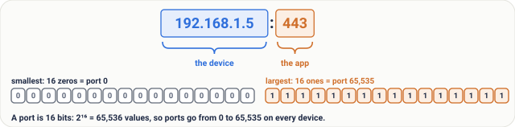
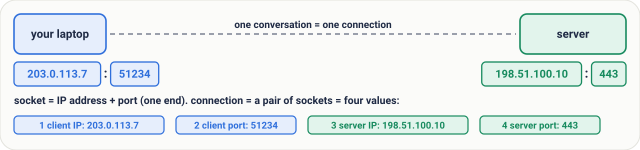
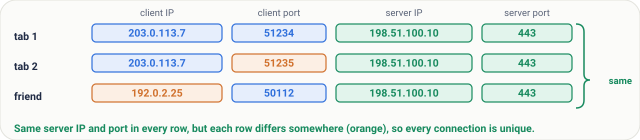
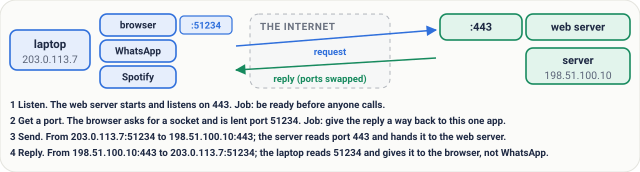
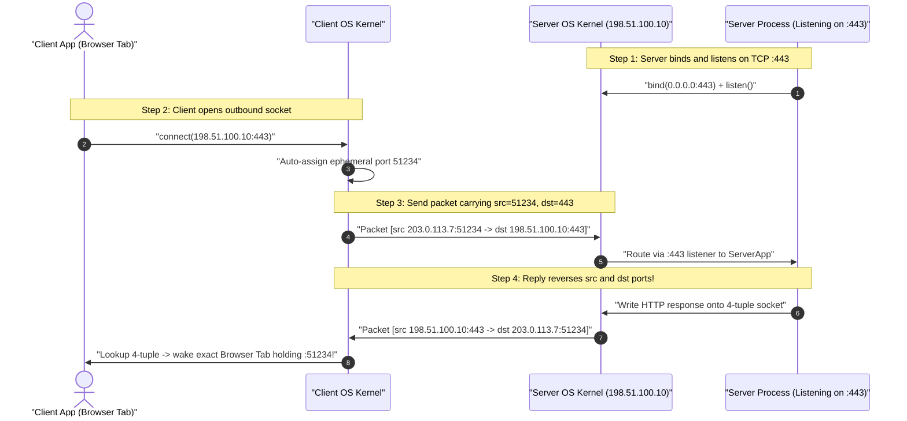
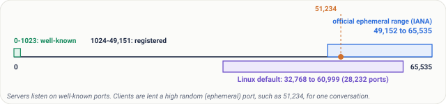
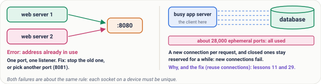
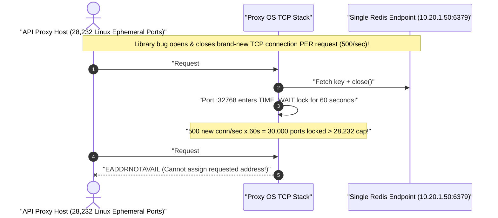

# Lesson 04: Ports and Sockets: Which App Gets the Packet

> **Prerequisites:** [Lesson 03: IP Addresses](../03-ip-addresses/README.md) ([Track Overview](../README.md)).  
> **Estimated Reading Time:** 31 minutes  
> **Target Audience:** Developers understanding how multiple apps share one machine's IP and backend engineers diagnosing `EADDRINUSE`, ephemeral port exhaustion, `TIME_WAIT` storms, and socket/4-tuple limits in high-concurrency proxies.  
> **Free PDF Notes:** [Download SD-N-004.pdf](https://backendroadmap.com/notes/system-design/SD-N-004.pdf)

> [!NOTE]
> **In one line:** the IP address gets a packet to the device, and the port, a 16-bit number from 0 to 65,535, gets it to one app on that device; servers listen on well-known ports such as 443, clients are lent a random high port, and a connection is a pair of sockets: four values that make it unique.

> [!TIP]
> **The Golden Rule of Ports & Sockets:** An **IP address** delivers packets to the right **device**, while a **16-bit port (`0–65,535`)** delivers them to the exact **application** inside it. Every active TCP connection is uniquely identified by a **4-tuple**—`(source IP, source port, destination IP, destination port)`—which lets one web server listening on port `443` handle millions of simultaneous users without collisions, **as long as outbound proxy hosts don't burn through their finite ephemeral port pool!**

---

## Words You'll Meet Today

| Word | Everyday Meaning | Role in a Live Network |
| :--- | :--- | :--- |
| **Port** | A `16-bit` number (`0–65,535`) identifying a specific application or service on a machine. | Appends after the IP (`192.168.1.5:443`) inside TCP/UDP headers. |
| **Socket** | One endpoint of a live connection: an IP address paired with a port number. | Kernel handle (`file descriptor` on Linux) backing reads/writes to the network. |
| **Listening** | A server app waiting passively on an assigned port for incoming clients. | `listen()` puts a port in `LISTEN` state (`nginx` on `:443`, Postgres on `:5432`). |
| **Protocol** | The agreed conversation language (e.g., `TCP` or `UDP`). | TCP port `53` and UDP port `53` are **distinct independent mailboxes**! |
| **Well-Known Port** | Standardized port (`0–1023`) reserved for core internet services. | `:80` HTTP, `:443` HTTPS, `:22` SSH, `:53` DNS, `:25` SMTP. |
| **Ephemeral Port** | Temporary short-lived client port picked automatically by the OS for one outbound call. | Linux default: `32,768–60,999` (`28,232` ports); IANA standard: `49,152–65,535`. |
| **Connection** | Paired conversation defined by two sockets (the **4-tuple**). | `(src_ip, src_port, dst_ip, dst_port)` keeps tabs/clients separate cleanly. |
| **Address Already in Use** | OS error (`EADDRINUSE`) thrown when two processes attempt to listen on the same IP + port + protocol. | Requires stopping the existing process, choosing another port, or tuning `SO_REUSEADDR`/`SO_REUSEPORT`. |

---

## What It Is vs. What It Isn't

Ports and sockets are the most commonly blurred vocabulary in networking. Four easily conflated ideas, side by side:

| Term | Precise Meaning | What It Is **NOT** | Production Example |
| :--- | :--- | :--- | :--- |
| **Port** | A `16-bit` number (`0-65,535`) in the TCP/UDP header naming one app/conversation endpoint on a host. | Not a physical plug, not a device, not unique across the internet — only unique *per IP and protocol*. | `443` for HTTPS, `5432` for PostgreSQL. |
| **Socket** | One endpoint of a conversation = **IP + port** (+ protocol). On Linux it is also a **file descriptor** in your process. | Not the same as a port; a single port can sit behind a listening socket *and* thousands of connected sockets. | `203.0.113.7:51234`. |
| **Connection** | A **pair of sockets**, uniquely keyed by the **4-tuple** inside the kernel's connection table. | Not "one server port per client". It does not consume a new *server* port. | One row of `ss -tan`. |
| **Listening socket** | A passive socket in `LISTEN` state that only *accepts* new connections; each `accept()` yields a **new connected socket** on the same local port. | Not the socket that carries your data; it never reads or writes application bytes. | nginx master on `0.0.0.0:443`. |
| **Ephemeral port** | A disposable client-side port auto-assigned by the OS for one outbound `connect()`. | Not reserved for a service; not stable between runs; not a firewall rule target. | `51234` in your browser tab. |

> A packet is addressed to `(IP, port)`; the **kernel's socket table is the receptionist** that turns that pair into "wake process #4127".

---

## Visual Mental Models & Architecture

### The Flat With Multiple People Inside

In [Lesson 03](../03-ip-addresses/README.md), we mapped the IP address to **flat `5`** inside an apartment building. Now look inside flat `5`: **Mom, the kid, and Grandpa** all live there! If a parcel reads only `"flat 5"`, nobody knows whose hands to put it in—you write **"Priya — flat 5"** or **"Arjun — flat 5"** on the envelope.

On one computer running a web server, database, SSH daemon, and background worker simultaneously, **the IP address finds flat `5`, and the port number is the person's name on the envelope**:


*Figure 1. The flat (lesson 3's device) has people inside: the apps. The name on each envelope is the port, so the right person gets it.*

When your browser opens [`https://backendroadmap.com`](https://backendroadmap.com), it secretly connects to **`backendroadmap.com:443`**—IP gets the packet onto the host, and `:443` tells the OS kernel *"hand this to the HTTPS web server."*



*Figure 2. Anatomy of 192.168.1.5:443: the IP address finds the device, the port after the colon finds the app. A port is 16 bits, 0 to 65,535.*

### One Server Port, Many Simultaneous Connections (The 4-Tuple!)

A **socket** is one end of a conversation (`IP + port`). An entire live **connection** pairs **both sockets**—creating a **4-tuple**:



*Figure 4. A socket is one end of a conversation, an IP address plus a port. A connection is the pair of sockets: four values.*

How does **one** Nginx instance listening strictly on `:443` serve two tabs from your laptop AND your friend's phone at the exact same millisecond? Because **every 4-tuple row in the kernel table differs in at least one column**:



*Figure 5. One server port serves many connections: a second tab gets another client port, a friend has another address, and every four-value row is still unique.*

| Connection | Client Socket (`src_ip : src_port`) | Server Socket (`dst_ip : dst_port`) | Unique 4-Tuple? |
| :--- | :--- | :--- | :--- |
| **Tab #1 (You)** | `203.0.113.7:51234` | `198.51.100.10:443` | Unique (`51234`) |
| **Tab #2 (You)** | `203.0.113.7:51235` | `198.51.100.10:443` | Unique (`51235`) |
| **Friend's Phone** | `192.0.2.25:50112` | `198.51.100.10:443` | Unique (`192.0.2.25` + `50112`) |

### Step-by-Step Lifecycle of One Request



*Figure 6. One request, step by step: listen, get a port, send, reply. The ports in the header pick the app at each end.*



---

## Real Numbers & Systematic Reference Grids

A port field inside TCP and UDP packet headers is **`16 bits`**, permitting exactly **$2^{16} = 65{,}536$** distinct values (`0` through `65,535`). Those `65,536` ports partition cleanly into three operational zones:



*Figure 3. All 65,536 ports on one line, to scale: well-known 0 to 1023 at the very start, the official ephemeral range 49,152 to 65,535, and the Linux default 32,768 to 60,999.*

### The `65,536`-Port Map & OS Ephemeral Ranges

| Port Range | Category | Count | Real-World Usage & OS Rules |
| :--- | :--- | :--- | :--- |
| **`0–1023`** | **Well-Known / System Ports** | `1,024` | Standard services (`22` SSH, `25` SMTP, `53` DNS, `80` HTTP, `443` HTTPS). Linux requires root or `CAP_NET_BIND_SERVICE` to bind. |
| **`1024–49151`** | **Registered / User Ports** | `48,128` | Application servers & databases (`3000` dev web, `3306` MySQL, `5432` PostgreSQL, `6379` Redis, `8080` HTTP alt). |
| **`49152–65535`** | **IANA Ephemeral / Dynamic** | `16,384` | Official IANA dynamic outbound range (also Windows/macOS modern default). |
| **`32768–60999`** | **Linux Default Ephemeral** | **`28,232`** | Default `ip_local_port_range` on Linux—controls max simultaneous outbound connections to **one** fixed destination IP:port! |

### Essential Well-Known Service Ports Cheat Sheet

| Port | Transport Protocol | Service | Operational Notes |
| :--- | :--- | :--- | :--- |
| **`22`** | TCP | **SSH** | Encrypted remote administration shell. |
| **`25`** | TCP | **SMTP** | Server-to-server email delivery relay. |
| **`53`** | **UDP + TCP** | **DNS** | UDP for fast small lookups; TCP fallback for large responses (`DNSSEC` / zone transfers)—held as separate mailboxes! |
| **`80`** | TCP | **HTTP** | Unencrypted web traffic (typically `301` redirects immediately to `:443`). |
| **`443`** | TCP (HTTP/1.1, H2) / UDP (H3) | **HTTPS (TLS)** | Encrypted web & API traffic (`HTTP/3` QUIC runs over UDP `:443`, covered in Lesson 05/23). |

### Capacity Math: How Many Connections Can Ports Actually Carry?

Two very different ceilings are routinely confused. Keep them apart:

**1. Client-side (outbound) ceiling — ports ARE the limit.** For a client IP talking to **one** destination `(dst IP, dst port)`, only the source port can vary, so

$$R_{\max} = \frac{P_{\text{ephemeral}}}{T_{\text{TIME\_WAIT}}} \qquad\text{(new unpooled connections per second)}$$

| Ephemeral Range | Ports $P$ | $T_{\text{TIME\_WAIT}}$ | $R_{\max}$ per source IP → one destination | With 4 source IPs |
| :--- | :--- | :--- | :--- | :--- |
| Linux default `32768-60999` | `28,232` | `60 s` | **`~470 /s`** | `~1,880 /s` |
| IANA `49152-65535` | `16,384` | `60 s` | `~273 /s` | `~1,092 /s` |
| Widened `10240-65535` | `55,296` | `60 s` | `~921 /s` | `~3,686 /s` |
| Any range with **pooling** (64 persistent sockets) | `64` used | n/a | **Unlimited by ports** (requests ride existing sockets) | n/a |

> Exhaustion is a **utilisation problem**: at 70% of $R_{\max}$ (`~330 /s` on defaults) you should already be paging someone, exactly like CPU headroom in queueing theory.

**2. Server-side (inbound) ceiling — ports are NOT the limit.**

$$N_{\text{4-tuples per listener}} = 2^{32}\ \text{(client IPs)} \times 2^{16}\ \text{(client ports)} \approx 2.8 \times 10^{14}$$

The real caps are resource budgets:

| Resource | Typical Setting | Rough Cost | Where You Hit It |
| :--- | :--- | :--- | :--- |
| **File descriptors** | `ulimit -n 1024` (often default!) | 1 FD per connection | `EMFILE: too many open files` long before ports run out. |
| **Kernel memory** | `net.ipv4.tcp_mem`, per-socket buffers | Several KB per idle socket, tens of KB when buffers fill | 1M idle connections ≈ several GB RAM. |
| **Accept queue** | `somaxconn` (4096 on modern kernels, 128 on older) | One slot per not-yet-`accept()`ed connection | SYN/accept overflows during traffic spikes. |
| **Conntrack table** | `nf_conntrack_max` | ~300 bytes per tracked flow | Silent packet drops on NAT/firewall hosts (`nf_conntrack: table full`). |

### The Observability Gap: Where Port Trouble Hides

| Vantage Point | What It Shows | What It **Hides** |
| :--- | :--- | :--- |
| **Application logs** | `connect: cannot assign requested address` (`EADDRNOTAVAIL`) | The *cause* — you see a symptom, not the `TIME_WAIT` backlog behind it. |
| **Destination server dashboards (Redis/DB)** | CPU, QPS, latency | **Nothing** — failed connects never arrive on the wire, so Redis looks *healthy at 4% CPU*. |
| **Load-balancer / proxy metrics** | Upstream connect errors, 5xx | Whether the errors are port exhaustion, SG drops, or app crashes. |
| **`ss -s` / `/proc/net/sockstat`** | Totals for `inuse`, `orphan`, `tw`, `alloc` | Which *destination* is consuming the ports (use `ss -tan state time-wait` grouped by peer). |
| **node_exporter** (`node_sockstat_TCP_tw`, `node_sockstat_TCP_inuse`) | Time series of `TIME_WAIT` and in-use sockets | Per-destination breakdown; needs eBPF (`tcplife`, `tcpconnect`) or `conntrack -L` for that. |

**What to alert on:** (1) `TIME_WAIT` count ÷ ephemeral port range > `50%`, (2) rate of new outbound connects per destination vs. $R_{\max}$, (3) FD usage ÷ `ulimit -n` > `70%`, (4) listener `Recv-Q` (accept-queue depth) from `ss -ltn`. All four are *leading* indicators; the application error is a *lagging* one.

---

## What Goes Wrong & Production War Story Post-Mortem

Two classic port failures strike engineering teams repeatedly:



*Figure 7. What goes wrong: two apps trying to listen on one port (address already in use), and a busy client using up its ephemeral ports.*

1. **Two listeners on the same port (`EADDRINUSE`):** Launching a second dev server on `:8080` while an older background worker still owns `:8080` fails cleanly at `bind()`.
2. **Ephemeral port exhaustion (`EADDRNOTAVAIL`):** When one busy proxy/client opens thousands of short-lived connections per second to **one fixed server** (e.g., `10.0.1.50:6379`), every closed TCP socket lingers in **`TIME_WAIT`** (typically `60 seconds` on Linux, covered deeply in Lesson 11) before its ephemeral port frees back to the pool—exhausting all **`28,232` ports** at just **`~470` new connections/sec**!

### SEV-1 Post-Mortem: The Reverse Proxy That Exhausted `28,232` Ephemeral Ports Against Redis

#### Incident Overview
* **Severity:** SEV-1 (`100%` Checkout Failure With `connect: cannot assign requested address`)
* **Detection Time:** `4 minutes` after a library upgrade silently disabled Redis connection pooling
* **Resolution Time:** `26 minutes`
* **Impact:** Our API gateway maintained under `500` concurrent requests/sec (`~480` RPS), yet outbound calls to a single internal Redis host (`10.20.1.50:6379`) collapsed with `EADDRNOTAVAIL` despite Redis CPU sitting at `4%`!

#### What Happened


1. An upgraded SDK wrapper opened a **fresh TCP connection per HTTP request** (`conn = connect(); get(); close()`) instead of reusing a persistent connection pool.
2. Each closed TCP connection to `10.20.1.50:6379` held its client ephemeral port in `TIME_WAIT` for `60 seconds`.
3. `500 requests/sec × 60 seconds = 30,000` locked 4-tuples—crossing Linux's `28,232` (`32,768–60,999`) ephemeral ceiling!
4. Every new outbound request crashed immediately inside the proxy OS kernel before even hitting the wire (`Redis` itself stayed `96%` idle!).

#### Root Cause Analysis
1. **Disabled TCP Connection Pooling:** Opening/closing ephemeral 4-tuples per call turned `500 RPS` into `30,000` locked `TIME_WAIT` sockets inside 60 seconds.
2. **All Traffic Funnelled Toward One Single Fixed `(IP, Port)` Target:** Because destination `10.20.1.50:6379` was identical for every call, only **`source_port`** could vary across the 4-tuple—capping concurrency strictly at `ip_local_port_range`!

#### The Fix & Architectural Hardening
1. **Re-Enabled Persistent HTTP/Redis Connection Pools + Keep-Alives:** Replaced per-request sockets with `64` persistent long-lived connections (`500` RPS carried effortlessly across `64` steady 4-tuples instead of `30,000` churning ones!).
2. **Widened Ephemeral Port Range (`ip_local_port_range = 10240 65535`):** Raised headroom on high-egress proxies as defense in depth, paired with Prometheus alerting when `TIME_WAIT` sockets exceed `50%` of local port supply.
3. **Multiple Local Client IPs or Sharded Targets for Massive Gateways:** High-scale load balancers ([Lesson 29](../29-connection-pooling-and-keep-alive/README.md)) assign multiple outbound source IPs when single-IP `~55K` limits are reached.

---

## Multi-Language Production Implementation: Safe Port Binding (`SO_REUSEADDR`) & 4-Tuple Connection Table Tracker

Each implementation demonstrates two fundamental socket/port patterns: **(1)** gracefully catching **`EADDRINUSE`** (`address already in use`) when binding a listener while enabling socket reuse properly, and **(2)** modeling a kernel **4-tuple router + ephemeral port allocator** that isolates concurrent connections to the exact same server port (`:443`) and signals exhaustion cleanly.

````carousel
```go
package socklab

import (
	"errors"
	"fmt"
	"net"
)

type FourTuple struct {
	SrcIP   string
	SrcPort int
	DstIP   string
	DstPort int
}

type ConnectionTable struct {
	active     map[FourTuple]string
	nextPort   int
	maxPort    int
}

func NewConnectionTable(ephemeralStart, ephemeralEnd int) *ConnectionTable {
	return &ConnectionTable{
		active:   make(map[FourTuple]string),
		nextPort: ephemeralStart,
		maxPort:  ephemeralEnd,
	}
}

func (t *ConnectionTable) OpenClientConnection(clientIP, serverIP string, serverPort int, handler string) (FourTuple, error) {
	for port := t.nextPort; port <= t.maxPort; port++ {
		tuple := FourTuple{SrcIP: clientIP, SrcPort: port, DstIP: serverIP, DstPort: serverPort}
		if _, exists := t.active[tuple]; !exists {
			t.active[tuple] = handler
			t.nextPort = port + 1
			return tuple, nil
		}
	}
	return FourTuple{}, errors.New("EADDRNOTAVAIL: ephemeral ports exhausted for target socket")
}

// ListenSafely attempts to bind a port and reports clear diagnostics if already taken.
func ListenSafely(addr string) (net.Listener, error) {
	ln, err := net.Listen("tcp", addr)
	if err != nil {
		return nil, fmt.Errorf("failed binding %s (check for EADDRINUSE): %w", addr, err)
	}
	return ln, nil
}
```
<!-- slide -->
```typescript
import * as net from "node:net";

export interface FourTuple {
  srcIp: string;
  srcPort: number;
  dstIp: string;
  dstPort: number;
}

export class KernelConnectionTable {
  private readonly table = new Map<string, string>();
  private cursor: number;

  constructor(private readonly startPort = 32768, private readonly endPort = 60999) {
    this.cursor = startPort;
  }

  private key(t: FourTuple): string {
    return `${t.srcIp}:${t.srcPort}->${t.dstIp}:${t.dstPort}`;
  }

  openOutbound(clientIp: string, serverIp: string, serverPort: number, tabName: string): FourTuple {
    const capacity = this.endPort - this.startPort + 1;
    for (let i = 0; i < capacity; i++) {
      const port = this.startPort + ((this.cursor - this.startPort + i) % capacity);
      const tuple: FourTuple = { srcIp: clientIp, srcPort: port, dstIp: serverIp, dstPort: serverPort };
      const k = this.key(tuple);
      if (!this.table.has(k)) {
        this.table.set(k, tabName);
        this.cursor = port + 1;
        return tuple;
      }
    }
    throw new Error(`EADDRNOTAVAIL: all ${capacity} ephemeral ports busy against ${serverIp}:${serverPort}`);
  }
}

export function tryBindPort(port: number): Promise<net.Server> {
  return new Promise((resolve, reject) => {
    const srv = net.createServer();
    srv.once("error", (err: NodeJS.ErrnoException) => {
      if (err.code === "EADDRINUSE") {
        reject(new Error(`Port ${port} is already bound by another process!`));
      } else {
        reject(err);
      }
    });
    srv.listen(port, "127.0.0.1", () => resolve(srv));
  });
}
```
<!-- slide -->
```python
import socket
from dataclasses import dataclass


@dataclass(frozen=True)
class FourTuple:
    src_ip: str
    src_port: int
    dst_ip: str
    dst_port: int


class SocketDemuxTable:
    def __init__(self, start_port: int = 32768, end_port: int = 60999) -> None:
        self.start = start_port
        self.end = end_port
        self._table: dict[FourTuple, str] = {}

    def open_connection(self, client_ip: str, server_ip: str, server_port: int, app_label: str) -> FourTuple:
        for port in range(self.start, self.end + 1):
            t = FourTuple(client_ip, port, server_ip, server_port)
            if t not in self._table:
                self._table[t] = app_label
                return t
        raise OSError("EADDRNOTAVAIL: Ephemeral port pool exhausted for destination")


def bind_port_safely(port: int) -> socket.socket:
    sock = socket.socket(socket.AF_INET, socket.SOCK_STREAM)
    sock.setsockopt(socket.SOL_SOCKET, socket.SO_REUSEADDR, 1)
    try:
        sock.bind(("127.0.0.1", port))
        sock.listen(16)
        return sock
    except OSError as exc:
        sock.close()
        raise RuntimeError(f"Cannot bind 127.0.0.1:{port} (already in use or restricted): {exc}") from exc
```
<!-- slide -->
```csharp
using System;
using System.Collections.Generic;
using System.Net;
using System.Net.Sockets;

public readonly record struct FourTuple(string SrcIp, int SrcPort, string DstIp, int DstPort);

public sealed class EphemeralPortAllocator(int minPort = 32768, int maxPort = 60999)
{
    private readonly Dictionary<FourTuple, string> _connections = new();

    public FourTuple Allocate(string clientIp, string serverIp, int serverPort, string sessionName)
    {
        for (int p = minPort; p <= maxPort; p++)
        {
            var tuple = new FourTuple(clientIp, p, serverIp, serverPort);
            if (!_connections.ContainsKey(tuple))
            {
                _connections[tuple] = sessionName;
                return tuple;
            }
        }
        throw new SocketException((int)SocketError.AddressNotAvailable);
    }

    public static TcpListener BindSafely(int port)
    {
        var listener = new TcpListener(IPAddress.Loopback, port);
        try
        {
            listener.Start();
            return listener;
        }
        catch (SocketException ex) when (ex.SocketErrorCode == SocketError.AddressAlreadyInUse)
        {
            throw new InvalidOperationException($"Port {port} is already bound (AddressAlreadyInUse).", ex);
        }
    }
}
```
````

---

## Practical Hands-On Verification CLI Workflows

Watch **live OS ephemeral ports, 4-tuples, and `EADDRINUSE`** locally with Python's built-in socket module—and inspect real open sockets on your machine via `ss` / `netstat`.

### Step 1: Observe Live 4-Tuple Sockets & Trigger Real `EADDRINUSE` Safely

```bash
# Inspect currently open listening & active sockets on your OS:
# Linux:          ss -tan
# macOS/Windows:  netstat -an

python3 - <<'EOF'
import socket

# 1. Start a listening server on an OS-assigned free loopback port
srv = socket.socket(socket.AF_INET, socket.SOCK_STREAM)
srv.bind(("127.0.0.1", 0))
srv.listen(4)
srv_ip, srv_port = srv.getsockname()
print(f"Server listening on socket: {srv_ip}:{srv_port}")

# 2. Open two parallel client tabs against the SAME server port
c1 = socket.create_connection((srv_ip, srv_port))
c2 = socket.create_connection((srv_ip, srv_port))
print(f"Tab #1 4-tuple: {c1.getsockname()[0]}:{c1.getsockname()[1]} -> {srv_ip}:{srv_port}")
print(f"Tab #2 4-tuple: {c2.getsockname()[0]}:{c2.getsockname()[1]} -> {srv_ip}:{srv_port}")

# 3. Attempt a duplicate listener on the exact same port (triggers Address Already In Use!)
dup = socket.socket(socket.AF_INET, socket.SOCK_STREAM)
try:
    dup.bind((srv_ip, srv_port))
except OSError as err:
    print(f"Duplicate bind rejected safely: errno={err.errno} ({err.strerror})")
finally:
    for s in (dup, c1, c2, srv): s.close()
EOF
```

**Expected Output:**
```text
Server listening on socket: 127.0.0.1:41932
Tab #1 4-tuple: 127.0.0.1:54810 -> 127.0.0.1:41932
Tab #2 4-tuple: 127.0.0.1:54812 -> 127.0.0.1:41932
Duplicate bind rejected safely: errno=98 (Address already in use)
```

---

## Pause and Think & Validation Checkpoints

### Pause and Think

An active web server handles `100,000` mobile phone connections simultaneously on a single server listening port (`443`). How can **one port** serve `100,000` different phones without mixing up messages?

<details>
<summary><strong>Click to see the answer</strong></summary>

**A connection is identified by the full four-value tuple (`client IP, client port, server IP, server port`) — not by server port alone.** All `100,000` connections share the same right half (`server_ip : 443`), yet every phone carries a different client IP (and/or a different client ephemeral port when behind shared carrier NAT). Because every 4-tuple row in the server kernel's socket table is unique, the OS demultiplexes all `100,000` streams to their exact handles cleanly.


*Figure 8. 100,000 phones can all connect to port 443; each four-value pair is different, so one server port is enough.*

</details>

### Operational Validation Checkpoints (Scenario Quizzes)

<details>
<summary><strong>Checkpoint 1: Same Port `53` Running on Both UDP and TCP</strong></summary>

**Scenario:** You run `ss -tulnp` on a DNS resolver container and notice `coredns` bound to `0.0.0.0:53` on **UDP** AND `0.0.0.0:53` on **TCP** simultaneously without throwing `Address already in use`. Is the OS broken?

<strong>Answer:</strong>
No! Socket bindings are scoped by **`(protocol, local_ip, local_port)`**. TCP port `53` and UDP port `53` live in completely separate transport port spaces inside the kernel—so one daemon can bind both cleanly to serve tiny fast UDP queries alongside larger TCP DNS responses.
</details>

<details>
<summary><strong>Checkpoint 2: Why Dev Server Fails With `EADDRINUSE` After a Crash-Restart</strong></summary>

**Scenario:** You stop a Node/Go HTTP server (`:3000`) mid-request and immediately rerun it 1 second later, only to see `listen tcp :3000: bind: address already in use`. Or a zombie previous instance was still running. What two root causes explain this?

<strong>Answer:</strong>
Either **(1)** another orphaned process is still running and bound to `:3000` (`lsof -i :3000` / `ss -tlp` reveals it), OR **(2)** old client sockets from the crashed process linger briefly in **`TIME_WAIT`** without `SO_REUSEADDR` enabled on the listening socket.
</details>

<details>
<summary><strong>Checkpoint 3: Calculating Ephemeral Ceiling Against One Upstream Endpoint</strong></summary>

**Scenario:** A proxy runs on default Linux (`ip_local_port_range = 32768 60999`) with **1 outbound public IP** and talks without connection pooling to **1 Redis node** (`10.0.1.5:6379`). Closed sockets stay in `TIME_WAIT` for `60 s`. What is the hard maximum sustainable new-connection rate before `EADDRNOTAVAIL` strikes?

<strong>Answer:</strong>
Available ephemeral ports = `60,999 - 32,768 + 1 = 28,232`. Spread across a `60`-second `TIME_WAIT` window: `28,232 ÷ 60 ≈ 470.5` new connections/sec! Exceeding ~`470` new unpooled connections per second against that single `(dst_ip, dst_port)` saturates every 4-tuple. Connection pooling fixes it permanently!
</details>

---

## Interview Practice Questions

Exactly **12 questions**, tagged by kind: **[BASIC]** (Q1-Q4, definitions), **[SCENARIO]** (Q5-Q8, apply it to a system), and **[TRICKY]** (Q9-Q12, deep follow-ups). Answer out loud for 30 seconds before opening the solution.

<details>
<summary><strong>Q1: What is a port, and why do we need one if we already have an IP address? [BASIC]</strong></summary>

<strong>What a strong answer covers:</strong>
An **IP address** only gets a packet to the **device**; dozens of apps (browser, database, SSH daemon, Spotify) share that one address. A **port** is a `16-bit` number (`0-65,535`, i.e. $2^{16} = 65{,}536$ values) written in the TCP/UDP header that tells the OS kernel **which application** on the device receives the payload. Together they say *"this device, this app"*: `192.168.1.5:443`.

</details>

<details>
<summary><strong>Q2: What is a socket, and what identifies a connection? [BASIC]</strong></summary>

<strong>What a strong answer covers:</strong>
A **socket** is one endpoint of a conversation: an **IP address + a port** (`203.0.113.7:51234`). Do not confuse it with a bare *port* (just a number). A **connection** is a **pair of sockets**, so it is identified by the **4-tuple** `(client IP, client port, server IP, server port)` — plus the protocol (TCP vs UDP) if you want to be exact. No two live connections can share all four values.

</details>

<details>
<summary><strong>Q3: Name three well-known ports and explain what an ephemeral port is. [BASIC]</strong></summary>

<strong>What a strong answer covers:</strong>
**Well-known ports (`0-1,023`)** are fixed for core services so clients know where to knock: `80` HTTP, `443` HTTPS, `22` SSH, `53` DNS, `25` SMTP. An **ephemeral port** is a high, temporary port the client OS lends to one outbound conversation (e.g. `51,234`). IANA's official ephemeral range is `49,152-65,535`; **Linux defaults to `32,768-60,999` (`28,232` ports)**. Servers *listen* on stable ports; clients get *disposable* ports.

</details>

<details>
<summary><strong>Q4: Can TCP port 53 and UDP port 53 be used by two different programs at the same time? [BASIC]</strong></summary>

<strong>What a strong answer covers:</strong>
Yes. Each transport protocol has its **own independent port namespace** inside the kernel. Bindings are scoped by `(protocol, local IP, local port)`. That is exactly why a single DNS resolver such as CoreDNS or BIND commonly holds **both** `UDP/53` (fast small lookups) and `TCP/53` (large answers, DNSSEC, zone transfers), and why a firewall rule that opens only `TCP/53` silently breaks big DNS responses while small ones still work.

</details>

<details>
<summary><strong>Q5: You start a second copy of your server on port 8080 and get "address already in use". Why, and what do you do? [SCENARIO]</strong></summary>

<strong>What a strong answer covers:</strong>
`bind()` failed with **`EADDRINUSE`**: only one socket may listen on a given `(protocol, IP, port)`, otherwise the kernel could not decide which process receives an arriving SYN. Diagnose with `ss -ltnp 'sport = :8080'` or `lsof -i :8080`. Then either stop the stale/zombie process, move the new instance to another port (`8081`) behind a reverse proxy, or — if you intentionally want N identical workers — use **`SO_REUSEPORT`** so the kernel load-balances new connections across them. Also check for sockets stuck in `TIME_WAIT` after a crash-restart: setting `SO_REUSEADDR` on the listener (default in Go's `net.Listen` and Node) avoids that false conflict.

</details>

<details>
<summary><strong>Q6: Your API gateway opens a brand-new connection to one Redis/Postgres host for every request. At ~500 req/s it starts failing with "cannot assign requested address". Explain and fix. [SCENARIO]</strong></summary>

<strong>What a strong answer covers:</strong>
Toward one fixed `(server IP, server port)`, the only free variable in the 4-tuple is the **client ephemeral port**: `28,232` on default Linux. Every closed connection parks its port in **`TIME_WAIT` for 60 s**. Sustainable new-connection rate:
$$\frac{28{,}232}{60\,\text{s}} \approx 470\ \text{conn/s}$$
At `500` conn/s you need `500 × 60 = 30,000` locked 4-tuples > `28,232` -> `EADDRNOTAVAIL`, while the database sits at 4% CPU. **Fix (in order):** (1) **connection pooling / keep-alive** so 500 RPS rides on ~64 steady sockets, (2) widen `ip_local_port_range`, (3) add source IPs or shard destinations, (4) only then consider `tcp_tw_reuse` for outbound sockets. Alert on `TIME_WAIT` count and port-pool utilisation, not just CPU.

</details>

<details>
<summary><strong>Q7: `curl localhost:3000` works on the server, but a teammate gets "connection refused" on `http://<server-ip>:3000`. What is wrong? [SCENARIO]</strong></summary>

<strong>What a strong answer covers:</strong>
Almost certainly the app is **bound to the loopback interface** (`127.0.0.1:3000`) rather than the wildcard `0.0.0.0:3000` (or the LAN IP). Packets arriving on the NIC for `server-ip:3000` find no matching listener, so the kernel replies with a TCP **RST** -> *connection refused*. Confirm with `ss -ltn | grep 3000` (look at the **Local Address** column). Fix by binding `0.0.0.0` / `::` (or the specific private interface), and then put a firewall/security group in front — remember that `0.0.0.0` exposes the service on **every** interface, which is dangerous for admin ports (the same trap from Lesson 03). In Docker, the same bug shows up as publishing a port while the app listens on `127.0.0.1` *inside* the container.

</details>

<details>
<summary><strong>Q8: Your non-root Go/Node service fails with `EACCES` when binding port 443 in production. What are the options? [SCENARIO]</strong></summary>

<strong>What a strong answer covers:</strong>
Ports `0-1,023` are **privileged** on Linux: binding needs root or the **`CAP_NET_BIND_SERVICE`** capability. Running the app as root just to bind a port is poor practice. Better options: (1) grant the single capability: `setcap 'cap_net_bind_service=+ep' ./app` (or `AmbientCapabilities=` in systemd, `NET_BIND_SERVICE` in a container `securityContext`); (2) listen on an unprivileged port (`8443`) and let a **load balancer / ingress / reverse proxy** own `443`; (3) lower `net.ipv4.ip_unprivileged_port_start` (sysctl) where the whole host is trusted; (4) redirect `443 -> 8443` with an iptables/nftables rule. Option (2) is the standard in cloud and Kubernetes (Service port `443` -> `targetPort 8443`).

</details>

<details>
<summary><strong>Q9: A port is 16 bits, so only 65,536 ports exist. How can one server accept a million concurrent connections on port 443? [TRICKY]</strong></summary>

<strong>What a strong answer covers:</strong>
The 65,536 limit counts **local port numbers on one IP**, not connections to a listener. All million connections share the server half `(server IP, 443)`; uniqueness comes from the **client half** `(client IP, client port)`. The theoretical space per listener is $2^{32} \times 2^{16} \approx 2.8 \times 10^{14}$ combinations. The real ceilings are **file descriptors** (`ulimit -n`, `fs.file-max`), **kernel memory per socket** (buffers, roughly several KB each even when idle), CPU/interrupt handling, and the **accept queue**. Famous C10K / C1M servers (nginx, Netty, Go) prove the point. *Exception to remember:* many clients behind one CGNAT IP present the **same client IP**, so only their client ports differ — still unique.

</details>

<details>
<summary><strong>Q10: A client has `28,232` ephemeral ports. Does that cap it at `28,232` concurrent outbound connections in total? [TRICKY]</strong></summary>

<strong>What a strong answer covers:</strong>
No — the cap applies **per destination `(dst IP, dst port)` and source IP**, because uniqueness is judged on the whole 4-tuple. The same local port `40000` can be used simultaneously for connections to `10.0.0.1:6379` and `10.0.0.2:6379`. Hence a proxy fanning out to hundreds of upstream hosts rarely exhausts ports, while a proxy hammering **one** Redis/DB VIP exhausts them quickly. Practical consequences: (a) funnelling everything through one load-balancer VIP *concentrates* the problem, (b) adding source IPs multiplies capacity, (c) with `connect()` auto-binding, the kernel picks a port that is free for that destination (and `IP_BIND_ADDRESS_NO_PORT` lets it defer the choice until the destination is known), whereas an explicit `bind(port)` before `connect()` burns the port globally.

</details>

<details>
<summary><strong>Q11: What is the difference between SO_REUSEADDR and SO_REUSEPORT? [TRICKY]</strong></summary>

<strong>What a strong answer covers:</strong>
- **`SO_REUSEADDR`**: lets a listener re-`bind()` a port while old connections to it linger in `TIME_WAIT` (restart-after-crash) and allows specific-IP vs wildcard binds to coexist. It does **not** allow two live listeners on the same IP:port on Linux.
- **`SO_REUSEPORT`** (Linux 3.9+): lets **multiple sockets — typically one per worker process/thread — listen on the identical IP:port**, and the kernel **hashes the 4-tuple to spread new connections** across them. This removes the single accept-queue lock bottleneck (used by nginx `reuseport`, Envoy, many Go/Rust servers) and enables zero-downtime restarts. Security caveat: all sockets must be opened by the same effective UID, so a hostile local user cannot hijack the port. Note that BSD/Windows semantics differ — a favourite follow-up.

</details>

<details>
<summary><strong>Q12: A packet arrives for a port nothing is listening on. What does the client see for TCP vs UDP, and how does a firewall change that? [TRICKY]</strong></summary>

<strong>What a strong answer covers:</strong>
- **TCP, no listener:** the host's kernel answers the SYN with a **RST** -> client gets `ECONNREFUSED` *instantly* (one RTT).
- **UDP, no listener:** the kernel returns an **ICMP "port unreachable"**; a connected UDP socket surfaces it as `ECONNREFUSED`, an unconnected one often sees nothing and just times out.
- **Firewall `REJECT`** imitates the above (fast failure); **firewall `DROP`** / a cloud security group says nothing -> the client **hangs until its connect timeout** (commonly `~21 s`-`2 min` depending on SYN retries).
Therefore "refused" means *host reachable, nobody listening (or a REJECT rule)*, while "timed out" means *packets lost, host down, wrong route, or a DROP rule*. This one distinction halves most connectivity debugging time.

</details>

---

## One-Page Master Cheat Sheet

```text
====================================================================================================
                        PORTS AND SOCKETS: WHICH APP GETS THE PACKET — CHEAT SHEET
====================================================================================================
THE MODEL
  * IP address  -> finds the DEVICE.     Port -> finds the APP (16 bits: 0..65,535 = 2^16 = 65,536).
  * Socket      = IP + port (ONE END).   Connection = PAIR of sockets = 4-TUPLE:
                  (client IP, client port, server IP, server port)  [+ protocol TCP/UDP]
  * Server LISTENs on a stable port; client is lent an EPHEMERAL port per conversation.
  * TCP/53 and UDP/53 are DIFFERENT mailboxes (namespace = protocol + IP + port).

PORT MAP
  0..1,023        Well-known / system   (root or CAP_NET_BIND_SERVICE to bind on Linux)
  1,024..49,151   Registered / user     (3000 dev, 3306 MySQL, 5432 PG, 6379 Redis, 8080 alt HTTP)
  49,152..65,535  IANA ephemeral        (16,384 ports)  Windows/macOS default
  32,768..60,999  LINUX default ephemeral (28,232 ports)  -> /proc/sys/net/ipv4/ip_local_port_range
  Remember: 22 SSH | 25 SMTP | 53 DNS | 80 HTTP | 443 HTTPS(+HTTP/3 over UDP) 

CAPACITY MATH
  Ephemeral ceiling (ONE src IP -> ONE dst IP:port) = range size
  Max new conn/s without pooling = ports / TIME_WAIT = 28,232 / 60 ~= 470 /s
  Widened range 10,240..65,535   = 55,296 / 60 ~= 920 /s      Each extra source IP adds one full range
  Server side: ports are NOT the limit -> FDs (ulimit -n), RAM per socket, CPU, accept queue
  Distinct 4-tuples per listener = 2^32 (client IPs) x 2^16 (client ports) ~= 2.8 x 10^14

OBSERVE
  ss -ltnp                 who LISTENs where (check 127.0.0.1 vs 0.0.0.0 vs ::)
  ss -s  | /proc/net/sockstat   totals: inuse / orphan / tw (TIME_WAIT) / alloc
  ss -tan state time-wait | wc -l    count TIME_WAIT sockets
  cat /proc/sys/net/ipv4/ip_local_port_range    ephemeral supply
  node_exporter: node_sockstat_TCP_tw, node_sockstat_TCP_inuse, node_sockstat_TCP_alloc

ERRORS -> MEANING
  EADDRINUSE     second listener on same (proto, IP, port)   -> stop old / change port / SO_REUSEPORT
  EADDRNOTAVAIL  ephemeral ports exhausted for that dst      -> POOL connections, widen range, add src IPs
  EACCES         bind() on <1024 without privilege           -> CAP_NET_BIND_SERVICE or LB on 443
  ECONNREFUSED   host answered RST: nobody listening / REJECT -> start app, check bind address
  ETIMEDOUT      silence: DROP rule, bad route, host down     -> check SG/firewall, routing

RULES OF THUMB
  1. One port, one listener (unless SO_REUSEPORT).   2. Never one TCP connection per request.
  3. Bind 127.0.0.1 for local-only, 0.0.0.0 only with a firewall.   4. Alert on TIME_WAIT %, not CPU.
====================================================================================================
```

---

## Common Mistakes & Troubleshooting

- **Assuming each user connection consumes a separate server port:** A listening server holds only **one port** (`:443`) regardless of whether `10` or `1,000,000` clients connect; only the 4-tuple table grows.
- **Forgetting TCP and UDP port spaces are separate:** Binding TCP `:53` never blocks UDP `:53` (and vice versa).
- **Opening/closing raw TCP connections per request inside a proxy or backend client:** Guarantees `TIME_WAIT` ephemeral port exhaustion under load—always use persistent HTTP/DB connection pools.
- **Binding to `0.0.0.0` "just to make it work":** Exposes admin, debug, and metrics ports on every interface. Bind loopback for local-only daemons; front public services with a firewall/security group.
- **Binding to `127.0.0.1` and then wondering why other hosts (or the Docker host) get "connection refused":** Read the *Local Address* column of `ss -ltn` before blaming the network.
- **Reading "connection refused" and "timed out" as the same failure:** Refused = reachable host, nobody listening (RST). Timed out = silence (DROP rule, bad route, dead host).
- **Watching only the destination's CPU during a port-exhaustion incident:** The target never sees the failed connects—monitor `TIME_WAIT`, FD usage, and `EADDRNOTAVAIL` on the **client**.
- **Running with `ulimit -n 1024`:** `EMFILE` hits at ~1,000 connections, thousands of times lower than the port space.

---

## Recap in Three Lines

1. An **IP address** reaches the **device**; a **16-bit port (`0–65,535`)** delivers the packet to the right **application** inside it.
2. One socket is `IP + port`, and every connection is uniquely keyed by the **4-tuple** (`client IP, client port, server IP, server port`)—letting one `:443` server serve millions concurrently.
3. Servers wait on **well-known/registered ports**, while clients use **ephemeral ports** (`32,768–60,999` on Linux)—so high-throughput clients must pool connections to avoid ephemeral port exhaustion.

---

## Sources

- [RFC 9293: Transmission Control Protocol (TCP)](https://www.rfc-editor.org/rfc/rfc9293) — `16-bit` TCP ports, socket pairs, and TCP connection 4-tuple identification.
- [RFC 768: User Datagram Protocol](https://www.rfc-editor.org/rfc/rfc768) — `16-bit` UDP source/destination port header format.
- [RFC 6335: IANA Procedures for the Management of the Service Name and Transport Protocol Port Number Registry](https://www.rfc-editor.org/rfc/rfc6335) — defines System (`0–1023`), User (`1024–49151`), and Dynamic/Private (`49152–65535`) ranges.
- [IANA Service Name and Transport Protocol Port Number Registry](https://www.iana.org/assignments/service-names-port-numbers/service-names-port-numbers.xhtml) — official live directory of well-known and registered ports.
- [RFC 6056: Recommendations for Transport-Protocol Port Randomization](https://www.rfc-editor.org/rfc/rfc6056) — ephemeral port allocation guidance (`32768–60999` Linux convention noted alongside IANA range).
- [RFC 5737: IPv4 Address Blocks Reserved for Documentation](https://www.rfc-editor.org/rfc/rfc5737) — `192.0.2.0/24`, `198.51.100.0/24`, and `203.0.113.0/24` documentation ranges used in examples.

---

## Free PDF notes

Download these notes as a printable PDF, with every diagram: [SD-N-004.pdf](https://backendroadmap.com/notes/system-design/SD-N-004.pdf).

---

## Next

Continue with [Lesson 05: Protocols and Layers: Agreed Languages, and Why We Stack Them](../05-protocols-and-layers/README.md) to see how HTTP messages, TCP segments, IP packets, and Ethernet/Wi-Fi frames stack seamlessly via encapsulation so you can swap wires without rewriting apps.
