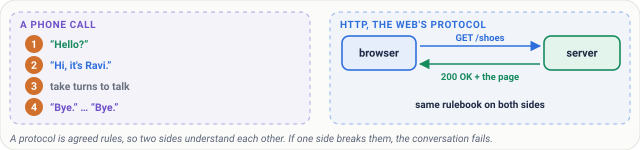
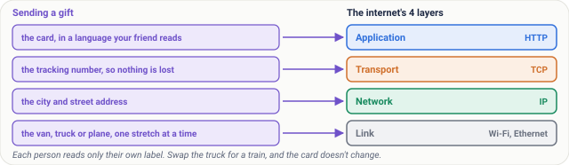
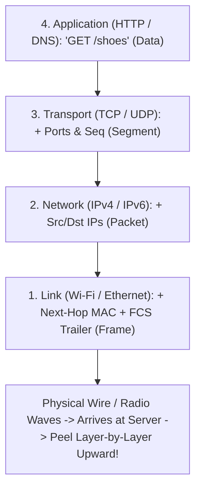
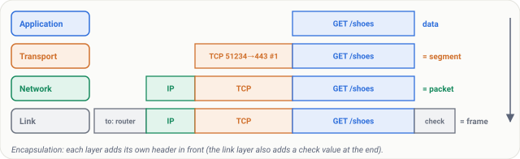
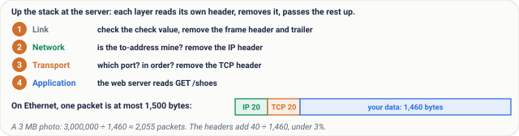
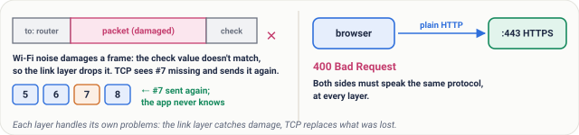
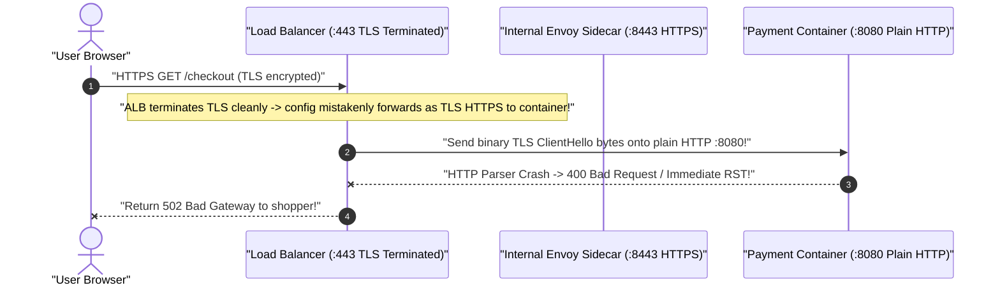
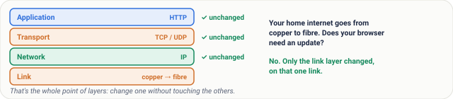

# Lesson 05: Protocols and Layers: Agreed Languages, and Why We Stack Them

> **Prerequisites:** [Lesson 02: Packets](../02-packets/README.md), [Lesson 03: IP Addresses](../03-ip-addresses/README.md), and [Lesson 04: Ports and Sockets](../04-ports-and-sockets/README.md) ([Track Overview](../README.md)).  
> **Estimated Reading Time:** 24 minutes  
> **Target Audience:** Developers understanding how HTTP, TCP, IP, and Wi-Fi fit together and backend engineers debugging multi-layer protocol mismatches, encapsulation overhead, and frame drops cleanly layer by layer.  
> **Free PDF Notes:** [Download SD-N-005.pdf](https://backendroadmap.com/notes/system-design/SD-N-005.pdf)

> [!TIP]
> **The Golden Rule of Protocols & Layers:** A **protocol** is an agreed-upon message grammar so software from different vendors interoperates cleanly, while **layering** puts each concern—App grammar (**HTTP**), Reliable delivery & Ports (**TCP/UDP**), Global routing (**IP**), and Physical hop transfer (**Wi-Fi/Ethernet**)—in an isolated box wrapped by **encapsulation**. Because each layer adds only its own small envelope (`40 B` TCP+IP header on a `1,500 B` frame, `< 3%` overhead) and peels only its own header at the receiver, swapping copper cables for fiber optics breaks nothing in your web browser!

---

## Words You'll Meet Today

| Word | Everyday Meaning | Role in the Protocol Stack |
| :--- | :--- | :--- |
| **Protocol** | An exact written set of rules governing message format, timing, and error replies. | Lets an Android app speak seamlessly to a Linux Rust server (`HTTP`, `TCP`, `IP`). |
| **Layer** | One independent box in a clean stack where each level handles strictly one job. | Four TCP/IP layers: **Application**, **Transport**, **Network**, **Link**. |
| **Header** | Label tacked onto the front of data by a layer before handing it down. | `HTTP` text -> `TCP` ports/seq -> `IP` src/dst addresses -> `MAC` frame header. |
| **Encapsulation** | Wrapping data progressively inside nested envelopes from top layer down to the wire. | Data -> Segment -> Packet -> Frame -> Bits -> reverse **decapsulation** upward. |
| **Segment** | **Transport layer (TCP/UDP)** chunk holding your app data + port & order headers. | Ensures ordered, reliable byte streams (`TCP`) or fast datagrams (`UDP`). |
| **Packet** | **Network layer (IP)** parcel wrapping a segment inside source + destination IP addresses. | Routed hop by hop across intermediate internet routers toward the target host. |
| **Frame** | **Link layer (Ethernet/Wi-Fi)** package adding local MAC addresses + a trailing error check (**FCS**). | Travels strictly across one physical cable or wireless hop at a time. |
| **MTU** | *Maximum Transmission Unit* (`1,500 bytes` on Ethernet) bounding total packet size per frame. | Leaves **`1,460 bytes`** of payload (`1,500 - 20 IP - 20 TCP`) cleanly below `3%` overhead. |

---

## Visual Mental Models & Architecture

### Why Protocols Must Be Exact Rules (Not Unwritten Habits)

Humans run unwritten protocols on every phone call: `"Hello?"` -> `"Hi, it's Ravi"` -> chat -> `"Bye!"`. Machines cannot guess vague social cues—so **HTTP (`RFC 9110`)**, **TCP (`RFC 9293`)**, and **IP (`RFC 791`)** write every keyword, byte offset, and status code (`200 OK`, `400 Bad Request`) in public RFC standards so teams at Google, Mozilla, Apple, and startups worldwide build compatible software without talking to each other:



*Figure 1. A protocol is a set of agreed rules. A phone call follows unwritten ones; HTTP writes them down exactly, so machines from different companies understand each other.*

### The Gift Parcel Analogy: Four Stacked Jobs

We now have pieces from earlier lessons—packets ([Lesson 02](../02-packets/README.md)), IPs ([Lesson 03](../03-ip-addresses/README.md)), and ports ([Lesson 04](../04-ports-and-sockets/README.md)). Think of mailing a birthday gift from **Bengaluru to Pune** through four completely decoupled helpers:



*Figure 2. The gift, layer by layer: the card is the application layer, the tracking number is transport, the address is the network layer, and the van is the link layer.*

1. **You & Your Friend (Application Layer — HTTP):** Write a card `"Happy birthday!"` inside the box. Neither the courier nor the van driver reads the card.
2. **Courier Desk Clerk (Transport Layer — TCP / UDP):** Sticks on a **tracking number, piece count, and person's name (Port)** so missing boxes are spotted and ordered (`segments`).
3. **Sorting Hub Dispatcher (Network Layer — IP):** Writes **"From Bengaluru -> To Pune, flat 5" (IP address)** so city hubs steer the parcel toward the destination building (`packets`).
4. **Delivery Van Driver (Link Layer — Wi-Fi / Ethernet):** Moves the sealed carton across **one road stretch (one hop)** into the next hub or flat door (`frames`).

### Encapsulation Down, Decapsulation Up



On the sender, each layer wraps the layer above it (**encapsulation**):



*Figure 3. Encapsulation on the way down: the data gets a TCP header (a segment), then an IP header (a packet), then a link header and trailer (a frame).*

At the receiving server, each layer peels **strictly its own envelope** (**decapsulation**) and hands the untouched inside package straight upward until `"GET /shoes"` lands cleanly inside your backend handler:



*Figure 4. On the way up each layer removes only its own header. The sizes: 20 bytes of IP header and at least 20 of TCP leave up to 1,460 bytes of data in a 1,500-byte packet.*

---

## Real Numbers & Systematic Reference Grids

### The 4-Layer TCP/IP Reference Stack

| Layer | Unit Name | Example Protocols | Primary Job & Scope | Standard Header Overhead |
| :--- | :--- | :--- | :--- | :--- |
| **4. Application** | **Data / Message** | **HTTP/HTTPS, DNS, SSH, SMTP** | Speaks the app's structured grammar (`GET /shoes`, `200 OK`). | Application-specific (`HTTP` headers etc.) |
| **3. Transport** | **Segment (TCP) / Datagram (UDP)** | **TCP, UDP, QUIC** | Delivers bytes to the right **port** (`:443`) + orders & recovers lost pieces (**TCP**; Lesson 08). | **`20 bytes`** base TCP (`+12 B` w/ timestamps option) |
| **2. Network** | **Packet** | **IPv4, IPv6, ICMP** | Routes packets end-to-end across networks using **IP addresses**. | **`20 bytes`** base IPv4 (`40 bytes` IPv6) |
| **1. Link** | **Frame** | **Ethernet (wired), Wi-Fi (802.11)** | Moves a frame over **one physical hop** + rejects electrical glitches via **FCS trailer**. | Ethernet `14 B` header + **`4 B` FCS trailer** (outside the `1,500 B` IP MTU) |

> [!NOTE]
> **Layer Overhead Math (`< 3%`):** On standard Ethernet (`1,500`-byte MTU), `20 B` IPv4 + `20 B` TCP consume **`40 bytes`**, leaving **`1,460 bytes` MSS** of application data (`40 ÷ 1,460 < 3%` tax). For a `3 MB` photo (`~2,055` chunks), encapsulation guarantees every hop knows where to route and verify checksums cleanly for negligible bandwidth cost. *(Note: Lesson 06 covers the classic **7-layer OSI model** used heavily in certification exams alongside this practical **4-layer TCP/IP stack** from RFC 1122!)*

---

## What Goes Wrong & Production War Story Post-Mortem

Because layers have crisp boundaries, failures stay cleanly **isolated or cleanly surfaced**:



*Figure 5. What goes wrong: a damaged frame is dropped by the link layer and resent by TCP, and a protocol mismatch (plain HTTP to an HTTPS port) gets an error.*

* **Microwave noise corrupts a Wi-Fi frame (Link drops -> TCP recovers):** The Link layer spots a bad **Frame Check Sequence (FCS)** trailer checksum and silently discards the mangled frame; the **Transport layer (TCP)** catches the missing sequence gap and retransmits cleanly ([Lesson 08](../08-tcp-sequence-numbers-and-acks/README.md)). Your **Application layer (`HTTP` handler)** never even knows radio interference occurred!
* **Wrong Application Protocol on the right port (TLS port `443` fed plain HTTP):** Transport and Network succeed (`198.51.100.10:443` accepts TCP!), then the server expects a **TLS ClientHello** binary handshake instead of ASCII `"GET / HTTP/1.1"`—returning `400 Bad Request (The plain HTTP request was sent to HTTPS port)`.

### SEV-2 Post-Mortem: Plain HTTP Inside an HTTPS ALB Target Group Loop

#### Incident Overview
* **Severity:** SEV-2 (`100%` `502 Bad Gateway` Errors Across One Newly Deployed Billing Region)
* **Detection Time:** `12 seconds` after automated Blue/Green DNS switchover
* **Resolution Time:** `9 minutes`
* **Impact:** Every checkout call failed with `502 Bad Gateway` immediately after cutover even though ECS container health checks passed cleanly on local HTTP ports.

#### What Happened


1. Terraform wired the Load Balancer's backend target port to `:8080`, **while accidentally copying `protocol = "HTTPS"`** from a previous TLS-passthrough module.
2. Layer 1 (**Link**), Layer 2 (**IP**), and Layer 3 (**TCP** handshake on `:8080`) all succeeded `100%`!
3. At Layer 4 (**Application**), the load balancer opened a **TLS ClientHello** encrypted handshake onto a plain-text **HTTP/1.1** server expecting `"GET /..."` ASCII text.
4. The app's HTTP parser immediately rejected the garbled binary TLS header (`400 Bad Request`), causing the load balancer to emit `502 Bad Gateway`!

#### Root Cause Analysis
1. **Application Protocol Mismatch Across Matching TCP Ports:** Having TCP `:8080` reachable proves only Layer 2/3 connectivity—never that both endpoints speak the exact same Layer 4 protocol!
2. **Untested Target Group Smoke Check After IaC Refactor:** Synthetic probes skipped testing full load-balancer-to-container protocol alignment prior to weighted DNS cutover.

#### The Fix & Architectural Hardening
1. **Aligned Protocol Contracts Explicitly (`HTTPS` -> Sidecar `:8443`, OR `HTTP` -> App `:8080`):** Matched both port number and application protocol (`TLS` vs plain `HTTP`) in Terraform modules with schema validation assertions.
2. **Canary Cutover Test (`1%` Traffic) Before `100%` Cutover:** Verified full end-to-end encrypted curl requests through the ALB before migrating live shopper traffic.

---

## Multi-Language Production Implementation: Layered Encapsulator & Decapsulator With Frame Checksum Verification

Each implementation constructs a simplified **4-layer protocol frame** cleanly from top to bottom—**(4) Application payload -> (3) TCP segment -> (2) IP packet -> (1) Link frame + CRC32 FCS checksum**—and proves how bit-flip corruption at the Link layer is caught and dropped before garbage ever leaks up to the app!

````carousel
```go
package stacksim

import (
	"encoding/binary"
	"errors"
	"fmt"
	"hash/crc32"
)

type Segment struct{ SrcPort, DstPort uint16; Seq uint32; Data []byte }
type Packet struct{ SrcIP, DstIP [4]byte; Seg []byte }
type Frame struct{ DstMAC, SrcMAC string; Packet []byte; FCS uint32 }

func Encapsulate(appPayload []byte, srcPort, dstPort uint16, seq uint32, srcIP, dstIP [4]byte) Frame {
	// Layer 3 (Transport): 8-byte simplified TCP-like header (ports + seq)
	seg := make([]byte, 8+len(appPayload))
	binary.BigEndian.PutUint16(seg[0:2], srcPort)
	binary.BigEndian.PutUint16(seg[2:4], dstPort)
	binary.BigEndian.PutUint32(seg[4:8], seq)
	copy(seg[8:], appPayload)

	// Layer 2 (Network): prepend 4B srcIP + 4B dstIP
	pkt := make([]byte, 8+len(seg))
	copy(pkt[0:4], srcIP[:])
	copy(pkt[4:8], dstIP[:])
	copy(pkt[8:], seg)

	// Layer 1 (Link): wrap in Ethernet-like frame with CRC32 FCS trailer
	return Frame{
		SrcMAC: "aa:bb:cc:00:00:01",
		DstMAC: "dd:ee:ff:00:00:02",
		Packet: pkt,
		FCS:    crc32.ChecksumIEEE(pkt),
	}
}

func Decapsulate(f Frame) (dstPort uint16, appData string, err error) {
	if crc32.ChecksumIEEE(f.Packet) != f.FCS {
		return 0, "", errors.New("Link Layer FCS mismatch: damaged frame dropped (TCP will resend!)")
	}
	seg := f.Packet[8:] // Network layer strips src/dst IP
	dstPort = binary.BigEndian.Uint16(seg[2:4]) // Transport layer inspects destination port
	return dstPort, string(seg[8:]), nil        // App receives untouched payload!
}

func CorruptBitExample(f *Frame) {
	f.Packet[len(f.Packet)-1] ^= 0xFF // Simulate Wi-Fi noise flipping last byte
	_ = fmt.Sprintf("corrupted frame trailing byte")
}
```
<!-- slide -->
```typescript
import { crc32 } from "node:zlib";

export interface LinkFrame {
  srcMac: string;
  dstMac: string;
  wirePacket: Buffer;
  fcsCrc32: number;
}

export function encapsulateHttpRequest(
  httpText: string,
  srcPort: number,
  dstPort: number,
  seq: number,
  srcIp: [number, number, number, number],
  dstIp: [number, number, number, number]
): LinkFrame {
  const appBytes = Buffer.from(httpText, "utf8");

  // Layer 3 (Transport): ports + sequence header
  const tcpHeader = Buffer.alloc(8);
  tcpHeader.writeUInt16BE(srcPort, 0);
  tcpHeader.writeUInt16BE(dstPort, 2);
  tcpHeader.writeUInt32BE(seq, 4);
  const segment = Buffer.concat([tcpHeader, appBytes]);

  // Layer 2 (Network): src + dst IPv4
  const ipHeader = Buffer.from([...srcIp, ...dstIp]);
  const packet = Buffer.concat([ipHeader, segment]);

  // Layer 1 (Link): Frame + FCS trailer
  return {
    srcMac: "aa:bb:cc:00:00:01",
    dstMac: "dd:ee:ff:00:00:02",
    wirePacket: packet,
    fcsCrc32: crc32(packet),
  };
}

export function decapsulateFrame(frame: LinkFrame): { dstPort: number; appText: string } {
  if (crc32(frame.wirePacket) !== frame.fcsCrc32) {
    throw new Error("Link Layer dropped frame: FCS checksum failed (waiting on TCP resend)");
  }
  const segment = frame.wirePacket.subarray(8); // Peel IP header
  const dstPort = segment.readUInt16BE(2);
  const appBytes = segment.subarray(8);         // Peel TCP header
  return { dstPort, appText: appBytes.toString("utf8") };
}
```
<!-- slide -->
```python
import ipaddress
import struct
import zlib
from dataclasses import dataclass


@dataclass
class LinkFrame:
    src_mac: str
    dst_mac: str
    ip_packet: bytes
    fcs_trailer: int


def encapsulate(http_msg: str, src_port: int, dst_port: int, seq: int, src_ip: str, dst_ip: str) -> LinkFrame:
    # 4. Application -> bytes
    app_data = http_msg.encode("utf-8")
    # 3. Transport -> Segment (+ ports & seq)
    segment = struct.pack("!HHI", src_port, dst_port, seq) + app_data
    # 2. Network -> Packet (+ src & dst IPv4)
    ip_header = ipaddress.IPv4Address(src_ip).packed + ipaddress.IPv4Address(dst_ip).packed
    packet = ip_header + segment
    # 1. Link -> Frame (+ MAC addresses + CRC32 FCS error check)
    return LinkFrame("aa:bb:cc:00:00:01", "dd:ee:ff:00:00:02", packet, zlib.crc32(packet))


def decapsulate(frame: LinkFrame) -> tuple[str, int, str]:
    # 1. Link checks FCS before even parsing upper bytes
    if zlib.crc32(frame.ip_packet) != frame.fcs_trailer:
        raise ValueError("Link Layer: Bad FCS checksum! Frame silently discarded for TCP retry.")
    # 2. Network peels 8-byte simplified IP header
    dst_ip = str(ipaddress.IPv4Address(frame.ip_packet[4:8]))
    segment = frame.ip_packet[8:]
    # 3. Transport peels 8-byte simplified TCP header
    _, dst_port, _ = struct.unpack("!HHI", segment[:8])
    app_data = segment[8:].decode("utf-8")
    # 4. Application receives intact message
    return dst_ip, dst_port, app_data
```
<!-- slide -->
```csharp
using System;
using System.Buffers.Binary;
using System.IO.Hashing;
using System.Net;
using System.Text;

public sealed record LinkFrame(string SrcMac, string DstMac, byte[] Packet, uint FcsTrailer);

public static class ProtocolStackEncoder
{
    public static LinkFrame Encapsulate(string httpText, ushort srcPort, ushort dstPort, uint seq, string srcIp, string dstIp)
    {
        byte[] app = Encoding.UTF8.GetBytes(httpText);
        byte[] packet = new byte[8 + 8 + app.Length];

        // Network Layer (IPs) + Transport Layer (Ports & Seq) + App Data
        IPAddress.Parse(srcIp).GetAddressBytes().CopyTo(packet, 0);
        IPAddress.Parse(dstIp).GetAddressBytes().CopyTo(packet, 4);
        BinaryPrimitives.WriteUInt16BigEndian(packet.AsSpan(8, 2), srcPort);
        BinaryPrimitives.WriteUInt16BigEndian(packet.AsSpan(10, 2), dstPort);
        BinaryPrimitives.WriteUInt32BigEndian(packet.AsSpan(12, 4), seq);
        app.CopyTo(packet, 16);

        return new LinkFrame("aa:bb:cc:00:00:01", "dd:ee:ff:00:00:02", packet, Crc32.HashToUInt32(packet));
    }

    public static (ushort DstPort, string AppData) Decapsulate(LinkFrame frame)
    {
        if (Crc32.HashToUInt32(frame.Packet) != frame.FcsTrailer)
            throw new InvalidOperationException("Link Layer FCS failed: frame dropped safely.");

        ushort dstPort = BinaryPrimitives.ReadUInt16BigEndian(frame.Packet.AsSpan(10, 2));
        string payload = Encoding.UTF8.GetString(frame.Packet, 16, frame.Packet.Length - 16);
        return (dstPort, payload);
    }
}
```
````

---

## Practical Hands-On Verification CLI Workflows

Watch full 4-layer encapsulation down to raw bytes, prove that standard `20 B IP + 20 B TCP` headers take under `3%` of a `1,500`-byte frame, and simulate microwave Wi-Fi corruption dropping the broken frame cleanly at the Link layer.

### Step 1: Run Layered Encapsulation, Decapsulation & Frame-Corruption Recovery Check

```bash
python3 - <<'EOF'
import ipaddress, struct, zlib

http_msg = b"GET /shoes HTTP/1.1\r\nHost: shop.example\r\n\r\n"

# Wrap top-down (Application -> Transport -> Network -> Link)
segment = struct.pack("!HHI", 51234, 443, 1) + http_msg
packet  = ipaddress.IPv4Address("203.0.113.7").packed + ipaddress.IPv4Address("198.51.100.10").packed + segment
fcs_ok  = zlib.crc32(packet)

print(f"Real MTU overhead check: 40B IPv4+TCP out of 1,500B = {40/1500*100:.2f}% (< 3%!)")
print(f"Layer Sizes -> App={len(http_msg)}B | Segment={len(segment)}B | Packet={len(packet)}B | FCS=0x{fcs_ok:08x}\n")

# Clean reception decapsulation
assert zlib.crc32(packet) == fcs_ok
dst_ip = str(ipaddress.IPv4Address(packet[4:8]))
_, dst_port, _ = struct.unpack("!HHI", packet[8:16])
print(f"Healthy Frame Decapsulated -> Delivered to {dst_ip}:{dst_port} | App sees: {packet[16:35].decode()}...")

# Flip 1 byte in transit (Wi-Fi interference)
corrupted = bytearray(packet)
corrupted[-5] ^= 0xFF
if zlib.crc32(bytes(corrupted)) != fcs_ok:
    print("Corrupted Frame Detected   -> Link Layer FCS mismatch! Dropped silently so TCP retransmits.")
EOF
```

**Expected Output:**
```text
Real MTU overhead check: 40B IPv4+TCP out of 1,500B = 2.67% (< 3%!)
Layer Sizes -> App=41B | Segment=49B | Packet=57B | FCS=0x...

Healthy Frame Decapsulated -> Delivered to 198.51.100.10:443 | App sees: GET /shoes HTTP/1.1...
Corrupted Frame Detected   -> Link Layer FCS mismatch! Dropped silently so TCP retransmits.
```

---

## Pause and Think & Validation Checkpoints

### Pause and Think

Your home internet is upgraded from old **copper wire to optical fibre**. Why does your web browser not need a single line of code changed?

<details>
<summary><strong>Click to see the answer</strong></summary>

**Only the Link / physical layer changed.** Fibre optics swap how bits cross the physical hop (`Link` layer `frames` running over glass light pulses instead of copper electrical signals). Every layer stacked above it—**IP packets** (`Network`), **TCP segments** (`Transport`), and **HTTP** (`Application` inside your browser)—relies strictly on clean interfaces rather than cable physics, so the browser keeps running untouched.



*Figure 6. The pause-and-think answer: swapping copper for fibre changes only the link layer; the network, transport and application layers work exactly as before.*

</details>

### Operational Validation Checkpoints (Scenario Quizzes)

<details>
<summary><strong>Checkpoint 1: Moving a Server From Ethernet Cable to Wi-Fi Without Touching App Code</strong></summary>

**Scenario:** An on-prem IoT gateway runs an HTTP telemetry daemon written in Python. You unplug its Cat6 Ethernet cable and switch it onto enterprise Wi-Fi. Why do IP, TCP, and HTTP work completely unmodified?

<strong>Answer:</strong>
Because networking uses **layered separation of concerns**. Swapping Ethernet (`802.3`) for Wi-Fi (`802.11`) alters strictly **Link layer framing and radio transmission**. As long as the OS Link driver delivers unwrapped IP packets upward, neither IP routing, TCP ordering, nor the Python HTTP server notices the physical swap.
</details>

<details>
<summary><strong>Checkpoint 2: Why `ping` Succeeds While `curl https://...` Returns `400 Bad Request`</strong></summary>

**Scenario:** You run `curl http://my-api.internal:443` and receive `400 Bad Request: The plain HTTP request was sent to HTTPS port`. Meanwhile `nc -zv my-api.internal 443` reports `Connection succeeded!`. Which layers passed and which layer failed?

<strong>Answer:</strong>
* **Link + Network (IP) + Transport (TCP `:443`) ALL passed!** (`nc` opened the 3-way TCP handshake cleanly).
* **Application Layer failed:** Your client sent plain ASCII `HTTP` (`GET /...`) to a port expecting a **TLS/HTTPS** handshake! Switching `http://` to `https://` aligns the Application/Presentation protocol.
</details>

<details>
<summary><strong>Checkpoint 3: Adding TCP Timestamps + IPv6 Header Budget</strong></summary>

**Scenario:** Modern Linux connections commonly add the **`12-byte` TCP Timestamps option** (`20 + 12 = 32 B` TCP header) and travel over **IPv6 (`40 B` header)** inside a `1,500 B` Ethernet MTU. How much application payload fits per packet, and is header overhead still low?

<strong>Answer:</strong>
$1{,}500 - 40\text{ (IPv6)} - 32\text{ (TCP + timestamps)} = \mathbf{1{,}428\text{ bytes}}$ of payload. Headers consume `72 ÷ 1,500 = 4.8%`—still vastly efficient while leaving `> 95%` of every wire packet for application bytes!
</details>

---

## Interview Practice Questions

Each question is tagged by kind: **Basic** (definitions), **Scenario** (apply it to a system), and **Tricky** (deep follow-ups). Answer out loud before opening the solution.

<details>
<summary><strong>1. What is a protocol? Name three examples from this lesson. (Basic)</strong></summary>

<strong>What a strong answer covers:</strong>
A **protocol** is an agreed-upon specification of rules (message grammar, fields, errors, timing) so systems built independently can talk accurately. Examples across the stack include **HTTP** (Application), **TCP / UDP** (Transport), and **IP** (Network), plus **Ethernet / Wi-Fi** (Link).

</details>

<details>
<summary><strong>2. What are the four layers of the TCP/IP stack, and what does each do? (Basic)</strong></summary>

<strong>What a strong answer covers:</strong>
1. **Application (`HTTP`, `DNS`):** Speaks app requests and responses (**Data**).
2. **Transport (`TCP`, `UDP`):** Targets app **ports**, handles ordering & reliability (**Segment / Datagram**).
3. **Network (`IPv4`, `IPv6`):** Routes traffic hop-by-hop globally by **IP address** (**Packet**).
4. **Link (`Wi-Fi`, `Ethernet`):** Sends bytes across **one physical hop** & catches corruptions via FCS (**Frame**).

</details>

<details>
<summary><strong>3. What is encapsulation? What does it add on the way down, and what happens on the way up? (Basic)</strong></summary>

<strong>What a strong answer covers:</strong>
**Encapsulation** wraps application data in nested layer headers on the sender: **HTTP data** -> `+ TCP header` (**Segment**) -> `+ IP header` (**Packet**) -> `+ Link header & FCS trailer` (**Frame**). On the receiver (**decapsulation**), each layer validates and strips **only its own wrapper** and hands the interior cleanly to the layer above.

</details>

<details>
<summary><strong>4. You send HTTP over a TCP port expecting HTTPS, and the server replies with `400 Bad Request`. Which layer worked, and which layer failed? (Scenario)</strong></summary>

<strong>What a strong answer covers:</strong>
**Link, Network (`IP`), and Transport (`TCP`)** all succeeded—your bytes arrived in order at the right device and listening port. **The Application/TLS layer failed**, because both sides ran mismatched application expectations (`plain ASCII HTTP` vs `encrypted TLS handshake`)—which TCP neither inspects nor catches.

</details>

<details>
<summary><strong>5. A frame gets corrupted by radio noise mid-air. Does HTTP resend the whole file? Why or why not? (Tricky)</strong></summary>

<strong>What a strong answer covers:</strong>
**No.** First, the **Link layer** verifies the **FCS trailer** and immediately drops the corrupted frame cleanly. Next, **TCP (Transport layer)** notices the missing segment sequence gap and automatically resends **strictly that missing `1,460`-byte chunk** ([Lesson 08](../08-tcp-sequence-numbers-and-acks/README.md)). Because Transport masks packet drops below it, **HTTP never knows anything failed** and never re-requests the file!

</details>

<details>
<summary><strong>6. Your phone switches from Wi-Fi to 5G mobile data. Which layer changes, and does your web browser care? (Tricky)</strong></summary>

<strong>What a strong answer covers:</strong>
Strictly the **Link layer** changes beneath your feet (from `802.11 Wi-Fi` framing to `5G` cellular radio framing), while **TCP/IP** stays conceptually decoupled (your browser code doesn't rewrite a single HTTP header!). *(Real-world caveat: switching from home Wi-Fi to cellular normally assigns a **new IP address**, breaking live old TCP 4-tuples unless a mobility protocol like **QUIC/HTTP/3 connection migration** preserves the session across IPs!)*

</details>

---

## Common Mistakes & Troubleshooting

- **Confusing the names `frame`, `packet`, `segment`, and `message`:** Frames carry **MAC/link hop** metadata (Link); packets carry **IP addresses** (Network); segments carry **TCP ports & order** (Transport); messages/data belong to **HTTP/DNS** (Application).
- **Assuming routers or switches read HTTP headers:** Intermediate routers operate strictly at **Link/Network layers**—they inspect IP headers and leave encrypted/inner payloads sealed until the destination endpoint.
- **Misreading "TCP `:443` connected" as "TLS/HTTP is healthy":** Port reachability tests only **Transport**, not Application protocol agreement.

---

## Recap in Three Lines

1. A **protocol** sets exact conversation rules (`HTTP`, `TCP`, `IP`, `Ethernet`), while **four clean layers** let each job evolve independently (like swapping Wi-Fi for fiber without editing browsers).
2. **Encapsulation** wraps app **data** into a **TCP segment**, then an **IP packet**, then a **Link frame**—costing under `3%` (`40 B` of `1,500 B`) while decapsulation peels one layer per step on arrival.
3. Layer isolation means the Link layer drops radio noise via **FCS**, TCP retries only the lost piece cleanly, and app code never handles raw wire physics.

---

## Sources

- [RFC 1122: Requirements for Internet Hosts, Communication Layers](https://www.rfc-editor.org/rfc/rfc1122) — defines the 4-layer TCP/IP Internet architecture (`Application`, `Transport`, `Internet`, `Link`).
- [RFC 9110: HTTP Semantics](https://www.rfc-editor.org/rfc/rfc9110) — modern Application-layer HTTP request/response specification.
- [RFC 9293: Transmission Control Protocol (TCP)](https://www.rfc-editor.org/rfc/rfc9293) — Transport-layer segment formatting, reliability, and ports.
- [RFC 791: Internet Protocol](https://www.rfc-editor.org/rfc/rfc791) — Network-layer `20-byte` minimum IPv4 header and packet forwarding.
- [RFC 894: A Standard for the Transmission of IP Datagrams over Ethernet Networks](https://www.rfc-editor.org/rfc/rfc894) — Link-layer Ethernet framing (`1,500-byte` MTU) carrying IP packets.
- [RFC 879: The TCP Maximum Segment Size and Related Topics](https://www.rfc-editor.org/rfc/rfc879) — derives `1,460`-byte default TCP MSS (`1,500 - 20 IP - 20 TCP`).

---

## Free PDF notes

Download these notes as a printable PDF, with every diagram: [SD-N-005.pdf](https://backendroadmap.com/notes/system-design/SD-N-005.pdf).

---

## Next

Continue with [Lesson 06: The OSI Model (7 Layers), Mapped to Real Packets](../06-osi-model/README.md) to map this practical 4-layer stack cleanly onto the classic 7-layer OSI interview & troubleshooting model.
