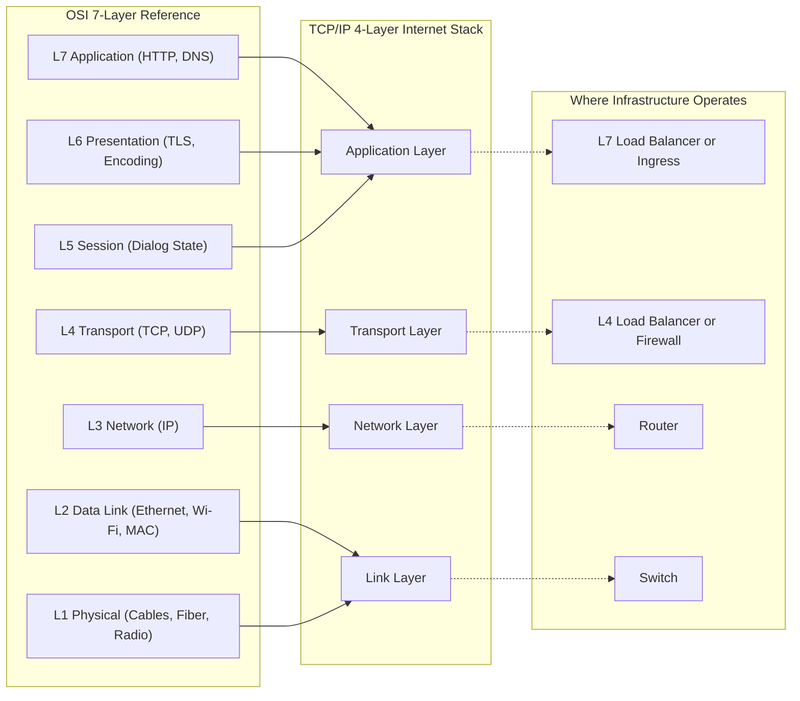
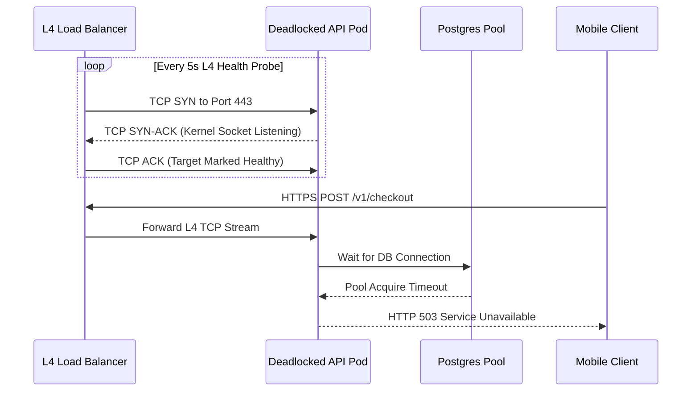

# Lesson 06: The OSI Model, Made Simple

> **Prerequisites:** [Lesson 05: Protocols and Layers](../05-protocols-and-layers/README.md) ([Networking From Zero Overview](../README.md)).  
> **Estimated Reading Time:** 20 minutes  
> **Target Audience:** Backend and infrastructure engineers decoding L2/L3/L4/L7 terminology, packet encapsulation headers, load balancer placement, and bottom-up network triage.  
> **Free PDF Notes:** [Download SD-N-006.pdf](https://backendroadmap.com/notes/system-design/SD-N-006.pdf)

> [!TIP]
> **The Golden Rule of the OSI Model:** The OSI model splits networking into seven layers—physical, data link, network, transport, session, presentation, and application—while the real internet runs the four-layer TCP/IP stack. Engineers use OSI numbers as universal shorthand to identify *which header* a device reads, *where* encapsulation stops, and *which layer* to troubleshoot first from the bottom up: a switch works at layer 2, a router at layer 3, and load balancers at layer 4 or layer 7.

---

## Words You'll Meet Today

Before mapping cables to HTTP headers, anchor these eight foundational terms in plain English and production infrastructure:

| Word | Everyday Meaning | Role in a Live Backend System |
| :--- | :--- | :--- |
| **OSI model** | A seven-layer reference model for naming where things happen in a network. | Shared engineering vocabulary (`L2`, `L3`, `L4`, `L7`) for architecture and incident triage. |
| **Physical layer (1)** | Cables, fibre, and radio carrying raw bits (`1`s and `0`s). | NIC transceivers, SFP+ optics, Cat6 copper, and wireless RF spectrum. |
| **Data link layer (2)** | Moves frames to the next device on the same network. | Ethernet and Wi-Fi framing, VLAN tags (`802.1Q`), and local ARP resolution. |
| **MAC address** | A 48-bit hardware address of a network card, used at layer 2. | Identifies the exact next-hop NIC (`3C:22:FB:9A:10:7E`) inside one broadcast domain. |
| **Switch** | A box that connects devices on one network (layer 2). | Top-of-Rack (ToR) switch forwarding frames via a MAC address table within a subnet. |
| **Router** | A box that moves packets between networks (layer 3). | Gateway or BGP core router rewriting L2 frames per hop using IP routing tables. |
| **Session / presentation (5, 6)** | The conversation state, plus data format, compression, and encryption. | Implemented inside application libraries (TLS encryption, UTF-8/JSON/Protobuf encoding). |
| **Load balancer** | A box that spreads requests over many servers (layer 4 or 7). | `IPVS`/NLB forwarding TCP tuples at L4, or Envoy/ALB/Nginx routing HTTP paths at L7. |

---

## Visual Mental Models & Architecture

### The Question: Layer 7 of What?

In a system design interview, someone says: *"Put a layer 7 load balancer in front."* Or: *"That's a layer 4 problem."* Layer 7 of what?

Of the **OSI model**: seven layers, and every engineer uses their numbers as shorthand. In [lesson 5](../05-protocols-and-layers/README.md), we met four layers. Today we split them into seven, and learn what each number means.

### An Everyday Picture First: A Contract, Mumbai to Berlin

A company in Mumbai sends a signed contract to a company in Berlin. Seven people touch it, each with one job.

The director decides what to say: that's the message. A translator turns it into German, and seals it so nobody else can read it. An assistant keeps track of which conversation this belongs to.

The shipping desk splits it into numbered parcels, and checks each one arrives. The post office writes the city address. The local driver takes it to the next depot. And the road itself carries the truck.


*Figure 1. The analogy: seven people each do one job with the contract, and each job is one OSI layer, from the director (application) down to the road (physical).*

### The Seven Layers, from the Bottom Up

| # | Layer | Its Job | Examples | In the Picture |
| :--- | :--- | :--- | :--- | :--- |
| 1 | **Physical** | Carry raw bits, ones and zeros | Cables, fibre, radio | The road |
| 2 | **Data link** | Move a frame to the next device on the same network | Ethernet, Wi-Fi, MAC addresses, switches | The local driver |
| 3 | **Network** | Addresses and routes across many networks | IP, routers | The post office |
| 4 | **Transport** | The right app (ports); for TCP, numbered pieces and resending what's lost | TCP, UDP | The shipping desk |
| 5 | **Session** | Open, keep, and close a conversation | Usually inside the app | The assistant |
| 6 | **Presentation** | The data's format, compression, and encryption | Text encoding, TLS's job | The translator |
| 7 | **Application** | The protocol your app speaks | HTTP, DNS | The director |

Note: layer 7 is the protocol, not the app itself. Chrome isn't layer 7; HTTP is. To remember the order from 1 to 7: **Please Do Not Throw Sausage Pizza Away**.


*Figure 2. The seven OSI layers with what each one handles, and the box that works at each: a switch at 2, a router at 3, load balancers at 4 or 7.*

### The Honest Part: The Internet Uses Four

The real internet doesn't use seven separate layers. It uses the four from lesson 5. OSI is a map, used to name where something happens.

The mapping is simple. Layers 1 and 2 are the link layer. Layer 3 is the network layer. Layer 4 is transport. And layers 5, 6 and 7 are squeezed into the application layer. For example, TLS does the encryption job of layer 6, but it runs inside the app.


*Figure 3. OSI is a map; the internet runs the four-layer TCP/IP model. Layers 5 to 7 are the application layer, 4 is transport, 3 is network, 1 and 2 are the link layer.*



### Step by Step: One Request, Layer by Layer

1. **Layer 7.** Your browser asks for a page: an HTTP request, `GET /shoes`.
2. **Layer 6.** TLS encrypts it.
3. **Layer 4.** TCP adds ports: 51,234 to 443.
4. **Layer 3.** IP adds the addresses.
5. **Layer 2.** A frame, addressed to your router's MAC address.
6. **Layer 1.** Radio waves over Wi-Fi.

Each router on the way unwraps only up to layer 3, reads the IP address, and sends it on, in a new frame. Only the server unwraps all seven, and reads `GET /shoes`.


*Figure 4. One request on its way: the laptop wraps it through all seven layers, each router unwraps only to layer 3, and only the server unwraps all seven.*

### Real Numbers

A **MAC address** is 48 bits, written as six pairs, like `3C:22:FB:9A:10:7E`. Every network card is given one by its maker.

An Ethernet frame adds **14 bytes** in front, and **4** at the end, around a packet of up to 1,500 bytes. So the largest normal frame is **1,518 bytes** (or 1,522 bytes when carrying a 4-byte `802.1Q` VLAN tag).


*Figure 5. Real numbers at layer 2: a MAC address is 48 bits, and an Ethernet frame adds a 14-byte header and a 4-byte check value around a packet of up to 1,500 bytes.*

### Why Interviewers Love Layer Numbers: Load Balancers

A **layer 4 load balancer** sees only IP addresses and ports. It's fast, and it can't read the request.

A **layer 7 load balancer** reads the HTTP request itself: the path, the headers, the cookies. So it can send `/api` to one group of servers, and `/images` to another. It does more work, but it's smarter.


*Figure 6. Layer 4 versus layer 7 load balancing: a layer 4 box routes by IP address and port only; a layer 7 box reads the HTTP request, so it can route /api and /images to different servers.*

### What Goes Wrong: Find the Broken Layer

Your laptop says: connected, no internet. Check from the bottom up.

- **Layer 1:** is the cable plugged in, is Wi-Fi on?
- **Layer 2:** did you join the right network?
- **Layer 3:** did you get an IP address? An address starting `169.254` means you didn't.
- **Layer 4:** is a firewall blocking the port?
- **Layer 7:** does the site itself return an error, like `500`?

The first layer that fails is your problem. Everything above it fails too, so don't start at the top.


*Figure 7. Troubleshooting with layers: check from layer 1 upwards; the first layer that fails is the problem, because every layer above it fails too.*

---

## Systematic Reference & Protocol Comparison

### Load Balancer Architecture: Layer 4 vs. Layer 7

| Dimension | Layer 4 Load Balancer (e.g., AWS NLB, IPVS) | Layer 7 Load Balancer (e.g., Envoy, AWS ALB, NGINX) |
| :--- | :--- | :--- |
| **Headers Inspected** | L3 IP (`src`/`dst`) + L4 TCP/UDP ports (`5-tuple`) | L7 HTTP method, URI path, Host, headers, cookies, gRPC metadata |
| **TLS Handling** | Passes encrypted TLS ciphertext straight through (unless TLS offload enabled) | Must terminate TLS to inspect decrypted HTTP payload, then re-encrypts upstream |
| **Connection Model** | Single TCP connection proxied or Direct Server Return (DSR) | Two decoupled TCP connections: client-to-proxy and proxy-to-origin |
| **CPU & Latency Cost** | Sub-millisecond packet forwarding; minimal memory per flow | Higher CPU/memory from TLS termination, HTTP parsing, and connection pooling |
| **Health Checks** | TCP `SYN`/`SYN-ACK` port reachability | Deep HTTP status checks (`GET /healthz` expecting `200 OK`) |
| **Best Used For** | Databases, Kafka/MQTT brokers, raw TCP streams, ultra-high RPS edge | Microservice path routing (`/api`, `/images`), canary headers, WAF, rate limiting |

### Infrastructure Devices & Encapsulation Boundaries

| Device / Component | Highest OSI Layer Unwrapped | Addressing Used | Frame / Header Behavior on Forward |
| :--- | :--- | :--- | :--- |
| **Ethernet Switch** | Layer 2 (Data Link) | 48-bit MAC address | Forwards frame unchanged (or tags/untags VLAN) based on CAM/MAC table |
| **IP Router** | Layer 3 (Network) | 32-bit IPv4 / 128-bit IPv6 | Strips old L2 frame, decrements IP TTL, wraps packet in new L2 frame for next hop |
| **Stateless Firewall / ACL** | Layer 3–4 | IP CIDR + TCP/UDP port | Permits or drops packets by header match without tracking session state |
| **L4 Load Balancer** | Layer 4 (Transport) | IP + Port (`5-tuple`) | Rewrites destination IP/port (NAT) or L2 MAC (DSR) without parsing payload |
| **L7 Reverse Proxy / Ingress** | Layer 7 (Application) | Host, Path, Headers, JWT | Terminates TCP + TLS, parses HTTP, selects backend pool, opens upstream request |

---

## Production War Story Post-Mortem

### SEV-1: Layer 4 Health Checks Green-Light Deadlocked Pods Serving Layer 7 HTTP 503s

- **Severity:** SEV-1 (Complete checkout outage in `eu-central-1`)
- **Detection Time:** 6 minutes (customer error-rate alerts fired before infra alerts)
- **Resolution Time:** 18 minutes
- **Impact:** 100% of checkout requests failed with `HTTP 503 Service Unavailable` across 24 API pods; L4 Network Load Balancer telemetry reported `100% Healthy Targets`.

#### What Happened

A deployment rolled out a connection-pool bug to the checkout service. Every pod started up, initialized its HTTP listener on TCP port `443`, and immediately deadlocked while acquiring PostgreSQL connections. Because the edge load balancer operated at **Layer 4** and used a **TCP port `443` probe**, the Linux kernel on every broken pod completed the `SYN` -> `SYN-ACK` -> `ACK` handshake cleanly. The L4 balancer kept all 24 broken pods in rotation and forwarded live customer traffic straight into deadlocked application workers.



#### Root Cause Analysis

1. **Layer Mismatch in Health Probing:** The L4 load balancer only verified **Layer 4 transport reachability** (the OS kernel accepting a TCP connection on port 443). It never spoke **Layer 7 HTTP** to ask the application whether its dependencies were healthy.
2. **Kernel vs. Application Separation:** Opening a listening TCP socket (`listen(2)`) happens in the kernel backlog independently of application request-worker progress.

#### The Fix & Architectural Hardening

1. **Deep Layer 7 Health Checks:** Replaced TCP port probes with an explicit **Layer 7 HTTP `GET /healthz/ready`** check (verified via an L7 ingress/health agent) that verifies database pool liveness before returning `200 OK`.
2. **Clear Separation of L4 Edge and L7 Ingress:** Kept the L4 NLB for ultra-low-latency TCP ingress, routing directly into an **L7 Envoy proxy tier** that terminates TLS, executes L7 HTTP readiness checks, and ejects pods returning consecutive `5xx` responses via outlier detection.

---

## Multi-Language Production Implementation

Below is a layer-aware packet and L7 route classifier in four languages. It inspects raw **Layer 2** Ethernet bytes (`14-byte` header, `EtherType 0x0800`), unwraps **Layer 3** IPv4 (`IHL`, protocol byte, source/dest IP), reads **Layer 4** TCP ports, and distinguishes **Layer 4** vs **Layer 7** routing decisions.

````carousel
```go
package main

import (
	"encoding/binary"
	"fmt"
	"net"
	"strings"
)

type LayerSummary struct {
	SrcMAC, DstMAC string
	SrcIP, DstIP   string
	Protocol       uint8
	SrcPort        uint16
	DstPort        uint16
	L7Path         string
}

func InspectFrame(frame []byte) (LayerSummary, error) {
	if len(frame) < 14+20 {
		return LayerSummary{}, fmt.Errorf("truncated frame: %d bytes", len(frame))
	}
	// Layer 2: Ethernet II 14-byte header (6 Dst MAC + 6 Src MAC + 2 EtherType)
	dstMAC := net.HardwareAddr(frame[0:6]).String()
	srcMAC := net.HardwareAddr(frame[6:12]).String()
	etherType := binary.BigEndian.Uint16(frame[12:14])
	if etherType != 0x0800 {
		return LayerSummary{}, fmt.Errorf("non-IPv4 EtherType: 0x%04x", etherType)
	}

	// Layer 3: IPv4 header
	ipStart := 14
	ihl := int(frame[ipStart]&0x0F) * 4
	if ihl < 20 || len(frame) < ipStart+ihl+4 {
		return LayerSummary{}, fmt.Errorf("invalid IPv4 IHL: %d", ihl)
	}
	proto := frame[ipStart+9]
	srcIP := net.IP(frame[ipStart+12 : ipStart+16]).String()
	dstIP := net.IP(frame[ipStart+16 : ipStart+20]).String()

	// Layer 4: TCP ports (when proto == 6)
	l4Start := ipStart + ihl
	srcPort := binary.BigEndian.Uint16(frame[l4Start : l4Start+2])
	dstPort := binary.BigEndian.Uint16(frame[l4Start+2 : l4Start+4])

	return LayerSummary{
		SrcMAC: srcMAC, DstMAC: dstMAC,
		SrcIP: srcIP, DstIP: dstIP,
		Protocol: proto, SrcPort: srcPort, DstPort: dstPort,
	}, nil
}

func RouteTarget(s LayerSummary, httpPath string) string {
	// L4 LB can only inspect IP + Port; L7 LB reads HTTP path after TLS termination
	if httpPath == "" {
		return fmt.Sprintf("L4-pool(port=%d)", s.DstPort)
	}
	if strings.HasPrefix(httpPath, "/api") {
		return "L7-api-cluster"
	}
	if strings.HasPrefix(httpPath, "/images") {
		return "L7-media-cdn-origin"
	}
	return "L7-web-default"
}

func main() {
	// Minimal 14B Ethernet + 20B IPv4 + 4B TCP Ports (38B sample)
	sample := []byte{
		0x00, 0x11, 0x22, 0x33, 0x44, 0x55, // Dst MAC
		0x3C, 0x22, 0xFB, 0x9A, 0x10, 0x7E, // Src MAC
		0x08, 0x00, // EtherType: IPv4
		0x45, 0x00, 0x00, 0x3c, 0x00, 0x01, 0x40, 0x00, 0x40, 0x06, 0x00, 0x00,
		192, 168, 1, 10, 198, 51, 100, 10, // Src -> Dst IP
		0xC8, 0x22, 0x01, 0xBB, // Ports: 51234 -> 443
	}
	summary, err := InspectFrame(sample)
	if err != nil {
		panic(err)
	}
	fmt.Printf("L2 %s -> %s | L3 %s -> %s | L4 %d -> %d\n",
		summary.SrcMAC, summary.DstMAC, summary.SrcIP, summary.DstIP, summary.SrcPort, summary.DstPort)
	fmt.Println("L4 decision:", RouteTarget(summary, ""))
	fmt.Println("L7 decision:", RouteTarget(summary, "/api/v1/orders"))
}
```
<!-- slide -->
```typescript
interface LayerSummary {
  srcMac: string;
  dstMac: string;
  srcIp: string;
  dstIp: string;
  protocol: number;
  srcPort: number;
  dstPort: number;
}

const formatMac = (bytes: Uint8Array): string =>
  Array.from(bytes, (b) => b.toString(16).padStart(2, "0")).join(":");

const formatIp = (bytes: Uint8Array): string => Array.from(bytes).join(".");

export function inspectFrame(frame: Uint8Array): LayerSummary {
  if (frame.length < 34) {
    throw new Error(`Truncated frame: ${frame.length} bytes`);
  }
  // Layer 2: 14-byte Ethernet II header
  const dstMac = formatMac(frame.subarray(0, 6));
  const srcMac = formatMac(frame.subarray(6, 12));
  const etherType = (frame[12] << 8) | frame[13];
  if (etherType !== 0x0800) {
    throw new Error(`Unsupported EtherType: 0x${etherType.toString(16)}`);
  }

  // Layer 3: IPv4 header
  const ipStart = 14;
  const ihl = (frame[ipStart] & 0x0f) * 4;
  if (ihl < 20 || frame.length < ipStart + ihl + 4) {
    throw new Error(`Invalid IPv4 header length: ${ihl}`);
  }
  const protocol = frame[ipStart + 9];
  const srcIp = formatIp(frame.subarray(ipStart + 12, ipStart + 16));
  const dstIp = formatIp(frame.subarray(ipStart + 16, ipStart + 20));

  // Layer 4: TCP/UDP source & destination ports
  const l4Start = ipStart + ihl;
  const srcPort = (frame[l4Start] << 8) | frame[l4Start + 1];
  const dstPort = (frame[l4Start + 2] << 8) | frame[l4Start + 3];

  return { srcMac, dstMac, srcIp, dstIp, protocol, srcPort, dstPort };
}

export function routeTarget(summary: LayerSummary, httpPath?: string): string {
  if (!httpPath) return `L4-pool(port=${summary.dstPort})`;
  if (httpPath.startsWith("/api")) return "L7-api-cluster";
  if (httpPath.startsWith("/images")) return "L7-media-cdn-origin";
  return "L7-web-default";
}

const sample = new Uint8Array([
  0x00, 0x11, 0x22, 0x33, 0x44, 0x55,
  0x3c, 0x22, 0xfb, 0x9a, 0x10, 0x7e,
  0x08, 0x00,
  0x45, 0x00, 0x00, 0x3c, 0x00, 0x01, 0x40, 0x00, 0x40, 0x06, 0x00, 0x00,
  192, 168, 1, 10, 198, 51, 100, 10,
  0xc8, 0x22, 0x01, 0xbb,
]);
const parsed = inspectFrame(sample);
console.log(parsed, "L4:", routeTarget(parsed), "L7:", routeTarget(parsed, "/images/logo.svg"));
```
<!-- slide -->
```python
from dataclasses import dataclass
import socket
import struct


@dataclass(frozen=True)
class LayerSummary:
    src_mac: str
    dst_mac: str
    src_ip: str
    dst_ip: str
    protocol: int
    src_port: int
    dst_port: int


def _fmt_mac(raw: bytes) -> str:
    return ":".join(f"{b:02X}" for b in raw)


def inspect_frame(frame: bytes) -> LayerSummary:
    if len(frame) < 38:
        raise ValueError(f"Truncated frame: {len(frame)} bytes")

    # Layer 2: 14-byte Ethernet II header
    dst_mac_raw, src_mac_raw, ether_type = struct.unpack("!6s6sH", frame[:14])
    if ether_type != 0x0800:
        raise ValueError(f"Unsupported EtherType: 0x{ether_type:04x}")

    # Layer 3: IPv4 header
    ip_start = 14
    ver_ihl = frame[ip_start]
    ihl = (ver_ihl & 0x0F) * 4
    if ihl < 20 or len(frame) < ip_start + ihl + 4:
        raise ValueError(f"Invalid IPv4 IHL: {ihl}")

    protocol = frame[ip_start + 9]
    src_ip = socket.inet_ntoa(frame[ip_start + 12 : ip_start + 16])
    dst_ip = socket.inet_ntoa(frame[ip_start + 16 : ip_start + 20])

    # Layer 4: Source and destination ports
    l4_start = ip_start + ihl
    src_port, dst_port = struct.unpack("!HH", frame[l4_start : l4_start + 4])

    return LayerSummary(
        src_mac=_fmt_mac(src_mac_raw),
        dst_mac=_fmt_mac(dst_mac_raw),
        src_ip=src_ip,
        dst_ip=dst_ip,
        protocol=protocol,
        src_port=src_port,
        dst_port=dst_port,
    )


def route_target(summary: LayerSummary, http_path: str | None = None) -> str:
    if http_path is None:
        return f"L4-pool(port={summary.dst_port})"
    if http_path.startswith("/api"):
        return "L7-api-cluster"
    if http_path.startswith("/images"):
        return "L7-media-cdn-origin"
    return "L7-web-default"


if __name__ == "__main__":
    sample = bytes([
        0x00, 0x11, 0x22, 0x33, 0x44, 0x55,
        0x3C, 0x22, 0xFB, 0x9A, 0x10, 0x7E,
        0x08, 0x00,
        0x45, 0x00, 0x00, 0x3C, 0x00, 0x01, 0x40, 0x00, 0x40, 0x06, 0x00, 0x00,
        192, 168, 1, 10, 198, 51, 100, 10,
        0xC8, 0x22, 0x01, 0xBB,
    ])
    parsed = inspect_frame(sample)
    print(parsed)
    print("L4:", route_target(parsed))
    print("L7:", route_target(parsed, "/api/v1/orders"))
```
<!-- slide -->
```csharp
using System;
using System.Buffers.Binary;
using System.Net;

public readonly record struct LayerSummary(
    string SrcMac,
    string DstMac,
    string SrcIp,
    string DstIp,
    byte Protocol,
    ushort SrcPort,
    ushort DstPort
);

public static class OsiFrameInspector
{
    private static string FormatMac(ReadOnlySpan<byte> mac) =>
        $"{mac[0]:X2}:{mac[1]:X2}:{mac[2]:X2}:{mac[3]:X2}:{mac[4]:X2}:{mac[5]:X2}";

    public static LayerSummary InspectFrame(ReadOnlySpan<byte> frame)
    {
        if (frame.Length < 38)
            throw new ArgumentException($"Truncated frame: {frame.Length} bytes");

        // Layer 2: Ethernet II header (14 bytes)
        string dstMac = FormatMac(frame[..6]);
        string srcMac = FormatMac(frame.Slice(6, 6));
        ushort etherType = BinaryPrimitives.ReadUInt16BigEndian(frame.Slice(12, 2));
        if (etherType != 0x0800)
            throw new NotSupportedException($"Unsupported EtherType: 0x{etherType:X4}");

        // Layer 3: IPv4 header
        int ipStart = 14;
        int ihl = (frame[ipStart] & 0x0F) * 4;
        if (ihl < 20 || frame.Length < ipStart + ihl + 4)
            throw new ArgumentException($"Invalid IPv4 IHL: {ihl}");

        byte protocol = frame[ipStart + 9];
        string srcIp = new IPAddress(frame.Slice(ipStart + 12, 4)).ToString();
        string dstIp = new IPAddress(frame.Slice(ipStart + 16, 4)).ToString();

        // Layer 4: TCP/UDP ports
        int l4Start = ipStart + ihl;
        ushort srcPort = BinaryPrimitives.ReadUInt16BigEndian(frame.Slice(l4Start, 2));
        ushort dstPort = BinaryPrimitives.ReadUInt16BigEndian(frame.Slice(l4Start + 2, 2));

        return new LayerSummary(srcMac, dstMac, srcIp, dstIp, protocol, srcPort, dstPort);
    }

    public static string RouteTarget(LayerSummary summary, string? httpPath = null)
    {
        if (string.IsNullOrEmpty(httpPath)) return $"L4-pool(port={summary.DstPort})";
        if (httpPath.StartsWith("/api", StringComparison.Ordinal)) return "L7-api-cluster";
        if (httpPath.StartsWith("/images", StringComparison.Ordinal)) return "L7-media-cdn-origin";
        return "L7-web-default";
    }
}
```
````

---

## Practical Hands-On Verification CLI Workflows

Run this bottom-up diagnostic sequence on Linux (or equivalent tools on macOS/Windows) to observe Layers 1 through 7 directly on a live host:

### 1. Inspect Layer 1 Link State, Layer 2 MAC & MTU, and Neighbor ARP Cache

```bash
ip -br link show && ip neigh show
```

**Expected Output:**

```text
lo               UNKNOWN        00:00:00:00:00:00 <LOOPBACK,UP,LOWER_UP>
eth0             UP             3c:22:fb:9a:10:7e <BROADCAST,MULTICAST,UP,LOWER_UP>
192.168.1.1 dev eth0 lladdr d8:47:32:aa:19:01 REACHABLE
```

Notice `LOWER_UP` confirms Layer 1 physical carrier signal, `3c:22:fb:9a:10:7e` is your Layer 2 48-bit MAC address, and `ip neigh` shows the resolved Layer 2 MAC of your default router (`192.168.1.1`).

### 2. Verify Layer 3 IP Assignment & Routing Path (Check for `169.254.x.x` APIPA Failure)

```bash
ip -br addr show && ip route get 198.51.100.10
```

**Expected Output:**

```text
lo               UNKNOWN        127.0.0.1/8 ::1/128
eth0             UP             192.168.1.42/24
198.51.100.10 via 192.168.1.1 dev eth0 src 192.168.1.42 uid 1000
```

If `eth0` shows `169.254.x.x/16` instead of `192.168.1.42/24`, DHCP failed at Layer 3 and no packets can cross onto the internet.

### 3. Contrast Layer 4 Port Reachability vs. Layer 7 HTTP Response

```bash
# Layer 4 check: can we complete TCP handshake on port 443?
nc -zv -w 3 backendroadmap.com 443

# Layer 7 check: what HTTP protocol & status does the application return?
curl -sS -o /dev/null -w "L4_ip=%{remote_ip} L4_port=%{remote_port} L7_code=%{http_code} proto=%{http_version}\n" https://backendroadmap.com/
```

**Expected Output:**

```text
Connection to backendroadmap.com 443 port [tcp/https] succeeded!
L4_ip=198.51.100.10 L4_port=443 L7_code=200 proto=2
```

---

## Pause and Think

> [!exercise] A load balancer sends every request for `/api` to one server group, and `/images` to another. Is it layer 4 or layer 7? Decide before you open the answer.

<details><summary>Answer</summary>

Layer 7. The path, `/api` or `/images`, is inside the HTTP request. A layer 4 box only sees addresses and ports, so it can't tell them apart. And with HTTPS, the layer 7 box must decrypt the request first.

</details>

---

## Operational Validation Checkpoints

<details><summary><strong>Checkpoint 1: Triage a "Connected, No Internet" Laptop Showing 169.254.88.14</strong></summary>

Your workstation connects to corporate Wi-Fi cleanly (full signal bars), `ip neigh` resolves local peers, yet browsers fail to load any external website and `ip addr` prints `169.254.88.14/16` on `wlan0`. At which OSI layer has failure occurred, and why?

**Diagnosis:** **Layer 3 (Network Layer).** Layers 1 (Wi-Fi radio link) and 2 (Wi-Fi association / MAC framing) succeeded, which is why the OS reports "connected". However, DHCP failed to lease a valid routable IP address and default gateway, causing the OS to fall back to an RFC 3927 link-local address (`169.254.x.x`). Every layer above L3 fails as a consequence.

</details>

<details><summary><strong>Checkpoint 2: What Changes at Each Router Hop Across the Internet?</strong></summary>

Your laptop sends an HTTPS request (`192.168.1.42:51234 -> 198.51.100.10:443`) across 11 intermediate routers. Which headers stay identical end-to-end, and which header is rebuilt at every single router?

**Diagnosis:** The **Layer 2 Ethernet/Wi-Fi MAC header** (plus FCS trailer) is stripped and rewritten at every single router hop so the frame reaches the next physical link's MAC address. Meanwhile, the **Layer 3 IP addresses** (barring NAT), **Layer 4 TCP ports**, **Layer 6 TLS ciphertext**, and **Layer 7 HTTP payload** stay untouched end-to-end because routers only unwrap up to Layer 3.

</details>

<details><summary><strong>Checkpoint 3: Choosing L4 vs. L7 Load Balancing for End-to-End mTLS Database Proxying</strong></summary>

You run a PostgreSQL cluster requiring strict end-to-end mutual TLS (`mTLS`) directly between client applications and database nodes without exposing database TLS private keys to any intermediate proxy. Should you place an L4 or L7 load balancer in front of the cluster?

**Diagnosis:** A **Layer 4 load balancer**. Because the proxy must not possess or terminate the database's TLS keys, it cannot decrypt Layer 7 bytes. An L4 load balancer inspects only the Layer 3 IP addresses and Layer 4 port (`5432`) and passes the opaque TLS stream untouched straight to the backend PostgreSQL server.

</details>

---

## Common Mistakes & Troubleshooting

- **"The internet runs on the OSI model."** No. It runs on TCP/IP's four layers; OSI is the reference map whose numbers we borrow.
- **"Layer 7 means the app."** No. It means the app's protocol, such as HTTP. A browser or a mobile app uses layer 7; it isn't layer 7.
- **Debugging top-down instead of bottom-up.** Starting with HTTP headers (`L7`) or firewall rules (`L4`) wastes time when an unplugged cable (`L1`), wrong VLAN (`L2`), or missing DHCP route (`L3` / `169.254.x.x`) broke everything above it.
- **Assuming L4 health checks verify L7 readiness.** A TCP `SYN-ACK` only confirms the kernel socket queue is open—not that application worker threads, caches, or database pools are healthy.

---

## Recap in Three Lines

1. The OSI model has seven layers: physical, data link, network, transport, session, presentation and application.
2. The real internet uses four, and OSI names where things happen.
3. Switches work at layer 2, routers at layer 3, and load balancers at layer 4 or 7.

---

## Interview Practice Questions

> [!interview] What are the seven layers of the OSI model? (Basic)

<details><summary>What to say in 30 seconds</summary>

From the bottom: 1 physical (cables, radio, bits), 2 data link (frames on one network, MAC addresses, switches), 3 network (IP, routing between networks), 4 transport (TCP, UDP, ports), 5 session (the conversation), 6 presentation (format, compression, encryption), 7 application (the protocol the app speaks, such as HTTP or DNS).

</details>

> [!interview] How does the OSI model relate to the TCP/IP model the internet uses? (Basic)

<details><summary>What to say in 30 seconds</summary>

OSI is a reference model; the internet follows the four-layer TCP/IP model. OSI layers 1 and 2 are the link layer, 3 is the network layer, 4 is transport, and 5 to 7 are squeezed into the application layer. For example, TLS does layer 6's job, encryption, but it runs inside the application. We keep the OSI numbers as shorthand.

</details>

> [!interview] What is the difference between a switch and a router? (Basic)

<details><summary>What to say in 30 seconds</summary>

A switch works at layer 2: it forwards frames between devices on the same local network, using MAC addresses. A router works at layer 3: it forwards packets between networks, using IP addresses, unwrapping each frame and putting the packet in a new frame for the next hop.

</details>

> [!interview] When would you choose a layer 7 load balancer over a layer 4 one? (Scenario)

<details><summary>What to say in 30 seconds</summary>

When routing needs the request's content: send `/api` and `/images` to different servers, route by header or cookie, or end TLS and add security checks. A layer 4 balancer only sees IP addresses and ports, so it is faster and simpler and suits plain TCP traffic, such as databases, or very high throughput.

</details>

> [!interview] Your laptop shows “connected, no internet”. How do you debug it? (Scenario)

<details><summary>What to say in 30 seconds</summary>

Bottom up. Layer 1: cable in, Wi-Fi on. Layer 2: joined the right network. Layer 3: got an IP address (`169.254.x.x` means DHCP failed) and a route. Then DNS and layer 4: is a firewall blocking the port? Layer 7: does the site itself answer with an error? The first failing layer is the problem, since everything above fails too.

</details>

> [!interview] Which layer does TLS belong to? (Tricky)

<details><summary>What to say in 30 seconds</summary>

It doesn't fit neatly, which is a good thing to say. Its job, encryption and agreeing a format, is OSI layer 6, but it runs on top of TCP inside the application, so in the TCP/IP model it is part of the application layer. That's why a layer 7 load balancer must terminate TLS before it can read the HTTP path.

</details>

---

## Free PDF notes

Download these notes as a printable PDF, with every picture, the layer table and the interview answers: [SD-N-006.pdf](https://backendroadmap.com/notes/system-design/SD-N-006.pdf).

## Sources

- [ITU-T X.200 / ISO/IEC 7498-1: The Basic Reference Model for Open Systems Interconnection](https://www.itu.int/rec/T-REC-X.200-199407-I/en), the seven layers.
- [RFC 1122: Requirements for Internet Hosts, Communication Layers](https://www.rfc-editor.org/rfc/rfc1122), the internet's own four layers.
- [RFC 3439: Some Internet Architectural Guidelines and Philosophy](https://www.rfc-editor.org/rfc/rfc3439), why strict layering is not the internet's model.
- [IEEE 802.3 (Ethernet)](https://standards.ieee.org/ieee/802.3/10422/), frames, the 14-byte header and the 4-byte check value.
- [RFC 3927: Dynamic Configuration of IPv4 Link-Local Addresses](https://www.rfc-editor.org/rfc/rfc3927), the 169.254.x.x addresses you get when no address was handed out.

## Next

Next comes [lesson 7, the TCP/IP model in action](../07-what-happens-when-you-type-a-url/README.md): everything that happens when you type a URL and press Enter. The [track overview](../README.md) lists the whole series.
