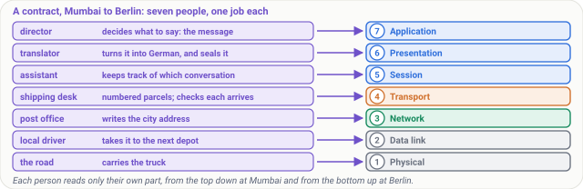
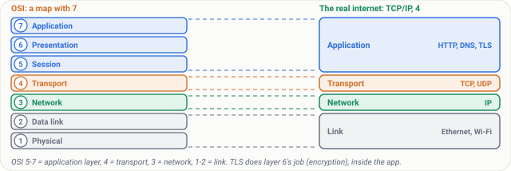
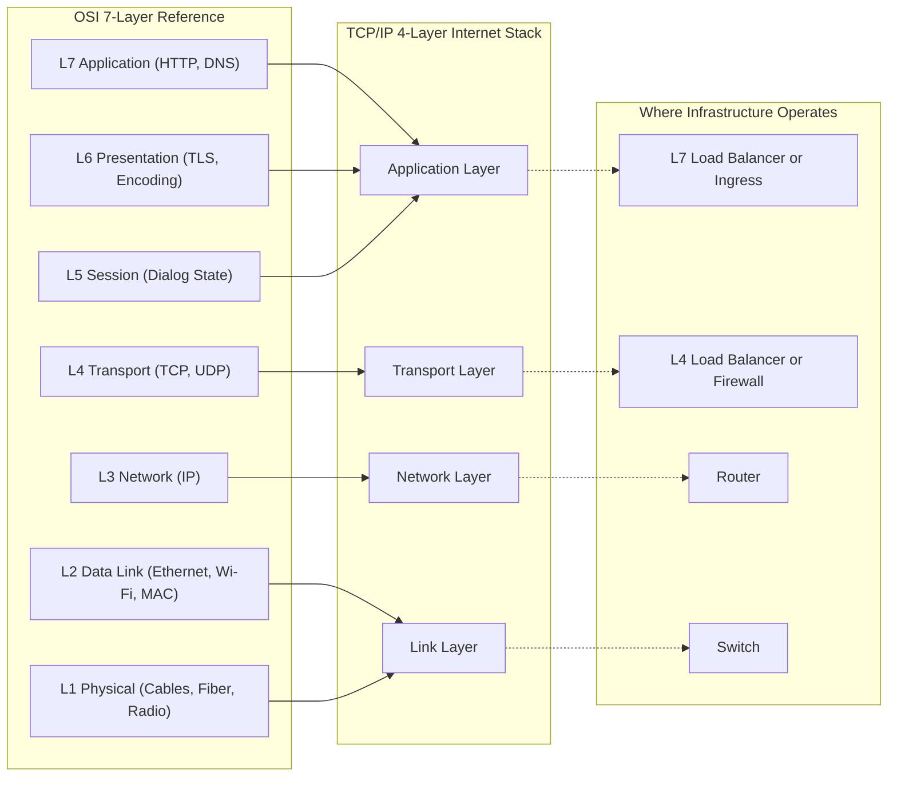
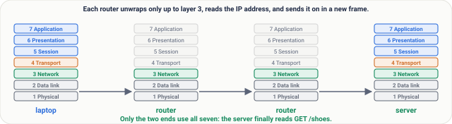
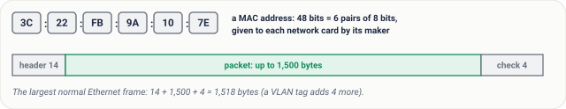
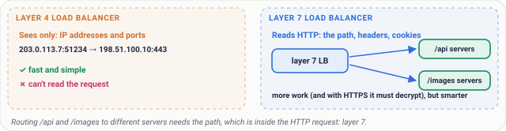
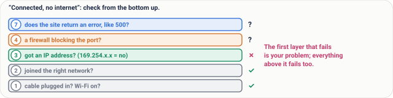
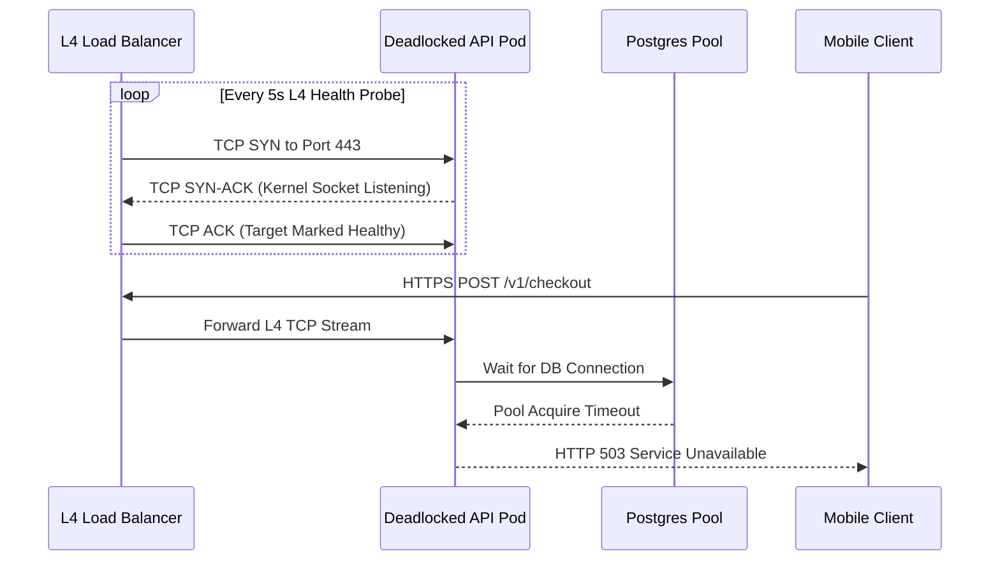

# Lesson 06: The OSI Model, Made Simple

> **Prerequisites:** [Lesson 05: Protocols and Layers](../05-protocols-and-layers/README.md) ([Networking From Zero Overview](../README.md)).  
> **Estimated Reading Time:** 30 minutes  
> **Target Audience:** Backend and infrastructure engineers decoding L2/L3/L4/L7 terminology, packet encapsulation headers, load balancer placement, and bottom-up network triage.  
> **Free PDF Notes:** [Download SD-N-006.pdf](https://backendroadmap.com/notes/system-design/SD-N-006.pdf)

> [!NOTE]
> **In one line:** the OSI model splits networking into seven layers (physical, data link, network, transport, session, presentation and application); the real internet runs the four-layer TCP/IP model, and engineers use the OSI numbers as shorthand: a switch is layer 2, a router layer 3, and load balancers layer 4 or 7.

> [!TIP]
> **The Golden Rule of the OSI Model:** The OSI model splits networking into seven layers—physical, data link, network, transport, session, presentation, and application—while the real internet runs the four-layer TCP/IP stack. Engineers use OSI numbers as universal shorthand to identify *which header* a device reads, *where* encapsulation stops, and *which layer* to troubleshoot first from the bottom up: a switch works at layer 2, a router at layer 3, and load balancers at layer 4 or layer 7.

---

## Words You'll Meet Today

Before mapping cables to HTTP headers, anchor these eight foundational terms in plain English and production infrastructure:

| Word | Everyday Meaning | Role in a Live Backend System |
| :--- | :--- | :--- |
| **OSI model** | A seven-layer reference model for naming where things happen in a network. | Shared engineering vocabulary (`L2`, `L3`, `L4`, `L7`) for architecture and incident triage. |
| **Physical layer (1)** | Cables, fibre, and radio carrying raw bits (`1`s and `0`s). | NIC transceivers, SFP+ optics, Cat6 copper, and wireless RF spectrum. |
| **Data link layer (2)** | Moves frames to the next device on the same network. | Ethernet and Wi-Fi framing, VLAN tags (`802.1Q`), and local ARP resolution. |
| **MAC address** | A 48-bit hardware address of a network card, used at layer 2. | Identifies the exact next-hop NIC (`3C:22:FB:9A:10:7E`) inside one broadcast domain. |
| **Switch** | A box that connects devices on one network (layer 2). | Top-of-Rack (ToR) switch forwarding frames via a MAC address table within a subnet. |
| **Router** | A box that moves packets between networks (layer 3). | Gateway or BGP core router rewriting L2 frames per hop using IP routing tables. |
| **Session / presentation (5, 6)** | The conversation state, plus data format, compression, and encryption. | Implemented inside application libraries (TLS encryption, UTF-8/JSON/Protobuf encoding). |
| **Load balancer** | A box that spreads requests over many servers (layer 4 or 7). | `IPVS`/NLB forwarding TCP tuples at L4, or Envoy/ALB/Nginx routing HTTP paths at L7. |

---

## What It Is vs. What It Isn't

OSI vocabulary is easy to repeat and easy to misuse. Five concepts that are routinely blurred:

| Term | Precise Meaning | What It Is **NOT** | Production Example |
| :--- | :--- | :--- | :--- |
| **OSI model** | A **7-layer reference model** (ISO/IEC 7498-1) used to *name* where a function lives. | Not what the internet runs; no kernel ships a separate "session layer" module. | "That's an L4 problem", "put an L7 LB in front". |
| **TCP/IP model** | The **4-layer** model the real internet implements (RFC 1122): Application, Transport, Internet, Link. | Not a competitor you must memorise separately — OSI 5-7 collapse into its Application layer, OSI 1-2 into Link. | What Wireshark's packet dissector tree actually shows. |
| **"Layer 7"** | The **protocol** an application speaks (HTTP, DNS, gRPC). | Not "the application" — Chrome is software; HTTP is layer 7. | An ALB routing `/api` vs `/images` by URL path. |
| **Layer 2 vs Layer 3 device** | A **switch** forwards *frames* by **MAC** inside one network; a **router** forwards *packets* by **IP** between networks. | A router is not "a bigger switch": it rewrites the L2 header and decrements the TTL at every hop. | ToR switch inside a rack vs. the core router at the data-centre edge. |
| **L4 vs L7 load balancer** | L4 balances by **IP + port (5-tuple)** without parsing the payload; L7 **terminates TLS and reads HTTP**. | Not "L7 is just a faster L4": it holds *two* connections per request and costs far more CPU. | AWS NLB / IPVS (L4) vs ALB / Envoy / NGINX (L7). |

> **Reading rule:** the *layer number* tells you the **highest header a device must understand**. Anything above that is opaque payload to it.

---

## Visual Mental Models & Architecture

### The Question: Layer 7 of What?

In a system design interview, someone says: *"Put a layer 7 load balancer in front."* Or: *"That's a layer 4 problem."* Layer 7 of what?

Of the **OSI model**: seven layers, and every engineer uses their numbers as shorthand. In [lesson 5](../05-protocols-and-layers/README.md), we met four layers. Today we split them into seven, and learn what each number means.

### An Everyday Picture First: A Contract, Mumbai to Berlin

A company in Mumbai sends a signed contract to a company in Berlin. Seven people touch it, each with one job.

The director decides what to say: that's the message. A translator turns it into German, and seals it so nobody else can read it. An assistant keeps track of which conversation this belongs to.

The shipping desk splits it into numbered parcels, and checks each one arrives. The post office writes the city address. The local driver takes it to the next depot. And the road itself carries the truck.



*Figure 1. The analogy: seven people each do one job with the contract, and each job is one OSI layer, from the director (application) down to the road (physical).*

### The Seven Layers, from the Bottom Up

| # | Layer | Its Job | Examples | In the Picture |
| :--- | :--- | :--- | :--- | :--- |
| 1 | **Physical** | Carry raw bits, ones and zeros | Cables, fibre, radio | The road |
| 2 | **Data link** | Move a frame to the next device on the same network | Ethernet, Wi-Fi, MAC addresses, switches | The local driver |
| 3 | **Network** | Addresses and routes across many networks | IP, routers | The post office |
| 4 | **Transport** | The right app (ports); for TCP, numbered pieces and resending what's lost | TCP, UDP | The shipping desk |
| 5 | **Session** | Open, keep, and close a conversation | Usually inside the app | The assistant |
| 6 | **Presentation** | The data's format, compression, and encryption | Text encoding, TLS's job | The translator |
| 7 | **Application** | The protocol your app speaks | HTTP, DNS | The director |

Note: layer 7 is the protocol, not the app itself. Chrome isn't layer 7; HTTP is. To remember the order from 1 to 7: **Please Do Not Throw Sausage Pizza Away**.


*Figure 2. The seven OSI layers with what each one handles, and the box that works at each: a switch at 2, a router at 3, load balancers at 4 or 7.*

### The Honest Part: The Internet Uses Four

The real internet doesn't use seven separate layers. It uses the four from lesson 5. OSI is a map, used to name where something happens.

The mapping is simple. Layers 1 and 2 are the link layer. Layer 3 is the network layer. Layer 4 is transport. And layers 5, 6 and 7 are squeezed into the application layer. For example, TLS does the encryption job of layer 6, but it runs inside the app.



*Figure 3. OSI is a map; the internet runs the four-layer TCP/IP model. Layers 5 to 7 are the application layer, 4 is transport, 3 is network, 1 and 2 are the link layer.*



### Step by Step: One Request, Layer by Layer

1. **Layer 7.** Your browser asks for a page: an HTTP request, `GET /shoes`.
2. **Layer 6.** TLS encrypts it.
3. **Layer 4.** TCP adds ports: 51,234 to 443.
4. **Layer 3.** IP adds the addresses.
5. **Layer 2.** A frame, addressed to your router's MAC address.
6. **Layer 1.** Radio waves over Wi-Fi.

Each router on the way unwraps only up to layer 3, reads the IP address, and sends it on, in a new frame. Only the server unwraps all seven, and reads `GET /shoes`.



*Figure 4. One request on its way: the laptop wraps it through all seven layers, each router unwraps only to layer 3, and only the server unwraps all seven.*

### Real Numbers

A **MAC address** is 48 bits, written as six pairs, like `3C:22:FB:9A:10:7E`. Every network card is given one by its maker.

An Ethernet frame adds **14 bytes** in front, and **4** at the end, around a packet of up to 1,500 bytes. So the largest normal frame is **1,518 bytes** (or 1,522 bytes when carrying a 4-byte `802.1Q` VLAN tag).



*Figure 5. Real numbers at layer 2: a MAC address is 48 bits, and an Ethernet frame adds a 14-byte header and a 4-byte check value around a packet of up to 1,500 bytes.*

### Why Interviewers Love Layer Numbers: Load Balancers

A **layer 4 load balancer** sees only IP addresses and ports. It's fast, and it can't read the request.

A **layer 7 load balancer** reads the HTTP request itself: the path, the headers, the cookies. So it can send `/api` to one group of servers, and `/images` to another. It does more work, but it's smarter.



*Figure 6. Layer 4 versus layer 7 load balancing: a layer 4 box routes by IP address and port only; a layer 7 box reads the HTTP request, so it can route /api and /images to different servers.*

### What Goes Wrong: Find the Broken Layer

Your laptop says: connected, no internet. Check from the bottom up.

- **Layer 1:** is the cable plugged in, is Wi-Fi on?
- **Layer 2:** did you join the right network?
- **Layer 3:** did you get an IP address? An address starting `169.254` means you didn't.
- **Layer 4:** is a firewall blocking the port?
- **Layer 7:** does the site itself return an error, like `500`?

The first layer that fails is your problem. Everything above it fails too, so don't start at the top.



*Figure 7. Troubleshooting with layers: check from layer 1 upwards; the first layer that fails is the problem, because every layer above it fails too.*

---

## Systematic Reference & Protocol Comparison

### Load Balancer Architecture: Layer 4 vs. Layer 7

| Dimension | Layer 4 Load Balancer (e.g., AWS NLB, IPVS) | Layer 7 Load Balancer (e.g., Envoy, AWS ALB, NGINX) |
| :--- | :--- | :--- |
| **Headers Inspected** | L3 IP (`src`/`dst`) + L4 TCP/UDP ports (`5-tuple`) | L7 HTTP method, URI path, Host, headers, cookies, gRPC metadata |
| **TLS Handling** | Passes encrypted TLS ciphertext straight through (unless TLS offload enabled) | Must terminate TLS to inspect decrypted HTTP payload, then re-encrypts upstream |
| **Connection Model** | Single TCP connection proxied or Direct Server Return (DSR) | Two decoupled TCP connections: client-to-proxy and proxy-to-origin |
| **CPU & Latency Cost** | Sub-millisecond packet forwarding; minimal memory per flow | Higher CPU/memory from TLS termination, HTTP parsing, and connection pooling |
| **Health Checks** | TCP `SYN`/`SYN-ACK` port reachability | Deep HTTP status checks (`GET /healthz` expecting `200 OK`) |
| **Best Used For** | Databases, Kafka/MQTT brokers, raw TCP streams, ultra-high RPS edge | Microservice path routing (`/api`, `/images`), canary headers, WAF, rate limiting |

### Infrastructure Devices & Encapsulation Boundaries

| Device / Component | Highest OSI Layer Unwrapped | Addressing Used | Frame / Header Behavior on Forward |
| :--- | :--- | :--- | :--- |
| **Ethernet Switch** | Layer 2 (Data Link) | 48-bit MAC address | Forwards frame unchanged (or tags/untags VLAN) based on CAM/MAC table |
| **IP Router** | Layer 3 (Network) | 32-bit IPv4 / 128-bit IPv6 | Strips old L2 frame, decrements IP TTL, wraps packet in new L2 frame for next hop |
| **Stateless Firewall / ACL** | Layer 3–4 | IP CIDR + TCP/UDP port | Permits or drops packets by header match without tracking session state |
| **L4 Load Balancer** | Layer 4 (Transport) | IP + Port (`5-tuple`) | Rewrites destination IP/port (NAT) or L2 MAC (DSR) without parsing payload |
| **L7 Reverse Proxy / Ingress** | Layer 7 (Application) | Host, Path, Headers, JWT | Terminates TCP + TLS, parses HTTP, selects backend pool, opens upstream request |

### Capacity & Cost Math Across the Layers

**1. Address-space math (L2 vs L3).**

$$N_{\text{MAC}} = 2^{48} = 281{,}474{,}976{,}710{,}656 \approx 2.8 \times 10^{14} \qquad N_{\text{OUI blocks}} = 2^{24} \approx 16.7\text{M vendors} \times 2^{24}\ \text{NICs each}$$

MACs are **flat** (no hierarchy), so a switch must remember every one it hears in a **CAM/MAC table** (typically `16K-128K` entries on data-centre ToR gear). IP addresses are **hierarchical** (prefix + host), so a router summarises millions of destinations in a few hundred thousand prefixes (the global IPv4 BGP table is on the order of `~1M` routes). That is exactly why L2 domains must stay small (broadcast + flooding) while L3 scales to the planet.

**2. Ethernet frame envelope.**

| Quantity | Value | Why |
| :--- | :--- | :--- |
| Minimum frame | `64 B` (`14` hdr + `46` min payload + `4` FCS) | Short payloads are padded; originally sized so a sender detects a collision within `512` bit-times (`51.2 µs` at 10 Mbps). |
| Standard maximum frame | `1,518 B` (`14 + 1,500 + 4`) | IP MTU `1,500 B` + header + FCS. |
| With 802.1Q VLAN tag | `1,522 B` | `+4 B` tag. |
| Jumbo frame | `9,018 B` (MTU `9,000`) | Fewer headers per byte; must be supported on **every** hop of the path. |
| Per-hop rewrites | **11 routers -> 12 links -> 12 different Ethernet frames** around the *same* IP packet | L2 header/FCS rebuilt at each hop; IP addresses and TCP ports stay untouched (barring NAT); TTL drops by `1` per router. |

**3. What each layer costs to process (order of magnitude, hardware-dependent).**

| Box | Highest Layer Parsed | Typical Work per Unit | Scales By | Typical Bottleneck |
| :--- | :--- | :--- | :--- | :--- |
| **L2 switch** | 2 (MAC lookup) | ASIC, **nanoseconds** per frame, line rate | Ports x line speed | CAM table size, broadcast storms. |
| **L3 router** | 3 (FIB longest-prefix match) | ASIC, **sub-microsecond to microseconds** | Packets per second | FIB/TCAM size, BGP convergence. |
| **L4 LB** (NLB, IPVS, XDP) | 4 (5-tuple hash + conntrack) | **Microseconds**, millions of pps per box | New flows/s, conntrack entries | `nf_conntrack` table full. |
| **L7 LB** (ALB, Envoy, NGINX) | 7 (TLS + HTTP parse + routing) | **~0.1-several ms CPU** per new TLS connection (ECDSA cheaper than RSA-2048), tens of µs per reused-connection request | CPU cores, memory per connection | TLS handshakes/s, FDs, upstream port exhaustion. |

**4. L7 load balancer connection math.** An L7 proxy terminates the client TCP/TLS connection and opens a *separate* upstream connection, so file descriptors double:

$$\text{FDs} \approx C_{\text{client}} + C_{\text{upstream}}, \qquad C_{\text{upstream}} = B \times p \ \ (\text{backends} \times \text{pool size per backend})$$

Example: `1,000,000` idle client connections + `200` backends x `64` pooled sockets = `1,012,800` FDs -> raise `ulimit -n` far above the default `1,024`. Without upstream pooling, **Lesson 04's math returns**: one proxy IP to one backend `ip:port` is capped at $28{,}232 / 60\,\text{s} \approx 470$ new connections/s.

**5. Health-check detection time.**

$$T_{\text{eject}} = \text{interval} \times \text{unhealthy threshold} \qquad\text{e.g. } 5\,\text{s} \times 2 = 10\,\text{s (L7)}\quad\text{vs.}\quad \infty\ \text{(L4 probe on a deadlocked app)}$$

That single formula is the entire post-mortem below: a probe that cannot fail is not a probe.

### The Observability Gap: Green at L4, Red at L7

| Vantage Point | Layer Seen | What It Tells You | What It **Hides** |
| :--- | :--- | :--- | :--- |
| **Switch/NIC counters** (`ethtool -S`, SNMP `ifInErrors`) | 1-2 | Cable, optics, CRC, duplex, MAC flapping | Anything above the frame: a perfectly clean link can carry a dead service. |
| **L4 LB metrics** (`HealthyHostCount`, `ActiveFlowCount`, `TCP_Target_Reset_Count`) | 3-4 | Port reachable, flows balanced, resets | Whether the application behind the open port can do useful work. **100% healthy while 100% of requests return `503`.** |
| **L7 LB / ingress metrics** (`HTTPCode_Target_5XX_Count`, `TargetResponseTime`, p99) | 7 | Per-route status codes and latency | Which lower layer is at fault; TLS or upstream-connect failures often appear as a generic `502`. |
| **App internals** (pool wait time, queue depth, GC pause) | 7 (inside the process) | Why the handler is slow | Network path problems; the app only sees its own socket. |
| **Kernel socket state** (`ss -ltn` Recv-Q/Send-Q, `nstat`) | 3-4 | Accept-queue overflows, retransmits | Per-request business impact. |

**Principle:** alert on the **highest layer your users touch** (synthetic L7 checks, SLO error budgets) and use lower-layer metrics for *diagnosis*, not for *declaring health*.

---

---

## Production War Story Post-Mortem

### SEV-1: Layer 4 Health Checks Green-Light Deadlocked Pods Serving Layer 7 HTTP 503s

- **Severity:** SEV-1 (Complete checkout outage in `eu-central-1`)
- **Detection Time:** 6 minutes (customer error-rate alerts fired before infra alerts)
- **Resolution Time:** 18 minutes
- **Impact:** 100% of checkout requests failed with `HTTP 503 Service Unavailable` across 24 API pods; L4 Network Load Balancer telemetry reported `100% Healthy Targets`.

#### What Happened

A deployment rolled out a connection-pool bug to the checkout service. Every pod started up, initialized its HTTP listener on TCP port `443`, and immediately deadlocked while acquiring PostgreSQL connections. Because the edge load balancer operated at **Layer 4** and used a **TCP port `443` probe**, the Linux kernel on every broken pod completed the `SYN` -> `SYN-ACK` -> `ACK` handshake cleanly. The L4 balancer kept all 24 broken pods in rotation and forwarded live customer traffic straight into deadlocked application workers.



#### Root Cause Analysis

1. **Layer Mismatch in Health Probing:** The L4 load balancer only verified **Layer 4 transport reachability** (the OS kernel accepting a TCP connection on port 443). It never spoke **Layer 7 HTTP** to ask the application whether its dependencies were healthy.
2. **Kernel vs. Application Separation:** Opening a listening TCP socket (`listen(2)`) happens in the kernel backlog independently of application request-worker progress.

#### The Fix & Architectural Hardening

1. **Deep Layer 7 Health Checks:** Replaced TCP port probes with an explicit **Layer 7 HTTP `GET /healthz/ready`** check (verified via an L7 ingress/health agent) that verifies database pool liveness before returning `200 OK`.
2. **Clear Separation of L4 Edge and L7 Ingress:** Kept the L4 NLB for ultra-low-latency TCP ingress, routing directly into an **L7 Envoy proxy tier** that terminates TLS, executes L7 HTTP readiness checks, and ejects pods returning consecutive `5xx` responses via outlier detection.

---

## Multi-Language Production Implementation

Below is a layer-aware packet and L7 route classifier in four languages. It inspects raw **Layer 2** Ethernet bytes (`14-byte` header, `EtherType 0x0800`), unwraps **Layer 3** IPv4 (`IHL`, protocol byte, source/dest IP), reads **Layer 4** TCP ports, and distinguishes **Layer 4** vs **Layer 7** routing decisions.

````carousel
```go
package main

import (
	"encoding/binary"
	"fmt"
	"net"
	"strings"
)

type LayerSummary struct {
	SrcMAC, DstMAC string
	SrcIP, DstIP   string
	Protocol       uint8
	SrcPort        uint16
	DstPort        uint16
	L7Path         string
}

func InspectFrame(frame []byte) (LayerSummary, error) {
	if len(frame) < 14+20 {
		return LayerSummary{}, fmt.Errorf("truncated frame: %d bytes", len(frame))
	}
	// Layer 2: Ethernet II 14-byte header (6 Dst MAC + 6 Src MAC + 2 EtherType)
	dstMAC := net.HardwareAddr(frame[0:6]).String()
	srcMAC := net.HardwareAddr(frame[6:12]).String()
	etherType := binary.BigEndian.Uint16(frame[12:14])
	if etherType != 0x0800 {
		return LayerSummary{}, fmt.Errorf("non-IPv4 EtherType: 0x%04x", etherType)
	}

	// Layer 3: IPv4 header
	ipStart := 14
	ihl := int(frame[ipStart]&0x0F) * 4
	if ihl < 20 || len(frame) < ipStart+ihl+4 {
		return LayerSummary{}, fmt.Errorf("invalid IPv4 IHL: %d", ihl)
	}
	proto := frame[ipStart+9]
	srcIP := net.IP(frame[ipStart+12 : ipStart+16]).String()
	dstIP := net.IP(frame[ipStart+16 : ipStart+20]).String()

	// Layer 4: TCP ports (when proto == 6)
	l4Start := ipStart + ihl
	srcPort := binary.BigEndian.Uint16(frame[l4Start : l4Start+2])
	dstPort := binary.BigEndian.Uint16(frame[l4Start+2 : l4Start+4])

	return LayerSummary{
		SrcMAC: srcMAC, DstMAC: dstMAC,
		SrcIP: srcIP, DstIP: dstIP,
		Protocol: proto, SrcPort: srcPort, DstPort: dstPort,
	}, nil
}

func RouteTarget(s LayerSummary, httpPath string) string {
	// L4 LB can only inspect IP + Port; L7 LB reads HTTP path after TLS termination
	if httpPath == "" {
		return fmt.Sprintf("L4-pool(port=%d)", s.DstPort)
	}
	if strings.HasPrefix(httpPath, "/api") {
		return "L7-api-cluster"
	}
	if strings.HasPrefix(httpPath, "/images") {
		return "L7-media-cdn-origin"
	}
	return "L7-web-default"
}

func main() {
	// Minimal 14B Ethernet + 20B IPv4 + 4B TCP Ports (38B sample)
	sample := []byte{
		0x00, 0x11, 0x22, 0x33, 0x44, 0x55, // Dst MAC
		0x3C, 0x22, 0xFB, 0x9A, 0x10, 0x7E, // Src MAC
		0x08, 0x00, // EtherType: IPv4
		0x45, 0x00, 0x00, 0x3c, 0x00, 0x01, 0x40, 0x00, 0x40, 0x06, 0x00, 0x00,
		192, 168, 1, 10, 198, 51, 100, 10, // Src -> Dst IP
		0xC8, 0x22, 0x01, 0xBB, // Ports: 51234 -> 443
	}
	summary, err := InspectFrame(sample)
	if err != nil {
		panic(err)
	}
	fmt.Printf("L2 %s -> %s | L3 %s -> %s | L4 %d -> %d\n",
		summary.SrcMAC, summary.DstMAC, summary.SrcIP, summary.DstIP, summary.SrcPort, summary.DstPort)
	fmt.Println("L4 decision:", RouteTarget(summary, ""))
	fmt.Println("L7 decision:", RouteTarget(summary, "/api/v1/orders"))
}
```
<!-- slide -->
```typescript
interface LayerSummary {
  srcMac: string;
  dstMac: string;
  srcIp: string;
  dstIp: string;
  protocol: number;
  srcPort: number;
  dstPort: number;
}

const formatMac = (bytes: Uint8Array): string =>
  Array.from(bytes, (b) => b.toString(16).padStart(2, "0")).join(":");

const formatIp = (bytes: Uint8Array): string => Array.from(bytes).join(".");

export function inspectFrame(frame: Uint8Array): LayerSummary {
  if (frame.length < 34) {
    throw new Error(`Truncated frame: ${frame.length} bytes`);
  }
  // Layer 2: 14-byte Ethernet II header
  const dstMac = formatMac(frame.subarray(0, 6));
  const srcMac = formatMac(frame.subarray(6, 12));
  const etherType = (frame[12] << 8) | frame[13];
  if (etherType !== 0x0800) {
    throw new Error(`Unsupported EtherType: 0x${etherType.toString(16)}`);
  }

  // Layer 3: IPv4 header
  const ipStart = 14;
  const ihl = (frame[ipStart] & 0x0f) * 4;
  if (ihl < 20 || frame.length < ipStart + ihl + 4) {
    throw new Error(`Invalid IPv4 header length: ${ihl}`);
  }
  const protocol = frame[ipStart + 9];
  const srcIp = formatIp(frame.subarray(ipStart + 12, ipStart + 16));
  const dstIp = formatIp(frame.subarray(ipStart + 16, ipStart + 20));

  // Layer 4: TCP/UDP source & destination ports
  const l4Start = ipStart + ihl;
  const srcPort = (frame[l4Start] << 8) | frame[l4Start + 1];
  const dstPort = (frame[l4Start + 2] << 8) | frame[l4Start + 3];

  return { srcMac, dstMac, srcIp, dstIp, protocol, srcPort, dstPort };
}

export function routeTarget(summary: LayerSummary, httpPath?: string): string {
  if (!httpPath) return `L4-pool(port=${summary.dstPort})`;
  if (httpPath.startsWith("/api")) return "L7-api-cluster";
  if (httpPath.startsWith("/images")) return "L7-media-cdn-origin";
  return "L7-web-default";
}

const sample = new Uint8Array([
  0x00, 0x11, 0x22, 0x33, 0x44, 0x55,
  0x3c, 0x22, 0xfb, 0x9a, 0x10, 0x7e,
  0x08, 0x00,
  0x45, 0x00, 0x00, 0x3c, 0x00, 0x01, 0x40, 0x00, 0x40, 0x06, 0x00, 0x00,
  192, 168, 1, 10, 198, 51, 100, 10,
  0xc8, 0x22, 0x01, 0xbb,
]);
const parsed = inspectFrame(sample);
console.log(parsed, "L4:", routeTarget(parsed), "L7:", routeTarget(parsed, "/images/logo.svg"));
```
<!-- slide -->
```python
from dataclasses import dataclass
import socket
import struct


@dataclass(frozen=True)
class LayerSummary:
    src_mac: str
    dst_mac: str
    src_ip: str
    dst_ip: str
    protocol: int
    src_port: int
    dst_port: int


def _fmt_mac(raw: bytes) -> str:
    return ":".join(f"{b:02X}" for b in raw)


def inspect_frame(frame: bytes) -> LayerSummary:
    if len(frame) < 38:
        raise ValueError(f"Truncated frame: {len(frame)} bytes")

    # Layer 2: 14-byte Ethernet II header
    dst_mac_raw, src_mac_raw, ether_type = struct.unpack("!6s6sH", frame[:14])
    if ether_type != 0x0800:
        raise ValueError(f"Unsupported EtherType: 0x{ether_type:04x}")

    # Layer 3: IPv4 header
    ip_start = 14
    ver_ihl = frame[ip_start]
    ihl = (ver_ihl & 0x0F) * 4
    if ihl < 20 or len(frame) < ip_start + ihl + 4:
        raise ValueError(f"Invalid IPv4 IHL: {ihl}")

    protocol = frame[ip_start + 9]
    src_ip = socket.inet_ntoa(frame[ip_start + 12 : ip_start + 16])
    dst_ip = socket.inet_ntoa(frame[ip_start + 16 : ip_start + 20])

    # Layer 4: Source and destination ports
    l4_start = ip_start + ihl
    src_port, dst_port = struct.unpack("!HH", frame[l4_start : l4_start + 4])

    return LayerSummary(
        src_mac=_fmt_mac(src_mac_raw),
        dst_mac=_fmt_mac(dst_mac_raw),
        src_ip=src_ip,
        dst_ip=dst_ip,
        protocol=protocol,
        src_port=src_port,
        dst_port=dst_port,
    )


def route_target(summary: LayerSummary, http_path: str | None = None) -> str:
    if http_path is None:
        return f"L4-pool(port={summary.dst_port})"
    if http_path.startswith("/api"):
        return "L7-api-cluster"
    if http_path.startswith("/images"):
        return "L7-media-cdn-origin"
    return "L7-web-default"


if __name__ == "__main__":
    sample = bytes([
        0x00, 0x11, 0x22, 0x33, 0x44, 0x55,
        0x3C, 0x22, 0xFB, 0x9A, 0x10, 0x7E,
        0x08, 0x00,
        0x45, 0x00, 0x00, 0x3C, 0x00, 0x01, 0x40, 0x00, 0x40, 0x06, 0x00, 0x00,
        192, 168, 1, 10, 198, 51, 100, 10,
        0xC8, 0x22, 0x01, 0xBB,
    ])
    parsed = inspect_frame(sample)
    print(parsed)
    print("L4:", route_target(parsed))
    print("L7:", route_target(parsed, "/api/v1/orders"))
```
<!-- slide -->
```csharp
using System;
using System.Buffers.Binary;
using System.Net;

public readonly record struct LayerSummary(
    string SrcMac,
    string DstMac,
    string SrcIp,
    string DstIp,
    byte Protocol,
    ushort SrcPort,
    ushort DstPort
);

public static class OsiFrameInspector
{
    private static string FormatMac(ReadOnlySpan<byte> mac) =>
        $"{mac[0]:X2}:{mac[1]:X2}:{mac[2]:X2}:{mac[3]:X2}:{mac[4]:X2}:{mac[5]:X2}";

    public static LayerSummary InspectFrame(ReadOnlySpan<byte> frame)
    {
        if (frame.Length < 38)
            throw new ArgumentException($"Truncated frame: {frame.Length} bytes");

        // Layer 2: Ethernet II header (14 bytes)
        string dstMac = FormatMac(frame[..6]);
        string srcMac = FormatMac(frame.Slice(6, 6));
        ushort etherType = BinaryPrimitives.ReadUInt16BigEndian(frame.Slice(12, 2));
        if (etherType != 0x0800)
            throw new NotSupportedException($"Unsupported EtherType: 0x{etherType:X4}");

        // Layer 3: IPv4 header
        int ipStart = 14;
        int ihl = (frame[ipStart] & 0x0F) * 4;
        if (ihl < 20 || frame.Length < ipStart + ihl + 4)
            throw new ArgumentException($"Invalid IPv4 IHL: {ihl}");

        byte protocol = frame[ipStart + 9];
        string srcIp = new IPAddress(frame.Slice(ipStart + 12, 4)).ToString();
        string dstIp = new IPAddress(frame.Slice(ipStart + 16, 4)).ToString();

        // Layer 4: TCP/UDP ports
        int l4Start = ipStart + ihl;
        ushort srcPort = BinaryPrimitives.ReadUInt16BigEndian(frame.Slice(l4Start, 2));
        ushort dstPort = BinaryPrimitives.ReadUInt16BigEndian(frame.Slice(l4Start + 2, 2));

        return new LayerSummary(srcMac, dstMac, srcIp, dstIp, protocol, srcPort, dstPort);
    }

    public static string RouteTarget(LayerSummary summary, string? httpPath = null)
    {
        if (string.IsNullOrEmpty(httpPath)) return $"L4-pool(port={summary.DstPort})";
        if (httpPath.StartsWith("/api", StringComparison.Ordinal)) return "L7-api-cluster";
        if (httpPath.StartsWith("/images", StringComparison.Ordinal)) return "L7-media-cdn-origin";
        return "L7-web-default";
    }
}
```
````

---

## Practical Hands-On Verification CLI Workflows

Run this bottom-up diagnostic sequence on Linux (or equivalent tools on macOS/Windows) to observe Layers 1 through 7 directly on a live host:

### 1. Inspect Layer 1 Link State, Layer 2 MAC & MTU, and Neighbor ARP Cache

```bash
ip -br link show && ip neigh show
```

**Expected Output:**

```text
lo               UNKNOWN        00:00:00:00:00:00 <LOOPBACK,UP,LOWER_UP>
eth0             UP             3c:22:fb:9a:10:7e <BROADCAST,MULTICAST,UP,LOWER_UP>
192.168.1.1 dev eth0 lladdr d8:47:32:aa:19:01 REACHABLE
```

Notice `LOWER_UP` confirms Layer 1 physical carrier signal, `3c:22:fb:9a:10:7e` is your Layer 2 48-bit MAC address, and `ip neigh` shows the resolved Layer 2 MAC of your default router (`192.168.1.1`).

### 2. Verify Layer 3 IP Assignment & Routing Path (Check for `169.254.x.x` APIPA Failure)

```bash
ip -br addr show && ip route get 198.51.100.10
```

**Expected Output:**

```text
lo               UNKNOWN        127.0.0.1/8 ::1/128
eth0             UP             192.168.1.42/24
198.51.100.10 via 192.168.1.1 dev eth0 src 192.168.1.42 uid 1000
```

If `eth0` shows `169.254.x.x/16` instead of `192.168.1.42/24`, DHCP failed at Layer 3 and no packets can cross onto the internet.

### 3. Contrast Layer 4 Port Reachability vs. Layer 7 HTTP Response

```bash
# Layer 4 check: can we complete TCP handshake on port 443?
nc -zv -w 3 backendroadmap.com 443

# Layer 7 check: what HTTP protocol & status does the application return?
curl -sS -o /dev/null -w "L4_ip=%{remote_ip} L4_port=%{remote_port} L7_code=%{http_code} proto=%{http_version}\n" https://backendroadmap.com/
```

**Expected Output:**

```text
Connection to backendroadmap.com 443 port [tcp/https] succeeded!
L4_ip=198.51.100.10 L4_port=443 L7_code=200 proto=2
```

---

## Pause and Think

> [!exercise] A load balancer sends every request for `/api` to one server group, and `/images` to another. Is it layer 4 or layer 7? Decide before you open the answer.

<details><summary>Answer</summary>

Layer 7. The path, `/api` or `/images`, is inside the HTTP request. A layer 4 box only sees addresses and ports, so it can't tell them apart. And with HTTPS, the layer 7 box must decrypt the request first.

</details>

---

## Operational Validation Checkpoints

<details><summary><strong>Checkpoint 1: Triage a "Connected, No Internet" Laptop Showing 169.254.88.14</strong></summary>

Your workstation connects to corporate Wi-Fi cleanly (full signal bars), `ip neigh` resolves local peers, yet browsers fail to load any external website and `ip addr` prints `169.254.88.14/16` on `wlan0`. At which OSI layer has failure occurred, and why?

**Diagnosis:** **Layer 3 (Network Layer).** Layers 1 (Wi-Fi radio link) and 2 (Wi-Fi association / MAC framing) succeeded, which is why the OS reports "connected". However, DHCP failed to lease a valid routable IP address and default gateway, causing the OS to fall back to an RFC 3927 link-local address (`169.254.x.x`). Every layer above L3 fails as a consequence.

</details>

<details><summary><strong>Checkpoint 2: What Changes at Each Router Hop Across the Internet?</strong></summary>

Your laptop sends an HTTPS request (`192.168.1.42:51234 -> 198.51.100.10:443`) across 11 intermediate routers. Which headers stay identical end-to-end, and which header is rebuilt at every single router?

**Diagnosis:** The **Layer 2 Ethernet/Wi-Fi MAC header** (plus FCS trailer) is stripped and rewritten at every single router hop so the frame reaches the next physical link's MAC address. Meanwhile, the **Layer 3 IP addresses** (barring NAT), **Layer 4 TCP ports**, **Layer 6 TLS ciphertext**, and **Layer 7 HTTP payload** stay untouched end-to-end because routers only unwrap up to Layer 3.

</details>

<details><summary><strong>Checkpoint 3: Choosing L4 vs. L7 Load Balancing for End-to-End mTLS Database Proxying</strong></summary>

You run a PostgreSQL cluster requiring strict end-to-end mutual TLS (`mTLS`) directly between client applications and database nodes without exposing database TLS private keys to any intermediate proxy. Should you place an L4 or L7 load balancer in front of the cluster?

**Diagnosis:** A **Layer 4 load balancer**. Because the proxy must not possess or terminate the database's TLS keys, it cannot decrypt Layer 7 bytes. An L4 load balancer inspects only the Layer 3 IP addresses and Layer 4 port (`5432`) and passes the opaque TLS stream untouched straight to the backend PostgreSQL server.

</details>

---

## Common Mistakes & Troubleshooting

- **"The internet runs on the OSI model."** No. It runs on TCP/IP's four layers; OSI is the reference map whose numbers we borrow.
- **"Layer 7 means the app."** No. It means the app's protocol, such as HTTP. A browser or a mobile app uses layer 7; it isn't layer 7.
- **Debugging top-down instead of bottom-up.** Starting with HTTP headers (`L7`) or firewall rules (`L4`) wastes time when an unplugged cable (`L1`), wrong VLAN (`L2`), or missing DHCP route (`L3` / `169.254.x.x`) broke everything above it.
- **Assuming L4 health checks verify L7 readiness.** A TCP `SYN-ACK` only confirms the kernel socket queue is open—not that application worker threads, caches, or database pools are healthy.
- **Calling a router "a bigger switch" (or an L3 switch "just a router").** Switches forward frames by MAC inside one broadcast domain; routers rebuild the L2 header, decrement TTL, and forward between networks.
- **Putting an L7 load balancer in front of a protocol that needs end-to-end TLS/mTLS.** Terminating TLS breaks the guarantee; use L4 passthrough (with SNI routing if needed).
- **Forgetting the per-request cost of L7.** Two connections per request, TLS handshakes, and HTTP parsing multiply FDs, CPU, and upstream ephemeral-port pressure—pool upstream connections.
- **Declaring a service healthy from L1-L4 dashboards.** Green links and open ports say nothing about whether users get `200`s; alert on L7 SLOs.
- **Treating OSI as a strict wiring diagram.** NAT, firewalls, VPN tunnels, and QUIC deliberately cross layers; use OSI to name the *highest header a device reads*.

---

## Recap in Three Lines

1. The OSI model has seven layers: physical, data link, network, transport, session, presentation and application.
2. The real internet uses four, and OSI names where things happen.
3. Switches work at layer 2, routers at layer 3, and load balancers at layer 4 or 7.

---

## Interview Practice Questions

Exactly **12 questions**, tagged by kind: **[BASIC]** (Q1-Q4, definitions), **[SCENARIO]** (Q5-Q8, apply it to a system), and **[TRICKY]** (Q9-Q12, deep follow-ups). Answer out loud for 30 seconds before opening the solution.

<details>
<summary><strong>Q1: What are the seven layers of the OSI model? [BASIC]</strong></summary>

<strong>What a strong answer covers:</strong>
From the bottom: **1 Physical** (cables, fibre, radio, bits), **2 Data Link** (frames on one network, MAC addresses, switches), **3 Network** (IP, routing between networks, routers), **4 Transport** (TCP/UDP, ports), **5 Session** (conversation state), **6 Presentation** (format, compression, encryption), **7 Application** (the protocol the app speaks: HTTP, DNS). Mnemonic: *Please Do Not Throw Sausage Pizza Away*. Add that **layer 7 is the protocol, not the app** (Chrome isn't L7, HTTP is).

</details>

<details>
<summary><strong>Q2: How does OSI relate to the TCP/IP model the internet actually uses? [BASIC]</strong></summary>

<strong>What a strong answer covers:</strong>
OSI is a **reference/teaching model**; the internet implements the **4-layer TCP/IP model** (RFC 1122). Mapping: **OSI 1+2 -> Link**, **OSI 3 -> Internet/Network**, **OSI 4 -> Transport**, **OSI 5+6+7 -> Application**. For instance, TLS does layer 6's job (encryption) but runs *inside* the application on top of TCP. We keep OSI numbers because they are a **shared vocabulary** for incident triage and design ("L4 LB", "L7 firewall"). RFC 3439 even argues rigid layering is not how the internet is built.

</details>

<details>
<summary><strong>Q3: What is the difference between a switch and a router? [BASIC]</strong></summary>

<strong>What a strong answer covers:</strong>
A **switch (L2)** forwards **frames** between devices on the **same network** using **MAC addresses** and a learned MAC table; it does not change the frame. A **router (L3)** forwards **packets between different networks** using **IP addresses** and a routing table (longest-prefix match): it strips the incoming L2 header, **decrements the TTL**, and wraps the packet in a **new L2 frame** for the next hop. Switches have broadcast domains; routers *separate* them. Modern "L3 switches" do both in hardware.

</details>

<details>
<summary><strong>Q4: Why does a device need both a MAC address and an IP address? [BASIC]</strong></summary>

<strong>What a strong answer covers:</strong>
They answer different questions at different scopes. A **MAC (48-bit, flat, burned into the NIC)** identifies *the next device on this link*; it only matters for **one hop**. An **IP address (hierarchical)** identifies *the final destination* across networks; it stays (mostly) constant end to end. A packet to `198.51.100.10` is wrapped in a frame addressed to your **router's MAC** (found via **ARP**); the router then picks the next hop's MAC. Flat MACs would not scale to routing; IPs alone cannot tell a switch which physical port to use.

</details>

<details>
<summary><strong>Q5: When would you choose a Layer 7 load balancer over a Layer 4 one, and what does it cost? [SCENARIO]</strong></summary>

<strong>What a strong answer covers:</strong>
Choose **L7** when routing needs the **content** of the request: path (`/api` vs `/images`), `Host`, headers/cookies, **canary** by header, **gRPC** method routing, **WAF**, rate limiting, per-request retries and outlier detection, or **TLS termination** at the edge. Choose **L4** for raw **TCP/UDP** (databases, Kafka, MQTT), **end-to-end mTLS passthrough**, preserving client IP with DSR, or extreme throughput. **Cost of L7:** terminates TLS (CPU), parses HTTP, keeps **two** connections per request (double FDs), and adds latency; a common design is **L4 NLB at the edge -> fleet of L7 Envoy/NGINX** behind it.

</details>

<details>
<summary><strong>Q6: Your laptop says "connected" but nothing loads. How do you debug it layer by layer? [SCENARIO]</strong></summary>

<strong>What a strong answer covers:</strong>
**Bottom-up; stop at the first failing layer** (everything above it fails too):
1. **L1:** cable seated, Wi-Fi on, `ip -br link` shows `LOWER_UP`.
2. **L2:** joined the right SSID/VLAN; `ip neigh` shows the gateway's MAC.
3. **L3:** `ip -br addr` — a **`169.254.x.x`** address means **DHCP failed**; check the default route with `ip route`, then `ping 1.1.1.1` (separates routing from DNS).
4. **DNS:** `dig example.com` — can names resolve?
5. **L4:** `nc -zv host 443` — is a firewall blocking the port?
6. **L7:** `curl -v` — TLS cert errors, `4xx/5xx`.
`ping` by IP works but names fail -> DNS; both fail -> layer 3 or below.

</details>

<details>
<summary><strong>Q7: Your NLB reports 100% healthy targets, yet every checkout returns HTTP 503. What happened and how do you fix it? [SCENARIO]</strong></summary>

<strong>What a strong answer covers:</strong>
A **layer mismatch in health checking**. The NLB's TCP probe completes `SYN -> SYN-ACK -> ACK` against port `443`, which the **kernel** answers from the listen backlog **independently of whether the app's worker threads can serve requests** (here, a deadlocked DB pool). Fix: use **L7 readiness checks** (`GET /healthz/ready` that verifies the dependency pool and returns `200`), add **outlier detection** at an L7 proxy tier (eject pods after N consecutive `5xx`), separate **liveness** (restart me) from **readiness** (send me traffic), and alert on **L7 SLO signals** (5xx rate, p99), not on L4 target health. Detection time becomes `interval × unhealthy_threshold` (e.g. `5 s × 2 = 10 s`).

</details>

<details>
<summary><strong>Q8: A database cluster requires end-to-end mutual TLS and the DB's private keys must never sit on a proxy. L4 or L7 in front? [SCENARIO]</strong></summary>

<strong>What a strong answer covers:</strong>
**L4 (TCP passthrough).** An L7 proxy must **terminate TLS** to read plaintext, which means holding the key (or issuing its own certificate), breaking end-to-end mTLS and client-certificate identity. An L4 balancer reads only IP + port (`5432`) and forwards the **opaque ciphertext stream** untouched. Trade-offs: no content-based routing or per-query metrics at the proxy; health checks are TCP-only, so add an **application-level check** (e.g. a sidecar/agent running `SELECT 1` or `pg_isready`) and use connection-aware pooling (PgBouncer) deliberately, knowing it terminates the protocol itself. Passing SNI through lets an L4 balancer route TLS by hostname without decrypting.

</details>

<details>
<summary><strong>Q9: Which OSI layer does TLS belong to? [TRICKY]</strong></summary>

<strong>What a strong answer covers:</strong>
"It doesn't fit neatly, and that's the point." By **function** (encryption, agreeing a format, session resumption) it is **OSI layer 6** (and arguably 5). By **implementation** it runs **on top of TCP, inside the application/library** (OpenSSL, BoringSSL, Go `crypto/tls`), so in the TCP/IP model it is part of the **Application layer**. That is why an **L7 LB must terminate TLS** before reading the HTTP path, why an **L4 LB can pass it through**, and why on-path devices see only the **SNI** (until Encrypted Client Hello). **QUIC** pushes this further: TLS 1.3 is built into the transport itself.

</details>

<details>
<summary><strong>Q10: A packet crosses 11 routers. Which headers change at each hop and which stay the same? [TRICKY]</strong></summary>

<strong>What a strong answer covers:</strong>
**Changes at every router:** the **L2 header + FCS** (new source/destination MAC for the next link), the **IP TTL** (decremented; the header checksum is recomputed in IPv4), and possibly the **DSCP/ECN** bits. **Stay the same end-to-end:** **IP source/destination**, **TCP/UDP ports**, the TLS ciphertext, and the HTTP payload — *unless a NAT or L4 LB rewrites IPs/ports.* So there are **12 different Ethernet frames** carrying the *same* IP packet. If TTL hits `0`, the router drops it and sends **ICMP Time Exceeded** — the basis of `traceroute`. Routers never decrypt TLS or parse HTTP.

</details>

<details>
<summary><strong>Q11: Where do NAT, firewalls, VPNs/tunnels, Kubernetes Services, and QUIC fit in OSI — and why does "layering" break down? [TRICKY]</strong></summary>

<strong>What a strong answer covers:</strong>
They are **layer violations by design**:
- **NAT (L3 + L4):** rewrites IPs *and* ports, so it must track L4 flows (conntrack).
- **Stateful firewall / security group (L3-L4):** matches 5-tuples and TCP flags; **WAF/next-gen firewall** goes to L7.
- **VPN / VXLAN / WireGuard / GRE:** **L2 or L3 payload carried inside L3/L4** (tunnels) — encapsulation inside encapsulation, which shrinks the MTU.
- **kube-proxy / Service:** L4 DNAT via iptables/IPVS/eBPF; **Ingress** is L7.
- **QUIC/HTTP/3:** a "transport" built on UDP **with TLS 1.3 and streams inside** — spans L4-L7.
Takeaway: OSI is a **vocabulary for the highest header a box must read**, not a strict module diagram.

</details>

<details>
<summary><strong>Q12: Your laptop sends to `198.51.100.10`. How does it learn the MAC address to put in the Ethernet frame — and what if the destination is on the same subnet? [TRICKY]</strong></summary>

<strong>What a strong answer covers:</strong>
It first applies its **subnet mask**: if `198.51.100.10` is **off-subnet**, the next hop is the **default gateway**; if **on-subnet**, the next hop is the destination itself. It then needs that next hop's MAC: it checks the **ARP cache** (`ip neigh`); on a miss it **broadcasts an ARP request** (`ff:ff:ff:ff:ff:ff`: *"who has 192.168.1.1?"*) and the owner **unicasts back its MAC**. The frame carries **destination MAC = gateway** but **destination IP = the real server** — the signature of L2 vs L3 roles. (IPv6 uses **Neighbor Discovery** instead.) Security note: ARP is unauthenticated, so **ARP spoofing** poisons the cache; the defence is dynamic ARP inspection, 802.1X, or encrypted traffic (TLS).

</details>

---

## One-Page Master Cheat Sheet

```text
====================================================================================================
                          THE OSI MODEL, MADE SIMPLE — ONE-PAGE CHEAT SHEET
====================================================================================================
THE SEVEN LAYERS (Please Do Not Throw Sausage Pizza Away = 1..7)       TCP/IP MAP       BOX THAT LIVES HERE
  7 Application   protocol your app speaks (HTTP, DNS, gRPC)           \                L7 LB, ingress, WAF, API gateway
  6 Presentation  format / compression / ENCRYPTION (TLS's job)         > Application
  5 Session       conversation state (usually inside the app)          /
  4 Transport     ports; TCP: order + resend (TCP, UDP, QUIC)           Transport       L4 LB (NLB/IPVS), firewall, NAT
  3 Network       IP addressing + routing, TTL                          Internet        Router, L3 switch
  2 Data Link     frames, MAC addresses, ARP, VLAN                      \ Link           Switch, Wi-Fi AP
  1 Physical      bits on copper / fibre / radio                        /

NUMBERS
  MAC = 48 bits (6 hex pairs) = 2^48 ~= 2.8 x 10^14       OUI = first 24 bits = vendor
  Frame: 14 B hdr + up to 1,500 B packet + 4 B FCS = 1,518 B   (VLAN tag +4 -> 1,522 | min frame 64 B)
  Per hop: NEW L2 frame, TTL-1, same IP + ports (unless NAT).  11 routers => 12 frames, same packet.
  L7 LB FDs ~= client conns + (backends x pool size).  No pooling: 28,232 / 60 s ~= 470 new conn/s per backend.
  Health-check eject time = interval x unhealthy_threshold   (L4 probe on a deadlocked app = never)

L4 vs L7 LOAD BALANCER
  L4: sees IP + port (5-tuple) | fast, cheap, TLS passthrough, DB/Kafka/MQTT, DSR | cannot read request
  L7: terminates TLS, reads path/headers/cookies | routing, canary, WAF, retries | 2 conns/request, more CPU
  Common pattern: NLB (L4) -> Envoy/NGINX fleet (L7) -> pods.   mTLS end-to-end => stay at L4.

DEBUG BOTTOM-UP (first failing layer wins)
  L1 ip -br link (LOWER_UP) -> L2 ip neigh -> L3 ip -br addr (169.254.x.x = DHCP failed), ip route, ping IP
  -> DNS dig -> L4 nc -zv host port -> L7 curl -v / -w "%{http_code}"

TRAPS
  * "Internet runs OSI"  -> no, TCP/IP's 4 layers.     * "Layer 7 = the app" -> no, the app's PROTOCOL.
  * L4 health check green != service healthy.           * NAT, VPN, QUIC, firewalls blur layers (by design).
  * Alert on L7 SLOs (5xx, p99); use L1-L4 metrics to DIAGNOSE, not to declare health.
====================================================================================================
```

---

## Free PDF notes

Download these notes as a printable PDF, with every picture, the layer table and the interview answers: [SD-N-006.pdf](https://backendroadmap.com/notes/system-design/SD-N-006.pdf).

## Sources

- [ITU-T X.200 / ISO/IEC 7498-1: The Basic Reference Model for Open Systems Interconnection](https://www.itu.int/rec/T-REC-X.200-199407-I/en), the seven layers.
- [RFC 1122: Requirements for Internet Hosts, Communication Layers](https://www.rfc-editor.org/rfc/rfc1122), the internet's own four layers.
- [RFC 3439: Some Internet Architectural Guidelines and Philosophy](https://www.rfc-editor.org/rfc/rfc3439), why strict layering is not the internet's model.
- [IEEE 802.3 (Ethernet)](https://standards.ieee.org/ieee/802.3/10422/), frames, the 14-byte header and the 4-byte check value.
- [RFC 3927: Dynamic Configuration of IPv4 Link-Local Addresses](https://www.rfc-editor.org/rfc/rfc3927), the 169.254.x.x addresses you get when no address was handed out.

## Next

Next comes [lesson 7, the TCP/IP model in action](../07-what-happens-when-you-type-a-url/README.md): everything that happens when you type a URL and press Enter. The [track overview](../README.md) lists the whole series.
