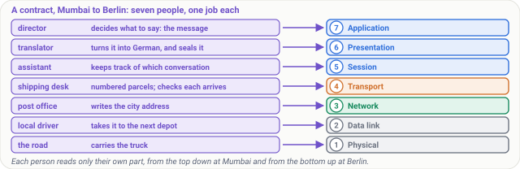
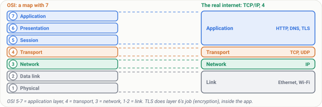
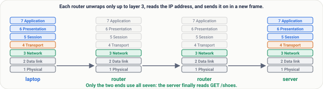
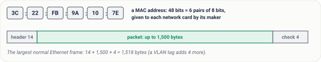
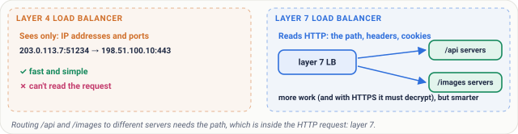
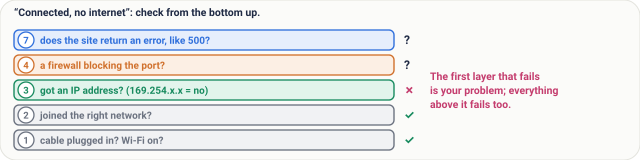

# Lesson 06: The OSI Model, Made Simple

## Roadmap

You are in **System Design Interview Prep**, Track 02, **Networking from Zero**: lesson 6 of 30. It builds on [lesson 5](../05-protocols-and-layers/README.md), where the internet's work was split into four layers. Here we meet the seven-layer OSI model whose numbers every engineer uses. The next lesson, the TCP/IP model in action, is coming soon. See [the track overview](../README.md) for the whole plan.

These are the written notes for the lesson's video. Prefer paper? The same notes are a free, printable PDF: [download SD-N-006.pdf](https://backendroadmap.com/notes/system-design/SD-N-006.pdf).

## Concept

> [!key] The OSI model splits networking into seven layers: physical, data link, network, transport, session, presentation and application. The real internet runs the four-layer TCP/IP model, and engineers use the OSI numbers as shorthand: a switch works at layer 2, a router at layer 3, and load balancers at layer 4 or layer 7.

## Words you'll meet today

| Word | In plain words |
|---|---|
| **OSI model** | a seven-layer reference model for naming where things happen in a network |
| **Physical layer (1)** | cables, fibre and radio carrying raw bits |
| **Data link layer (2)** | moves frames to the next device on the same network |
| **MAC address** | a 48-bit hardware address of a network card, used at layer 2 |
| **Switch** | a box that connects devices on one network (layer 2) |
| **Router** | a box that moves packets between networks (layer 3) |
| **Session / presentation (5, 6)** | the conversation, and the data's format and encryption |
| **Load balancer** | a box that spreads requests over many servers (layer 4 or 7) |

## The question: layer 7 of what?

In a system design interview, someone says: put a layer 7 load balancer in front. Or: that's a layer 4 problem. Layer 7 of what?

Of the **OSI model**: seven layers, and every engineer uses their numbers as shorthand. In [lesson 5](../05-protocols-and-layers/README.md), we met four layers. Today we split them into seven, and learn what each number means.

## An everyday picture first: a contract, Mumbai to Berlin

A company in Mumbai sends a signed contract to a company in Berlin. Seven people touch it, each with one job.

The director decides what to say: that's the message. A translator turns it into German, and seals it so nobody else can read it. An assistant keeps track of which conversation this belongs to.

The shipping desk splits it into numbered parcels, and checks each one arrives. The post office writes the city address. The local driver takes it to the next depot. And the road itself carries the truck.

*Figure 1. The analogy: seven people each do one job with the contract, and each job is one OSI layer, from the director (application) down to the road (physical).*

## The seven layers, from the bottom up

| # | Layer | Its job | Examples | In the picture |
|---|---|---|---|---|
| 1 | **Physical** | carry raw bits, ones and zeros | cables, fibre, radio | the road |
| 2 | **Data link** | move a frame to the next device on the same network | Ethernet, Wi-Fi, MAC addresses, switches | the local driver |
| 3 | **Network** | addresses and routes across many networks | IP, routers | the post office |
| 4 | **Transport** | the right app (ports); for TCP, numbered pieces and resending what's lost | TCP, UDP | the shipping desk |
| 5 | **Session** | open, keep and close a conversation | usually inside the app | the assistant |
| 6 | **Presentation** | the data's format, compression and encryption | text encoding, TLS's job | the translator |
| 7 | **Application** | the protocol your app speaks | HTTP, DNS | the director |

Note: layer 7 is the protocol, not the app itself. Chrome isn't layer 7; HTTP is. To remember the order from 1 to 7: **Please Do Not Throw Sausage Pizza Away**.

*Figure 2. The seven OSI layers with what each one handles, and the box that works at each: a switch at 2, a router at 3, load balancers at 4 or 7.*

## The honest part: the internet uses four

The real internet doesn't use seven separate layers. It uses the four from lesson 5. OSI is a map, used to name where something happens.

The mapping is simple. Layers 1 and 2 are the link layer. Layer 3 is the network layer. Layer 4 is transport. And layers 5, 6 and 7 are squeezed into the application layer. For example, TLS does the encryption job of layer 6, but it runs inside the app.

*Figure 3. OSI is a map; the internet runs the four-layer TCP/IP model. Layers 5 to 7 are the application layer, 4 is transport, 3 is network, 1 and 2 are the link layer.*

## Step by step: one request, layer by layer

1. **Layer 7.** Your browser asks for a page: an HTTP request, `GET /shoes`.
2. **Layer 6.** TLS encrypts it.
3. **Layer 4.** TCP adds ports: 51,234 to 443.
4. **Layer 3.** IP adds the addresses.
5. **Layer 2.** A frame, addressed to your router's MAC address.
6. **Layer 1.** Radio waves over Wi-Fi.

Each router on the way unwraps only up to layer 3, reads the IP address, and sends it on, in a new frame. Only the server unwraps all seven, and reads `GET /shoes`.

*Figure 4. One request on its way: the laptop wraps it through all seven layers, each router unwraps only to layer 3, and only the server unwraps all seven.*

## Real numbers

A **MAC address** is 48 bits, written as six pairs, like `3C:22:FB:9A:10:7E`. Every network card is given one by its maker.

An Ethernet frame adds **14 bytes** in front, and **4** at the end, around a packet of up to 1,500 bytes. So the largest normal frame is **1,518 bytes**.

*Figure 5. Real numbers at layer 2: a MAC address is 48 bits, and an Ethernet frame adds a 14-byte header and a 4-byte check value around a packet of up to 1,500 bytes.*

## Why interviewers love layer numbers: load balancers

A **layer 4 load balancer** sees only IP addresses and ports. It's fast, and it can't read the request.

A **layer 7 load balancer** reads the HTTP request itself: the path, the headers, the cookies. So it can send `/api` to one group of servers, and `/images` to another. It does more work, but it's smarter.

*Figure 6. Layer 4 versus layer 7 load balancing: a layer 4 box routes by IP address and port only; a layer 7 box reads the HTTP request, so it can route /api and /images to different servers.*

## What goes wrong: find the broken layer

Your laptop says: connected, no internet. Check from the bottom up.

- **Layer 1:** is the cable plugged in, is Wi-Fi on?
- **Layer 2:** did you join the right network?
- **Layer 3:** did you get an IP address? An address starting 169.254 means you didn't.
- **Layer 4:** is a firewall blocking the port?
- **Layer 7:** does the site itself return an error, like 500?

The first layer that fails is your problem. Everything above it fails too, so don't start at the top.

*Figure 7. Troubleshooting with layers: check from layer 1 upwards; the first layer that fails is the problem, because every layer above it fails too.*

## Pause and think

> [!exercise] A load balancer sends every request for `/api` to one server group, and `/images` to another. Is it layer 4 or layer 7? Decide before you open the answer.

Answer

Layer 7. The path, `/api` or `/images`, is inside the HTTP request. A layer 4 box only sees addresses and ports, so it can't tell them apart. And with HTTPS, the layer 7 box must decrypt the request first.

## Common mistakes

- **"The internet runs on the OSI model."** No. It runs on TCP/IP's four layers; OSI is the reference map whose numbers we borrow.
- **"Layer 7 means the app."** No. It means the app's protocol, such as HTTP. A browser or a mobile app uses layer 7; it isn't layer 7.

## Recap in three lines

1. The OSI model has seven layers: physical, data link, network, transport, session, presentation and application.
2. The real internet uses four, and OSI names where things happen.
3. Switches work at layer 2, routers at layer 3, and load balancers at layer 4 or 7.

## Interview questions

> [!interview] What are the seven layers of the OSI model? (Basic)

What to say in 30 seconds

From the bottom: 1 physical (cables, radio, bits), 2 data link (frames on one network, MAC addresses, switches), 3 network (IP, routing between networks), 4 transport (TCP, UDP, ports), 5 session (the conversation), 6 presentation (format, compression, encryption), 7 application (the protocol the app speaks, such as HTTP or DNS).

> [!interview] How does the OSI model relate to the TCP/IP model the internet uses? (Basic)

What to say in 30 seconds

OSI is a reference model; the internet follows the four-layer TCP/IP model. OSI layers 1 and 2 are the link layer, 3 is the network layer, 4 is transport, and 5 to 7 are squeezed into the application layer. For example, TLS does layer 6's job, encryption, but it runs inside the application. We keep the OSI numbers as shorthand.

> [!interview] What is the difference between a switch and a router? (Basic)

What to say in 30 seconds

A switch works at layer 2: it forwards frames between devices on the same local network, using MAC addresses. A router works at layer 3: it forwards packets between networks, using IP addresses, unwrapping each frame and putting the packet in a new frame for the next hop.

> [!interview] When would you choose a layer 7 load balancer over a layer 4 one? (Scenario)

What to say in 30 seconds

When routing needs the request's content: send /api and /images to different servers, route by header or cookie, or end TLS and add security checks. A layer 4 balancer only sees IP addresses and ports, so it is faster and simpler and suits plain TCP traffic, such as databases, or very high throughput.

> [!interview] Your laptop shows “connected, no internet”. How do you debug it? (Scenario)

What to say in 30 seconds

Bottom up. Layer 1: cable in, Wi-Fi on. Layer 2: joined the right network. Layer 3: got an IP address (169.254.x.x means DHCP failed) and a route. Then DNS and layer 4: is a firewall blocking the port? Layer 7: does the site itself answer with an error? The first failing layer is the problem, since everything above fails too.

> [!interview] Which layer does TLS belong to? (Tricky)

What to say in 30 seconds

It doesn't fit neatly, which is a good thing to say. Its job, encryption and agreeing a format, is OSI layer 6, but it runs on top of TCP inside the application, so in the TCP/IP model it is part of the application layer. That's why a layer 7 load balancer must terminate TLS before it can read the HTTP path.

## Free PDF notes

Download these notes as a printable PDF, with every picture, the layer table and the interview answers: [SD-N-006.pdf](https://backendroadmap.com/notes/system-design/SD-N-006.pdf).

## Sources

- [ITU-T X.200 / ISO/IEC 7498-1: The Basic Reference Model for Open Systems Interconnection](https://www.itu.int/rec/T-REC-X.200-199407-I/en), the seven layers.
- [RFC 1122: Requirements for Internet Hosts, Communication Layers](https://www.rfc-editor.org/rfc/rfc1122), the internet's own four layers.
- [RFC 3439: Some Internet Architectural Guidelines and Philosophy](https://www.rfc-editor.org/rfc/rfc3439), why strict layering is not the internet's model.
- [IEEE 802.3 (Ethernet)](https://standards.ieee.org/ieee/802.3/10422/), frames, the 14-byte header and the 4-byte check value.
- [RFC 3927: Dynamic Configuration of IPv4 Link-Local Addresses](https://www.rfc-editor.org/rfc/rfc3927), the 169.254.x.x addresses you get when no address was handed out.

## Next

Next comes lesson 7, the TCP/IP model in action: everything that happens when you type a URL and press Enter (coming soon). Until then, the [track overview](../README.md) lists the whole series, and [lesson 8](../08-tcp-sequence-numbers-and-acks/README.md) is already out.
