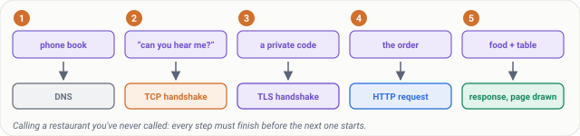
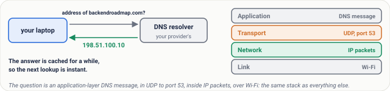
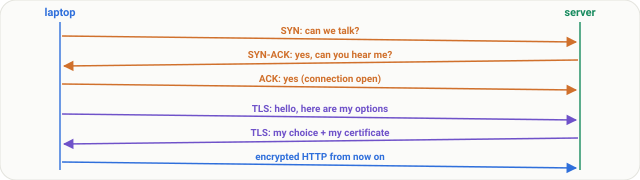
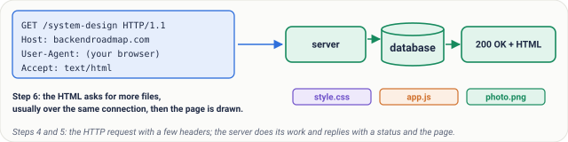
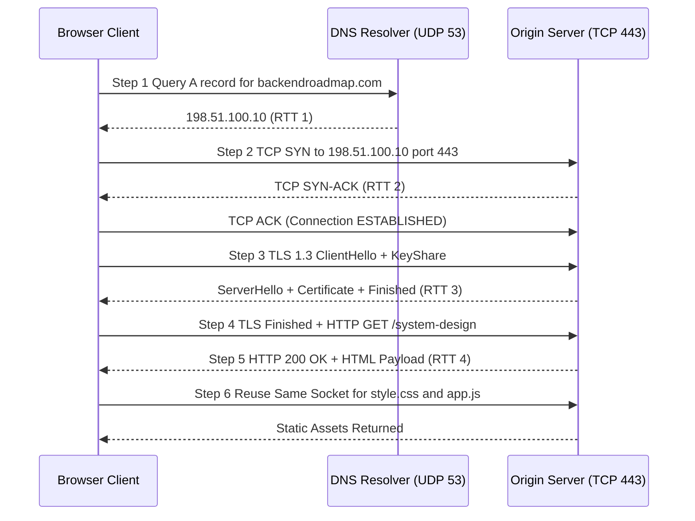
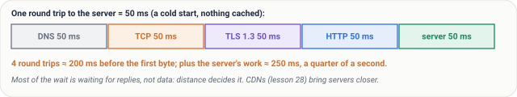
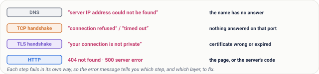
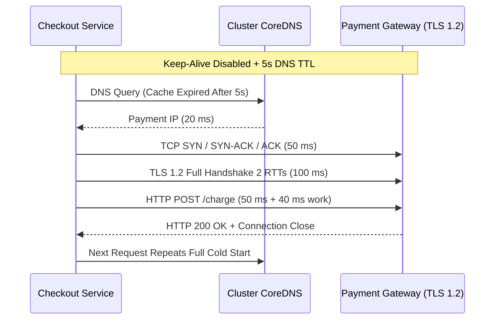
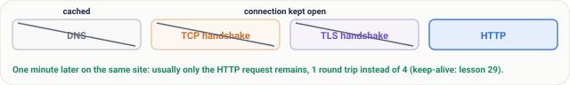

# Lesson 07: What Happens When You Type a URL

> **Prerequisites:** [Lesson 05: Protocols and Layers](../05-protocols-and-layers/README.md) and [Lesson 06: The OSI Model, Made Simple](../06-osi-model/README.md) ([Networking From Zero Overview](../README.md)).  
> **Estimated Reading Time:** 22 minutes  
> **Target Audience:** Backend engineers and SREs mastering the end-to-end browser-to-origin request lifecycle, cold-start RTT accounting, connection reuse, and per-phase failure diagnosis.  
> **Free PDF Notes:** [Download SD-N-007.pdf](https://backendroadmap.com/notes/system-design/SD-N-007.pdf)

> [!TIP]
> **The Golden Rule of URL Resolution:** Pressing Enter triggers four serial conversations—**DNS**, the **TCP handshake**, the **TLS handshake**, and **HTTP**—each costing about one round trip (`RTT`), so a cold page load waits roughly four round trips before receiving its first byte. Because latency is governed by physical distance and serial handshakes rather than bandwidth or server CPU, the error message tells you exactly which step failed, and real speedups come from caching, keep-alive connection reuse, HTTP/3, and CDNs.

---

## Words You'll Meet Today

Before tracing a URL across DNS resolvers, TCP sockets, and TLS certificates, anchor these eight core terms:

| Word | Everyday Meaning | Role in a Live Backend System |
| :--- | :--- | :--- |
| **URL** | A web address: protocol, server name, and path. | Parsed into scheme/port (`https` -> `443`), `Host` header, and URI route (`/system-design`). |
| **DNS** | The internet's phone book: a name to an IP address. | Maps human hostnames to routable IPv4/IPv6 addresses (cached up to each record's TTL). |
| **DNS resolver** | The server that looks names up for you, usually your provider's. | Recursive resolver (ISP, `1.1.1.1`, `8.8.8.8`, or cluster CoreDNS) querying authoritative DNS. |
| **Handshake** | The opening exchange before any data. | Negotiates initial sequence numbers (TCP) or cipher suites and keys (TLS). |
| **TLS** | The encryption behind the `S` in HTTPS. | Secures data in transit against eavesdropping and tampering above TCP. |
| **Certificate** | The server's proof of who it is. | X.509 chain signed by a trusted Certificate Authority (CA) binding domain name to public key. |
| **Round trip (RTT)** | A message there and the reply back. | Fundamental unit of network waiting (`~50 ms` regional, `~200 ms` transoceanic). |
| **Cold start** | A first visit, with nothing cached and no connection open. | Pays full DNS + TCP + TLS + HTTP latency before the first application byte arrives. |

---

## Visual Mental Models & Architecture

### The Question: What Happens in a Quarter of a Second?

You type `backendroadmap.com` and press Enter. A quarter of a second later, the page is on your screen.

In that blink, your browser held at least four separate conversations, using every layer from lesson 5. Today we follow them in order, one step at a time. It's also one of the most famous interview questions.

### An Everyday Picture First: Calling a New Restaurant

You want to order food from a restaurant you've never called. You look up its number in a phone book. You dial, and you both check you can hear each other.

You agree on a private code, so nobody listening can understand. You place the order. The food arrives, and you set the table. Every step must finish before the next one starts.



*Figure 1. The analogy: looking up the number, checking you can hear each other, agreeing a private code, ordering and eating map onto DNS, the TCP handshake, the TLS handshake, the HTTP request and the response.*

### Step 0: Read the URL

The browser reads the URL. `https:` means use HTTPS, so port `443`. **backendroadmap.com** is the name of the server. And `/system-design` is the page you want on it.


*Figure 2. Anatomy of a URL: the protocol (HTTPS, so port 443), the server's name, and the path of the page you want.*

### Step 1: DNS, the Phone Book

Computers don't send packets to names; they need an IP address. So step 1 is the phone book lookup.

Your laptop asks a **DNS resolver**, usually run by your internet provider: what's the address of `backendroadmap.com`? The resolver answers **198.51.100.10**. The answer is stored for a while (cached), so next time it's instant.

Notice the layers. The question is a DNS message, at the application layer. It travels in UDP, to port `53`, inside IP packets, over Wi-Fi. The same stack as every other message. DNS gets two full lessons of its own, 15 and 16.



*Figure 3. Step 1, DNS: the laptop asks a resolver for the server's IP address and caches the answer. The question travels through the same four layers as everything else.*

### Steps 2 and 3: The TCP and TLS Handshakes

**The TCP handshake.** Your laptop sends a `SYN`: can we talk? The server replies `SYN-ACK`: yes, can you hear me? Your laptop answers `ACK`: yes. Now a connection exists. Lesson 9 shows each message in detail.

**The TLS handshake.** Browser and server agree on keys for encryption, and the server proves who it is with a **certificate**. From now on, nobody in between can read or change the data. Lessons 20 to 22 cover keys, the handshake and certificates.



*Figure 4. Steps 2 and 3: the TCP three-way handshake (SYN, SYN-ACK, ACK) opens a connection; the TLS 1.3 handshake agrees keys and proves the server's identity with a certificate.*

### Steps 4 to 6: HTTP, the Server, the Page

4. **The HTTP request.** `GET /system-design`, with a few headers, like which browser you use and which formats you accept.
5. **The server does its work.** Maybe it reads a database and builds the page, then replies: `200 OK`, and the HTML.
6. **The browser draws the page.** The HTML says it needs more: a style sheet, some scripts and images. The browser asks for those too, usually over the same connection, and draws the page.

So the four conversations are DNS, the TCP handshake, the TLS handshake and HTTP. Each one needs the one before it.



*Figure 5. Steps 4 to 6: the HTTP request with its headers, the server's work and reply (200 OK and the HTML), then the extra files the page needs.*



### Real Numbers: Count the Round Trips

Say a round trip to the server takes `50 ms`.

| Step | Round Trips | Time |
| :--- | :--- | :--- |
| DNS (not cached) | 1, often more | 50 ms |
| TCP handshake | 1 | 50 ms |
| TLS 1.3 handshake | 1 | 50 ms |
| HTTP request and reply | 1 | 50 ms |
| **Before the first byte** | **4** | **≈ 200 ms** |
| Server's own work | – | ≈ 50 ms |
| **Total** | | **≈ 250 ms** |

That's the quarter of a second from the start.

Notice: most of that time isn't data; it's waiting for replies. That's why the speed of light, and the distance to the server, matter so much, and why CDNs, servers close to you, exist ([lesson 28](../28-cdns/README.md)).



*Figure 6. Counting round trips on a cold start: DNS, TCP, TLS 1.3 and HTTP each cost about one, so 200 ms of waiting before the first byte, plus the server's own work.*

### What Goes Wrong: The Error Names the Step

- **DNS fails:** the browser says the server's IP address could not be found. The name has no answer.
- **The TCP handshake fails:** connection refused, or connection timed out. The address was found, but nothing answered on that port.
- **TLS fails:** your connection is not private. The certificate is wrong or expired.
- **HTTP fails:** everything else worked, and you get a page with a status code: `404` not found, or `500`, a server error.

So reading the error tells you which step, and which layer, to fix.



*Figure 7. What goes wrong: each of the four conversations has its own error, so the message tells you which step failed.*

---

## Systematic Reference & Protocol Comparison

### Cold Start vs. Warm Connection vs. HTTP/3 (QUIC) RTT Budget

| Connection Profile | DNS Cost | Transport Handshake | TLS Handshake | HTTP Req/Resp | Network Wait Before First Byte (at 50 ms RTT) |
| :--- | :--- | :--- | :--- | :--- | :--- |
| **Cold Start (HTTPS / TLS 1.2)** | 1+ RTT | 1 RTT (TCP) | 2 RTT (TLS 1.2) | 1 RTT | **5+ RTTs (`~250+ ms`)** |
| **Cold Start (HTTPS / TLS 1.3)** | 1+ RTT | 1 RTT (TCP) | 1 RTT (TLS 1.3) | 1 RTT | **4+ RTTs (`~200+ ms`)** |
| **Cold Start (HTTP/3 over QUIC)** | 1+ RTT | Combined with TLS | 1 RTT (QUIC 1-RTT) | 1 RTT | **3+ RTTs (`~150+ ms`)** |
| **Warm Keep-Alive (Cached DNS)** | 0 RTT | 0 RTT (Open socket) | 0 RTT | 1 RTT | **1 RTT (`50 ms`)** |

### Failure Signatures Mapped to Protocol Phase

| Step | Browser / Client Error | Kernel / Wire Signal | Primary Root Causes |
| :--- | :--- | :--- | :--- |
| **1. DNS** | `ERR_NAME_NOT_RESOLVED` / `NXDOMAIN` | UDP/53 timeout or empty `NOERROR`/`NXDOMAIN` answer | Bad domain spelling, missing DNS record, resolver outage, VPC DNS blockage |
| **2. TCP** | `ERR_CONNECTION_REFUSED` or `TIMED_OUT` | `RST` packet (refused) or silent drop of `SYN` (timeout) | Service crashed/not listening on `443`, security group or firewall drop |
| **3. TLS** | `ERR_CERT_DATE_INVALID` / `NET::ERR_CERT_AUTHORITY_INVALID` | TLS Alert (`certificate_expired`, `handshake_failure`) | Expired X.509 cert, missing intermediate chain, hostname/SAN mismatch |
| **4. HTTP** | `404 Not Found`, `502 Bad Gateway`, `504 Gateway Timeout` | Valid TLS stream carrying HTTP status code | Wrong route path, upstream crash (`502`), upstream slow beyond proxy timeout (`504`) |

---

## Production War Story Post-Mortem

### SEV-1: Disabled HTTP Keep-Alive + 5-Second DNS TTL Triggers 4x Checkout Latency Spike

- **Severity:** SEV-1 (Checkout p99 spiked from `180 ms` to `760 ms`; CoreDNS CPU hit 98%)
- **Detection Time:** 4 minutes (SLO burn alert on checkout latency)
- **Resolution Time:** 27 minutes
- **Impact:** 38% of mobile checkouts timed out on the `500 ms` client SLA during peak evening traffic.

#### What Happened

During a routine HTTP client library upgrade in the `checkout-service`, the default connection pool behavior silently changed to close idle sockets immediately (`Connection: close`), while a separate Helm change reduced the payment gateway's external DNS record TTL to `5 seconds`. Every single `POST /charge` call suddenly became a **cold start**: paying a fresh CoreDNS lookup, a `50 ms` TCP handshake, a `100 ms` TLS 1.2 handshake (2 RTTs), and the `50 ms` HTTP call before even starting payment processing.



#### Root Cause Analysis

1. **Unintended Cold-Start Amplification:** Disabling HTTP keep-alive forced every RPC through fresh TCP and TLS 1.2 handshakes (`3 RTTs` of pure handshake overhead per request).
2. **Resolver Saturation:** Shortening the DNS TTL to `5 s` without connection pooling magnified QPS to cluster `CoreDNS`, adding DNS queuing jitter on top of TCP/TLS round trips.

#### The Fix & Architectural Hardening

1. **Enforced Persistent HTTP Connection Pooling:** Re-enabled HTTP/1.1 keep-alive / HTTP/2 multiplexing (`MaxIdleConnsPerHost = 100`, `IdleConnTimeout = 90s`), dropping steady-state network wait from 4–5 RTTs down to **1 RTT**.
2. **TLS 1.3 & NodeLocal DNSCache:** Upgraded upstream gateway negotiation to **TLS 1.3** (saving 1 RTT on cold connects) and deployed `NodeLocal DNSCache` with sane `60 s+` external DNS caching.

---

## Multi-Language Production Implementation

Below is a **Multi-Phase URL Latency Tracer** in four languages. It breaks a single HTTPS request into the exact four conversations from this lesson—**DNS lookup**, **TCP handshake**, **TLS handshake**, and **HTTP first-byte latency (TTFB)**—so you can pinpoint which step dominates your tail latency.

````carousel
```go
package main

import (
	"context"
	"crypto/tls"
	"fmt"
	"io"
	"net/http"
	"net/http/httptrace"
	"time"
)

func TraceURL(ctx context.Context, targetURL string) error {
	var dnsStart, tcpStart, tlsStart, reqStart time.Time
	var dnsDur, tcpDur, tlsDur, ttfb time.Duration

	trace := &httptrace.ClientTrace{
		DNSStart: func(_ httptrace.DNSStartInfo) { dnsStart = time.Now() },
		DNSDone:  func(_ httptrace.DNSDoneInfo) { dnsDur = time.Since(dnsStart) },
		ConnectStart: func(_, _ string) { tcpStart = time.Now() },
		ConnectDone:  func(_, _ string, _ error) { tcpDur = time.Since(tcpStart) },
		TLSHandshakeStart: func() { tlsStart = time.Now() },
		TLSHandshakeDone:  func(_ tls.ConnectionState, _ error) { tlsDur = time.Since(tlsStart) },
		GotFirstResponseByte: func() { ttfb = time.Since(reqStart) },
	}

	req, err := http.NewRequestWithContext(httptrace.WithClientTrace(ctx, trace), http.MethodGet, targetURL, nil)
	if err != nil {
		return err
	}

	// Disable keep-alive only when intentionally benchmarking a cold start
	client := &http.Client{Transport: &http.Transport{DisableKeepAlives: true}, Timeout: 5 * time.Second}
	reqStart = time.Now()
	resp, err := client.Do(req)
	if err != nil {
		return err
	}
	defer resp.Body.Close()
	_, _ = io.Copy(io.Discard, resp.Body)

	fmt.Printf("Status=%d | DNS=%v | TCP=%v | TLS=%v | HTTP_TTFB=%v | Total=%v\n",
		resp.StatusCode, dnsDur.Round(time.Millisecond), tcpDur.Round(time.Millisecond),
		tlsDur.Round(time.Millisecond), ttfb.Round(time.Millisecond), time.Since(reqStart).Round(time.Millisecond))
	return nil
}

func main() {
	if err := TraceURL(context.Background(), "https://backendroadmap.com/system-design"); err != nil {
		fmt.Println("Request failed:", err)
	}
}
```
<!-- slide -->
```typescript
import * as dns from "node:dns/promises";
import * as tls from "node:tls";
import { performance } from "node:perf_hooks";

interface PhaseTimings {
  dnsMs: number;
  tcpMs: number;
  tlsMs: number;
  ttfbMs: number;
  statusLine: string;
}

export async function traceHttpsUrl(rawUrl: string): Promise<PhaseTimings> {
  const parsed = new URL(rawUrl);
  const port = Number(parsed.port || 443);
  const path = `${parsed.pathname || "/"}${parsed.search}`;

  // Step 1: DNS resolution
  const t0 = performance.now();
  const { address } = await dns.lookup(parsed.hostname);
  const dnsMs = performance.now() - t0;

  return new Promise((resolve, reject) => {
    const tTcpStart = performance.now();
    let tcpMs = 0;
    let tlsMs = 0;
    let tHttpStart = 0;

    // Steps 2 & 3: TCP + TLS handshake
    const socket = tls.connect({ host: address, port, servername: parsed.hostname }, () => {
      tlsMs = performance.now() - tTcpStart - tcpMs;
      tHttpStart = performance.now();
      socket.write(`GET ${path} HTTP/1.1\r\nHost: ${parsed.hostname}\r\nConnection: close\r\n\r\n`);
    });

    socket.once("connect", () => {
      tcpMs = performance.now() - tTcpStart;
    });

    // Step 4: HTTP first response byte
    socket.once("data", (chunk: Buffer) => {
      const ttfbMs = performance.now() - tHttpStart;
      const statusLine = chunk.toString("utf8").split("\r\n")[0];
      socket.destroy();
      resolve({ dnsMs, tcpMs, tlsMs, ttfbMs, statusLine });
    });

    socket.setTimeout(5000, () => reject(new Error("Phase timeout")));
    socket.on("error", reject);
  });
}

traceHttpsUrl("https://backendroadmap.com/system-design")
  .then((t) => console.log(t))
  .catch((err) => console.error("Failed:", err.message));
```
<!-- slide -->
```python
import socket
import ssl
import time
from urllib.parse import urlparse


def trace_https_url(raw_url: str, timeout: float = 5.0) -> dict[str, float | str]:
    parsed = urlparse(raw_url)
    host = parsed.hostname or ""
    port = parsed.port or 443
    path = parsed.path or "/"

    # Step 1: DNS Lookup
    t0 = time.perf_counter()
    infos = socket.getaddrinfo(host, port, type=socket.SOCK_STREAM)
    ip = infos[0][4][0]
    dns_ms = (time.perf_counter() - t0) * 1000

    # Step 2: TCP Three-Way Handshake
    t_tcp = time.perf_counter()
    raw_sock = socket.create_connection((ip, port), timeout=timeout)
    tcp_ms = (time.perf_counter() - t_tcp) * 1000

    # Step 3: TLS Handshake
    ctx = ssl.create_default_context()
    t_tls = time.perf_counter()
    with ctx.wrap_socket(raw_sock, server_hostname=host) as tls_sock:
        tls_ms = (time.perf_counter() - t_tls) * 1000

        # Step 4: HTTP Request & First Byte (TTFB)
        req = f"GET {path} HTTP/1.1\r\nHost: {host}\r\nConnection: close\r\n\r\n".encode()
        t_http = time.perf_counter()
        tls_sock.sendall(req)
        first_chunk = tls_sock.recv(1024)
        ttfb_ms = (time.perf_counter() - t_http) * 1000

    status_line = first_chunk.decode("utf-8", errors="replace").splitlines()[0]
    return {
        "ip": ip,
        "dns_ms": round(dns_ms, 2),
        "tcp_ms": round(tcp_ms, 2),
        "tls_ms": round(tls_ms, 2),
        "http_ttfb_ms": round(ttfb_ms, 2),
        "status": status_line,
    }


if __name__ == "__main__":
    print(trace_https_url("https://backendroadmap.com/system-design"))
```
<!-- slide -->
```csharp
using System;
using System.Diagnostics;
using System.Net;
using System.Net.Security;
using System.Net.Sockets;
using System.Text;
using System.Threading.Tasks;

public static class UrlLifecycleTracer
{
    public static async Task TraceAsync(string rawUrl)
    {
        var uri = new Uri(rawUrl);
        int port = uri.Port > 0 ? uri.Port : 443;
        var sw = new Stopwatch();

        // Step 1: DNS Lookup
        sw.Restart();
        IPAddress[] addresses = await Dns.GetHostAddressesAsync(uri.Host);
        double dnsMs = sw.Elapsed.TotalMilliseconds;

        // Step 2: TCP Three-Way Handshake
        using var tcp = new TcpClient();
        sw.Restart();
        await tcp.ConnectAsync(addresses[0], port);
        double tcpMs = sw.Elapsed.TotalMilliseconds;

        // Step 3: TLS Handshake + Certificate Validation
        using var ssl = new SslStream(tcp.GetStream(), leaveInnerStreamOpen: false);
        sw.Restart();
        await ssl.AuthenticateAsClientAsync(uri.Host);
        double tlsMs = sw.Elapsed.TotalMilliseconds;

        // Step 4: HTTP Request & First Byte (TTFB)
        string req = $"GET {uri.PathAndQuery} HTTP/1.1\r\nHost: {uri.Host}\r\nConnection: close\r\n\r\n";
        byte[] buffer = new byte[1024];
        sw.Restart();
        await ssl.WriteAsync(Encoding.ASCII.GetBytes(req));
        int read = await ssl.ReadAsync(buffer);
        double httpTtfbMs = sw.Elapsed.TotalMilliseconds;

        string statusLine = Encoding.UTF8.GetString(buffer, 0, read).Split("\r\n")[0];
        Console.WriteLine($"IP={addresses[0]} DNS={dnsMs:F1}ms TCP={tcpMs:F1}ms TLS={tlsMs:F1}ms HTTP_TTFB={httpTtfbMs:F1}ms Status={statusLine}");
    }
}
```
````

---

## Practical Hands-On Verification CLI Workflows

Run these commands to measure every single phase of a URL load from your terminal and isolate failing steps:

### 1. Measure Exact Cold-Start Phase Breakdown with `curl -w`

```bash
curl -sS -o /dev/null -w "dns=%{time_namelookup}s tcp_connect=%{time_connect}s tls_done=%{time_appconnect}s ttfb=%{time_starttransfer}s total=%{time_total}s http=%{http_code}\n" https://backendroadmap.com/system-design
```

**Expected Output:**

```text
dns=0.048210s tcp_connect=0.097430s tls_done=0.149880s ttfb=0.211450s total=0.238900s http=200
```

Notice the cumulative timeline: DNS took `~48 ms`, TCP added `~49 ms` (`0.097 - 0.048`), TLS 1.3 added `~52 ms` (`0.149 - 0.097`), and HTTP first byte arrived `~62 ms` later (`0.211 - 0.149`).

### 2. Isolate Step 1 (DNS Resolution) and Observe Caching TTL

```bash
dig +noall +answer +stats backendroadmap.com A
```

**Expected Output:**

```text
backendroadmap.com.     300     IN      A       198.51.100.10
;; Query time: 42 msec
;; SERVER: 192.168.1.1#53(192.168.1.1) (UDP)
```

### 3. Inspect Step 3 (TLS 1.3 Handshake & Certificate Chain)

```bash
openssl s_client -connect backendroadmap.com:443 -servername backendroadmap.com -tls1_3 </dev/null 2>/dev/null | grep -E "Protocol|Cipher|Verify return code"
```

**Expected Output:**

```text
    Protocol  : TLSv1.3
    Cipher    : TLS_AES_256_GCM_SHA384
    Verify return code: 0 (ok)
```

---

## Pause and Think

> [!exercise] One minute later, you open another page on the same site. It loads much faster. Which steps did the browser skip? Decide before you open the answer.

<details><summary>Answer</summary>

Usually three of the four. DNS is cached, so no lookup. And the connection is kept open, so no TCP or TLS handshake. Only the HTTP request remains: one round trip instead of four. That's why keeping connections open matters so much ([lesson 29](../29-connection-pooling-and-keep-alive/README.md)).



*Figure 8. The pause-and-think answer: on a second page a minute later, DNS is cached and the connection is still open, so only the HTTP request remains.*

</details>

---

## Operational Validation Checkpoints

<details><summary><strong>Checkpoint 1: Cold-Start Math on a Transatlantic API Call</strong></summary>

A backend client in Frankfurt opens a cold HTTPS connection (uncached DNS, TLS 1.3) to a legacy API in Virginia (`RTT = 95 ms`), and the origin database query takes `25 ms`. Estimate the Time to First Byte (TTFB).

**Answer:** `4 RTTs + 25 ms` = `(4 × 95 ms) + 25 ms` = **`405 ms`**. Notice that optimizing the origin database query all the way down to `0 ms` only reduces TTFB to `380 ms` because 94% of the wait is serial round trips across the Atlantic.

</details>

<details><summary><strong>Checkpoint 2: Pinpointing the Broken Conversation From the Error String</strong></summary>

Three customers report errors hitting `https://shop.example.com/cart`: Customer A sees `DNS_PROBE_FINISHED_NXDOMAIN`, Customer B sees `ERR_CONNECTION_TIMED_OUT`, and Customer C sees `HTTP 502 Bad Gateway`. Which conversation failed for each?

**Answer:** Customer A failed at **Step 1 (DNS)**—their resolver could not obtain an IP address. Customer B resolved the IP successfully and failed at **Step 2 (TCP handshake)**—packets were silently dropped before a `SYN-ACK` returned. Customer C completed DNS, TCP, and TLS cleanly, failing at **Step 4 (HTTP)** when the edge proxy could not get a healthy response from the backend origin.

</details>

<details><summary><strong>Checkpoint 3: Why Bandwidth Upgrades Don't Fix Cold Page Loads</strong></summary>

A startup upgrades its server network interface from 1 Gbps to 10 Gbps and doubles server CPU cores, yet cold users 8,000 km away still report ~850 ms Time to First Byte. Why did neither upgrade meaningfully reduce TTFB?

**Answer:** Initial HTML requests and handshakes are tiny packets (`< 2 KB`)—they are **latency-bound, not bandwidth-bound**, and serial round trips wait on the speed of light in fiber (`~200 ms RTT` across 8,000 km). Putting an edge **CDN** closer to users (cutting RTT from `200 ms` to `15 ms`) and enabling **HTTP/3 + keep-alive** directly slashes those round trips.

</details>

---

## Common Mistakes & Troubleshooting

- **"The browser goes straight to the server."** No. It first needs the address (DNS), then a connection (TCP), then encryption (TLS); only then can it ask for the page.
- **"A faster server fixes a slow page."** Often not. On a cold load most of the time is round trips; fewer and shorter round trips (caching, keep-alive, CDNs) usually help more.
- **Ignoring TLS 1.2 vs. TLS 1.3 on cold connections.** Older load balancers pinned to TLS 1.2 burn **two** RTTs on the TLS handshake instead of one—adding a hidden 25–30% latency tax on every uncached mobile request.
- **Shortening DNS TTLs without local caching.** Dropping DNS TTL to `5 s` without keep-alive pooling or a node-local DNS cache forces constant UDP port 53 lookups on hot paths.

---

## Recap in Three Lines

1. Typing a URL starts four conversations: DNS, the TCP handshake, the TLS handshake and HTTP.
2. Each costs about one round trip, so distance and caching decide most of the wait.
3. The error you see tells you which step failed.

---

## Interview Practice Questions

> [!interview] What happens when you type a URL into a browser and press Enter? (Basic)

<details><summary>What to say in 30 seconds</summary>

The browser parses the URL, resolves the name to an IP address with DNS (usually from a cache), opens a TCP connection with the three-way handshake, and for HTTPS does a TLS handshake that agrees keys and checks the certificate. Then it sends the HTTP request, the server responds with the HTML, and the browser fetches the other files, CSS, scripts and images, usually over the same connection, and renders the page.

</details>

> [!interview] Which protocols, at which layers, are involved? (Basic)

<details><summary>What to say in 30 seconds</summary>

DNS (application layer, normally over UDP port 53) to find the address; TCP (transport) for the connection; TLS for encryption, which runs above TCP inside the application; HTTP (application) for the request and response; IP (network) carries every packet; and Ethernet or Wi-Fi (link) moves them hop by hop.

</details>

> [!interview] Why is the first visit to a site slower than the second? (Scenario)

<details><summary>What to say in 30 seconds</summary>

A cold start pays for DNS, the TCP handshake and the TLS handshake before the request, about four round trips in all. A minute later the DNS answer is cached and the connection is usually still open (keep-alive), so only the HTTP request and response remain, often one round trip. Browser caching of files saves even more.

</details>

> [!interview] A user sees “connection timed out”. Which step failed, and what would you check? (Scenario)

<details><summary>What to say in 30 seconds</summary>

DNS worked, because there is an address; the TCP handshake failed, because nothing answered on that port. Check that the server is up and listening on 443, firewall and security-group rules, and the load balancer's health. If it said the IP address could not be found, it would be DNS; “not private” would be TLS; a 500 would be the application.

</details>

> [!interview] How long does a cold page load take, at minimum, if the round-trip time is 50 ms? (Tricky)

<details><summary>What to say in 30 seconds</summary>

About four round trips before the first byte: DNS (one or more if not cached), the TCP handshake (one), TLS 1.3 (one) and the HTTP request (one): roughly 200 ms, plus the server's processing time. TLS 1.2 costs two round trips, and HTTP/3 over QUIC combines the transport and TLS handshakes into one.

</details>

> [!interview] Most of that time isn't data. What does that mean for design? (Tricky)

<details><summary>What to say in 30 seconds</summary>

Latency, not bandwidth, dominates small requests, and latency is mostly distance. So reduce round trips (keep connections open, cache DNS and files, use HTTP/2 or 3) and shorten them (put content close to users with a CDN). Making the server faster helps only the small part of the time it owns.

</details>

---

## Free PDF notes

Download these notes as a printable PDF, with every picture, the round-trip count and the interview answers: [SD-N-007.pdf](https://backendroadmap.com/notes/system-design/SD-N-007.pdf).

## Sources

- [RFC 3986: Uniform Resource Identifier (URI): Generic Syntax](https://www.rfc-editor.org/rfc/rfc3986), the parts of a URL.
- [RFC 1034](https://www.rfc-editor.org/rfc/rfc1034) and [RFC 1035](https://www.rfc-editor.org/rfc/rfc1035): Domain Names, DNS and its use of UDP port 53.
- [RFC 9293: Transmission Control Protocol](https://www.rfc-editor.org/rfc/rfc9293), the three-way handshake.
- [RFC 8446: TLS 1.3](https://www.rfc-editor.org/rfc/rfc8446), the one-round-trip handshake and certificates.
- [RFC 9110: HTTP Semantics](https://www.rfc-editor.org/rfc/rfc9110), requests, headers and status codes such as 200, 404 and 500.
- [RFC 9000: QUIC](https://www.rfc-editor.org/rfc/rfc9000), which joins the transport and TLS handshakes for HTTP/3.
- [RFC 5737: IPv4 Address Blocks Reserved for Documentation](https://www.rfc-editor.org/rfc/rfc5737), where the example address 198.51.100.10 comes from.

## Next

Next comes [lesson 8, TCP part 1](../08-tcp-sequence-numbers-and-acks/README.md): how sequence numbers and acknowledgements make sure no data is ever lost. The [track overview](../README.md) lists the whole series.
