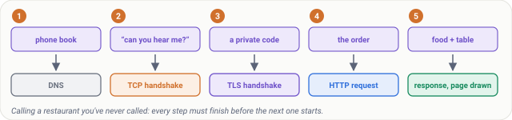
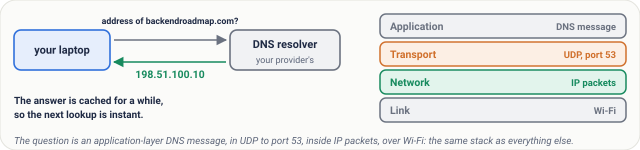
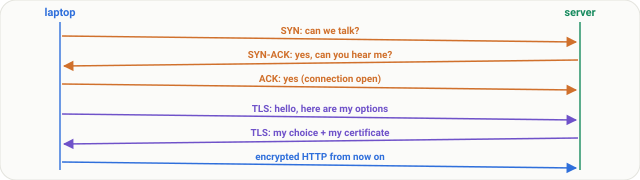
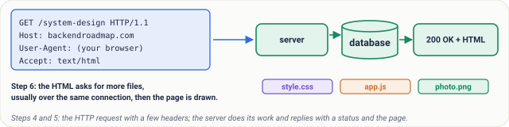
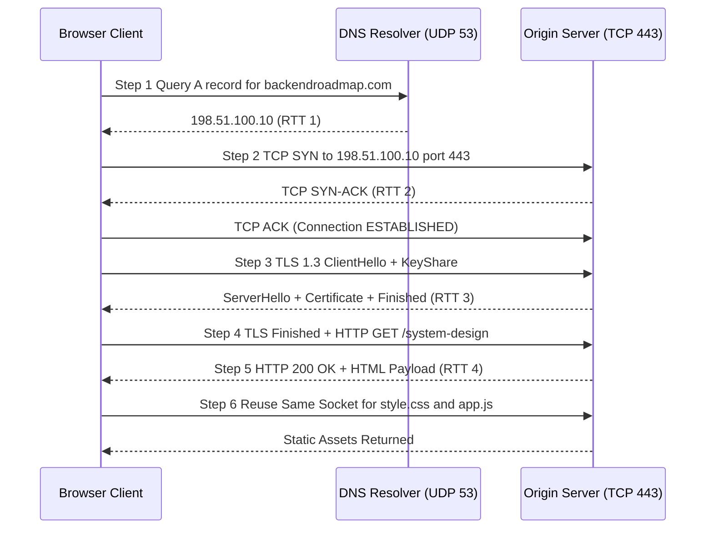
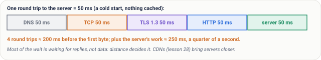
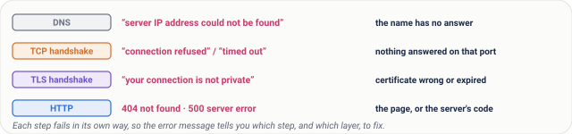
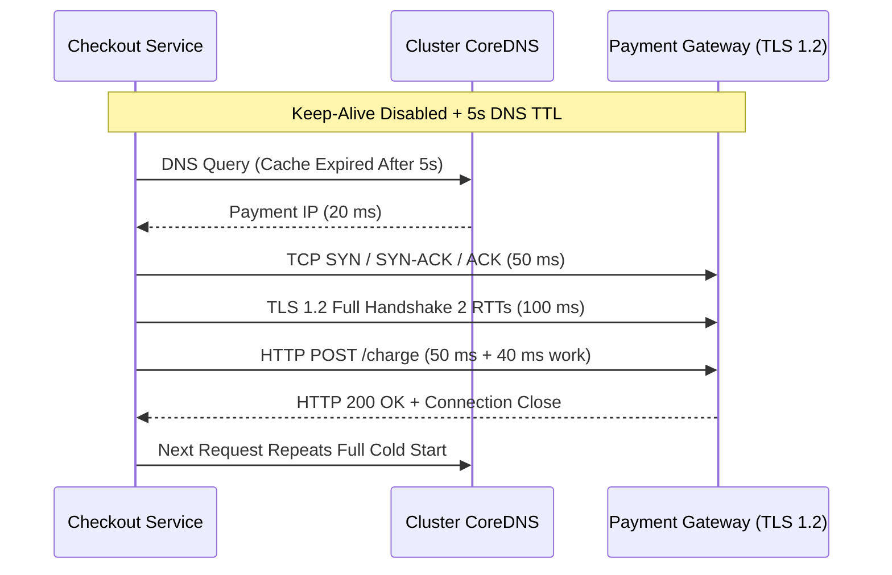
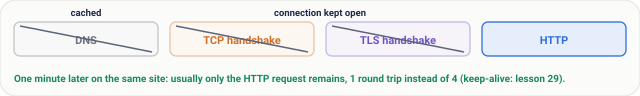

# Lesson 07: What Happens When You Type a URL

> **Prerequisites:** [Lesson 05: Protocols and Layers](../05-protocols-and-layers/README.md) and [Lesson 06: The OSI Model, Made Simple](../06-osi-model/README.md) ([Networking From Zero Overview](../README.md)).  
> **Estimated Reading Time:** 31 minutes  
> **Target Audience:** Backend engineers and SREs mastering the end-to-end browser-to-origin request lifecycle, cold-start RTT accounting, connection reuse, and per-phase failure diagnosis.  
> **Free PDF Notes:** [Download SD-N-007.pdf](https://backendroadmap.com/notes/system-design/SD-N-007.pdf)

> [!NOTE]
> **In one line:** pressing Enter starts four conversations in order (DNS, the TCP handshake, the TLS handshake and HTTP), each about one round trip, so a cold page load waits about four round trips before the first byte; the error you see tells you which step failed.

> [!TIP]
> **The Golden Rule of URL Resolution:** Pressing Enter triggers four serial conversations—**DNS**, the **TCP handshake**, the **TLS handshake**, and **HTTP**—each costing about one round trip (`RTT`), so a cold page load waits roughly four round trips before receiving its first byte. Because latency is governed by physical distance and serial handshakes rather than bandwidth or server CPU, the error message tells you exactly which step failed, and real speedups come from caching, keep-alive connection reuse, HTTP/3, and CDNs.

---

## Words You'll Meet Today

Before tracing a URL across DNS resolvers, TCP sockets, and TLS certificates, anchor these eight core terms:

| Word | Everyday Meaning | Role in a Live Backend System |
| :--- | :--- | :--- |
| **URL** | A web address: protocol, server name, and path. | Parsed into scheme/port (`https` -> `443`), `Host` header, and URI route (`/system-design`). |
| **DNS** | The internet's phone book: a name to an IP address. | Maps human hostnames to routable IPv4/IPv6 addresses (cached up to each record's TTL). |
| **DNS resolver** | The server that looks names up for you, usually your provider's. | Recursive resolver (ISP, `1.1.1.1`, `8.8.8.8`, or cluster CoreDNS) querying authoritative DNS. |
| **Handshake** | The opening exchange before any data. | Negotiates initial sequence numbers (TCP) or cipher suites and keys (TLS). |
| **TLS** | The encryption behind the `S` in HTTPS. | Secures data in transit against eavesdropping and tampering above TCP. |
| **Certificate** | The server's proof of who it is. | X.509 chain signed by a trusted Certificate Authority (CA) binding domain name to public key. |
| **Round trip (RTT)** | A message there and the reply back. | Fundamental unit of network waiting (`~50 ms` regional, `~200 ms` transoceanic). |
| **Cold start** | A first visit, with nothing cached and no connection open. | Pays full DNS + TCP + TLS + HTTP latency before the first application byte arrives. |

---

## What It Is vs. What It Isn't

"Loading a page" is really a chain of different protocols owned by different systems. Keep them separate:

| Term | Precise Meaning | What It Is **NOT** | Production Example |
| :--- | :--- | :--- | :--- |
| **URL** | A structured address: `scheme://host[:port]/path?query#fragment` (RFC 3986). | Not an IP address, not a file path on the server, and the `#fragment` is **never sent** to the server. | `https://backendroadmap.com/system-design` -> port `443`, `Host: backendroadmap.com`, path `/system-design`. |
| **DNS lookup** | Translating a hostname to IP addresses (UDP/TCP `53`), cached up to the record's **TTL**. | Not part of HTTP; not a connection to the website; it talks to *resolvers*, not your server. | `dig backendroadmap.com A` -> `198.51.100.10`, TTL `300`. |
| **TCP handshake** | `SYN`, `SYN-ACK`, `ACK`: both sides agree they can talk and pick initial sequence numbers. | Not encryption and not a request; no application bytes (except TCP Fast Open) travel yet. | `nc -zv host 443` measures only this step. |
| **TLS handshake** | Agreeing keys and ciphers and verifying the **certificate** so data is private and tamper-evident. | Not authentication of *you*, and not the same as the TCP connection; TLS fails independently of TCP. | `openssl s_client -connect host:443`. |
| **HTTP request/response** | Application message (`GET /path`, headers) answered by status + body. | Not a connection: HTTP *rides on* the TCP+TLS connection (or QUIC for HTTP/3) and can reuse it. | `curl -v https://host/path` -> `200 OK`. |

> **Four conversations, four owners, four failure modes:** resolver (DNS), network/firewall (TCP), certificate/clock (TLS), application (HTTP). The error string tells you whose problem it is.

---

## Visual Mental Models & Architecture

### The Question: What Happens in a Quarter of a Second?

You type `backendroadmap.com` and press Enter. A quarter of a second later, the page is on your screen.

In that blink, your browser held at least four separate conversations, using every layer from lesson 5. Today we follow them in order, one step at a time. It's also one of the most famous interview questions.

### An Everyday Picture First: Calling a New Restaurant

You want to order food from a restaurant you've never called. You look up its number in a phone book. You dial, and you both check you can hear each other.

You agree on a private code, so nobody listening can understand. You place the order. The food arrives, and you set the table. Every step must finish before the next one starts.



*Figure 1. The analogy: looking up the number, checking you can hear each other, agreeing a private code, ordering and eating map onto DNS, the TCP handshake, the TLS handshake, the HTTP request and the response.*

### Step 0: Read the URL

The browser reads the URL. `https:` means use HTTPS, so port `443`. **backendroadmap.com** is the name of the server. And `/system-design` is the page you want on it.


*Figure 2. Anatomy of a URL: the protocol (HTTPS, so port 443), the server's name, and the path of the page you want.*

### Step 1: DNS, the Phone Book

Computers don't send packets to names; they need an IP address. So step 1 is the phone book lookup.

Your laptop asks a **DNS resolver**, usually run by your internet provider: what's the address of `backendroadmap.com`? The resolver answers **198.51.100.10**. The answer is stored for a while (cached), so next time it's instant.

Notice the layers. The question is a DNS message, at the application layer. It travels in UDP, to port `53`, inside IP packets, over Wi-Fi. The same stack as every other message. DNS gets two full lessons of its own, 15 and 16.



*Figure 3. Step 1, DNS: the laptop asks a resolver for the server's IP address and caches the answer. The question travels through the same four layers as everything else.*

### Steps 2 and 3: The TCP and TLS Handshakes

**The TCP handshake.** Your laptop sends a `SYN`: can we talk? The server replies `SYN-ACK`: yes, can you hear me? Your laptop answers `ACK`: yes. Now a connection exists. Lesson 9 shows each message in detail.

**The TLS handshake.** Browser and server agree on keys for encryption, and the server proves who it is with a **certificate**. From now on, nobody in between can read or change the data. Lessons 20 to 22 cover keys, the handshake and certificates.



*Figure 4. Steps 2 and 3: the TCP three-way handshake (SYN, SYN-ACK, ACK) opens a connection; the TLS 1.3 handshake agrees keys and proves the server's identity with a certificate.*

### Steps 4 to 6: HTTP, the Server, the Page

4. **The HTTP request.** `GET /system-design`, with a few headers, like which browser you use and which formats you accept.
5. **The server does its work.** Maybe it reads a database and builds the page, then replies: `200 OK`, and the HTML.
6. **The browser draws the page.** The HTML says it needs more: a style sheet, some scripts and images. The browser asks for those too, usually over the same connection, and draws the page.

So the four conversations are DNS, the TCP handshake, the TLS handshake and HTTP. Each one needs the one before it.



*Figure 5. Steps 4 to 6: the HTTP request with its headers, the server's work and reply (200 OK and the HTML), then the extra files the page needs.*



### Real Numbers: Count the Round Trips

Say a round trip to the server takes `50 ms`.

| Step | Round Trips | Time |
| :--- | :--- | :--- |
| DNS (not cached) | 1, often more | 50 ms |
| TCP handshake | 1 | 50 ms |
| TLS 1.3 handshake | 1 | 50 ms |
| HTTP request and reply | 1 | 50 ms |
| **Before the first byte** | **4** | **≈ 200 ms** |
| Server's own work | – | ≈ 50 ms |
| **Total** | | **≈ 250 ms** |

That's the quarter of a second from the start.

Notice: most of that time isn't data; it's waiting for replies. That's why the speed of light, and the distance to the server, matter so much, and why CDNs, servers close to you, exist ([lesson 28](../28-cdns/README.md)).



*Figure 6. Counting round trips on a cold start: DNS, TCP, TLS 1.3 and HTTP each cost about one, so 200 ms of waiting before the first byte, plus the server's own work.*

### What Goes Wrong: The Error Names the Step

- **DNS fails:** the browser says the server's IP address could not be found. The name has no answer.
- **The TCP handshake fails:** connection refused, or connection timed out. The address was found, but nothing answered on that port.
- **TLS fails:** your connection is not private. The certificate is wrong or expired.
- **HTTP fails:** everything else worked, and you get a page with a status code: `404` not found, or `500`, a server error.

So reading the error tells you which step, and which layer, to fix.



*Figure 7. What goes wrong: each of the four conversations has its own error, so the message tells you which step failed.*

---

## Systematic Reference & Protocol Comparison

### Cold Start vs. Warm Connection vs. HTTP/3 (QUIC) RTT Budget

| Connection Profile | DNS Cost | Transport Handshake | TLS Handshake | HTTP Req/Resp | Network Wait Before First Byte (at 50 ms RTT) |
| :--- | :--- | :--- | :--- | :--- | :--- |
| **Cold Start (HTTPS / TLS 1.2)** | 1+ RTT | 1 RTT (TCP) | 2 RTT (TLS 1.2) | 1 RTT | **5+ RTTs (`~250+ ms`)** |
| **Cold Start (HTTPS / TLS 1.3)** | 1+ RTT | 1 RTT (TCP) | 1 RTT (TLS 1.3) | 1 RTT | **4+ RTTs (`~200+ ms`)** |
| **Cold Start (HTTP/3 over QUIC)** | 1+ RTT | Combined with TLS | 1 RTT (QUIC 1-RTT) | 1 RTT | **3+ RTTs (`~150+ ms`)** |
| **Warm Keep-Alive (Cached DNS)** | 0 RTT | 0 RTT (Open socket) | 0 RTT | 1 RTT | **1 RTT (`50 ms`)** |

### Failure Signatures Mapped to Protocol Phase

| Step | Browser / Client Error | Kernel / Wire Signal | Primary Root Causes |
| :--- | :--- | :--- | :--- |
| **1. DNS** | `ERR_NAME_NOT_RESOLVED` / `NXDOMAIN` | UDP/53 timeout or empty `NOERROR`/`NXDOMAIN` answer | Bad domain spelling, missing DNS record, resolver outage, VPC DNS blockage |
| **2. TCP** | `ERR_CONNECTION_REFUSED` or `TIMED_OUT` | `RST` packet (refused) or silent drop of `SYN` (timeout) | Service crashed/not listening on `443`, security group or firewall drop |
| **3. TLS** | `ERR_CERT_DATE_INVALID` / `NET::ERR_CERT_AUTHORITY_INVALID` | TLS Alert (`certificate_expired`, `handshake_failure`) | Expired X.509 cert, missing intermediate chain, hostname/SAN mismatch |
| **4. HTTP** | `404 Not Found`, `502 Bad Gateway`, `504 Gateway Timeout` | Valid TLS stream carrying HTTP status code | Wrong route path, upstream crash (`502`), upstream slow beyond proxy timeout (`504`) |

### Cold-Start Math: Distance, Round Trips, and Hidden RTTs

**1. The physics floor.** Light in optical fibre travels at roughly $\tfrac{2}{3}c \approx 200{,}000$ km/s $= 200$ km/ms, so the *minimum* round-trip time over a straight fibre of length $d$ is

$$\text{RTT}_{\min} = \frac{2d}{200\ \text{km/ms}} = \frac{d}{100\ \text{km}}\ \text{ms}$$

Real routes are longer than the great-circle distance (cable landings, switching, queueing), typically **1.3x-2x**:

| Path (approximate) | Distance | $\text{RTT}_{\min}$ (physics) | Typical real RTT |
| :--- | :--- | :--- | :--- |
| Same metro / same AZ | `< 100 km` | `~1 ms` | `0.5-2 ms` |
| Mumbai -> Bengaluru | `~1,000 km` | `~10 ms` | `20-35 ms` |
| New York -> London | `~5,600 km` | `~56 ms` | `65-80 ms` |
| Frankfurt -> N. Virginia | `~6,500 km` | `~65 ms` | `85-100 ms` |
| Mumbai -> San Francisco | `~14,000 km` | `~140 ms` | `220-260 ms` |
| Sydney -> London | `~17,000 km` | `~170 ms` | `270-300 ms` |

No server upgrade can beat this floor — only **moving the endpoint closer** (CDN / edge / region) can.

**2. Time to first byte (TTFB) for a cold request.**

$$\text{TTFB} \approx n \cdot \text{RTT} + T_{\text{server}}$$

where $n$ counts the serial round trips (DNS + transport + TLS + HTTP):

| Connection Profile | $n$ | RTT `10 ms` (same region) | RTT `50 ms` | RTT `100 ms` | RTT `200 ms` (far away) |
| :--- | :--- | :--- | :--- | :--- | :--- |
| **Warm** (DNS cached, socket reused) | `1` | `10 ms` | `50 ms` | `100 ms` | `200 ms` |
| **Cold HTTP/3** (DNS + QUIC 1-RTT + HTTP) | `3` | `30 ms` | `150 ms` | `300 ms` | `600 ms` |
| **Cold HTTPS, TLS 1.3** (DNS + TCP + TLS + HTTP) | `4` | `40 ms` | `200 ms` | `400 ms` | `800 ms` |
| **Cold HTTPS, TLS 1.2** (DNS + TCP + 2 TLS + HTTP) | `5` | `50 ms` | `250 ms` | `500 ms` | `1,000 ms` |
| **`http://` typed + redirect to HTTPS, no HSTS** (full cold start *twice*) | `~1 + 1 + 4 = 6-8` | `60-80 ms` | `300-400 ms` | `600-800 ms` | `1.2-1.6 s` |

*(Add $T_{\text{server}}$ to every cell. DNS is counted as one RTT to the resolver, which is usually **closer** than the origin, so the first round trip is often cheaper than shown; an uncached recursive lookup that walks root -> TLD -> authoritative can cost several.)*

**3. Hidden extra round trips: TCP slow start.** The first response burst is limited by the initial congestion window (`IW10` $\approx$ `10 × 1,460 = 14,600 B`), which then **doubles every RTT**. To deliver a $S$-byte HTML response:

$$\text{segments} = \left\lceil \frac{S}{1{,}460} \right\rceil \qquad \text{rounds} = \min\{k : 10\,(2^k - 1) \ge \text{segments}\}$$

| Response Size | Segments | Slow-start rounds (`10, 20, 40, 80...`) | Extra RTTs after the request |
| :--- | :--- | :--- | :--- |
| `10 KB` | `7` | `1` | `0` |
| `100 KB` | `69` | `3` (`10 + 20 + 40 = 70`) | `+2` |
| `1 MB` | `685` | `7` (`10 + 20 + ... + 320 = 630` is not enough; the 7th round reaches `1,270`) | `+6` |

This is why **small HTML, compression (brotli/gzip), and warm connections with a grown congestion window** matter as much as the handshakes. A `100 KB` uncompressed page at `100 ms` RTT adds `~200 ms` before the last byte.

**4. DNS caching math.** If a record has TTL $T$ and a client makes $r$ requests/s on a *cold* path, resolver QPS from $N$ clients is up to $\tfrac{N}{T}$ per name when each client caches properly, but **$N \times r$** when caching or keep-alive is broken. With $N = 2{,}000$ pods: TTL `300 s` -> `~7 QPS`; TTL `5 s`, no local DNS cache and no connection reuse at `50 req/s` per pod -> **`100,000 QPS`** at CoreDNS.

### The Observability Gap: Who Measures Which Part of the Page Load?

| Where It Is Measured | What It Captures | What It **Hides** |
| :--- | :--- | :--- |
| **Browser Navigation Timing / RUM** (`domainLookupEnd-domainLookupStart`, `connectEnd-connectStart`, `secureConnectionStart`, `responseStart`) | **All four phases** as the user lived them | Aggregates across networks; needs sampling and privacy care; blind to why a phase was slow. |
| **`curl -w`** (`time_namelookup`, `time_connect`, `time_appconnect`, `time_starttransfer`) | Per-phase timeline from *your* vantage point | One location, one moment; not representative of mobile users. |
| **Origin access log** (`$request_time`, `$upstream_response_time` in nginx) | Handler / upstream time only | **DNS, TCP, TLS, and queueing before the request is read** — the server log shows `40 ms` while the user waited `800 ms`. |
| **Load balancer metrics** (`TargetResponseTime`) | Time between LB and target | Everything on the client side of the LB, including TLS handshake time and long-haul RTT. |
| **Synthetic probes from many regions** | Geographic latency maps, cert expiry, DNS failures | Real-user device/network diversity. |
| **Packet capture** (`tcpdump`, Wireshark) | Ground truth for SYN/TLS/HTTP timing and retransmits | Encrypted HTTP content; heavy to run at scale. |

**Rule:** server-side latency metrics are *lower bounds* on user-perceived latency. If your SLO is a user SLO, measure at the user (RUM + synthetic), and use server metrics to explain the part the server owns.

---

---

## Production War Story Post-Mortem

### SEV-1: Disabled HTTP Keep-Alive + 5-Second DNS TTL Triggers 4x Checkout Latency Spike

- **Severity:** SEV-1 (Checkout p99 spiked from `180 ms` to `760 ms`; CoreDNS CPU hit 98%)
- **Detection Time:** 4 minutes (SLO burn alert on checkout latency)
- **Resolution Time:** 27 minutes
- **Impact:** 38% of mobile checkouts timed out on the `500 ms` client SLA during peak evening traffic.

#### What Happened

During a routine HTTP client library upgrade in the `checkout-service`, the default connection pool behavior silently changed to close idle sockets immediately (`Connection: close`), while a separate Helm change reduced the payment gateway's external DNS record TTL to `5 seconds`. Every single `POST /charge` call suddenly became a **cold start**: paying a fresh CoreDNS lookup, a `50 ms` TCP handshake, a `100 ms` TLS 1.2 handshake (2 RTTs), and the `50 ms` HTTP call before even starting payment processing.



#### Root Cause Analysis

1. **Unintended Cold-Start Amplification:** Disabling HTTP keep-alive forced every RPC through fresh TCP and TLS 1.2 handshakes (`3 RTTs` of pure handshake overhead per request).
2. **Resolver Saturation:** Shortening the DNS TTL to `5 s` without connection pooling magnified QPS to cluster `CoreDNS`, adding DNS queuing jitter on top of TCP/TLS round trips.

#### The Fix & Architectural Hardening

1. **Enforced Persistent HTTP Connection Pooling:** Re-enabled HTTP/1.1 keep-alive / HTTP/2 multiplexing (`MaxIdleConnsPerHost = 100`, `IdleConnTimeout = 90s`), dropping steady-state network wait from 4–5 RTTs down to **1 RTT**.
2. **TLS 1.3 & NodeLocal DNSCache:** Upgraded upstream gateway negotiation to **TLS 1.3** (saving 1 RTT on cold connects) and deployed `NodeLocal DNSCache` with sane `60 s+` external DNS caching.

---

## Multi-Language Production Implementation

Below is a **Multi-Phase URL Latency Tracer** in four languages. It breaks a single HTTPS request into the exact four conversations from this lesson—**DNS lookup**, **TCP handshake**, **TLS handshake**, and **HTTP first-byte latency (TTFB)**—so you can pinpoint which step dominates your tail latency.

````carousel
```go
package main

import (
	"context"
	"crypto/tls"
	"fmt"
	"io"
	"net/http"
	"net/http/httptrace"
	"time"
)

func TraceURL(ctx context.Context, targetURL string) error {
	var dnsStart, tcpStart, tlsStart, reqStart time.Time
	var dnsDur, tcpDur, tlsDur, ttfb time.Duration

	trace := &httptrace.ClientTrace{
		DNSStart: func(_ httptrace.DNSStartInfo) { dnsStart = time.Now() },
		DNSDone:  func(_ httptrace.DNSDoneInfo) { dnsDur = time.Since(dnsStart) },
		ConnectStart: func(_, _ string) { tcpStart = time.Now() },
		ConnectDone:  func(_, _ string, _ error) { tcpDur = time.Since(tcpStart) },
		TLSHandshakeStart: func() { tlsStart = time.Now() },
		TLSHandshakeDone:  func(_ tls.ConnectionState, _ error) { tlsDur = time.Since(tlsStart) },
		GotFirstResponseByte: func() { ttfb = time.Since(reqStart) },
	}

	req, err := http.NewRequestWithContext(httptrace.WithClientTrace(ctx, trace), http.MethodGet, targetURL, nil)
	if err != nil {
		return err
	}

	// Disable keep-alive only when intentionally benchmarking a cold start
	client := &http.Client{Transport: &http.Transport{DisableKeepAlives: true}, Timeout: 5 * time.Second}
	reqStart = time.Now()
	resp, err := client.Do(req)
	if err != nil {
		return err
	}
	defer resp.Body.Close()
	_, _ = io.Copy(io.Discard, resp.Body)

	fmt.Printf("Status=%d | DNS=%v | TCP=%v | TLS=%v | HTTP_TTFB=%v | Total=%v\n",
		resp.StatusCode, dnsDur.Round(time.Millisecond), tcpDur.Round(time.Millisecond),
		tlsDur.Round(time.Millisecond), ttfb.Round(time.Millisecond), time.Since(reqStart).Round(time.Millisecond))
	return nil
}

func main() {
	if err := TraceURL(context.Background(), "https://backendroadmap.com/system-design"); err != nil {
		fmt.Println("Request failed:", err)
	}
}
```
<!-- slide -->
```typescript
import * as dns from "node:dns/promises";
import * as tls from "node:tls";
import { performance } from "node:perf_hooks";

interface PhaseTimings {
  dnsMs: number;
  tcpMs: number;
  tlsMs: number;
  ttfbMs: number;
  statusLine: string;
}

export async function traceHttpsUrl(rawUrl: string): Promise<PhaseTimings> {
  const parsed = new URL(rawUrl);
  const port = Number(parsed.port || 443);
  const path = `${parsed.pathname || "/"}${parsed.search}`;

  // Step 1: DNS resolution
  const t0 = performance.now();
  const { address } = await dns.lookup(parsed.hostname);
  const dnsMs = performance.now() - t0;

  return new Promise((resolve, reject) => {
    const tTcpStart = performance.now();
    let tcpMs = 0;
    let tlsMs = 0;
    let tHttpStart = 0;

    // Steps 2 & 3: TCP + TLS handshake
    const socket = tls.connect({ host: address, port, servername: parsed.hostname }, () => {
      tlsMs = performance.now() - tTcpStart - tcpMs;
      tHttpStart = performance.now();
      socket.write(`GET ${path} HTTP/1.1\r\nHost: ${parsed.hostname}\r\nConnection: close\r\n\r\n`);
    });

    socket.once("connect", () => {
      tcpMs = performance.now() - tTcpStart;
    });

    // Step 4: HTTP first response byte
    socket.once("data", (chunk: Buffer) => {
      const ttfbMs = performance.now() - tHttpStart;
      const statusLine = chunk.toString("utf8").split("\r\n")[0];
      socket.destroy();
      resolve({ dnsMs, tcpMs, tlsMs, ttfbMs, statusLine });
    });

    socket.setTimeout(5000, () => reject(new Error("Phase timeout")));
    socket.on("error", reject);
  });
}

traceHttpsUrl("https://backendroadmap.com/system-design")
  .then((t) => console.log(t))
  .catch((err) => console.error("Failed:", err.message));
```
<!-- slide -->
```python
import socket
import ssl
import time
from urllib.parse import urlparse


def trace_https_url(raw_url: str, timeout: float = 5.0) -> dict[str, float | str]:
    parsed = urlparse(raw_url)
    host = parsed.hostname or ""
    port = parsed.port or 443
    path = parsed.path or "/"

    # Step 1: DNS Lookup
    t0 = time.perf_counter()
    infos = socket.getaddrinfo(host, port, type=socket.SOCK_STREAM)
    ip = infos[0][4][0]
    dns_ms = (time.perf_counter() - t0) * 1000

    # Step 2: TCP Three-Way Handshake
    t_tcp = time.perf_counter()
    raw_sock = socket.create_connection((ip, port), timeout=timeout)
    tcp_ms = (time.perf_counter() - t_tcp) * 1000

    # Step 3: TLS Handshake
    ctx = ssl.create_default_context()
    t_tls = time.perf_counter()
    with ctx.wrap_socket(raw_sock, server_hostname=host) as tls_sock:
        tls_ms = (time.perf_counter() - t_tls) * 1000

        # Step 4: HTTP Request & First Byte (TTFB)
        req = f"GET {path} HTTP/1.1\r\nHost: {host}\r\nConnection: close\r\n\r\n".encode()
        t_http = time.perf_counter()
        tls_sock.sendall(req)
        first_chunk = tls_sock.recv(1024)
        ttfb_ms = (time.perf_counter() - t_http) * 1000

    status_line = first_chunk.decode("utf-8", errors="replace").splitlines()[0]
    return {
        "ip": ip,
        "dns_ms": round(dns_ms, 2),
        "tcp_ms": round(tcp_ms, 2),
        "tls_ms": round(tls_ms, 2),
        "http_ttfb_ms": round(ttfb_ms, 2),
        "status": status_line,
    }


if __name__ == "__main__":
    print(trace_https_url("https://backendroadmap.com/system-design"))
```
<!-- slide -->
```csharp
using System;
using System.Diagnostics;
using System.Net;
using System.Net.Security;
using System.Net.Sockets;
using System.Text;
using System.Threading.Tasks;

public static class UrlLifecycleTracer
{
    public static async Task TraceAsync(string rawUrl)
    {
        var uri = new Uri(rawUrl);
        int port = uri.Port > 0 ? uri.Port : 443;
        var sw = new Stopwatch();

        // Step 1: DNS Lookup
        sw.Restart();
        IPAddress[] addresses = await Dns.GetHostAddressesAsync(uri.Host);
        double dnsMs = sw.Elapsed.TotalMilliseconds;

        // Step 2: TCP Three-Way Handshake
        using var tcp = new TcpClient();
        sw.Restart();
        await tcp.ConnectAsync(addresses[0], port);
        double tcpMs = sw.Elapsed.TotalMilliseconds;

        // Step 3: TLS Handshake + Certificate Validation
        using var ssl = new SslStream(tcp.GetStream(), leaveInnerStreamOpen: false);
        sw.Restart();
        await ssl.AuthenticateAsClientAsync(uri.Host);
        double tlsMs = sw.Elapsed.TotalMilliseconds;

        // Step 4: HTTP Request & First Byte (TTFB)
        string req = $"GET {uri.PathAndQuery} HTTP/1.1\r\nHost: {uri.Host}\r\nConnection: close\r\n\r\n";
        byte[] buffer = new byte[1024];
        sw.Restart();
        await ssl.WriteAsync(Encoding.ASCII.GetBytes(req));
        int read = await ssl.ReadAsync(buffer);
        double httpTtfbMs = sw.Elapsed.TotalMilliseconds;

        string statusLine = Encoding.UTF8.GetString(buffer, 0, read).Split("\r\n")[0];
        Console.WriteLine($"IP={addresses[0]} DNS={dnsMs:F1}ms TCP={tcpMs:F1}ms TLS={tlsMs:F1}ms HTTP_TTFB={httpTtfbMs:F1}ms Status={statusLine}");
    }
}
```
````

---

## Practical Hands-On Verification CLI Workflows

Run these commands to measure every single phase of a URL load from your terminal and isolate failing steps:

### 1. Measure Exact Cold-Start Phase Breakdown with `curl -w`

```bash
curl -sS -o /dev/null -w "dns=%{time_namelookup}s tcp_connect=%{time_connect}s tls_done=%{time_appconnect}s ttfb=%{time_starttransfer}s total=%{time_total}s http=%{http_code}\n" https://backendroadmap.com/system-design
```

**Expected Output:**

```text
dns=0.048210s tcp_connect=0.097430s tls_done=0.149880s ttfb=0.211450s total=0.238900s http=200
```

Notice the cumulative timeline: DNS took `~48 ms`, TCP added `~49 ms` (`0.097 - 0.048`), TLS 1.3 added `~52 ms` (`0.149 - 0.097`), and HTTP first byte arrived `~62 ms` later (`0.211 - 0.149`).

### 2. Isolate Step 1 (DNS Resolution) and Observe Caching TTL

```bash
dig +noall +answer +stats backendroadmap.com A
```

**Expected Output:**

```text
backendroadmap.com.     300     IN      A       198.51.100.10
;; Query time: 42 msec
;; SERVER: 192.168.1.1#53(192.168.1.1) (UDP)
```

### 3. Inspect Step 3 (TLS 1.3 Handshake & Certificate Chain)

```bash
openssl s_client -connect backendroadmap.com:443 -servername backendroadmap.com -tls1_3 </dev/null 2>/dev/null | grep -E "Protocol|Cipher|Verify return code"
```

**Expected Output:**

```text
    Protocol  : TLSv1.3
    Cipher    : TLS_AES_256_GCM_SHA384
    Verify return code: 0 (ok)
```

---

## Pause and Think

> [!exercise] One minute later, you open another page on the same site. It loads much faster. Which steps did the browser skip? Decide before you open the answer.

<details><summary>Answer</summary>

Usually three of the four. DNS is cached, so no lookup. And the connection is kept open, so no TCP or TLS handshake. Only the HTTP request remains: one round trip instead of four. That's why keeping connections open matters so much ([lesson 29](../29-connection-pooling-and-keep-alive/README.md)).



*Figure 8. The pause-and-think answer: on a second page a minute later, DNS is cached and the connection is still open, so only the HTTP request remains.*

</details>

---

## Operational Validation Checkpoints

<details><summary><strong>Checkpoint 1: Cold-Start Math on a Transatlantic API Call</strong></summary>

A backend client in Frankfurt opens a cold HTTPS connection (uncached DNS, TLS 1.3) to a legacy API in Virginia (`RTT = 95 ms`), and the origin database query takes `25 ms`. Estimate the Time to First Byte (TTFB).

**Answer:** `4 RTTs + 25 ms` = `(4 × 95 ms) + 25 ms` = **`405 ms`**. Notice that optimizing the origin database query all the way down to `0 ms` only reduces TTFB to `380 ms` because 94% of the wait is serial round trips across the Atlantic.

</details>

<details><summary><strong>Checkpoint 2: Pinpointing the Broken Conversation From the Error String</strong></summary>

Three customers report errors hitting `https://shop.example.com/cart`: Customer A sees `DNS_PROBE_FINISHED_NXDOMAIN`, Customer B sees `ERR_CONNECTION_TIMED_OUT`, and Customer C sees `HTTP 502 Bad Gateway`. Which conversation failed for each?

**Answer:** Customer A failed at **Step 1 (DNS)**—their resolver could not obtain an IP address. Customer B resolved the IP successfully and failed at **Step 2 (TCP handshake)**—packets were silently dropped before a `SYN-ACK` returned. Customer C completed DNS, TCP, and TLS cleanly, failing at **Step 4 (HTTP)** when the edge proxy could not get a healthy response from the backend origin.

</details>

<details><summary><strong>Checkpoint 3: Why Bandwidth Upgrades Don't Fix Cold Page Loads</strong></summary>

A startup upgrades its server network interface from 1 Gbps to 10 Gbps and doubles server CPU cores, yet cold users 8,000 km away still report ~850 ms Time to First Byte. Why did neither upgrade meaningfully reduce TTFB?

**Answer:** Initial HTML requests and handshakes are tiny packets (`< 2 KB`)—they are **latency-bound, not bandwidth-bound**, and serial round trips wait on the speed of light in fiber (`~200 ms RTT` across 8,000 km). Putting an edge **CDN** closer to users (cutting RTT from `200 ms` to `15 ms`) and enabling **HTTP/3 + keep-alive** directly slashes those round trips.

</details>

---

## Common Mistakes & Troubleshooting

- **"The browser goes straight to the server."** No. It first needs the address (DNS), then a connection (TCP), then encryption (TLS); only then can it ask for the page.
- **"A faster server fixes a slow page."** Often not. On a cold load most of the time is round trips; fewer and shorter round trips (caching, keep-alive, CDNs) usually help more.
- **Ignoring TLS 1.2 vs. TLS 1.3 on cold connections.** Older load balancers pinned to TLS 1.2 burn **two** RTTs on the TLS handshake instead of one—adding a hidden 25–30% latency tax on every uncached mobile request.
- **Shortening DNS TTLs without local caching.** Dropping DNS TTL to `5 s` without keep-alive pooling or a node-local DNS cache forces constant UDP port 53 lookups on hot paths.
- **Trusting server-side latency as user latency.** `$request_time` and `TargetResponseTime` start after DNS, TCP, and TLS; measure with RUM, synthetic probes, or `curl -w` for the real picture.
- **Forgetting the `http://` -> `https://` redirect hop.** Without HSTS (and preload) a typed bare domain can cost an entire extra cold start.
- **Debugging slowness without a per-phase breakdown.** "The site is slow" is four different problems (DNS, TCP, TLS, HTTP); split the timeline before choosing a fix.
- **Ignoring TCP slow start and response size.** A `100 KB` uncompressed page adds about two extra RTTs after the request; compress and keep connections warm.
- **Setting client idle timeouts longer than load-balancer/NAT idle timeouts.** Stale pooled connections fail on first use; keep the client's timeout shorter and retry idempotent calls.

---

## Recap in Three Lines

1. Typing a URL starts four conversations: DNS, the TCP handshake, the TLS handshake and HTTP.
2. Each costs about one round trip, so distance and caching decide most of the wait.
3. The error you see tells you which step failed.

---

## Interview Practice Questions

Exactly **12 questions**, tagged by kind: **[BASIC]** (Q1-Q4, definitions), **[SCENARIO]** (Q5-Q8, apply it to a system), and **[TRICKY]** (Q9-Q12, deep follow-ups). Answer out loud for 30 seconds before opening the solution.

<details>
<summary><strong>Q1: What happens when you type a URL into a browser and press Enter? [BASIC]</strong></summary>

<strong>What a strong answer covers:</strong>
1. **Parse the URL** (scheme -> port `443`, host, path); check HSTS / caches / service workers.
2. **DNS:** resolve the name to an IP (browser -> OS -> recursive resolver caches; otherwise root -> TLD -> authoritative) over UDP `53`.
3. **TCP handshake:** `SYN`, `SYN-ACK`, `ACK` to `IP:443`.
4. **TLS handshake:** agree keys, verify the **certificate chain** and hostname (TLS 1.3 = 1 RTT).
5. **HTTP request** `GET /path` with headers; the server (maybe via CDN/LB/app/DB) replies `200 OK` + HTML.
6. **Render:** parse HTML, fetch CSS/JS/images (usually over the same connection or HTTP/2 multiplexing), build the DOM/CSSOM, paint.
Mention that each of steps 2-5 costs about **one round trip**, so a cold load waits ~4 RTTs before the first byte.

</details>

<details>
<summary><strong>Q2: Which protocols, at which layers, are involved? [BASIC]</strong></summary>

<strong>What a strong answer covers:</strong>
**DNS** (Application; usually UDP/53, TCP fallback; DoH/DoT variants), **TCP** (Transport) for the connection and ports, **TLS** (runs above TCP, inside the application/library; OSI "layer 6"), **HTTP** (Application) for the request/response, **IP** (Network) for hop-by-hop addressing and routing, **Ethernet/Wi-Fi** (Link) for each physical hop, plus **ARP** to find the next-hop MAC and **DHCP** that gave the laptop its IP and DNS server in the first place. With HTTP/3, TCP+TLS are replaced by **QUIC over UDP/443**.

</details>

<details>
<summary><strong>Q3: Why must DNS, TCP, TLS and HTTP happen in that order? [BASIC]</strong></summary>

<strong>What a strong answer covers:</strong>
**Each step needs the output of the previous one.** Packets need an **IP address**, so DNS first. TLS records need a **reliable ordered byte stream**, so TCP before TLS. You must not send secrets or cookies until the **identity is verified and keys exist**, so TLS before HTTP. HTTP then carries the application request. That serial dependency is exactly why latency adds up and why the usual optimisations are *removing* steps (cache DNS, reuse the connection, resume sessions, use QUIC) rather than speeding each one.

</details>

<details>
<summary><strong>Q4: What is the difference between latency and bandwidth, and which dominates a cold page load? [BASIC]</strong></summary>

<strong>What a strong answer covers:</strong>
**Bandwidth** = how many bits per second the pipe carries (a wide highway). **Latency** = how long one bit/message takes to travel (the speed limit and distance). Handshakes and a first HTML request are **tiny (`< 2 KB`) and serial**, so they are **latency-bound**: `TTFB ≈ n·RTT + T_server`. A 10x bandwidth upgrade barely moves TTFB; **halving the distance** (CDN/edge) or **removing round trips** (keep-alive, TLS 1.3, HTTP/3) does. Bandwidth only matters for large bodies (video, downloads).

</details>

<details>
<summary><strong>Q5: Why is the first visit to a site slower than the second one a minute later? [SCENARIO]</strong></summary>

<strong>What a strong answer covers:</strong>
A **cold start** pays for DNS + TCP + TLS + HTTP (`~4 RTTs`). One minute later: **DNS is cached** (TTL), the **connection is still open** (keep-alive / HTTP/2 idle timeout), so the TCP and TLS handshakes are skipped and only the HTTP request remains (`~1 RTT`); files may also hit the **HTTP cache** (`Cache-Control`, `ETag` -> `304`) and the TCP congestion window is already **grown**. Even after the connection closes, **TLS session resumption** saves a full certificate exchange. Caveat: browsers cap idle connections (`~60-300 s`), servers close idle sockets (nginx `keepalive_timeout 75s`), so "a minute later" is on the edge — an interesting follow-up.

</details>

<details>
<summary><strong>Q6: A user sees "connection timed out". Which step failed and what do you check? [SCENARIO]</strong></summary>

<strong>What a strong answer covers:</strong>
DNS **worked** (there is an IP), so the failure is the **TCP handshake**: the `SYN` got **no reply**. Check in order: (1) is the host up and **listening** on `443` (`ss -ltn`)? (2) **security group / firewall / NACL** rules silently **dropping** the SYN (timeout = DROP; "refused" = host sent `RST`, nobody listening); (3) the **load balancer** (listener, target health, subnet routing, idle IPs); (4) route/NAT problems and **asymmetric routing**; (5) SYN backlog/accept queue overflow on the server (`nstat -az TcpExtListenOverflows`). Compare: *"IP could not be found"* = DNS, *"connection is not private"* = TLS, `502/504` = HTTP/upstream.

</details>

<details>
<summary><strong>Q7: A Frankfurt service makes a cold HTTPS call (TLS 1.3, uncached DNS) to Virginia (RTT 95 ms). The DB query takes 25 ms. Estimate TTFB and say what you'd optimise. [SCENARIO]</strong></summary>

<strong>What a strong answer covers:</strong>
$\text{TTFB} \approx 4 \times 95 + 25 = \mathbf{405\ ms}$ (DNS may be cheaper if the resolver is local, so `~310-405 ms`). Making the DB query **0 ms** only saves `25 ms` (`6%`). Real wins, in order: **keep-alive / connection pooling** (4 -> 1 RTT = `~120 ms` instead of `405 ms`), **HTTP/2 or 3**, **TLS 1.3 + session resumption**, **cache DNS** (NodeLocal DNSCache), **place the service in the same region** or front it with a **CDN/edge** so RTT drops from `95 ms` to `~10 ms`, and **batch** calls so you pay RTT once. It's *latency-bound*, not CPU- or bandwidth-bound.

</details>

<details>
<summary><strong>Q8: After a client-library upgrade, checkout p99 goes from 180 ms to 760 ms. Server CPU and DB are unchanged. Where do you look? [SCENARIO]</strong></summary>

<strong>What a strong answer covers:</strong>
A signature of **lost connection reuse** (the lesson's war story). Check: (1) **per-phase timings** (`curl -w`, `httptrace`/Navigation Timing): did DNS, TCP and TLS time reappear in the client's breakdown? (2) `ss -s` / `TIME_WAIT` and **new connections per second** to the dependency — a jump means pooling/keep-alive broke (`Connection: close`, `MaxIdleConnsPerHost`, `IdleConnTimeout`); (3) **TLS handshakes/s** on the peer and **resolver QPS** (e.g. CoreDNS CPU 98%, TTL dropped to `5 s`); (4) ephemeral port exhaustion (Lesson 04); (5) TLS version fallback (1.2 = +1 RTT). Server-side latency looks fine because `$request_time` only starts **after** handshakes. Fix: restore pooling, TLS 1.3, node-local DNS cache, sane TTLs, and alert on *new connections per request*.

</details>

<details>
<summary><strong>Q9: At minimum, how long does a cold page load take if RTT is 50 ms — and how do TLS 1.2, TLS 1.3 and HTTP/3 change it? [TRICKY]</strong></summary>

<strong>What a strong answer covers:</strong>
**TLS 1.3 over TCP:** DNS (1) + TCP (1) + TLS (1) + HTTP (1) = **4 RTT ≈ 200 ms + server time** before the first byte. **TLS 1.2:** two TLS round trips -> **5 RTT ≈ 250 ms**. **HTTP/3 (QUIC):** transport + TLS merged in **1 RTT** -> DNS + QUIC + HTTP = **3 RTT ≈ 150 ms**. **Warm / resumed:** `1 RTT`; **QUIC or TLS 1.3 0-RTT resumption** can send the request with the first flight (`~0` extra handshake RTT) — but only for **idempotent** requests because 0-RTT data is **replayable**. Also mention hidden costs: certificate-chain size and **TCP slow start** for large responses.

</details>

<details>
<summary><strong>Q10: "Most of that time isn't data." What does that imply for system design? [TRICKY]</strong></summary>

<strong>What a strong answer covers:</strong>
Small requests are **latency-bound**, and latency is mostly **distance x serial round trips**. So (a) **reduce round trips**: connection reuse, HTTP/2 multiplexing, HTTP/3, TLS 1.3/resumption, DNS prefetch/`preconnect`, bundling/inlining critical resources, fewer serial dependent calls (avoid chatty N+1 patterns); (b) **shorten each round trip**: CDN/edge termination, multi-region deploys, anycast, closer resolvers; (c) **cache** aggressively (DNS, HTTP, edge); (d) **measure at the user**, because server metrics omit handshakes. Faster servers improve only $T_{\text{server}}$, often the *smallest* term. The physics floor is $\text{RTT}_{\min} = d / 100\ \text{km per ms}$ — you cannot out-engineer it, only move closer.

</details>

<details>
<summary><strong>Q11: A user types `example.com` (no scheme) and your site is HTTPS-only. Why can the first load cost twice as many round trips, and how do you fix it? [TRICKY]</strong></summary>

<strong>What a strong answer covers:</strong>
Without a scheme the browser may try **`http://example.com:80`** first. That costs **DNS + TCP**, then the server answers `301 Location: https://...`; the browser then performs **another TCP + TLS + HTTP** on port `443`. That is a *second* connection (~`6-8 RTTs` total). Fixes: send **HSTS** (`Strict-Transport-Security: max-age=31536000; includeSubDomains; preload`) so the browser upgrades internally with **no network hop**; get on the **HSTS preload list** to remove even the *first-visit* exposure; publish **HTTPS/SVCB DNS records** so clients learn about HTTPS/H3 up front; terminate `:80` redirects at the **CDN edge** (cheap RTT); modern browsers also increasingly try HTTPS first. Security bonus: the plain-HTTP first hop is exposed to **SSL-stripping** attacks.

</details>

<details>
<summary><strong>Q12: How do HTTP/2, HTTP/3, TLS session resumption and keep-alive each cut round trips — and what are the risks or limits? [TRICKY]</strong></summary>

<strong>What a strong answer covers:</strong>
- **Keep-alive / pooling:** skips TCP+TLS entirely for later requests; risk: **stale connections** closed by LB/NAT idle timeouts (set client idle timeout < server/LB timeout, enable retries on idempotent requests).
- **HTTP/2:** one TCP connection, **multiplexed streams** (no 6-connection hack, header compression); limit: **TCP head-of-line blocking** — one lost packet stalls every stream.
- **HTTP/3 (QUIC):** per-stream loss recovery (no TCP HoL blocking), **1-RTT** combined transport+TLS, **connection migration** across IPs; cost: UDP may be blocked/throttled by middleboxes (fallback to H2 needed), more CPU in user space.
- **TLS session resumption / 0-RTT:** avoids the full certificate exchange; **0-RTT data is replayable** — only allow safe, idempotent methods.
- **Limits:** none of them beats the **physics floor** or the extra RTTs from **slow start** on large responses.

</details>

---

## One-Page Master Cheat Sheet

```text
====================================================================================================
                       WHAT HAPPENS WHEN YOU TYPE A URL — ONE-PAGE CHEAT SHEET
====================================================================================================
THE FOUR CONVERSATIONS (each ~1 RTT; each needs the previous one)
  0 Parse URL   scheme->port (https=443) | host | path | #fragment NEVER sent | HSTS/cache checks
  1 DNS         name -> IP        UDP/53 (TCP fallback)  cached up to TTL   fail: NXDOMAIN / "IP not found"
  2 TCP         SYN, SYN-ACK, ACK -> ESTABLISHED          refused = RST | timed out = SYN dropped
  3 TLS 1.3     hello+keys, cert + Finished (1 RTT)       fail: "not private" (expired / chain / SAN / clock)
  4 HTTP        GET /path -> 200 OK + HTML                fail: 404 / 500 / 502 (bad upstream) / 504 (slow upstream)
  5 Render      HTML references CSS/JS/images -> same connection (H2/H3 multiplex) -> paint

FORMULAS
  TTFB ~= n x RTT + T_server       n: warm=1 | HTTP/3 cold=3 | TLS1.3 cold=4 | TLS1.2 cold=5 | http->https redirect ~6-8
  RTT_min (ms) = distance_km / 100         (light in fibre = 200 km/ms; real routes 1.3x-2x longer)
  At RTT 50 ms: warm 50 | H3 150 | TLS1.3 200 | TLS1.2 250 (+ server time)     At RTT 200 ms: 200 | 600 | 800 | 1000
  Slow start: 10 segs x 1,460 B ~= 14.6 KB first flight, doubles each RTT -> 100 KB needs 3 rounds, 1 MB needs 7
  Resolver QPS ~= clients / TTL (cached)  vs  clients x req/s (cache or keep-alive broken)

WINS (in order of impact)
  1 Reuse connections (keep-alive, pools, H2)   2 Move closer (CDN, edge, regional deploy)   3 TLS 1.3 + resumption
  4 HTTP/3 (QUIC)   5 Cache DNS + HTTP (TTL >= 60 s, NodeLocal DNSCache)   6 HSTS + preload (skip the http:// hop)
  7 Smaller responses (brotli, fewer round trips, inline critical CSS)      8 Preconnect / dns-prefetch hints

MEASURE
  curl -w "dns=%{time_namelookup} tcp=%{time_connect} tls=%{time_appconnect} ttfb=%{time_starttransfer} total=%{time_total}\n"
  dig +stats host | openssl s_client -connect host:443 -tls1_3 | Navigation Timing API | tcpdump / Wireshark
  Server logs ($request_time) EXCLUDE DNS/TCP/TLS -> use RUM + synthetic probes for user SLOs.

DIAGNOSE BY ERROR
  NXDOMAIN -> DNS | ECONNREFUSED -> nobody listening | ETIMEDOUT -> DROP/route/SG | CERT_* -> TLS | 5xx -> app/upstream
  p99 jumps, server CPU flat -> lost keep-alive / DNS TTL / TLS fallback / port exhaustion
====================================================================================================
```

---

## Free PDF notes

Download these notes as a printable PDF, with every picture, the round-trip count and the interview answers: [SD-N-007.pdf](https://backendroadmap.com/notes/system-design/SD-N-007.pdf).

## Sources

- [RFC 3986: Uniform Resource Identifier (URI): Generic Syntax](https://www.rfc-editor.org/rfc/rfc3986), the parts of a URL.
- [RFC 1034](https://www.rfc-editor.org/rfc/rfc1034) and [RFC 1035](https://www.rfc-editor.org/rfc/rfc1035): Domain Names, DNS and its use of UDP port 53.
- [RFC 9293: Transmission Control Protocol](https://www.rfc-editor.org/rfc/rfc9293), the three-way handshake.
- [RFC 8446: TLS 1.3](https://www.rfc-editor.org/rfc/rfc8446), the one-round-trip handshake and certificates.
- [RFC 9110: HTTP Semantics](https://www.rfc-editor.org/rfc/rfc9110), requests, headers and status codes such as 200, 404 and 500.
- [RFC 9000: QUIC](https://www.rfc-editor.org/rfc/rfc9000), which joins the transport and TLS handshakes for HTTP/3.
- [RFC 5737: IPv4 Address Blocks Reserved for Documentation](https://www.rfc-editor.org/rfc/rfc5737), where the example address 198.51.100.10 comes from.

## Next

Next comes [lesson 8, TCP part 1](../08-tcp-sequence-numbers-and-acks/README.md): how sequence numbers and acknowledgements make sure no data is ever lost. The [track overview](../README.md) lists the whole series.
