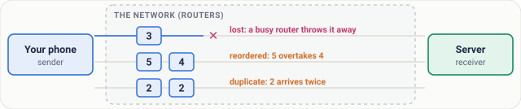
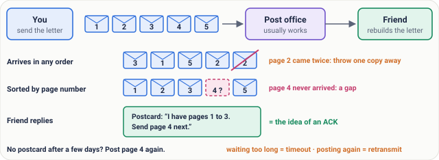
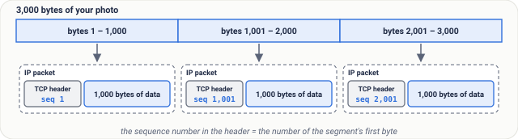
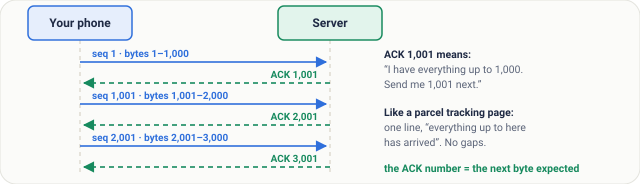
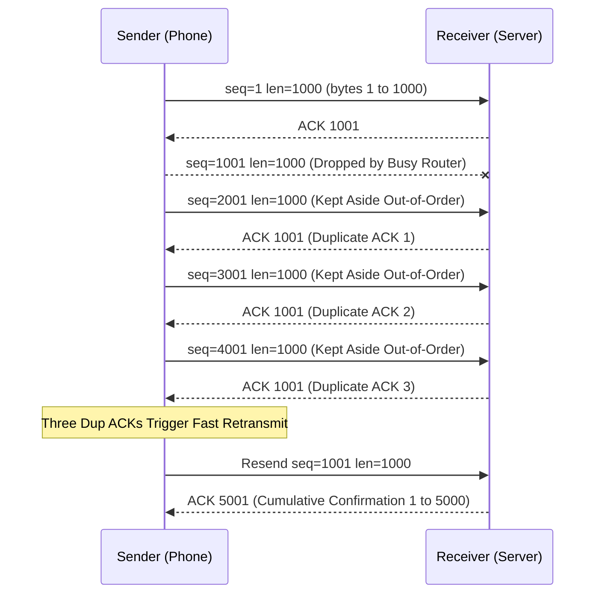
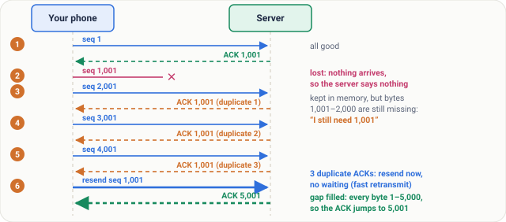
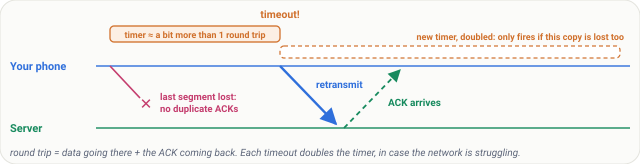
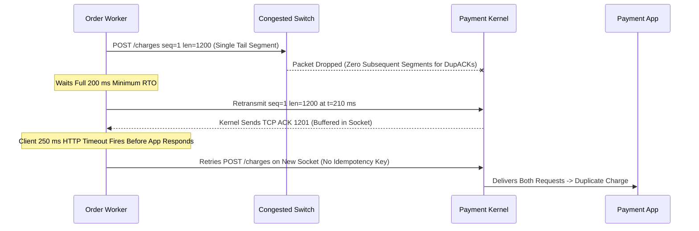

# Lesson 08: TCP Part 1, Sequence Numbers and ACKs

> **Prerequisites:** [Lesson 07: What Happens When You Type a URL](../07-what-happens-when-you-type-a-url/README.md) ([Networking From Zero Overview](../README.md)).  
> **Estimated Reading Time:** 33 minutes  
> **Target Audience:** Backend engineers and SREs understanding byte-stream sequencing, cumulative and duplicate ACKs, fast retransmit, RTO exponential backoff, and why TCP ACKs never prove application persistence.  
> **Free PDF Notes:** [Download SD-N-008.pdf](https://backendroadmap.com/notes/system-design/SD-N-008.pdf)

> [!NOTE]
> **In one line:** TCP numbers every byte; the receiver answers with an ACK that names the next byte it expects; a lost segment is sent again after three duplicate ACKs or a timeout.

> [!TIP]
> **The Golden Rule of TCP Reliability:** TCP numbers every byte in the stream rather than counting messages; the receiver replies with a cumulative **ACK** naming the next byte it expects, and a lost segment is resent either after **three duplicate ACKs** (fast retransmit) or when the retransmission timer (**RTO**) expires and doubles. Because the receiver's OS kernel emits ACKs upon writing bytes into the socket buffer, a TCP ACK never proves the application processed or persisted the request.

---

## Words You'll Meet Today

Before inspecting sequence numbers and retransmission timers on the wire, anchor these twelve terms:

| Word | Everyday Meaning | Role in a Live Backend System |
| :--- | :--- | :--- |
| **Packet** | A small piece of data on the internet. | IP-layer unit routed independently across hops (`<= 1,500 B` standard Ethernet MTU). |
| **Router** | A machine that forwards packets. | Intermediate L3 hop that may drop, delay, or reorder packets under congestion. |
| **Byte** | A tiny unit of data, about one letter of text. | TCP's fundamental accounting unit for sequencing and acknowledgements. |
| **Segment** | One piece of data TCP sends. | TCP header (`20+ B`) plus application payload bytes wrapped inside an IP packet. |
| **Sequence number** | Where that piece belongs. | 32-bit header field carrying the byte number of the segment's *first* payload byte. |
| **ACK** | A reply that says "got it". | Receiver control bit (`ACK`) plus 32-bit acknowledgement number. |
| **Duplicate ACK** | The same ACK again: "there is a gap". | Sent when an out-of-order segment arrives while earlier bytes remain missing. |
| **Cumulative ACK** | One ACK confirms everything before it. | `ACK 3,001` proves contiguous receipt of every byte up through `3,000`. |
| **Timeout** | "I waited too long". | Retransmission Timeout (`RTO`) firing when no ACK returns for the oldest unacked byte. |
| **Retransmit** | Send the same piece again. | Re-sending an unacknowledged byte range from the sender's socket send buffer. |
| **Fast retransmit** | Resend right away after 3 duplicate ACKs. | Heals mid-stream packet loss in ~1 RTT without waiting for the slower RTO timer. |
| **Round trip** | Data going there plus the ACK coming back. | Sets baseline RTO calculation (`SRTT + 4 * RTTVAR`) and fast-retransmit speed. |

---

## What It Is vs. What It Isn't

TCP's reliability vocabulary is precise, and interviewers probe the edges. Keep these apart:

| Term | Precise Meaning | What It Is **NOT** | Production Example |
| :--- | :--- | :--- | :--- |
| **Sequence number** | A 32-bit counter of **bytes**; a segment carries the number of its **first** payload byte (offset by a random **ISN**). | Not a segment counter, not a message ID, and not unique forever (it wraps at $2^{32}$ bytes). | `seq 1001:2001` = bytes `1001-2000`, `length 1000`. |
| **ACK number** | The **next byte the receiver expects**; cumulative: everything before it arrived in order. | Not "the last byte received", and not a per-segment receipt. | `ack 5001` = "I have `1-5000`, send `5001`". |
| **Duplicate ACK** | The same ACK number repeated because a segment arrived **above a gap**. | Not an error by itself — 1-2 are normal under mild reordering. | `ack 1001` x3 -> fast retransmit of `1001`. |
| **Fast retransmit vs. RTO** | Fast retransmit = resend after **3 dup ACKs** (`~1 RTT`); RTO = resend when the **timer** expires (`>= 200 ms` on Linux) and **double** it. | Not the same speed: RTO is often **100-1000x** slower; tail packets can *only* use RTO/TLP. | `nstat`: `TcpExtTCPFastRetrans` vs `TcpExtTCPTimeouts`. |
| **TCP ACK vs. application ACK** | TCP ACK = the receiver's **kernel** buffered the bytes. App ACK = the app **processed (and maybe persisted)** them. | A TCP ACK is **not** proof the app read, validated, committed, or `fsync`ed anything. | A DB ACKs `COMMIT` bytes at the kernel, crashes before `fsync` -> transaction lost. |

> **TCP guarantees order and completeness of a *byte stream* between two kernels — or an error. It does not guarantee speed, message boundaries, or that the app did its job.**

---

## Visual Mental Models & Architecture

### The Story: The Network Makes No Promises

You send a photo to a friend on WhatsApp. To travel, it is cut into small pieces called **packets**, and each one crosses the internet on its own. On the way, one packet is lost. One arrives twice. Two arrive in the wrong order. And yet, your friend sees a perfect photo. Who fixes this? A protocol called **TCP**, the Transmission Control Protocol.

- **Lost.** A busy **router**, the machine that forwards packets, can simply throw one away.
- **Reordered.** Packets can take different roads, so a later one can overtake an earlier one.
- **Duplicated.** Sometimes a packet is sent twice.

TCP runs on the sender and the receiver only. It can't fix the network; it works around these three problems.



*Figure 1. The network makes no promises. TCP runs only on the two ends and works around all three problems.*

### An Everyday Picture First: A Letter by Post

You post a five-page letter to a friend, each page in its own envelope. The post office usually works, but sometimes an envelope goes missing, and the envelopes arrive in a random order.

- **You numbered the pages**, so your friend sorts them. If page 2 arrives twice, they throw one copy away.
- **Page 4 never arrives.** Your friend sees the gap: 5 is here, 4 is not. So they send a postcard: *"I have pages 1 to 3. Send page 4 next."* That postcard is the idea of an ACK.
- **No postcard comes?** After a few days, you post the page again. Waiting too long is a **timeout**. Posting again is a **retransmit**.



*Figure 2. The everyday picture: page numbers to sort, a gap to ask about, silence to act on.*

### Now the Real Thing

| In the Letter Story | In TCP |
| :--- | :--- |
| You, posting the letter | The **sender**: your phone |
| Your friend | The **receiver**: the server |
| One envelope | A **segment**: your data plus a small TCP header, inside an IP packet |
| The page number | The **sequence number** |
| The postcard "send page 4 next" | The **ACK** |
| Waiting a few days / posting again | **timeout** / **retransmit** |

**One twist: TCP doesn't number pages, it numbers bytes.** A byte is a tiny unit of data, about one letter of text, and every byte gets its own number.

Real numbers: your phone sends 3,000 bytes as three segments of 1,000 bytes. The first holds bytes 1 to 1,000, the second 1,001 to 2,000, the third 2,001 to 3,000. Each segment carries one number in its header, the number of its **first** byte, so the sequence numbers are **1, 1,001 and 2,001**.



*Figure 3. TCP numbers bytes, not pages: each segment carries the number of its first byte.*

> [!note] **One honest detail.** Real connections start counting from a random number (both sides agree on it in the handshake, lesson 9), but tools such as Wireshark show them from 1, and so does this lesson.

### The ACK: The Most Important Idea Today

ACK is short for **acknowledgement**: "I confirm I received it." The receiver sends ACKs back to the sender. Here is the rule, slowly:

**ACK number = the next byte the receiver expects.**

The server receives bytes 1 to 1,000 and replies **ACK 1,001**. In plain words: *"I have everything up to 1,000. Send me 1,001 next."* Like a parcel tracking page, it shows one line: everything up to here has arrived. After the second segment the ACK becomes 2,001; after the third, 3,001. No gaps.

This is a **cumulative acknowledgement**: one ACK confirms everything before it. So if an ACK is lost on the way back, the next one covers it.



*Figure 4. The ACK number is the next byte the receiver expects. One cumulative ACK confirms everything before it, so if one ACK is lost on the way back, the next one covers it.*

### Step by Step: One Segment Is Lost

The phone sends five segments, with sequence numbers `1`, `1,001`, `2,001`, `3,001`, and `4,001`.

1. **Segment 1 arrives.** The server replies `ACK 1,001`. All good.
2. **Segment 1,001 is lost.** A busy router dropped it. Nothing arrives, so the server says nothing.
3. **Segment 2,001 arrives**, but bytes `1,001` to `2,000` are still missing. The server keeps the new segment in memory and repeats `ACK 1,001`: *"I still need 1,001."* An ACK that repeats the same number is a **duplicate ACK**. It means: there is a gap.
4. **Segment 3,001 arrives**, and the server sends `ACK 1,001` again.
5. **Segment 4,001 arrives**, `ACK 1,001` again. The phone now has **three duplicate ACKs**. It reasons: later segments get through, so one is missing. It resends segment `1,001` right away, without waiting. This is **fast retransmit**.
6. **The missing segment arrives.** The server now has every byte, `1` to `5,000`, so the ACK jumps straight to **5,001**.



### The Real Numbers, as a Table

| Step | Phone Sends | Arrives? | Server Now Holds | ACK Sent Back |
| :--- | :--- | :--- | :--- | :--- |
| 1 | `seq 1` (bytes `1–1,000`) | yes | `1–1,000` | **1,001** |
| 2 | `seq 1,001` (`1,001–2,000`) | **lost** | `1–1,000` | nothing |
| 3 | `seq 2,001` (`2,001–3,000`) | yes | `1–1,000`, plus `2,001–3,000` kept aside | **1,001** (duplicate 1) |
| 4 | `seq 3,001` (`3,001–4,000`) | yes | `1–1,000`, plus `2,001–4,000` kept aside | **1,001** (duplicate 2) |
| 5 | `seq 4,001` (`4,001–5,000`) | yes | `1–1,000`, plus `2,001–5,000` kept aside | **1,001** (duplicate 3) |
| | *three duplicate ACKs: fast retransmit of `seq 1,001`* | | | |
| 6 | `seq 1,001` again | yes | `1–5,000`, no gaps | **5,001** |

Read the last column: `1,001`, then nothing, then `1,001` three times, then `5,001`. The repeated number points straight at the gap.



*Figure 5. One lost segment: three duplicate ACK 1,001s, a fast retransmit, then ACK 5,001.*

### What Goes Wrong: The Last Segment Is Lost

If the lost segment was the last one, no later segments arrive, so there are no duplicate ACKs. Then the second safety net works: a **timer**.

With every segment it sends, the sender starts a timer a little longer than one **round trip** (data going, and the ACK coming back). If it runs out with no ACK, that is a timeout: the sender retransmits, and **doubles the timer**, in case the network is struggling.



*Figure 6. The second safety net. If no ACK comes before the timer runs out, the sender retransmits and doubles the timer.*

> [!note] **For the curious.** The timer is called the retransmission timeout (RTO). It is computed from measured round trips, with a floor (200 ms on Linux; the standard, RFC 6298, suggests 1 s). Real systems run one timer for the oldest unacknowledged data rather than one per segment, and receivers often send one ACK for every two segments. None of this changes the logic: ACKs are cumulative.

---

## Systematic Reference & Protocol Comparison

### TCP Loss Recovery Mechanisms Compared

| Recovery Mechanism | Trigger Condition | Typical Recovery Latency | When It Cannot Fire | RFC / OS Behavior |
| :--- | :--- | :--- | :--- | :--- |
| **Fast Retransmit** | Sender receives **3 duplicate ACKs** (`4` total ACKs for same byte) | `~1 RTT` (immediate upon 3rd dup ACK) | Tail-packet loss, small burst (`< 4` segments in flight) | RFC 5681; Linux RACK/TLP also accelerates tail loss |
| **SACK (Selective ACK)** | TCP option blocks list exact out-of-order ranges received | `~1 RTT` for multiple holes in one window | Disabled by old middleboxes or firewall scrubbing | RFC 2018; prevents redundant resends of already-buffered packets |
| **RTO Timeout** | Retransmission timer expires with zero forward progress | `>= 200 ms` (Linux `RTO_MIN`) to `1 s` (RFC 6298), then `2x` backoff | Only stops when max retries (`tcp_retries2`, ~15) fail | Exponential backoff prevents congestion collapse |

### Key Sequence & Acknowledgement Header Fields

| Header Element | Size | Purpose in Reliability |
| :--- | :--- | :--- |
| **Sequence Number (`seq`)** | 32 bits (`4 bytes`) | Byte offset of the first data byte in this segment (plus `ISN` offset). |
| **Acknowledgement Number (`ack`)** | 32 bits (`4 bytes`) | Next expected byte offset when `ACK` flag is set (`cumulative`). |
| **`ACK` Control Flag** | 1 bit | Indicates the Acknowledgment Number field is valid (set on almost all packets after initial `SYN`). |
| **Out-of-Order Buffer (`OFO`)** | Kernel memory | Receiver socket storage holding future segments above a gap until the missing bytes arrive. |

### Math of Reliability: Sequence Space, RTO, Backoff, and Loss

**1. The sequence space wraps.** Sequence and ACK numbers are 32-bit, so the byte space is $2^{32} = 4{,}294{,}967{,}296$ bytes $= 4$ GiB. Time to wrap at line rate $B$ is

$$t_{\text{wrap}} = \frac{2^{32}\ \text{bytes}}{B / 8}$$

| Link Speed | $t_{\text{wrap}}$ | Consequence |
| :--- | :--- | :--- |
| `100 Mbps` | `~343 s` (5.7 min) | Wrap is slower than the `2 min` maximum segment lifetime (MSL) — safe-ish. |
| `1 Gbps` | `~34 s` | An old duplicate from the *previous wrap* could look valid -> needs **PAWS** (TCP timestamps, RFC 7323). |
| `10 Gbps` | `~3.4 s` | Without TCP timestamps, sequence numbers repeat while old segments may still be in flight. |
| `100 Gbps` | `~0.34 s` | Timestamps are mandatory; this is why Linux enables them by default. |

**2. The retransmission timer (RFC 6298).** The sender measures round-trip samples $R'$ and keeps a smoothed RTT and variance:

$$\text{SRTT} \leftarrow (1-\alpha)\,\text{SRTT} + \alpha R' \quad (\alpha = \tfrac{1}{8}) \qquad \text{RTTVAR} \leftarrow (1-\beta)\,\text{RTTVAR} + \beta\,|\text{SRTT} - R'| \quad (\beta = \tfrac{1}{4})$$

$$\text{RTO} = \text{SRTT} + \max(G,\ 4\cdot\text{RTTVAR}) \qquad \text{RTO}_{\text{first}} = 3R\ \ (\text{SRTT}=R,\ \text{RTTVAR}=R/2)$$

The RFC suggests a `1 s` floor; **Linux uses a `200 ms` minimum** (`TCP_RTO_MIN`) which effectively adds ~`200 ms` to SRTT. That is why `ss -ti` shows `rtt:48.12` but `rto:248`. A tail-loss stall therefore costs **`~RTO`, not `~RTT`** — `200+ ms` versus `48 ms`.

**3. Exponential backoff — how long until TCP gives up?** After each timeout the RTO doubles (capped at `120 s`, `TCP_RTO_MAX`). With base `200 ms`:

| Retransmission # | Timer waited before it | Cumulative time |
| :--- | :--- | :--- |
| 1 | `0.2 s` | `0.2 s` |
| 2 | `0.4 s` | `0.6 s` |
| 3 | `0.8 s` | `1.4 s` |
| 4 | `1.6 s` | `3.0 s` |
| 5 | `3.2 s` | `6.2 s` |
| 6 | `6.4 s` | `12.6 s` |
| 7 | `12.8 s` | `25.4 s` |
| 8 | `25.6 s` | `51.0 s` |
| 9 | `51.2 s` | `102.2 s` |
| 15 (`tcp_retries2` default) | capped at `120 s` | **`~924 s` (~15.4 min)** until the socket errors with `ETIMEDOUT` |

Application timeouts (`250 ms` RPC, `30 s` HTTP) fire **long before** TCP gives up, so the *app* decides what happens to an in-flight request — which is exactly where duplicate charges come from.

**4. When can fast retransmit even fire?** It needs **3 duplicate ACKs**, i.e. at least **3 segments sent after the lost one**. So the window must be $\ge 4$ segments and the loss must not be in the *tail*:

| Pattern | Segments after the loss | Dup ACKs generated | Recovery path | Typical stall |
| :--- | :--- | :--- | :--- | :--- |
| Mid-stream loss in a large transfer | many | `>= 3` | **Fast retransmit** | `~1 RTT` |
| Loss of the **last** segment | `0` | `0` | **TLP** (Linux, `~2 RTT`) or **RTO** | `~2 RTT` / `>= 200 ms` |
| Single-segment RPC (`< 1,460 B`) | `0` | `0` | RTO / TLP | `>= 200 ms` |
| Loss with only 2 later segments | `2` | `2` | RACK/Early Retransmit or RTO | `~RTT` to `RTO` |

**Probability a response suffers at least one loss**, for $n$ segments at loss rate $p$: $P = 1 - (1-p)^n$. At $p = 1\%$: $n = 1 \to 1\%$; $n = 10 \to 9.6\%$; $n = 69$ (a `100 KB` page) $\to 50\%$; $n = 685$ (`1 MB`) $\to 99.9\%$. Large transfers *always* meet loss, so loss **recovery speed** (SACK, RACK, fast retransmit) dominates their latency.

**5. Why loss cripples throughput (Mathis model).** For loss-based congestion control the steady-state rate of one flow is bounded by

$$\text{BW} \lesssim \frac{\text{MSS}}{\text{RTT}} \cdot \frac{C}{\sqrt{p}}, \qquad C \approx 1.22$$

With $\text{MSS} = 1{,}460$ B:

| Loss rate $p$ | RTT `10 ms` | RTT `50 ms` | RTT `200 ms` |
| :--- | :--- | :--- | :--- |
| `1%` | `14.2 Mbps` | **`2.85 Mbps`** | `0.71 Mbps` |
| `0.1%` | `45 Mbps` | `9.0 Mbps` | `2.3 Mbps` |
| `0.01%` | `142 Mbps` | `28.5 Mbps` | `7.1 Mbps` |
| `0.0001%` (`10^-6`) | `1.4 Gbps` | `285 Mbps` | `71 Mbps` |

A single TCP flow over a lossy long-distance path **cannot fill a fat pipe** regardless of link capacity (CUBIC and BBR do better than this Reno-style bound, but the trend holds). That is why storage replication over WANs uses parallel streams, tuned congestion control, or QUIC/BBR.

**6. ACK overhead.** With delayed ACKs (one per two full segments) a `3 MB` upload (`2,055` segments) generates `~1,028` ACKs of `~52-66 B` each: `~60 KB` of reverse traffic, `~2%` of the data volume — small, but on asymmetric links (ADSL, cellular uplink) the **ACK stream can throttle the download**.

### The Observability Gap: What Does "Acknowledged" Actually Prove?

There are many different things an engineer may call "acknowledged", and each one is visible at a different place:

| Level | What Is True | Visible At | **Not** Proven |
| :--- | :--- | :--- | :--- |
| **1. Sender wrote** | `write()`/`send()` returned: bytes were **copied into the local send buffer** | App logs | That a single byte left the machine. |
| **2. On the wire** | Segment transmitted | `tcpdump` on sender | That it arrived. |
| **3. TCP ACK** | Peer **kernel** buffered the bytes | `tcpdump`, `ss -ti` (`unacked`, `bytes_acked`) | That the app has called `read()`. |
| **4. App read** | Peer process pulled bytes from the socket | Peer app logs, `Recv-Q` drains | That the request was valid or executed. |
| **5. App processed** | Business logic ran, response generated | Application metrics/tracing | That it is **durable**. |
| **6. Durable** | Written and **`fsync`ed** (WAL/disk) | DB commit log | That replicas have it. |
| **7. Replicated** | Quorum of replicas acknowledged | Replication metrics | — |

**Transport-health signals to export:**

| Metric | Source | Healthy Signal | Warning Sign |
| :--- | :--- | :--- | :--- |
| Retransmit ratio $\frac{\text{RetransSegs}}{\text{OutSegs}}$ | `nstat` / `node_netstat_Tcp_RetransSegs` | `≪ 1%` | Sustained `> 1-2%` -> loss or reordering on the path. |
| Fast retransmits vs. timeouts | `TcpExtTCPFastRetrans`, `TcpExtTCPTimeouts` | Fast retransmits dominate | Timeouts dominate -> tail loss, tiny windows, dead peers. |
| Per-socket `rto`, `rtt`, `retrans`, `unacked` | `ss -ti` | `rto ≈ rtt + 200 ms` | `rto` climbing in `x2` steps -> a blackhole is forming. |
| Duplicate-ACK spikes with ~0% loss | `TcpExtTCPDSACKRecv`, `TCPSACKReorder` | Rare | ECMP/path **reordering** causing false fast retransmits. |

---

---

## Production War Story Post-Mortem

### SEV-1: Tail-Loss RTO Stalls + Non-Idempotent Retries Trigger Double Charges

- **Severity:** SEV-1 (142 customers double-charged during microburst congestion)
- **Detection Time:** 11 minutes (reconciliation mismatch alert against ledger)
- **Resolution Time:** 42 minutes
- **Impact:** `~1.8%` of single-packet checkout calls suffered `200 ms–600 ms` RTO stalls, triggering client retries that executed duplicate payments.

#### What Happened

An order service sent a `1,200-byte` `POST /charges` RPC over a single TCP segment (`< 1,460 B` MSS). During an east-west switch microburst, that lone segment was dropped. Because **no subsequent segments existed** in the request flight, the server never generated 3 duplicate ACKs—so Fast Retransmit could not fire. The sender waited out Linux's `200 ms` minimum RTO floor before retransmitting. Meanwhile, the client's aggressive `250 ms` RPC timeout fired just as the retransmitted TCP segment reached the payment server's OS kernel, causing the client to fire a second request on a fresh socket while the payment server processed both!



#### Root Cause Analysis

1. **Tail-Loss Blind Spot:** Single-segment RPCs cannot trigger duplicate-ACK Fast Retransmit; any drop pays the full `RTO_MIN` (`200 ms`+) penalty plus another RTT.
2. **Confusing Transport Delivery with App Commit:** When the client saw socket write success or fast retries after a timeout, it lacked an application-level `Idempotency-Key` to deduplicate already-received bytes.

#### The Fix & Architectural Hardening

1. **Mandatory Idempotency Keys:** Enforced an application-level `Idempotency-Key` header backed by an atomic database constraint on `POST /charges`, making retries safe regardless of TCP retransmits or timeouts.
2. **Tail-Loss Probe (TLP) & Sane Timeout Budgets:** Verified `net.ipv4.tcp_early_retrans=3` (Linux RACK/TLP enabled) so tail segments probe faster (~2x RTT) rather than stalling on full RTO, and aligned client RPC timeouts above `2 * RTO_MIN + p99_app_latency`.

---

## Multi-Language Production Implementation

Below is a **TCP Byte-Stream Receiver & Sender Fast-Retransmit Simulator** in four languages. It implements exact byte-level sequence numbering, out-of-order segment buffering, cumulative `ACK` calculation, duplicate-ACK counting, and the 3-dup-ACK fast-retransmit trigger using the 5-segment trace from this lesson.

````carousel
```go
package main

import (
	"fmt"
	"sort"
)

type Segment struct {
	Seq  int
	Data string
}

type TcpReceiver struct {
	AckNext int
	OfoBuf  map[int]string
}

func NewTcpReceiver(initialNext int) *TcpReceiver {
	return &TcpReceiver{AckNext: initialNext, OfoBuf: make(map[int]string)}
}

func (r *TcpReceiver) OnSegment(seg Segment) int {
	end := seg.Seq + len(seg.Data)
	if end <= r.AckNext {
		return r.AckNext // Fully duplicate old segment
	}
	if seg.Seq <= r.AckNext {
		// Trim overlap if needed and advance contiguous window
		offset := r.AckNext - seg.Seq
		r.AckNext += len(seg.Data) - offset
		// Drain contiguous out-of-order segments
		for {
			keys := make([]int, 0, len(r.OfoBuf))
			for k := range r.OfoBuf {
				keys = append(keys, k)
			}
			sort.Ints(keys)
			advanced := false
			for _, k := range keys {
				v := r.OfoBuf[k]
				if k <= r.AckNext {
					delete(r.OfoBuf, k)
					if k+len(v) > r.AckNext {
						r.AckNext = k + len(v)
						advanced = true
					}
				}
			}
			if !advanced {
				break
			}
		}
	} else {
		// Future segment beyond gap: buffer out-of-order
		r.OfoBuf[seg.Seq] = seg.Data
	}
	return r.AckNext
}

func main() {
	rx := NewTcpReceiver(1)
	lastAck := 1
	dupCount := 0
	// Simulate 1,000-byte chunks represented with synthetic payloads
	chunk := func(seq int) Segment { return Segment{Seq: seq, Data: string(make([]byte, 1000))} }

	wire := []Segment{chunk(1), chunk(2001), chunk(3001), chunk(4001), chunk(1001)}
	for _, seg := range wire {
		ack := rx.OnSegment(seg)
		if ack == lastAck {
			dupCount++
			fmt.Printf("recv seq=%d -> ACK %d (dup #%d)\n", seg.Seq, ack, dupCount)
			if dupCount == 3 {
				fmt.Printf("  >>> 3 duplicate ACKs! Fast retransmit seq=%d\n", ack)
			}
		} else {
			dupCount = 0
			lastAck = ack
			fmt.Printf("recv seq=%d -> ACK %d\n", seg.Seq, ack)
		}
	}
}
```
<!-- slide -->
```typescript
interface Segment {
  seq: number;
  length: number;
}

class TcpReceiver {
  private ackNext: number;
  private readonly ofo = new Map<number, number>(); // seq -> length

  constructor(initialNext = 1) {
    this.ackNext = initialNext;
  }

  onSegment(seg: Segment): number {
    const segEnd = seg.seq + seg.length;
    if (segEnd <= this.ackNext) {
      return this.ackNext; // Pure duplicate
    }
    if (seg.seq <= this.ackNext) {
      this.ackNext = Math.max(this.ackNext, segEnd);
      let merged = true;
      while (merged) {
        merged = false;
        for (const [s, len] of Array.from(this.ofo.entries()).sort((a, b) => a[0] - b[0])) {
          if (s <= this.ackNext) {
            this.ofo.delete(s);
            if (s + len > this.ackNext) {
              this.ackNext = s + len;
              merged = true;
            }
          }
        }
      }
    } else {
      const existing = this.ofo.get(seg.seq) ?? 0;
      this.ofo.set(seg.seq, Math.max(existing, seg.length));
    }
    return this.ackNext;
  }
}

const rx = new TcpReceiver(1);
let lastAck = 1;
let dupCount = 0;

// Segment 1001 was dropped in transit; 2001..4001 arrive out of order, then 1001 is resent
const arrivals: Segment[] = [
  { seq: 1, length: 1000 },
  { seq: 2001, length: 1000 },
  { seq: 3001, length: 1000 },
  { seq: 4001, length: 1000 },
  { seq: 1001, length: 1000 },
];

for (const seg of arrivals) {
  const ack = rx.onSegment(seg);
  if (ack === lastAck) {
    dupCount += 1;
    console.log(`recv seq=${seg.seq} -> ACK ${ack} (dup #${dupCount})`);
    if (dupCount === 3) console.log(`  >>> Fast retransmit triggered for seq=${ack}`);
  } else {
    dupCount = 0;
    lastAck = ack;
    console.log(`recv seq=${seg.seq} -> ACK ${ack}`);
  }
}
```
<!-- slide -->
```python
class TcpReceiver:
    def __init__(self, initial_next: int = 1) -> None:
        self.ack_next = initial_next
        self.ofo: dict[int, int] = {}  # seq -> byte length

    def on_segment(self, seq: int, length: int) -> int:
        seg_end = seq + length
        if seg_end <= self.ack_next:
            return self.ack_next

        if seq <= self.ack_next:
            self.ack_next = max(self.ack_next, seg_end)
            while True:
                advanced = False
                for buffered_seq in sorted(list(self.ofo)):
                    buffered_len = self.ofo[buffered_seq]
                    if buffered_seq <= self.ack_next:
                        del self.ofo[buffered_seq]
                        if buffered_seq + buffered_len > self.ack_next:
                            self.ack_next = buffered_seq + buffered_len
                            advanced = True
                if not advanced:
                    break
        else:
            self.ofo[seq] = max(self.ofo.get(seq, 0), length)

        return self.ack_next


if __name__ == "__main__":
    rx = TcpReceiver(1)
    last_ack = 1
    dup_count = 0

    for seq, length in [(1, 1000), (2001, 1000), (3001, 1000), (4001, 1000), (1001, 1000)]:
        ack = rx.on_segment(seq, length)
        if ack == last_ack:
            dup_count += 1
            print(f"recv seq={seq} -> ACK {ack} (dup #{dup_count})")
            if dup_count == 3:
                print(f"  >>> 3 dup ACKs: Fast retransmit seq={ack}")
        else:
            dup_count = 0
            last_ack = ack
            print(f"recv seq={seq} -> ACK {ack}")
```
<!-- slide -->
```csharp
using System;
using System.Collections.Generic;

public sealed class TcpReceiver
{
    private int _ackNext;
    private readonly SortedDictionary<int, int> _ofo = new();

    public TcpReceiver(int initialNext = 1) => _ackNext = initialNext;

    public int OnSegment(int seq, int length)
    {
        int segEnd = seq + length;
        if (segEnd <= _ackNext) return _ackNext;

        if (seq <= _ackNext)
        {
            _ackNext = Math.Max(_ackNext, segEnd);
            bool advanced;
            do
            {
                advanced = false;
                foreach (var seqKey in new List<int>(_ofo.Keys))
                {
                    if (seqKey <= _ackNext)
                    {
                        int len = _ofo[seqKey];
                        _ofo.Remove(seqKey);
                        if (seqKey + len > _ackNext)
                        {
                            _ackNext = seqKey + len;
                            advanced = true;
                        }
                    }
                }
            } while (advanced);
        }
        else
        {
            _ofo[seq] = Math.Max(_ofo.GetValueOrDefault(seq), length);
        }
        return _ackNext;
    }

    public static void Main()
    {
        var rx = new TcpReceiver(1);
        int lastAck = 1, dupCount = 0;
        (int Seq, int Len)[] arrivals = [(1, 1000), (2001, 1000), (3001, 1000), (4001, 1000), (1001, 1000)];

        foreach (var (seq, len) in arrivals)
        {
            int ack = rx.OnSegment(seq, len);
            if (ack == lastAck)
            {
                dupCount++;
                Console.WriteLine($"recv seq={seq} -> ACK {ack} (dup #{dupCount})");
                if (dupCount == 3) Console.WriteLine($"  >>> Fast retransmit triggered for seq={ack}");
            }
            else
            {
                dupCount = 0;
                lastAck = ack;
                Console.WriteLine($"recv seq={seq} -> ACK {ack}");
            }
        }
    }
}
```
````

---

## Practical Hands-On Verification CLI Workflows

Use these Linux commands to watch sequence numbers, cumulative ACKs, retransmissions, and live RTO timers in real traffic:

### 1. Capture Relative TCP Sequence Numbers and ACK Advances with `tcpdump`

```bash
sudo tcpdump -i eth0 -nn tcp port 443 -c 6
```

**Expected Output:**

```text
10:14:22.104112 IP 192.168.1.42.51234 > 198.51.100.10.443: Flags [P.], seq 1:1001, ack 1, win 502, length 1000
10:14:22.152008 IP 198.51.100.10.443 > 192.168.1.42.51234: Flags [.], ack 1001, win 509, length 0
10:14:22.152290 IP 192.168.1.42.51234 > 198.51.100.10.443: Flags [P.], seq 1001:2001, ack 1, win 502, length 1000
10:14:22.201440 IP 198.51.100.10.443 > 192.168.1.42.51234: Flags [.], ack 2001, win 509, length 0
```

Notice how `seq 1:1001` (`length 1000`) advances the server's reply directly to `ack 1001`—the exact next byte expected.

### 2. Inspect Live Socket RTO, RTT, and Retransmit Counters via `ss -ti`

```bash
ss -ti state established '( dport = :443 or sport = :443 )'
```

**Expected Output:**

```text
Recv-Q Send-Q Local Address:Port   Peer Address:Port
0      0      192.168.1.42:51234   198.51.100.10:443
         cubic wscale:7,7 rto:248 rtt:48.12/4.25 ato:40 mss:1460 bytes_acked:5001 segs_out:6 segs_in:6 retrans:0/1
```

Look closely at `rto:248` (`248 ms` retransmission timeout derived from `rtt:48.12 ms`) and `retrans:0/1` (`0` currently unacked retransmits / `1` cumulative retransmit during this socket's lifetime).

### 3. Check Host-Wide Fast Retransmits vs. RTO Timeouts via `nstat`

```bash
nstat -az TcpRetransSegs TcpExtTCPFastRetrans TcpExtTCPLostRetransmit
```

**Expected Output:**

```text
#kernel
TcpRetransSegs                  14                 0.0
TcpExtTCPFastRetrans            11                 0.0
TcpExtTCPLostRetransmit         0                  0.0
```

---

## Pause and Think

> [!exercise] Four segments, starting at 1, 1,001, 2,001 and 3,001. The one at 2,001 is lost; the others arrive. Which ACK does the server keep sending? And after the resend arrives? Decide before you open the answer.

<details><summary>Answer</summary>

The server has bytes 1 to 2,000, so it keeps sending **ACK 2,001**. After the resend it has everything up to 4,000, so: **ACK 4,001**. If you got that, you understand ACKs.

Bonus: only one segment comes after the lost one, so there is only one duplicate ACK, not three. With the classic rule, this resend comes from the timer.

</details>

---

## Operational Validation Checkpoints

<details><summary><strong>Checkpoint 1: Computing Cumulative ACKs Across Out-of-Order Segments</strong></summary>

A client starts at `seq 1` and transmits four `500-byte` segments (`seq 1`, `seq 501`, `seq 1,001`, `seq 1,501`). Segments `1` and `1,001` arrive; `501` and `1,501` are lost. What ACK does the receiver send right after `1,001` arrives? And what does it send once `501` is retransmitted and arrives?

**Answer:** After `1,001` arrives, the receiver still lacks `501–1,000`, so it holds `1,001–1,500` aside and sends duplicate **ACK 501**. Once `501` arrives, bytes `1–1,500` are now contiguous, so the receiver jumps straight to **ACK 1,501**.

</details>

<details><summary><strong>Checkpoint 2: Diagnosing Why Fast Retransmit Didn't Fire on a Single RPC Packet</strong></summary>

A microservice fires small `400-byte` HTTP requests (`1 segment` each) across a slightly lossy WAN (`1%` packet loss). Despite `40 ms` RTT, p99 latency spikes cleanly into `240 ms` buckets. Why isn't Fast Retransmit recovering these drops in `40 ms`?

**Answer:** Each `400-byte` request fits inside a single TCP segment with **no trailing segments in flight**. When that lone segment drops, the receiver receives nothing later to trigger 3 duplicate ACKs, forcing the sender to wait out Linux's `200 ms+` RTO floor (`~200 ms wait + 40 ms RTT = 240 ms`).

</details>

<details><summary><strong>Checkpoint 3: Socket ACK vs. Application Commit Durability</strong></summary>

A developer runs `tcpdump` and verifies that the database server sent `ACK 4,501` for a `4,500-byte` transaction commit message. Moments later, the database host panics due to power loss. When the database reboots, that transaction is missing. How is this possible if TCP ACKed all bytes?

**Answer:** The database server's **OS kernel** emitted `ACK 4,501` as soon as the bytes reached the kernel's TCP receive buffer—*before* the database process called `recv()`/`read()`, wrote the WAL, or called `fsync()`. Reliability at Layer 4 guarantees transport buffer delivery, never application processing or disk durability.

</details>

---

## Common Mistakes & Troubleshooting

- **"Sequence numbers count segments."** No, they count bytes. That's why they jump by `1,000`.
- **"TCP guarantees fast delivery."** No. It guarantees your data arrives complete and in order, or you get an error. Resending takes time, so on a weak mobile signal a page loads slowly, but nothing is lost.
- **"An ACK means the app handled the data."** No. The receiver's operating system sends the ACK when the bytes reach its memory; the app may not have read them yet. That's why apps add their own confirmations, like WhatsApp's ticks, or a UPI success screen.
- **Retrying non-idempotent writes after an app timeout.** TCP may still deliver the first copy; without an idempotency key you create duplicates (double charges, duplicate orders).
- **Setting RPC timeouts below the recovery time of one tail loss.** A `250 ms` timeout beside a `200 ms+` RTO guarantees spurious retries during the very congestion that caused the stall.
- **Assuming `write()` success means delivery.** It only means bytes were copied into the local send buffer; use application-level confirmations.
- **Treating dup ACKs as always meaning loss.** One or two are normal reordering; check `DSACK`/`TCPSACKReorder` before declaring the path lossy.
- **Disabling TCP timestamps or SACK "for performance".** You lose PAWS (wrap protection on fast links), better RTT estimates, and precise loss recovery.
- **Misreading `ss -ti` `retrans` spikes during packet reordering.** If `TcpExtTCPFastRetrans` climbs while real packet loss is near zero, network paths (like ECMP hashing issues) are reordering packets by `>= 3` segments, tricking TCP into false Fast Retransmits.

---

## Recap in Three Lines

1. TCP numbers every byte, and each segment carries the number of its first byte.
2. The receiver ACKs the next byte it expects.
3. A lost segment is resent after three duplicate ACKs, or a timeout.

---

## Interview Practice Questions

Exactly **12 questions**, tagged by kind: **[BASIC]** (Q1-Q4, definitions), **[SCENARIO]** (Q5-Q8, apply it to a system), and **[TRICKY]** (Q9-Q12, deep follow-ups). Answer out loud for 30 seconds before opening the solution.

<details>
<summary><strong>Q1: How does TCP make sure data is never lost? [BASIC]</strong></summary>

<strong>What a strong answer covers:</strong>
TCP **numbers every byte**. The receiver returns **cumulative ACKs** naming the **next byte it expects**, uses the sequence numbers to **reorder** out-of-order data and **discard duplicates**, and the sender keeps unacknowledged bytes in its **send buffer**. A missing segment is **retransmitted** after **three duplicate ACKs** (*fast retransmit*) or when the **retransmission timer (RTO)** expires — and the RTO **doubles** on each failure (exponential backoff). If the peer never answers, TCP eventually **fails with an error** (`ETIMEDOUT`, after `~15 min` with default `tcp_retries2`) rather than silently losing data.

</details>

<details>
<summary><strong>Q2: The server sends "ACK 1,001". What exactly does that mean? [BASIC]</strong></summary>

<strong>What a strong answer covers:</strong>
*"I have every byte up to and including `1,000`; send me `1,001` next."* It is the **next expected byte**, not the last received (a common slip), and it is **cumulative**: one ACK confirms *everything* before it, so a lost ACK is covered by the next. It says nothing about bytes **above** a gap (those are held in the out-of-order buffer and only reported with **SACK** blocks). It also does not mean the application read the data.

</details>

<details>
<summary><strong>Q3: Why does TCP number bytes instead of segments, and what is the ISN? [BASIC]</strong></summary>

<strong>What a strong answer covers:</strong>
TCP presents an **undelimited byte stream**; segment boundaries are an implementation detail (the sender can **re-segment** on retransmit, coalesce small writes, or split at the MSS). Numbering **bytes** lets the receiver reassemble regardless of how data was chunked, and lets a retransmission **cover a different range** than the original. A segment's `seq` is the number of its **first byte**. The **Initial Sequence Number (ISN)** is **random** (RFC 9293: clock-driven plus a keyed hash) and is agreed in the **three-way handshake** (Lesson 09), so *(a)* **old duplicates** from a prior connection on the same 4-tuple are not mistaken for new data, and *(b)* off-path attackers cannot easily **inject** packets. Wireshark shows *relative* numbers starting at 1 for readability.

</details>

<details>
<summary><strong>Q4: The network can lose, reorder, or duplicate packets. How does TCP handle each? [BASIC]</strong></summary>

<strong>What a strong answer covers:</strong>
- **Lost:** no ACK progress -> **fast retransmit** (3 dup ACKs) or **RTO**; **SACK** pinpoints exactly which ranges to resend.
- **Reordered:** sequence numbers let the receiver **buffer and sort**; a few duplicate ACKs may appear, which is why the threshold is **3**, not 1.
- **Duplicated:** the receiver sees `seq` below its `ack` point and **drops** the duplicate (and may send a DSACK).
TCP runs **only on the two endpoints**; routers know nothing about it. It cannot make the network reliable — it **works around** an unreliable one.

</details>

<details>
<summary><strong>Q5: Five 1,000-byte segments are sent and the second is lost. Walk through the ACKs. [SCENARIO]</strong></summary>

<strong>What a strong answer covers:</strong>
Sequence numbers `1, 1001, 2001, 3001, 4001`. Seg `1` -> `ACK 1001`. Seg `1001` **lost** -> nothing. Seg `2001` arrives above the gap, **buffered**, -> `ACK 1001` (dup #1). Seg `3001` -> `ACK 1001` (dup #2). Seg `4001` -> `ACK 1001` (dup #3). **Three dup ACKs -> fast retransmit** of `1001` (also entering fast recovery and halving `cwnd`, Lesson 10). The retransmission fills the gap, so the receiver now holds `1-5000` and sends a cumulative **`ACK 5001`** — it jumps over the buffered data. With **SACK** the dup ACKs also carry ranges `2001-5001`, so the sender resends *only* `1001-2000`.

</details>

<details>
<summary><strong>Q6: What if the lost segment is the last one in the flight? [SCENARIO]</strong></summary>

<strong>What a strong answer covers:</strong>
There are **no later segments**, hence **no duplicate ACKs**, so fast retransmit cannot fire. Recovery falls to the **timer**: either Linux's **Tail Loss Probe (TLP)** — which sends a probe after `~2 × SRTT` — or the full **RTO**, which is `≥ 200 ms` on Linux (`1 s` in RFC 6298) and **doubles** on each repeat. The cost is `~RTO`, **not** `~RTT` — often **4-20x** slower. This is the **tail-loss blind spot** affecting small RPCs, the last packet of a response, and handshake packets.

</details>

<details>
<summary><strong>Q7: A service sends small single-packet RPCs over a WAN with 1% loss and 40 ms RTT. p99 latency shows up in ~240 ms buckets. Why, and what do you change? [SCENARIO]</strong></summary>

<strong>What a strong answer covers:</strong>
Roughly **1% of requests lose their only segment**, so there are no dup ACKs and each pays `RTO ≈ 200 ms + 40 ms RTT ≈ 240 ms` — landing exactly in the **p99 bucket** (1% of traffic). Options: enable/verify **TLP/RACK** (`net.ipv4.tcp_early_retrans`, default on modern kernels), lower `TCP_RTO_MIN` via `ip route ... rto_min 50ms` for **datacenter** paths (not the open internet), **reuse connections** so there is traffic behind a loss to trigger dup ACKs, use **QUIC/HTTP/3** (per-packet loss detection, no TCP HoL blocking), **hedge** requests (send a second copy after the p95 latency), fix the **lossy link**, and make requests **idempotent**.

</details>

<details>
<summary><strong>Q8: A client timed out after 250 ms and retried a `POST /charges`; the customer was charged twice even though TCP is "reliable". How do you design against this? [SCENARIO]</strong></summary>

<strong>What a strong answer covers:</strong>
TCP guarantees **delivery of bytes to the peer's kernel buffer**, not **exactly-once execution**. The first request was delayed by an RTO stall and the client's **application timeout fired first**, so it sent a *new request on a new connection*; the server processed **both**. Defence: **idempotency keys** (`Idempotency-Key` header, stored with a **unique constraint** and the saved response, so a replay returns the first result), **timeouts > worst-case recovery** (`> 2×RTO_min + p99 service time`), **retry only idempotent methods or keyed requests**, **exponential backoff with jitter**, and a **reconciliation job**. "At-least-once delivery + idempotent handler = effectively exactly-once".

</details>

<details>
<summary><strong>Q9: Why wait for three duplicate ACKs instead of retransmitting after one? [TRICKY]</strong></summary>

<strong>What a strong answer covers:</strong>
**Reordering** also produces duplicate ACKs: if packet `n+1` overtakes packet `n`, the receiver ACKs `n` twice with *nothing lost*. Retransmitting on the first dup would waste bandwidth (**spurious retransmits**) and needlessly **shrink `cwnd`**. Empirically, reordering rarely exceeds 2 segments, so **3 dup ACKs** = strong evidence that a segment is truly lost while later data still flows (RFC 5681). Modern stacks refine this: **SACK** (exact holes), **RACK** (time-based loss detection, tolerant to reordering), **DSACK** (detects spurious retransmits), and **Early Retransmit** for small windows. Under heavy **ECMP reordering** you can see fast retransmits with ~0% real loss.

</details>

<details>
<summary><strong>Q10: The server's TCP ACKed your request. Has the application processed it? [TRICKY]</strong></summary>

<strong>What a strong answer covers:</strong>
**No.** The ACK is emitted by the peer's **kernel** as soon as bytes land in the **socket receive buffer** — before the app calls `read()`, parses the request, writes a WAL, or `fsync`s. If the process crashes, the host panics, or the app is stuck (full queue, deadlock), the ACK was still sent. Hence **application-level acknowledgements** (HTTP `200`, `COMMIT OK`, a UPI success screen, WhatsApp ticks), **durability levels** (written -> fsync'd -> replicated), and **idempotent retries**. Also, `write()` returning only means the bytes reached the **local** send buffer. TCP gives *transport* reliability, never *business* reliability.

</details>

<details>
<summary><strong>Q11: Sequence numbers are 32-bit. What happens when they wrap, and why do we need TCP timestamps (PAWS)? [TRICKY]</strong></summary>

<strong>What a strong answer covers:</strong>
The space is $2^{32}$ bytes = **4 GiB**; arithmetic is **modulo $2^{32}$**, so wrapping is routine in long transfers. The danger is a **delayed old segment** from the *previous lap* whose sequence number now looks valid. At `1 Gbps` the wrap takes `~34 s`, `10 Gbps` `~3.4 s` — shorter than the `2 min` **maximum segment lifetime** — so sequence numbers alone cannot distinguish old from new. **PAWS** (*Protection Against Wrapped Sequences*, RFC 7323) uses the **TCP timestamp option** (`+12 B` per segment): a segment with an *older* timestamp than the most recent one is discarded. Timestamps also give better **RTT samples** for the RTO. Note the **window scale** option extends the *receive window* (`up to 1 GiB`) but does **not** extend the sequence space.

</details>

<details>
<summary><strong>Q12: Why does 1% packet loss at 50 ms RTT cap a single TCP flow near 3 Mbps — even on a 10 Gbps link? What do you do about it? [TRICKY]</strong></summary>

<strong>What a strong answer covers:</strong>
Loss-based congestion control (Reno-like) halves `cwnd` on each loss event, so steady-state throughput follows the **Mathis model**: $\text{BW} \lesssim \frac{\text{MSS}}{\text{RTT}} \cdot \frac{1.22}{\sqrt{p}} = \frac{11{,}680\ \text{bits}}{0.05\ \text{s}} \times 12.2 \approx \mathbf{2.85\ Mbps}$. Link capacity is irrelevant — the **window never grows large enough**. At $p = 10^{-6}$ the same flow can reach `~285 Mbps`; at `10 ms` RTT, `1.4 Gbps`. Mitigations: **fix loss** (bad optics, buffer drops, Wi-Fi), **shorten RTT** (CDN/edge), **parallel flows**, **BBR** (model-based, much less sensitive to random loss), **QUIC**, **SACK/RACK** to recover faster, and avoid *bufferbloat*. Distinguish **loss** from **reordering** (`DSACK`, `nstat`) before blaming the network.

</details>

---

## One-Page Master Cheat Sheet

```text
====================================================================================================
                     TCP PART 1: SEQUENCE NUMBERS & ACKs — ONE-PAGE CHEAT SHEET
====================================================================================================
THE CORE RULES
  * The network may LOSE, REORDER, DUPLICATE packets.  TCP (endpoints only) fixes it with numbers + ACKs.
  * seq  = number of the segment's FIRST BYTE (32-bit, starts at a random ISN; tools show relative from 1).
  * ack  = the NEXT BYTE EXPECTED. Cumulative: "I have everything below this."   ack 1001 = have 1..1000.
  * Duplicate ACK = same ack repeated -> there is a GAP.  1-2 may just be reordering.
  * 3 dup ACKs  -> FAST RETRANSMIT (~1 RTT).   No dup ACKs (tail loss) -> TLP (~2 RTT) or RTO (>=200 ms).
  * RTO doubles on every timeout (0.2, 0.4, 0.8 ... cap 120 s); Linux gives up at ~15 retries ~= 924 s.

WORKED TRACE (5 x 1000 B, 2nd lost)
  seq 1 -> ACK 1001 | seq 1001 LOST | 2001 -> ACK 1001 (d1) | 3001 -> ACK 1001 (d2) | 4001 -> ACK 1001 (d3)
  => fast retransmit seq 1001 => ACK 5001 (jumps: 1..5000 contiguous).   SACK adds exact ranges.

FORMULAS
  Wrap time = 2^32 B / (B/8):  100 Mbps 343 s | 1 Gbps 34 s | 10 Gbps 3.4 s  -> PAWS / TCP timestamps required
  RTO = SRTT + max(G, 4*RTTVAR);  first RTO = 3R;  Linux floor 200 ms  (ss: rtt:48 -> rto:248)
  P(>=1 loss in n segs) = 1 - (1-p)^n :  p=1%: n=10 -> 9.6% | n=69 -> 50% | n=685 -> 99.9%
  Mathis: BW <= (MSS/RTT) * 1.22/sqrt(p) :  1% @50 ms = 2.85 Mbps | 0.01% = 28.5 Mbps | 1e-6 = 285 Mbps
  Fast retransmit needs >= 3 segments AFTER the loss  (window >= 4, loss not in the tail)

"ACKNOWLEDGED" LADDER  (each level proves less than the next)
  write() returned < on the wire < TCP ACK (peer KERNEL) < app read < app processed < fsync'd < replicated
  => A TCP ACK NEVER proves the app processed or persisted anything.  Use app-level ACKs + idempotency keys.

OBSERVE
  tcpdump -nn 'tcp port 443'            seq/ack/length on the wire     ss -ti       rto rtt retrans unacked
  nstat -az TcpRetransSegs TcpExtTCPFastRetrans TcpExtTCPTimeouts TcpExtTCPDSACKRecv
  Alert: retransmit ratio > 1-2% sustained | timeouts >> fast retransmits | rto climbing x2 | dup-ACK spikes w/o loss

DESIGN RULES
  1 Idempotency keys on every retried write.   2 App timeout > 2*RTO_min + p99 service time.
  3 Reuse connections (traffic behind a loss enables fast retransmit).   4 Retry with backoff + jitter.
  5 Fix loss at the source; consider BBR / QUIC / parallel streams for long fat pipes.
====================================================================================================
```

---

## Free PDF notes

Download these notes as a printable PDF, with every picture, the real-numbers table and the interview answers: [SD-N-008.pdf](https://backendroadmap.com/notes/system-design/SD-N-008.pdf).

## Sources

- [RFC 9293: Transmission Control Protocol](https://www.rfc-editor.org/rfc/rfc9293), the current TCP standard: sequence numbers, the ACK as the next sequence number expected.
- [RFC 5681: TCP Congestion Control](https://www.rfc-editor.org/rfc/rfc5681), section 3.2: duplicate ACKs and fast retransmit after three of them.
- [RFC 6298: Computing TCP's Retransmission Timer](https://www.rfc-editor.org/rfc/rfc6298): how the timer is set from measured round trips, and why it doubles after each timeout.

## Next

Next comes [lesson 9, TCP part 2: the three-way handshake](../09-tcp-three-way-handshake/README.md), where both sides agree on their starting numbers. The [track overview](../README.md) lists the whole series.
