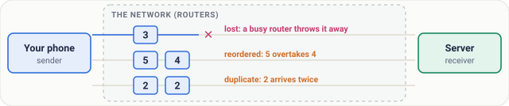
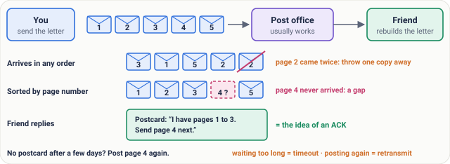
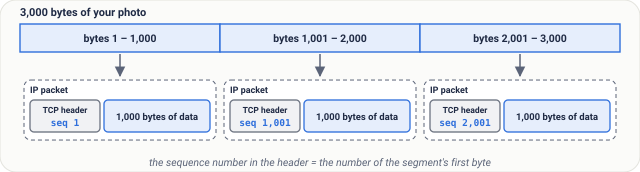
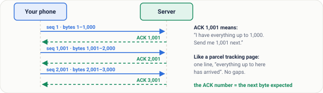
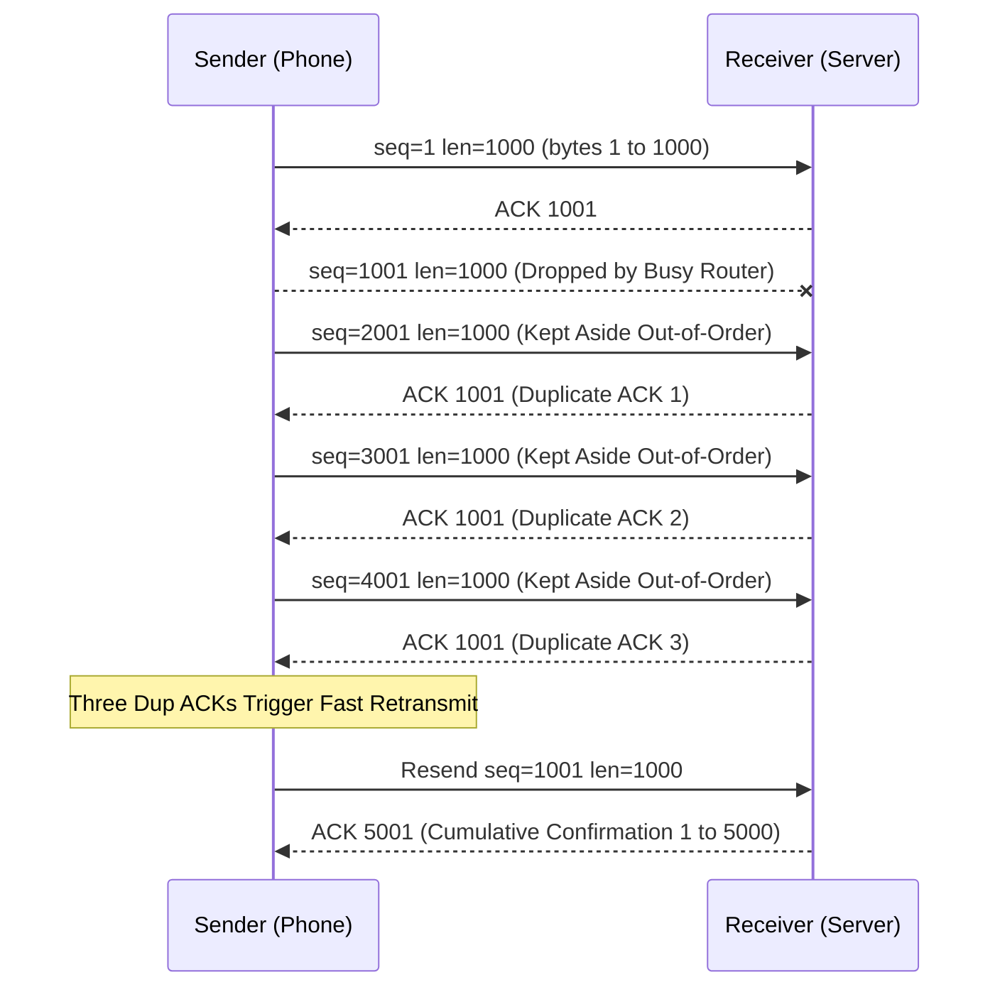
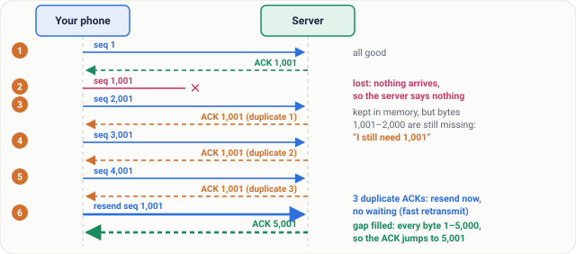
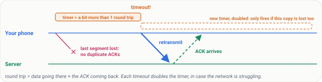
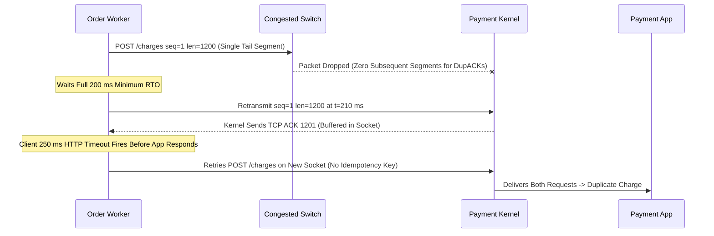

# Lesson 08: TCP Part 1, Sequence Numbers and ACKs

> **Prerequisites:** [Lesson 07: What Happens When You Type a URL](../07-what-happens-when-you-type-a-url/README.md) ([Networking From Zero Overview](../README.md)).  
> **Estimated Reading Time:** 20 minutes  
> **Target Audience:** Backend engineers and SREs understanding byte-stream sequencing, cumulative and duplicate ACKs, fast retransmit, RTO exponential backoff, and why TCP ACKs never prove application persistence.  
> **Free PDF Notes:** [Download SD-N-008.pdf](https://backendroadmap.com/notes/system-design/SD-N-008.pdf)

> [!TIP]
> **The Golden Rule of TCP Reliability:** TCP numbers every byte in the stream rather than counting messages; the receiver replies with a cumulative **ACK** naming the next byte it expects, and a lost segment is resent either after **three duplicate ACKs** (fast retransmit) or when the retransmission timer (**RTO**) expires and doubles. Because the receiver's OS kernel emits ACKs upon writing bytes into the socket buffer, a TCP ACK never proves the application processed or persisted the request.

---

## Words You'll Meet Today

Before inspecting sequence numbers and retransmission timers on the wire, anchor these twelve terms:

| Word | Everyday Meaning | Role in a Live Backend System |
| :--- | :--- | :--- |
| **Packet** | A small piece of data on the internet. | IP-layer unit routed independently across hops (`<= 1,500 B` standard Ethernet MTU). |
| **Router** | A machine that forwards packets. | Intermediate L3 hop that may drop, delay, or reorder packets under congestion. |
| **Byte** | A tiny unit of data, about one letter of text. | TCP's fundamental accounting unit for sequencing and acknowledgements. |
| **Segment** | One piece of data TCP sends. | TCP header (`20+ B`) plus application payload bytes wrapped inside an IP packet. |
| **Sequence number** | Where that piece belongs. | 32-bit header field carrying the byte number of the segment's *first* payload byte. |
| **ACK** | A reply that says "got it". | Receiver control bit (`ACK`) plus 32-bit acknowledgement number. |
| **Duplicate ACK** | The same ACK again: "there is a gap". | Sent when an out-of-order segment arrives while earlier bytes remain missing. |
| **Cumulative ACK** | One ACK confirms everything before it. | `ACK 3,001` proves contiguous receipt of every byte up through `3,000`. |
| **Timeout** | "I waited too long". | Retransmission Timeout (`RTO`) firing when no ACK returns for the oldest unacked byte. |
| **Retransmit** | Send the same piece again. | Re-sending an unacknowledged byte range from the sender's socket send buffer. |
| **Fast retransmit** | Resend right away after 3 duplicate ACKs. | Heals mid-stream packet loss in ~1 RTT without waiting for the slower RTO timer. |
| **Round trip** | Data going there plus the ACK coming back. | Sets baseline RTO calculation (`SRTT + 4 * RTTVAR`) and fast-retransmit speed. |

---

## Visual Mental Models & Architecture

### The Story: The Network Makes No Promises

You send a photo to a friend on WhatsApp. To travel, it is cut into small pieces called **packets**, and each one crosses the internet on its own. On the way, one packet is lost. One arrives twice. Two arrive in the wrong order. And yet, your friend sees a perfect photo. Who fixes this? A protocol called **TCP**, the Transmission Control Protocol.

- **Lost.** A busy **router**, the machine that forwards packets, can simply throw one away.
- **Reordered.** Packets can take different roads, so a later one can overtake an earlier one.
- **Duplicated.** Sometimes a packet is sent twice.

TCP runs on the sender and the receiver only. It can't fix the network; it works around these three problems.



*Figure 1. The network makes no promises. TCP runs only on the two ends and works around all three problems.*

### An Everyday Picture First: A Letter by Post

You post a five-page letter to a friend, each page in its own envelope. The post office usually works, but sometimes an envelope goes missing, and the envelopes arrive in a random order.

- **You numbered the pages**, so your friend sorts them. If page 2 arrives twice, they throw one copy away.
- **Page 4 never arrives.** Your friend sees the gap: 5 is here, 4 is not. So they send a postcard: *"I have pages 1 to 3. Send page 4 next."* That postcard is the idea of an ACK.
- **No postcard comes?** After a few days, you post the page again. Waiting too long is a **timeout**. Posting again is a **retransmit**.



*Figure 2. The everyday picture: page numbers to sort, a gap to ask about, silence to act on.*

### Now the Real Thing

| In the Letter Story | In TCP |
| :--- | :--- |
| You, posting the letter | The **sender**: your phone |
| Your friend | The **receiver**: the server |
| One envelope | A **segment**: your data plus a small TCP header, inside an IP packet |
| The page number | The **sequence number** |
| The postcard "send page 4 next" | The **ACK** |
| Waiting a few days / posting again | **timeout** / **retransmit** |

**One twist: TCP doesn't number pages, it numbers bytes.** A byte is a tiny unit of data, about one letter of text, and every byte gets its own number.

Real numbers: your phone sends 3,000 bytes as three segments of 1,000 bytes. The first holds bytes 1 to 1,000, the second 1,001 to 2,000, the third 2,001 to 3,000. Each segment carries one number in its header, the number of its **first** byte, so the sequence numbers are **1, 1,001 and 2,001**.



*Figure 3. TCP numbers bytes, not pages: each segment carries the number of its first byte.*

> [!note] **One honest detail.** Real connections start counting from a random number (both sides agree on it in the handshake, lesson 9), but tools such as Wireshark show them from 1, and so does this lesson.

### The ACK: The Most Important Idea Today

ACK is short for **acknowledgement**: "I confirm I received it." The receiver sends ACKs back to the sender. Here is the rule, slowly:

**ACK number = the next byte the receiver expects.**

The server receives bytes 1 to 1,000 and replies **ACK 1,001**. In plain words: *"I have everything up to 1,000. Send me 1,001 next."* Like a parcel tracking page, it shows one line: everything up to here has arrived. After the second segment the ACK becomes 2,001; after the third, 3,001. No gaps.

This is a **cumulative acknowledgement**: one ACK confirms everything before it. So if an ACK is lost on the way back, the next one covers it.



*Figure 4. The ACK number is the next byte the receiver expects. One cumulative ACK confirms everything before it, so if one ACK is lost on the way back, the next one covers it.*

### Step by Step: One Segment Is Lost

The phone sends five segments, with sequence numbers `1`, `1,001`, `2,001`, `3,001`, and `4,001`.

1. **Segment 1 arrives.** The server replies `ACK 1,001`. All good.
2. **Segment 1,001 is lost.** A busy router dropped it. Nothing arrives, so the server says nothing.
3. **Segment 2,001 arrives**, but bytes `1,001` to `2,000` are still missing. The server keeps the new segment in memory and repeats `ACK 1,001`: *"I still need 1,001."* An ACK that repeats the same number is a **duplicate ACK**. It means: there is a gap.
4. **Segment 3,001 arrives**, and the server sends `ACK 1,001` again.
5. **Segment 4,001 arrives**, `ACK 1,001` again. The phone now has **three duplicate ACKs**. It reasons: later segments get through, so one is missing. It resends segment `1,001` right away, without waiting. This is **fast retransmit**.
6. **The missing segment arrives.** The server now has every byte, `1` to `5,000`, so the ACK jumps straight to **5,001**.



### The Real Numbers, as a Table

| Step | Phone Sends | Arrives? | Server Now Holds | ACK Sent Back |
| :--- | :--- | :--- | :--- | :--- |
| 1 | `seq 1` (bytes `1–1,000`) | yes | `1–1,000` | **1,001** |
| 2 | `seq 1,001` (`1,001–2,000`) | **lost** | `1–1,000` | nothing |
| 3 | `seq 2,001` (`2,001–3,000`) | yes | `1–1,000`, plus `2,001–3,000` kept aside | **1,001** (duplicate 1) |
| 4 | `seq 3,001` (`3,001–4,000`) | yes | `1–1,000`, plus `2,001–4,000` kept aside | **1,001** (duplicate 2) |
| 5 | `seq 4,001` (`4,001–5,000`) | yes | `1–1,000`, plus `2,001–5,000` kept aside | **1,001** (duplicate 3) |
| | *three duplicate ACKs: fast retransmit of `seq 1,001`* | | | |
| 6 | `seq 1,001` again | yes | `1–5,000`, no gaps | **5,001** |

Read the last column: `1,001`, then nothing, then `1,001` three times, then `5,001`. The repeated number points straight at the gap.



*Figure 5. One lost segment: three duplicate ACK 1,001s, a fast retransmit, then ACK 5,001.*

### What Goes Wrong: The Last Segment Is Lost

If the lost segment was the last one, no later segments arrive, so there are no duplicate ACKs. Then the second safety net works: a **timer**.

With every segment it sends, the sender starts a timer a little longer than one **round trip** (data going, and the ACK coming back). If it runs out with no ACK, that is a timeout: the sender retransmits, and **doubles the timer**, in case the network is struggling.



*Figure 6. The second safety net. If no ACK comes before the timer runs out, the sender retransmits and doubles the timer.*

> [!note] **For the curious.** The timer is called the retransmission timeout (RTO). It is computed from measured round trips, with a floor (200 ms on Linux; the standard, RFC 6298, suggests 1 s). Real systems run one timer for the oldest unacknowledged data rather than one per segment, and receivers often send one ACK for every two segments. None of this changes the logic: ACKs are cumulative.

---

## Systematic Reference & Protocol Comparison

### TCP Loss Recovery Mechanisms Compared

| Recovery Mechanism | Trigger Condition | Typical Recovery Latency | When It Cannot Fire | RFC / OS Behavior |
| :--- | :--- | :--- | :--- | :--- |
| **Fast Retransmit** | Sender receives **3 duplicate ACKs** (`4` total ACKs for same byte) | `~1 RTT` (immediate upon 3rd dup ACK) | Tail-packet loss, small burst (`< 4` segments in flight) | RFC 5681; Linux RACK/TLP also accelerates tail loss |
| **SACK (Selective ACK)** | TCP option blocks list exact out-of-order ranges received | `~1 RTT` for multiple holes in one window | Disabled by old middleboxes or firewall scrubbing | RFC 2018; prevents redundant resends of already-buffered packets |
| **RTO Timeout** | Retransmission timer expires with zero forward progress | `>= 200 ms` (Linux `RTO_MIN`) to `1 s` (RFC 6298), then `2x` backoff | Only stops when max retries (`tcp_retries2`, ~15) fail | Exponential backoff prevents congestion collapse |

### Key Sequence & Acknowledgement Header Fields

| Header Element | Size | Purpose in Reliability |
| :--- | :--- | :--- |
| **Sequence Number (`seq`)** | 32 bits (`4 bytes`) | Byte offset of the first data byte in this segment (plus `ISN` offset). |
| **Acknowledgement Number (`ack`)** | 32 bits (`4 bytes`) | Next expected byte offset when `ACK` flag is set (`cumulative`). |
| **`ACK` Control Flag** | 1 bit | Indicates the Acknowledgment Number field is valid (set on almost all packets after initial `SYN`). |
| **Out-of-Order Buffer (`OFO`)** | Kernel memory | Receiver socket storage holding future segments above a gap until the missing bytes arrive. |

---

## Production War Story Post-Mortem

### SEV-1: Tail-Loss RTO Stalls + Non-Idempotent Retries Trigger Double Charges

- **Severity:** SEV-1 (142 customers double-charged during microburst congestion)
- **Detection Time:** 11 minutes (reconciliation mismatch alert against ledger)
- **Resolution Time:** 42 minutes
- **Impact:** `~1.8%` of single-packet checkout calls suffered `200 ms–600 ms` RTO stalls, triggering client retries that executed duplicate payments.

#### What Happened

An order service sent a `1,200-byte` `POST /charges` RPC over a single TCP segment (`< 1,460 B` MSS). During an east-west switch microburst, that lone segment was dropped. Because **no subsequent segments existed** in the request flight, the server never generated 3 duplicate ACKs—so Fast Retransmit could not fire. The sender waited out Linux's `200 ms` minimum RTO floor before retransmitting. Meanwhile, the client's aggressive `250 ms` RPC timeout fired just as the retransmitted TCP segment reached the payment server's OS kernel, causing the client to fire a second request on a fresh socket while the payment server processed both!



#### Root Cause Analysis

1. **Tail-Loss Blind Spot:** Single-segment RPCs cannot trigger duplicate-ACK Fast Retransmit; any drop pays the full `RTO_MIN` (`200 ms`+) penalty plus another RTT.
2. **Confusing Transport Delivery with App Commit:** When the client saw socket write success or fast retries after a timeout, it lacked an application-level `Idempotency-Key` to deduplicate already-received bytes.

#### The Fix & Architectural Hardening

1. **Mandatory Idempotency Keys:** Enforced an application-level `Idempotency-Key` header backed by an atomic database constraint on `POST /charges`, making retries safe regardless of TCP retransmits or timeouts.
2. **Tail-Loss Probe (TLP) & Sane Timeout Budgets:** Verified `net.ipv4.tcp_early_retrans=3` (Linux RACK/TLP enabled) so tail segments probe faster (~2x RTT) rather than stalling on full RTO, and aligned client RPC timeouts above `2 * RTO_MIN + p99_app_latency`.

---

## Multi-Language Production Implementation

Below is a **TCP Byte-Stream Receiver & Sender Fast-Retransmit Simulator** in four languages. It implements exact byte-level sequence numbering, out-of-order segment buffering, cumulative `ACK` calculation, duplicate-ACK counting, and the 3-dup-ACK fast-retransmit trigger using the 5-segment trace from this lesson.

````carousel
```go
package main

import (
	"fmt"
	"sort"
)

type Segment struct {
	Seq  int
	Data string
}

type TcpReceiver struct {
	AckNext int
	OfoBuf  map[int]string
}

func NewTcpReceiver(initialNext int) *TcpReceiver {
	return &TcpReceiver{AckNext: initialNext, OfoBuf: make(map[int]string)}
}

func (r *TcpReceiver) OnSegment(seg Segment) int {
	end := seg.Seq + len(seg.Data)
	if end <= r.AckNext {
		return r.AckNext // Fully duplicate old segment
	}
	if seg.Seq <= r.AckNext {
		// Trim overlap if needed and advance contiguous window
		offset := r.AckNext - seg.Seq
		r.AckNext += len(seg.Data) - offset
		// Drain contiguous out-of-order segments
		for {
			keys := make([]int, 0, len(r.OfoBuf))
			for k := range r.OfoBuf {
				keys = append(keys, k)
			}
			sort.Ints(keys)
			advanced := false
			for _, k := range keys {
				v := r.OfoBuf[k]
				if k <= r.AckNext {
					delete(r.OfoBuf, k)
					if k+len(v) > r.AckNext {
						r.AckNext = k + len(v)
						advanced = true
					}
				}
			}
			if !advanced {
				break
			}
		}
	} else {
		// Future segment beyond gap: buffer out-of-order
		r.OfoBuf[seg.Seq] = seg.Data
	}
	return r.AckNext
}

func main() {
	rx := NewTcpReceiver(1)
	lastAck := 1
	dupCount := 0
	// Simulate 1,000-byte chunks represented with synthetic payloads
	chunk := func(seq int) Segment { return Segment{Seq: seq, Data: string(make([]byte, 1000))} }

	wire := []Segment{chunk(1), chunk(2001), chunk(3001), chunk(4001), chunk(1001)}
	for _, seg := range wire {
		ack := rx.OnSegment(seg)
		if ack == lastAck {
			dupCount++
			fmt.Printf("recv seq=%d -> ACK %d (dup #%d)\n", seg.Seq, ack, dupCount)
			if dupCount == 3 {
				fmt.Printf("  >>> 3 duplicate ACKs! Fast retransmit seq=%d\n", ack)
			}
		} else {
			dupCount = 0
			lastAck = ack
			fmt.Printf("recv seq=%d -> ACK %d\n", seg.Seq, ack)
		}
	}
}
```
<!-- slide -->
```typescript
interface Segment {
  seq: number;
  length: number;
}

class TcpReceiver {
  private ackNext: number;
  private readonly ofo = new Map<number, number>(); // seq -> length

  constructor(initialNext = 1) {
    this.ackNext = initialNext;
  }

  onSegment(seg: Segment): number {
    const segEnd = seg.seq + seg.length;
    if (segEnd <= this.ackNext) {
      return this.ackNext; // Pure duplicate
    }
    if (seg.seq <= this.ackNext) {
      this.ackNext = Math.max(this.ackNext, segEnd);
      let merged = true;
      while (merged) {
        merged = false;
        for (const [s, len] of Array.from(this.ofo.entries()).sort((a, b) => a[0] - b[0])) {
          if (s <= this.ackNext) {
            this.ofo.delete(s);
            if (s + len > this.ackNext) {
              this.ackNext = s + len;
              merged = true;
            }
          }
        }
      }
    } else {
      const existing = this.ofo.get(seg.seq) ?? 0;
      this.ofo.set(seg.seq, Math.max(existing, seg.length));
    }
    return this.ackNext;
  }
}

const rx = new TcpReceiver(1);
let lastAck = 1;
let dupCount = 0;

// Segment 1001 was dropped in transit; 2001..4001 arrive out of order, then 1001 is resent
const arrivals: Segment[] = [
  { seq: 1, length: 1000 },
  { seq: 2001, length: 1000 },
  { seq: 3001, length: 1000 },
  { seq: 4001, length: 1000 },
  { seq: 1001, length: 1000 },
];

for (const seg of arrivals) {
  const ack = rx.onSegment(seg);
  if (ack === lastAck) {
    dupCount += 1;
    console.log(`recv seq=${seg.seq} -> ACK ${ack} (dup #${dupCount})`);
    if (dupCount === 3) console.log(`  >>> Fast retransmit triggered for seq=${ack}`);
  } else {
    dupCount = 0;
    lastAck = ack;
    console.log(`recv seq=${seg.seq} -> ACK ${ack}`);
  }
}
```
<!-- slide -->
```python
class TcpReceiver:
    def __init__(self, initial_next: int = 1) -> None:
        self.ack_next = initial_next
        self.ofo: dict[int, int] = {}  # seq -> byte length

    def on_segment(self, seq: int, length: int) -> int:
        seg_end = seq + length
        if seg_end <= self.ack_next:
            return self.ack_next

        if seq <= self.ack_next:
            self.ack_next = max(self.ack_next, seg_end)
            while True:
                advanced = False
                for buffered_seq in sorted(list(self.ofo)):
                    buffered_len = self.ofo[buffered_seq]
                    if buffered_seq <= self.ack_next:
                        del self.ofo[buffered_seq]
                        if buffered_seq + buffered_len > self.ack_next:
                            self.ack_next = buffered_seq + buffered_len
                            advanced = True
                if not advanced:
                    break
        else:
            self.ofo[seq] = max(self.ofo.get(seq, 0), length)

        return self.ack_next


if __name__ == "__main__":
    rx = TcpReceiver(1)
    last_ack = 1
    dup_count = 0

    for seq, length in [(1, 1000), (2001, 1000), (3001, 1000), (4001, 1000), (1001, 1000)]:
        ack = rx.on_segment(seq, length)
        if ack == last_ack:
            dup_count += 1
            print(f"recv seq={seq} -> ACK {ack} (dup #{dup_count})")
            if dup_count == 3:
                print(f"  >>> 3 dup ACKs: Fast retransmit seq={ack}")
        else:
            dup_count = 0
            last_ack = ack
            print(f"recv seq={seq} -> ACK {ack}")
```
<!-- slide -->
```csharp
using System;
using System.Collections.Generic;

public sealed class TcpReceiver
{
    private int _ackNext;
    private readonly SortedDictionary<int, int> _ofo = new();

    public TcpReceiver(int initialNext = 1) => _ackNext = initialNext;

    public int OnSegment(int seq, int length)
    {
        int segEnd = seq + length;
        if (segEnd <= _ackNext) return _ackNext;

        if (seq <= _ackNext)
        {
            _ackNext = Math.Max(_ackNext, segEnd);
            bool advanced;
            do
            {
                advanced = false;
                foreach (var seqKey in new List<int>(_ofo.Keys))
                {
                    if (seqKey <= _ackNext)
                    {
                        int len = _ofo[seqKey];
                        _ofo.Remove(seqKey);
                        if (seqKey + len > _ackNext)
                        {
                            _ackNext = seqKey + len;
                            advanced = true;
                        }
                    }
                }
            } while (advanced);
        }
        else
        {
            _ofo[seq] = Math.Max(_ofo.GetValueOrDefault(seq), length);
        }
        return _ackNext;
    }

    public static void Main()
    {
        var rx = new TcpReceiver(1);
        int lastAck = 1, dupCount = 0;
        (int Seq, int Len)[] arrivals = [(1, 1000), (2001, 1000), (3001, 1000), (4001, 1000), (1001, 1000)];

        foreach (var (seq, len) in arrivals)
        {
            int ack = rx.OnSegment(seq, len);
            if (ack == lastAck)
            {
                dupCount++;
                Console.WriteLine($"recv seq={seq} -> ACK {ack} (dup #{dupCount})");
                if (dupCount == 3) Console.WriteLine($"  >>> Fast retransmit triggered for seq={ack}");
            }
            else
            {
                dupCount = 0;
                lastAck = ack;
                Console.WriteLine($"recv seq={seq} -> ACK {ack}");
            }
        }
    }
}
```
````

---

## Practical Hands-On Verification CLI Workflows

Use these Linux commands to watch sequence numbers, cumulative ACKs, retransmissions, and live RTO timers in real traffic:

### 1. Capture Relative TCP Sequence Numbers and ACK Advances with `tcpdump`

```bash
sudo tcpdump -i eth0 -nn tcp port 443 -c 6
```

**Expected Output:**

```text
10:14:22.104112 IP 192.168.1.42.51234 > 198.51.100.10.443: Flags [P.], seq 1:1001, ack 1, win 502, length 1000
10:14:22.152008 IP 198.51.100.10.443 > 192.168.1.42.51234: Flags [.], ack 1001, win 509, length 0
10:14:22.152290 IP 192.168.1.42.51234 > 198.51.100.10.443: Flags [P.], seq 1001:2001, ack 1, win 502, length 1000
10:14:22.201440 IP 198.51.100.10.443 > 192.168.1.42.51234: Flags [.], ack 2001, win 509, length 0
```

Notice how `seq 1:1001` (`length 1000`) advances the server's reply directly to `ack 1001`—the exact next byte expected.

### 2. Inspect Live Socket RTO, RTT, and Retransmit Counters via `ss -ti`

```bash
ss -ti state established '( dport = :443 or sport = :443 )'
```

**Expected Output:**

```text
Recv-Q Send-Q Local Address:Port   Peer Address:Port
0      0      192.168.1.42:51234   198.51.100.10:443
         cubic wscale:7,7 rto:248 rtt:48.12/4.25 ato:40 mss:1460 bytes_acked:5001 segs_out:6 segs_in:6 retrans:0/1
```

Look closely at `rto:248` (`248 ms` retransmission timeout derived from `rtt:48.12 ms`) and `retrans:0/1` (`0` currently unacked retransmits / `1` cumulative retransmit during this socket's lifetime).

### 3. Check Host-Wide Fast Retransmits vs. RTO Timeouts via `nstat`

```bash
nstat -az TcpRetransSegs TcpExtTCPFastRetrans TcpExtTCPLostRetransmit
```

**Expected Output:**

```text
#kernel
TcpRetransSegs                  14                 0.0
TcpExtTCPFastRetrans            11                 0.0
TcpExtTCPLostRetransmit         0                  0.0
```

---

## Pause and Think

> [!exercise] Four segments, starting at 1, 1,001, 2,001 and 3,001. The one at 2,001 is lost; the others arrive. Which ACK does the server keep sending? And after the resend arrives? Decide before you open the answer.

<details><summary>Answer</summary>

The server has bytes 1 to 2,000, so it keeps sending **ACK 2,001**. After the resend it has everything up to 4,000, so: **ACK 4,001**. If you got that, you understand ACKs.

Bonus: only one segment comes after the lost one, so there is only one duplicate ACK, not three. With the classic rule, this resend comes from the timer.

</details>

---

## Operational Validation Checkpoints

<details><summary><strong>Checkpoint 1: Computing Cumulative ACKs Across Out-of-Order Segments</strong></summary>

A client starts at `seq 1` and transmits four `500-byte` segments (`seq 1`, `seq 501`, `seq 1,001`, `seq 1,501`). Segments `1` and `1,001` arrive; `501` and `1,501` are lost. What ACK does the receiver send right after `1,001` arrives? And what does it send once `501` is retransmitted and arrives?

**Answer:** After `1,001` arrives, the receiver still lacks `501–1,000`, so it holds `1,001–1,500` aside and sends duplicate **ACK 501**. Once `501` arrives, bytes `1–1,500` are now contiguous, so the receiver jumps straight to **ACK 1,501**.

</details>

<details><summary><strong>Checkpoint 2: Diagnosing Why Fast Retransmit Didn't Fire on a Single RPC Packet</strong></summary>

A microservice fires small `400-byte` HTTP requests (`1 segment` each) across a slightly lossy WAN (`1%` packet loss). Despite `40 ms` RTT, p99 latency spikes cleanly into `240 ms` buckets. Why isn't Fast Retransmit recovering these drops in `40 ms`?

**Answer:** Each `400-byte` request fits inside a single TCP segment with **no trailing segments in flight**. When that lone segment drops, the receiver receives nothing later to trigger 3 duplicate ACKs, forcing the sender to wait out Linux's `200 ms+` RTO floor (`~200 ms wait + 40 ms RTT = 240 ms`).

</details>

<details><summary><strong>Checkpoint 3: Socket ACK vs. Application Commit Durability</strong></summary>

A developer runs `tcpdump` and verifies that the database server sent `ACK 4,501` for a `4,500-byte` transaction commit message. Moments later, the database host panics due to power loss. When the database reboots, that transaction is missing. How is this possible if TCP ACKed all bytes?

**Answer:** The database server's **OS kernel** emitted `ACK 4,501` as soon as the bytes reached the kernel's TCP receive buffer—*before* the database process called `recv()`/`read()`, wrote the WAL, or called `fsync()`. Reliability at Layer 4 guarantees transport buffer delivery, never application processing or disk durability.

</details>

---

## Common Mistakes & Troubleshooting

- **"Sequence numbers count segments."** No, they count bytes. That's why they jump by `1,000`.
- **"TCP guarantees fast delivery."** No. It guarantees your data arrives complete and in order, or you get an error. Resending takes time, so on a weak mobile signal a page loads slowly, but nothing is lost.
- **"An ACK means the app handled the data."** No. The receiver's operating system sends the ACK when the bytes reach its memory; the app may not have read them yet. That's why apps add their own confirmations, like WhatsApp's ticks, or a UPI success screen.
- **Misreading `ss -ti` `retrans` spikes during packet reordering.** If `TcpExtTCPFastRetrans` climbs while real packet loss is near zero, network paths (like ECMP hashing issues) are reordering packets by `>= 3` segments, tricking TCP into false Fast Retransmits.

---

## Recap in Three Lines

1. TCP numbers every byte, and each segment carries the number of its first byte.
2. The receiver ACKs the next byte it expects.
3. A lost segment is resent after three duplicate ACKs, or a timeout.

---

## Interview Practice Questions

Each question is tagged by kind: **Basic** (definitions), **Scenario** (apply it) and **Tricky** (the follow-ups interviewers use to go deeper). Each answer is what to say in about 30 seconds. Answer out loud before you open it.

> [!interview] How does TCP make sure data is never lost? (Basic)

<details><summary>What to say in 30 seconds</summary>

TCP numbers every byte. The receiver sends cumulative ACKs with the next byte it expects, and uses sequence numbers to reorder data and drop duplicates. A lost segment is retransmitted after three duplicate ACKs, called fast retransmit, or when the retransmission timer expires.

</details>

> [!interview] The server sends "ACK 1,001". What exactly does that mean? (Basic)

<details><summary>What to say in 30 seconds</summary>

"I have every byte up to 1,000; send me 1,001 next." It is the next byte expected, not the last one received, and it is cumulative: it confirms everything before it, so a lost ACK is covered by the next.

</details>

> [!interview] Five 1,000-byte segments, the second is lost. Walk through the ACKs. (Scenario)

<details><summary>What to say in 30 seconds</summary>

ACK 1,001; then nothing for the lost segment; then ACK 1,001 three more times as 2,001, 3,001 and 4,001 arrive and are kept aside. Three duplicates trigger fast retransmit of 1,001; the server then has bytes 1 to 5,000 and answers ACK 5,001.

</details>

> [!interview] What if the lost segment is the last one? (Scenario)

<details><summary>What to say in 30 seconds</summary>

No later segments, so no duplicate ACKs. The retransmission timer covers it: a little longer than one measured round trip. When it runs out with no ACK, the sender retransmits and doubles the timer (exponential backoff).

</details>

> [!interview] Why wait for three duplicate ACKs, not one? (Tricky)

<details><summary>What to say in 30 seconds</summary>

Reordering also causes a duplicate ACK or two with nothing lost. Three duplicates are strong evidence of a real loss while later data still gets through, so the sender resends without waiting for the slower timeout.

</details>

> [!interview] The server's TCP ACKed your request. Has the app processed it? (Tricky)

<details><summary>What to say in 30 seconds</summary>

Not necessarily. The receiver's operating system sends the ACK when the bytes reach its memory; the app may not have read them yet, or may crash first. That's why apps add their own confirmations, like WhatsApp's ticks or a UPI success screen.

</details>

---

## Free PDF notes

Download these notes as a printable PDF, with every picture, the real-numbers table and the interview answers: [SD-N-008.pdf](https://backendroadmap.com/notes/system-design/SD-N-008.pdf).

## Sources

- [RFC 9293: Transmission Control Protocol](https://www.rfc-editor.org/rfc/rfc9293), the current TCP standard: sequence numbers, the ACK as the next sequence number expected.
- [RFC 5681: TCP Congestion Control](https://www.rfc-editor.org/rfc/rfc5681), section 3.2: duplicate ACKs and fast retransmit after three of them.
- [RFC 6298: Computing TCP's Retransmission Timer](https://www.rfc-editor.org/rfc/rfc6298): how the timer is set from measured round trips, and why it doubles after each timeout.

## Next

Next comes [lesson 9, TCP part 2: the three-way handshake](../09-tcp-three-way-handshake/README.md), where both sides agree on their starting numbers. The [track overview](../README.md) lists the whole series.
