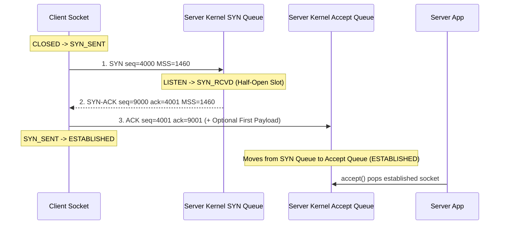
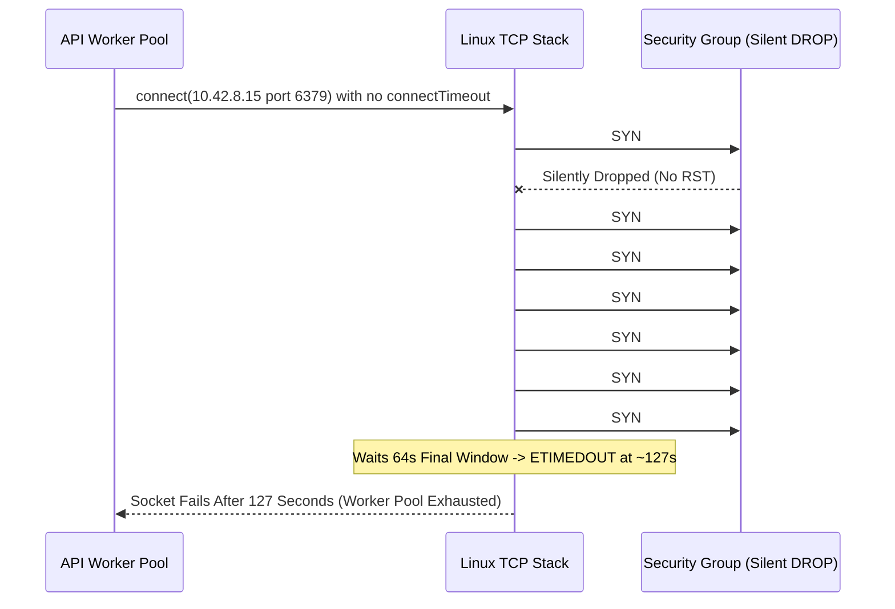

# Lesson 09: TCP Part 2, the Three-Way Handshake

> **Prerequisites:** [Lesson 08: TCP Part 1, Sequence Numbers and ACKs](../08-tcp-sequence-numbers-and-acks/README.md) and [Lesson 06: The OSI Model, Made Simple](../06-osi-model/README.md) ([Networking From Zero Overview](../README.md)).  
> **Estimated Reading Time:** 22 minutes  
> **Target Audience:** Backend engineers and SREs mastering TCP connection establishment, ISN security, MSS negotiation, SYN retransmission backoff, kernel backlog queues, and SYN flood defenses.  
> **Free PDF Notes:** [Download SD-N-009.pdf](https://backendroadmap.com/notes/system-design/SD-N-009.pdf)

> [!TIP]
> **The Golden Rule of the TCP Handshake:** Before a single application byte moves, TCP exchanges three control segments—**SYN**, **SYN-ACK**, and **ACK**—so both ends share random **Initial Sequence Numbers (ISNs)**, confirm each other's reachability with `ISN + 1`, and negotiate options such as **MSS** in one round trip. A dropped `SYN` stalls for `1 s` before retrying with exponential doubling (`1, 2, 4, 8, 16, 32, 64 ≈ 127 s`), making bounded connect timeouts, connection reuse, and kernel backlog sizing essential for production reliability.

---

## Words You'll Meet Today

Before watching packets synchronize across ports and kernel queues, anchor these eight essential terms:

| Word | Everyday Meaning | Role in a Live Backend System |
| :--- | :--- | :--- |
| **Connection** | Two programs agreeing to talk, with a counter on each side. | Kernel 4-tuple state (`src_ip, src_port, dst_ip, dst_port`) tracking send/receive sequence windows. |
| **SYN** | Synchronise: the message that says "here's my starting number". | Opening TCP segment (`SYN=1`) consuming 1 sequence number (`ISN`) and advertising MSS. |
| **ISN** | Initial sequence number: that random starting number. | CSPRNG-seeded 32-bit counter preventing blind spoofing and stale-packet injection. |
| **SYN-ACK** | The server's reply: its own SYN and an ACK in one segment. | Confirms client `ISN + 1` while sending the server's own random `ISN`. |
| **Flag** | One bit in the TCP header that marks the kind of message. | Control bits (`SYN`, `ACK`, `FIN`, `RST`, `PSH`) driving TCP's state machine. |
| **ESTABLISHED** | The state once the handshake is done and data can flow. | Both directions confirmed; socket moves into the server's `Accept` queue for `accept()`. |
| **MSS** | Maximum segment size: the most data in one segment, often `1,460` bytes. | Negotiated during `SYN`/`SYN-ACK` (`1,500 B MTU - 20 B IP - 20 B TCP = 1,460 B`). |
| **RST** | Reset: a flag meaning no, or stop, this connection. | Emitted immediately when no socket listens on the target port (`connection refused`). |

---

## Visual Mental Models & Architecture

### The Question: Three Tiny Messages, No Data

Before your phone sends a single byte of your photo, it sends three tiny messages to the server. No data at all. Just: hello.

In [lesson 8](../08-tcp-sequence-numbers-and-acks/README.md), we saw that TCP numbers every byte. But each side starts counting from a random number. So before any data moves, both sides must tell each other where they start. That's the three-way handshake, and today we follow it one message at a time.

### An Everyday Picture First: A Call on a Bad Line

You call a friend on a bad line. You say: hello, can you hear me? Your friend says: yes, I can hear you. Can you hear me?

You say: yes, I can. Now both of you know two things: my voice reaches you, and your voice reaches me. Only then does the real conversation start.

Count the messages. Three. Two would not be enough: after only two, your friend still doesn't know that you can hear them.


*Figure 1. The analogy: a call on a bad line takes three messages before both people know that each voice reaches the other.*

### The Real Thing, One Message at a Time

The server is waiting on port `443`. In TCP's words, it is **listening**. Your phone picks a random starting number, say `4,000`.

1. **SYN.** Your phone sends a segment with the `SYN` flag set, and sequence number `4,000`. In plain words: *I want to talk, and my bytes start at 4,000.*
2. **SYN-ACK.** The server picks its own random number, say `9,000`. Its reply has both flags set: `SYN`, with sequence number `9,000`, and `ACK 4,001`. In plain words: *got your number, and my bytes start at 9,000.*
3. **ACK.** Your phone replies: `ACK 9,001`. *Got your number too.* Now both sides are in the state called **ESTABLISHED**, and the connection exists.

Why `4,001`, and not `4,000`? Remember the rule from lesson 8: the ACK is the next number the receiver expects. The `SYN` itself uses up one number, so the next one is `4,001`.

The first byte of your photo will carry sequence number `4,001`. The first byte of the server's reply: `9,001`. Two directions, two counters, both confirmed.


*Figure 2. The three-way handshake with real numbers: each side sends its random starting number, and the other confirms it with that number plus one.*

| # | From → To | Flags | `seq` | `ack` |
| :--- | :--- | :--- | :--- | :--- |
| 1 | phone → server | `SYN` | `4,000` | `-` |
| 2 | server → phone | `SYN + ACK` | `9,000` | `4,001` |
| 3 | phone → server | `ACK` | `4,001` | `9,001` |

Read the numbers: each ACK is the other side's number, plus one.



### Why Three Messages, and Why Random Numbers?

Why three messages, and not two, or four? Each direction needs its own number, sent and confirmed. That's four jobs. But the server sends its `SYN` and its `ACK` in the same segment. Four jobs, three messages.


*Figure 3. Why three messages: four jobs (each side sends its number, the other confirms it), and the server combines its confirmation and its own number in one SYN-ACK.*

And why random starting numbers? Two reasons. A late packet from an old connection on the same ports won't be mistaken for new data. And an attacker can't easily guess the numbers to fake a connection.

### Options, and Real Numbers for Time

The `SYN` also carries options. The most important is the **maximum segment size** (`MSS`): how much data fits in one segment. On normal Ethernet or Wi-Fi, it's **1,460 bytes**: the 1,500-byte packet from [lesson 6](../06-osi-model/README.md), minus 20 bytes of IP header, and 20 bytes of TCP header.


*Figure 4. The SYN's most important option, the maximum segment size: 1,500 bytes per packet minus 20 bytes of IP header and 20 of TCP header leaves 1,460 bytes of data.*

The handshake costs **one round trip** before any data. Your phone can send its first data together with the final `ACK`, so one round trip is all it costs.

| Where the Server Is | One Round Trip |
| :--- | :--- |
| the same city | a few ms |
| India → Singapore | about `60 ms` |
| India → US east coast | about `200` to `250 ms` |

You pay it once per connection, which is why opening connections is expensive, and reusing them matters ([lesson 29](../29-connection-pooling-and-keep-alive/README.md)).


*Figure 5. The handshake costs one round trip before any data (the first data can ride with the final ACK), and how long one round trip is depends on distance.*

### What Goes Wrong

- **No reply.** Maybe the server is down, or a firewall silently drops the `SYN`. Your phone waits, then sends the `SYN` again. On Linux, the first wait is one second, and then it doubles: two, four, eight, and so on. After six retries, about two minutes in all, you see: *connection timed out*.
- **Nobody listening.** The server is up, but no program is listening on that port. The server answers straight away with a reset: a segment with the **RST** flag. You see: *connection refused*. Fast, and honest.


*Figure 6. What goes wrong: with no reply the client resends the SYN, doubling the wait each time, until "connection timed out"; with no program on the port the server sends RST and you see "connection refused".*

**A SYN flood.** An attacker sends millions of `SYN`s, and never sends the final `ACK`. The server keeps a slot for each half-open connection, and its queue fills up, so real users can't get in. The usual fix is **SYN cookies**: the server keeps no slot, and hides what it needs inside its own starting number.


*Figure 7. A SYN flood: an attacker sends SYNs and never the final ACK, filling the server's queue of half-open connections so real users can't connect. SYN cookies keep no slot until the ACK arrives.*

---

## Systematic Reference & Protocol Comparison

### Handshake Failure Modes Compared

| Symptom | Wire Event | Elapsed Wait Time | Root Cause | Diagnostic Action |
| :--- | :--- | :--- | :--- | :--- |
| **`Connection refused` (`ECONNREFUSED`)** | Server sends immediate `RST` | `~1 RTT` (`< 5 ms` on LAN) | Host reachable, but no process bound to that port (or active reject firewall) | Run `ss -lnt` on target host; verify process started and bound `0.0.0.0:port` |
| **`Connection timed out` (`ETIMEDOUT`)** | Client retries `SYN` (`1, 2, 4, 8, 16, 32, 64 s`) | `~127 s` (`tcp_syn_retries=6`) | Silent firewall `DROP`, dead host, routing blackhole, or full `SYN`/`Accept` queue | Inspect security groups, routing tables, and `TcpExtListenOverflows` |
| **Intermittent `1 s` or `3 s` Connect Latency** | Initial `SYN` or `SYN-ACK` dropped; retry succeeds | `1,000 ms + RTT` (or `3,000 ms`) | Transient congestion or ECMP drop during handshake | Check `TcpRetransSegs` / packet drops on NIC and edge load balancer |

### Linux Kernel Handshake Queues & Tuning Parameters

| Sysctl / Option | Default (Modern Linux) | Role in Three-Way Handshake |
| :--- | :--- | :--- |
| **`net.ipv4.tcp_syn_retries`** | `6` (`~127 s` total) | Number of times client kernel resends an unanswered `SYN` (`1+2+4+8+16+32+64`). |
| **`net.ipv4.tcp_max_syn_backlog`** | `1024`–`4096` | Max half-open (`SYN_RECV`) connections queued before dropping `SYN` or triggering SYN cookies. |
| **`net.core.somaxconn`** | `4096` (older kernels `128`) | Ceiling on the `Accept` queue of fully `ESTABLISHED` sockets waiting for app `accept()`. |
| **`net.ipv4.tcp_syncookies`** | `1` (enabled on overflow) | Encodes MSS and connection hash into server's `ISN` so half-open floods use zero RAM. |
| **`TCP_FASTOPEN` (`RFC 7413`)** | Opt-in cookie | Allows repeat clients to carry HTTP payload inside the initial `SYN`, saving 1 RTT. |

---

## Production War Story Post-Mortem

### SEV-1: Silent Firewall Drop + Missing Connect Timeout Turns Dead Redis Shard into 127s Thread Exhaustion

- **Severity:** SEV-1 (Full API outage across 3 availability zones)
- **Detection Time:** 3 minutes (`502 Bad Gateway` surge on ingress)
- **Resolution Time:** 21 minutes
- **Impact:** All 400 API worker threads froze for over 2 minutes per connection attempt, taking down unrelated read endpoints.

#### What Happened

A blue-green Redis migration stood up a new cache shard in a subnet whose security group omitted an ingress rule for port `6379`—configured to silently `DROP` unauthorized packets instead of rejecting with `RST`. Meanwhile, the backend Redis client used an explicit `readTimeout = 200 ms`, but left `connectTimeout` unset (falling back to the Linux kernel's default `tcp_syn_retries = 6`). Every single request hitting the new shard blocked a worker thread for **`127 seconds`** as the kernel patiently doubled its `SYN` retransmission timer: `1s -> 2s -> 4s -> 8s -> 16s -> 32s -> 64s`.



#### Root Cause Analysis

1. **Unbounded Kernel Connect Wait:** Application timeouts (`readTimeout`) only start *after* the TCP handshake transitions to `ESTABLISHED`. Without an explicit user-space `connectTimeout`, the kernel dictates `127 seconds` of blocking.
2. **Silent Drop vs. Immediate `RST`:** Unlike an immediate `RST` (`connection refused` in milliseconds), silent packet drops force full exponential backoff retries.

#### The Fix & Architectural Hardening

1. **Strict Bounded Connect Timeouts (`<= 500 ms`):** Configured `DialTimeout` / `connectTimeout = 500 ms` on every internal datastore and RPC pool so failed handshakes fail fast before the `1 s` first `SYN` retransmit even blocks the pool.
2. **Pre-Flight Smoke Probes & Explicit Rejects in VPCs:** Added automated TCP port-reachability canary probes during blue-green cutovers and configured internal health/ACL boundaries to return `RST`/ICMP unreachable rather than silent drops where appropriate.

---

## Multi-Language Production Implementation

Below is a **TCP Three-Way Handshake Simulator & Bounded Connect Dialer** in four languages. It models CSPRNG `ISN` selection, `ISN + 1` confirmation across `SYN -> SYN-ACK -> ACK`, `MSS` negotiation, `RST` vs `SYN` cookie protection, and a production bounded-timeout TCP dial helper.

````carousel
```go
package main

import (
	"crypto/rand"
	"encoding/binary"
	"errors"
	"fmt"
	"net"
	"time"
)

type Segment struct {
	SYN, ACK, RST bool
	Seq, Ack      uint32
	MSS           uint16
}

func randomISN() uint32 {
	var b [4]byte
	_, _ = rand.Read(b[:])
	return binary.BigEndian.Uint32(b[:])
}

func SimulateHandshake(listening bool, clientMSS, serverMSS uint16) error {
	clientISN := randomISN()
	syn := Segment{SYN: true, Seq: clientISN, MSS: clientMSS}
	fmt.Printf("1. Client -> Server: SYN seq=%d MSS=%d\n", syn.Seq, syn.MSS)

	if !listening {
		fmt.Println("2. Server -> Client: RST (Connection refused)")
		return errors.New("ECONNREFUSED")
	}

	serverISN := randomISN()
	synAck := Segment{SYN: true, ACK: true, Seq: serverISN, Ack: syn.Seq + 1, MSS: serverMSS}
	fmt.Printf("2. Server -> Client: SYN-ACK seq=%d ack=%d MSS=%d\n", synAck.Seq, synAck.Ack, synAck.MSS)

	if synAck.Ack != clientISN+1 {
		return errors.New("invalid SYN-ACK ack number")
	}

	negotiatedMSS := min(clientMSS, serverMSS)
	finalAck := Segment{ACK: true, Seq: clientISN + 1, Ack: synAck.Seq + 1}
	fmt.Printf("3. Client -> Server: ACK seq=%d ack=%d -> ESTABLISHED (MSS=%d)\n",
		finalAck.Seq, finalAck.Ack, negotiatedMSS)
	return nil
}

// Production pattern: always bound Connect timeout well below Linux's ~127s tcp_syn_retries
func BoundedDial(addr string, timeout time.Duration) (net.Conn, error) {
	return net.DialTimeout("tcp", addr, timeout)
}

func main() {
	_ = SimulateHandshake(true, 1460, 1400)
	_ = SimulateHandshake(false, 1460, 1460)
}
```
<!-- slide -->
```typescript
import * as crypto from "node:crypto";
import * as net from "node:net";

interface Segment {
  syn?: boolean;
  ack?: boolean;
  rst?: boolean;
  seq: number;
  ackNum?: number;
  mss?: number;
}

const randomISN = (): number => crypto.randomBytes(4).readUInt32BE(0);

export function simulateHandshake(listening: boolean, clientMss = 1460, serverMss = 1400): void {
  const clientIsn = randomISN();
  const syn: Segment = { syn: true, seq: clientIsn, mss: clientMss };
  console.log(`1. Client -> Server: SYN seq=${syn.seq} MSS=${syn.mss}`);

  if (!listening) {
    console.log("2. Server -> Client: RST (ECONNREFUSED)");
    return;
  }

  const serverIsn = randomISN();
  const synAck: Segment = {
    syn: true,
    ack: true,
    seq: serverIsn,
    ackNum: (syn.seq + 1) >>> 0,
    mss: serverMss,
  };
  console.log(`2. Server -> Client: SYN-ACK seq=${synAck.seq} ack=${synAck.ackNum} MSS=${synAck.mss}`);

  const negotiatedMss = Math.min(clientMss, serverMss);
  const ack: Segment = {
    ack: true,
    seq: (clientIsn + 1) >>> 0,
    ackNum: (serverIsn + 1) >>> 0,
  };
  console.log(`3. Client -> Server: ACK seq=${ack.seq} ack=${ack.ackNum} -> ESTABLISHED (MSS=${negotiatedMss})`);
}

// Production pattern: bound TCP connect timeout to prevent 127s kernel SYN retry hang
export function boundedConnect(host: string, port: number, timeoutMs = 500): Promise<net.Socket> {
  return new Promise((resolve, reject) => {
    const sock = net.createConnection({ host, port });
    const timer = setTimeout(() => {
      sock.destroy(new Error(`ETIMEDOUT after ${timeoutMs}ms during TCP handshake`));
    }, timeoutMs);
    sock.once("connect", () => {
      clearTimeout(timer);
      resolve(sock);
    });
    sock.once("error", (err) => {
      clearTimeout(timer);
      reject(err);
    });
  });
}

simulateHandshake(true);
simulateHandshake(false);
```
<!-- slide -->
```python
import secrets
import socket


def random_isn() -> int:
    return secrets.randbits(32)


def simulate_handshake(listening: bool, client_mss: int = 1460, server_mss: int = 1400) -> str:
    client_isn = random_isn()
    print(f"1. Client -> Server: SYN seq={client_isn} MSS={client_mss}")

    if not listening:
        print("2. Server -> Client: RST (ConnectionRefusedError)")
        return "CLOSED"

    server_isn = random_isn()
    server_ack = (client_isn + 1) & 0xFFFFFFFF
    print(f"2. Server -> Client: SYN-ACK seq={server_isn} ack={server_ack} MSS={server_mss}")

    client_seq = server_ack
    client_ack = (server_isn + 1) & 0xFFFFFFFF
    negotiated_mss = min(client_mss, server_mss)
    print(f"3. Client -> Server: ACK seq={client_seq} ack={client_ack} -> ESTABLISHED (MSS={negotiated_mss})")
    return "ESTABLISHED"


def bounded_connect(host: str, port: int, timeout_sec: float = 0.5) -> socket.socket:
    """Explicit connect timeout protects threads from 127s Linux SYN backoff."""
    return socket.create_connection((host, port), timeout=timeout_sec)


if __name__ == "__main__":
    simulate_handshake(listening=True)
    simulate_handshake(listening=False)
```
<!-- slide -->
```csharp
using System;
using System.Net.Sockets;
using System.Security.Cryptography;
using System.Threading;
using System.Threading.Tasks;

public static class TcpHandshakeDemo
{
    private static uint RandomIsn() => RandomNumberGenerator.GetInt32(int.MaxValue) * 2U;

    public static void SimulateHandshake(bool listening, ushort clientMss = 1460, ushort serverMss = 1400)
    {
        uint clientIsn = RandomIsn();
        Console.WriteLine($"1. Client -> Server: SYN seq={clientIsn} MSS={clientMss}");

        if (!listening)
        {
            Console.WriteLine("2. Server -> Client: RST (SocketError.ConnectionRefused)");
            return;
        }

        uint serverIsn = RandomIsn();
        uint ackToClient = unchecked(clientIsn + 1);
        Console.WriteLine($"2. Server -> Client: SYN-ACK seq={serverIsn} ack={ackToClient} MSS={serverMss}");

        uint ackToServer = unchecked(serverIsn + 1);
        ushort negotiatedMss = Math.Min(clientMss, serverMss);
        Console.WriteLine($"3. Client -> Server: ACK seq={ackToClient} ack={ackToServer} -> ESTABLISHED (MSS={negotiatedMss})");
    }

    public static async Task<TcpClient> BoundedConnectAsync(string host, int port, int timeoutMs = 500)
    {
        var client = new TcpClient();
        using var cts = new CancellationTokenSource(timeoutMs);
        await client.ConnectAsync(host, port, cts.Token);
        return client;
    }

    public static void Main()
    {
        SimulateHandshake(listening: true);
        SimulateHandshake(listening: false);
    }
}
```
````

---

## Practical Hands-On Verification CLI Workflows

Run these commands to capture the real 3-way handshake on the wire, inspect kernel `SYN` and `Accept` queues, and observe `RST` vs `SYN` retransmission backoff:

### 1. Capture Absolute ISNs, Flags, and Negotiated `MSS` with `tcpdump -S`

```bash
sudo tcpdump -i eth0 -S -nn 'tcp[tcpflags] & (tcp-syn|tcp-rst) != 0' -c 4
```

**Expected Output:**

```text
11:02:10.001120 IP 192.168.1.42.54112 > 198.51.100.10.443: Flags [S], seq 2894112004, win 64240, options [mss 1460,sackOK,TS val 190123 ecr 0,nop,wscale 7], length 0
11:02:10.049331 IP 198.51.100.10.443 > 192.168.1.42.54112: Flags [S.], seq 1044982112, ack 2894112005, win 65160, options [mss 1440,sackOK,TS val 98122 ecr 190123,nop,wscale 7], length 0
```

Notice `-S` disables relative sequence numbers so you see the true random 32-bit `ISN` (`2894112004`), the server's `ack` (`2894112005 = ISN + 1`), and each side's advertised `mss` (`1460` vs `1440`).

### 2. Inspect Kernel Listening Backlog & `SYN_RECV` Queue State with `ss`

```bash
ss -lnt && ss -ant state syn-recv
```

**Expected Output:**

```text
State   Recv-Q  Send-Q  Local Address:Port   Peer Address:Port
LISTEN  0       4096    0.0.0.0:443          0.0.0.0:*
State   Recv-Q  Send-Q  Local Address:Port   Peer Address:Port
```

For a `LISTEN` socket, `Recv-Q` shows the current number of completed connections waiting in the **Accept queue** for `accept()`, while `Send-Q` displays the configured backlog ceiling (`4096`).

### 3. Inspect `tcp_syn_retries`, `tcp_syncookies`, and `somaxconn` + Test `RST`

```bash
sysctl net.ipv4.tcp_syn_retries net.ipv4.tcp_syncookies net.core.somaxconn
nc -zv 127.0.0.1 65432
```

**Expected Output:**

```text
net.ipv4.tcp_syn_retries = 6
net.ipv4.tcp_syncookies = 1
net.core.somaxconn = 4096
nc: connect to 127.0.0.1 port 65432 (tcp) failed: Connection refused
```

---

## Pause and Think

> [!exercise] The round trip to a server is 100 milliseconds. Your phone's first SYN is lost. How long until the connection is established? Decide before you open the answer.

<details><summary>Answer</summary>

About 1.1 seconds. Your phone waits one full second for a reply that never comes. Then it resends the SYN, and the handshake takes one round trip: 100 milliseconds. One lost packet, and the page feels stuck for a second.


*Figure 8. The pause-and-think answer: a lost first SYN costs the one-second retransmission wait, then one round trip, about 1.1 seconds in all.*

</details>

---

## Operational Validation Checkpoints

<details><summary><strong>Checkpoint 1: Handshake Sequence & ACK Math Through First Payload</strong></summary>

A client selects random `ISN = 42,000`, the server selects `ISN = 81,500`, and right after the handshake completes the client sends a `500-byte` HTTP request. List `(Flags, seq, ack)` for all four segments (`SYN`, `SYN-ACK`, `ACK`, and the `500 B` request).

**Answer:**
1. Client -> Server: `SYN`, `seq = 42,000`, `ack = -`
2. Server -> Client: `SYN + ACK`, `seq = 81,500`, `ack = 42,001`
3. Client -> Server: `ACK`, `seq = 42,001`, `ack = 81,501`
4. Client -> Server: `PSH + ACK` (`500 B`), `seq = 42,001`, `ack = 81,501` (server replies `ACK 42,501`)

</details>

<details><summary><strong>Checkpoint 2: Diagnosing Immediate Failure vs. 2-Minute Hang</strong></summary>

Calling Service A on port `8080` fails with `Connection refused` in `2 ms`. Calling Service B on port `8080` hangs and fails with `Connection timed out` after `127 s`. What is happening on the wire for each?

**Answer:** Service A's host OS is alive and reachable, saw nothing listening on `8080`, and returned an immediate **TCP `RST`**. Service B's `SYN` packets received **zero reply** (silent firewall `DROP` or dead host), causing Linux to retry `SYN` six times (`1 + 2 + 4 + 8 + 16 + 32 + 64 = 127 s`) before aborting.

</details>

<details><summary><strong>Checkpoint 3: How SYN Cookies Survive Half-Open Floods</strong></summary>

During a massive `SYN` flood from spoofed source IPs, `net.ipv4.tcp_max_syn_backlog` fills up. With `tcp_syncookies = 1`, how does the Linux kernel validate a legitimate client's final `ACK` without storing any per-SYN memory slot?

**Answer:** Instead of storing the half-open connection in the `SYN` queue, the server computes a cryptographic hash of the 4-tuple, timestamp, and client's `MSS` index, and embeds it into its own **32-bit server `ISN`** inside the `SYN-ACK`. When a real client answers with `ACK = server_ISN + 1`, the server subtracts `1`, recomputes the hash, verifies validity, and reconstructs the socket directly into `ESTABLISHED`.

</details>

---

## Common Mistakes & Troubleshooting

- **"There's a handshake for every request."** No. It happens once per connection, and many requests can reuse it ([lesson 29](../29-connection-pooling-and-keep-alive/README.md)).
- **"The handshake makes the connection secure."** No. It only agrees numbers. Encryption is TLS, which starts after it ([lesson 21](../21-tls-1-3-handshake/README.md)).
- **"ACK 4,001 means 4,001 bytes were received."** No. It means: the next number I expect is `4,001`.
- **Setting only HTTP read timeouts without a TCP connect timeout.** Read timeouts do not start until the handshake finishes; an un-bounded `connect()` against a silently dropped IP stalls threads for `~127 s` (`tcp_syn_retries=6`).

---

## Recap in Three Lines

1. Before any data, TCP sends three messages: SYN, SYN-ACK and ACK.
2. Each side sends a random starting number, and the other confirms it with that number plus one.
3. It costs one round trip, and a lost SYN waits a full second, or more.

---

## Interview Practice Questions

> [!interview] Explain the TCP three-way handshake. (Basic)

<details><summary>What to say in 30 seconds</summary>

The client sends a SYN with its initial sequence number. The server replies with a SYN-ACK: its own initial sequence number, and an acknowledgement of the client's number plus one. The client acknowledges the server's number plus one, and both sides are established. Data can start with, or right after, that final ACK.

</details>

> [!interview] Why three messages and not two? (Basic)

<details><summary>What to say in 30 seconds</summary>

Each direction needs its own starting number sent and confirmed, which is four jobs. The server combines its acknowledgement and its own SYN in one segment, so it takes three. With only two, the server would never learn that the client received its number, so the server-to-client direction would be unconfirmed.

</details>

> [!interview] A client sees “connection refused” on one server and “connection timed out” on another. What's the difference? (Scenario)

<details><summary>What to say in 30 seconds</summary>

Refused means the host answered with an RST: it is up, but no program is listening on that port (or a firewall actively rejects). Timed out means the SYN got no reply at all: the host is down, unreachable, or a firewall silently drops the packet, so the client kept retrying with doubling waits until it gave up.

</details>

> [!interview] What is a SYN flood, and how do you defend against it? (Scenario)

<details><summary>What to say in 30 seconds</summary>

An attacker sends many SYNs, often from fake addresses, and never completes the handshake, so the server's queue of half-open connections fills and real clients can't connect. Defences: SYN cookies (the server keeps no state and encodes it in its initial sequence number), larger backlog queues, rate limiting, and absorbing it upstream at a load balancer or DDoS protection service.

</details>

> [!interview] Why are initial sequence numbers random instead of starting at 0? (Tricky)

<details><summary>What to say in 30 seconds</summary>

So a delayed segment from an earlier connection on the same address and ports doesn't fall inside the new connection's numbers and get accepted as data, and so an off-path attacker can't guess the numbers to inject data or fake a connection (blind spoofing).

</details>

> [!interview] How does the handshake affect latency, and what reduces it? (Tricky)

<details><summary>What to say in 30 seconds</summary>

It costs one round trip before the request can be sent, paid for every new connection, plus TLS on top. Reuse connections (keep-alive, connection pools), put servers closer (CDNs), and use TCP Fast Open or QUIC (HTTP/3), which can send data in the first flight on repeat connections.

</details>

---

## Free PDF notes

Download these notes as a printable PDF, with every picture, the handshake table and the interview answers: [SD-N-009.pdf](https://backendroadmap.com/notes/system-design/SD-N-009.pdf).

## Sources

- [RFC 9293: Transmission Control Protocol](https://www.rfc-editor.org/rfc/rfc9293), the three-way handshake, connection states and RST.
- [RFC 6528: Defending against Sequence Number Attacks](https://www.rfc-editor.org/rfc/rfc6528), why initial sequence numbers are random.
- [RFC 4987: TCP SYN Flooding Attacks and Common Mitigations](https://www.rfc-editor.org/rfc/rfc4987), SYN floods and SYN cookies.
- [RFC 6298: Computing TCP's Retransmission Timer](https://www.rfc-editor.org/rfc/rfc6298), the 1-second initial timeout and doubling.
- [RFC 7413: TCP Fast Open](https://www.rfc-editor.org/rfc/rfc7413), sending data in the SYN on repeat connections.
- [Linux tcp(7) manual page](https://man7.org/linux/man-pages/man7/tcp.7.html), `tcp_syn_retries` (6 by default).

## Next

Next comes [lesson 10, TCP part 3](../10-tcp-flow-and-congestion-control/README.md): how TCP decides how fast to send, without drowning the receiver or the network. The [track overview](../README.md) lists the whole series.
