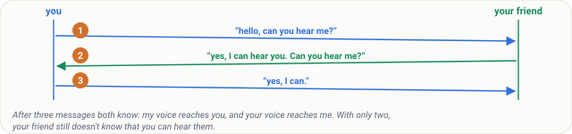
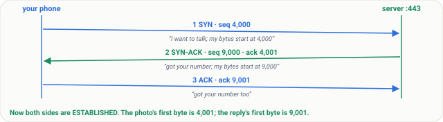
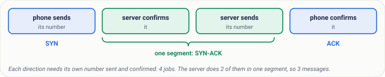
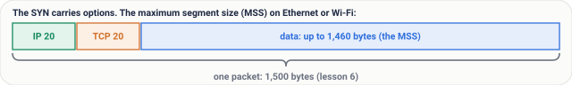
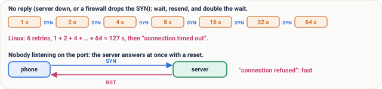
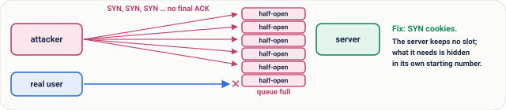
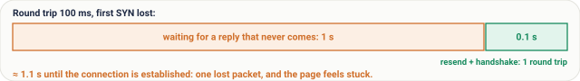

# Lesson 09: TCP Part 2, the Three-Way Handshake

## Roadmap

You are in **System Design Interview Prep**, Track 02, **Networking from Zero**: lesson 9 of 30. It builds on [lesson 8](../08-tcp-sequence-numbers-and-acks/README.md), where TCP numbered every byte and answered with ACKs. Here we see how both sides agree on their starting numbers before any data moves. The next lesson is [TCP part 3: flow control and congestion control](../10-tcp-flow-and-congestion-control/README.md). See [the track overview](../README.md) for the whole plan.

These are the written notes for the lesson's video. Prefer paper? The same notes are a free, printable PDF: [download SD-N-009.pdf](https://backendroadmap.com/notes/system-design/SD-N-009.pdf).

## Concept

> [!key] Before any data, TCP sends three messages: SYN, SYN-ACK and ACK. Each side sends a random starting number, and the other confirms it with that number plus one. It costs one round trip, and a lost SYN waits a full second, or more.

## Words you'll meet today

| Word | In plain words |
|---|---|
| **Connection** | two programs agreeing to talk, with a counter on each side |
| **SYN** | synchronise: the message that says here's my starting number |
| **ISN** | initial sequence number: that random starting number |
| **SYN-ACK** | the server's reply: its own SYN and an ACK in one segment |
| **Flag** | one bit in the TCP header that marks the kind of message |
| **ESTABLISHED** | the state once the handshake is done and data can flow |
| **MSS** | maximum segment size: the most data in one segment, often 1,460 bytes |
| **RST** | reset: a flag meaning no, or stop, this connection |

## The question: three tiny messages, no data

Before your phone sends a single byte of your photo, it sends three tiny messages to the server. No data at all. Just: hello.

In [lesson 8](../08-tcp-sequence-numbers-and-acks/README.md), we saw that TCP numbers every byte. But each side starts counting from a random number. So before any data moves, both sides must tell each other where they start. That's the three-way handshake, and today we follow it one message at a time.

## An everyday picture first: a call on a bad line

You call a friend on a bad line. You say: hello, can you hear me? Your friend says: yes, I can hear you. Can you hear me?

You say: yes, I can. Now both of you know two things: my voice reaches you, and your voice reaches me. Only then does the real conversation start.

Count the messages. Three. Two would not be enough: after only two, your friend still doesn't know that you can hear them.

*Figure 1. The analogy: a call on a bad line takes three messages before both people know that each voice reaches the other.*

## The real thing, one message at a time

The server is waiting on port 443. In TCP's words, it is **listening**. Your phone picks a random starting number, say 4,000.

1. **SYN.** Your phone sends a segment with the SYN flag set, and sequence number 4,000. In plain words: I want to talk, and my bytes start at 4,000.
2. **SYN-ACK.** The server picks its own random number, say 9,000. Its reply has both flags set: SYN, with sequence number 9,000, and ACK 4,001. In plain words: got your number, and my bytes start at 9,000.
3. **ACK.** Your phone replies: ACK 9,001. Got your number too. Now both sides are in the state called **ESTABLISHED**, and the connection exists.

Why 4,001, and not 4,000? Remember the rule from lesson 8: the ACK is the next number the receiver expects. The SYN itself uses up one number, so the next one is 4,001.

The first byte of your photo will carry sequence number 4,001. The first byte of the server's reply: 9,001. Two directions, two counters, both confirmed.

*Figure 2. The three-way handshake with real numbers: each side sends its random starting number, and the other confirms it with that number plus one.*

| # | From → to | Flags | seq | ack |
|---|---|---|---|---|
| 1 | phone → server | SYN | 4,000 | - |
| 2 | server → phone | SYN + ACK | 9,000 | 4,001 |
| 3 | phone → server | ACK | 4,001 | 9,001 |

Read the numbers: each ACK is the other side's number, plus one.

## Why three messages, and why random numbers?

Why three messages, and not two, or four? Each direction needs its own number, sent and confirmed. That's four jobs. But the server sends its SYN and its ACK in the same segment. Four jobs, three messages.

*Figure 3. Why three messages: four jobs (each side sends its number, the other confirms it), and the server combines its confirmation and its own number in one SYN-ACK.*

And why random starting numbers? Two reasons. A late packet from an old connection on the same ports won't be mistaken for new data. And an attacker can't easily guess the numbers to fake a connection.

## Options, and real numbers for time

The SYN also carries options. The most important is the **maximum segment size** (MSS): how much data fits in one segment. On normal Ethernet or Wi-Fi, it's **1,460 bytes**: the 1,500-byte packet from [lesson 6](../06-osi-model/README.md), minus 20 bytes of IP header, and 20 bytes of TCP header.

*Figure 4. The SYN's most important option, the maximum segment size: 1,500 bytes per packet minus 20 bytes of IP header and 20 of TCP header leaves 1,460 bytes of data.*

The handshake costs **one round trip** before any data. Your phone can send its first data together with the final ACK, so one round trip is all it costs.

| Where the server is | One round trip |
|---|---|
| the same city | a few ms |
| India → Singapore | about 60 ms |
| India → US east coast | about 200 to 250 ms |

You pay it once per connection, which is why opening connections is expensive, and reusing them matters (lesson 29).

*Figure 5. The handshake costs one round trip before any data (the first data can ride with the final ACK), and how long one round trip is depends on distance.*

## What goes wrong

- **No reply.** Maybe the server is down, or a firewall silently drops the SYN. Your phone waits, then sends the SYN again. On Linux, the first wait is one second, and then it doubles: two, four, eight, and so on. After six retries, about two minutes in all, you see: *connection timed out*.
- **Nobody listening.** The server is up, but no program is listening on that port. The server answers straight away with a reset: a segment with the **RST** flag. You see: *connection refused*. Fast, and honest.

*Figure 6. What goes wrong: with no reply the client resends the SYN, doubling the wait each time, until "connection timed out"; with no program on the port the server sends RST and you see "connection refused".*

**A SYN flood.** An attacker sends millions of SYNs, and never sends the final ACK. The server keeps a slot for each half-open connection, and its queue fills up, so real users can't get in. The usual fix is **SYN cookies**: the server keeps no slot, and hides what it needs inside its own starting number.

*Figure 7. A SYN flood: an attacker sends SYNs and never the final ACK, filling the server's queue of half-open connections so real users can't connect. SYN cookies keep no slot until the ACK arrives.*

## Pause and think

> [!exercise] The round trip to a server is 100 milliseconds. Your phone's first SYN is lost. How long until the connection is established? Decide before you open the answer.

Answer

About 1.1 seconds. Your phone waits one full second for a reply that never comes. Then it resends the SYN, and the handshake takes one round trip: 100 milliseconds. One lost packet, and the page feels stuck for a second.

*Figure 8. The pause-and-think answer: a lost first SYN costs the one-second retransmission wait, then one round trip, about 1.1 seconds in all.*

## Common mistakes

- **"There's a handshake for every request."** No. It happens once per connection, and many requests can reuse it (lesson 29).
- **"The handshake makes the connection secure."** No. It only agrees numbers. Encryption is TLS, which starts after it (lesson 21).
- **"ACK 4,001 means 4,001 bytes were received."** No. It means: the next number I expect is 4,001.

## Recap in three lines

1. Before any data, TCP sends three messages: SYN, SYN-ACK and ACK.
2. Each side sends a random starting number, and the other confirms it with that number plus one.
3. It costs one round trip, and a lost SYN waits a full second, or more.

## Interview questions

> [!interview] Explain the TCP three-way handshake. (Basic)

What to say in 30 seconds

The client sends a SYN with its initial sequence number. The server replies with a SYN-ACK: its own initial sequence number, and an acknowledgement of the client's number plus one. The client acknowledges the server's number plus one, and both sides are established. Data can start with, or right after, that final ACK.

> [!interview] Why three messages and not two? (Basic)

What to say in 30 seconds

Each direction needs its own starting number sent and confirmed, which is four jobs. The server combines its acknowledgement and its own SYN in one segment, so it takes three. With only two, the server would never learn that the client received its number, so the server-to-client direction would be unconfirmed.

> [!interview] A client sees “connection refused” on one server and “connection timed out” on another. What's the difference? (Scenario)

What to say in 30 seconds

Refused means the host answered with an RST: it is up, but no program is listening on that port (or a firewall actively rejects). Timed out means the SYN got no reply at all: the host is down, unreachable, or a firewall silently drops the packet, so the client kept retrying with doubling waits until it gave up.

> [!interview] What is a SYN flood, and how do you defend against it? (Scenario)

What to say in 30 seconds

An attacker sends many SYNs, often from fake addresses, and never completes the handshake, so the server's queue of half-open connections fills and real clients can't connect. Defences: SYN cookies (the server keeps no state and encodes it in its initial sequence number), larger backlog queues, rate limiting, and absorbing it upstream at a load balancer or DDoS protection service.

> [!interview] Why are initial sequence numbers random instead of starting at 0? (Tricky)

What to say in 30 seconds

So a delayed segment from an earlier connection on the same address and ports doesn't fall inside the new connection's numbers and get accepted as data, and so an off-path attacker can't guess the numbers to inject data or fake a connection (blind spoofing).

> [!interview] How does the handshake affect latency, and what reduces it? (Tricky)

What to say in 30 seconds

It costs one round trip before the request can be sent, paid for every new connection, plus TLS on top. Reuse connections (keep-alive, connection pools), put servers closer (CDNs), and use TCP Fast Open or QUIC (HTTP/3), which can send data in the first flight on repeat connections.

## Free PDF notes

Download these notes as a printable PDF, with every picture, the handshake table and the interview answers: [SD-N-009.pdf](https://backendroadmap.com/notes/system-design/SD-N-009.pdf).

## Sources

- [RFC 9293: Transmission Control Protocol](https://www.rfc-editor.org/rfc/rfc9293), the three-way handshake, connection states and RST.
- [RFC 6528: Defending against Sequence Number Attacks](https://www.rfc-editor.org/rfc/rfc6528), why initial sequence numbers are random.
- [RFC 4987: TCP SYN Flooding Attacks and Common Mitigations](https://www.rfc-editor.org/rfc/rfc4987), SYN floods and SYN cookies.
- [RFC 6298: Computing TCP's Retransmission Timer](https://www.rfc-editor.org/rfc/rfc6298), the 1-second initial timeout and doubling.
- [RFC 7413: TCP Fast Open](https://www.rfc-editor.org/rfc/rfc7413), sending data in the SYN on repeat connections.
- [Linux tcp(7) manual page](https://man7.org/linux/man-pages/man7/tcp.7.html), `tcp_syn_retries` (6 by default).

## Next

Next comes [lesson 10, TCP part 3](../10-tcp-flow-and-congestion-control/README.md): how TCP decides how fast to send, without drowning the receiver or the network. The [track overview](../README.md) lists the whole series.
