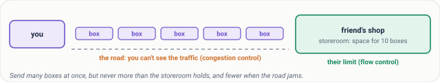
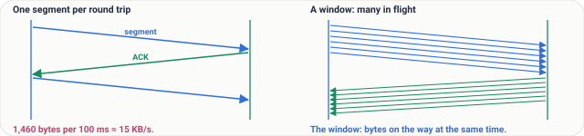
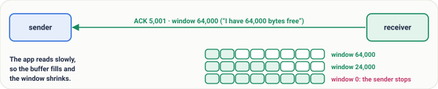
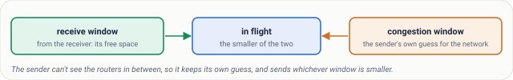
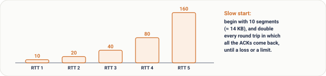
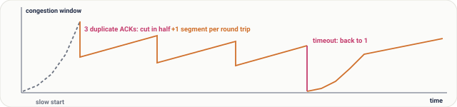
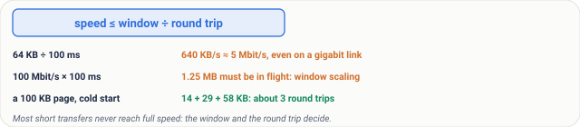
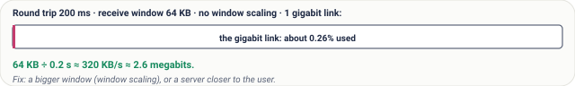

# Lesson 10: TCP Part 3, Flow Control and Congestion Control

## Roadmap

You are in **System Design Interview Prep**, Track 02, **Networking from Zero**: lesson 10 of 30. It builds on [lesson 8](../08-tcp-sequence-numbers-and-acks/README.md), where TCP numbered bytes and answered with ACKs, and [lesson 9](../09-tcp-three-way-handshake/README.md), the handshake that opens a connection. Here we see how TCP decides how fast to send. The next lesson is [TCP part 4: closing, RST, TIME_WAIT and running out of ports](../11-tcp-closing-time-wait-and-ports/README.md). See [the track overview](../README.md) for the whole plan.

These are the written notes for the lesson's video. Prefer paper? The same notes are a free, printable PDF: [download SD-N-010.pdf](https://backendroadmap.com/notes/system-design/SD-N-010.pdf).

## Concept

> [!key] The receive window stops TCP drowning the receiver, the congestion window stops it drowning the network; TCP keeps the smaller in flight, starts small, doubles every round trip, and cuts back on loss, so speed is at most window ÷ round trip.

## Words you'll meet today

| Word | In plain words |
|---|---|
| **Window** | how many bytes may be on the way, not yet acknowledged |
| **Receive window (rwnd)** | the receiver's free buffer space, sent in every ACK |
| **Congestion window (cwnd)** | the sender's own guess of what the network can take |
| **Flow control** | not drowning the receiver |
| **Congestion control** | not drowning the network |
| **Slow start** | begin with about 10 segments and double every round trip |
| **Throughput** | how many bytes arrive per second |
| **Window scaling** | a SYN option that allows windows far bigger than 64 KB |

## The question: who decides how fast?

You start a big download. The speed starts low, then climbs. On a crowded café Wi-Fi it suddenly drops, then slowly recovers. Nobody is turning a knob: TCP is deciding, every round trip, how fast to send. It must never drown two things: the receiver, and the network.

## An everyday picture first: boxes to a friend's shop

You send boxes to a friend's shop by van. Sending one box and waiting for a thank-you each time takes forever, so you send many at once. But two things limit you. The shop's storeroom: your friend says, I have space for ten boxes. And the road: you can't see the traffic, so you start with a few vans, add more while they arrive on time, and send fewer when one gets stuck in a jam. The storeroom is **flow control**; the road is **congestion control**. TCP obeys both.

*Figure 1. The analogy: boxes to a friend's shop. The storeroom is the receiver's limit (flow control); the road you can't see is the network's limit (congestion control).*

## The window: many segments in flight

Why not wait for each ACK? With a 100 ms round trip, one 1,460-byte segment per round trip is about 15 KB a second. So TCP keeps many segments in flight before their ACKs come back. The **window** is how many bytes may be on the way at the same time.

*Figure 2. Waiting for each ACK sends one segment per round trip, about 15 KB/s at 100 ms; a window keeps many segments in flight before their ACKs return.*

## Flow control: the receive window

In every ACK, the receiver also writes the **receive window**: I have 64,000 bytes of free space, don't send more than that. If the app on the receiver reads slowly, its buffer fills and the window shrinks. At zero, the sender stops, and checks back now and then until there's space again.

*Figure 3. Flow control: every ACK carries the receive window, the receiver's free buffer space. A slow app lets the buffer fill and the window shrink, down to zero.*

## Congestion control: the sender's guess

The sender can't see the routers in between, so it keeps its own guess, the **congestion window**, and sends whichever is smaller: the receiver's window or its own guess.

*Figure 4. TCP's two limits: the receive window (flow control) and the congestion window (congestion control). The sender keeps the smaller of the two in flight.*

**Slow start.** Modern TCP begins with ten segments, about 14 KB. Every round trip in which all the ACKs come back, it doubles: 10, 20, 40, 80. It isn't slow for long: it grows fast until a segment is lost, or it reaches a limit it learned before.

*Figure 5. Slow start: the congestion window begins at 10 segments, about 14 KB, and doubles every round trip: 10, 20, 40, 80, 160.*

**Then it grows carefully,** one more segment per round trip. When a loss shows up through three duplicate ACKs (lesson 8), it cuts the window; classic TCP cuts it in half, then grows again. Drawn over time, that's a sawtooth: TCP feeling for the limit of the road. After a timeout, with no ACKs at all, it drops to one segment and slow-starts again.

*Figure 6. The window over time: slow start, then a sawtooth, growing by one segment per round trip and cut in half on loss; after a timeout it falls to one segment and slow-starts again.*

## Real numbers

The key formula: **speed ≤ window ÷ round trip**. A 64 KB window over a 100 ms round trip gives 640 KB a second, about 5 megabits, even on a gigabit link. To fill a 100-megabit link at 100 ms you need 1.25 MB on the way at once, which is why a SYN option called **window scaling** allows windows far bigger than 64 KB. And at the start of a connection slow start decides: a 100 KB page needs about three round trips, 14, then 29, then 58 KB. That's why the first 14 KB of a page matter so much.

Today's systems refine this: Linux uses **CUBIC** by default, and Google's **BBR** measures the bandwidth and round trip directly instead of waiting for losses. The two limits are the same.

*Figure 7. Real numbers: throughput is at most the window divided by the round-trip time, so long paths need big windows, and short transfers are limited by slow start.*

## What goes wrong

- **Wi-Fi loss.** A packet lost to radio noise looks like congestion, so TCP cuts its window even though the road was empty. On bad Wi-Fi, speed drops for no good reason.
- **A slow receiver.** The app doesn't read fast enough, the receive window falls to zero and the sender sits idle; a packet capture shows *zero window*. The network is fine; the app is the bottleneck.
- **Too small a window on a long path.** Fast links, far away, still slow: the window, not the link, is the limit.

## Pause and think

> [!exercise] A server in the US, a user in India: a 200 ms round trip. The receive window is 64 KB, window scaling is off, and the link is one gigabit. What's the fastest this transfer can go? Decide before you open the answer.

Answer

64 KB per 200 ms: about 320 KB a second, roughly 2.6 megabits, a quarter of one percent of the gigabit link. The fix: a bigger window, or a server closer to the user.

*Figure 8. The pause-and-think answer: with a 64 KB window and a 200 ms round trip, the transfer tops out near 2.6 megabits, a tiny slice of a gigabit link.*

## Common mistakes

- **"Flow control and congestion control are the same."** No. One protects the receiver, the other protects the network.
- **"TCP uses the full bandwidth straight away."** No. It starts small and has to grow, so short transfers rarely reach full speed.
- **"Losing packets means the network is broken."** No. A little loss is normal: it's the signal TCP uses to find the limit.

## Recap in three lines

1. The receiver's window stops TCP from drowning the receiver.
2. The congestion window stops it from drowning the network.
3. TCP sends the smaller, starts small, doubles, and cuts back on loss.

## Interview questions

> [!interview] What's the difference between flow control and congestion control? (Basic)

What to say in 30 seconds

Flow control protects the receiver: it advertises a receive window, its free buffer space, in every ACK, and the sender never has more unacknowledged data than that. Congestion control protects the network: the sender keeps its own congestion window, grows it while ACKs arrive and cuts it on loss. The sender is limited by the smaller of the two.

> [!interview] Explain slow start and congestion avoidance. (Basic)

What to say in 30 seconds

A new connection starts with a small congestion window, about 10 segments, and doubles it every round trip (slow start). After a threshold or a loss it grows by about one segment per round trip (congestion avoidance). On three duplicate ACKs classic TCP halves the window; on a timeout it drops to one segment and slow-starts again, which gives the sawtooth.

> [!interview] A transfer between India and the US is slow, though both ends have fast links. Why? (Scenario)

What to say in 30 seconds

Throughput is at most window ÷ round-trip time. At 200 ms, a 64 KB window allows about 2.6 Mbit/s whatever the link speed. Check window scaling and buffer sizes, packet loss on the path (which keeps cutting the window), and consider moving the data closer (a CDN or a nearer region) or using parallel connections.

> [!interview] A capture shows the receiver advertising a zero window. What does that tell you? (Scenario)

What to say in 30 seconds

The receiver's buffer is full because the application isn't reading fast enough, so the sender is paused and probing. The network is fine; the bottleneck is the receiving app: CPU, a slow disk, a blocked thread or too small a buffer.

> [!interview] What is the bandwidth-delay product, and why does it matter? (Tricky)

What to say in 30 seconds

Bandwidth × round-trip time: the bytes that must be in flight to keep the link full. 100 Mbit/s × 100 ms = 1.25 MB, far more than the 64 KB a window can say without window scaling, so long, fast paths need scaled windows and large buffers.

> [!interview] Why can TCP perform badly on Wi-Fi or mobile links, and what helps? (Tricky)

What to say in 30 seconds

Loss-based congestion control treats every lost packet as congestion, but radio noise also loses packets, so TCP cuts its window although the path isn't full. Link-layer retransmission hides some loss; newer algorithms such as BBR estimate bandwidth and round trip directly instead of reacting to each loss.

## Free PDF notes

Download these notes as a printable PDF, with every picture, the round-trip maths and the interview answers: [SD-N-010.pdf](https://backendroadmap.com/notes/system-design/SD-N-010.pdf).

## Sources

- [RFC 9293: Transmission Control Protocol](https://www.rfc-editor.org/rfc/rfc9293), the window and the receive window in every segment.
- [RFC 5681: TCP Congestion Control](https://www.rfc-editor.org/rfc/rfc5681), slow start, congestion avoidance, fast retransmit and what happens on a timeout.
- [RFC 6928: Increasing TCP's Initial Window](https://www.rfc-editor.org/rfc/rfc6928), starting with 10 segments.
- [RFC 7323: TCP Extensions for High Performance](https://www.rfc-editor.org/rfc/rfc7323), window scaling.
- [RFC 9438: CUBIC for Fast and Long-Distance Networks](https://www.rfc-editor.org/rfc/rfc9438), the Linux default.
- [BBR: Congestion-Based Congestion Control (ACM Queue, 2016)](https://queue.acm.org/detail.cfm?id=3022184), measuring bandwidth and round trip instead of reacting to loss.

## Next

Next comes [lesson 11, TCP part 4](../11-tcp-closing-time-wait-and-ports/README.md): how a connection closes, what a reset means, and how a busy server can run out of ports. The [track overview](../README.md) lists the whole series.
