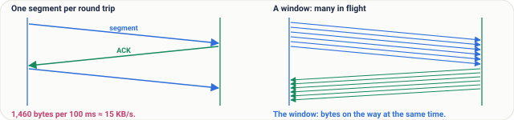
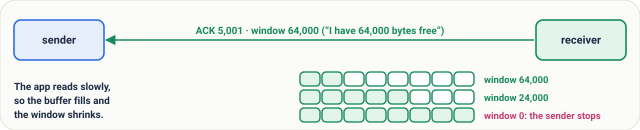
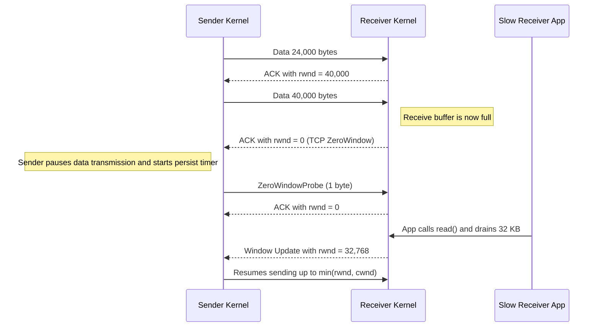
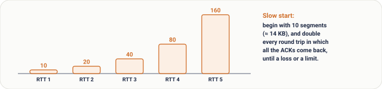
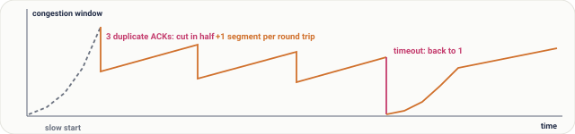
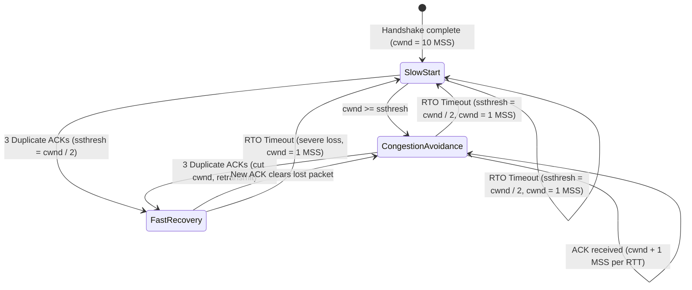
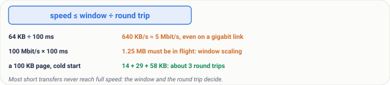
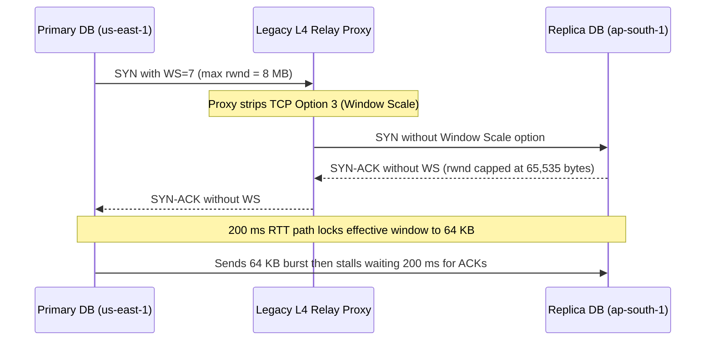

# Lesson 10: TCP Part 3, Flow Control and Congestion Control

> **Prerequisites:** [Lesson 08: TCP Sequence Numbers and ACKs](../08-tcp-sequence-numbers-and-acks/README.md), [Lesson 09: TCP Three-Way Handshake](../09-tcp-three-way-handshake/README.md), and [Networking From Zero Overview](../README.md) (Lesson 10 of 30).  
> **Estimated Reading Time:** 25 minutes  
> **Target Audience:** Backend engineers and system design candidates optimizing throughput across high-latency WAN paths, diagnosing zero-window receiver stalls, and evaluating CUBIC vs BBR congestion control.  
> **Free PDF Notes:** [Download SD-N-010.pdf](https://backendroadmap.com/notes/system-design/SD-N-010.pdf)

> [!NOTE]
> **In one line:** The receive window stops TCP drowning the receiver, the congestion window stops it drowning the network; TCP keeps the smaller of the two in flight, starts small, doubles every round trip, and cuts back on loss, so speed is at most window ÷ round trip.

> [!TIP]
> **The Golden Rule of TCP Pacing:** The **receive window (`rwnd`)** stops TCP from drowning the receiver, and the **congestion window (`cwnd`)** stops it from drowning the network. TCP keeps the smaller of the two in flight, starts small, doubles every round trip in slow start, and cuts back on loss—so throughput is strictly bounded by `min(rwnd, cwnd) / RTT`.

---

## Words You'll Meet Today

| Word | In Plain Words | Role in a Live Backend System |
| :--- | :--- | :--- |
| **Window** | How many bytes may be on the way, not yet acknowledged. | Bounds total unacknowledged bytes in flight per socket (`Bytes in Flight`). |
| **Receive window (`rwnd`)** | The receiver's free buffer space, sent in every ACK. | Applies kernel-level backpressure (`TCP ZeroWindow`) when an app drains sockets slowly. |
| **Congestion window (`cwnd`)** | The sender's own guess of what the network can take. | Dynamically probes router queue capacity via AIMD, CUBIC, or BBR. |
| **Flow control** | Not drowning the receiver. | Prevents a fast upstream service or CDN from overflowing a slow consumer's `sk_buff` memory. |
| **Congestion control** | Not drowning the network. | Prevents routers and switches along the WAN path from collapsing into bufferbloat and tail-drop loss. |
| **Slow start** | Begin with about 10 segments and double every round trip. | Controls cold-connection ramp-up (`IW10`, ~14.6 KB on first RTT) for API calls and web pages. |
| **Throughput** | How many bytes arrive per second. | Goodput ceiling constrained by Bandwidth-Delay Product (`BDP`) and packet loss rate. |
| **Window scaling** | A SYN option that allows windows far bigger than 64 KB. | RFC 7323 bit-shift multiplier (`wscale`) required to saturate modern Gigabit/10G WAN links. |

---

## Visual Mental Models & Architecture

### The Question: Who Decides How Fast?

You start a big download. The speed starts low, then climbs. On a crowded café Wi-Fi it suddenly drops, then slowly recovers. Nobody is turning a knob: TCP is deciding, every round trip, how fast to send. It must never drown two things: the receiver, and the network.

### An Everyday Picture First: Boxes to a Friend's Shop

You send boxes to a friend's shop by van. Sending one box and waiting for a thank-you each time takes forever, so you send many at once. But two things limit you. The shop's storeroom: your friend says, I have space for ten boxes. And the road: you can't see the traffic, so you start with a few vans, add more while they arrive on time, and send fewer when one gets stuck in a jam. The storeroom is **flow control**; the road is **congestion control**. TCP obeys both.


*Figure 1. The analogy: boxes to a friend's shop. The storeroom is the receiver's limit (flow control); the road you can't see is the network's limit (congestion control).*

### The Window: Many Segments in Flight

Why not wait for each ACK? With a `100 ms` round trip, one `1,460`-byte segment per round trip is about `15 KB` a second (`1,460 / 0.1 s = 14.6 KB/s`). So TCP keeps many segments in flight before their ACKs come back. The **window** is how many bytes may be on the way at the same time.



*Figure 2. Waiting for each ACK sends one segment per round trip, about 15 KB/s at 100 ms; a window keeps many segments in flight before their ACKs return.*

### Flow Control: The Receive Window (`rwnd`)

In every ACK, the receiver also writes the **receive window**: I have `64,000` bytes of free space, don't send more than that. If the app on the receiver reads slowly, its buffer fills and the window shrinks. At zero, the sender stops, and checks back now and then with a **Zero Window Probe** until there's space again.



*Figure 3. Flow control: every ACK carries the receive window, the receiver's free buffer space. A slow app lets the buffer fill and the window shrink, down to zero.*



### Congestion Control: The Sender's Guess (`cwnd`)

The sender can't see the routers in between, so it keeps its own guess, the **congestion window**, and sends whichever is smaller: the receiver's window or its own guess.


*Figure 4. TCP's two limits: the receive window (flow control) and the congestion window (congestion control). The sender keeps the smaller of the two in flight.*

**Slow start.** Modern TCP begins with ten segments, about `14 KB` (RFC 6928 `IW10`: `10 × 1,460 bytes = 14,600 bytes`). Every round trip in which all the ACKs come back, it doubles: `10, 20, 40, 80`. It isn't slow for long: it grows fast until a segment is lost, or it reaches a limit it learned before (`ssthresh`).



*Figure 5. Slow start: the congestion window begins at 10 segments, about 14 KB, and doubles every round trip: 10, 20, 40, 80, 160.*

**Then it grows carefully,** one more segment per round trip (**congestion avoidance**). When a loss shows up through three duplicate ACKs ([lesson 8](../08-tcp-sequence-numbers-and-acks/README.md)), it cuts the window; classic TCP cuts it in half, then grows again. Drawn over time, that's a **sawtooth**: TCP feeling for the limit of the road. After a timeout (RTO), with no ACKs at all, it drops to one segment (`1 MSS`) and slow-starts again.



*Figure 6. The window over time: slow start, then a sawtooth, growing by one segment per round trip and cut in half on loss; after a timeout it falls to one segment and slow-starts again.*



### Real Numbers & Bandwidth-Delay Product (BDP)

The key formula: **speed ≤ window ÷ round trip**. A `64 KB` window over a `100 ms` round trip gives `640 KB` a second, about `5 megabits`, even on a gigabit link. To fill a `100-megabit` link at `100 ms` you need `1.25 MB` on the way at once (`100 Mbps × 0.1 s / 8 = 1.25 MB`), which is why a SYN option called **window scaling** (RFC 7323) allows windows far bigger than `64 KB` (up to `1 GB` via a shift count up to `14`). And at the start of a connection slow start decides: a `100 KB` page needs about three round trips: `14 KB`, then `29 KB`, then `58 KB`. That's why the first `14 KB` of a page matter so much.

Today's systems refine this: Linux uses **CUBIC** by default, and Google's **BBR** measures the bandwidth and round trip directly instead of waiting for losses. The two limits (`rwnd` and `cwnd`) are the same.



*Figure 7. Real numbers: throughput is at most the window divided by the round-trip time, so long paths need big windows, and short transfers are limited by slow start.*

---

## Core Definition & Taxonomic Comparison

**What it is:** TCP throughput control is the closed feedback loop that decides, every round trip, *how many unacknowledged bytes may be in flight*. Two independent brakes feed that decision: one lives at the **receiver** (what the application can absorb) and one lives at the **sender** (what the path can carry). The sender obeys the **smaller**.

**What it isn't:** It is not "bandwidth" (a link property), not "latency" (a path property), and not "retransmission" (a loss-recovery mechanism). Engineers routinely blur these four, then tune the wrong knob.

| Term | Precise Meaning | Production Example |
| :--- | :--- | :--- |
| **Receive window (`rwnd`)** | Free bytes in the receiver's socket buffer, advertised in every ACK (16-bit field × `2^wscale`). Receiver-owned. | A Python ingest worker blocks on `fsync()`; `Recv-Q` fills; the server advertises `win 0` and every client upload stalls. |
| **Congestion window (`cwnd`)** | The sender's private estimate of how many bytes the *path* can hold. Never transmitted on the wire. | A fresh HTTPS connection starts at `IW10` = `14,600` bytes; a 60 KB JSON needs 3 data round trips regardless of link speed. |
| **Slow-start threshold (`ssthresh`)** | The `cwnd` value at which exponential growth hands over to linear growth. Set to `cwnd / 2` after loss. | After a loss at `cwnd = 400` segments, `ssthresh = 200`: the connection regrows quickly to 200, then crawls `+1 MSS/RTT`. |
| **Send window (effective window)** | `min(rwnd, cwnd)` minus bytes already in flight: how much more the sender may emit *right now*. | `ss -tin` shows `cwnd:20` but `Send-Q` capped at 64 KB: `rwnd` (no `wscale`), not `cwnd`, is the binding limit. |
| **Bandwidth-Delay Product (BDP)** | `bandwidth × RTT`: bytes that must be in flight to keep the pipe full. | A `1 Gbps` × `180 ms` Frankfurt–Tokyo link has a `22.5 MB` BDP; a 64 KB window uses `0.29%` of it. |
| **Throughput vs. goodput** | Throughput = bytes on the wire per second; goodput = *useful, de-duplicated* application bytes per second. | A Wi-Fi link at `3%` loss can show `20 Mbps` throughput but `12 Mbps` goodput once retransmits are subtracted. |
| **Bufferbloat** | Excess queueing delay created when loss-based CC keeps filling oversized router buffers. | A CUBIC bulk upload pushes ping on the same home router from `15 ms` to `600 ms`. |

**Human and business implication:** users do not perceive *bandwidth*; they perceive *time to last byte*. For small API responses that is dominated by slow start (RTT count), for bulk replication it is dominated by `min(rwnd, cwnd) / RTT`, and for mobile it is dominated by whether the CC algorithm mistakes radio loss for congestion.

---

## Component Breakdown & Anatomy: Where Does the Time Go?

Time-to-last-byte for a transfer of `S` bytes over a cold TCP connection decomposes into five additive parts:

$$T_{\text{total}} = T_{\text{handshake}} + T_{\text{slow-start}} + T_{\text{steady}} + T_{\text{loss-recovery}} + T_{\text{receiver-stall}}$$

| Component | What Drives It | Typical Size | Fix Lever |
| :--- | :--- | :--- | :--- |
| **Handshake (`T_handshake`)** | `1 × RTT` for TCP (+ `1 × RTT` for TLS 1.3) before the first data byte | `RTT` to `2 × RTT` | Keep-alive, connection pools, TLS 1.3 0-RTT, QUIC |
| **Slow start (`T_slow-start`)** | `IW10` and doubling per RTT until `ssthresh` or loss | `⌈log2(S/14,600 + 1)⌉` RTTs | Compress below 14 KB, CDN edge, larger `initcwnd` on trusted paths |
| **Steady state (`T_steady`)** | `min(rwnd, cwnd) / RTT` ceiling, link rate ceiling | `S / min(window/RTT, link)` | Window scaling, BBR, closer replica |
| **Loss recovery (`T_loss-recovery`)** | Dup-ACK fast retransmit (`~1 RTT`) vs. RTO (`≥ 200 ms`, doubling) | `1 RTT` to seconds | Fix lossy hop, SACK, TLP, pacing |
| **Receiver stall (`T_receiver-stall`)** | App not draining `Recv-Q`; `rwnd = 0` windows | `0` to seconds | Fix slow consumer, enlarge `tcp_rmem`, backpressure |

```text
 SENDER APP        SENDER KERNEL                NETWORK PATH               RECEIVER KERNEL          RECEIVER APP
 write(buf) ──►  [ Send-Q  ]                                               [ Recv-Q (sk_rmem) ] ──► read(buf)
                  │ limited by min(cwnd, rwnd)                                   ▲  advertises rwnd in every ACK
                  ▼                                                              │
             in-flight bytes ═══════►  routers + queues + loss  ═══════════════►│
                  ▲                         (cwnd probes this)                   │
                  └───────────────────────── ACK + window ◄──────────────────────┘
```

### The Observability Gap: Who Sees Which Number?

Every measurement point is blind to something. Misreading them is how teams blame the network for an application stall (and vice versa).

| Measurement Point | What It Captures | What It Hides |
| :--- | :--- | :--- |
| **Application timer** (client `fetch` duration, server handler time) | End-to-end wall time | Splits between slow start, loss recovery, and receiver stalls are invisible |
| **`ss -tin` / `TCP_INFO` on sender** | `cwnd`, `ssthresh`, `rtt`, `retrans`, `delivery_rate`, `snd_wnd`, `wscale` | Only that host's view; cannot see *why* the path dropped packets |
| **`ss -tin` on receiver** | `Recv-Q` depth, advertised window, `rcv_space` | Whether the sender is `cwnd`-limited or app-limited |
| **Packet capture (`tshark`, `tcpdump`)** | `ZeroWindow`, `Dup ACK`, `Retransmission`, window scale option in SYN | Ground truth, but one vantage point; no view of queueing inside a middlebox |
| **Load balancer / CDN logs** | Per-request time, bytes, upstream time | TCP-level behavior (window, loss) is entirely hidden |
| **Router / switch counters** | Queue drops, ECN marks, utilization | Which flow was hurt and why |

---

## Mathematical Model: Windows, BDP, Slow Start, and Loss

### 1. The Fundamental Throughput Bound

Per round trip, at most one window of data can be acknowledged, so:

$$\text{Throughput} \le \frac{\min(\text{rwnd},\ \text{cwnd})}{\text{RTT}}$$

Without window scaling the 16-bit field caps `rwnd` at `65,535` bytes, so:

| RTT | Max throughput at 64 KB window | % of a 1 Gbps link | Where you meet it |
| :--- | :--- | :--- | :--- |
| `1 ms` | `524 Mbps` | `52%` | Same-rack / same-AZ |
| `20 ms` | `26.2 Mbps` | `2.6%` | Cross-region, same continent |
| `100 ms` | `5.2 Mbps` | `0.52%` | Cross-continent |
| `200 ms` | `2.6 Mbps` | `0.26%` | India ↔ US East, satellite-grade paths |

### 2. Bandwidth-Delay Product and Window Scaling

$$\text{BDP} = \frac{B \times \text{RTT}}{8} \text{ bytes}, \qquad \text{wscale} = \min\{k : 65{,}535 \cdot 2^{k} \ge \text{BDP}\}\ (k \le 14)$$

| Bandwidth | RTT | BDP | Min `wscale` | Max window at that shift |
| :--- | :--- | :--- | :--- | :--- |
| `100 Mbps` | `100 ms` | `1.25 MB` | `5` | `2.1 MB` |
| `1 Gbps` | `20 ms` | `2.5 MB` | `6` | `4.2 MB` |
| `500 Mbps` | `180 ms` | `11.25 MB` | `8` | `16.8 MB` |
| `10 Gbps` | `200 ms` | `250 MB` | `12` | `268 MB` |

The absolute ceiling is `65,535 × 2^14 ≈ 1.07 GB`. Rule of thumb: size `tcp_rmem`/`tcp_wmem` maximums to `2 × BDP` so retransmission and kernel overhead never starve the pipe.

### 3. Slow-Start Rounds for a Cold Connection

With `IW = 10 × 1,460 = 14,600` bytes doubling each RTT, after `n` data rounds the sender has emitted $IW\,(2^{n} - 1)$ bytes. The rounds needed for a payload of `S` bytes:

$$n = \left\lceil \log_2\!\left(\frac{S}{IW} + 1\right) \right\rceil$$

| Payload `S` | Data rounds `n` | Added latency at `100 ms` RTT | Takeaway |
| :--- | :--- | :--- | :--- |
| `14.6 KB` | `1` | `100 ms` | Fits in `IW10`: the "first 14 KB" rule |
| `60 KB` | `3` | `300 ms` | Typical un-gzipped API list |
| `100 KB` | `3` | `300 ms` | Typical page HTML + CSS |
| `500 KB` | `6` | `600 ms` | Why bundle size matters on cold connections |
| `1 MB` | `7` | `700 ms` | Still ramp-limited, not link-limited |
| `10 MB` | `10` | `1,000 ms` | Ramp-up amortizes; steady state dominates |

### 4. Loss and the Mathis Equation

For loss-based Reno-style CC with loss probability `p`, the steady-state ceiling is (Mathis et al., 1997):

$$\text{Throughput} \approx \frac{C \cdot \text{MSS}}{\text{RTT}\sqrt{p}},\quad C \approx 1.22$$

| Loss rate `p` | `RTT = 10 ms` | `RTT = 100 ms` | `RTT = 200 ms` |
| :--- | :--- | :--- | :--- |
| `0.001%` | `451 Mbps` | `45.1 Mbps` | `22.5 Mbps` |
| `0.01%` | `142 Mbps` | `14.3 Mbps` | `7.1 Mbps` |
| `0.1%` | `45.1 Mbps` | `4.5 Mbps` | `2.3 Mbps` |
| `1%` | `14.3 Mbps` | `1.4 Mbps` | `0.7 Mbps` |
| `5%` | `6.4 Mbps` | `0.6 Mbps` | `0.3 Mbps` |

**The operational lesson:** throughput falls with `1/√p` *and* `1/RTT`. A path with `1%` loss at `100 ms` cannot exceed `~1.4 Mbps` per connection under Reno-style CC even on a `10 Gbps` circuit. That is why "just buy more bandwidth" fails, and why BBR (which ignores isolated non-congestive loss) or a nearer edge wins.

### 5. Sawtooth Average

For AIMD with a multiplicative cut of `β = 0.5`, the average window is `0.75 × W_max` (the sawtooth swings between `0.5 W_max` and `W_max`). For CUBIC (`β = 0.7`) it is `0.85 × W_max`, one reason CUBIC fills fat pipes better than Reno.

---

---

## Systematic Reference & Comparison Grid

### Flow Control (`rwnd`) vs. Congestion Control (`cwnd`)

| Dimension | Flow Control (`rwnd`) | Congestion Control (`cwnd`) |
| :--- | :--- | :--- |
| **Protects Whom?** | The **receiver's** OS receive buffer and slow app | Intermediate **routers, switches, and WAN links** |
| **Where Computed?** | At the receiver kernel, based on free `sk_rmem` | At the sender kernel, from ACKs, RTT, and loss |
| **Signaled Over Wire?** | Yes—16-bit Window field in every TCP header (+ `wscale`) | No—never transmitted on the wire; strictly sender state |
| **Typical Hard Ceiling** | `64 KB` unscaled; up to `1 GB` with RFC 7323 `wscale` | Dynamic (`10 MSS` initial up to BDP + router queue) |
| **Packet Capture Signature** | `TCP ZeroWindow`, `ZeroWindowProbe`, `WindowUpdate` | `TCP Dup ACK`, `Fast Retransmission`, `Spurious Retransmission` |
| **Primary Engineering Fix** | Drain socket faster, enlarge `net.ipv4.tcp_rmem`, fix blocking I/O | Enable `tcp_window_scaling`, tune BBR/CUBIC, move CDN/data closer |

### Congestion Control Algorithms Compared

| Algorithm | Primary Congestion Signal | Growth Behavior | Reaction to Loss | Behavior on Long / Lossy Paths |
| :--- | :--- | :--- | :--- | :--- |
| **Reno / NewReno** | Packet loss (`3 Dup ACKs` or RTO) | Linear (`+1 MSS / RTT`) | Halves `cwnd` (`0.5×`) | Collapses badly on high-BDP or 1% loss Wi-Fi |
| **CUBIC (Linux Default)** | Packet loss | Cubic function of time since last loss | Cuts `cwnd` by `30%` (`0.7×`) | Great on clean fiber, still fills buffers (bufferbloat) and drops on radio noise |
| **BBR (Bottleneck BW & RTT)** | Delivery rate & min-RTT pacing | Probes bandwidth (`1.25×` gain) and drains queues | Ignores isolated non-congestive loss (in v1); paces smoothly | Maintains high speed across transoceanic / Wi-Fi links with minimal bufferbloat |

---

## Observability: Metrics, Alerts, and Dashboards for Throughput Health

Treat TCP window state as a first-class SLI. Most "slow network" tickets are one of three signatures: **receiver-limited** (zero window), **window-limited** (small or unscaled `rwnd`), or **loss-limited** (sawtooth + retransmits).

| Signal | Source | Healthy | Alert When | Meaning |
| :--- | :--- | :--- | :--- | :--- |
| `tcpi_snd_cwnd` / `cwnd` | `ss -tin`, `TCP_INFO` | Climbs to path BDP after ramp | Pinned at `10` on a long-lived transfer | Repeated RTO / slow-start-after-idle resets |
| `tcpi_snd_wnd` | `TCP_INFO` | Multi-MB on WAN sockets | `≤ 65,535` on cross-region sockets | Missing `wscale` (middlebox stripped option) |
| `tcpi_rtt` / `rttvar` | `TCP_INFO` | Stable, near physical RTT | RTT jumps `3×` under load | Bufferbloat / queue build-up |
| `tcpi_total_retrans` / `RetransSegs` | `nstat TcpRetransSegs` | `< 0.1%` of segments out | `> 1%` for 5 min | Lossy hop, congestion, or Wi-Fi noise |
| `TCPTimeouts` vs `TCPFastRetrans` | `nstat -az TcpExtTCPTimeouts TcpExtTCPFastRetrans` | Fast retrans ≫ timeouts | Timeouts rising | Tail losses; RTO collapses `cwnd` to 1 MSS |
| `Recv-Q` per listening service | `ss -tn` / eBPF | Near `0` | Sustained `> 50%` of `rcvbuf` | Consumer slower than producer; `ZeroWindow` imminent |
| `TCPZeroWindowDrop`, `TCPRcvQDrop` | `nstat` | `0` | Any steady increase | Receiver buffer overflow / memory pressure |
| `delivery_rate` vs `pacing_rate` | `ss -tin` | Close to link/BDP goodput | Delivery ≪ pacing | App-limited or loss-limited |

**Dashboard layout that works:** (1) per-service `p50/p95` of *time-to-first-byte* and *time-to-last-byte* split by payload size bucket (`< 14 KB`, `14–100 KB`, `> 1 MB`); (2) cross-region socket `snd_wnd` histogram; (3) `Recv-Q` heatmap per pod; (4) retransmit ratio per AZ pair. If TTFB is fine but TTLB scales with payload, you are slow-start- or window-limited, not CPU-limited.

**Runbook decision tree:**
1. `ss -tin` on the sender: is `cwnd` small, or `snd_wnd` small? If `snd_wnd ≤ 65,535`, check window scaling end to end.
2. `ss -tn` on the receiver: is `Recv-Q` huge? Then profile the consumer (GC, fsync, locks).
3. `nstat`: are retransmits or timeouts rising? Then trace the path (`mtr`, ping loss per hop) and consider BBR.
4. Only after all three: blame bandwidth.

---

## Production War Story Post-Mortem: Cross-Continent DB Replication Stalled at 2.6 Mbps

- **Severity:** SEV-1 (DR Replication SLA Breach)
- **Detection / Resolution Time:** 38 minutes to isolate via packet capture; 12 minutes to remediate
- **Impact:** PostgreSQL WAL shipping from `us-east-1` to `ap-south-1` (`200 ms` RTT) flatlined at `320 KB/s` (`2.6 Mbps`) per stream despite a provisioned `10 Gbps` cross-region tunnel, building a 4-hour RPO lag during bulk ETL writes.

### What Happened



### Root Cause Analysis

1. **Missing RFC 7323 Window Scaling:** A legacy user-space TCP forwarder in the DR path rebuilt outgoing `SYN` packets without copying the TCP `Window Scale` (`WS`) option. Without `WS`, the 16-bit TCP Window field cannot express more than `65,535` bytes (`64 KB`).
2. **BDP Starvation:** Over a `200 ms` transoceanic round trip, `65,535 bytes / 0.2 s = 327.6 KB/s ≈ 2.62 Mbps`—less than `0.03%` of the `10 Gbps` pipe. Meanwhile, to fill even `1 Gbps` at `200 ms`, the Bandwidth-Delay Product requires `1,000 Mbps × 0.2 s / 8 = 25 MB` in flight.
3. **Misleading Host Metrics:** Both database hosts showed `< 5%` CPU and healthy disk IOPS, delaying diagnosis because operators checked hardware before running `ss -tin` or `tcpdump`.

### The Fix & Architectural Hardening

- **Immediate Mitigation:** Bypassed the option-stripping relay with direct kernel/WireGuard routing so both endpoints negotiated `wscale:9,9` (enabling multi-megabyte windows).
- **Kernel Tuning:** Set `net.ipv4.tcp_window_scaling = 1`, raised `net.ipv4.tcp_rmem` and `net.ipv4.tcp_wmem` ceiling to `33554432` (`32 MB` > `25 MB` BDP), and switched the WAN interface qdisc + CC to `fq` + `bbr`.
- **Observability Guardrail:** Added `ss` / `TCP_INFO` exporter metrics alerting whenever `tcpi_snd_wnd` stays pinned at `<= 65535` on cross-region sockets.

---

## Multi-Language Production Implementation

Below is a production-structured **TCP Window & BDP Simulator** implementing `min(rwnd, cwnd)` pacing, `IW10` Slow Start, Congestion Avoidance, `3 Dup ACK` Fast Recovery, `RTO` reset, and RFC 7323 Window Scale shift calculation across Go, TypeScript, Python, and C#.

````carousel
```go
package tcpctrl

import "math"

type State string

const (
	SlowStart           State = "SLOW_START"
	CongestionAvoidance State = "CONGESTION_AVOIDANCE"
)

type WindowController struct {
	MSS      int
	Cwnd     int
	Rwnd     int
	Ssthresh int
	State    State
}

func NewWindowController(mss, initialRwnd, ssthresh int) *WindowController {
	return &WindowController{
		MSS:      mss,
		Cwnd:     10 * mss, // RFC 6928 IW10
		Rwnd:     initialRwnd,
		Ssthresh: ssthresh,
		State:    SlowStart,
	}
}

// EffectiveWindow returns bytes allowed in flight: min(rwnd, cwnd).
func (w *WindowController) EffectiveWindow() int {
	if w.Rwnd < w.Cwnd {
		return w.Rwnd
	}
	return w.Cwnd
}

// OnRoundTripAck advances cwnd after one RTT of clean ACKs.
func (w *WindowController) OnRoundTripAck() {
	if w.State == SlowStart {
		w.Cwnd *= 2
		if w.Cwnd >= w.Ssthresh {
			w.State = CongestionAvoidance
		}
		return
	}
	w.Cwnd += w.MSS
}

// OnThreeDupAcks simulates Fast Retransmit / Fast Recovery (halving cwnd).
func (w *WindowController) OnThreeDupAcks() {
	w.Ssthresh = max(2*w.MSS, w.Cwnd/2)
	w.Cwnd = w.Ssthresh
	w.State = CongestionAvoidance
}

// OnTimeout simulates RTO: drop to 1 MSS and re-enter Slow Start.
func (w *WindowController) OnTimeout() {
	w.Ssthresh = max(2*w.MSS, w.Cwnd/2)
	w.Cwnd = w.MSS
	w.State = SlowStart
}

// RequiredWindowScale computes BDP bytes and minimum RFC 7323 wscale shift.
func RequiredWindowScale(bandwidthMbps, rttMs float64) (bdpBytes int, wscale int) {
	bdpBytes = int(math.Ceil((bandwidthMbps * 1_000_000 / 8.0) * (rttMs / 1000.0)))
	for (65535 << wscale) < bdpBytes && wscale < 14 {
		wscale++
	}
	return bdpBytes, wscale
}
```
<!-- slide -->
```typescript
type CongestionState = "SLOW_START" | "CONGESTION_AVOIDANCE";

export class TcpWindowController {
  public cwnd: number;
  public state: CongestionState = "SLOW_START";

  constructor(
    public readonly mss: number = 1460,
    public rwnd: number = 65_535,
    public ssthresh: number = 128 * 1460
  ) {
    this.cwnd = 10 * mss; // RFC 6928 IW10 (~14.6 KB)
  }

  effectiveWindowBytes(): number {
    return Math.min(this.rwnd, this.cwnd);
  }

  onRoundTripAck(): void {
    if (this.state === "SLOW_START") {
      this.cwnd *= 2;
      if (this.cwnd >= this.ssthresh) {
        this.state = "CONGESTION_AVOIDANCE";
      }
      return;
    }
    this.cwnd += this.mss;
  }

  onThreeDupAcks(): void {
    this.ssthresh = Math.max(2 * this.mss, Math.floor(this.cwnd / 2));
    this.cwnd = this.ssthresh;
    this.state = "CONGESTION_AVOIDANCE";
  }

  onTimeout(): void {
    this.ssthresh = Math.max(2 * this.mss, Math.floor(this.cwnd / 2));
    this.cwnd = this.mss;
    this.state = "SLOW_START";
  }

  static computeBdpAndShift(bandwidthMbps: number, rttMs: number): {
    bdpBytes: number;
    wscale: number;
    maxThroughputMbps: number;
  } {
    const bdpBytes = Math.ceil(((bandwidthMbps * 1_000_000) / 8) * (rttMs / 1000));
    let wscale = 0;
    while ((65_535 << wscale) < bdpBytes && wscale < 14) {
      wscale++;
    }
    const unscaledMaxMbps = ((65_535 * 8) / (rttMs / 1000)) / 1_000_000;
    return { bdpBytes, wscale, maxThroughputMbps: Number(unscaledMaxMbps.toFixed(2)) };
  }
}
```
<!-- slide -->
```python
from dataclasses import dataclass
import math


@dataclass
class TcpWindowController:
    mss: int = 1460
    rwnd: int = 65_535
    ssthresh: int = 128 * 1460
    cwnd: int = 10 * 1460  # RFC 6928 IW10
    state: str = "SLOW_START"

    def effective_window(self) -> int:
        return min(self.rwnd, self.cwnd)

    def on_round_trip_ack(self) -> None:
        if self.state == "SLOW_START":
            self.cwnd *= 2
            if self.cwnd >= self.ssthresh:
                self.state = "CONGESTION_AVOIDANCE"
        else:
            self.cwnd += self.mss

    def on_three_dup_acks(self) -> None:
        self.ssthresh = max(2 * self.mss, self.cwnd // 2)
        self.cwnd = self.ssthresh
        self.state = "CONGESTION_AVOIDANCE"

    def on_timeout(self) -> None:
        self.ssthresh = max(2 * self.mss, self.cwnd // 2)
        self.cwnd = self.mss
        self.state = "SLOW_START"


def compute_bdp_and_wscale(bandwidth_mbps: float, rtt_ms: float) -> tuple[int, int]:
    bdp_bytes = math.ceil((bandwidth_mbps * 1_000_000 / 8.0) * (rtt_ms / 1000.0))
    wscale = 0
    while (65_535 << wscale) < bdp_bytes and wscale < 14:
        wscale += 1
    return bdp_bytes, wscale
```
<!-- slide -->
```csharp
using System;

public enum CongestionState { SlowStart, CongestionAvoidance }

public sealed class TcpWindowController
{
    public int Mss { get; }
    public int Rwnd { get; set; }
    public int Cwnd { get; private set; }
    public int Ssthresh { get; private set; }
    public CongestionState State { get; private set; } = CongestionState.SlowStart;

    public TcpWindowController(int mss = 1460, int rwnd = 65_535, int ssthresh = 128 * 1460)
    {
        Mss = mss;
        Rwnd = rwnd;
        Ssthresh = ssthresh;
        Cwnd = 10 * mss; // RFC 6928 IW10
    }

    public int EffectiveWindow() => Math.Min(Rwnd, Cwnd);

    public void OnRoundTripAck()
    {
        if (State == CongestionState.SlowStart)
        {
            Cwnd *= 2;
            if (Cwnd >= Ssthresh) State = CongestionState.CongestionAvoidance;
            return;
        }
        Cwnd += Mss;
    }

    public void OnThreeDupAcks()
    {
        Ssthresh = Math.Max(2 * Mss, Cwnd / 2);
        Cwnd = Ssthresh;
        State = CongestionState.CongestionAvoidance;
    }

    public void OnTimeout()
    {
        Ssthresh = Math.Max(2 * Mss, Cwnd / 2);
        Cwnd = Mss;
        State = CongestionState.SlowStart;
    }

    public static (int BdpBytes, int Wscale) ComputeBdpAndWscale(double bandwidthMbps, double rttMs)
    {
        int bdpBytes = (int)Math.Ceiling((bandwidthMbps * 1_000_000.0 / 8.0) * (rttMs / 1000.0));
        int wscale = 0;
        while ((65_535 << wscale) < bdpBytes && wscale < 14) wscale++;
        return (bdpBytes, wscale);
    }
}
```
````

---

## Practical Hands-On Verification CLI Workflows

### 1. Inspect Live Socket `cwnd`, `rtt`, `wscale`, and Congestion Control (`ss -tin`)

```bash
ss -tin dst 198.51.100.10
```

**Expected Output:**

```text
State  Recv-Q Send-Q Local Address:Port  Peer Address:Port
ESTAB  0      43800  10.0.1.14:51822     198.51.100.10:443
         cubic wscale:7,7 rto:240 rtt:38.2/2.1 ato:40 mss:1448 pmtu:1500 rcvmss:1448 advmss:1448 cwnd:20 ssthresh:14 bytes_acked:29200 segs_out:24 segs_in:18 send 6.1Mbps pacing_rate 12.1Mbps unacked:10
```

Notice `wscale:7,7` (a `2^7 = 128×` window multiplier), `cwnd:20` (20 MSS segments), and `cubic` active on the socket.

### 2. Audit Kernel Window Scaling, Buffer Limits, and Congestion Algorithm

```bash
sysctl net.ipv4.tcp_window_scaling net.ipv4.tcp_congestion_control net.ipv4.tcp_rmem net.ipv4.tcp_wmem
```

**Expected Output:**

```text
net.ipv4.tcp_window_scaling = 1
net.ipv4.tcp_congestion_control = cubic
net.ipv4.tcp_rmem = 4096	131072	6291456
net.ipv4.tcp_wmem = 4096	16384	4194304
```

### 3. Detect `ZeroWindow` Stalls and `Dup ACK` Retransmissions in a Capture

```bash
tshark -r capture.pcap -Y "tcp.analysis.zero_window or tcp.analysis.duplicate_ack or tcp.analysis.retransmission" -T fields -e frame.number -e ip.src -e tcp.window_size -e _ws.col.Info
```

**Expected Output:**

```text
412	10.0.2.15	0	[TCP ZeroWindow] 5432 → 51822 [ACK] Seq=1 Ack=89214 Win=0 Len=0
413	10.0.1.14	64256	[TCP ZeroWindowProbe] 51822 → 5432 [ACK] Seq=89214 Ack=1 Win=64256 Len=1
414	10.0.2.15	0	[TCP ZeroWindowProbeAck] [TCP ZeroWindow] 5432 → 51822 [ACK] Seq=1 Ack=89215 Win=0 Len=0
```

---

## Pause and Think

> [!exercise] A server in the US, a user in India: a 200 ms round trip. The receive window is 64 KB, window scaling is off, and the link is one gigabit. What's the fastest this transfer can go? Decide before you open the answer.

<details><summary>Answer</summary>

64 KB per 200 ms: about 320 KB a second, roughly 2.6 megabits, a quarter of one percent of the gigabit link. The fix: a bigger window, or a server closer to the user.


*Figure 8. The pause-and-think answer: with a 64 KB window and a 200 ms round trip, the transfer tops out near 2.6 megabits, a tiny slice of a gigabit link.*

</details>

---

## Operational Validation Checkpoints

<details><summary><strong>Checkpoint 1: Sizing Buffers for a High-BDP Replication Link</strong></summary>

**Scenario:** You need a single TCP stream between Frankfurt and Tokyo (`180 ms` RTT) to sustain `500 Mbps`. What minimum socket buffer size (`rwnd` / `tcp_rmem` max) and `wscale` shift count do you need?

**Solution:**
1. Compute BDP: `500 Mbps × 0.18 s / 8 = 90 megabits / 8 = 11.25 MB` (`~11,250,000` bytes).
2. Unscaled max window is `65,535` bytes. Shift `7` gives `65,535 × 128 = 8.39 MB` (still too small!). Shift `8` gives `65,535 × 256 = 16.77 MB` (`>= 11.25 MB`).
3. Set `net.ipv4.tcp_rmem` and `tcp_wmem` max values to at least `16 MB–24 MB` (`2 × BDP` is a standard rule of thumb in Linux to leave room for kernel overhead and loss recovery).

</details>

<details><summary><strong>Checkpoint 2: Isolating App Backpressure vs. Network Congestion</strong></summary>

**Scenario:** File uploads to your ingestion service drop to `0 B/s` intermittently for 5 seconds at a time. `tshark` reveals `TCP ZeroWindow` frames emitted by your ingestion server, with zero `Retransmission` frames. Is the ISP congested?

**Solution:**
No—the network is completely healthy. `TCP ZeroWindow` means `rwnd` dropped to `0` because the receiving application's kernel buffer (`Recv-Q` in `ss`) filled up faster than user-space code drained it. Check for garbage-collection pauses, synchronous disk fsyncs, mutex contention, or blocked worker threads on the receiving host.

</details>

<details><summary><strong>Checkpoint 3: Why Short API Responses Feel Slow Over TLS</strong></summary>

**Scenario:** Returning a `60 KB` uncompressed JSON catalog from an origin `120 ms` away takes `~480 ms` after TCP connect, even on a `1 Gbps` client connection. Why?

**Solution:**
Even with a huge `rwnd`, `IW10` starts `cwnd` at `10 × 1,460 = 14.6 KB`:
- RTT 1 sends `~14.6 KB` (`45.4 KB` left).
- RTT 2 doubles `cwnd` to `~29.2 KB` (`16.2 KB` left).
- RTT 3 doubles `cwnd` to `~58.4 KB` (finishes the remaining `16.2 KB`).
Three full data RTTs (`3 × 120 ms = 360 ms`) plus initial handshake RTTs add up quickly. Enabling gzip/Brotli compression (shrinking `60 KB` under `14 KB` so it fits in **1 RTT**) or serving via an edge CDN cuts latency dramatically.

</details>

---

## Common Mistakes & Troubleshooting

### What Goes Wrong in Production

- **Wi-Fi loss:** A packet lost to radio noise looks like congestion, so TCP cuts its window even though the road was empty. On bad Wi-Fi, speed drops for no good reason.
- **A slow receiver:** The app doesn't read fast enough, the receive window falls to zero and the sender sits idle; a packet capture shows *zero window*. The network is fine; the app is the bottleneck.
- **Too small a window on a long path:** Fast links, far away, still slow: the window, not the link, is the limit.

### Common Myths

- **"Flow control and congestion control are the same."** No. One protects the receiver, the other protects the network.
- **"TCP uses the full bandwidth straight away."** No. It starts small and has to grow, so short transfers rarely reach full speed.
- **"Losing packets means the network is broken."** No. A little loss is normal: it's the signal TCP uses to find the limit.

| Diagnostic Symptom (`ss` / `tshark`) | Underlying Cause | Immediate Fix |
| :--- | :--- | :--- |
| `Recv-Q` maxed out + `TCP ZeroWindow` | App cannot drain socket fast enough | Fix slow disk/GC/blocking handler; apply app-level 429/backpressure |
| `wscale` missing in `ss -tin`, `Send-Q` capped ~64 KB | Middlebox stripped RFC 7323 or `tcp_window_scaling=0` | Re-enable `tcp_window_scaling=1` and upgrade/bypass stripping proxy |
| High `retrans` + sawtooth drops on Wi-Fi/WAN | Loss-based CC (`CUBIC`) misreads wireless loss as congestion | Evaluate `BBR` (`net.ipv4.tcp_congestion_control=bbr` with `fq` qdisc) |
| High latency on `< 50 KB` responses | Slow start (`IW10`) requires multiple RTTs | Compress payload `< 14 KB`, reuse pooled HTTP/2+ connections, add CDN |

---

## Recap in Three Lines

1. The receiver's window stops TCP from drowning the receiver.
2. The congestion window stops it from drowning the network.
3. TCP sends the smaller, starts small, doubles, and cuts back on loss.

---

## Interview Practice Questions

Each question is tagged by kind: **Basic** (definitions), **Scenario** (apply it to a system), and **Tricky** (deep follow-ups). Answer out loud before opening the solution.

### Basic Conceptual Questions (Q1–Q4)

<details>
<summary><strong>Q1: What's the difference between flow control and congestion control? [BASIC]</strong></summary>

<strong>What a strong answer covers:</strong>
**Flow control** protects the *receiver*: it advertises a receive window (`rwnd`), its free buffer space, in every ACK, and the sender never has more unacknowledged data than that. **Congestion control** protects the *network*: the sender keeps its own congestion window (`cwnd`), grows it while ACKs arrive and cuts it on loss. The sender is limited by the smaller of the two: `in flight ≤ min(rwnd, cwnd)`. Only `rwnd` is on the wire; `cwnd` is private sender state.

</details>

<details>
<summary><strong>Q2: Explain slow start and congestion avoidance. [BASIC]</strong></summary>

<strong>What a strong answer covers:</strong>
A new connection starts with a small `cwnd`, about `10` segments (`IW10`, `14.6 KB`, RFC 6928), and **doubles** it every round trip in which all ACKs return (slow start: `10, 20, 40, 80`). After `cwnd ≥ ssthresh` or a loss it grows by about **one segment per round trip** (congestion avoidance). On three duplicate ACKs classic TCP halves the window (fast retransmit / fast recovery); on a timeout it drops to `1 MSS` and slow-starts again. Plotted over time that gives the **sawtooth**.

</details>

<details>
<summary><strong>Q3: Why does TCP keep many segments in flight instead of waiting for each ACK? [BASIC]</strong></summary>

<strong>What a strong answer covers:</strong>
Stop-and-wait sends one segment per RTT. With `1,460` bytes and `100 ms` RTT that is `14.6 KB/s`, about `117 kbit/s`, regardless of link speed. A **sliding window** keeps `W` bytes outstanding so throughput becomes `W / RTT`. The window must be at least the **BDP** to fill the pipe; anything smaller leaves the link idle while the sender waits for ACKs.

</details>

<details>
<summary><strong>Q4: What is window scaling, and why do we need it? [BASIC]</strong></summary>

<strong>What a strong answer covers:</strong>
The TCP header's window field is 16 bits, so it can only express `65,535` bytes. **Window scaling** (RFC 7323) is a **SYN-only option** that defines a shift count (`0–14`); the effective window is `field × 2^shift`, up to about `1 GB`. It is negotiated only in the handshake; if either side (or a middlebox) omits it, the connection is stuck at 64 KB for life. Modern Linux enables it by default (`tcp_window_scaling=1`).

</details>

### Scenario-Based Architecture Questions (Q5–Q8)

<details>
<summary><strong>Q5: A transfer between India and the US is slow, though both ends have fast links. Why? [SCENARIO]</strong></summary>

<strong>What a strong answer covers:</strong>
Throughput is at most `window ÷ RTT`. At `200 ms`, a `64 KB` window yields only `~2.6 Mbit/s` whatever the link speed. Check, in order: (1) window scaling negotiated on both ends and not stripped by a proxy (`ss -tin` shows `wscale:x,y`); (2) socket buffer maximums (`tcp_rmem`, `tcp_wmem`); (3) loss on the path (Mathis: throughput falls with `1/√p`); (4) the CC algorithm (BBR helps on lossy long paths). If physics still bites, move data closer (CDN, regional replica) or use parallel streams.

</details>

<details>
<summary><strong>Q6: A packet capture shows the receiver advertising a zero window. What does that tell you? [SCENARIO]</strong></summary>

<strong>What a strong answer covers:</strong>
The receiver's buffer is full because the **application is not reading fast enough**; the sender is paused, sending periodic **Zero Window Probes** until a **Window Update** arrives. The network is fine (no retransmissions needed). Look at the receiving app: GC pauses, synchronous disk `fsync`, lock contention, a blocked worker, or an undersized buffer. Fix the consumer or add application-level backpressure (HTTP `429`, bounded queues), not the network.

</details>

<details>
<summary><strong>Q7: A `60 KB` uncompressed JSON from an origin `120 ms` away takes `~480 ms` after connect on a gigabit client. Why, and how do you fix it? [SCENARIO]</strong></summary>

<strong>What a strong answer covers:</strong>
Slow start, not bandwidth. `IW10` sends `14.6 KB` in RTT 1, `29.2 KB` in RTT 2, then the remaining `16.2 KB` in RTT 3: `3 × 120 ms = 360 ms` of data rounds on top of handshake and server time. Fixes: compress (gzip/Brotli) below `14 KB` so it fits in one round, serve from an edge CDN, reuse warm pooled HTTP/2 connections (cwnd already grown), or paginate.

</details>

<details>
<summary><strong>Q8: Size the TCP buffers for a single stream between Frankfurt and Tokyo (`180 ms` RTT) that must sustain `500 Mbps`. [SCENARIO]</strong></summary>

<strong>What a strong answer covers:</strong>
BDP = `500 Mbps × 0.18 s / 8 = 11.25 MB`. Unscaled window is `64 KB`; shift `7` gives `8.39 MB` (too small), shift `8` gives `16.8 MB` (enough), so `wscale ≥ 8`. Set `tcp_rmem`/`tcp_wmem` maxima to `~2 × BDP` (`16–32 MB`). Also verify no middlebox strips the option, enable `fq` + BBR or tuned CUBIC, and watch loss: at `0.01%` loss Reno-style CC caps near `7 Mbps` at this RTT, so loss must be near zero or CC must be loss-tolerant.

</details>

### Advanced & Tricky Interview Questions (Q9–Q12)

<details>
<summary><strong>Q9: What is the bandwidth-delay product, and why does it matter? [TRICKY]</strong></summary>

<strong>What a strong answer covers:</strong>
`BDP = bandwidth × RTT`: the bytes that must be in flight to keep the pipe full. `100 Mbit/s × 100 ms = 1.25 MB`, nearly 20× the 64 KB a window can express without scaling. It matters because a **long fat network** is idle most of the time if the window is smaller than BDP; it also sizes buffers (`2 × BDP`) and tells you the delivery floor when a router queue is empty. Note BDP is the amount that *fits in the pipe*; anything above it just sits in router queues as extra latency (bufferbloat).

</details>

<details>
<summary><strong>Q10: Why can TCP perform badly on Wi-Fi or mobile links, and what helps? [TRICKY]</strong></summary>

<strong>What a strong answer covers:</strong>
Loss-based congestion control (Reno, CUBIC) interprets *every* lost packet as congestion and cuts `cwnd` (`×0.5` or `×0.7`), yet radio noise, handover, and interference lose packets while the path is empty. Because throughput scales as `1/√p`, even `1%` random loss crushes speed. Helps: link-layer retransmission (hides loss), **BBR**, which models bandwidth and min-RTT instead of reacting to each loss, SACK/RACK/TLP for faster recovery, and reducing RTT via an edge presence. QUIC adds per-stream recovery, avoiding head-of-line stalls.

</details>

<details>
<summary><strong>Q11: Your service uses pooled keep-alive connections, yet the first request after a quiet period is slow. Why? [TRICKY]</strong></summary>

<strong>What a strong answer covers:</strong>
Linux has `net.ipv4.tcp_slow_start_after_idle = 1` by default (RFC 2861 behaviour): after the connection has been idle for roughly one RTO, `cwnd` is **reset to the initial window** because the old estimate of the path is stale. The pooled socket is "warm" for TLS/TCP handshake purposes but cold for window size. Setting it to `0` keeps the grown `cwnd` for bursty-but-long-lived internal RPC paths (a deliberate trade-off on trusted networks), or send small keep-alive traffic, or use HTTP/2 multiplexing to keep connections busy.

</details>

<details>
<summary><strong>Q12: CUBIC vs BBR: what signal does each use, and when would BBR hurt? [TRICKY]</strong></summary>

<strong>What a strong answer covers:</strong>
**CUBIC** (Linux default) is loss-based: it grows `cwnd` as a cubic function of time since the last loss and cuts by `0.7×` on loss, so it keeps filling buffers until they overflow (bufferbloat) and misreads radio loss. **BBR** estimates bottleneck bandwidth (max delivery rate) and `min RTT`, paces at that rate, and periodically probes (`1.25×` gain) and drains the queue; it keeps queues short and tolerates random loss. Caveats: BBRv1 can be unfair to loss-based flows sharing a shallow-buffered bottleneck and can cause high retransmissions there; it needs `fq` pacing (or internal pacing in newer kernels). BBRv2/v3 add loss and ECN responses. Always A/B test on your real paths.

</details>

---

## One-Page Master Cheat Sheet

```text
====================================================================================================
              TCP FLOW & CONGESTION CONTROL: HOW FAST SHOULD TCP SEND? — CHEAT SHEET
====================================================================================================
TWO BRAKES
  * Flow control   (rwnd): receiver's free buffer, in every ACK (16-bit x 2^wscale). Protects RECEIVER.
  * Congestion ctl (cwnd): sender's private guess of the path. Never on the wire.   Protects NETWORK.
  * In flight <= min(rwnd, cwnd).   Throughput <= min(rwnd, cwnd) / RTT.

CONGESTION CONTROL STATE MACHINE
  * Start        : cwnd = IW10 = 10 x 1,460 = 14,600 B  (RFC 6928)
  * Slow start   : cwnd doubles each RTT (10, 20, 40, 80, 160) until ssthresh or loss
  * Cong. avoid. : cwnd += 1 MSS per RTT
  * 3 dup ACKs   : ssthresh = cwnd/2 (Reno) or 0.7 x cwnd (CUBIC); fast retransmit + fast recovery
  * RTO timeout  : ssthresh = cwnd/2; cwnd = 1 MSS; slow start again

KEY FORMULAS
  * BDP bytes    = bandwidth_bps x RTT_s / 8      ( 100 Mbps x 100 ms = 1.25 MB )
  * wscale       = smallest k where 65,535 x 2^k >= BDP   (max k = 14, ~1 GB window)
  * Slow-start rounds for S bytes: n = ceil( log2( S/14,600 + 1 ) )   ( 60 KB -> 3, 1 MB -> 7 )
  * Mathis loss ceiling: ~ 1.22 x MSS / ( RTT x sqrt(p) )   ( 1% loss, 100 ms -> ~1.4 Mbps )
  * 64 KB window: 200 ms -> 2.6 Mbps | 100 ms -> 5.2 Mbps | 20 ms -> 26 Mbps | 1 ms -> 524 Mbps

DIAGNOSIS CHEAT TABLE
  * Recv-Q full + ZeroWindow ........ slow consumer app           -> fix GC/disk/locks, backpressure
  * snd_wnd <= 65,535 on WAN ........ wscale stripped/disabled    -> tcp_window_scaling=1, bypass proxy
  * retrans + sawtooth on Wi-Fi ..... loss misread as congestion   -> BBR + fq, link-layer ARQ
  * slow small responses ............ slow start (IW10)           -> compress <14 KB, pool, CDN
  * slow first request after idle ... tcp_slow_start_after_idle   -> sysctl=0 on trusted paths

TOOLS
  ss -tin dst <ip>   |  sysctl net.ipv4.tcp_{window_scaling,congestion_control,rmem,wmem}
  tshark -Y "tcp.analysis.zero_window or tcp.analysis.duplicate_ack"  |  nstat -az TcpRetransSegs

ANTI-PATTERNS
  x Treating flow control and congestion control as the same thing
  x Assuming TCP uses full bandwidth immediately          x Blaming the network for a slow receiver app
  x Buying more bandwidth on a window-limited or loss-limited path
  x Allowing middleboxes that strip the window-scale option
====================================================================================================
```

---

## Free PDF notes

Download these notes as a printable PDF, with every picture, the round-trip maths and the interview answers: [SD-N-010.pdf](https://backendroadmap.com/notes/system-design/SD-N-010.pdf).

---

## Sources

- [RFC 9293: Transmission Control Protocol](https://www.rfc-editor.org/rfc/rfc9293), the window and the receive window in every segment.
- [RFC 5681: TCP Congestion Control](https://www.rfc-editor.org/rfc/rfc5681), slow start, congestion avoidance, fast retransmit and what happens on a timeout.
- [RFC 6928: Increasing TCP's Initial Window](https://www.rfc-editor.org/rfc/rfc6928), starting with 10 segments.
- [RFC 7323: TCP Extensions for High Performance](https://www.rfc-editor.org/rfc/rfc7323), window scaling.
- [RFC 9438: CUBIC for Fast and Long-Distance Networks](https://www.rfc-editor.org/rfc/rfc9438), the Linux default.
- [BBR: Congestion-Based Congestion Control (ACM Queue, 2016)](https://queue.acm.org/detail.cfm?id=3022184), measuring bandwidth and round trip instead of reacting to loss.

---

## Next

Next comes [lesson 11, TCP part 4](../11-tcp-closing-time-wait-and-ports/README.md): how a connection closes, what a reset means, and how a busy server can run out of ports. The [track overview](../README.md) lists the whole series.
