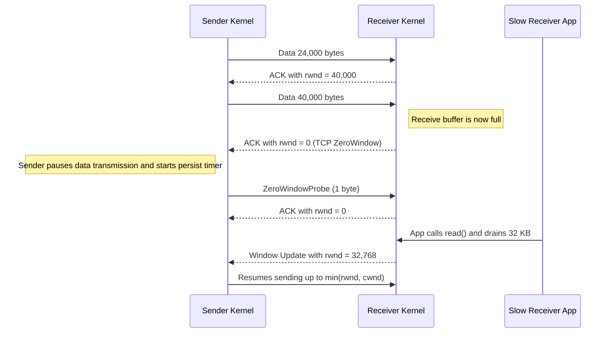
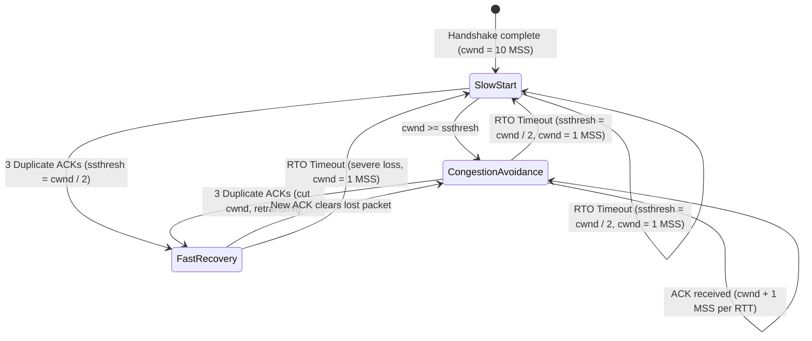
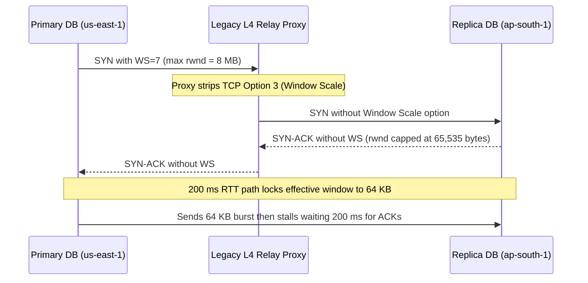

# Lesson 10: TCP Part 3, Flow Control and Congestion Control

> **Prerequisites:** [Lesson 08: TCP Sequence Numbers and ACKs](../08-tcp-sequence-numbers-and-acks/README.md), [Lesson 09: TCP Three-Way Handshake](../09-tcp-three-way-handshake/README.md), and [Networking From Zero Overview](../README.md) (Lesson 10 of 30).  
> **Estimated Reading Time:** 25 minutes  
> **Target Audience:** Backend engineers and system design candidates optimizing throughput across high-latency WAN paths, diagnosing zero-window receiver stalls, and evaluating CUBIC vs BBR congestion control.  
> **Free PDF Notes:** [Download SD-N-010.pdf](https://backendroadmap.com/notes/system-design/SD-N-010.pdf)

> [!TIP]
> **The Golden Rule of TCP Pacing:** The **receive window (`rwnd`)** stops TCP from drowning the receiver, and the **congestion window (`cwnd`)** stops it from drowning the network. TCP keeps the smaller of the two in flight, starts small, doubles every round trip in slow start, and cuts back on loss—so throughput is strictly bounded by `min(rwnd, cwnd) / RTT`.

---

## Words You'll Meet Today

| Word | In Plain Words | Role in a Live Backend System |
| :--- | :--- | :--- |
| **Window** | How many bytes may be on the way, not yet acknowledged. | Bounds total unacknowledged bytes in flight per socket (`Bytes in Flight`). |
| **Receive window (`rwnd`)** | The receiver's free buffer space, sent in every ACK. | Applies kernel-level backpressure (`TCP ZeroWindow`) when an app drains sockets slowly. |
| **Congestion window (`cwnd`)** | The sender's own guess of what the network can take. | Dynamically probes router queue capacity via AIMD, CUBIC, or BBR. |
| **Flow control** | Not drowning the receiver. | Prevents a fast upstream service or CDN from overflowing a slow consumer's `sk_buff` memory. |
| **Congestion control** | Not drowning the network. | Prevents routers and switches along the WAN path from collapsing into bufferbloat and tail-drop loss. |
| **Slow start** | Begin with about 10 segments and double every round trip. | Controls cold-connection ramp-up (`IW10`, ~14.6 KB on first RTT) for API calls and web pages. |
| **Throughput** | How many bytes arrive per second. | Goodput ceiling constrained by Bandwidth-Delay Product (`BDP`) and packet loss rate. |
| **Window scaling** | A SYN option that allows windows far bigger than 64 KB. | RFC 7323 bit-shift multiplier (`wscale`) required to saturate modern Gigabit/10G WAN links. |

---

## Visual Mental Models & Architecture

### The Question: Who Decides How Fast?

You start a big download. The speed starts low, then climbs. On a crowded café Wi-Fi it suddenly drops, then slowly recovers. Nobody is turning a knob: TCP is deciding, every round trip, how fast to send. It must never drown two things: the receiver, and the network.

### An Everyday Picture First: Boxes to a Friend's Shop

You send boxes to a friend's shop by van. Sending one box and waiting for a thank-you each time takes forever, so you send many at once. But two things limit you. The shop's storeroom: your friend says, I have space for ten boxes. And the road: you can't see the traffic, so you start with a few vans, add more while they arrive on time, and send fewer when one gets stuck in a jam. The storeroom is **flow control**; the road is **congestion control**. TCP obeys both.


*Figure 1. The analogy: boxes to a friend's shop. The storeroom is the receiver's limit (flow control); the road you can't see is the network's limit (congestion control).*

### The Window: Many Segments in Flight

Why not wait for each ACK? With a `100 ms` round trip, one `1,460`-byte segment per round trip is about `15 KB` a second (`1,460 / 0.1 s = 14.6 KB/s`). So TCP keeps many segments in flight before their ACKs come back. The **window** is how many bytes may be on the way at the same time.


*Figure 2. Waiting for each ACK sends one segment per round trip, about 15 KB/s at 100 ms; a window keeps many segments in flight before their ACKs return.*

### Flow Control: The Receive Window (`rwnd`)

In every ACK, the receiver also writes the **receive window**: I have `64,000` bytes of free space, don't send more than that. If the app on the receiver reads slowly, its buffer fills and the window shrinks. At zero, the sender stops, and checks back now and then with a **Zero Window Probe** until there's space again.


*Figure 3. Flow control: every ACK carries the receive window, the receiver's free buffer space. A slow app lets the buffer fill and the window shrink, down to zero.*



### Congestion Control: The Sender's Guess (`cwnd`)

The sender can't see the routers in between, so it keeps its own guess, the **congestion window**, and sends whichever is smaller: the receiver's window or its own guess.


*Figure 4. TCP's two limits: the receive window (flow control) and the congestion window (congestion control). The sender keeps the smaller of the two in flight.*

**Slow start.** Modern TCP begins with ten segments, about `14 KB` (RFC 6928 `IW10`: `10 × 1,460 bytes = 14,600 bytes`). Every round trip in which all the ACKs come back, it doubles: `10, 20, 40, 80`. It isn't slow for long: it grows fast until a segment is lost, or it reaches a limit it learned before (`ssthresh`).


*Figure 5. Slow start: the congestion window begins at 10 segments, about 14 KB, and doubles every round trip: 10, 20, 40, 80, 160.*

**Then it grows carefully,** one more segment per round trip (**congestion avoidance**). When a loss shows up through three duplicate ACKs ([lesson 8](../08-tcp-sequence-numbers-and-acks/README.md)), it cuts the window; classic TCP cuts it in half, then grows again. Drawn over time, that's a **sawtooth**: TCP feeling for the limit of the road. After a timeout (RTO), with no ACKs at all, it drops to one segment (`1 MSS`) and slow-starts again.


*Figure 6. The window over time: slow start, then a sawtooth, growing by one segment per round trip and cut in half on loss; after a timeout it falls to one segment and slow-starts again.*



### Real Numbers & Bandwidth-Delay Product (BDP)

The key formula: **speed ≤ window ÷ round trip**. A `64 KB` window over a `100 ms` round trip gives `640 KB` a second, about `5 megabits`, even on a gigabit link. To fill a `100-megabit` link at `100 ms` you need `1.25 MB` on the way at once (`100 Mbps × 0.1 s / 8 = 1.25 MB`), which is why a SYN option called **window scaling** (RFC 7323) allows windows far bigger than `64 KB` (up to `1 GB` via a shift count up to `14`). And at the start of a connection slow start decides: a `100 KB` page needs about three round trips: `14 KB`, then `29 KB`, then `58 KB`. That's why the first `14 KB` of a page matter so much.

Today's systems refine this: Linux uses **CUBIC** by default, and Google's **BBR** measures the bandwidth and round trip directly instead of waiting for losses. The two limits (`rwnd` and `cwnd`) are the same.


*Figure 7. Real numbers: throughput is at most the window divided by the round-trip time, so long paths need big windows, and short transfers are limited by slow start.*

---

## Systematic Reference & Comparison Grid

### Flow Control (`rwnd`) vs. Congestion Control (`cwnd`)

| Dimension | Flow Control (`rwnd`) | Congestion Control (`cwnd`) |
| :--- | :--- | :--- |
| **Protects Whom?** | The **receiver's** OS receive buffer and slow app | Intermediate **routers, switches, and WAN links** |
| **Where Computed?** | At the receiver kernel, based on free `sk_rmem` | At the sender kernel, from ACKs, RTT, and loss |
| **Signaled Over Wire?** | Yes—16-bit Window field in every TCP header (+ `wscale`) | No—never transmitted on the wire; strictly sender state |
| **Typical Hard Ceiling** | `64 KB` unscaled; up to `1 GB` with RFC 7323 `wscale` | Dynamic (`10 MSS` initial up to BDP + router queue) |
| **Packet Capture Signature** | `TCP ZeroWindow`, `ZeroWindowProbe`, `WindowUpdate` | `TCP Dup ACK`, `Fast Retransmission`, `Spurious Retransmission` |
| **Primary Engineering Fix** | Drain socket faster, enlarge `net.ipv4.tcp_rmem`, fix blocking I/O | Enable `tcp_window_scaling`, tune BBR/CUBIC, move CDN/data closer |

### Congestion Control Algorithms Compared

| Algorithm | Primary Congestion Signal | Growth Behavior | Reaction to Loss | Behavior on Long / Lossy Paths |
| :--- | :--- | :--- | :--- | :--- |
| **Reno / NewReno** | Packet loss (`3 Dup ACKs` or RTO) | Linear (`+1 MSS / RTT`) | Halves `cwnd` (`0.5×`) | Collapses badly on high-BDP or 1% loss Wi-Fi |
| **CUBIC (Linux Default)** | Packet loss | Cubic function of time since last loss | Cuts `cwnd` by `30%` (`0.7×`) | Great on clean fiber, still fills buffers (bufferbloat) and drops on radio noise |
| **BBR (Bottleneck BW & RTT)** | Delivery rate & min-RTT pacing | Probes bandwidth (`1.25×` gain) and drains queues | Ignores isolated non-congestive loss (in v1); paces smoothly | Maintains high speed across transoceanic / Wi-Fi links with minimal bufferbloat |

---

## Production War Story Post-Mortem: Cross-Continent DB Replication Stalled at 2.6 Mbps

- **Severity:** SEV-1 (DR Replication SLA Breach)
- **Detection / Resolution Time:** 38 minutes to isolate via packet capture; 12 minutes to remediate
- **Impact:** PostgreSQL WAL shipping from `us-east-1` to `ap-south-1` (`200 ms` RTT) flatlined at `320 KB/s` (`2.6 Mbps`) per stream despite a provisioned `10 Gbps` cross-region tunnel, building a 4-hour RPO lag during bulk ETL writes.

### What Happened



### Root Cause Analysis

1. **Missing RFC 7323 Window Scaling:** A legacy user-space TCP forwarder in the DR path rebuilt outgoing `SYN` packets without copying the TCP `Window Scale` (`WS`) option. Without `WS`, the 16-bit TCP Window field cannot express more than `65,535` bytes (`64 KB`).
2. **BDP Starvation:** Over a `200 ms` transoceanic round trip, `65,535 bytes / 0.2 s = 327.6 KB/s ≈ 2.62 Mbps`—less than `0.03%` of the `10 Gbps` pipe. Meanwhile, to fill even `1 Gbps` at `200 ms`, the Bandwidth-Delay Product requires `1,000 Mbps × 0.2 s / 8 = 25 MB` in flight.
3. **Misleading Host Metrics:** Both database hosts showed `< 5%` CPU and healthy disk IOPS, delaying diagnosis because operators checked hardware before running `ss -tin` or `tcpdump`.

### The Fix & Architectural Hardening

- **Immediate Mitigation:** Bypassed the option-stripping relay with direct kernel/WireGuard routing so both endpoints negotiated `wscale:9,9` (enabling multi-megabyte windows).
- **Kernel Tuning:** Set `net.ipv4.tcp_window_scaling = 1`, raised `net.ipv4.tcp_rmem` and `net.ipv4.tcp_wmem` ceiling to `33554432` (`32 MB` > `25 MB` BDP), and switched the WAN interface qdisc + CC to `fq` + `bbr`.
- **Observability Guardrail:** Added `ss` / `TCP_INFO` exporter metrics alerting whenever `tcpi_snd_wnd` stays pinned at `<= 65535` on cross-region sockets.

---

## Multi-Language Production Implementation

Below is a production-structured **TCP Window & BDP Simulator** implementing `min(rwnd, cwnd)` pacing, `IW10` Slow Start, Congestion Avoidance, `3 Dup ACK` Fast Recovery, `RTO` reset, and RFC 7323 Window Scale shift calculation across Go, TypeScript, Python, and C#.

````carousel
```go
package tcpctrl

import "math"

type State string

const (
	SlowStart           State = "SLOW_START"
	CongestionAvoidance State = "CONGESTION_AVOIDANCE"
)

type WindowController struct {
	MSS      int
	Cwnd     int
	Rwnd     int
	Ssthresh int
	State    State
}

func NewWindowController(mss, initialRwnd, ssthresh int) *WindowController {
	return &WindowController{
		MSS:      mss,
		Cwnd:     10 * mss, // RFC 6928 IW10
		Rwnd:     initialRwnd,
		Ssthresh: ssthresh,
		State:    SlowStart,
	}
}

// EffectiveWindow returns bytes allowed in flight: min(rwnd, cwnd).
func (w *WindowController) EffectiveWindow() int {
	if w.Rwnd < w.Cwnd {
		return w.Rwnd
	}
	return w.Cwnd
}

// OnRoundTripAck advances cwnd after one RTT of clean ACKs.
func (w *WindowController) OnRoundTripAck() {
	if w.State == SlowStart {
		w.Cwnd *= 2
		if w.Cwnd >= w.Ssthresh {
			w.State = CongestionAvoidance
		}
		return
	}
	w.Cwnd += w.MSS
}

// OnThreeDupAcks simulates Fast Retransmit / Fast Recovery (halving cwnd).
func (w *WindowController) OnThreeDupAcks() {
	w.Ssthresh = max(2*w.MSS, w.Cwnd/2)
	w.Cwnd = w.Ssthresh
	w.State = CongestionAvoidance
}

// OnTimeout simulates RTO: drop to 1 MSS and re-enter Slow Start.
func (w *WindowController) OnTimeout() {
	w.Ssthresh = max(2*w.MSS, w.Cwnd/2)
	w.Cwnd = w.MSS
	w.State = SlowStart
}

// RequiredWindowScale computes BDP bytes and minimum RFC 7323 wscale shift.
func RequiredWindowScale(bandwidthMbps, rttMs float64) (bdpBytes int, wscale int) {
	bdpBytes = int(math.Ceil((bandwidthMbps * 1_000_000 / 8.0) * (rttMs / 1000.0)))
	for (65535 << wscale) < bdpBytes && wscale < 14 {
		wscale++
	}
	return bdpBytes, wscale
}
```
<!-- slide -->
```typescript
type CongestionState = "SLOW_START" | "CONGESTION_AVOIDANCE";

export class TcpWindowController {
  public cwnd: number;
  public state: CongestionState = "SLOW_START";

  constructor(
    public readonly mss: number = 1460,
    public rwnd: number = 65_535,
    public ssthresh: number = 128 * 1460
  ) {
    this.cwnd = 10 * mss; // RFC 6928 IW10 (~14.6 KB)
  }

  effectiveWindowBytes(): number {
    return Math.min(this.rwnd, this.cwnd);
  }

  onRoundTripAck(): void {
    if (this.state === "SLOW_START") {
      this.cwnd *= 2;
      if (this.cwnd >= this.ssthresh) {
        this.state = "CONGESTION_AVOIDANCE";
      }
      return;
    }
    this.cwnd += this.mss;
  }

  onThreeDupAcks(): void {
    this.ssthresh = Math.max(2 * this.mss, Math.floor(this.cwnd / 2));
    this.cwnd = this.ssthresh;
    this.state = "CONGESTION_AVOIDANCE";
  }

  onTimeout(): void {
    this.ssthresh = Math.max(2 * this.mss, Math.floor(this.cwnd / 2));
    this.cwnd = this.mss;
    this.state = "SLOW_START";
  }

  static computeBdpAndShift(bandwidthMbps: number, rttMs: number): {
    bdpBytes: number;
    wscale: number;
    maxThroughputMbps: number;
  } {
    const bdpBytes = Math.ceil(((bandwidthMbps * 1_000_000) / 8) * (rttMs / 1000));
    let wscale = 0;
    while ((65_535 << wscale) < bdpBytes && wscale < 14) {
      wscale++;
    }
    const unscaledMaxMbps = ((65_535 * 8) / (rttMs / 1000)) / 1_000_000;
    return { bdpBytes, wscale, maxThroughputMbps: Number(unscaledMaxMbps.toFixed(2)) };
  }
}
```
<!-- slide -->
```python
from dataclasses import dataclass
import math


@dataclass
class TcpWindowController:
    mss: int = 1460
    rwnd: int = 65_535
    ssthresh: int = 128 * 1460
    cwnd: int = 10 * 1460  # RFC 6928 IW10
    state: str = "SLOW_START"

    def effective_window(self) -> int:
        return min(self.rwnd, self.cwnd)

    def on_round_trip_ack(self) -> None:
        if self.state == "SLOW_START":
            self.cwnd *= 2
            if self.cwnd >= self.ssthresh:
                self.state = "CONGESTION_AVOIDANCE"
        else:
            self.cwnd += self.mss

    def on_three_dup_acks(self) -> None:
        self.ssthresh = max(2 * self.mss, self.cwnd // 2)
        self.cwnd = self.ssthresh
        self.state = "CONGESTION_AVOIDANCE"

    def on_timeout(self) -> None:
        self.ssthresh = max(2 * self.mss, self.cwnd // 2)
        self.cwnd = self.mss
        self.state = "SLOW_START"


def compute_bdp_and_wscale(bandwidth_mbps: float, rtt_ms: float) -> tuple[int, int]:
    bdp_bytes = math.ceil((bandwidth_mbps * 1_000_000 / 8.0) * (rtt_ms / 1000.0))
    wscale = 0
    while (65_535 << wscale) < bdp_bytes and wscale < 14:
        wscale += 1
    return bdp_bytes, wscale
```
<!-- slide -->
```csharp
using System;

public enum CongestionState { SlowStart, CongestionAvoidance }

public sealed class TcpWindowController
{
    public int Mss { get; }
    public int Rwnd { get; set; }
    public int Cwnd { get; private set; }
    public int Ssthresh { get; private set; }
    public CongestionState State { get; private set; } = CongestionState.SlowStart;

    public TcpWindowController(int mss = 1460, int rwnd = 65_535, int ssthresh = 128 * 1460)
    {
        Mss = mss;
        Rwnd = rwnd;
        Ssthresh = ssthresh;
        Cwnd = 10 * mss; // RFC 6928 IW10
    }

    public int EffectiveWindow() => Math.Min(Rwnd, Cwnd);

    public void OnRoundTripAck()
    {
        if (State == CongestionState.SlowStart)
        {
            Cwnd *= 2;
            if (Cwnd >= Ssthresh) State = CongestionState.CongestionAvoidance;
            return;
        }
        Cwnd += Mss;
    }

    public void OnThreeDupAcks()
    {
        Ssthresh = Math.Max(2 * Mss, Cwnd / 2);
        Cwnd = Ssthresh;
        State = CongestionState.CongestionAvoidance;
    }

    public void OnTimeout()
    {
        Ssthresh = Math.Max(2 * Mss, Cwnd / 2);
        Cwnd = Mss;
        State = CongestionState.SlowStart;
    }

    public static (int BdpBytes, int Wscale) ComputeBdpAndWscale(double bandwidthMbps, double rttMs)
    {
        int bdpBytes = (int)Math.Ceiling((bandwidthMbps * 1_000_000.0 / 8.0) * (rttMs / 1000.0));
        int wscale = 0;
        while ((65_535 << wscale) < bdpBytes && wscale < 14) wscale++;
        return (bdpBytes, wscale);
    }
}
```
````

---

## Practical Hands-On Verification CLI Workflows

### 1. Inspect Live Socket `cwnd`, `rtt`, `wscale`, and Congestion Control (`ss -tin`)

```bash
ss -tin dst 198.51.100.10
```

**Expected Output:**

```text
State  Recv-Q Send-Q Local Address:Port  Peer Address:Port
ESTAB  0      43800  10.0.1.14:51822     198.51.100.10:443
         cubic wscale:7,7 rto:240 rtt:38.2/2.1 ato:40 mss:1448 pmtu:1500 rcvmss:1448 advmss:1448 cwnd:20 ssthresh:14 bytes_acked:29200 segs_out:24 segs_in:18 send 6.1Mbps pacing_rate 12.1Mbps unacked:10
```

Notice `wscale:7,7` (a `2^7 = 128×` window multiplier), `cwnd:20` (20 MSS segments), and `cubic` active on the socket.

### 2. Audit Kernel Window Scaling, Buffer Limits, and Congestion Algorithm

```bash
sysctl net.ipv4.tcp_window_scaling net.ipv4.tcp_congestion_control net.ipv4.tcp_rmem net.ipv4.tcp_wmem
```

**Expected Output:**

```text
net.ipv4.tcp_window_scaling = 1
net.ipv4.tcp_congestion_control = cubic
net.ipv4.tcp_rmem = 4096	131072	6291456
net.ipv4.tcp_wmem = 4096	16384	4194304
```

### 3. Detect `ZeroWindow` Stalls and `Dup ACK` Retransmissions in a Capture

```bash
tshark -r capture.pcap -Y "tcp.analysis.zero_window or tcp.analysis.duplicate_ack or tcp.analysis.retransmission" -T fields -e frame.number -e ip.src -e tcp.window_size -e _ws.col.Info
```

**Expected Output:**

```text
412	10.0.2.15	0	[TCP ZeroWindow] 5432 → 51822 [ACK] Seq=1 Ack=89214 Win=0 Len=0
413	10.0.1.14	64256	[TCP ZeroWindowProbe] 51822 → 5432 [ACK] Seq=89214 Ack=1 Win=64256 Len=1
414	10.0.2.15	0	[TCP ZeroWindowProbeAck] [TCP ZeroWindow] 5432 → 51822 [ACK] Seq=1 Ack=89215 Win=0 Len=0
```

---

## Pause and Think

> [!exercise] A server in the US, a user in India: a 200 ms round trip. The receive window is 64 KB, window scaling is off, and the link is one gigabit. What's the fastest this transfer can go? Decide before you open the answer.

<details><summary>Answer</summary>

64 KB per 200 ms: about 320 KB a second, roughly 2.6 megabits, a quarter of one percent of the gigabit link. The fix: a bigger window, or a server closer to the user.


*Figure 8. The pause-and-think answer: with a 64 KB window and a 200 ms round trip, the transfer tops out near 2.6 megabits, a tiny slice of a gigabit link.*

</details>

---

## Operational Validation Checkpoints

<details><summary><strong>Checkpoint 1: Sizing Buffers for a High-BDP Replication Link</strong></summary>

**Scenario:** You need a single TCP stream between Frankfurt and Tokyo (`180 ms` RTT) to sustain `500 Mbps`. What minimum socket buffer size (`rwnd` / `tcp_rmem` max) and `wscale` shift count do you need?

**Solution:**
1. Compute BDP: `500 Mbps × 0.18 s / 8 = 90 megabits / 8 = 11.25 MB` (`~11,250,000` bytes).
2. Unscaled max window is `65,535` bytes. Shift `7` gives `65,535 × 128 = 8.39 MB` (still too small!). Shift `8` gives `65,535 × 256 = 16.77 MB` (`>= 11.25 MB`).
3. Set `net.ipv4.tcp_rmem` and `tcp_wmem` max values to at least `16 MB–24 MB` (`2 × BDP` is a standard rule of thumb in Linux to leave room for kernel overhead and loss recovery).

</details>

<details><summary><strong>Checkpoint 2: Isolating App Backpressure vs. Network Congestion</strong></summary>

**Scenario:** File uploads to your ingestion service drop to `0 B/s` intermittently for 5 seconds at a time. `tshark` reveals `TCP ZeroWindow` frames emitted by your ingestion server, with zero `Retransmission` frames. Is the ISP congested?

**Solution:**
No—the network is completely healthy. `TCP ZeroWindow` means `rwnd` dropped to `0` because the receiving application's kernel buffer (`Recv-Q` in `ss`) filled up faster than user-space code drained it. Check for garbage-collection pauses, synchronous disk fsyncs, mutex contention, or blocked worker threads on the receiving host.

</details>

<details><summary><strong>Checkpoint 3: Why Short API Responses Feel Slow Over TLS</strong></summary>

**Scenario:** Returning a `60 KB` uncompressed JSON catalog from an origin `120 ms` away takes `~480 ms` after TCP connect, even on a `1 Gbps` client connection. Why?

**Solution:**
Even with a huge `rwnd`, `IW10` starts `cwnd` at `10 × 1,460 = 14.6 KB`:
- RTT 1 sends `~14.6 KB` (`45.4 KB` left).
- RTT 2 doubles `cwnd` to `~29.2 KB` (`16.2 KB` left).
- RTT 3 doubles `cwnd` to `~58.4 KB` (finishes the remaining `16.2 KB`).
Three full data RTTs (`3 × 120 ms = 360 ms`) plus initial handshake RTTs add up quickly. Enabling gzip/Brotli compression (shrinking `60 KB` under `14 KB` so it fits in **1 RTT**) or serving via an edge CDN cuts latency dramatically.

</details>

---

## Common Mistakes & Troubleshooting

### What Goes Wrong in Production

- **Wi-Fi loss:** A packet lost to radio noise looks like congestion, so TCP cuts its window even though the road was empty. On bad Wi-Fi, speed drops for no good reason.
- **A slow receiver:** The app doesn't read fast enough, the receive window falls to zero and the sender sits idle; a packet capture shows *zero window*. The network is fine; the app is the bottleneck.
- **Too small a window on a long path:** Fast links, far away, still slow: the window, not the link, is the limit.

### Common Myths

- **"Flow control and congestion control are the same."** No. One protects the receiver, the other protects the network.
- **"TCP uses the full bandwidth straight away."** No. It starts small and has to grow, so short transfers rarely reach full speed.
- **"Losing packets means the network is broken."** No. A little loss is normal: it's the signal TCP uses to find the limit.

| Diagnostic Symptom (`ss` / `tshark`) | Underlying Cause | Immediate Fix |
| :--- | :--- | :--- |
| `Recv-Q` maxed out + `TCP ZeroWindow` | App cannot drain socket fast enough | Fix slow disk/GC/blocking handler; apply app-level 429/backpressure |
| `wscale` missing in `ss -tin`, `Send-Q` capped ~64 KB | Middlebox stripped RFC 7323 or `tcp_window_scaling=0` | Re-enable `tcp_window_scaling=1` and upgrade/bypass stripping proxy |
| High `retrans` + sawtooth drops on Wi-Fi/WAN | Loss-based CC (`CUBIC`) misreads wireless loss as congestion | Evaluate `BBR` (`net.ipv4.tcp_congestion_control=bbr` with `fq` qdisc) |
| High latency on `< 50 KB` responses | Slow start (`IW10`) requires multiple RTTs | Compress payload `< 14 KB`, reuse pooled HTTP/2+ connections, add CDN |

---

## Recap in Three Lines

1. The receiver's window stops TCP from drowning the receiver.
2. The congestion window stops it from drowning the network.
3. TCP sends the smaller, starts small, doubles, and cuts back on loss.

---

## Interview Practice Questions

> [!interview] What's the difference between flow control and congestion control? (Basic)

<details><summary>What to say in 30 seconds</summary>

Flow control protects the receiver: it advertises a receive window, its free buffer space, in every ACK, and the sender never has more unacknowledged data than that. Congestion control protects the network: the sender keeps its own congestion window, grows it while ACKs arrive and cuts it on loss. The sender is limited by the smaller of the two.

</details>

> [!interview] Explain slow start and congestion avoidance. (Basic)

<details><summary>What to say in 30 seconds</summary>

A new connection starts with a small congestion window, about 10 segments, and doubles it every round trip (slow start). After a threshold or a loss it grows by about one segment per round trip (congestion avoidance). On three duplicate ACKs classic TCP halves the window; on a timeout it drops to one segment and slow-starts again, which gives the sawtooth.

</details>

> [!interview] A transfer between India and the US is slow, though both ends have fast links. Why? (Scenario)

<details><summary>What to say in 30 seconds</summary>

Throughput is at most window ÷ round-trip time. At 200 ms, a 64 KB window allows about 2.6 Mbit/s whatever the link speed. Check window scaling and buffer sizes, packet loss on the path (which keeps cutting the window), and consider moving the data closer (a CDN or a nearer region) or using parallel connections.

</details>

> [!interview] A capture shows the receiver advertising a zero window. What does that tell you? (Scenario)

<details><summary>What to say in 30 seconds</summary>

The receiver's buffer is full because the application isn't reading fast enough, so the sender is paused and probing. The network is fine; the bottleneck is the receiving app: CPU, a slow disk, a blocked thread or too small a buffer.

</details>

> [!interview] What is the bandwidth-delay product, and why does it matter? (Tricky)

<details><summary>What to say in 30 seconds</summary>

Bandwidth × round-trip time: the bytes that must be in flight to keep the link full. 100 Mbit/s × 100 ms = 1.25 MB, far more than the 64 KB a window can say without window scaling, so long, fast paths need scaled windows and large buffers.

</details>

> [!interview] Why can TCP perform badly on Wi-Fi or mobile links, and what helps? (Tricky)

<details><summary>What to say in 30 seconds</summary>

Loss-based congestion control treats every lost packet as congestion, but radio noise also loses packets, so TCP cuts its window although the path isn't full. Link-layer retransmission hides some loss; newer algorithms such as BBR estimate bandwidth and round trip directly instead of reacting to each loss.

</details>

---

## Free PDF notes

Download these notes as a printable PDF, with every picture, the round-trip maths and the interview answers: [SD-N-010.pdf](https://backendroadmap.com/notes/system-design/SD-N-010.pdf).

---

## Sources

- [RFC 9293: Transmission Control Protocol](https://www.rfc-editor.org/rfc/rfc9293), the window and the receive window in every segment.
- [RFC 5681: TCP Congestion Control](https://www.rfc-editor.org/rfc/rfc5681), slow start, congestion avoidance, fast retransmit and what happens on a timeout.
- [RFC 6928: Increasing TCP's Initial Window](https://www.rfc-editor.org/rfc/rfc6928), starting with 10 segments.
- [RFC 7323: TCP Extensions for High Performance](https://www.rfc-editor.org/rfc/rfc7323), window scaling.
- [RFC 9438: CUBIC for Fast and Long-Distance Networks](https://www.rfc-editor.org/rfc/rfc9438), the Linux default.
- [BBR: Congestion-Based Congestion Control (ACM Queue, 2016)](https://queue.acm.org/detail.cfm?id=3022184), measuring bandwidth and round trip instead of reacting to loss.

---

## Next

Next comes [lesson 11, TCP part 4](../11-tcp-closing-time-wait-and-ports/README.md): how a connection closes, what a reset means, and how a busy server can run out of ports. The [track overview](../README.md) lists the whole series.
