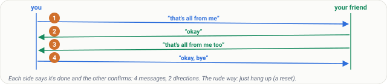
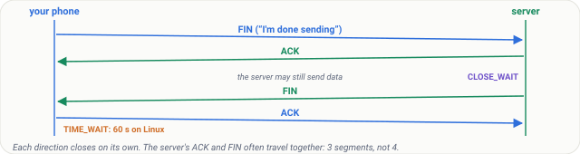
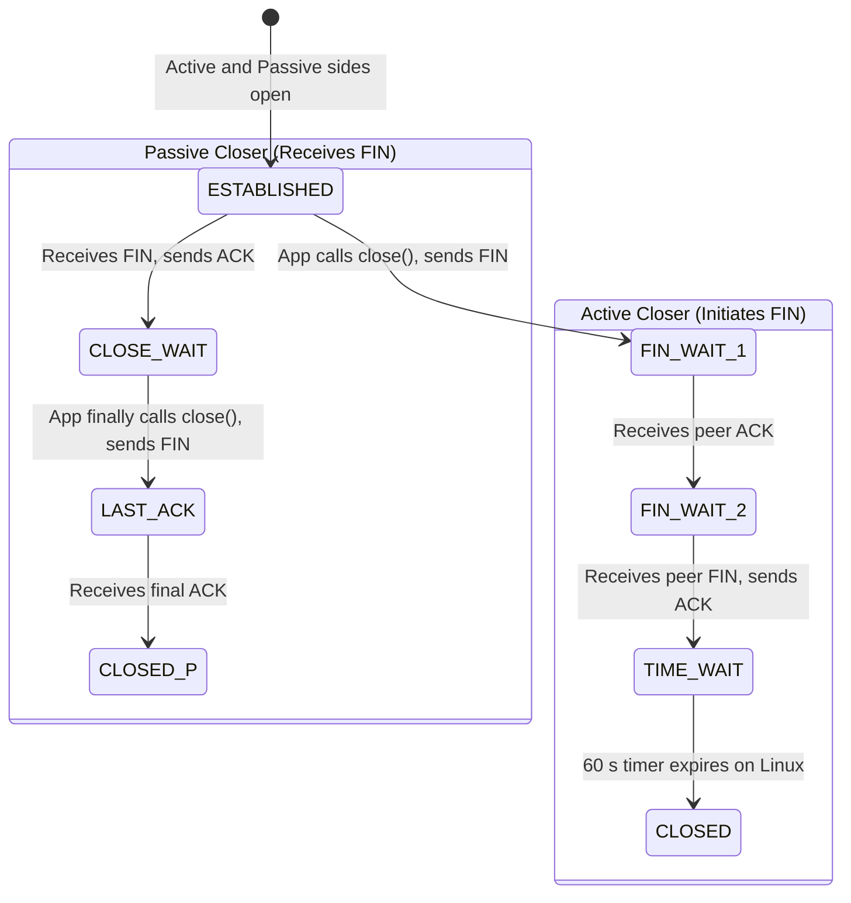
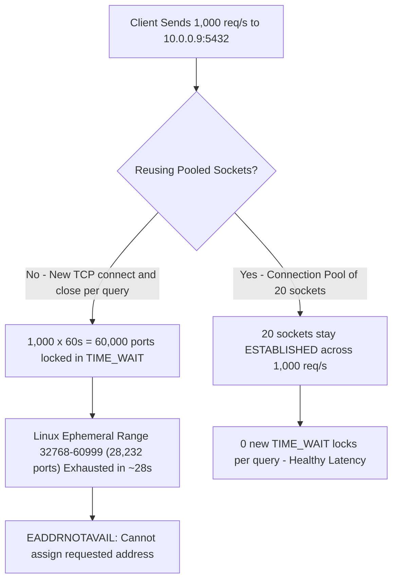
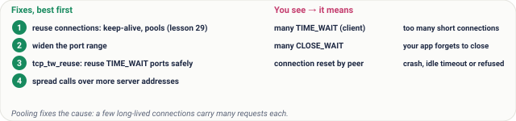
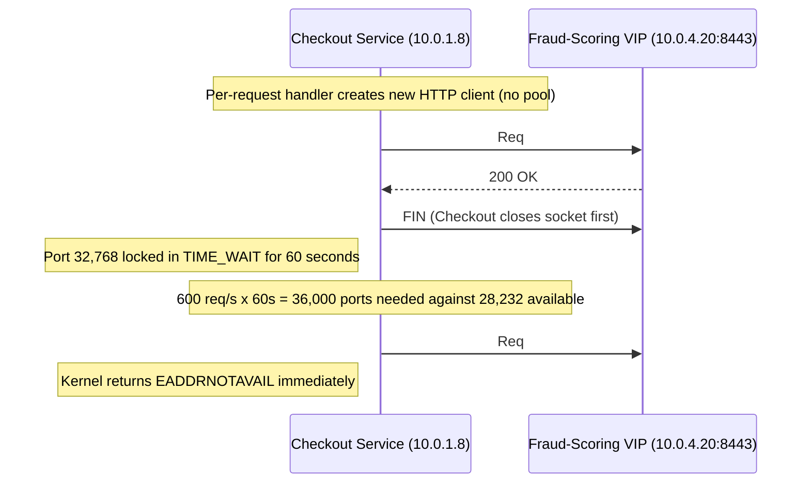

# Lesson 11: TCP Part 4, Closing, RST, TIME_WAIT and Running Out of Ports

> **Prerequisites:** [Lesson 09: TCP Three-Way Handshake](../09-tcp-three-way-handshake/README.md), [Lesson 04: Ports and Sockets](../04-ports-and-sockets/README.md), [Lesson 10: TCP Flow Control and Congestion Control](../10-tcp-flow-and-congestion-control/README.md), and [Networking From Zero Overview](../README.md) (Lesson 11 of 30).  
> **Estimated Reading Time:** 25 minutes  
> **Target Audience:** Backend engineers diagnosing `cannot assign requested address` (`EADDRNOTAVAIL`), `CLOSE_WAIT` socket leaks, and `connection reset by peer` (`ECONNRESET`) failures in production microservices.  
> **Free PDF Notes:** [Download SD-N-011.pdf](https://backendroadmap.com/notes/system-design/SD-N-011.pdf)

> [!TIP]
> **The Golden Rule of TCP Teardown:** A connection closes in both directions with `FIN` and `ACK`. The side that closes first waits in `TIME_WAIT` (`60` seconds on Linux) to absorb stray packets and lost ACKs, whereas `RST` aborts immediately—so opening short-lived connections faster than `ephemeral_ports / 60s` (`~470/s`) exhausts client ports unless you **reuse persistent connections via pooling and keep-alive**.

---

## Words You'll Meet Today

| Word | In Plain Words | Role in a Live Backend System |
| :--- | :--- | :--- |
| **`FIN`** | Finish: I'm done sending. | Graceful teardown signal; flushes unread send buffer before closing one direction. |
| **`RST`** | Reset: stop this connection right now. | Immediate abort sent on process crash, closed port, or load-balancer idle timeout (`ECONNRESET`). |
| **`TIME_WAIT`** | The wait, after closing, before a connection is really gone (`60 s` on Linux). | Kernel safeguard (`2 × MSL`) holding the 4-tuple so delayed packets don't corrupt new sockets. |
| **`CLOSE_WAIT`** | The other side said goodbye, and our app hasn't closed yet. | Classic application socket-leak state—meaning a missing `close()` or un-drained response body. |
| **Ephemeral port** | The temporary port a client picks for each connection. | Finite Linux pool (`32,768–60,999`, ~`28,000` ports) bound per `(client_ip, server_ip, server_port)`. |
| **Half-close** | One direction closed while the other can still send. | Allows a server to finish streaming an HTTP response even after the client sends `FIN`. |
| **Connection pool** | A few open connections reused for many requests. | Eliminates handshake overhead and keeps `TIME_WAIT` port churn near zero. |
| **Keep-alive** | Keeping a connection open for the next request. | Reuses an established TCP socket across sequential HTTP requests (`HTTP/1.1` default). |

---

## Visual Mental Models & Architecture

### The Question: Why Did It Run Out of Ports?

A busy service calls another service thousands of times a second. Suddenly every new call fails with *cannot assign requested address*. The CPU is fine, the memory is fine: it has run out of ports. To understand why, we need the end of a TCP connection, not the start.

### An Everyday Picture First: Ending a Phone Call

Ending a call politely: you say, that's all from me. Your friend says, okay. Then your friend says, that's all from me too, and you say, okay, bye. Each person says they're done and the other confirms: four messages, because there are two directions, just like the handshake in [lesson 9](../09-tcp-three-way-handshake/README.md). The rude way: you just hang up, and anything your friend was still saying is lost.



*Figure 1. The analogy: ending a call politely takes four messages, because each person says they're done and the other confirms; hanging up is the reset.*

### The Polite Close: `FIN` and `ACK`, Both Ways

Your phone is done sending, so it sends a segment with the **`FIN`** flag. The server answers `ACK`, and one direction is closed. But the server may still have data to send. When it's done, it sends its own `FIN`, and your phone answers `ACK`. Both directions are closed. Often the server's `ACK` and `FIN` travel together, so you see three segments, not four.

Between the two halves the server is in **`CLOSE_WAIT`**: it got the goodbye and is waiting for its own app to close. If the app never closes, the connection stays there forever; thousands of them mean a bug in your code, someone forgot to close.



*Figure 2. The polite close: FIN and ACK in each direction. The server sits in CLOSE_WAIT until its app closes; the side that closed first waits in TIME_WAIT.*



### `TIME_WAIT`: Why the Closer Waits

The side that closed first, your phone, doesn't forget the connection right away. It enters **`TIME_WAIT`**; on Linux it waits `60` seconds. Two reasons:

1. **The final ACK might be lost:** then the server sends its `FIN` again, and your phone must still be there to answer.
2. **Old, delayed segments** from this connection might still be wandering the network; waiting lets them die out, so they are never mistaken for a new connection on the same ports.


*Figure 3. Why TIME_WAIT exists: a lost final ACK makes the server repeat its FIN, and the closer must still answer; and delayed old segments need time to die out.*

### The Rude Way: `RST`

A **reset** (`RST`) is one segment, no goodbye, and the connection is gone at once. Any data not yet read is thrown away, and you see *connection reset by peer*. Resets happen when a program crashes or is killed, when a load balancer or firewall drops an idle connection, or ([lesson 9](../09-tcp-three-way-handshake/README.md)) when nobody listens on that port.


*Figure 4. The rude way: a reset (RST) ends the connection at once and throws away unread data; you see “connection reset by peer”.*

### Running Out of Ports

From [lesson 4](../04-ports-and-sockets/README.md): a connection is named by four values—client address, client port, server address, and server port. When your service calls one database at one address and one port, three of the four never change; only the client port can. So each connection to that database needs its own client port.


*Figure 5. A connection is named by four values. To one database address and port, only the client port changes, so each connection needs its own.*

**Real numbers.** Linux hands out client ports from `32,768` to `60,999`: about `28,000` (`28,232` ports). Every connection your service closes keeps its port busy, in `TIME_WAIT`, for `60` seconds. So at most about `28,000` ports every `60` seconds: roughly **`470` new connections per second** to that one address and port. Open and close faster than that, and the ports run out.


*Figure 6. Running out of ports: about 28,000 client ports, each held for 60 seconds in TIME_WAIT, allow roughly 470 new connections per second to one server address and port.*



**The fixes, best first.** Reuse connections: open a few and send many requests over each, with keep-alive and connection pools (lesson 29). Widen the port range. Let Linux safely reuse ports in `TIME_WAIT` for new outgoing connections, with `tcp_tw_reuse`. Spread the calls over more server addresses.

| You see | It means | Do this |
| :--- | :--- | :--- |
| Many `TIME_WAIT` on a client | Too many short connections | Pool them |
| Many `CLOSE_WAIT` | Your app forgets to close | Fix the code |
| Connection reset by peer | The other side crashed, timed out an idle connection, or refused it | Check the other side |



*Figure 7. The fixes, best first, and a symptom checklist: TIME_WAIT piles mean short connections, CLOSE_WAIT piles mean an app that forgets to close.*

---

## Systematic Reference & Comparison Grid

### TCP Teardown States & Signals

| State / Flag | Trigger Event | Who Holds Socket? | Typical Duration | Production Meaning |
| :--- | :--- | :--- | :--- | :--- |
| **`FIN_WAIT_1`** | Local app called `close()`, sent `FIN` | Active closer | `< 1 RTT` | Waiting for peer `ACK` or simultaneous `FIN` |
| **`FIN_WAIT_2`** | Peer `ACK`ed our `FIN`, hasn't sent theirs | Active closer | Seconds (`tcp_fin_timeout`) | Half-closed; peer still flushing response data |
| **`TIME_WAIT`** | Both `FIN`s exchanged; final `ACK` sent | **Active closer** | `60 s` (hardcoded in Linux) | Expected safeguard for short-lived connections; pool sockets if high |
| **`CLOSE_WAIT`** | Peer sent `FIN`; kernel sent `ACK` | **Passive closer** | Indefinite until app closes | **Bug in local code** (unclosed socket / missing `defer Close()`) |
| **`LAST_ACK`** | Passive app finally called `close()` | Passive closer | `< 1 RTT` | Waiting for active closer's final `ACK` |
| **`RST`** | Crash, closed port, or idle LB reap | Immediate drop | `0 s` (instant) | Throws away unread data; causes `connection reset by peer` |

### Port Exhaustion Mitigations Ranked

| Mitigation | Configuration / Pattern | Safety Behind NAT? | Throughput Impact |
| :--- | :--- | :--- | :--- |
| **1. Connection Pooling & Keep-Alive** | App-level singleton HTTP/DB pool | Yes (always safe) | Eliminates both `TIME_WAIT` churn AND handshake RTTs |
| **2. Widen Ephemeral Port Range** | `net.ipv4.ip_local_port_range = 1024 65000` | Yes | Doubles headroom (`~64,000` ports = `~1,060/s`) |
| **3. Safe Outbound `TIME_WAIT` Reuse** | `net.ipv4.tcp_tw_reuse = 2` (loopback) or `1` | Yes (uses RFC 7323 timestamps) | Allows immediate outbound port reuse if > `1 s` elapsed |
| **4. Multiple VIPs / Source IPs** | Multiple backend IPs or client SNAT IPs | Yes | Scales 4-tuple space linearly per `(src_ip, dst_ip, dst_port)` |
| **Deprecated: `tcp_tw_recycle`** | Removed in Linux 4.12 | **No — breaks NAT clients** | Drops legitimate `SYN`s from shared corporate/mobile NATs |

---

## Production War Story Post-Mortem: Flash Sale `EADDRNOTAVAIL` Outage

- **Severity:** SEV-1 (Checkout Service 100% Down)
- **Detection / Resolution Time:** 14 minutes total outage
- **Impact:** Every checkout call failed with `connect: cannot assign requested address` after flash-sale traffic pushed calls to the internal Fraud-Scoring API (`10.0.4.20:8443`) past `500 req/s`.

### What Happened



### Root Cause Analysis

1. **Per-Request Client Construction:** A refactor moved `http.Client` instantiation inside the request handler function. Each request opened a new TCP + TLS socket, read one JSON payload, and closed the socket—putting the client into `TIME_WAIT`.
2. **Ephemeral Range Ceiling:** With default Linux `ip_local_port_range = 32768 60999` (`28,232` ports) and `60 s` `TIME_WAIT`, the single destination tuple `10.0.4.20:8443` could sustain only `28,232 / 60 = 470` new connections per second. At `600 req/s`, ports ran dry in ~47 seconds.
3. **Zero Connection Reuse:** Not only did each request burn an ephemeral port, it also burned 2–3 RTTs on TCP + TLS handshakes, inflating latency prior to total collapse.

### The Fix & Architectural Hardening

- **Singleton Pooled Clients:** Hoisted the HTTP client to process-wide singleton scope with `MaxIdleConnsPerHost = 128`, keeping `~30` persistent connections warm for `10,000+ req/s` with zero `TIME_WAIT` churn.
- **Response Body Draining:** Added `io.Copy(io.Discard, resp.Body)` + `defer resp.Body.Close()` everywhere so sockets return cleanly to the pool instead of leaking into `CLOSE_WAIT` or triggering forced resets.
- **Idle Timeout Alignment:** Configured client idle timeout (`60 s`) strictly shorter than the Fraud-Scoring ALB idle timeout (`90 s`) so the client closes politely before the load balancer sends an unexpected `RST`.

---

## Multi-Language Production Implementation

Preventing **both** `TIME_WAIT` port exhaustion and `CLOSE_WAIT` descriptor leaks requires: (1) a process-wide pooled client, (2) a client idle timeout shorter than upstream LB timeouts, and (3) guaranteed response body draining/closing on every error path.

````carousel
```go
package client

import (
	"io"
	"net/http"
	"time"
)

// Shared singleton client: reuses TCP sockets across requests to prevent TIME_WAIT exhaustion.
var FraudHTTPClient = &http.Client{
	Timeout: 2 * time.Second,
	Transport: &http.Transport{
		MaxIdleConns:        200,
		MaxIdleConnsPerHost: 64,
		IdleConnTimeout:     50 * time.Second, // Shorter than 60s upstream LB idle timeout
	},
}

func CheckFraud(url string) (int, error) {
	resp, err := FraudHTTPClient.Get(url)
	if err != nil {
		return 0, err
	}
	// Guarantee body drain + close so socket returns to pool (no CLOSE_WAIT leak).
	defer func() {
		_, _ = io.Copy(io.Discard, resp.Body)
		_ = resp.Body.Close()
	}()
	return resp.StatusCode, nil
}
```
<!-- slide -->
```typescript
import { Pool } from "undici";

// Singleton persistent connection pool bound to one upstream origin.
const fraudPool = new Pool("https://10.0.4.20:8443", {
  connections: 64,
  keepAliveTimeout: 50_000, // Closed by client before 60s LB idle reset
  headersTimeout: 2_000,
  bodyTimeout: 2_000,
});

export async function checkFraud(path: string): Promise<number> {
  const { statusCode, body } = await fraudPool.request({
    path,
    method: "GET",
  });
  // Always drain/dump the body even on non-200 responses so the socket returns cleanly.
  await body.dump();
  return statusCode;
}
```
<!-- slide -->
```python
import httpx

# Module-level singleton client reuses persistent TCP connections safely.
fraud_client = httpx.Client(
    base_url="https://10.0.4.20:8443",
    timeout=2.0,
    limits=httpx.Limits(
        max_connections=100,
        max_keepalive_connections=64,
        keepalive_expiry=50.0,  # Shorter than upstream LB timeout
    ),
)


def check_fraud(path: str) -> int:
    # Context manager guarantees body read + socket return to pool (prevents CLOSE_WAIT).
    with fraud_client.stream("GET", path) as resp:
        resp.read()
        return resp.status_code
```
<!-- slide -->
```csharp
using System;
using System.Net.Http;
using System.Threading.Tasks;

public static class FraudHttpClientFactory
{
    // Singleton SocketsHttpHandler avoids socket exhaustion and respects DNS rotation.
    private static readonly SocketsHttpHandler Handler = new()
    {
        MaxConnectionsPerServer = 64,
        PooledConnectionLifetime = TimeSpan.FromMinutes(5),
        PooledConnectionIdleTimeout = TimeSpan.FromSeconds(50),
    };

    public static readonly HttpClient Instance = new(Handler)
    {
        BaseAddress = new Uri("https://10.0.4.20:8443"),
        Timeout = TimeSpan.FromSeconds(2),
    };

    public static async Task<int> CheckFraudAsync(string path)
    {
        // 'using' ensures response stream disposal so the socket returns to the pool.
        using HttpResponseMessage resp = await Instance.GetAsync(path);
        _ = await resp.Content.ReadAsByteArrayAsync();
        return (int)resp.StatusCode;
    }
}
```
````

---

## Practical Hands-On Verification CLI Workflows

### 1. Count Sockets by TCP State to Spot `TIME_WAIT` vs. `CLOSE_WAIT`

```bash
ss -tan | awk 'NR>1 {++state[$1]} END {for (s in state) printf "%-12s %d\n", s, state[s]}'
```

**Expected Output:**

```text
LISTEN       12
ESTAB        48
TIME-WAIT    14203
CLOSE-WAIT   2
```

### 2. Audit Ephemeral Port Range and `TIME_WAIT` Kernel Settings

```bash
sysctl net.ipv4.ip_local_port_range net.ipv4.tcp_tw_reuse net.ipv4.tcp_fin_timeout
```

**Expected Output:**

```text
net.ipv4.ip_local_port_range = 32768	60999
net.ipv4.tcp_tw_reuse = 2
net.ipv4.tcp_fin_timeout = 60
```

### 3. Identify the Exact Process Leaking `CLOSE_WAIT` Sockets

```bash
ss -tanp state close-wait
```

**Expected Output:**

```text
Recv-Q Send-Q Local Address:Port  Peer Address:Port
1      0      10.0.1.8:48210     10.0.4.20:5432    users:(("order-worker",pid=1842,fd=37))
```

Notice `pid=1842` (`order-worker`) still has `fd=37` open even though `10.0.4.20:5432` already sent `FIN` (`Recv-Q = 1` represents the unread EOF).

---

## Pause and Think

> [!exercise] A service opens a new connection to its database for every query and closes it right after. It runs 1,000 queries per second; the port range is 28,000 and TIME_WAIT lasts 60 seconds. Does it run out of ports? Decide before you open the answer.

<details><summary>Answer</summary>

Yes. 1,000 a second, each holding a port for 60 seconds, needs 60,000 ports, and it only has 28,000. After about 28 seconds new connections start to fail. The fix: a connection pool with, say, 20 connections that stay open.


*Figure 8. The pause-and-think answer: 1,000 connections a second for 60 seconds needs 60,000 ports against about 28,000, so new connections fail after about 28 seconds; a pool fixes it.*

</details>

---

## Operational Validation Checkpoints

<details><summary><strong>Checkpoint 1: Port Budget Across Multi-Node Backends</strong></summary>

**Scenario:** Your API server handles `1,200 req/s` without connection pooling, spread evenly across `3` separate backend database IPs (`400 req/s` each). With `28,232` ephemeral ports and `60 s` `TIME_WAIT`, does it exhaust ports?

**Solution:**
Wait—each connection is identified by the **4-tuple** `(src_ip, src_port, dst_ip, dst_port)`. Because the `3` backends have **distinct destination IPs**, the same client ephemeral port can connect simultaneously to IP 1, IP 2, and IP 3! Each backend needs `400 × 60 = 24,000` ports `< 28,232`. It barely survives at `1,200 req/s`, though any single backend failover immediately doubles load on the remaining two (`600 × 60 = 36,000` > `28,232`) and triggers cascading `EADDRNOTAVAIL`. Connection pooling remains mandatory.

</details>

<details><summary><strong>Checkpoint 2: Why `IdleConnTimeout` Must Beat the Load Balancer</strong></summary>

**Scenario:** Your microservice sees random `connection reset by peer` (`ECONNRESET`) spikes every 60 seconds right as idle pooled connections get reused. Why?

**Solution:**
A race condition between keep-alive reuse and an upstream load balancer's idle timeout (typically `60 s`). If the LB sends `RST` or `FIN` at `t = 60.000 s` while your client picks that same idle socket out of its pool at `t = 60.001 s` to write an HTTP request, your request collides with the teardown and receives `RST`. Setting client `IdleConnTimeout` shorter (e.g., `45–50 s`) ensures the client retires idle sockets cleanly before the LB kills them.

</details>

<details><summary><strong>Checkpoint 3: Diagnosing `TIME_WAIT` vs. `CLOSE_WAIT` on a Database Host</strong></summary>

**Scenario:** Your PostgreSQL server shows `9,000` `TIME_WAIT` connections on port `5432` while your Go API host shows `0` `TIME_WAIT` and `0` `CLOSE_WAIT`. Which side closed first?

**Solution:**
PostgreSQL (`5432`) initiated the `FIN` first (e.g., idle connection reaper or statement timeout teardown), because **only the active closer enters `TIME_WAIT`**. Meanwhile, the Go API closed cleanly after receiving `FIN` (`CLOSE_WAIT` -> `LAST_ACK` -> `CLOSED`).

</details>

---

## Common Mistakes & Troubleshooting

### Common Mistakes

- **"Closing takes one message."** No. Each direction closes on its own: `FIN` and `ACK`, both ways.
- **"`TIME_WAIT` is a bug, so turn it off."** No. It protects you from lost `ACK`s and old segments. Reuse connections instead.
- **"A reset means an attack."** Usually not. Most resets are crashed programs, idle timeouts, or closed ports.

### Troubleshooting Matrix

| Symptom / Error Message | Socket State Evidence | Root Cause | Fix |
| :--- | :--- | :--- | :--- |
| `cannot assign requested address` (`EADDRNOTAVAIL`) | Client has `~28k` `TIME_WAIT` to one target | Opening/closing short connections too fast | Reuse pooled singleton connections; widen `ip_local_port_range`; `tcp_tw_reuse` |
| File descriptor limit reached (`EMFILE`) | Thousands of `CLOSE_WAIT` sockets | App forgets `Close()` or doesn't drain HTTP bodies | Wrap sockets/streams in `defer`/`using`/`with` blocks |
| `connection reset by peer` (`ECONNRESET`) | `RST` frames in `tcpdump` | Peer crashed, LB idle timeout fired, or port closed | Align idle timeouts `< LB`; inspect peer crash logs; verify target port |

---

## Recap in Three Lines

1. A connection closes in both directions: `FIN`, `ACK`, `FIN`, `ACK`.
2. The side that closes first waits in `TIME_WAIT`, for `60` seconds on Linux.
3. A reset ends a connection at once, and short connections can use up all your ports.

---

## Interview Practice Questions

> [!interview] How does a TCP connection close? (Basic)

<details><summary>What to say in 30 seconds</summary>

Each direction closes separately. The side that's done sends a FIN and the other ACKs it; later the other side sends its FIN and gets an ACK. That's four segments, often three because the second ACK and FIN travel together. The side that closed first then waits in TIME_WAIT.

</details>

> [!interview] What is TIME_WAIT and why does it exist? (Basic)

<details><summary>What to say in 30 seconds</summary>

The state the side that closed first stays in after the final ACK, 60 seconds on Linux (two maximum segment lifetimes in the standard). It lets the closer answer a repeated FIN if its last ACK was lost, and lets old delayed segments expire so they can't be mistaken for a new connection with the same addresses and ports.

</details>

> [!interview] A service starts failing with “cannot assign requested address”. What's going on? (Scenario)

<details><summary>What to say in 30 seconds</summary>

It's out of ephemeral ports. Each new connection to the same server address and port needs a distinct client port, and closed connections hold theirs in TIME_WAIT for 60 s: about 28,000 ports means roughly 470 new connections per second. Fix the cause with keep-alive and connection pools; widening the range, tcp_tw_reuse and more destination addresses help too.

</details>

> [!interview] You see thousands of connections in CLOSE_WAIT. What does it tell you? (Scenario)

<details><summary>What to say in 30 seconds</summary>

The peer has closed, but your application never closed its side: a leak in your code, such as a missing close in an error path or a connection not returned to the pool. The kernel can't fix it; the app must close the socket.

</details>

> [!interview] What's the difference between FIN and RST? (Tricky)

<details><summary>What to say in 30 seconds</summary>

FIN is a graceful close of one direction: data already sent is delivered and acknowledged, and the other side can keep sending. RST aborts the whole connection immediately, discards data not yet read, and the other side sees “connection reset by peer”. Crashes, idle timeouts on load balancers and connections to a closed port cause resets.

</details>

> [!interview] Should you turn off TIME_WAIT to fix port exhaustion? (Tricky)

<details><summary>What to say in 30 seconds</summary>

No. It protects against lost ACKs and stray old segments. Reuse connections so you open fewer; on Linux, tcp_tw_reuse safely reuses TIME_WAIT ports for new outgoing connections using timestamps. The old tcp_tw_recycle was unsafe behind NAT and was removed.

</details>

---

## Free PDF notes

Download these notes as a printable PDF, with every picture, the port arithmetic and the interview answers: [SD-N-011.pdf](https://backendroadmap.com/notes/system-design/SD-N-011.pdf).

---

## Sources

- [RFC 9293: Transmission Control Protocol](https://www.rfc-editor.org/rfc/rfc9293), closing with FIN, TIME_WAIT, CLOSE_WAIT and RST.
- [RFC 6056: Recommendations for Transport-Protocol Port Randomization](https://www.rfc-editor.org/rfc/rfc6056), ephemeral ports.
- [RFC 7323: TCP Extensions for High Performance](https://www.rfc-editor.org/rfc/rfc7323), the timestamps that let tcp_tw_reuse work safely.
- [Linux kernel: IP sysctl documentation](https://www.kernel.org/doc/html/latest/networking/ip-sysctl.html), ip_local_port_range and tcp_tw_reuse.
- [Linux tcp(7) manual page](https://man7.org/linux/man-pages/man7/tcp.7.html), TCP states and settings.

---

## Next

Next comes lesson 12, UDP vs TCP: when speed matters more than reliability, and why video calls and games often choose UDP (coming soon). Until then, the [track overview](../README.md) lists the whole series.
