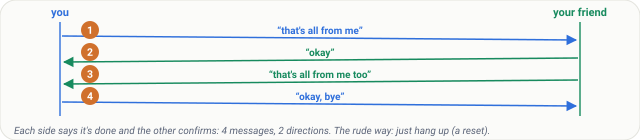
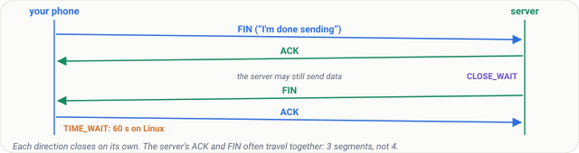
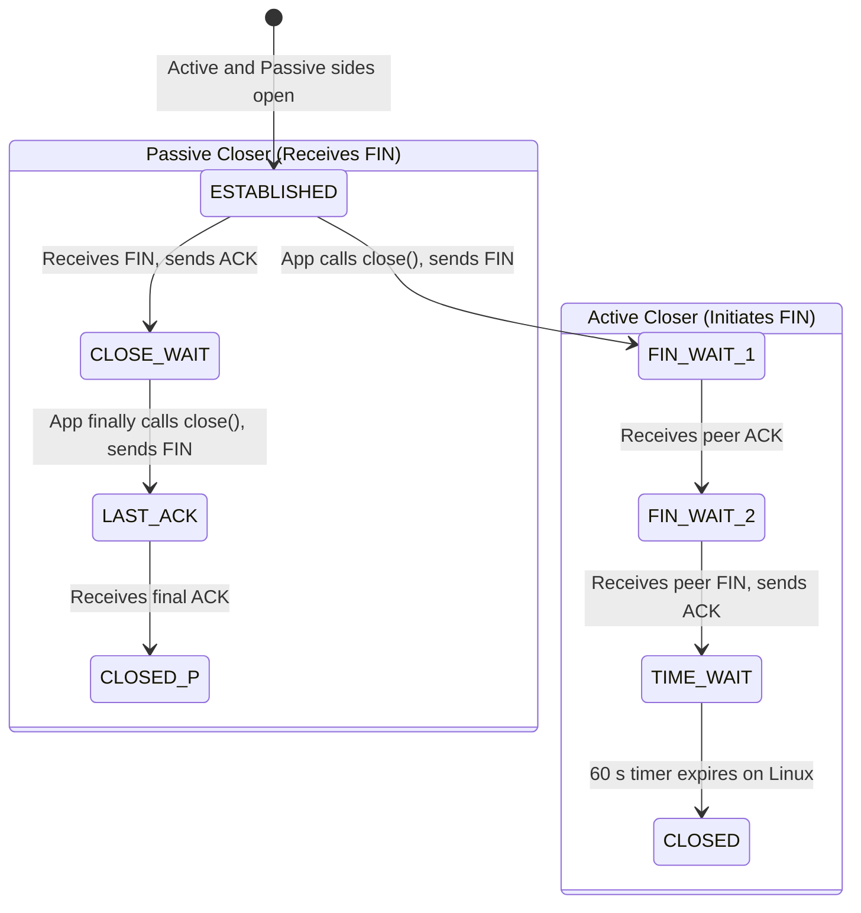
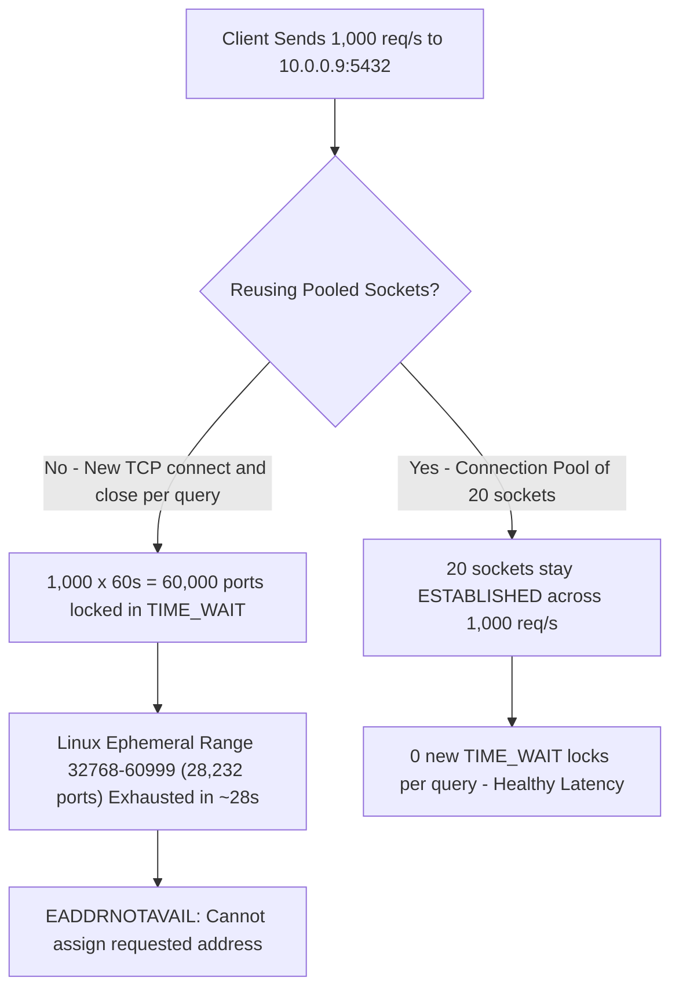
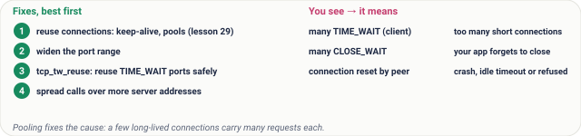
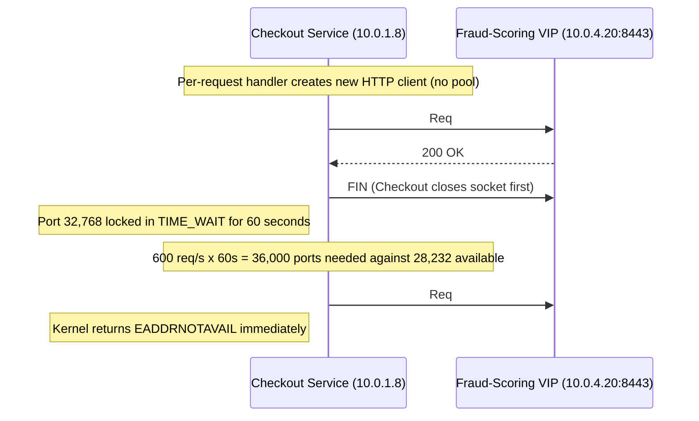

# Lesson 11: TCP Part 4, Closing, RST, TIME_WAIT and Running Out of Ports

> **Prerequisites:** [Lesson 09: TCP Three-Way Handshake](../09-tcp-three-way-handshake/README.md), [Lesson 04: Ports and Sockets](../04-ports-and-sockets/README.md), [Lesson 10: TCP Flow Control and Congestion Control](../10-tcp-flow-and-congestion-control/README.md), and [Networking From Zero Overview](../README.md) (Lesson 11 of 30).  
> **Estimated Reading Time:** 25 minutes  
> **Target Audience:** Backend engineers diagnosing `cannot assign requested address` (`EADDRNOTAVAIL`), `CLOSE_WAIT` socket leaks, and `connection reset by peer` (`ECONNRESET`) failures in production microservices.  
> **Free PDF Notes:** [Download SD-N-011.pdf](https://backendroadmap.com/notes/system-design/SD-N-011.pdf)

> [!NOTE]
> **In one line:** A connection closes in both directions with FIN and ACK; the side that closes first waits in `TIME_WAIT` (60 s on Linux) so a lost final ACK or a stray old segment can't corrupt a new connection; a reset (`RST`) ends it at once; and opening short connections faster than about 470 per second to one address and port runs a client out of ephemeral ports.

> [!TIP]
> **The Golden Rule of TCP Teardown:** A connection closes in both directions with `FIN` and `ACK`. The side that closes first waits in `TIME_WAIT` (`60` seconds on Linux) to absorb stray packets and lost ACKs, whereas `RST` aborts immediately—so opening short-lived connections faster than `ephemeral_ports / 60s` (`~470/s`) exhausts client ports unless you **reuse persistent connections via pooling and keep-alive**.

---

## Words You'll Meet Today

| Word | In Plain Words | Role in a Live Backend System |
| :--- | :--- | :--- |
| **`FIN`** | Finish: I'm done sending. | Graceful teardown signal; flushes unread send buffer before closing one direction. |
| **`RST`** | Reset: stop this connection right now. | Immediate abort sent on process crash, closed port, or load-balancer idle timeout (`ECONNRESET`). |
| **`TIME_WAIT`** | The wait, after closing, before a connection is really gone (`60 s` on Linux). | Kernel safeguard (`2 × MSL`) holding the 4-tuple so delayed packets don't corrupt new sockets. |
| **`CLOSE_WAIT`** | The other side said goodbye, and our app hasn't closed yet. | Classic application socket-leak state—meaning a missing `close()` or un-drained response body. |
| **Ephemeral port** | The temporary port a client picks for each connection. | Finite Linux pool (`32,768–60,999`, ~`28,000` ports) bound per `(client_ip, server_ip, server_port)`. |
| **Half-close** | One direction closed while the other can still send. | Allows a server to finish streaming an HTTP response even after the client sends `FIN`. |
| **Connection pool** | A few open connections reused for many requests. | Eliminates handshake overhead and keeps `TIME_WAIT` port churn near zero. |
| **Keep-alive** | Keeping a connection open for the next request. | Reuses an established TCP socket across sequential HTTP requests (`HTTP/1.1` default). |

---

## Visual Mental Models & Architecture

### The Question: Why Did It Run Out of Ports?

A busy service calls another service thousands of times a second. Suddenly every new call fails with *cannot assign requested address*. The CPU is fine, the memory is fine: it has run out of ports. To understand why, we need the end of a TCP connection, not the start.

### An Everyday Picture First: Ending a Phone Call

Ending a call politely: you say, that's all from me. Your friend says, okay. Then your friend says, that's all from me too, and you say, okay, bye. Each person says they're done and the other confirms: four messages, because there are two directions, just like the handshake in [lesson 9](../09-tcp-three-way-handshake/README.md). The rude way: you just hang up, and anything your friend was still saying is lost.



*Figure 1. The analogy: ending a call politely takes four messages, because each person says they're done and the other confirms; hanging up is the reset.*

### The Polite Close: `FIN` and `ACK`, Both Ways

Your phone is done sending, so it sends a segment with the **`FIN`** flag. The server answers `ACK`, and one direction is closed. But the server may still have data to send. When it's done, it sends its own `FIN`, and your phone answers `ACK`. Both directions are closed. Often the server's `ACK` and `FIN` travel together, so you see three segments, not four.

Between the two halves the server is in **`CLOSE_WAIT`**: it got the goodbye and is waiting for its own app to close. If the app never closes, the connection stays there forever; thousands of them mean a bug in your code, someone forgot to close.



*Figure 2. The polite close: FIN and ACK in each direction. The server sits in CLOSE_WAIT until its app closes; the side that closed first waits in TIME_WAIT.*



### `TIME_WAIT`: Why the Closer Waits

The side that closed first, your phone, doesn't forget the connection right away. It enters **`TIME_WAIT`**; on Linux it waits `60` seconds. Two reasons:

1. **The final ACK might be lost:** then the server sends its `FIN` again, and your phone must still be there to answer.
2. **Old, delayed segments** from this connection might still be wandering the network; waiting lets them die out, so they are never mistaken for a new connection on the same ports.


*Figure 3. Why TIME_WAIT exists: a lost final ACK makes the server repeat its FIN, and the closer must still answer; and delayed old segments need time to die out.*

### The Rude Way: `RST`

A **reset** (`RST`) is one segment, no goodbye, and the connection is gone at once. Any data not yet read is thrown away, and you see *connection reset by peer*. Resets happen when a program crashes or is killed, when a load balancer or firewall drops an idle connection, or ([lesson 9](../09-tcp-three-way-handshake/README.md)) when nobody listens on that port.


*Figure 4. The rude way: a reset (RST) ends the connection at once and throws away unread data; you see “connection reset by peer”.*

### Running Out of Ports

From [lesson 4](../04-ports-and-sockets/README.md): a connection is named by four values—client address, client port, server address, and server port. When your service calls one database at one address and one port, three of the four never change; only the client port can. So each connection to that database needs its own client port.


*Figure 5. A connection is named by four values. To one database address and port, only the client port changes, so each connection needs its own.*

**Real numbers.** Linux hands out client ports from `32,768` to `60,999`: about `28,000` (`28,232` ports). Every connection your service closes keeps its port busy, in `TIME_WAIT`, for `60` seconds. So at most about `28,000` ports every `60` seconds: roughly **`470` new connections per second** to that one address and port. Open and close faster than that, and the ports run out.


*Figure 6. Running out of ports: about 28,000 client ports, each held for 60 seconds in TIME_WAIT, allow roughly 470 new connections per second to one server address and port.*



**The fixes, best first.** Reuse connections: open a few and send many requests over each, with keep-alive and connection pools ([lesson 29](../29-connection-pooling-and-keep-alive/README.md)). Widen the port range. Let Linux safely reuse ports in `TIME_WAIT` for new outgoing connections, with `tcp_tw_reuse`. Spread the calls over more server addresses.

| You see | It means | Do this |
| :--- | :--- | :--- |
| Many `TIME_WAIT` on a client | Too many short connections | Pool them |
| Many `CLOSE_WAIT` | Your app forgets to close | Fix the code |
| Connection reset by peer | The other side crashed, timed out an idle connection, or refused it | Check the other side |



*Figure 7. The fixes, best first, and a symptom checklist: TIME_WAIT piles mean short connections, CLOSE_WAIT piles mean an app that forgets to close.*

---

## Core Definition & Taxonomic Comparison

**What it is:** TCP teardown is a *per-direction* shutdown protocol. Each half of the full-duplex byte stream is closed independently (`FIN` + `ACK`), and the endpoint that closes first parks the connection's 4-tuple in `TIME_WAIT` so the old connection cannot be confused with a new one. **What it isn't:** a one-message "hang up", a bug to be disabled, or something the server alone controls.

Four near-identical symptoms get conflated in incident channels. Distinguish them by *which side acted* and *what the kernel does next*:

| Term | Precise Meaning | Production Example |
| :--- | :--- | :--- |
| **`FIN` (graceful close)** | "I have no more bytes to send." Delivers all queued data first; the peer can still send (half-close). | An HTTP/1.1 server finishes a streamed `200` body, then calls `close()`; client reads EOF cleanly. |
| **`RST` (abortive close)** | "This connection is invalid; drop it now." Discards unread/unsent data; peer sees `ECONNRESET`. | A pod is `SIGKILL`ed mid-response; or a client connects to a port with no listener (`SYN` → `RST`). |
| **`TIME_WAIT`** | State held by the **active closer** for `2 × MSL` (`60 s` Linux). Not a leak; a safety timer. | A client opening/closing one connection per request accumulates `28,000` of them to one database. |
| **`CLOSE_WAIT`** | State held by the **passive closer** after it received `FIN`, until *its application* calls `close()`. No kernel timer ends it. | A Go service forgets `resp.Body.Close()`; `ss` shows `12,000` sockets pinned until `EMFILE`. |
| **`FIN_WAIT_2`** | Active closer has its `FIN` acked, waits for the peer's `FIN`. Bounded by `tcp_fin_timeout` for orphaned sockets. | A slow peer app that never closes keeps the other side in `FIN_WAIT_2` for up to `60 s`. |
| **Ephemeral port exhaustion** | Every `(src_ip, src_port)` for a fixed `(dst_ip, dst_port)` is in use or in `TIME_WAIT`. `connect()` returns `EADDRNOTAVAIL`. | Checkout → Fraud API at `600 req/s` with no pooling. |

**Rule of attribution:** `TIME_WAIT` piles point at the *side that closes first* (usually a short-connection client, or a server enforcing idle timeouts). `CLOSE_WAIT` piles point at a *code bug in the side that received `FIN`*. `RST` points at *a crash, a timeout policy, or a closed port*, never at "an attack" by default.

**Business implication:** port exhaustion fails *every* new outbound call at once with zero CPU pressure, so it presents as a total outage with healthy dashboards. `CLOSE_WAIT` leaks fail slowly and then catastrophically (`EMFILE`: too many open files), usually at peak load.

---

## Component Breakdown & Anatomy of a Connection's Last Seconds

A connection's lifetime after the application decides to stop decomposes into: **(1)** application close decision, **(2)** kernel FIN exchange (`≈ 1 RTT` each way), **(3)** the half-close window (data still draining), **(4)** the `TIME_WAIT` quarantine (`60 s`), **(5)** final release of the 4-tuple and the ephemeral port.

```text
        ACTIVE CLOSER (client)                                   PASSIVE CLOSER (server)
        ESTABLISHED                                               ESTABLISHED
        close()  ── FIN seq=x ───────────────────────────────►   CLOSE_WAIT   ◄── waits for server app close()
        FIN_WAIT_1                                               (kernel ACKs, app not yet told to close)
                 ◄────────────────────────────── ACK x+1 ────
        FIN_WAIT_2                                               ... server app drains response ...
                                                                 close() ── LAST_ACK
                 ◄────────────────────────────── FIN seq=y ───
        TIME_WAIT ── ACK y+1 ─────────────────────────────────►  CLOSED
        ... 60 s quarantine: tuple (src,sport,dst,dport) blocked ...
        CLOSED  (port is free again)
```

| Phase | Who Controls It | Resource Held | Failure Signature |
| :--- | :--- | :--- | :--- |
| App decides to close | **Your code** | File descriptor | Forgotten `Close()` → `CLOSE_WAIT` forever |
| FIN/ACK exchange | Kernel + network | Socket buffers | Lost FIN → retransmit with RTO backoff |
| Half-close drain | Peer app | Peer's send buffer | `FIN_WAIT_2` lingers |
| `TIME_WAIT` | Kernel (`60 s`, compile-time constant) | A **4-tuple** (the port is *not* freed for that destination) | `EADDRNOTAVAIL` at high connect rate |
| Port release | Kernel | Ephemeral port number | Recovery once timers expire |

### The Observability Gap: Who Sees Which Failure?

| Measurement Point | What It Captures | What It Hides |
| :--- | :--- | :--- |
| **Application error logs** | `EADDRNOTAVAIL`, `ECONNRESET`, `EMFILE` strings | *Why*: which socket state accumulated and which side closed first |
| **`ss -s` / `/proc/net/sockstat`** | Counts of `estab`, `timewait`, `orphan`, `alloc` | Which destination or process owns them |
| **`ss -tanp state ...`** | Per-socket state, owning PID, `Recv-Q` | Rates over time (it's a snapshot) |
| **Packet capture** | Exact `FIN`/`RST` direction and timing | Application intent (did code call `close()` or did it crash?) |
| **Load-balancer metrics** | Idle-timeout resets, backend connection errors | The client's local port budget |
| **Kernel counters (`nstat`)** | `TcpExtTW`, `TcpExtTCPAbortOn*`, `TcpEstabResets` | Per-service attribution |

---

## Mathematical Model: Port Budget, TIME_WAIT Occupancy, and Pool Sizing

### 1. Ephemeral Port Capacity

Linux default `ip_local_port_range = 32768 60999`:

$$N_{\text{ports}} = 60{,}999 - 32{,}768 + 1 = 28{,}232$$

A closed connection keeps its `(src_ip, src_port, dst_ip, dst_port)` tuple in `TIME_WAIT` for $T_{\text{TW}} = 60\text{ s}$. For **one** destination `(dst_ip, dst_port)` the sustainable new-connection rate is:

$$\lambda_{\max} = \frac{N_{\text{ports}}}{T_{\text{TW}}} = \frac{28{,}232}{60} \approx 470\ \text{connections/s}$$

Distinct destination addresses or ports multiply the budget, because a tuple is unique only per full 4-tuple: $\lambda_{\max} = k \cdot N_{\text{ports}} / T_{\text{TW}}$ for $k$ destinations.

### 2. TIME_WAIT Occupancy and Time to Exhaustion

At arrival rate $\lambda$ of short connections, steady-state `TIME_WAIT` occupancy is $L = \lambda \cdot T_{\text{TW}}$ (Little's Law). If $L > N_{\text{ports}}$ the pool exhausts after:

$$t_{\text{exhaust}} = \frac{N_{\text{ports}}}{\lambda}$$

| New conn/s to one `dst_ip:port` | Ports locked at steady state (`λ × 60`) | % of `28,232` | Outcome |
| :--- | :--- | :--- | :--- |
| `100` | `6,000` | `21%` | Healthy |
| `300` | `18,000` | `64%` | Warning: little headroom for bursts |
| `470` | `28,200` | `100%` | Knife-edge limit |
| `600` | `36,000` | `127%` | **Exhausted after `47 s`** (Checkout war story) |
| `1,000` | `60,000` | `212%` | **Exhausted after `28 s`** |
| `5,000` | `300,000` | `1,063%` | **Exhausted after `5.6 s`** |

### 3. How Much Do Mitigations Buy?

| Mitigation | Port Budget `N` | Max rate `N / 60` |
| :--- | :--- | :--- |
| Default range | `28,232` | `470 /s` |
| Widen to `1024–65000` | `63,977` | `1,066 /s` |
| `tcp_tw_reuse` (reuse after `> 1 s` when timestamps on) | effectively `≈ N / 1 s` outbound | `~28,000 /s` theoretical |
| `4` destination VIPs | `4 × 28,232` | `1,880 /s` |
| **Connection pool** | `n_pool` long-lived ports | **Unbounded by `TIME_WAIT`**, limited by backend capacity |

### 4. Sizing the Pool With Little's Law

Connections needed in flight: $c = \lambda \times W$ where $W$ is mean request latency. `1,000 req/s × 20 ms = 20` busy connections; add headroom (`×2` to `×3`) for jitter: a pool of `40–64`. This is why the PDF's "a pool of about 20 open connections" fixes a `1,000 q/s` workload that needed `60,000` ports without pooling: a **3,000×** reduction in port consumption.

### 5. Handshake Overhead Saved by Reuse

A fresh TLS-over-TCP connection costs `1 RTT` (TCP) `+ 1 RTT` (TLS 1.3) before the first request byte. At `1 ms` intra-AZ RTT that is `~2 ms`; at `70 ms` cross-region it is `~140 ms`. Reuse removes this from every request *and* removes the `TIME_WAIT` port consumption.

---

---

## Systematic Reference & Comparison Grid

### TCP Teardown States & Signals

| State / Flag | Trigger Event | Who Holds Socket? | Typical Duration | Production Meaning |
| :--- | :--- | :--- | :--- | :--- |
| **`FIN_WAIT_1`** | Local app called `close()`, sent `FIN` | Active closer | `< 1 RTT` | Waiting for peer `ACK` or simultaneous `FIN` |
| **`FIN_WAIT_2`** | Peer `ACK`ed our `FIN`, hasn't sent theirs | Active closer | Seconds (`tcp_fin_timeout`) | Half-closed; peer still flushing response data |
| **`TIME_WAIT`** | Both `FIN`s exchanged; final `ACK` sent | **Active closer** | `60 s` (hardcoded in Linux) | Expected safeguard for short-lived connections; pool sockets if high |
| **`CLOSE_WAIT`** | Peer sent `FIN`; kernel sent `ACK` | **Passive closer** | Indefinite until app closes | **Bug in local code** (unclosed socket / missing `defer Close()`) |
| **`LAST_ACK`** | Passive app finally called `close()` | Passive closer | `< 1 RTT` | Waiting for active closer's final `ACK` |
| **`RST`** | Crash, closed port, or idle LB reap | Immediate drop | `0 s` (instant) | Throws away unread data; causes `connection reset by peer` |

### Port Exhaustion Mitigations Ranked

| Mitigation | Configuration / Pattern | Safety Behind NAT? | Throughput Impact |
| :--- | :--- | :--- | :--- |
| **1. Connection Pooling & Keep-Alive** | App-level singleton HTTP/DB pool | Yes (always safe) | Eliminates both `TIME_WAIT` churn AND handshake RTTs |
| **2. Widen Ephemeral Port Range** | `net.ipv4.ip_local_port_range = 1024 65000` | Yes | Doubles headroom (`~64,000` ports = `~1,060/s`) |
| **3. Safe Outbound `TIME_WAIT` Reuse** | `net.ipv4.tcp_tw_reuse = 2` (loopback) or `1` | Yes (uses RFC 7323 timestamps) | Allows immediate outbound port reuse if > `1 s` elapsed |
| **4. Multiple VIPs / Source IPs** | Multiple backend IPs or client SNAT IPs | Yes | Scales 4-tuple space linearly per `(src_ip, dst_ip, dst_port)` |
| **Deprecated: `tcp_tw_recycle`** | Removed in Linux 4.12 | **No — breaks NAT clients** | Drops legitimate `SYN`s from shared corporate/mobile NATs |

---

## Observability: Socket-State Metrics, Alerts, and Dashboards

Socket *state counts* are the most under-monitored production signal. A single time-series of `TIME_WAIT`, `CLOSE_WAIT`, and `ESTABLISHED` per host predicts both of the classic outages before they happen.

| Signal | Source | Healthy | Alert When | Meaning |
| :--- | :--- | :--- | :--- | :--- |
| `TIME_WAIT` count | `ss -s`, `/proc/net/sockstat` (`tw`), `node_sockstat_TCP_tw` | `< 20%` of port range per busy destination | `> 60%` of `28,232` per destination, or rising 5 min | Short-connection churn: approaching `EADDRNOTAVAIL` |
| Port utilization per destination | `ss -tan dst <ip>:<port> \| wc -l` / eBPF `tcpstates` | `< 50%` | `> 80%` | Pool missing or too small |
| `CLOSE_WAIT` count | `ss -tan state close-wait` | `≈ 0` (transient) | Any sustained `> 100`, or growing monotonic | App leak: missing `Close()` / undrained body |
| Open FDs vs `ulimit -n` | `/proc/<pid>/fd`, `process_open_fds` | `< 60%` | `> 80%` | `EMFILE` risk; correlates with `CLOSE_WAIT` leak |
| `EstabResets`, `OutRsts` | `nstat TcpEstabResets TcpOutRsts` | Low, stable | Step increase after deploy | Crashes, LB idle resets, closed ports |
| `TCPAbortOnData` / `TCPAbortOnClose` | `nstat TcpExtTCPAbortOn*` | `~0` | Rising | App closed with unread data: sends `RST` |
| `TcpExtTW` vs `TcpExtTWKilled` | `nstat` | Expired normally | `TWKilled` / overflow counters rising | `tcp_max_tw_buckets` pressure |
| `connect()` error rate by errno | App metrics | `0` | Any `EADDRNOTAVAIL` | Outbound port exhaustion: page immediately |
| Connection pool wait time / `in_use` / `idle` | HTTP client metrics (`http.Transport` stats, undici pool stats, HikariCP) | Idle > 0 | Wait time `> 5 ms` or `in_use == max` | Pool too small, or body not returned to pool |

**Dashboards that catch this early**
1. *Per-host socket state stack:* `ESTAB`, `TIME_WAIT`, `CLOSE_WAIT`, `FIN_WAIT_2` as stacked area. Healthy hosts show flat `ESTAB` and near-zero `CLOSE_WAIT`.
2. *Port-budget gauge:* `TIME_WAIT toward {top-5 destinations} / 28,232`, with warning at `60%` and page at `85%`.
3. *Leak-detector:* `CLOSE_WAIT` derivative; any constant-slope growth means a leak even if the absolute number is small.
4. *Reset attribution:* `RST` sent vs received per service pair, overlaid with deploy markers and LB idle-timeout config.

**Runbook decision tree**
1. Error says *cannot assign requested address* → `ss -tan | awk '{print $1}' | sort | uniq -c`. Mostly `TIME-WAIT` to one `ip:port` → pool; widen range; spread destinations.
2. Error says *too many open files* → `ss -tanp state close-wait`; find the PID, then the missing `close()`.
3. Error says *connection reset by peer* → capture `RST` direction; compare timing to LB idle timeout; check peer crash logs/OOM kills.

---

## Production War Story Post-Mortem: Flash Sale `EADDRNOTAVAIL` Outage

- **Severity:** SEV-1 (Checkout Service 100% Down)
- **Detection / Resolution Time:** 14 minutes total outage
- **Impact:** Every checkout call failed with `connect: cannot assign requested address` after flash-sale traffic pushed calls to the internal Fraud-Scoring API (`10.0.4.20:8443`) past `500 req/s`.

### What Happened



### Root Cause Analysis

1. **Per-Request Client Construction:** A refactor moved `http.Client` instantiation inside the request handler function. Each request opened a new TCP + TLS socket, read one JSON payload, and closed the socket—putting the client into `TIME_WAIT`.
2. **Ephemeral Range Ceiling:** With default Linux `ip_local_port_range = 32768 60999` (`28,232` ports) and `60 s` `TIME_WAIT`, the single destination tuple `10.0.4.20:8443` could sustain only `28,232 / 60 = 470` new connections per second. At `600 req/s`, ports ran dry in ~47 seconds.
3. **Zero Connection Reuse:** Not only did each request burn an ephemeral port, it also burned 2–3 RTTs on TCP + TLS handshakes, inflating latency prior to total collapse.

### The Fix & Architectural Hardening

- **Singleton Pooled Clients:** Hoisted the HTTP client to process-wide singleton scope with `MaxIdleConnsPerHost = 128`, keeping `~30` persistent connections warm for `10,000+ req/s` with zero `TIME_WAIT` churn.
- **Response Body Draining:** Added `io.Copy(io.Discard, resp.Body)` + `defer resp.Body.Close()` everywhere so sockets return cleanly to the pool instead of leaking into `CLOSE_WAIT` or triggering forced resets.
- **Idle Timeout Alignment:** Configured client idle timeout (`60 s`) strictly shorter than the Fraud-Scoring ALB idle timeout (`90 s`) so the client closes politely before the load balancer sends an unexpected `RST`.

---

## Multi-Language Production Implementation

Preventing **both** `TIME_WAIT` port exhaustion and `CLOSE_WAIT` descriptor leaks requires: (1) a process-wide pooled client, (2) a client idle timeout shorter than upstream LB timeouts, and (3) guaranteed response body draining/closing on every error path.

````carousel
```go
package client

import (
	"io"
	"net/http"
	"time"
)

// Shared singleton client: reuses TCP sockets across requests to prevent TIME_WAIT exhaustion.
var FraudHTTPClient = &http.Client{
	Timeout: 2 * time.Second,
	Transport: &http.Transport{
		MaxIdleConns:        200,
		MaxIdleConnsPerHost: 64,
		IdleConnTimeout:     50 * time.Second, // Shorter than 60s upstream LB idle timeout
	},
}

func CheckFraud(url string) (int, error) {
	resp, err := FraudHTTPClient.Get(url)
	if err != nil {
		return 0, err
	}
	// Guarantee body drain + close so socket returns to pool (no CLOSE_WAIT leak).
	defer func() {
		_, _ = io.Copy(io.Discard, resp.Body)
		_ = resp.Body.Close()
	}()
	return resp.StatusCode, nil
}
```
<!-- slide -->
```typescript
import { Pool } from "undici";

// Singleton persistent connection pool bound to one upstream origin.
const fraudPool = new Pool("https://10.0.4.20:8443", {
  connections: 64,
  keepAliveTimeout: 50_000, // Closed by client before 60s LB idle reset
  headersTimeout: 2_000,
  bodyTimeout: 2_000,
});

export async function checkFraud(path: string): Promise<number> {
  const { statusCode, body } = await fraudPool.request({
    path,
    method: "GET",
  });
  // Always drain/dump the body even on non-200 responses so the socket returns cleanly.
  await body.dump();
  return statusCode;
}
```
<!-- slide -->
```python
import httpx

# Module-level singleton client reuses persistent TCP connections safely.
fraud_client = httpx.Client(
    base_url="https://10.0.4.20:8443",
    timeout=2.0,
    limits=httpx.Limits(
        max_connections=100,
        max_keepalive_connections=64,
        keepalive_expiry=50.0,  # Shorter than upstream LB timeout
    ),
)


def check_fraud(path: str) -> int:
    # Context manager guarantees body read + socket return to pool (prevents CLOSE_WAIT).
    with fraud_client.stream("GET", path) as resp:
        resp.read()
        return resp.status_code
```
<!-- slide -->
```csharp
using System;
using System.Net.Http;
using System.Threading.Tasks;

public static class FraudHttpClientFactory
{
    // Singleton SocketsHttpHandler avoids socket exhaustion and respects DNS rotation.
    private static readonly SocketsHttpHandler Handler = new()
    {
        MaxConnectionsPerServer = 64,
        PooledConnectionLifetime = TimeSpan.FromMinutes(5),
        PooledConnectionIdleTimeout = TimeSpan.FromSeconds(50),
    };

    public static readonly HttpClient Instance = new(Handler)
    {
        BaseAddress = new Uri("https://10.0.4.20:8443"),
        Timeout = TimeSpan.FromSeconds(2),
    };

    public static async Task<int> CheckFraudAsync(string path)
    {
        // 'using' ensures response stream disposal so the socket returns to the pool.
        using HttpResponseMessage resp = await Instance.GetAsync(path);
        _ = await resp.Content.ReadAsByteArrayAsync();
        return (int)resp.StatusCode;
    }
}
```
````

---

## Practical Hands-On Verification CLI Workflows

### 1. Count Sockets by TCP State to Spot `TIME_WAIT` vs. `CLOSE_WAIT`

```bash
ss -tan | awk 'NR>1 {++state[$1]} END {for (s in state) printf "%-12s %d\n", s, state[s]}'
```

**Expected Output:**

```text
LISTEN       12
ESTAB        48
TIME-WAIT    14203
CLOSE-WAIT   2
```

### 2. Audit Ephemeral Port Range and `TIME_WAIT` Kernel Settings

```bash
sysctl net.ipv4.ip_local_port_range net.ipv4.tcp_tw_reuse net.ipv4.tcp_fin_timeout
```

**Expected Output:**

```text
net.ipv4.ip_local_port_range = 32768	60999
net.ipv4.tcp_tw_reuse = 2
net.ipv4.tcp_fin_timeout = 60
```

### 3. Identify the Exact Process Leaking `CLOSE_WAIT` Sockets

```bash
ss -tanp state close-wait
```

**Expected Output:**

```text
Recv-Q Send-Q Local Address:Port  Peer Address:Port
1      0      10.0.1.8:48210     10.0.4.20:5432    users:(("order-worker",pid=1842,fd=37))
```

Notice `pid=1842` (`order-worker`) still has `fd=37` open even though `10.0.4.20:5432` already sent `FIN` (`Recv-Q = 1` represents the unread EOF).

---

## Pause and Think

> [!exercise] A service opens a new connection to its database for every query and closes it right after. It runs 1,000 queries per second; the port range is 28,000 and TIME_WAIT lasts 60 seconds. Does it run out of ports? Decide before you open the answer.

<details><summary>Answer</summary>

Yes. 1,000 a second, each holding a port for 60 seconds, needs 60,000 ports, and it only has 28,000. After about 28 seconds new connections start to fail. The fix: a connection pool with, say, 20 connections that stay open.


*Figure 8. The pause-and-think answer: 1,000 connections a second for 60 seconds needs 60,000 ports against about 28,000, so new connections fail after about 28 seconds; a pool fixes it.*

</details>

---

## Operational Validation Checkpoints

<details><summary><strong>Checkpoint 1: Port Budget Across Multi-Node Backends</strong></summary>

**Scenario:** Your API server handles `1,200 req/s` without connection pooling, spread evenly across `3` separate backend database IPs (`400 req/s` each). With `28,232` ephemeral ports and `60 s` `TIME_WAIT`, does it exhaust ports?

**Solution:**
Wait—each connection is identified by the **4-tuple** `(src_ip, src_port, dst_ip, dst_port)`. Because the `3` backends have **distinct destination IPs**, the same client ephemeral port can connect simultaneously to IP 1, IP 2, and IP 3! Each backend needs `400 × 60 = 24,000` ports `< 28,232`. It barely survives at `1,200 req/s`, though any single backend failover immediately doubles load on the remaining two (`600 × 60 = 36,000` > `28,232`) and triggers cascading `EADDRNOTAVAIL`. Connection pooling remains mandatory.

</details>

<details><summary><strong>Checkpoint 2: Why `IdleConnTimeout` Must Beat the Load Balancer</strong></summary>

**Scenario:** Your microservice sees random `connection reset by peer` (`ECONNRESET`) spikes every 60 seconds right as idle pooled connections get reused. Why?

**Solution:**
A race condition between keep-alive reuse and an upstream load balancer's idle timeout (typically `60 s`). If the LB sends `RST` or `FIN` at `t = 60.000 s` while your client picks that same idle socket out of its pool at `t = 60.001 s` to write an HTTP request, your request collides with the teardown and receives `RST`. Setting client `IdleConnTimeout` shorter (e.g., `45–50 s`) ensures the client retires idle sockets cleanly before the LB kills them.

</details>

<details><summary><strong>Checkpoint 3: Diagnosing `TIME_WAIT` vs. `CLOSE_WAIT` on a Database Host</strong></summary>

**Scenario:** Your PostgreSQL server shows `9,000` `TIME_WAIT` connections on port `5432` while your Go API host shows `0` `TIME_WAIT` and `0` `CLOSE_WAIT`. Which side closed first?

**Solution:**
PostgreSQL (`5432`) initiated the `FIN` first (e.g., idle connection reaper or statement timeout teardown), because **only the active closer enters `TIME_WAIT`**. Meanwhile, the Go API closed cleanly after receiving `FIN` (`CLOSE_WAIT` -> `LAST_ACK` -> `CLOSED`).

</details>

---

## Common Mistakes & Troubleshooting

### Common Mistakes

- **"Closing takes one message."** No. Each direction closes on its own: `FIN` and `ACK`, both ways.
- **"`TIME_WAIT` is a bug, so turn it off."** No. It protects you from lost `ACK`s and old segments. Reuse connections instead.
- **"A reset means an attack."** Usually not. Most resets are crashed programs, idle timeouts, or closed ports.

### Troubleshooting Matrix

| Symptom / Error Message | Socket State Evidence | Root Cause | Fix |
| :--- | :--- | :--- | :--- |
| `cannot assign requested address` (`EADDRNOTAVAIL`) | Client has `~28k` `TIME_WAIT` to one target | Opening/closing short connections too fast | Reuse pooled singleton connections; widen `ip_local_port_range`; `tcp_tw_reuse` |
| File descriptor limit reached (`EMFILE`) | Thousands of `CLOSE_WAIT` sockets | App forgets `Close()` or doesn't drain HTTP bodies | Wrap sockets/streams in `defer`/`using`/`with` blocks |
| `connection reset by peer` (`ECONNRESET`) | `RST` frames in `tcpdump` | Peer crashed, LB idle timeout fired, or port closed | Align idle timeouts `< LB`; inspect peer crash logs; verify target port |

---

## Recap in Three Lines

1. A connection closes in both directions: `FIN`, `ACK`, `FIN`, `ACK`.
2. The side that closes first waits in `TIME_WAIT`, for `60` seconds on Linux.
3. A reset ends a connection at once, and short connections can use up all your ports.

---

## Interview Practice Questions

Each question is tagged by kind: **Basic** (definitions), **Scenario** (apply it to a system), and **Tricky** (deep follow-ups). Answer out loud before opening the solution.

### Basic Conceptual Questions (Q1–Q4)

<details>
<summary><strong>Q1: How does a TCP connection close? [BASIC]</strong></summary>

<strong>What a strong answer covers:</strong>
Each direction closes separately. The side that is done sends a `FIN` and the other `ACK`s it; later the other side sends its own `FIN` and gets an `ACK`. That is four segments, often three because the second `ACK` and `FIN` travel together. The side that closed first (the **active closer**) then waits in `TIME_WAIT`; the other side passes through `CLOSE_WAIT` and `LAST_ACK`.

</details>

<details>
<summary><strong>Q2: What is `TIME_WAIT` and why does it exist? [BASIC]</strong></summary>

<strong>What a strong answer covers:</strong>
The state the active closer stays in after sending the final `ACK`: `60 s` on Linux (a compile-time constant, standing in for `2 × MSL`). Two reasons: (1) the final `ACK` may be lost, in which case the peer retransmits its `FIN` and the closer must still be there to re-`ACK`; (2) delayed duplicate segments from the old connection must expire so they cannot be mistaken for data on a new connection that reuses the same 4-tuple.

</details>

<details>
<summary><strong>Q3: What is the difference between `TIME_WAIT` and `CLOSE_WAIT`, and which one is a bug? [BASIC]</strong></summary>

<strong>What a strong answer covers:</strong>
`TIME_WAIT` is held by the **side that closed first** and ends on a kernel timer; it is normal. `CLOSE_WAIT` is held by the **side that received `FIN`** and ends only when its *application* calls `close()`; large or growing counts mean an application bug (unclosed sockets, undrained HTTP bodies, connections not returned to the pool). Too many `TIME_WAIT` is a design smell (too many short connections); too many `CLOSE_WAIT` is a defect.

</details>

<details>
<summary><strong>Q4: What's the difference between `FIN` and `RST`? [BASIC]</strong></summary>

<strong>What a strong answer covers:</strong>
`FIN` is a graceful close of one direction: data already sent is delivered and acknowledged, and the other side can keep sending (half-close). `RST` aborts the whole connection immediately, discards data not yet read, skips `TIME_WAIT` on the aborting side, and the peer sees `ECONNRESET` ("connection reset by peer"). Crashes, `SIGKILL`, load-balancer idle timeouts, closing a socket with unread receive data, and connecting to a closed port all produce resets.

</details>

### Scenario-Based Architecture Questions (Q5–Q8)

<details>
<summary><strong>Q5: A service suddenly fails every outbound call with "cannot assign requested address" while CPU and memory are fine. What is going on and how do you fix it? [SCENARIO]</strong></summary>

<strong>What a strong answer covers:</strong>
**Ephemeral port exhaustion** (`EADDRNOTAVAIL`). Each new connection to the same destination `ip:port` needs a distinct client port, and closed connections hold theirs in `TIME_WAIT` for `60 s`: `28,232 / 60 ≈ 470` new connections per second per destination. Confirm with `ss -tan | awk` state counts. Fix in order: **connection pooling / keep-alive** (hoist the HTTP client to a singleton), widen `ip_local_port_range`, enable `tcp_tw_reuse` (needs timestamps), and spread load across more destination IPs or source IPs. Never "disable `TIME_WAIT`".

</details>

<details>
<summary><strong>Q6: You see thousands of connections in `CLOSE_WAIT`, and eventually `too many open files`. What does that tell you? [SCENARIO]</strong></summary>

<strong>What a strong answer covers:</strong>
The peer has closed (sent `FIN`) but your application never closed its side: a leak in your code. Typical causes: a missing `close()` on an error path, not draining/closing an HTTP response body so the connection is neither reused nor closed, a pool that loses track of connections, or a worker blocked forever. The kernel cannot fix it. Use `ss -tanp state close-wait` to get the PID and `lsof -p` / goroutine/thread dumps to find the code path, then wrap in `defer`/`using`/`with` and add FD-usage alerts.

</details>

<details>
<summary><strong>Q7: Your microservice sees random `ECONNRESET` errors roughly every 60 seconds, exactly when idle pooled connections are reused. Why? [SCENARIO]</strong></summary>

<strong>What a strong answer covers:</strong>
A race between client keep-alive reuse and the upstream's idle timeout (an ALB/NLB/NAT/firewall typically at `60 s` or `350 s`). The upstream sends `FIN`/`RST` at `t = 60.000 s`; the client picks that idle socket from the pool at `t = 60.001 s` and writes into a dead connection, getting `RST`. Fix: make the **client idle timeout shorter** than every hop's idle timeout (`45–50 s` vs `60 s`), enable TCP keep-alive probes (below the NAT/LB timeout), and retry idempotent requests once on a stale connection.

</details>

<details>
<summary><strong>Q8: Your API runs `1,200 req/s` with no pooling, spread evenly across 3 backend IPs. Do you exhaust ports, and what if one backend dies? [SCENARIO]</strong></summary>

<strong>What a strong answer covers:</strong>
The budget is per destination 4-tuple. Each backend gets `400 /s` → `400 × 60 = 24,000` ports `< 28,232`: it just survives (`85%` utilization, no burst room). If one backend fails, the other two take `600 /s` each → `36,000 > 28,232` → exhaustion in `47 s`, a **cascading failure** triggered by a partial outage. Mandatory fix: connection pooling; secondary: wider port range and `tcp_tw_reuse`. This is why capacity tests must include "N−1 backends" scenarios.

</details>

### Advanced & Tricky Interview Questions (Q9–Q12)

<details>
<summary><strong>Q9: Should you turn off `TIME_WAIT` to fix port exhaustion? [TRICKY]</strong></summary>

<strong>What a strong answer covers:</strong>
No. It protects against lost final `ACK`s and stray old segments corrupting a new connection with the same 4-tuple. Reduce the *need* for it by reusing connections. On Linux, `tcp_tw_reuse` allows reusing a `TIME_WAIT` tuple for **outgoing** connections when TCP timestamps prove the new `SYN` is newer (RFC 7323), and it is safe. The historical `tcp_tw_recycle` was unsafe behind NAT (it dropped `SYN`s from different hosts sharing an IP because of per-host timestamp assumptions) and was **removed in Linux 4.12**.

</details>

<details>
<summary><strong>Q10: Why doesn't a busy server on port `443` run out of ports from `TIME_WAIT` the way a client does? [TRICKY]</strong></summary>

<strong>What a strong answer covers:</strong>
The server's local port is fixed (`443`) and *each client brings a different source `(ip, port)`*, so the 4-tuples are unique and the server does not need to allocate ephemeral ports for inbound connections. Server-side `TIME_WAIT` costs only small kernel memory (bounded by `tcp_max_tw_buckets`). It becomes a problem when (a) the server is the *active closer* toward its own upstreams (it acts as a client), (b) many clients sit behind one NAT/CGNAT/proxy IP so source IPs collapse, or (c) a load balancer opens connections to backends from a small set of source IPs/ports.

</details>

<details>
<summary><strong>Q11: What is a half-close, and when would you use `shutdown(SHUT_WR)` instead of `close()`? [TRICKY]</strong></summary>

<strong>What a strong answer covers:</strong>
A half-close shuts one direction while the other stays open. `shutdown(fd, SHUT_WR)` sends `FIN` after queued data ("I'm done sending") but the socket remains readable, so the peer can finish its reply. Use it for protocols that signal end-of-request by EOF (netcat-style tools, some proxies, `rsync`-like pipelines). `close()` releases the descriptor entirely; if unread data remains in the receive buffer, Linux sends **`RST` instead of `FIN`**, a source of puzzling truncated responses. Many HTTP stacks handle this with a lingering close that drains input before closing.

</details>

<details>
<summary><strong>Q12: What does `SO_LINGER` with timeout `0` do, and why is it dangerous? What about `SO_REUSEADDR` on server restart? [TRICKY]</strong></summary>

<strong>What a strong answer covers:</strong>
`SO_LINGER {on, 0}` makes `close()` send **`RST` immediately** and discard unsent data; the socket skips `TIME_WAIT`, so it "fixes" port exhaustion cosmetically but risks truncated responses and loses the safety net against delayed segments. Prefer pooling. `SO_REUSEADDR` is different: it lets a *listening* server bind to a port even if old connections on that port sit in `TIME_WAIT`, which prevents `address already in use` after a restart, and does not weaken `TIME_WAIT` for client connections. Use `SO_REUSEPORT` for multi-process accept scaling, not as a `TIME_WAIT` workaround.

</details>

---

## One-Page Master Cheat Sheet

```text
====================================================================================================
     TCP CLOSING, RST, TIME_WAIT & PORT EXHAUSTION: WHY IT RAN OUT OF PORTS — CHEAT SHEET
====================================================================================================
CLOSE SEQUENCE (per direction)
  active  : ESTABLISHED -> FIN_WAIT_1 -> FIN_WAIT_2 -> TIME_WAIT (60 s) -> CLOSED
  passive : ESTABLISHED -> CLOSE_WAIT (until APP calls close) -> LAST_ACK -> CLOSED
  Segments: FIN, ACK, FIN, ACK  (often 3: second ACK+FIN merged).   RST = instant abort, no TIME_WAIT.

WHO HOLDS WHAT
  * TIME_WAIT  = active closer. Kernel timer. NORMAL.  Piles => too many short connections -> POOL.
  * CLOSE_WAIT = passive closer. App must close().     Piles => CODE BUG (leak) -> fix close/defer.
  * RST        = crash | idle timeout (LB/NAT) | closed port | close() with unread data.

PORT MATH (client, per destination ip:port)
  * Range 32768-60999 = 28,232 ports.     Max new conn/s = 28,232 / 60 = ~470/s.
  * Occupancy L = lambda x 60.            Exhaust after t = 28,232 / lambda   (1,000/s -> 28 s)
  * Widen to 1024-65000 -> ~1,066/s.      k destinations -> k x 470/s.
  * Pool size = lambda x latency (Little) -> 1,000 req/s x 20 ms = 20 conns (x2-3 headroom).

FIXES (best first)
  1 Pool / keep-alive (singleton client, drain+close bodies)   3 net.ipv4.tcp_tw_reuse (timestamps)
  2 Widen ip_local_port_range                                  4 More destination / source IPs
  NEVER: tcp_tw_recycle (removed 4.12, broke NAT), SO_LINGER 0 as a "fix".

TIMEOUT ALIGNMENT RULE
  client idle timeout (45-50 s)  <  LB idle timeout (60 s)  <  server idle timeout (75-90 s)

COMMANDS
  ss -tan | awk 'NR>1{++s[$1]} END{for(k in s)print k,s[k]}'   | ss -tanp state close-wait
  sysctl net.ipv4.ip_local_port_range net.ipv4.tcp_tw_reuse net.ipv4.tcp_fin_timeout

ANTI-PATTERNS
  x New HTTP client per request          x Not draining/closing response bodies
  x "Turn off TIME_WAIT"                 x Client idle timeout longer than the load balancer's
  x Treating every RST as an attack      x Capacity tests that ignore N-1 backend failover
====================================================================================================
```

---

## Free PDF notes

Download these notes as a printable PDF, with every picture, the port arithmetic and the interview answers: [SD-N-011.pdf](https://backendroadmap.com/notes/system-design/SD-N-011.pdf).

---

## Sources

- [RFC 9293: Transmission Control Protocol](https://www.rfc-editor.org/rfc/rfc9293), closing with FIN, TIME_WAIT, CLOSE_WAIT and RST.
- [RFC 6056: Recommendations for Transport-Protocol Port Randomization](https://www.rfc-editor.org/rfc/rfc6056), ephemeral ports.
- [RFC 7323: TCP Extensions for High Performance](https://www.rfc-editor.org/rfc/rfc7323), the timestamps that let tcp_tw_reuse work safely.
- [Linux kernel: IP sysctl documentation](https://www.kernel.org/doc/html/latest/networking/ip-sysctl.html), ip_local_port_range and tcp_tw_reuse.
- [Linux tcp(7) manual page](https://man7.org/linux/man-pages/man7/tcp.7.html), TCP states and settings.

---

## Next

Next comes [lesson 12, UDP vs TCP](../12-udp-vs-tcp/README.md): when speed matters more than reliability, and why video calls and games often choose UDP. See [the track overview](../README.md) for the whole series.
