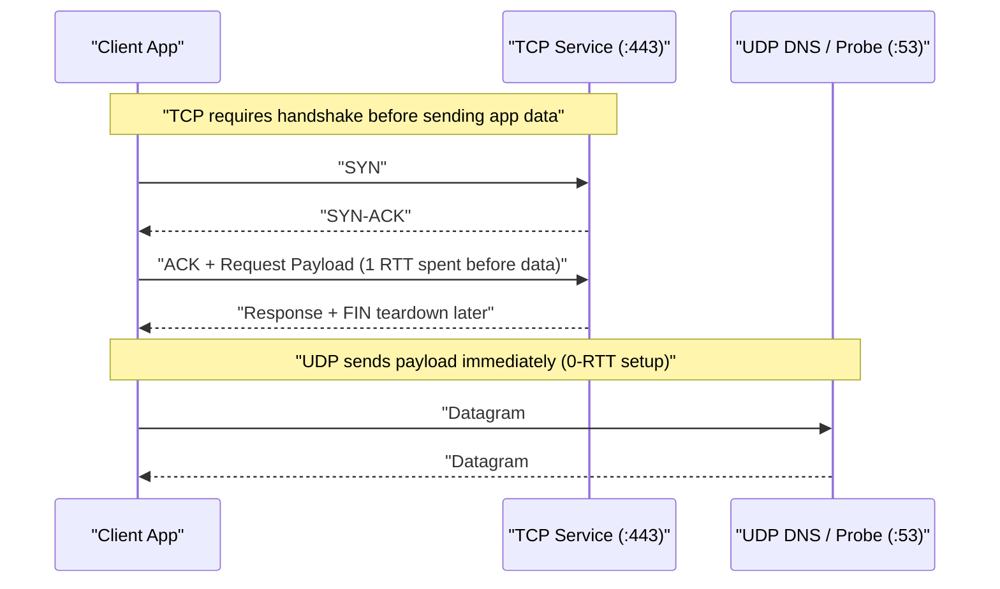
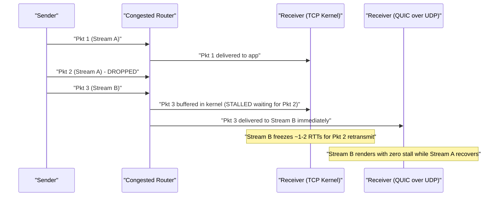
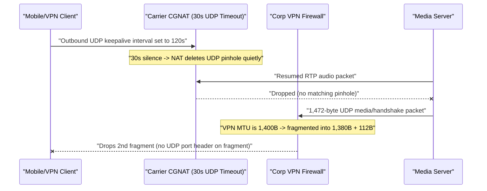

# Lesson 12: UDP vs TCP — When Speed Beats Reliability

> **Prerequisites:** [Lesson 11: TCP Closing, RST, TIME_WAIT and Ports](../11-tcp-closing-time-wait-and-ports/README.md), [Lesson 04: Ports and Sockets](../04-ports-and-sockets/README.md), [Lesson 05: Protocols and Layers](../05-protocols-and-layers/README.md), and [Networking From Zero Overview](../README.md) (Lesson 12 of 30).  
> **Estimated Reading Time:** 26 minutes  
> **Target Audience:** Backend and real-time systems engineers deciding between TCP and UDP, diagnosing QUIC/HTTP/3 path-MTU blackholes, keeping WebRTC NAT pinholes alive, and eliminating transport head-of-line blocking.  
> **Free PDF Notes:** [Download SD-N-012.pdf](https://backendroadmap.com/notes/system-design/SD-N-012.pdf)

> [!TIP]
> **The Golden Rule of UDP vs. TCP:** TCP delivers a reliable, ordered byte stream at the cost of a handshake, retransmission stalls, and transport **head-of-line blocking**, whereas **UDP** sends independent **datagrams** behind an **`8`-byte header** with zero connection setup and zero guarantees. Pick UDP when **late data is worse than lost data** (voice, video, games), when queries fit in one packet (**DNS**), or when user-space protocols like **QUIC** rebuild reliability per stream—while keeping payloads under **`~1,200` bytes** to avoid IP fragmentation and refreshing **NAT pinholes** every `15–25` seconds.

---

## Words You'll Meet Today

| Word | In Plain Words | Role in a Live Backend System |
| :--- | :--- | :--- |
| **Datagram** | One self-contained packet message with its own start and end. | Unit of UDP delivery; each `recvfrom()` returns one complete message or drops it entirely. |
| **Byte stream** | A continuous river of bytes with no built-in message boundaries. | TCP abstraction requiring application framing (length prefixes or HTTP delimiters). |
| **Head-of-line blocking** | One missing front packet freezes every healthy packet behind it. | TCP pauses delivery of packets `#5, #6, #7` in the kernel buffer until missing `#4` arrives. |
| **Jitter** | How wildly packet arrival times vary from packet to packet. | Destroys VoIP/gaming smoothness even when average latency looks low; buffered via jitter buffers. |
| **Path MTU** | The smallest maximum packet size supported across every router hop. | Usually `1,500 B` on Ethernet, shrinking to `1,400–1,492 B` over VPNs, cellular, or PPPoE links. |
| **IP fragmentation** | Splitting one oversized packet into smaller IP chunks mid-flight. | Disastrous for UDP: losing one fragment discards the entire datagram; firewalls often drop fragments. |
| **NAT pinhole** | Temporary port mapping keeping a home/cloud router open for UDP replies. | Expires quietly after `30–120 s` of silence, requiring periodic keepalive probes. |
| **QUIC** | Modern encrypted, multi-stream transport protocol built atop UDP. | Powers **HTTP/3**, eliminating TCP head-of-line blocking and merging TLS + transport into `1 RTT`. |

---

## Visual Mental Models & Architecture

### The Question: Why Would Anyone Drop Packets on Purpose?

In [lesson 08](../08-tcp-sequence-numbers-and-acks/README.md) through [lesson 11](../11-tcp-closing-time-wait-and-ports/README.md), we saw how hard TCP works so not a single byte goes missing or arrives out of order. So why do Zoom calls, Fortnite, DNS lookups, and HTTP/3 use **UDP**, a protocol that does not check if anything arrived at all? Because sometimes waiting for an old missing packet ruins the whole experience.

### An Everyday Picture First: Tracked Courier vs. Live Radio Postcards

Imagine sending a novel versus calling a live football match. For the novel (a web page or database backup), **TCP** is a tracked courier who collects a signature for every box and refuses to hand box `#5` to the reader until lost box `#4` is found and redelivered. For live radio commentary (**UDP**), if the sentence from second `12` gets buried in static, you do not freeze the broadcast for two seconds to replay second `12`—by the time it arrives, the striker has already scored! You keep broadcasting second `13` right away.

### Connectionless Datagrams vs. Byte Streams (`8` Bytes vs. `20+` Bytes)

A **UDP** header is radically tiny: just **`8` bytes** containing four `16`-bit fields—**Source Port**, **Destination Port**, **Length**, and **Checksum**. There is no sequence number, no acknowledgment number, no receive window, and no `SYN`/`FIN` state machine. A **TCP** header starts at **`20` bytes** (up to `60` bytes with options) purely to manage ordering, flow control, and teardown.

Because UDP is **connectionless**, an application calls `sendto()` and the kernel wraps the message and fires it onto the wire immediately—zero `3`-way handshake (`0 RTT` before payload), zero `TIME_WAIT` port locks afterward. And unlike TCP's unframed byte stream (where two `100`-byte `write()` calls might merge into one `200`-byte `read()`), UDP preserves **message boundaries**: one `sendto()` equals one `recvfrom()`.



*Figure 1. TCP vs. UDP on the wire: TCP spends a full round trip on `SYN`/`SYN-ACK` before carrying payload (or more with TLS), whereas UDP dispatches application data on the very first packet with an `8`-byte header.*

### Transport Head-of-Line Blocking & Why QUIC, WebRTC, and Games Pick UDP

Consider a single TCP connection multiplexing three independent API streams (`Stream A`, `Stream B`, `Stream C`). Suppose Packet `#2` (carrying `Stream A`) gets dropped by a congested router, while Packets `#3` and `#4` (carrying `Stream B` and `Stream C`) arrive cleanly at the receiver's network card. Because TCP sees only one flat byte stream, the OS kernel **must lock Packets `#3` and `#4` in its receive buffer** until Packet `#2` is retransmitted and arrives one or more round trips later. Your `Stream B` UI stalls because `Stream A` dropped a packet—that is **transport-layer head-of-line (HoL) blocking**.

**UDP eliminates kernel HoL blocking** completely because the kernel delivers every arriving datagram straight to the application the instant it lands:

- **VoIP & WebRTC Media:** Real-time audio/video codecs emit a frame every `20 ms`. A human tolerates a brief `20 ms` click from `1%` packet loss far better than a `300 ms` freeze while TCP waits for retransmission. What hurts calls most is **jitter** (irregular arrival spacing), not small loss.
- **Multiplayer Gaming:** Player position updates at `60 Hz` (`~16.6 ms` apart). If packet `#40` is lost, packet `#41` already contains newer coordinates—retransmitting `#40` is wasted bandwidth.
- **DNS Lookups:** Most queries fit in a single `< 150`-byte packet; paying `3`-way TCP handshake + `TIME_WAIT` kernel state on billions of tiny lookups per second would crush resolvers.
- **QUIC / HTTP/3 (`RFC 9000`):** Runs in user space over UDP port `443`. QUIC keeps **loss recovery and encryption**, but tracks stream offsets independently per stream so losing a packet on `Stream A` never blocks `Stream B`, while combining transport + TLS 1.3 into a `1-RTT` (or `0-RTT` resumed) handshake.



*Figure 2. Transport head-of-line blocking: TCP stalls healthy Stream B data inside the kernel receive buffer whenever an earlier Stream A segment drops; QUIC over UDP hands Stream B up immediately.*

### Path MTU, IP Fragmentation Hazards, and NAT Pinhole Timeouts

Choosing UDP means **your application owns packet sizing and connection liveness**:

1. **Path MTU & Fragmentation Hazard:** Standard Ethernet frames carry a **`1,500`-byte MTU**. Subtracting `20` bytes for IPv4 and `8` bytes for UDP leaves **`1,472` bytes** of maximum UDP payload. Over IPv6 (`40`-byte header) or VPN/PPPoE tunnels (`WireGuard`, `IPsec`, `GRE`), path MTU routinely shrinks to **`1,280–1,420` bytes**. If your app sends a `3,000`-byte UDP datagram, IP either drops it (if the **Don't Fragment** `DF` bit is set) or splits it into three IP fragments. In UDP, **fragments are catastrophic**: if just *one* fragment drops, the receiver discards the entire datagram—and many stateful firewalls silently drop non-initial fragments (`offset > 0`) because those fragments lack the UDP port header! That is why QUIC mandates initial packets padded up to **`1,200` bytes** and why healthy UDP services clamp payloads around `1,200` bytes.
2. **NAT Pinhole Timeouts:** Home routers and cloud NAT gateways inspect `SYN` and `FIN` flags to track TCP connections for hours (`3,600–7,440 s` idle). UDP has no `SYN` or `FIN`. A NAT device opens a temporary **pinhole** mapping `(internal_ip, internal_port) <-> (public_ip, nat_port)` on the first outbound UDP packet and deletes it quickly—often after **`30–120` seconds** of silence (`30 s` default on Linux `nf_conntrack_udp_timeout`!). Once that pinhole closes, inbound voice frames or game updates from the server hit a brick wall. Real-time UDP clients therefore send lightweight keepalive probes every **`15–25` seconds**.

---

## Systematic Reference & Comparison Grid

### UDP vs. TCP Wire & Behavioral Matrix

| Dimension | UDP (`RFC 768`) | TCP (`RFC 9293`) | Production Engineering Impact |
| :--- | :--- | :--- | :--- |
| **Header Overhead** | **`8` bytes** fixed | **`20` bytes** min (`60 B` with options) | UDP leaves `12+` extra bytes per packet and skips option parsing |
| **Handshake / Setup** | **`0 RTT`** (connectionless) | **`1 RTT`** (`SYN`, `SYN-ACK`, `ACK`) | Cuts latency for single-packet DNS and short telemetry bursts |
| **Data Model** | Preserved **datagrams** | Unframed **byte stream** | UDP never merges two `send()` calls; TCP requires app framing |
| **Ordering & Loss** | None (unordered, best-effort) | Sequence numbers, `ACK`s, retransmit | App adds sequence numbers if needed (e.g., RTP, QUIC, RakNet) |
| **Head-of-Line Blocking** | **None** in transport | **Severe** across multiplexed streams | QUIC over UDP isolates packet loss to the affected stream only |
| **Congestion Control** | **None** built-in (app must add) | Built-in (`CUBIC`, `BBR`) | Unthrottled UDP floods can collapse shared networks (RFC 8085) |
| **Teardown / `TIME_WAIT`** | None (`0 s` state release) | `FIN`/`ACK` + `60 s` `TIME_WAIT` | Busy UDP DNS servers avoid `TIME_WAIT` port exhaustion |
| **NAT Pinhole Idle TTL** | **`30–120 s`** typical | **`1–2 hours`** established | UDP apps must heartbeat every `15–25 s` across NATs |

### Header Structure & Path MTU Payload Math

| Protocol Header | Exact Fixed Fields (`Bytes`) | Typical Payload Budget Over `1,500 B` Ethernet | Conservative Internet-Safe Limit |
| :--- | :--- | :--- | :--- |
| **UDP (`8 B`)** | Src Port (`2`) + Dst Port (`2`) + Length (`2`) + Checksum (`2`) | `1,472 B` (IPv4) / `1,452 B` (IPv6) | **`1,200–1,232 B`** (avoids IPv6 min MTU & VPN fragments) |
| **TCP (`20 B`)** | Ports (`4`) + Seq (`4`) + Ack (`4`) + Offset/Flags (`2`) + Win (`2`) + Sum/Urg (`4`) | `1,460 B` (IPv4 `MSS`) / `1,440 B` (IPv6 `MSS`) | Auto-negotiated via **`MSS`** option in `SYN` |

The maximum unfragmented UDP application payload across any IPv4 path is:

$$
\text{Max UDP Payload}_{\text{IPv4}} = \text{Path MTU} - 20\text{ B (IPv4)} - 8\text{ B (UDP)}
$$

For example, across standard Ethernet ($\text{MTU} = 1{,}500$), $1{,}500 - 20 - 8 = 1{,}472\text{ bytes}$; across a WireGuard tunnel ($\text{MTU} = 1{,}420$), $1{,}420 - 20 - 8 = 1{,}392\text{ bytes}$; and across IPv6's guaranteed minimum path ($\text{MTU} = 1{,}280$), $1{,}280 - 40 - 8 = 1{,}232\text{ bytes}$.

### Protocol Selection Matrix

| Workload | Recommended Transport | Why |
| :--- | :--- | :--- |
| **DNS Resolution** | **UDP** (`53`), TCP fallback | Single-packet lookup fits in `< 512 B`; `TC=1` triggers TCP for big answers |
| **VoIP / WebRTC Audio-Video** | **UDP** (`RTP`/`SRTP` over ICE) | `20 ms` frames expire fast; jitter buffers + FEC beat stalling for retransmits |
| **Fast-Paced Multiplayer State** | **UDP** + custom reliability | Newer world snapshots supersede lost ticks; keeps player inputs snappy |
| **HTTP/3 Web APIs** | **UDP** via **QUIC** | Zero HoL blocking across concurrent HTTP streams + `0-RTT`/`1-RTT` handshake |
| **REST, gRPC (HTTP/2), SQL** | **TCP** (TLS) | Every byte of JSON/SQL matters; kernel `BBR`/`CUBIC` + checksums handle flow |

---

## Production War Story Post-Mortem: VPN Fragmentation Blackhole & 35-Second WebRTC Mute

- **Severity:** SEV-2 (`18%` of enterprise voice calls muted silently after ~35 seconds or failing completely behind VPNs)
- **Detection / Resolution Time:** 42 minutes to mitigate via MTU clamp and heartbeat interval deploy
- **Impact:** Corporate users on WireGuard/IPsec VPNs (`1,400 B` path MTU) failed to establish WebRTC media/signaling, while cellular callers experienced silent one-way audio drops exactly `30–40 s` into quiet hold periods.

### What Happened



*Figure 3. Post-mortem timeline: oversized `1,472`-byte UDP datagrams triggered firewall fragment drops over a `1,400`-byte VPN tunnel, while `120`-second keepalives allowed `30`-second carrier NAT pinholes to expire.*

### Root Cause Analysis

1. **Hardcoded `1,472`-Byte Payloads:** Developers subtracted `28` from `1,500` Ethernet MTU, forgetting that corporate VPN tunnels prepend `60–80` bytes of encapsulation overhead (`effective MTU = 1,400–1,420 B`). Either routers with `DF=1` dropped the packets silently (no ICMP reachable through firewall), or fragmented UDP packets hit firewall policies that reject non-initial fragments lacking Layer-4 ports.
2. **Keepalive Slower Than CGNAT Expiry:** The client sent STUN/ICE keepalives every `120 s`, far longer than mobile carrier CGNAT `30 s` UDP idle timers—causing servers to lose return routing during muted speech intervals.

### The Fix & Architectural Hardening

- **Safe Payload Cap (`1,200 B`) + DPLPMTUD (`RFC 8899`):** Capped application UDP datagrams at `1,200` bytes by default and enabled packetization-layer path MTU discovery so oversized frames never rely on IP fragmentation.
- **Aggressive `20`-Second NAT Keepalives:** Dropped ICE/STUN consent freshness probes from `120 s` to `20 s` (under the `30 s` Linux/CGNAT baseline) with jittered intervals.
- **TCP/TLS `443` TURN Fallback:** Configured ICE candidates to fall back automatically to TURN-over-TLS (`TCP 443`) if UDP probes receive zero replies within `1.5 s`.

---

## Multi-Language Production Implementation

Below is a production-structured **UDP Datagram Probe — RTT, Packet Loss & Sequence-Gap Jitter Tracker** across Go, TypeScript, Python, and C#. Every probe caps payloads safely well under `1,200` bytes, enforces strict read deadlines (remember: UDP has no `RST` if a remote port is firewalled!), detects out-of-order/dropped sequence numbers, and computes RFC 3550 smoothed inter-arrival **jitter**:

$$
J_i = J_{i-1} + \frac{|D(i-1, i)| - J_{i-1}}{16}, \qquad D(i-1,i) = |\text{RTT}_i - \text{RTT}_{i-1}|
$$

````carousel
```go
package udpprobe

import (
	"encoding/binary"
	"math"
	"net"
	"time"
)

const MaxSafePayload = 1200 // Safe below IPv6/VPN/QUIC path MTU

type ProbeStats struct {
	Sent, Received, Lost, OutOfOrder int
	JitterMs, AvgRttMs               float64
}

func RunUDPProbe(addr string, count int, timeout time.Duration) (ProbeStats, error) {
	conn, err := net.DialTimeout("udp", addr, timeout)
	if err != nil {
		return ProbeStats{}, err
	}
	defer conn.Close()

	var stats ProbeStats
	var prevRttMs, totalRttMs float64
	highestSeq := -1
	buf, rx := make([]byte, 12), make([]byte, MaxSafePayload)

	for seq := 0; seq < count; seq++ {
		stats.Sent++
		t0 := time.Now()
		binary.BigEndian.PutUint32(buf[0:4], uint32(seq))
		binary.BigEndian.PutUint64(buf[4:12], uint64(t0.UnixNano()))
		if _, err := conn.Write(buf); err != nil {
			stats.Lost++
			continue
		}
		_ = conn.SetReadDeadline(time.Now().Add(timeout))
		n, err := conn.Read(rx)
		if err != nil || n < 12 {
			stats.Lost++
			continue
		}
		rttMs := float64(time.Since(t0).Microseconds()) / 1000.0
		gotSeq := int(binary.BigEndian.Uint32(rx[0:4]))
		if gotSeq < highestSeq {
			stats.OutOfOrder++
		} else {
			highestSeq = gotSeq
		}
		if stats.Received > 0 {
			stats.JitterMs += (math.Abs(rttMs-prevRttMs) - stats.JitterMs) / 16.0 // RFC 3550 EWMA jitter
		}
		prevRttMs, totalRttMs = rttMs, totalRttMs+rttMs
		stats.Received++
	}
	if stats.Received > 0 {
		stats.AvgRttMs = totalRttMs / float64(stats.Received)
	}
	return stats, nil
}
```
<!-- slide -->
```typescript
import dgram from "node:dgram";

const MAX_SAFE_PAYLOAD = 1200;

export interface ProbeStats {
  sent: number; received: number; lost: number; outOfOrder: number;
  jitterMs: number; avgRttMs: number;
}

export async function runUdpProbe(host: string, port: number, count = 10, timeoutMs = 400): Promise<ProbeStats> {
  const socket = dgram.createSocket("udp4");
  const stats: ProbeStats = { sent: 0, received: 0, lost: 0, outOfOrder: 0, jitterMs: 0, avgRttMs: 0 };
  let prevRtt = 0, totalRtt = 0, highestSeq = -1;

  const sendOne = (seq: number): Promise<void> => new Promise((resolve) => {
    const payload = Buffer.alloc(12); // << 1,200 B MTU ceiling
    payload.writeUInt32BE(seq, 0);
    const t0 = process.hrtime.bigint();
    let settled = false;
    const done = () => { socket.removeListener("message", onMsg); resolve(); };
    const timer = setTimeout(() => { if (!settled) { settled = true; stats.lost++; done(); } }, timeoutMs);

    const onMsg = (msg: Buffer) => {
      if (settled || msg.length < 4 || msg.length > MAX_SAFE_PAYLOAD || msg.readUInt32BE(0) !== seq) return;
      settled = true;
      clearTimeout(timer);
      const rttMs = Number(process.hrtime.bigint() - t0) / 1_000_000;
      if (seq < highestSeq) stats.outOfOrder++;
      else highestSeq = seq;
      if (stats.received > 0) stats.jitterMs += (Math.abs(rttMs - prevRtt) - stats.jitterMs) / 16;
      prevRtt = rttMs;
      totalRtt += rttMs;
      stats.received++;
      done();
    };
    socket.on("message", onMsg);
    stats.sent++;
    socket.send(payload, port, host);
  });

  try {
    for (let i = 0; i < count; i++) await sendOne(i);
    if (stats.received > 0) stats.avgRttMs = totalRtt / stats.received;
    return stats;
  } finally {
    socket.close();
  }
}
```
<!-- slide -->
```python
from dataclasses import dataclass
import socket, struct, time

MAX_SAFE_UDP_BYTES = 1200  # Avoid IP fragmentation over VPNs/IPv6

@dataclass
class ProbeStats:
    sent: int = 0
    received: int = 0
    lost: int = 0
    out_of_order: int = 0
    jitter_ms: float = 0.0
    avg_rtt_ms: float = 0.0

def run_udp_probe(host: str, port: int, count: int = 10, timeout_s: float = 0.4) -> ProbeStats:
    stats, prev_rtt, total_rtt, highest_seq = ProbeStats(), 0.0, 0.0, -1
    with socket.socket(socket.AF_INET, socket.SOCK_DGRAM) as sock:
        sock.settimeout(timeout_s)
        sock.connect((host, port))
        for seq in range(count):
            stats.sent += 1
            t0 = time.perf_counter_ns()
            sock.sendall(struct.pack("!IQ", seq, t0))  # 12 bytes << 1,200 B limit
            try:
                data = sock.recv(MAX_SAFE_UDP_BYTES)
                rtt_ms = (time.perf_counter_ns() - t0) / 1_000_000.0
                (got_seq,) = struct.unpack("!I", data[:4])
                if got_seq < highest_seq:
                    stats.out_of_order += 1
                else:
                    highest_seq = got_seq
                if stats.received > 0:
                    stats.jitter_ms += (abs(rtt_ms - prev_rtt) - stats.jitter_ms) / 16.0
                prev_rtt, total_rtt = rtt_ms, total_rtt + rtt_ms
                stats.received += 1
            except (TimeoutError, OSError):
                stats.lost += 1
    if stats.received > 0:
        stats.avg_rtt_ms = total_rtt / stats.received
    return stats
```
<!-- slide -->
```csharp
using System;
using System.Buffers.Binary;
using System.Diagnostics;
using System.Net.Sockets;
using System.Threading;
using System.Threading.Tasks;

public sealed record UdpProbeStats(
    int Sent, int Received, int Lost, int OutOfOrder, double JitterMs, double AvgRttMs);

public static class UdpProbeRunner
{
    private const int MaxSafePayload = 1200;

    public static async Task<UdpProbeStats> RunAsync(string host, int port, int count = 10, int timeoutMs = 400)
    {
        using var client = new UdpClient(host, port);
        int sent = 0, received = 0, lost = 0, outOfOrder = 0, highestSeq = -1;
        double jitterMs = 0, prevRtt = 0, totalRtt = 0;
        byte[] payload = new byte[12]; // << 1,200 B fragmentation boundary

        for (int seq = 0; seq < count; seq++)
        {
            sent++;
            BinaryPrimitives.WriteUInt32BigEndian(payload.AsSpan(0, 4), (uint)seq);
            long t0 = Stopwatch.GetTimestamp();
            await client.SendAsync(payload);

            using var cts = new CancellationTokenSource(timeoutMs);
            try
            {
                UdpReceiveResult res = await client.ReceiveAsync(cts.Token);
                if (res.Buffer.Length < 4 || res.Buffer.Length > MaxSafePayload) { lost++; continue; }
                double rttMs = Stopwatch.GetElapsedTime(t0).TotalMilliseconds;
                int gotSeq = (int)BinaryPrimitives.ReadUInt32BigEndian(res.Buffer.AsSpan(0, 4));
                if (gotSeq < highestSeq) outOfOrder++;
                else highestSeq = gotSeq;
                if (received > 0) jitterMs += (Math.Abs(rttMs - prevRtt) - jitterMs) / 16.0;
                prevRtt = rttMs;
                totalRtt += rttMs;
                received++;
            }
            catch (OperationCanceledException) { lost++; }
        }
        return new UdpProbeStats(sent, received, lost, outOfOrder, jitterMs,
            received > 0 ? totalRtt / received : 0);
    }
}
```
````

---

## Practical Hands-On Verification CLI Workflows

### 1. Discover Path MTU and Watch Fragmentation Limits Live

```bash
ping -M do -c 2 -s 1472 1.1.1.1 && ping -M do -c 1 -s 1473 1.1.1.1
```

**Expected Output:**

```text
64 bytes from 1.1.1.1: icmp_seq=1 ttl=57 time=11.4 ms
ping: local error: message too long, mtu=1500
```

Passing `-M do` sets the IP **Don't Fragment (`DF`)** bit. Adding `20` bytes IPv4 + `8` bytes ICMP (`1472 + 28 = 1500`) succeeds cleanly; adding one more byte (`1473`) immediately breaches the `1,500`-byte MTU!

### 2. Inspect Active UDP Sockets and Kernel Buffers

```bash
ss -uanp
```

**Expected Output:**

```text
State   Recv-Q  Send-Q  Local Address:Port   Peer Address:Port  Process
UNCONN  0       0       127.0.0.53%lo:53     0.0.0.0:*          users:(("systemd-resolve",pid=812,fd=13))
ESTAB   0       0       10.0.1.8:51820       198.51.100.4:51820 users:(("wireguard",pid=1104,fd=7))
```

Notice `UNCONN`—unlike TCP's `LISTEN`/`TIME-WAIT`/`CLOSE-WAIT` states, UDP sockets need no handshake state machine (`ESTAB` only appears if the app explicitly calls `connect()` to filter a single peer).

### 3. Check Linux Kernel UDP NAT Conntrack Pinhole Timeouts

```bash
sysctl net.netfilter.nf_conntrack_udp_timeout net.netfilter.nf_conntrack_udp_timeout_stream
```

**Expected Output:**

```text
net.netfilter.nf_conntrack_udp_timeout = 30
net.netfilter.nf_conntrack_udp_timeout_stream = 120
```

An idle single-direction UDP pinhole vanishes in just **`30` seconds** (compared to `432,000 s` for established TCP in `nf_conntrack_tcp_timeout_established`)!

---

## Pause and Think

> [!exercise] A telemetry service sends `3,000`-byte JSON events inside single UDP datagrams over an internet path with a `1,500`-byte MTU and `2%` per-packet drop rate. Assuming IP fragmentation is allowed, what actually arrives—and roughly what percentage of events are lost completely? Decide before opening the answer.

<details><summary>Answer</summary>

Each `3,000`-byte UDP datagram + `28`-byte IP/UDP header (`3,028` bytes total) splits into **3 IP fragments**. Because UDP delivers *whole* datagrams only, losing **any one** of the three fragments throws away all `3,000` bytes! The probability all three survive is $(1 - 0.02)^3 \approx 0.941$, meaning **$\approx 5.9\%$** event loss—nearly **triple** the physical link's `2%` loss rate—and any firewall blocking non-initial fragments makes loss **100%**. Shrink events below `1,200` bytes instead.

</details>

---

## Operational Validation Checkpoints

<details><summary><strong>Checkpoint 1: Exact Payload Ceiling Over a PPPoE + WireGuard Path</strong></summary>

**Scenario:** Your home ISP uses PPPoE (`8`-byte header -> `1,492 B` MTU), and inside it your laptop runs WireGuard (`60–80`-byte overhead -> `1,412 B` tunnel MTU). What is the maximum IPv4 UDP application payload you can send without fragmentation?  
**Solution:** Take the effective tunnel MTU (`1,412 B`) and subtract `20` bytes IPv4 + `8` bytes UDP = **`1,384` bytes** (or `1,364` bytes over IPv6). Staying at **`1,200` bytes** preserves comfortable headroom even if another intermediate tunnel is encountered.

</details>

<details><summary><strong>Checkpoint 2: Why "TCP Inside TCP" Causes Meltdown in VPNs</strong></summary>

**Scenario:** An older corporate VPN runs user TCP sessions tunneled inside an outer *TCP* connection instead of UDP. During brief `3%` Wi-Fi packet loss, throughput collapses completely for seconds at a time. Why?  
**Solution:** **TCP meltdown:** Both inner and outer TCP run independent congestion control and retransmission timers. When one packet drops on Wi-Fi, the outer TCP stalls to retransmit it (HoL blocking), inflating inner RTT so sharply that the inner TCP assumes loss too and retransmits duplicates *into* the already congested outer TCP stream—causing cascading backoff and duplicate traffic. Tunneling over **UDP** avoids outer retransmission/HoL interference completely.

</details>

<details><summary><strong>Checkpoint 3: Detecting Silent UDP Drops vs. Closed Ports</strong></summary>

**Scenario:** Calling a closed TCP port returns `ECONNREFUSED` almost immediately via `RST`. When your UDP probe calls a firewalled remote port, why does it hang until `timeout` expires instead of returning an error right away?  
**Solution:** UDP has no `SYN`/`RST` handshake. A closed non-firewalled host *may* return an `ICMP Port Unreachable` packet (which only surfaces if your UDP socket is `connect()`ed), but stateful cloud firewalls silently drop unauthorized packets without sending ICMP—so without an explicit application read deadline (`SetReadDeadline`), `recvfrom()` blocks forever!

</details>

---

## Common Mistakes & Troubleshooting

### What Goes Wrong

- **Sending multi-kilobyte UDP blobs:** Crossing `1,200–1,472` bytes invites IP fragmentation and multi-fold packet loss amplification.
- **No application congestion control:** Flooding `100 Mbps` over UDP without pacing starves TCP peers and collapses your own buffers (`RFC 8085`).
- **Missing read timeouts:** Waiting on `recvfrom()` without a socket deadline hangs worker threads indefinitely when packets vanish.

### Common Myths

- **"UDP is always faster than TCP."** For bulk multi-megabyte file downloads over reliable links, TCP with hardware `TSO`/`GRO` offloading and `BBR` saturates `10 Gbps` easily; UDP only beats TCP on startup latency (`0-RTT`), real-time freshness, or multi-stream HoL isolation.
- **"UDP has no error checking."** UDP does carry a `16`-bit checksum covering the header and payload (mandatory in IPv6); it simply **discards** corrupted packets quietly instead of requesting retransmission.

### Troubleshooting Matrix

| Symptom / Failure | Network Evidence | Root Cause | Fix |
| :--- | :--- | :--- | :--- |
| Large UDP messages vanish | Small pings pass; `> 1,400 B` fails | IP fragmentation or `DF=1` blackhole | Clamp app datagrams to `<= 1,200 B` + DPLPMTUD |
| Voice/stream dies after `30–60 s` | Works initially, then 1-way silence | NAT pinhole expired (`nf_conntrack`) | Send `15–25 s` keepalives on UDP socket |
| High `RcvbufErrors` in `netstat -su` | Kernel dropping intact UDP packets | App reads too slowly; tiny `rmem_max` | Batch reads (`recvmmsg`) & raise `net.core.rmem_max` |

---

## Recap in Three Lines

1. **UDP** strips networking down to an **`8`-byte** connectionless datagram header with zero handshake, zero retransmission, and zero head-of-line blocking.
2. Real-time audio, games, DNS, and **QUIC/HTTP/3** choose UDP because stale retransmits or kernel stream stalls hurt worse than isolated packet loss.
3. With UDP, your application owns sizing (**`<= 1,200 B`** under Path MTU), timeouts, congestion pacing, and **`15–25 s`** NAT pinhole keepalives.

---

## Interview Practice Questions

> [!interview] What are the core differences between TCP and UDP? (Basic)

<details><summary>What to say in 30 seconds</summary>

TCP is connection-oriented and delivers a reliable, ordered byte stream using a 20-byte-plus header, a 3-way handshake, ACKs, and flow/congestion control. UDP is connectionless and sends discrete datagrams with an 8-byte header, zero handshake, no ordering, and no built-in retransmission—trading delivery guarantees for minimal latency and zero transport head-of-line blocking.

</details>

> [!interview] Why do VoIP, WebRTC, and fast-paced multiplayer games prefer UDP over TCP? (Basic)

<details><summary>What to say in 30 seconds</summary>

In live media and gaming, stale data is useless. If a 20 ms voice frame drops, TCP freezes all later frames in the kernel buffer until that old frame is retransmitted, turning a tiny glitch into a multi-hundred-millisecond stutter. Over UDP, apps keep playing newer frames right away and smooth minor gaps with jitter buffers or forward error correction.

</details>

> [!interview] What is transport-layer head-of-line blocking, and how does QUIC solve it over UDP? (Scenario)

<details><summary>What to say in 30 seconds</summary>

Because TCP exposes a single ordered byte stream, losing one packet stalls delivery of every subsequent packet in the kernel receive buffer—even if those later packets belong to unrelated multiplexed HTTP/2 streams. QUIC runs in user space over UDP so each logical stream has independent offset tracking; packet loss on Stream A pauses only Stream A while Stream B keeps delivering immediately.

</details>

> [!interview] Your UDP telemetry client works in unit tests but silently drops 100% of 2,400-byte payloads in production over VPNs. What happened? (Scenario)

<details><summary>What to say in 30 seconds</summary>

Those 2,400-byte datagrams exceed the path MTU—often 1,500 bytes on Ethernet and ~1,400 bytes over VPNs—so IP either drops them if Don't Fragment is set or splits them into IP fragments. Many firewalls discard non-initial fragments lacking UDP port headers, and losing even one fragment invalidates the whole datagram. Capping UDP payloads at 1,200 bytes eliminates fragmentation.

</details>

> [!interview] Why do WebRTC and WireGuard clients send tiny keepalive packets every 20 seconds? (Tricky)

<details><summary>What to say in 30 seconds</summary>

Because UDP is connectionless, intermediate home routers and carrier NATs cannot watch for TCP SYN or FIN flags. Instead, they delete idle UDP NAT pinhole mappings after roughly 30 to 120 seconds. A lightweight probe every 15 to 25 seconds refreshes the conntrack entry so inbound packets from the peer keep reaching the device.

</details>

> [!interview] Does UDP have any error detection at all, and how do you know if a UDP server port is down? (Tricky)

<details><summary>What to say in 30 seconds</summary>

Yes—UDP has a 16-bit checksum covering the pseudo-IP header, UDP header, and payload, which silently discards corrupted packets (mandatory in IPv6). Unlike TCP's instant RST on closed ports, firewalled UDP ports drop packets silently, so only an ICMP Port Unreachable (if unfiltered on a connected socket) or an application read timeout reveals an unreachable endpoint.

</details>

---

## Free PDF notes

Download these notes as a printable PDF, with the header comparison, MTU math, and interview answers: [SD-N-012.pdf](https://backendroadmap.com/notes/system-design/SD-N-012.pdf).

---

## Sources

- [RFC 768: User Datagram Protocol](https://www.rfc-editor.org/rfc/rfc768), the 8-byte UDP specification.
- [RFC 9000: QUIC — A UDP-Based Multiplexed and Secure Transport](https://www.rfc-editor.org/rfc/rfc9000), independent streams over UDP.
- [RFC 8085: UDP Usage Guidelines](https://www.rfc-editor.org/rfc/rfc8085), congestion control, fragmentation, and keepalive guidance.
- [RFC 8899: Packetization Layer Path MTU Discovery for Datagram Transports](https://www.rfc-editor.org/rfc/rfc8899), safe datagram sizing without IP fragmentation.
- [RFC 3550: RTP — A Transport Protocol for Real-Time Applications](https://www.rfc-editor.org/rfc/rfc3550), interarrival jitter calculation (`J += (|D| - J) / 16`).

---

## Next

Next comes [Lesson 13: Subnets and CIDR — Neighbourhoods of Addresses](../13-subnets-and-cidr/README.md), where we carve 32-bit IP space cleanly without running out of VPC or Kubernetes IPs. Until then, the [track overview](../README.md) lists the whole series.
