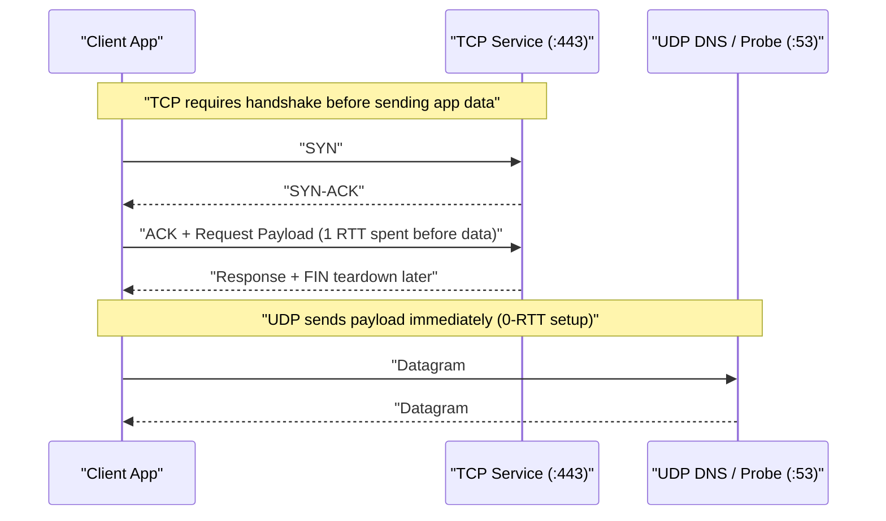
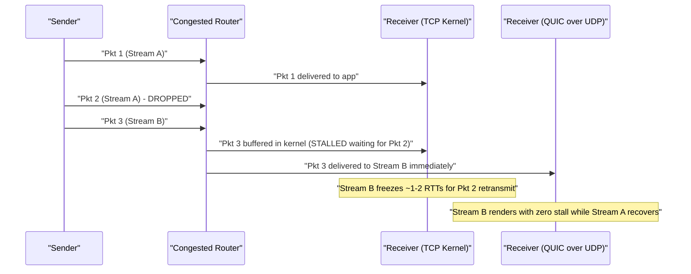
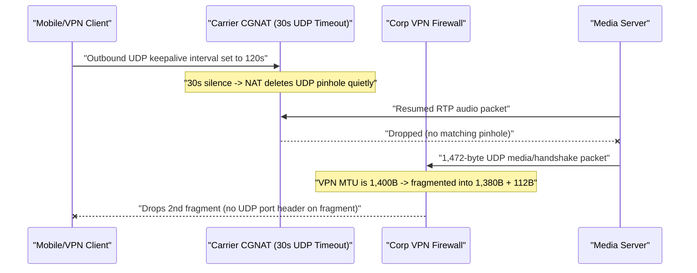

# Lesson 12: UDP vs TCP — When Speed Beats Reliability

> **Prerequisites:** [Lesson 11: TCP Closing, RST, TIME_WAIT and Ports](../11-tcp-closing-time-wait-and-ports/README.md), [Lesson 04: Ports and Sockets](../04-ports-and-sockets/README.md), [Lesson 05: Protocols and Layers](../05-protocols-and-layers/README.md), and [Networking From Zero Overview](../README.md) (Lesson 12 of 30).  
> **Estimated Reading Time:** 26 minutes  
> **Target Audience:** Backend and real-time systems engineers deciding between TCP and UDP, diagnosing QUIC/HTTP/3 path-MTU blackholes, keeping WebRTC NAT pinholes alive, and eliminating transport head-of-line blocking.  
> **Free PDF Notes:** [Download SD-N-012.pdf](https://backendroadmap.com/notes/system-design/SD-N-012.pdf)

> [!NOTE]
> **In one line:** TCP gives you a reliable, ordered stream at the price of a handshake and stalls on loss; UDP sends independent datagrams with an 8-byte header, no setup and no promises, so it wins when late data is worse than lost data (calls, games, DNS) or as the base for protocols such as QUIC that rebuild reliability themselves.

> [!TIP]
> **The Golden Rule of UDP vs. TCP:** TCP delivers a reliable, ordered byte stream at the cost of a handshake, retransmission stalls, and transport **head-of-line blocking**, whereas **UDP** sends independent **datagrams** behind an **`8`-byte header** with zero connection setup and zero guarantees. Pick UDP when **late data is worse than lost data** (voice, video, games), when queries fit in one packet (**DNS**), or when user-space protocols like **QUIC** rebuild reliability per stream—while keeping payloads under **`~1,200` bytes** to avoid IP fragmentation and refreshing **NAT pinholes** every `15–25` seconds.

---

## Words You'll Meet Today

| Word | In Plain Words | Role in a Live Backend System |
| :--- | :--- | :--- |
| **Datagram** | One self-contained packet message with its own start and end. | Unit of UDP delivery; each `recvfrom()` returns one complete message or drops it entirely. |
| **Byte stream** | A continuous river of bytes with no built-in message boundaries. | TCP abstraction requiring application framing (length prefixes or HTTP delimiters). |
| **Head-of-line blocking** | One missing front packet freezes every healthy packet behind it. | TCP pauses delivery of packets `#5, #6, #7` in the kernel buffer until missing `#4` arrives. |
| **Jitter** | How wildly packet arrival times vary from packet to packet. | Destroys VoIP/gaming smoothness even when average latency looks low; buffered via jitter buffers. |
| **Path MTU** | The smallest maximum packet size supported across every router hop. | Usually `1,500 B` on Ethernet, shrinking to `1,400–1,492 B` over VPNs, cellular, or PPPoE links. |
| **IP fragmentation** | Splitting one oversized packet into smaller IP chunks mid-flight. | Disastrous for UDP: losing one fragment discards the entire datagram; firewalls often drop fragments. |
| **NAT pinhole** | Temporary port mapping keeping a home/cloud router open for UDP replies. | Expires quietly after `30–120 s` of silence, requiring periodic keepalive probes. |
| **QUIC** | Modern encrypted, multi-stream transport protocol built atop UDP. | Powers **HTTP/3**, eliminating TCP head-of-line blocking and merging TLS + transport into `1 RTT`. |

---

## Visual Mental Models & Architecture

### The Question: Why Would Anyone Drop Packets on Purpose?

In [lesson 08](../08-tcp-sequence-numbers-and-acks/README.md) through [lesson 11](../11-tcp-closing-time-wait-and-ports/README.md), we saw how hard TCP works so not a single byte goes missing or arrives out of order. So why do Zoom calls, Fortnite, DNS lookups, and HTTP/3 use **UDP**, a protocol that does not check if anything arrived at all? Because sometimes waiting for an old missing packet ruins the whole experience.

### An Everyday Picture First: Tracked Courier vs. Live Radio Postcards

Imagine sending a novel versus calling a live football match. For the novel (a web page or database backup), **TCP** is a tracked courier who collects a signature for every box and refuses to hand box `#5` to the reader until lost box `#4` is found and redelivered. For live radio commentary (**UDP**), if the sentence from second `12` gets buried in static, you do not freeze the broadcast for two seconds to replay second `12`—by the time it arrives, the striker has already scored! You keep broadcasting second `13` right away.

### Connectionless Datagrams vs. Byte Streams (`8` Bytes vs. `20+` Bytes)

A **UDP** header is radically tiny: just **`8` bytes** containing four `16`-bit fields—**Source Port**, **Destination Port**, **Length**, and **Checksum**. There is no sequence number, no acknowledgment number, no receive window, and no `SYN`/`FIN` state machine. A **TCP** header starts at **`20` bytes** (up to `60` bytes with options) purely to manage ordering, flow control, and teardown.

Because UDP is **connectionless**, an application calls `sendto()` and the kernel wraps the message and fires it onto the wire immediately—zero `3`-way handshake (`0 RTT` before payload), zero `TIME_WAIT` port locks afterward. And unlike TCP's unframed byte stream (where two `100`-byte `write()` calls might merge into one `200`-byte `read()`), UDP preserves **message boundaries**: one `sendto()` equals one `recvfrom()`.



*Figure 1. TCP vs. UDP on the wire: TCP spends a full round trip on `SYN`/`SYN-ACK` before carrying payload (or more with TLS), whereas UDP dispatches application data on the very first packet with an `8`-byte header.*

### Transport Head-of-Line Blocking & Why QUIC, WebRTC, and Games Pick UDP

Consider a single TCP connection multiplexing three independent API streams (`Stream A`, `Stream B`, `Stream C`). Suppose Packet `#2` (carrying `Stream A`) gets dropped by a congested router, while Packets `#3` and `#4` (carrying `Stream B` and `Stream C`) arrive cleanly at the receiver's network card. Because TCP sees only one flat byte stream, the OS kernel **must lock Packets `#3` and `#4` in its receive buffer** until Packet `#2` is retransmitted and arrives one or more round trips later. Your `Stream B` UI stalls because `Stream A` dropped a packet—that is **transport-layer head-of-line (HoL) blocking**.

**UDP eliminates kernel HoL blocking** completely because the kernel delivers every arriving datagram straight to the application the instant it lands:

- **VoIP & WebRTC Media:** Real-time audio/video codecs emit a frame every `20 ms`. A human tolerates a brief `20 ms` click from `1%` packet loss far better than a `300 ms` freeze while TCP waits for retransmission. What hurts calls most is **jitter** (irregular arrival spacing), not small loss.
- **Multiplayer Gaming:** Player position updates at `60 Hz` (`~16.6 ms` apart). If packet `#40` is lost, packet `#41` already contains newer coordinates—retransmitting `#40` is wasted bandwidth.
- **DNS Lookups:** Most queries fit in a single `< 150`-byte packet; paying `3`-way TCP handshake + `TIME_WAIT` kernel state on billions of tiny lookups per second would crush resolvers.
- **QUIC / HTTP/3 (`RFC 9000`):** Runs in user space over UDP port `443`. QUIC keeps **loss recovery and encryption**, but tracks stream offsets independently per stream so losing a packet on `Stream A` never blocks `Stream B`, while combining transport + TLS 1.3 into a `1-RTT` (or `0-RTT` resumed) handshake.



*Figure 2. Transport head-of-line blocking: TCP stalls healthy Stream B data inside the kernel receive buffer whenever an earlier Stream A segment drops; QUIC over UDP hands Stream B up immediately.*

### Path MTU, IP Fragmentation Hazards, and NAT Pinhole Timeouts

Choosing UDP means **your application owns packet sizing and connection liveness**:

1. **Path MTU & Fragmentation Hazard:** Standard Ethernet frames carry a **`1,500`-byte MTU**. Subtracting `20` bytes for IPv4 and `8` bytes for UDP leaves **`1,472` bytes** of maximum UDP payload. Over IPv6 (`40`-byte header) or VPN/PPPoE tunnels (`WireGuard`, `IPsec`, `GRE`), path MTU routinely shrinks to **`1,280–1,420` bytes**. If your app sends a `3,000`-byte UDP datagram, IP either drops it (if the **Don't Fragment** `DF` bit is set) or splits it into three IP fragments. In UDP, **fragments are catastrophic**: if just *one* fragment drops, the receiver discards the entire datagram—and many stateful firewalls silently drop non-initial fragments (`offset > 0`) because those fragments lack the UDP port header! That is why QUIC mandates initial packets padded up to **`1,200` bytes** and why healthy UDP services clamp payloads around `1,200` bytes.
2. **NAT Pinhole Timeouts:** Home routers and cloud NAT gateways inspect `SYN` and `FIN` flags to track TCP connections for hours (`3,600–7,440 s` idle). UDP has no `SYN` or `FIN`. A NAT device opens a temporary **pinhole** mapping `(internal_ip, internal_port) <-> (public_ip, nat_port)` on the first outbound UDP packet and deletes it quickly—often after **`30–120` seconds** of silence (`30 s` default on Linux `nf_conntrack_udp_timeout`!). Once that pinhole closes, inbound voice frames or game updates from the server hit a brick wall. Real-time UDP clients therefore send lightweight keepalive probes every **`15–25` seconds**.

---

## Core Definition & Taxonomic Comparison

**What it is:** UDP (RFC 768) is the thinnest possible Layer-4 service: it adds **port multiplexing** and an optional **checksum** on top of IP, and nothing else. TCP (RFC 9293) adds a **connection**, a **reliable ordered byte stream**, **flow control**, and **congestion control**. **What it isn't:** UDP is not "faster bytes"; the bits travel at exactly the same speed. It is *faster to start* and *never stalls on someone else's loss*. And "unreliable" does not mean "lossy": on a healthy LAN UDP delivers nearly everything, it just makes **no promise** and does **no recovery**.

The transport choice is frequently framed as a binary. In practice there are four distinct designs that get conflated:

| Term | Precise Meaning | Production Example |
| :--- | :--- | :--- |
| **TCP (stream)** | Reliable, ordered, flow- and congestion-controlled **byte stream**; no message boundaries; head-of-line blocking across everything multiplexed on it. | PostgreSQL wire protocol, gRPC over HTTP/2, SSH, any REST/TLS API. |
| **Raw UDP (datagram)** | Independent, boundary-preserving messages; no ordering, no retransmit, **no congestion control**; sender must size and pace. | DNS queries, StatsD metrics, syslog, SNMP, NTP, game position ticks. |
| **UDP + app reliability** | App adds sequence numbers, selective ACKs, resend rules *only for what matters*. | Game server: state snapshots unreliable, "purchase" message reliable with ID + ACK (RakNet, ENet, Photon). |
| **QUIC / HTTP/3 (UDP-based)** | Full transport in user space: per-stream ordering/recovery, congestion control, TLS 1.3 handshake merged, connection IDs, `0/1-RTT` setup. | `https://` over `udp/443` at Google, Cloudflare, Meta; the default for modern browsers where supported. |
| **RTP/SRTP (real-time media)** | Timestamped, sequenced media frames over UDP with jitter/loss reporting (RTCP); recovery by concealment, FEC, or NACK for **recent** frames only. | WebRTC audio/video, VoIP, IPTV. |

**Business and human implication:** users judge voice/video/games by **freshness and smoothness**, not completeness. A `20 ms` audio gap is inaudible after loss concealment; a `300 ms` freeze behind a retransmission is a dropped call. Conversely, a bank transfer cannot tolerate a missing byte, so TCP's stall is the *correct* trade.

---

## Component Breakdown & Anatomy: What Each Transport Spends

Per-message cost decomposes into: **setup latency**, **per-packet header bytes**, **recovery delay on loss**, **state held in the kernel**, and **who owns congestion control**.

| Component | UDP | TCP | QUIC (over UDP) |
| :--- | :--- | :--- | :--- |
| **Setup before first payload byte** | `0 RTT` | `1 RTT` (+`1 RTT` TLS 1.3) = `2 RTT` | `1 RTT` (TLS merged), `0 RTT` on resumption |
| **Fixed header** | `8 B` | `20–60 B` | UDP `8 B` + QUIC `~1–25 B` short header + AEAD tag `16 B` |
| **Recovery on one lost packet** | None (app decides) | `≥ 1 RTT` fast retransmit, or `RTO ≥ 200 ms`; **blocks everything behind it** | `≥ 1 RTT`, **blocks only that stream** |
| **Kernel state per flow** | Almost none (socket + optional conntrack) | Full state machine, buffers, `TIME_WAIT` | Socket only (state lives in user space library) |
| **Congestion control** | **None: app must pace** (RFC 8085) | Kernel (`CUBIC`, `BBR`) | Library (`CUBIC`, `BBR`, `NewReno`) |
| **Message framing** | Free (one datagram = one message) | App must add (length prefix, delimiter) | Stream-based, app frames per stream |
| **Encryption** | Optional (DTLS / SRTP / WireGuard) | Optional (TLS) | **Mandatory** (TLS 1.3) |

```text
 REAL-TIME VOICE PATH (UDP/RTP)                                  WHERE MEASURED
  mic ─► codec(20 ms frame) ─► RTP+UDP+IP ─► NAT ─► internet ─► NAT ─► jitter buffer ─► decoder ─► speaker
          encode delay           8+12+20 hdr    pinhole   loss/jitter      40 ms play-out    conceal loss
                                                   ▲            ▲                ▲
                                          conntrack timer   RTCP reports   WebRTC getStats()
```

### The Observability Gap

| Measurement Point | What It Captures | What It Hides |
| :--- | :--- | :--- |
| **Application metrics (`getStats()`, custom counters)** | RTT, jitter, `packetsLost`, concealed samples, NACK/PLI counts | Where in the path the loss occurred (Wi-Fi? NAT? fragment drop?) |
| **Kernel UDP counters (`nstat`, `netstat -su`)** | Datagrams in/out, `RcvbufErrors`, `NoPorts`, checksum errors | Drops *before* the host (NIC, switch, firewall, NAT) |
| **Per-socket stats (`ss -uamp`)** | Rx/Tx queue depth, `skmem`, **per-socket drop counter** | Cross-host loss; it's one socket on one machine |
| **Conntrack (`conntrack -L -p udp`, `-S`)** | Active UDP "pinholes", remaining timeout, insert/drop failures | What the *remote* NAT is doing |
| **ICMP counters** | `Destination Unreachable`, `Fragmentation Needed` | Anything dropped silently without ICMP (most cloud firewalls) |
| **Packet capture** | Exact sizes, fragments, retries | Application intent and playback quality |

Silent failure is UDP's signature: with no `RST`, no `ACK`, and often no ICMP, **absence of data is the only symptom**. That is why UDP services need heartbeats, sequence-gap detection, and read deadlines built in.

---

## Mathematical Model: Overhead, Fragmentation Loss, Jitter, and Keepalives

### 1. Header Efficiency

$$\eta = \frac{P}{P + H_{\text{IP}} + H_{\text{L4}}}, \qquad H_{\text{IP}} = 20\text{ B (IPv4)},\ H_{\text{UDP}} = 8\text{ B},\ H_{\text{TCP}} = 20\text{ B}$$

| Payload `P` | UDP efficiency | TCP efficiency (no options) | Example |
| :--- | :--- | :--- | :--- |
| `20 B` | `41.7%` | `33.3%` | Tiny game input event |
| `100 B` | `78.1%` | `71.4%` | DNS-size / telemetry sample |
| `160 B` | `85.1%` | `80.0%` | G.711 voice frame (20 ms) |
| `1,200 B` | `97.7%` | `96.8%` | QUIC-safe datagram |
| `1,472 B` | `98.1%` | `97.4%` | Max unfragmented Ethernet UDP |

At small payload sizes the bulk of the bytes are headers regardless of transport: UDP's win is **latency and state**, not bandwidth. A G.711 voice stream at `50 pps` carries `160 + 12 (RTP) + 8 + 20 = 200 B` per packet = `80 kbit/s` on the wire for `64 kbit/s` of codec payload.

### 2. IP Fragmentation Turns Loss Multiplicative

A UDP datagram of `S` bytes over path MTU `1,500` splits into $k = \lceil (S + 8) / 1{,}480 \rceil$ IP fragments (`1,480 B` of data per fragment, after the 20 B IP header). The datagram arrives only if **all** fragments do:

$$P_{\text{deliver}} = (1 - p)^{k} \quad\Rightarrow\quad P_{\text{loss}} = 1 - (1 - p)^{k}$$

| Datagram `S` | Fragments `k` | Loss at `p=1%` | Loss at `p=2%` | Loss at `p=5%` |
| :--- | :--- | :--- | :--- | :--- |
| `500 B` | `1` | `1.0%` | `2.0%` | `5.0%` |
| `1,472 B` | `1` | `1.0%` | `2.0%` | `5.0%` |
| `1,473 B` | `2` | `2.0%` | `4.0%` | `9.8%` |
| `3,000 B` | `3` | `3.0%` | `5.9%` | `14.3%` |
| `6,144 B` | `5` | `4.9%` | `9.6%` | `22.6%` |
| `65,507 B` (max) | `45` | `36.4%` | `59.7%` | `90.1%` |

And if any firewall drops non-first fragments (they carry no UDP ports), loss is `100%` regardless of `p`.

### 3. Path MTU Payload Budget

$$\text{Payload}_{\max} = \text{MTU}_{\text{path}} - H_{\text{IP}} - 8$$

| Path | MTU | Max UDP payload (IPv4) | Max (IPv6, `40 B` header) |
| :--- | :--- | :--- | :--- |
| Ethernet | `1,500` | `1,472` | `1,452` |
| PPPoE | `1,492` | `1,464` | `1,444` |
| WireGuard (typ.) | `1,420` | `1,392` | `1,372` |
| IPv6 minimum link | `1,280` | `1,252` | `1,232` |
| **Safe everywhere** | : | **`1,200`** | **`1,200`** |

### 4. Jitter, Playout Buffer, and What Loss Costs

RFC 3550 smoothed jitter: $J_i = J_{i-1} + (|D_{i-1,i}| - J_{i-1})/16$. A usable **jitter buffer** is roughly `2–4 × J` (a `10 ms` jitter wants a `20–40 ms` buffer), added to mouth-to-ear delay. ITU guidance targets `< 150 ms` one-way for natural conversation.

**Voice, `20 ms` frames, `150 ms` RTT, `1%` loss (from the PDF's worked example):**

| Metric | TCP | UDP |
| :--- | :--- | :--- |
| Packets per second | `50` | `50` |
| Losses per second at `1%` | `0.5` (one every `2 s`) | `0.5` |
| Effect of one loss | Stall `≥ 1 RTT + detection ≈ 150–300 ms`, then a burst of stale audio | A `20 ms` gap, concealed by the decoder |
| Fraction of time frozen (lower bound) | `150 ms ÷ 2 s ≈ 7.5%` or more | `≈ 1%` of audio *concealed*, `0%` frozen |

### 5. NAT Pinhole Keepalive Rule

If the shortest NAT idle timeout on the path is $T_{\text{nat}}$ and you want to survive one lost probe, send keepalives at:

$$\Delta_{\text{keepalive}} \le \frac{T_{\text{nat}}}{2}$$

| Weakest UDP timeout | Safe keepalive | Where you meet it |
| :--- | :--- | :--- |
| `30 s` | `≤ 15 s` | Linux `nf_conntrack_udp_timeout`, many CGNATs |
| `60 s` | `≤ 25–30 s` | Many home routers |
| `120 s` | `≤ 60 s` | Linux "stream" UDP timeout once bidirectional |

WireGuard's `PersistentKeepalive = 25` and WebRTC consent freshness (`~5 s` checks, RFC 7675) follow exactly this rule.

---

---

## Systematic Reference & Comparison Grid

### UDP vs. TCP Wire & Behavioral Matrix

| Dimension | UDP (`RFC 768`) | TCP (`RFC 9293`) | Production Engineering Impact |
| :--- | :--- | :--- | :--- |
| **Header Overhead** | **`8` bytes** fixed | **`20` bytes** min (`60 B` with options) | UDP leaves `12+` extra bytes per packet and skips option parsing |
| **Handshake / Setup** | **`0 RTT`** (connectionless) | **`1 RTT`** (`SYN`, `SYN-ACK`, `ACK`) | Cuts latency for single-packet DNS and short telemetry bursts |
| **Data Model** | Preserved **datagrams** | Unframed **byte stream** | UDP never merges two `send()` calls; TCP requires app framing |
| **Ordering & Loss** | None (unordered, best-effort) | Sequence numbers, `ACK`s, retransmit | App adds sequence numbers if needed (e.g., RTP, QUIC, RakNet) |
| **Head-of-Line Blocking** | **None** in transport | **Severe** across multiplexed streams | QUIC over UDP isolates packet loss to the affected stream only |
| **Congestion Control** | **None** built-in (app must add) | Built-in (`CUBIC`, `BBR`) | Unthrottled UDP floods can collapse shared networks (RFC 8085) |
| **Teardown / `TIME_WAIT`** | None (`0 s` state release) | `FIN`/`ACK` + `60 s` `TIME_WAIT` | Busy UDP DNS servers avoid `TIME_WAIT` port exhaustion |
| **NAT Pinhole Idle TTL** | **`30–120 s`** typical | **`1–2 hours`** established | UDP apps must heartbeat every `15–25 s` across NATs |

### Header Structure & Path MTU Payload Math

| Protocol Header | Exact Fixed Fields (`Bytes`) | Typical Payload Budget Over `1,500 B` Ethernet | Conservative Internet-Safe Limit |
| :--- | :--- | :--- | :--- |
| **UDP (`8 B`)** | Src Port (`2`) + Dst Port (`2`) + Length (`2`) + Checksum (`2`) | `1,472 B` (IPv4) / `1,452 B` (IPv6) | **`1,200–1,232 B`** (avoids IPv6 min MTU & VPN fragments) |
| **TCP (`20 B`)** | Ports (`4`) + Seq (`4`) + Ack (`4`) + Offset/Flags (`2`) + Win (`2`) + Sum/Urg (`4`) | `1,460 B` (IPv4 `MSS`) / `1,440 B` (IPv6 `MSS`) | Auto-negotiated via **`MSS`** option in `SYN` |

The maximum unfragmented UDP application payload across any IPv4 path is:

$$
\text{Max UDP Payload}_{\text{IPv4}} = \text{Path MTU} - 20\text{ B (IPv4)} - 8\text{ B (UDP)}
$$

For example, across standard Ethernet ($\text{MTU} = 1{,}500$), $1{,}500 - 20 - 8 = 1{,}472\text{ bytes}$; across a WireGuard tunnel ($\text{MTU} = 1{,}420$), $1{,}420 - 20 - 8 = 1{,}392\text{ bytes}$; and across IPv6's guaranteed minimum path ($\text{MTU} = 1{,}280$), $1{,}280 - 40 - 8 = 1{,}232\text{ bytes}$.

### Protocol Selection Matrix

| Workload | Recommended Transport | Why |
| :--- | :--- | :--- |
| **DNS Resolution** | **UDP** (`53`), TCP fallback | Single-packet lookup fits in `< 512 B`; `TC=1` triggers TCP for big answers |
| **VoIP / WebRTC Audio-Video** | **UDP** (`RTP`/`SRTP` over ICE) | `20 ms` frames expire fast; jitter buffers + FEC beat stalling for retransmits |
| **Fast-Paced Multiplayer State** | **UDP** + custom reliability | Newer world snapshots supersede lost ticks; keeps player inputs snappy |
| **HTTP/3 Web APIs** | **UDP** via **QUIC** | Zero HoL blocking across concurrent HTTP streams + `0-RTT`/`1-RTT` handshake |
| **REST, gRPC (HTTP/2), SQL** | **TCP** (TLS) | Every byte of JSON/SQL matters; kernel `BBR`/`CUBIC` + checksums handle flow |

---

## Observability: UDP Metrics, Alerts, and Dashboards

Because UDP never complains, you must **instrument its silence**. Build three layers: kernel counters (is the host dropping?), application sequence/jitter statistics (is the path dropping?), and NAT/firewall state (is the middlebox dropping?).

| Signal | Source | Healthy | Alert When | Meaning |
| :--- | :--- | :--- | :--- | :--- |
| `UdpRcvbufErrors` | `nstat -az UdpRcvbufErrors`, `netstat -su` | `0` | Any steady increase | Receiver socket buffer full: app too slow or `rmem_max` too small |
| `UdpSndbufErrors` | `nstat` | `0` | Any increase | Sender outpacing the NIC/qdisc |
| `UdpInErrors` / `UdpInCsumErrors` | `nstat` | `~0` | Rising | Corruption, bad NIC offload, truncated fragments |
| `UdpNoPorts` | `nstat` | Low | Spikes | Traffic to a port with no listener (scan, bug, mis-routed) |
| Per-socket drops | `ss -uamp` (`skmem:(...d<N>)`), `/proc/net/udp` `drops` column | `0` | Growing | Which process is losing datagrams |
| `nf_conntrack_count / max` | `sysctl`, `conntrack -C` | `< 70%` | `> 85%` | UDP flood or NAT table exhaustion (DNS-heavy nodes) |
| Sequence-gap loss % | App (RTP seq, QUIC packet numbers) | `< 1%` | `> 2–3%` for 1 min | Real path loss |
| Jitter (RFC 3550) | App / RTCP / `getStats().jitter` | `< 30 ms` | `> 50 ms` | Bufferbloat, wireless contention, route flaps |
| `packetsLost`, `concealedSamples`, `nackCount`, `pliCount` | WebRTC `getStats()` | Low | Rising in step | Media quality degradation before users complain |
| ICMP `Frag Needed` / `Dest Unreachable` | `nstat IcmpInDestUnreachs` | Rare | Bursts | PMTU black hole or closed ports |
| One-way "silent after N s" events | App heartbeat timers | `0` | Any cluster at `30–60 s` | NAT pinhole expiry |

**Dashboards**
1. *Quality funnel:* sent → received → in-order → played, per region, with loss/jitter percentiles (`p50/p95/p99`, never the mean).
2. *Packet-size histogram:* share of datagrams `> 1,200 B`; anything above `1,472 B` is a fragmentation risk and should page the owning team.
3. *Silence detector:* calls/sessions with no inbound packets for `> 2 × keepalive` interval; segment by carrier ASN to find a short-timeout CGNAT.
4. *Receive-buffer pressure:* `RcvbufErrors` rate vs. `Recv-Q`, overlaid with GC pauses/CPU throttling of the consumer.

**Runbook decision tree**
1. *Works small, fails large* → MTU/fragmentation: `ping -M do -s <n>`, clamp to `1,200`.
2. *Dies after 30–60 s of quiet* → NAT pinhole: shorten keepalive; check `conntrack` timeouts.
3. *Intermittent loss only under load* → `RcvbufErrors`: raise `net.core.rmem_max`, batch with `recvmmsg`, add consumers with `SO_REUSEPORT`.
4. *Total silence, no errors anywhere* → firewall/security group (UDP is separate from TCP rules!), then ICMP.

---

## Production War Story Post-Mortem: VPN Fragmentation Blackhole & 35-Second WebRTC Mute

- **Severity:** SEV-2 (`18%` of enterprise voice calls muted silently after ~35 seconds or failing completely behind VPNs)
- **Detection / Resolution Time:** 42 minutes to mitigate via MTU clamp and heartbeat interval deploy
- **Impact:** Corporate users on WireGuard/IPsec VPNs (`1,400 B` path MTU) failed to establish WebRTC media/signaling, while cellular callers experienced silent one-way audio drops exactly `30–40 s` into quiet hold periods.

### What Happened



*Figure 3. Post-mortem timeline: oversized `1,472`-byte UDP datagrams triggered firewall fragment drops over a `1,400`-byte VPN tunnel, while `120`-second keepalives allowed `30`-second carrier NAT pinholes to expire.*

### Root Cause Analysis

1. **Hardcoded `1,472`-Byte Payloads:** Developers subtracted `28` from `1,500` Ethernet MTU, forgetting that corporate VPN tunnels prepend `60–80` bytes of encapsulation overhead (`effective MTU = 1,400–1,420 B`). Either routers with `DF=1` dropped the packets silently (no ICMP reachable through firewall), or fragmented UDP packets hit firewall policies that reject non-initial fragments lacking Layer-4 ports.
2. **Keepalive Slower Than CGNAT Expiry:** The client sent STUN/ICE keepalives every `120 s`, far longer than mobile carrier CGNAT `30 s` UDP idle timers—causing servers to lose return routing during muted speech intervals.

### The Fix & Architectural Hardening

- **Safe Payload Cap (`1,200 B`) + DPLPMTUD (`RFC 8899`):** Capped application UDP datagrams at `1,200` bytes by default and enabled packetization-layer path MTU discovery so oversized frames never rely on IP fragmentation.
- **Aggressive `20`-Second NAT Keepalives:** Dropped ICE/STUN consent freshness probes from `120 s` to `20 s` (under the `30 s` Linux/CGNAT baseline) with jittered intervals.
- **TCP/TLS `443` TURN Fallback:** Configured ICE candidates to fall back automatically to TURN-over-TLS (`TCP 443`) if UDP probes receive zero replies within `1.5 s`.

---

## Multi-Language Production Implementation

Below is a production-structured **UDP Datagram Probe — RTT, Packet Loss & Sequence-Gap Jitter Tracker** across Go, TypeScript, Python, and C#. Every probe caps payloads safely well under `1,200` bytes, enforces strict read deadlines (remember: UDP has no `RST` if a remote port is firewalled!), detects out-of-order/dropped sequence numbers, and computes RFC 3550 smoothed inter-arrival **jitter**:

$$
J_i = J_{i-1} + \frac{|D(i-1, i)| - J_{i-1}}{16}, \qquad D(i-1,i) = |\text{RTT}_i - \text{RTT}_{i-1}|
$$

````carousel
```go
package udpprobe

import (
	"encoding/binary"
	"math"
	"net"
	"time"
)

const MaxSafePayload = 1200 // Safe below IPv6/VPN/QUIC path MTU

type ProbeStats struct {
	Sent, Received, Lost, OutOfOrder int
	JitterMs, AvgRttMs               float64
}

func RunUDPProbe(addr string, count int, timeout time.Duration) (ProbeStats, error) {
	conn, err := net.DialTimeout("udp", addr, timeout)
	if err != nil {
		return ProbeStats{}, err
	}
	defer conn.Close()

	var stats ProbeStats
	var prevRttMs, totalRttMs float64
	highestSeq := -1
	buf, rx := make([]byte, 12), make([]byte, MaxSafePayload)

	for seq := 0; seq < count; seq++ {
		stats.Sent++
		t0 := time.Now()
		binary.BigEndian.PutUint32(buf[0:4], uint32(seq))
		binary.BigEndian.PutUint64(buf[4:12], uint64(t0.UnixNano()))
		if _, err := conn.Write(buf); err != nil {
			stats.Lost++
			continue
		}
		_ = conn.SetReadDeadline(time.Now().Add(timeout))
		n, err := conn.Read(rx)
		if err != nil || n < 12 {
			stats.Lost++
			continue
		}
		rttMs := float64(time.Since(t0).Microseconds()) / 1000.0
		gotSeq := int(binary.BigEndian.Uint32(rx[0:4]))
		if gotSeq < highestSeq {
			stats.OutOfOrder++
		} else {
			highestSeq = gotSeq
		}
		if stats.Received > 0 {
			stats.JitterMs += (math.Abs(rttMs-prevRttMs) - stats.JitterMs) / 16.0 // RFC 3550 EWMA jitter
		}
		prevRttMs, totalRttMs = rttMs, totalRttMs+rttMs
		stats.Received++
	}
	if stats.Received > 0 {
		stats.AvgRttMs = totalRttMs / float64(stats.Received)
	}
	return stats, nil
}
```
<!-- slide -->
```typescript
import dgram from "node:dgram";

const MAX_SAFE_PAYLOAD = 1200;

export interface ProbeStats {
  sent: number; received: number; lost: number; outOfOrder: number;
  jitterMs: number; avgRttMs: number;
}

export async function runUdpProbe(host: string, port: number, count = 10, timeoutMs = 400): Promise<ProbeStats> {
  const socket = dgram.createSocket("udp4");
  const stats: ProbeStats = { sent: 0, received: 0, lost: 0, outOfOrder: 0, jitterMs: 0, avgRttMs: 0 };
  let prevRtt = 0, totalRtt = 0, highestSeq = -1;

  const sendOne = (seq: number): Promise<void> => new Promise((resolve) => {
    const payload = Buffer.alloc(12); // << 1,200 B MTU ceiling
    payload.writeUInt32BE(seq, 0);
    const t0 = process.hrtime.bigint();
    let settled = false;
    const done = () => { socket.removeListener("message", onMsg); resolve(); };
    const timer = setTimeout(() => { if (!settled) { settled = true; stats.lost++; done(); } }, timeoutMs);

    const onMsg = (msg: Buffer) => {
      if (settled || msg.length < 4 || msg.length > MAX_SAFE_PAYLOAD || msg.readUInt32BE(0) !== seq) return;
      settled = true;
      clearTimeout(timer);
      const rttMs = Number(process.hrtime.bigint() - t0) / 1_000_000;
      if (seq < highestSeq) stats.outOfOrder++;
      else highestSeq = seq;
      if (stats.received > 0) stats.jitterMs += (Math.abs(rttMs - prevRtt) - stats.jitterMs) / 16;
      prevRtt = rttMs;
      totalRtt += rttMs;
      stats.received++;
      done();
    };
    socket.on("message", onMsg);
    stats.sent++;
    socket.send(payload, port, host);
  });

  try {
    for (let i = 0; i < count; i++) await sendOne(i);
    if (stats.received > 0) stats.avgRttMs = totalRtt / stats.received;
    return stats;
  } finally {
    socket.close();
  }
}
```
<!-- slide -->
```python
from dataclasses import dataclass
import socket, struct, time

MAX_SAFE_UDP_BYTES = 1200  # Avoid IP fragmentation over VPNs/IPv6

@dataclass
class ProbeStats:
    sent: int = 0
    received: int = 0
    lost: int = 0
    out_of_order: int = 0
    jitter_ms: float = 0.0
    avg_rtt_ms: float = 0.0

def run_udp_probe(host: str, port: int, count: int = 10, timeout_s: float = 0.4) -> ProbeStats:
    stats, prev_rtt, total_rtt, highest_seq = ProbeStats(), 0.0, 0.0, -1
    with socket.socket(socket.AF_INET, socket.SOCK_DGRAM) as sock:
        sock.settimeout(timeout_s)
        sock.connect((host, port))
        for seq in range(count):
            stats.sent += 1
            t0 = time.perf_counter_ns()
            sock.sendall(struct.pack("!IQ", seq, t0))  # 12 bytes << 1,200 B limit
            try:
                data = sock.recv(MAX_SAFE_UDP_BYTES)
                rtt_ms = (time.perf_counter_ns() - t0) / 1_000_000.0
                (got_seq,) = struct.unpack("!I", data[:4])
                if got_seq < highest_seq:
                    stats.out_of_order += 1
                else:
                    highest_seq = got_seq
                if stats.received > 0:
                    stats.jitter_ms += (abs(rtt_ms - prev_rtt) - stats.jitter_ms) / 16.0
                prev_rtt, total_rtt = rtt_ms, total_rtt + rtt_ms
                stats.received += 1
            except (TimeoutError, OSError):
                stats.lost += 1
    if stats.received > 0:
        stats.avg_rtt_ms = total_rtt / stats.received
    return stats
```
<!-- slide -->
```csharp
using System;
using System.Buffers.Binary;
using System.Diagnostics;
using System.Net.Sockets;
using System.Threading;
using System.Threading.Tasks;

public sealed record UdpProbeStats(
    int Sent, int Received, int Lost, int OutOfOrder, double JitterMs, double AvgRttMs);

public static class UdpProbeRunner
{
    private const int MaxSafePayload = 1200;

    public static async Task<UdpProbeStats> RunAsync(string host, int port, int count = 10, int timeoutMs = 400)
    {
        using var client = new UdpClient(host, port);
        int sent = 0, received = 0, lost = 0, outOfOrder = 0, highestSeq = -1;
        double jitterMs = 0, prevRtt = 0, totalRtt = 0;
        byte[] payload = new byte[12]; // << 1,200 B fragmentation boundary

        for (int seq = 0; seq < count; seq++)
        {
            sent++;
            BinaryPrimitives.WriteUInt32BigEndian(payload.AsSpan(0, 4), (uint)seq);
            long t0 = Stopwatch.GetTimestamp();
            await client.SendAsync(payload);

            using var cts = new CancellationTokenSource(timeoutMs);
            try
            {
                UdpReceiveResult res = await client.ReceiveAsync(cts.Token);
                if (res.Buffer.Length < 4 || res.Buffer.Length > MaxSafePayload) { lost++; continue; }
                double rttMs = Stopwatch.GetElapsedTime(t0).TotalMilliseconds;
                int gotSeq = (int)BinaryPrimitives.ReadUInt32BigEndian(res.Buffer.AsSpan(0, 4));
                if (gotSeq < highestSeq) outOfOrder++;
                else highestSeq = gotSeq;
                if (received > 0) jitterMs += (Math.Abs(rttMs - prevRtt) - jitterMs) / 16.0;
                prevRtt = rttMs;
                totalRtt += rttMs;
                received++;
            }
            catch (OperationCanceledException) { lost++; }
        }
        return new UdpProbeStats(sent, received, lost, outOfOrder, jitterMs,
            received > 0 ? totalRtt / received : 0);
    }
}
```
````

---

## Practical Hands-On Verification CLI Workflows

### 1. Discover Path MTU and Watch Fragmentation Limits Live

```bash
ping -M do -c 2 -s 1472 1.1.1.1 && ping -M do -c 1 -s 1473 1.1.1.1
```

**Expected Output:**

```text
64 bytes from 1.1.1.1: icmp_seq=1 ttl=57 time=11.4 ms
ping: local error: message too long, mtu=1500
```

Passing `-M do` sets the IP **Don't Fragment (`DF`)** bit. Adding `20` bytes IPv4 + `8` bytes ICMP (`1472 + 28 = 1500`) succeeds cleanly; adding one more byte (`1473`) immediately breaches the `1,500`-byte MTU!

### 2. Inspect Active UDP Sockets and Kernel Buffers

```bash
ss -uanp
```

**Expected Output:**

```text
State   Recv-Q  Send-Q  Local Address:Port   Peer Address:Port  Process
UNCONN  0       0       127.0.0.53%lo:53     0.0.0.0:*          users:(("systemd-resolve",pid=812,fd=13))
ESTAB   0       0       10.0.1.8:51820       198.51.100.4:51820 users:(("wireguard",pid=1104,fd=7))
```

Notice `UNCONN`—unlike TCP's `LISTEN`/`TIME-WAIT`/`CLOSE-WAIT` states, UDP sockets need no handshake state machine (`ESTAB` only appears if the app explicitly calls `connect()` to filter a single peer).

### 3. Check Linux Kernel UDP NAT Conntrack Pinhole Timeouts

```bash
sysctl net.netfilter.nf_conntrack_udp_timeout net.netfilter.nf_conntrack_udp_timeout_stream
```

**Expected Output:**

```text
net.netfilter.nf_conntrack_udp_timeout = 30
net.netfilter.nf_conntrack_udp_timeout_stream = 120
```

An idle single-direction UDP pinhole vanishes in just **`30` seconds** (compared to `432,000 s` for established TCP in `nf_conntrack_tcp_timeout_established`)!

---

## Pause and Think

> [!exercise] A telemetry service sends `3,000`-byte JSON events inside single UDP datagrams over an internet path with a `1,500`-byte MTU and `2%` per-packet drop rate. Assuming IP fragmentation is allowed, what actually arrives—and roughly what percentage of events are lost completely? Decide before opening the answer.

<details><summary>Answer</summary>

Each `3,000`-byte UDP datagram + `28`-byte IP/UDP header (`3,028` bytes total) splits into **3 IP fragments**. Because UDP delivers *whole* datagrams only, losing **any one** of the three fragments throws away all `3,000` bytes! The probability all three survive is $(1 - 0.02)^3 \approx 0.941$, meaning **$\approx 5.9\%$** event loss—nearly **triple** the physical link's `2%` loss rate—and any firewall blocking non-initial fragments makes loss **100%**. Shrink events below `1,200` bytes instead.

</details>

---

## Operational Validation Checkpoints

<details><summary><strong>Checkpoint 1: Exact Payload Ceiling Over a PPPoE + WireGuard Path</strong></summary>

**Scenario:** Your home ISP uses PPPoE (`8`-byte header -> `1,492 B` MTU), and inside it your laptop runs WireGuard (`60–80`-byte overhead -> `1,412 B` tunnel MTU). What is the maximum IPv4 UDP application payload you can send without fragmentation?  
**Solution:** Take the effective tunnel MTU (`1,412 B`) and subtract `20` bytes IPv4 + `8` bytes UDP = **`1,384` bytes** (or `1,364` bytes over IPv6). Staying at **`1,200` bytes** preserves comfortable headroom even if another intermediate tunnel is encountered.

</details>

<details><summary><strong>Checkpoint 2: Why "TCP Inside TCP" Causes Meltdown in VPNs</strong></summary>

**Scenario:** An older corporate VPN runs user TCP sessions tunneled inside an outer *TCP* connection instead of UDP. During brief `3%` Wi-Fi packet loss, throughput collapses completely for seconds at a time. Why?  
**Solution:** **TCP meltdown:** Both inner and outer TCP run independent congestion control and retransmission timers. When one packet drops on Wi-Fi, the outer TCP stalls to retransmit it (HoL blocking), inflating inner RTT so sharply that the inner TCP assumes loss too and retransmits duplicates *into* the already congested outer TCP stream—causing cascading backoff and duplicate traffic. Tunneling over **UDP** avoids outer retransmission/HoL interference completely.

</details>

<details><summary><strong>Checkpoint 3: Detecting Silent UDP Drops vs. Closed Ports</strong></summary>

**Scenario:** Calling a closed TCP port returns `ECONNREFUSED` almost immediately via `RST`. When your UDP probe calls a firewalled remote port, why does it hang until `timeout` expires instead of returning an error right away?  
**Solution:** UDP has no `SYN`/`RST` handshake. A closed non-firewalled host *may* return an `ICMP Port Unreachable` packet (which only surfaces if your UDP socket is `connect()`ed), but stateful cloud firewalls silently drop unauthorized packets without sending ICMP—so without an explicit application read deadline (`SetReadDeadline`), `recvfrom()` blocks forever!

</details>

---

## Common Mistakes & Troubleshooting

### What Goes Wrong

- **Sending multi-kilobyte UDP blobs:** Crossing `1,200–1,472` bytes invites IP fragmentation and multi-fold packet loss amplification.
- **No application congestion control:** Flooding `100 Mbps` over UDP without pacing starves TCP peers and collapses your own buffers (`RFC 8085`).
- **Missing read timeouts:** Waiting on `recvfrom()` without a socket deadline hangs worker threads indefinitely when packets vanish.

### Common Myths

- **"UDP is always faster than TCP."** For bulk multi-megabyte file downloads over reliable links, TCP with hardware `TSO`/`GRO` offloading and `BBR` saturates `10 Gbps` easily; UDP only beats TCP on startup latency (`0-RTT`), real-time freshness, or multi-stream HoL isolation.
- **"UDP has no error checking."** UDP does carry a `16`-bit checksum covering the header and payload (mandatory in IPv6); it simply **discards** corrupted packets quietly instead of requesting retransmission.

### Troubleshooting Matrix

| Symptom / Failure | Network Evidence | Root Cause | Fix |
| :--- | :--- | :--- | :--- |
| Large UDP messages vanish | Small pings pass; `> 1,400 B` fails | IP fragmentation or `DF=1` blackhole | Clamp app datagrams to `<= 1,200 B` + DPLPMTUD |
| Voice/stream dies after `30–60 s` | Works initially, then 1-way silence | NAT pinhole expired (`nf_conntrack`) | Send `15–25 s` keepalives on UDP socket |
| High `RcvbufErrors` in `netstat -su` | Kernel dropping intact UDP packets | App reads too slowly; tiny `rmem_max` | Batch reads (`recvmmsg`) & raise `net.core.rmem_max` |

---

## Recap in Three Lines

1. **UDP** strips networking down to an **`8`-byte** connectionless datagram header with zero handshake, zero retransmission, and zero head-of-line blocking.
2. Real-time audio, games, DNS, and **QUIC/HTTP/3** choose UDP because stale retransmits or kernel stream stalls hurt worse than isolated packet loss.
3. With UDP, your application owns sizing (**`<= 1,200 B`** under Path MTU), timeouts, congestion pacing, and **`15–25 s`** NAT pinhole keepalives.

---

## Interview Practice Questions

Each question is tagged by kind: **Basic** (definitions), **Scenario** (apply it to a system), and **Tricky** (deep follow-ups). Answer out loud before opening the solution.

### Basic Conceptual Questions (Q1–Q4)

<details>
<summary><strong>Q1: When would you choose UDP over TCP? [BASIC]</strong></summary>

<strong>What a strong answer covers:</strong>
When **low latency and freshness matter more than completeness**: voice, video, live games, and sensor streams where a late packet is worthless. For tiny request/response exchanges like DNS, where one packet each way is enough and a handshake would triple the cost. Or as the substrate for a protocol such as **QUIC** or WireGuard that adds exactly the reliability, ordering, and congestion control it needs. Otherwise (APIs, databases, file transfer) choose TCP and let the kernel do the hard work.

</details>

<details>
<summary><strong>Q2: What does UDP give up compared with TCP, and what does it gain? [BASIC]</strong></summary>

<strong>What a strong answer covers:</strong>
It gives up the handshake, ACKs, retransmission, ordering, duplicate suppression, flow control, and congestion control. It gains an `8`-byte header (vs `20+`), `0-RTT` setup, **no head-of-line blocking**, **message boundaries** (one `sendto` = one `recvfrom`), no `TIME_WAIT`, and multicast/broadcast capability. The bytes travel at the same speed: UDP is faster to *start* and never stalls on loss, not faster in raw bandwidth.

</details>

<details>
<summary><strong>Q3: How does an online game handle lost UDP packets? [BASIC]</strong></summary>

<strong>What a strong answer covers:</strong>
It sends frequent, self-contained **state snapshots** (`20–128 Hz`), so the next update supersedes a lost one: retransmitting packet `#40` when `#41` already has newer positions wastes bandwidth. The client **predicts and interpolates** between updates. Only critical events (purchases, chat, match results) get **application-level ACKs and resends** with message IDs so duplicates are dropped. Many engines run two logical channels: unreliable-sequenced for state, reliable-ordered for events.

</details>

<details>
<summary><strong>Q4: Does UDP have any error detection at all? [BASIC]</strong></summary>

<strong>What a strong answer covers:</strong>
Yes: a `16`-bit **checksum** over the pseudo-IP header, UDP header, and payload. It is optional in IPv4 (zero means "not computed") and **mandatory in IPv6**. A packet failing the checksum is **silently discarded**, with no retransmission request. That detects corruption but gives no delivery guarantee, so higher-level protocols (RTP, QUIC) add their own integrity, usually via authenticated encryption.

</details>

### Scenario-Based Architecture Questions (Q5–Q8)

<details>
<summary><strong>Q5: You are designing a video-calling service. TCP or UDP for the media, and what about signalling? [SCENARIO]</strong></summary>

<strong>What a strong answer covers:</strong>
**Media over UDP** (RTP/SRTP via WebRTC) with a jitter buffer (`40–100 ms`), loss concealment, FEC/NACK for recent frames, adaptive bitrate (congestion control such as GCC/transport-cc), and keepalive/consent checks. **Signalling** (join, leave, SDP offers, chat) over a reliable channel, typically **WebSocket over TCP/TLS**. Use **ICE with STUN/TURN**: direct UDP if possible, **TURN over UDP**, finally **TURN over TLS/TCP 443** only when UDP is blocked (accepting head-of-line stalls as a last resort).

</details>

<details>
<summary><strong>Q6: Your service pushes `10,000` metrics per second to a collector. Would UDP be OK? [SCENARIO]</strong></summary>

<strong>What a strong answer covers:</strong>
Yes for *operational* metrics: StatsD/DogStatsD do exactly this. Fire-and-forget means a slow or dead collector can never block the request path, there is no per-connection state, and losing `0.1%` of samples barely moves an aggregate. Caveats: batch multiple metrics per datagram up to `~1,200 B` (fewer syscalls, no fragmentation), prefer a local agent over loopback (near-zero loss), and monitor `RcvbufErrors`. For **billing-grade** counts or audit events use TCP, a queue, or an acknowledged protocol.

</details>

<details>
<summary><strong>Q7: Why does DNS use UDP, and when does it switch to TCP? [SCENARIO]</strong></summary>

<strong>What a strong answer covers:</strong>
A query and its answer usually fit in one packet each, so UDP avoids a handshake (`3×` fewer packets) and gives resolvers stateless handling of millions of queries per second. If the response exceeds the advertised UDP size (`512 B` classic, `~1,232 B` with EDNS0), the server sets the **`TC` (truncated) bit** and the client retries over **TCP port 53**. TCP is also used for zone transfers (AXFR/IXFR) and DNS over TLS. A firewall that blocks `TCP/53` breaks large answers (DNSSEC, many records).

</details>

<details>
<summary><strong>Q8: A client sends one 6 KB UDP datagram and it often never arrives, while 1 KB datagrams do. Why? [SCENARIO]</strong></summary>

<strong>What a strong answer covers:</strong>
`6 KB` exceeds the `1,500 B` MTU, so IP fragments it into about **5 pieces**; the datagram is delivered only if *all* fragments arrive: at `2%` per-packet loss that is `1 − 0.98⁵ ≈ 9.6%` loss, versus `2%` for a single packet. Worse, many firewalls and cloud NATs drop non-first fragments (no UDP header), and with `DF` set, a smaller-MTU hop drops the packet entirely. Fix: cap payloads at `~1,200 B`, split application messages yourself, or use QUIC/TCP.

</details>

### Advanced & Tricky Interview Questions (Q9–Q12)

<details>
<summary><strong>Q9: If UDP is unreliable, why is HTTP/3 built on it? [TRICKY]</strong></summary>

<strong>What a strong answer covers:</strong>
QUIC supplies reliability, congestion control, and TLS 1.3 **on top of** UDP, but tracks **each stream separately**, so a loss on one stream does not stall others (no transport head-of-line blocking). It merges the transport and TLS handshakes into `1 RTT` (`0 RTT` on resumption), supports **connection migration** via connection IDs (Wi-Fi → LTE without re-handshaking), and runs in **user space**, so it can evolve and deploy without OS kernel updates or middlebox ossification (middleboxes can't see or tamper with encrypted headers). UDP is chosen because it is the one transport that passes almost every NAT and firewall.

</details>

<details>
<summary><strong>Q10: Why do WireGuard and WebRTC clients send tiny keepalives every `15–25` seconds? [TRICKY]</strong></summary>

<strong>What a strong answer covers:</strong>
UDP has no `SYN`/`FIN`, so NATs and stateful firewalls track "connections" purely by recent traffic and delete the mapping after an idle timeout (`30–120 s`; Linux conntrack default `30 s` for one-way UDP). Once the **pinhole** closes, inbound packets from the peer have no mapping and are dropped. A keepalive at `≤ T_nat / 2` (e.g., `25 s` for a `60 s` timer) refreshes it. Set it below the *shortest* timeout on the path (often a carrier CGNAT), add jitter to avoid synchronization, and note the battery/radio cost on mobile (a tradeoff, so adapt it dynamically).

</details>

<details>
<summary><strong>Q11: How do you tell whether a UDP server port is down, filtered, or just silent? [TRICKY]</strong></summary>

<strong>What a strong answer covers:</strong>
There is **no handshake**, so a missing reply is ambiguous. Possible signals: an `ICMP Port Unreachable` (closed port; surfaced as `ECONNREFUSED` **only on a `connect()`ed UDP socket**); nothing at all (filtered by a firewall, dropped fragment, or the service simply doesn't answer that probe); or a valid response (open). Therefore a UDP client must have **read deadlines**, retries with backoff and jitter, and application-level health probes (e.g., DNS query for a known name). Port scanners (`nmap -sU`) are slow for exactly this reason: they must wait out timeouts and rate-limited ICMP.

</details>

<details>
<summary><strong>Q12: Why is UDP an attractive DDoS reflection vector, and how does QUIC defend against it? [TRICKY]</strong></summary>

<strong>What a strong answer covers:</strong>
UDP needs no handshake, so an attacker can **spoof the victim's source IP**; a small request to a server that returns a large response (open DNS resolvers, NTP `monlist`, memcached, SSDP) **amplifies** traffic toward the victim (memcached reached `~51,000×`). Mitigations: BCP 38 ingress filtering, response-rate limiting, disabling open recursion/amplifying commands, and not exposing UDP services to the internet. **QUIC** limits a server to sending at most **`3×`** the bytes it has received from an unvalidated address, requires client `Initial` datagrams to be padded to **`≥ 1,200 B`** (so the attacker pays equal bandwidth), and offers `Retry` tokens for address validation.

</details>

---

## One-Page Master Cheat Sheet

```text
====================================================================================================
               UDP vs TCP: WHEN SPEED BEATS RELIABILITY — CHEAT SHEET
====================================================================================================
THE TRADE
  TCP : connection, ordered reliable byte stream, flow + congestion control, 20-60 B header, HoL blocking
  UDP : connectionless datagrams, 8 B header (src port, dst port, length, checksum), 0 RTT, no recovery
  Same bytes, same speed. UDP = faster to START and never STALLS on loss, not faster in bandwidth.

PICK UDP WHEN
  * late data is worse than lost data (voice, video, games)       * one-packet exchanges (DNS, NTP)
  * you need multicast / per-stream loss isolation (QUIC)         * fire-and-forget telemetry (StatsD)
PICK TCP WHEN
  * every byte matters (SQL, REST, gRPC, files, payments) and you don't want to reinvent TCP

NUMBERS
  * Max IPv4 UDP payload = MTU - 20 - 8 : 1,500 -> 1,472 | 1,420 (WireGuard) -> 1,392 | IPv6 min 1,280 -> 1,232
  * SAFE EVERYWHERE: <= 1,200 B (QUIC min Initial = 1,200 B)
  * Fragments k = ceil((S+8)/1,480); loss = 1 - (1-p)^k    (3,000 B @2% -> 5.9% | 6 KB @2% -> 9.6%)
  * Jitter (RFC 3550): J += (|D| - J)/16   | jitter buffer ~ 2-4 x J | target one-way < 150 ms
  * NAT idle: UDP 30-120 s (Linux 30 s) vs TCP hours => keepalive <= T_nat/2 (15-25 s)
  * Voice 20 ms @ 1% loss: TCP stalls 150-300 ms every ~2 s | UDP conceals a 20 ms gap

YOU OWN (with UDP)
  sizing (<=1,200 B) | read deadlines | pacing/congestion (RFC 8085) | sequence/dup handling | keepalives
  | reliability for the few messages that need it (ID + ACK + resend) | amplification safety

DIAGNOSE
  works small, fails large ......... MTU / fragment drop -> clamp 1,200 B, DPLPMTUD (RFC 8899)
  dies after 30-60 s quiet ......... NAT pinhole expiry   -> keepalive 15-25 s
  loss only under load .............. UdpRcvbufErrors     -> rmem_max, recvmmsg, SO_REUSEPORT
  silent, no errors ................. firewall/SG for UDP, ICMP filtered -> app health probes

TOOLS
  ss -uamp | nstat -az Udp* | netstat -su | conntrack -L -p udp | ping -M do -s 1472 <host> | tshark -f udp

ANTI-PATTERNS
  x "UDP is just faster"      x multi-KB datagrams     x no congestion control / no pacing
  x no read timeout           x reinventing TCP on UDP for a plain API (use TCP or QUIC)
  x exposing amplifying UDP services (open DNS/NTP/memcached) to the internet
====================================================================================================
```

---

## Free PDF notes

Download these notes as a printable PDF, with the header comparison, MTU math, and interview answers: [SD-N-012.pdf](https://backendroadmap.com/notes/system-design/SD-N-012.pdf).

---

## Sources

- [RFC 768: User Datagram Protocol](https://www.rfc-editor.org/rfc/rfc768), the 8-byte UDP specification.
- [RFC 9000: QUIC — A UDP-Based Multiplexed and Secure Transport](https://www.rfc-editor.org/rfc/rfc9000), independent streams over UDP.
- [RFC 8085: UDP Usage Guidelines](https://www.rfc-editor.org/rfc/rfc8085), congestion control, fragmentation, and keepalive guidance.
- [RFC 8899: Packetization Layer Path MTU Discovery for Datagram Transports](https://www.rfc-editor.org/rfc/rfc8899), safe datagram sizing without IP fragmentation.
- [RFC 3550: RTP — A Transport Protocol for Real-Time Applications](https://www.rfc-editor.org/rfc/rfc3550), interarrival jitter calculation (`J += (|D| - J) / 16`).

---

## Next

Next comes [Lesson 13: Subnets and CIDR — Neighbourhoods of Addresses](../13-subnets-and-cidr/README.md), where we carve 32-bit IP space cleanly without running out of VPC or Kubernetes IPs. Until then, the [track overview](../README.md) lists the whole series.
