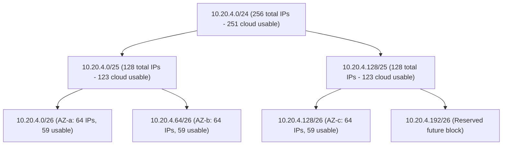
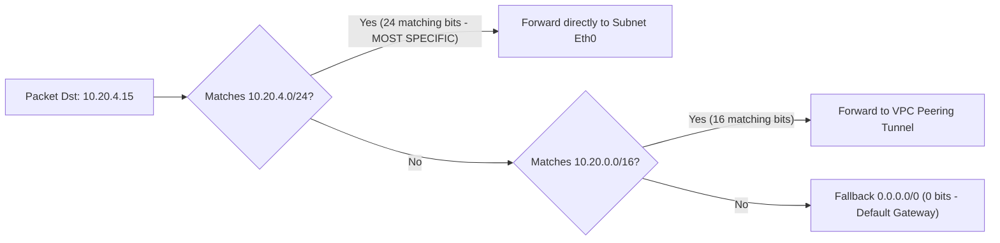
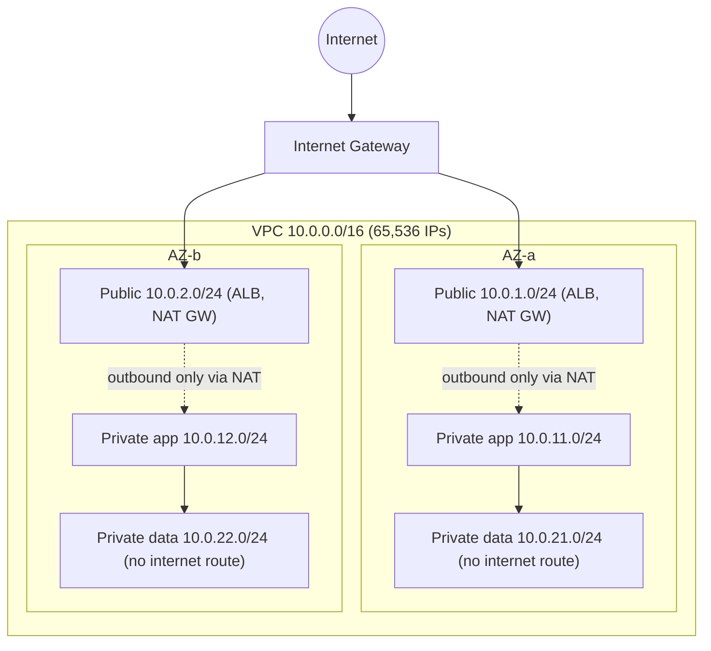
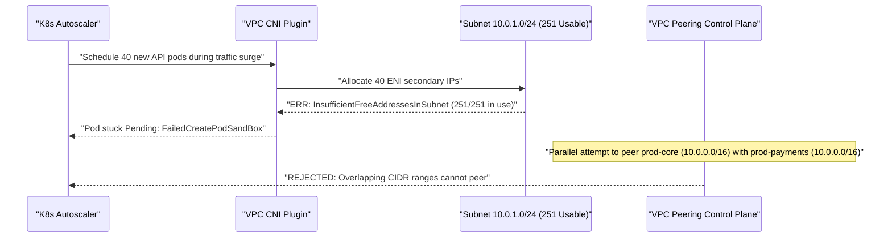

# Lesson 13: Subnets and CIDR — Neighbourhoods of Addresses

> **Prerequisites:** [Lesson 03: IP Addresses](../03-ip-addresses/README.md), [Lesson 12: UDP vs TCP](../12-udp-vs-tcp/README.md), and [Networking From Zero Overview](../README.md) (Lesson 13 of 30).  
> **Estimated Reading Time:** 28 minutes  
> **Target Audience:** Backend and platform engineers sizing cloud VPCs, preventing Kubernetes Pod CIDR IP exhaustion, resolving overlapping VPN/VPC peering collisions, and interpreting CIDR routing tables.  
> **Free PDF Notes:** [Download SD-N-013.pdf](https://backendroadmap.com/notes/system-design/SD-N-013.pdf)

> [!NOTE]
> **In one line:** CIDR writes an address block as `start/prefix`: the first `p` bits are fixed as the network and the remaining `32 − p` bits are hosts, so `/16` is 65,536 addresses and `/24` is 256 (251 usable on AWS); you carve a VPC into non-overlapping subnets per tier and zone, and you never let two networks that must talk claim the same range.

> [!TIP]
> **The Golden Rule of Subnets & CIDR:** **CIDR (`/prefix`)** replaces rigid legacy IP classes with a movable bit divider splitting a `32`-bit IPv4 address into `p` network bits and `32 - p` host bits—giving **$2^{32-p} - 2$** usable LAN hosts (or **$2^{32-p} - 5$** inside AWS/GCP/Azure VPC subnets). Always carve non-overlapping blocks from **RFC 1918** (`10.0.0.0/8`, `172.16.0.0/12`, `192.168.0.0/16`) and **RFC 6598 CGNAT** (`100.64.0.0/10`) upfront, because two subnets with overlapping CIDRs can **never** peer cleanly without messy NAT workarounds.

---

## Words You'll Meet Today

| Word | In Plain Words | Role in a Live Backend System |
| :--- | :--- | :--- |
| **CIDR** | *Classless Inter-Domain Routing*: arbitrary bit boundaries instead of fixed sizes. | Lets cloud architects carve exact `/28` to `/16` blocks (`RFC 4632`). |
| **Prefix length (`/p`)** | How many leading bits belong to the neighborhood, out of `32`. | `/24` locks the first `24` bits (`10.20.4.x`) and leaves `8` bits for hosts. |
| **Subnet mask** | `32`-bit bitmask of `1`s followed by `0`s showing network vs. host bits. | `/24` equals `255.255.255.0`; bitwise `ip & mask` extracts the network ID. |
| **Network & Broadcast ID** | First IP (all `0` host bits) and last IP (all `1` host bits) in a subnet. | Reserved by IP standards (plus `3` extra IPs reserved by cloud providers!). |
| **RFC 1918** | Private IPv4 neighborhoods reserved for internal LANs and cloud VPCs. | `10.0.0.0/8`, `172.16.0.0/12`, and `192.168.0.0/16` (unroutable on public internet). |
| **CGNAT (`100.64.0.0/10`)** | Shared carrier-grade NAT address pool (`RFC 6598`, `~4.19M` IPs). | Used by ISPs, Tailscale/WireGuard overlays, and secondary Kubernetes Pod CIDRs. |
| **Longest Prefix Match** | Routing rule picking whichever matching CIDR has the largest `/p`. | Ensures `/24` local subnet routes beat broader `/16` or `0.0.0.0/0` defaults. |
| **CIDR Overlap** | Two VPCs or clusters accidentally claiming the same IP range. | Blocks VPC peering and VPN site-to-site routing (`10.0.0.0/16` collision). |

---

## Visual Mental Models & Architecture

### The Question: Why Did AWS Say "No Available IPs" When You Only Have `250` Containers?

You launch a Kubernetes cluster in a `/24` cloud subnet (`256` addresses) expecting to run `250` services. Everything stalls around `240` containers, and a week later your company acquires another startup whose VPC cannot connect to yours because both used `10.0.0.0/16`. In [lesson 03](../03-ip-addresses/README.md) we met single IP addresses; today we see how addresses group into **subnets**, how bit math controls their exact size, and how bad CIDR planning breaks cloud scale.

### An Everyday Picture First: Adjustable Neighborhood Borders

Early IPv4 (**classful networking**) worked like a rigid real-estate law with only three block sizes: **Class A** (`16,777,216` houses), **Class B** (`65,536` houses), and **Class C** (`256` houses). If a university needed `400` addresses, Class C was too small, so it received an entire Class B—wasting **`65,136`** IP addresses!

**CIDR** threw away fixed classes and introduced a **sliding divider**: write `/p` after an IP (`10.20.4.0/24`) to mark how many of the `32` bits name the neighborhood, leaving `32 - p` bits for individual houses inside it. Move the divider left by one bit (`/24` -> `/23`) and the neighborhood doubles cleanly; move it right (`/24` -> `/25`) and it splits evenly in half.

### Bit-Boundary Math, Subnet Masks, and Cloud Reservations

Every IPv4 address is `32` binary bits grouped into four `8`-bit octets (`0–255`). A `/24` prefix keeps the left `24` bits fixed and varies the right `8` bits:

- **Subnet mask:** `24` ones followed by `8` zeros = `11111111.11111111.11111111.00000000` = **`255.255.255.0`**.
- **Total addresses:** $2^{32-24} = 2^8 = 256$ (`10.20.4.0` through `10.20.4.255`).
- **Standard LAN usable hosts:** $256 - 2 = \mathbf{254}$ because `.0` (all host bits `0`) is the **network ID** and `.255` (all host bits `1`) is the **broadcast address**.
- **Cloud VPC usable hosts (AWS / GCP / Azure):** Cloud virtual networks reserve **`5`** addresses in every subnet! In `10.20.4.0/24`, `.0` is Network, `.1` is VPC Router, `.2` is VPC DNS, `.3` is reserved for future use, and `.255` is Broadcast—leaving **`251` usable IPs**, not `254`! On a tiny `/28` (`16` total IPs), reserving `5` leaves only **`11`** usable hosts (`16 - 5 = 11`).



*Figure 1. Clean binary subdivision of a `/24` block: each extra prefix bit splits the range in two with zero overlap (`0..63`, `64..127`, `128..191`, `192..255`).*

### `RFC 1918`, `RFC 6598` CGNAT, and Longest Prefix Match

Private networks reuse three **`RFC 1918`** ranges that internet backbone routers refuse to forward publicly:

- **`10.0.0.0/8`** (`10.0.0.0` – `10.255.255.255`): **`16,777,216`** addresses (`2^24`). Cloud standard for large multi-VPC enterprises.
- **`172.16.0.0/12`** (`172.16.0.0` – `172.31.255.255`): **`1,048,576`** addresses (`2^20`). *Careful:* `172.32.0.1` is **public**, not private!
- **`192.168.0.0/16`** (`192.168.0.0` – `192.168.255.255`): **`65,536`** addresses (`2^16`). Common home/office default (`192.168.1.0/24`).

Because corporate clouds often exhaust `RFC 1918` or suffer overlaps during mergers, **`RFC 6598`** defined **`100.64.0.0/10`** (`100.64.0.0` – `100.127.255.255`, `4,194,304` IPs) for Carrier-Grade NAT (CGNAT). Platform teams also adopt `100.64.0.0/10` as a secondary VPC CIDR exclusively for **Kubernetes Pods** or **Tailscale/mesh VPNs** so pods never collide with primary corporate `10.x` routes.

When a packet arrives at a router whose table holds overlapping prefixes (for instance `0.0.0.0/0`, `10.20.0.0/16`, and `10.20.4.0/24`), how does the router choose? By **Longest Prefix Match (LPM)**: every matching CIDR is evaluated, and the **longest `/p`** wins because it names the most specific neighborhood (`24 > 16 > 0`).



*Figure 2. Longest Prefix Match: `10.20.4.15` matches all three routes in the table, so the router picks `/24` (`24` bits) over `/16` and `0.0.0.0/0` regardless of table row order.*

### Kubernetes Pod CIDR & AWS VPC Exhaustion Traps

In cloud-native Kubernetes plugins like **AWS VPC CNI** or **Azure CNI**, *every Pod* gets a real IP address directly from the VPC subnet—not just each EC2/VM node! A cluster with `40` worker nodes holding `30` pods each consumes `40 + (40 × 30) = 1,240` VPC IPs (plus warm ENI IP pre-allocations!). Put that cluster in a `/24` (`251` IPs) or `/22` (`1,019` IPs), and autoscaling grinds to a halt mid-traffic spike with `FailedCreatePodSandBox`. Meanwhile, leaving every VPC on the wizard default `10.0.0.0/16` makes peering two VPCs impossible later because routers cannot decide which `10.0.0.0/16` owns `10.0.1.25`.

---

## Core Definition & Taxonomic Comparison

**What it is:** A **subnet** is a contiguous, power-of-two-sized, bit-aligned slice of IP space that shares one network prefix and (normally) one broadcast/L2 domain or one cloud route-table scope. **CIDR** is the notation (`address/prefix-length`) and the allocation rule that lets blocks be any size from `/0` to `/32`, replacing the rigid Class A/B/C of the 1980s. **What it isn't:** `/24` does **not** mean "24 hosts" (it means `24` *network bits*, leaving `8` host bits = `256` addresses), and "public/private subnet" in the cloud is **not** a property of the IP range at all.

| Term | Precise Meaning | Production Example |
| :--- | :--- | :--- |
| **CIDR block** | A start address plus prefix length that must be *aligned* to its own size. `10.0.0.50/24` is not a valid block; `10.0.0.0/24` is. | `10.20.0.0/16` assigned to the payments VPC by the IPAM registry. |
| **Subnet** | A CIDR block carved out of a larger block and attached to one zone/segment; hosts inside share a prefix and reach each other without a router. | `10.0.11.0/24` = private app subnet in AZ-a. |
| **VPC / VNet** | A software-defined private network owning one or more CIDR blocks (primary + secondary) and many subnets. | `10.0.0.0/16` VPC with 6 subnets across 2 AZs. |
| **Subnet mask** | The `32`-bit pattern (`p` ones then zeros) used as `ip & mask = network ID`. | `/20` ⇒ `255.255.240.0`. |
| **Wildcard mask** | The bitwise inverse of the subnet mask (`0.0.15.255` for `/20`), used by some ACL syntaxes (Cisco OSPF/ACL). | Router ACL matching `10.0.16.0 0.0.15.255`. |
| **Supernet / aggregate** | Several adjacent, aligned subnets summarized into one shorter prefix. | `10.0.0.0/24` + `10.0.1.0/24` ⇒ `10.0.0.0/23`; 256 `/24`s ⇒ `/16`. |
| **Public subnet** | A subnet whose **route table** sends `0.0.0.0/0` to an **internet gateway**. Defined by routing, not by IP numbers. | Load balancers and NAT gateways. |
| **Private subnet** | A subnet with **no route to an internet gateway**; outbound goes through NAT (app tier) or nowhere (data tier). | App subnet → NAT GW; database subnet → no default route. |
| **Overlap** | Two blocks sharing any address. CIDR blocks are either *nested* or *disjoint*, never partially overlapping. | Two VPCs both `10.0.0.0/16`: peering, VPN, and Transit Gateway cannot route between them. |

**Business implication:** an address plan is a **one-way door**. Renumbering a live VPC means rebuilding every subnet, ENI, and security-group reference; companies spend months undoing a "default `10.0.0.0/16` everywhere" decision after a merger or when a partner needs private connectivity.

---

## Component Breakdown & Anatomy: A Hierarchical Address Plan

A good plan encodes organization structure into the bits, so that **routes, firewall rules and humans can all aggregate**:

$$\underbrace{10}_{\text{RFC 1918 /8}} . \underbrace{\text{env/region}}_{\text{bits 8–15}} . \underbrace{\text{AZ + tier}}_{\text{bits 16–23}} . \underbrace{\text{host}}_{\text{bits 24–31}}$$

```text
 10.0.0.0/8 (enterprise supernet: 16,777,216 addresses)
  ├── 10.0.0.0/16   prod     ── VPC  (65,536)           ← one IPAM-allocated slice per VPC
  │     ├── AZ-a   public   10.0.1.0/24    load balancers, NAT gateway
  │     ├── AZ-b   public   10.0.2.0/24
  │     ├── AZ-a   app      10.0.11.0/24   services  (use /20 if each container takes a VPC IP)
  │     ├── AZ-b   app      10.0.12.0/24
  │     ├── AZ-a   data     10.0.21.0/24   databases: NO internet route
  │     └── AZ-b   data     10.0.22.0/24
  ├── 10.1.0.0/16   staging
  ├── 10.2.0.0/16   dev
  └── 100.64.0.0/10 secondary: Kubernetes pod CIDRs / overlays (RFC 6598)
```



| Tier | Route table default (`0.0.0.0/0`) | Inbound from internet? | Outbound to internet? | Sizing driver |
| :--- | :--- | :--- | :--- | :--- |
| **Public** | Internet gateway | Yes (only to load balancers) | Yes | Few IPs: LBs, NAT GWs (`/24` is plenty) |
| **Private app** | NAT gateway (in the public subnet of the same AZ) | **No** | Yes (outbound only, replies return) | **Largest**: every container/pod/Lambda ENI may take an IP |
| **Private data** | None | **No** | **No** | Small, stable: DB nodes, replicas |

**Why databases live in private subnets:** with no route from the internet, even a leaked password or a mis-set security group is not enough to reach the database. Routing is one layer, security groups a second, credentials a third: **defense in depth**.

### The Observability Gap: Who Can See Address Exhaustion?

| Measurement Point | What It Captures | What It Hides |
| :--- | :--- | :--- |
| **Cloud console / `describe-subnets`** | `AvailableIpAddressCount` per subnet right now | Warm/pre-allocated IPs about to be claimed; per-workload attribution |
| **CNI metrics (e.g., VPC CNI `awscni_assigned_ip_addresses`, `awscni_total_ip_addresses`)** | IPs held by each node and how many are in use | Subnet-wide headroom unless aggregated across nodes |
| **IPAM tooling (AWS VPC IPAM, NetBox, Infoblox)** | Planned vs allocated CIDRs, overlaps across accounts | Actual runtime consumption inside subnets |
| **VPC Flow Logs** | Accepted/rejected flows, including packets to unroutable ranges | *Why* a route is missing; root cause lives in route tables |
| **Route tables / Reachability Analyzer** | The effective Longest-Prefix-Match decision for a source→dest | Application-level behavior |
| **Kubernetes events (`FailedCreatePodSandBox`, `InsufficientFreeAddressesInSubnet`)** | The failure *after* it hits | Early warning |

Address exhaustion is **a capacity metric with a hard cliff**, and nothing in the default dashboards alerts on it. You have to add the SLI yourself.

---

## Mathematical Model: Masks, Alignment, Splitting, and Capacity Planning

### 1. Size, Mask, and Usable Hosts

$$N_{\text{total}} = 2^{32-p}, \quad \text{mask} = 2^{32} - 2^{32-p}, \quad \text{usable}_{\text{LAN}} = N - 2,\quad \text{usable}_{\text{AWS/Azure}} = N - 5$$

**Provider nuance:** AWS and Azure reserve **5** addresses per subnet (network, router, DNS, future, broadcast); **GCP reserves 4** (network, gateway, second-to-last, broadcast) and allows subnets as small as `/29`; AWS allows `/28` to `/16`. Always read your provider's subnet-sizing doc before computing headroom.

Worked mask derivation for `/20`: `20` ones then `12` zeros ⇒ `11111111.11111111.11110000.00000000` ⇒ `255.255.240.0`; block size in the third octet is `256 − 240 = 16`, so valid `/20` networks start at `x.x.0.0`, `x.x.16.0`, `x.x.32.0`, …

### 2. Network ID by Bitwise AND, and Alignment Rule

$$\text{network} = \text{ip} \;\&\; \text{mask}, \qquad \text{start address} \bmod 2^{32-p} = 0$$

| Address | Prefix | `ip & mask` (network) | Valid block start? |
| :--- | :--- | :--- | :--- |
| `10.20.4.99` | `/24` | `10.20.4.0` | `10.20.4.0/24` ✓ |
| `10.20.4.99` | `/26` | `10.20.4.64` (99 = 64 + 35) | `10.20.4.64/26` ✓ |
| `10.0.0.50` | `/24` | `10.0.0.0` | `10.0.0.50/24` ✗ (not aligned) |
| `172.32.10.5` | `/12` vs `172.16.0.0/12` | outside `172.16.0.0 – 172.31.255.255` | **Public**, not RFC 1918 |

### 3. Splitting and Aggregating

Extending the prefix by `k` bits yields $2^{k}$ equal subnets, each $2^{k}$ times smaller:

| Parent | Split into | Count | Each has | Cloud-usable each |
| :--- | :--- | :--- | :--- | :--- |
| `/16` | `/24`s | `2^8 = 256` | `256` | `251` |
| `/16` | `/20`s | `2^4 = 16` | `4,096` | `4,091` |
| `/22` | `/24`s | `2^2 = 4` | `256` | `251` |
| `/24` | `/26`s | `2^2 = 4` | `64` | `59` |
| `/24` | `/28`s | `2^4 = 16` | `16` | `11` |

Aggregation is the inverse: `2^k` **adjacent, aligned** blocks of the same size summarize into one block `k` bits shorter, shrinking route tables (`10.0.0.0/24 … 10.0.3.0/24` ⇒ `10.0.0.0/22`). Non-aligned neighbors (`10.0.1.0/24` + `10.0.2.0/24`) do **not** merge.

### 4. Overlap Detection

Because CIDR blocks are aligned and power-of-two sized, two blocks are either **nested or disjoint**. Let $m = \min(p_a, p_b)$:

$$\text{overlap}(A, B) \iff (\text{net}_A \;\&\; \text{mask}_m) = (\text{net}_B \;\&\; \text{mask}_m)$$

`10.0.0.0/16` vs `10.0.1.0/24` ⇒ `m = 16` ⇒ same `10.0.0.0` ⇒ overlap (nested). `10.0.0.0/16` vs `10.1.0.0/16` ⇒ differ ⇒ safe.

### 5. Sizing a Subnet: Capacity Planning Formula

$$\text{IPs needed} = \frac{N_{\text{nodes}} \times (1 + \text{pods per node} + \text{warm pool})}{\text{target utilization}} + 5$$

Worked VPC-CNI example: `40` nodes × (`1` node IP + `30` pods + `~10` warm ENI IPs) = `1,640`; at a `70%` utilization ceiling that is `1,640 / 0.7 ≈ 2,343` ⇒ smallest block with `≥ 2,343 + 5` addresses is a **`/20`** (`4,096`). A `/24` (`251`) is more than `9×` too small.

| Needed usable IPs | Smallest cloud-safe prefix | Usable | Headroom at 70% ceiling |
| :--- | :--- | :--- | :--- |
| `≤ 40` | `/26` | `59` | `41` |
| `≤ 100` | `/25` | `123` | `86` |
| `≤ 250` | `/23` | `507` | `354` |
| `≤ 1,000` | `/21` | `2,043` | `1,430` |
| `≤ 4,000` | `/19` | `8,187` | `5,730` |

### 6. The PDF's Worked Address Plan

`VPC 10.0.0.0/16` with six `/24` subnets: **addresses used** `6 × 256 = 1,536`; **usable on AWS** `6 × 251 = 1,506`; **fraction of the VPC consumed** `1,536 / 65,536 = 2.34%`, leaving **`97.66%`** free for a third AZ or new tiers. The only strong reason to deviate is IP-hungry container tiers: make those `/20` (`4,091` usable each).

---

---

## Systematic Reference & Comparison Grid

### Essential CIDR Prefix Reference

| Prefix | Subnet Mask | Total IPs ($2^{32-p}$) | Standard LAN Usable ($-2$) | Cloud VPC Usable ($-5$) | Typical Production Role |
| :--- | :--- | :--- | :--- | :--- | :--- |
| **`/32`** | `255.255.255.255` | `1` | `1` (host route) | `1` (EIP / BGP host) | Single-host firewall rule, loopback, BGP `/32` VIP |
| **`/31`** | `255.255.255.254` | `2` | `2` (`RFC 3021` P2P) | N/A | Router-to-router point-to-point fiber links |
| **`/30`** | `255.255.255.252` | `4` | `2` | N/A (cloud min is `/28`) | Legacy point-to-point VPN / Direct Connect links |
| **`/28`** | `255.255.255.240` | `16` | `14` | **`11`** | Smallest AWS/GCP subnet (NAT GW or Transit GW link) |
| **`/26`** | `255.255.255.192` | `64` | `62` | **`59`** | Small database tier subnet per Availability Zone |
| **`/25`** | `255.255.255.128` | `128` | `126` | **`123`** | Public ALB/NLB ingress subnet per AZ |
| **`/24`** | `255.255.255.0` | `256` | `254` | **`251`** | Standard private app subnet or single K8s node Pod CIDR |
| **`/22`** | `255.255.252.0` | `1,024` | `1,022` | **`1,019`** | Medium regional microservice subnet |
| **`/20`** | `255.255.240.0` | `4,096` | `4,094` | **`4,091`** | Production Kubernetes worker subnet per AZ (VPC CNI) |
| **`/16`** | `255.255.0.0` | `65,536` | `65,534` | `65,531` (VPC block) | Entire cloud VPC CIDR (`10.24.0.0/16`) |
| **`/10`** | `255.192.0.0` | `4,194,304` | — | — | `RFC 6598` CGNAT secondary pod/overlay block |
| **`/8`** | `255.0.0.0` | `16,777,216` | `16,777,214` | — | Entire `10.0.0.0/8` enterprise IP space |

The governing sizing equations are:

$$
\text{Total IPs} = 2^{32 - p}, \qquad \text{Usable}_{\text{LAN}} = 2^{32 - p} - 2, \qquad \text{Usable}_{\text{Cloud VPC}} = 2^{32 - p} - 5
$$

*(Exception: `/32` identifies a single host `1` IP, and `/31` per `RFC 3021` omits network/broadcast for `2` point-to-point router IPs.)*

### Special-Purpose IPv4 Address Blocks

| Range | RFC | Scope / Routable? | Production Meaning |
| :--- | :--- | :--- | :--- |
| **`10.0.0.0/8`** | `RFC 1918` | Private | `10.0.0.0` – `10.255.255.255` |
| **`172.16.0.0/12`** | `RFC 1918` | Private | `172.16.0.0` – `172.31.255.255` (`172.32.x` is public!) |
| **`192.168.0.0/16`** | `RFC 1918` | Private | `192.168.0.0` – `192.168.255.255` |
| **`100.64.0.0/10`** | `RFC 6598` | Shared CGNAT | `100.64.0.0` – `100.127.255.255` (Tailscale, K8s Pods, ISP NAT) |
| **`127.0.0.0/8`** | `RFC 1122` | Host Loopback | Never leaves the OS kernel (`127.0.0.1`) |
| **`169.254.0.0/16`** | `RFC 3927` | Link-Local | Zero-conf & cloud metadata service (`169.254.169.254`) |
| **`192.0.2.0/24`, `198.51.100.0/24`, `203.0.113.0/24`** | `RFC 5737` | Documentation | Safe example "public" IPs for docs, tutorials, and tests |

---

## Observability: Subnet Utilization, Overlap Audits, and Routing Health

IP space is the one cloud resource you can exhaust *silently* and unrecoverably (you cannot grow a subnet in place). Monitor it as a first-class capacity metric.

| Signal | Source | Healthy | Alert When | Meaning |
| :--- | :--- | :--- | :--- | :--- |
| Subnet free IPs | `aws ec2 describe-subnets` (`AvailableIpAddressCount`) → custom metric / exporter | `> 30%` free | `< 25%` warn, `< 10%` page | Autoscaling about to fail with `InsufficientFreeAddressesInSubnet` |
| IPs held per node vs. used | VPC CNI `awscni_total_ip_addresses` vs `awscni_assigned_ip_addresses` | Warm pool small | Warm pool large on many nodes | Over-allocation draining the subnet (tune `WARM_IP_TARGET` / `MINIMUM_IP_TARGET`) |
| Pending pods with sandbox errors | `kube_pod_status_phase{phase="Pending"}` + events `FailedCreatePodSandBox` | `0` | Any sustained | Subnet or ENI exhaustion |
| ENI / instance limits | `aws ec2 describe-network-interfaces` counts; node `allocatable pods` | Under instance limit | At limit | Per-instance IP cap reached before the subnet is |
| CIDR overlap audit | IPAM export + script (below) in CI | `0` overlaps | Any | A future peering/VPN/TGW attachment will fail |
| Peering / TGW attachment errors | CloudTrail `CreateVpcPeeringConnection` failures, Transit Gateway route conflicts | None | Overlap error | Planning defect |
| Flow Logs `REJECT` to RFC 1918 | VPC Flow Logs → Athena/Loki | Low | New spike to an unexpected `10.x` | Missing route, stale peering, or overlapping network sending traffic to the wrong place |
| Route table drift | `aws ec2 describe-route-tables` diff in CI | Matches IaC | Drift | A manual `0.0.0.0/0` to the IGW on a data subnet is a breach waiting to happen |

**Dashboards**
1. *Capacity board:* every subnet as a bar of used / warm / free IPs, sorted by lowest free percentage, with the trend line projecting the date free IPs hit `10%`.
2. *Plan vs reality:* IPAM-allocated CIDRs against what exists in accounts; unallocated-but-in-use ranges are the earliest sign of shadow networks.
3. *Network paths:* weekly Reachability Analyzer runs for critical paths (app → DB, app → NAT → internet, VPN → app).

**CI guard: fail the pull request on overlap**
```python
import ipaddress, itertools, sys
cidrs = [ipaddress.ip_network(c) for c in sys.argv[1:]]
bad = [(a, b) for a, b in itertools.combinations(cidrs, 2) if a.overlaps(b)]
for a, b in bad: print(f"OVERLAP {a} <-> {b}")
sys.exit(1 if bad else 0)
```

**Runbook decision tree**
1. Pods Pending with `InsufficientFreeAddressesInSubnet` → add a secondary `100.64.0.0/16` pod CIDR with custom networking, or new `/20` subnets; reduce warm-pool targets as a stopgap.
2. Peering/VPN rejected → compare VPC CIDRs; if overlap, plan the migration (new VPC with a distinct `/16`) and meanwhile expose only needed services via PrivateLink.
3. Traffic reaching the wrong place → `ip route get <dst>` / route table, then check for a longer prefix hijacking the traffic.

---

## Production War Story Post-Mortem: Kubernetes IP Exhaustion & VPC Peering Deadlock

- **Severity:** SEV-1 (Zero new autoscaled Pods during peak sale + blocked payment partner integration)
- **Detection / Resolution Time:** 55 minutes to attach secondary CGNAT pod CIDR and unblock autoscaling; 3 weeks of Terraform migration to resolve peering overlap
- **Impact:** Kubernetes nodes hit `251/251` IPs in `10.0.1.0/24`, leaving `80` pending API pods stuck while checkout latency surged `4x`; meanwhile, `prod-payments` VPC could not peer with `prod-core` VPC because both defaulted to `10.0.0.0/16`.

### What Happened



*Figure 3. Dual CIDR failure: a `/24` VPC CNI subnet ran out of real IPs after 251 pods + ENIs, while identical `10.0.0.0/16` VPC defaults made peering impossible.*

### Root Cause Analysis

1. **Under-Sized Pod Subnet (`/24`):** Engineers assumed `251` IPs was plenty for `12` nodes, forgetting that VPC CNI assigns one real subnet IP to *each Pod* plus pre-warmed ENI buffers (`12 nodes × 20 IPs = 240 IPs`, instantly hitting the `251` wall!).
2. **Wizard-Default Overlap:** Both VPCs accepted `10.0.0.0/16` during setup, violating the golden rule of unique enterprise IPAM allocation.

### The Fix & Architectural Hardening

- **Secondary `RFC 6598` Pod CIDR (`100.64.0.0/16`):** Attached `100.64.0.0/16` as a secondary VPC CIDR and enabled custom networking in VPC CNI so Pods draw from `65,000+` `100.64.x.x` IPs while Nodes/ALBs keep primary `RFC 1918` subnets.
- **Global IPAM Registry:** Assigned distinct `/16` blocks per account/region (`10.10.0.0/16` core-us-east, `10.20.0.0/16` payments-us-east, `10.30.0.0/16` staging) with `/20` (`4,091`-IP) worker subnets per AZ.

---

## Multi-Language Production Implementation

Below is a clean **IPv4 CIDR Parser, IP-in-Subnet Checker & Cloud VPC Subnet Range Calculator** in Go, TypeScript, Python, and C#. Notice how every language uses unsigned `32`-bit bitwise arithmetic (`uint32` / `>>> 0`) so bit shifts never sign-extend into negative numbers!

````carousel
```go
package cidr

import (
	"fmt"
	"net/netip"
)

type SubnetSummary struct {
	CIDR             string
	Network          netip.Addr
	Broadcast        netip.Addr
	FirstUsableCloud netip.Addr
	LastUsableCloud  netip.Addr
	TotalIPs         uint64
	LanUsable        uint64
	CloudUsable      uint64
}

func DescribeIPv4Subnet(cidrStr string) (SubnetSummary, error) {
	prefix, err := netip.ParsePrefix(cidrStr)
	if err != nil || !prefix.Addr().Is4() {
		return SubnetSummary{}, fmt.Errorf("invalid IPv4 CIDR: %s", cidrStr)
	}
	masked := prefix.Masked() // Normalize host bits to zero
	bits := masked.Bits()
	total := uint64(1) << (32 - bits)

	netB := masked.Addr().As4()
	netInt := uint32(netB[0])<<24 | uint32(netB[1])<<16 | uint32(netB[2])<<8 | uint32(netB[3])
	bcastInt := netInt | uint32(total-1)

	toAddr := func(v uint32) netip.Addr {
		return netip.AddrFrom4([4]byte{byte(v >> 24), byte(v >> 16), byte(v >> 8), byte(v)})
	}

	var lanUsable, cloudUsable uint64
	var firstCloud, lastCloud netip.Addr
	if total >= 2 {
		lanUsable = total - 2
	}
	if bits == 32 {
		lanUsable, cloudUsable = 1, 1
		firstCloud, lastCloud = toAddr(netInt), toAddr(netInt)
	} else if total > 5 {
		cloudUsable = total - 5 // Cloud reserves .0, .1, .2, .3, and broadcast
		firstCloud, lastCloud = toAddr(netInt+4), toAddr(bcastInt-1)
	}

	return SubnetSummary{
		CIDR:             masked.String(),
		Network:          toAddr(netInt),
		Broadcast:        toAddr(bcastInt),
		FirstUsableCloud: firstCloud,
		LastUsableCloud:  lastCloud,
		TotalIPs:         total,
		LanUsable:        lanUsable,
		CloudUsable:      cloudUsable,
	}, nil
}

func ContainsIP(cidrStr, ipStr string) (bool, error) {
	p, err := netip.ParsePrefix(cidrStr)
	if err != nil {
		return false, err
	}
	ip, err := netip.ParseAddr(ipStr)
	if err != nil {
		return false, err
	}
	return p.Contains(ip), nil
}
```
<!-- slide -->
```typescript
export interface SubnetSummary {
  cidr: string;
  network: string;
  mask: string;
  broadcast: string;
  totalIps: number;
  lanUsable: number;
  cloudUsable: number;
}

function ipToUint32(ip: string): number {
  const parts = ip.split(".").map(Number);
  if (parts.length !== 4 || parts.some((p) => !Number.isInteger(p) || p < 0 || p > 255)) {
    throw new Error(`Invalid IPv4 address: ${ip}`);
  }
  return (((parts[0] << 24) | (parts[1] << 16) | (parts[2] << 8) | parts[3]) >>> 0);
}

function uint32ToIp(n: number): string {
  return [(n >>> 24) & 255, (n >>> 16) & 255, (n >>> 8) & 255, n & 255].join(".");
}

export function describeCidr(cidr: string): SubnetSummary {
  const [ipStr, prefixStr] = cidr.split("/");
  const prefix = Number(prefixStr);
  if (!Number.isInteger(prefix) || prefix < 0 || prefix > 32) {
    throw new Error(`Invalid CIDR prefix: ${cidr}`);
  }
  const mask = prefix === 0 ? 0 : (0xffffffff << (32 - prefix)) >>> 0;
  const network = (ipToUint32(ipStr) & mask) >>> 0;
  const totalIps = 2 ** (32 - prefix);
  const broadcast = (network | (~mask >>> 0)) >>> 0;

  return {
    cidr: `${uint32ToIp(network)}/${prefix}`,
    network: uint32ToIp(network),
    mask: uint32ToIp(mask),
    broadcast: uint32ToIp(broadcast),
    totalIps,
    lanUsable: prefix === 32 ? 1 : prefix === 31 ? 2 : Math.max(0, totalIps - 2),
    cloudUsable: prefix === 32 ? 1 : Math.max(0, totalIps - 5),
  };
}

export function isIpInSubnet(cidr: string, candidateIp: string): boolean {
  const [ipStr, prefixStr] = cidr.split("/");
  const prefix = Number(prefixStr);
  const mask = prefix === 0 ? 0 : (0xffffffff << (32 - prefix)) >>> 0;
  return ((ipToUint32(ipStr) & mask) >>> 0) === ((ipToUint32(candidateIp) & mask) >>> 0);
}
```
<!-- slide -->
```python
from dataclasses import dataclass
import ipaddress


@dataclass(frozen=True)
class SubnetSummary:
    cidr: str
    network: str
    mask: str
    broadcast: str
    total_ips: int
    lan_usable: int
    cloud_usable: int


def describe_ipv4_subnet(cidr: str) -> SubnetSummary:
    net = ipaddress.IPv4Network(cidr, strict=False)
    total = net.num_addresses
    if net.prefixlen == 32:
        lan_usable, cloud_usable = 1, 1
    elif net.prefixlen == 31:
        lan_usable, cloud_usable = 2, 0
    else:
        lan_usable = max(0, total - 2)
        cloud_usable = max(0, total - 5)  # Cloud reserves .0, .1, .2, .3, and broadcast

    return SubnetSummary(
        cidr=str(net),
        network=str(net.network_address),
        mask=str(net.netmask),
        broadcast=str(net.broadcast_address),
        total_ips=total,
        lan_usable=lan_usable,
        cloud_usable=cloud_usable,
    )


def ip_in_subnet(cidr: str, ip: str) -> bool:
    return ipaddress.IPv4Address(ip) in ipaddress.IPv4Network(cidr, strict=False)
```
<!-- slide -->
```csharp
using System;
using System.Buffers.Binary;
using System.Net;

public sealed record SubnetSummary(
    string Cidr, string Network, string Mask, string Broadcast,
    ulong TotalIps, ulong LanUsable, ulong CloudUsable);

public static class CidrCalculator
{
    private static uint ParseUInt32(string ip) =>
        BinaryPrimitives.ReadUInt32BigEndian(IPAddress.Parse(ip).GetAddressBytes());

    private static string FormatIp(uint val)
    {
        Span<byte> bytes = stackalloc byte[4];
        BinaryPrimitives.WriteUInt32BigEndian(bytes, val);
        return new IPAddress(bytes).ToString();
    }

    public static SubnetSummary Describe(string cidr)
    {
        var parts = cidr.Split('/');
        int prefix = int.Parse(parts[1]);
        if (prefix < 0 || prefix > 32) throw new ArgumentOutOfRangeException(nameof(cidr));

        uint mask = prefix == 0 ? 0u : ~0u << (32 - prefix);
        uint network = ParseUInt32(parts[0]) & mask;
        uint broadcast = network | ~mask;
        ulong total = 1UL << (32 - prefix);

        ulong lanUsable = prefix == 32 ? 1 : prefix == 31 ? 2 : total >= 2 ? total - 2 : 0;
        ulong cloudUsable = prefix == 32 ? 1 : total > 5 ? total - 5 : 0;

        return new SubnetSummary(
            $"{FormatIp(network)}/{prefix}", FormatIp(network), FormatIp(mask),
            FormatIp(broadcast), total, lanUsable, cloudUsable);
    }

    public static bool Contains(string cidr, string candidateIp)
    {
        var parts = cidr.Split('/');
        int prefix = int.Parse(parts[1]);
        uint mask = prefix == 0 ? 0u : ~0u << (32 - prefix);
        return (ParseUInt32(parts[0]) & mask) == (ParseUInt32(candidateIp) & mask);
    }
}
```
````

---

## Practical Hands-On Verification CLI Workflows

### 1. Inspect Your Host's Active CIDR Prefixes and Broadcast Addresses

```bash
ip -4 addr show
```

**Expected Output:**

```text
2: eth0: <BROADCAST,MULTICAST,UP,LOWER_UP> mtu 1500 qdisc mq state UP
    inet 10.20.4.18/24 brd 10.20.4.255 scope global dynamic eth0
```

Here `/24` immediately confirms the local subnet spans `10.20.4.0`–`10.20.4.255` with broadcast `10.20.4.255`.

### 2. Inspect Kernel Longest-Prefix Route Precedence

```bash
ip route show
```

**Expected Output:**

```text
default via 10.20.4.1 dev eth0 proto dhcp src 10.20.4.18 metric 100
10.20.0.0/16 via 10.20.4.1 dev eth0
10.20.4.0/24 dev eth0 proto kernel scope link src 10.20.4.18
```

Notice the kernel keeps `default` (`0.0.0.0/0`), `/16`, and `/24` side by side—evaluating Longest Prefix Match on every packet.

### 3. Verify Arbitrary CIDR Splits & Cloud Capacities With Python

```bash
python3 -c "import ipaddress; n=ipaddress.ip_network('10.20.4.0/24'); print(n.netmask, n.num_addresses, n.num_addresses-5, list(n.subnets(new_prefix=26)))"
```

**Expected Output:**

```text
255.255.255.0 256 251 [IPv4Network('10.20.4.0/26'), IPv4Network('10.20.4.64/26'), IPv4Network('10.20.4.128/26'), IPv4Network('10.20.4.192/26')]
```

---

## Pause and Think

> [!exercise] You carve `10.4.8.0/26` for a Kubernetes subnet inside AWS. How many Pods/instances can run there simultaneously if each requires 1 VPC IP, and what happens if you try to assign `10.4.8.65` inside that subnet? Decide before opening the answer.

<details><summary>Answer</summary>

A `/26` holds $2^{32-26} = 2^6 = 64$ total addresses (`10.4.8.0` through `10.4.8.63`). Subtracting AWS's `5` reserved IPs (`.0` network, `.1` router, `.2` DNS, `.3` future use, `.63` broadcast) leaves **$64 - 5 = 59$ usable IPs**. `10.4.8.65` does **not** belong to `10.4.8.0/26`—it sits inside the adjacent `/26` block (`10.4.8.64/26`)!

</details>

---

## Operational Validation Checkpoints

<details><summary><strong>Checkpoint 1: The Classic `172.16.0.0/12` Private Range Trap</strong></summary>

**Scenario:** An engineer creates firewall allowlists treating `172.32.10.5` as an internal `RFC 1918` microservice IP. Security flags an external exposure immediately. Why?

**Solution:**
`RFC 1918` allocates **`172.16.0.0/12`**, NOT `172.0.0.0/8`! A `/12` leaves `4` host bits inside the second octet ($2^4 = 16$ increments starting at `16`), spanning **`172.16.0.0` through `172.31.255.255`**. Anything at `172.32.0.0` or higher is a **globally routable public IP**!

</details>

<details><summary><strong>Checkpoint 2: Carve a `/22` VPC Block Cleanly Across Three Availability Zones</strong></summary>

**Scenario:** You are handed `10.50.0.0/22` (`1,024` IPs) for a new staging VPC spanning `3` Availability Zones, plus `1` reserved future block of equal size. What four CIDR blocks do you create?

**Solution:**
Adding `2` prefix bits splits `/22` into `2^2 = 4` equal `/24` blocks (`256` total / `251` cloud-usable IPs each):
- AZ-a: `10.50.0.0/24` (`10.50.0.0` – `10.50.0.255`)
- AZ-b: `10.50.1.0/24` (`10.50.1.0` – `10.50.1.255`)
- AZ-c: `10.50.2.0/24` (`10.50.2.0` – `10.50.2.255`)
- Future reserve: `10.50.3.0/24` (`10.50.3.0` – `10.50.3.255`)

</details>

<details><summary><strong>Checkpoint 3: Diagnosing Mismatched Subnet Masks on the Same Switch</strong></summary>

**Scenario:** Host A (`10.1.0.50/24`) and Host B (`10.1.1.20/23`) sit on the same Ethernet switch. Host B can send ARP directly for `10.1.0.50`, whereas Host A insists on sending traffic for `10.1.1.20` to its default gateway (`10.1.0.1`). Why?

**Solution:**
From Host B's `/23` view (`10.1.0.0`–`10.1.1.255`), `10.1.0.50` is **on-link in the same subnet**, so Host B broadcasts ARP locally. From Host A's narrower `/24` view (`10.1.0.0`–`10.1.0.255`), `10.1.1.20` sits **outside** its subnet, so Host A routes replies through `10.1.0.1`—creating broken asymmetric ARP/routing! Both hosts on one segment must share the exact same prefix length.

</details>

---

## Common Mistakes & Troubleshooting

### What Goes Wrong

- **Using `/24` subnets for VPC-CNI Kubernetes workers:** Containers consume real subnet IPs directly, exhausting `251` addresses within minutes of autoscaling.
- **Accepting `10.0.0.0/16` everywhere:** Multiple VPCs with identical CIDRs block future VPC peering, Transit Gateways, and corporate VPN integration.
- **Forgetting non-aligned start addresses:** `10.0.0.50/24` is not a valid network boundary; a `/24` must start on a multiple of `256` (`10.0.0.0/24`), and a `/26` must start on `0`, `64`, `128`, or `192`.

### Common Myths

- **"A `/24` gives 254 usable IPs in AWS/GCP/Azure."** Only on bare-metal LANs (`-2`). Cloud VPCs reserve `.0`, `.1`, `.2`, `.3`, and broadcast, leaving **`251`** usable IPs.
- **"Adding 1 to the prefix doubles the subnet."** Backwards! Moving from `/24` to `/25` **halves** the subnet (`256` -> `128`); moving from `/24` to `/23` **doubles** it (`256` -> `512`).

### Troubleshooting Matrix

| Symptom / Error | Network Evidence | Root Cause | Fix |
| :--- | :--- | :--- | :--- |
| `InsufficientFreeAddressesInSubnet` | K8s Pods stuck `Pending` | Pod CNI exhausted `/24` or `/25` | Attach `/19`–`/20` worker subnets or `100.64.0.0/16` secondary Pod CIDR |
| VPC peering creation rejected | `Overlapping CIDR` API error | Two VPCs share `10.0.0.0/16` | Use IPAM registry + distinct `/16`s, or NAT proxy / PrivateLink |
| Firewall allows public IP as internal | Traffic passes to `172.32.x.x` | Misread `172.16.0.0/12` boundary | Audit rules strictly against `172.16.0.0` – `172.31.255.255` |

---

## Recap in Three Lines

1. **CIDR (`/p`)** divides a `32`-bit IPv4 address at any bit boundary: `p` bits name the network neighborhood and `32 - p` bits name hosts inside it (`2^(32-p) - 2` on LANs, `- 5` in cloud VPCs).
2. Routers resolve overlapping prefixes using **Longest Prefix Match**, picking whichever matching route carries the largest `/p`.
3. Carve non-overlapping **`RFC 1918`** and **`RFC 6598` (`100.64.0.0/10`)** blocks via central IPAM upfront so cloud peering and Kubernetes Pod CNI scaling never hit an overlap or exhaustion wall.

---

## Interview Practice Questions

Each question is tagged by kind: **Basic** (definitions), **Scenario** (apply it to a system), and **Tricky** (deep follow-ups). Answer out loud before opening the solution.

### Basic Conceptual Questions (Q1–Q4)

<details>
<summary><strong>Q1: What is CIDR notation, and how many usable IPs are in a `/24` vs. a `/28`? [BASIC]</strong></summary>

<strong>What a strong answer covers:</strong>
CIDR writes the number of network-prefix bits after a slash; the remaining `32 − p` bits are hosts. A `/24` has `8` host bits: `256` addresses, `254` usable on a classic LAN (minus network and broadcast) or `251` on AWS/Azure (which reserve `5`). A `/28` has `4` host bits: `16` addresses, `14` LAN-usable, `11` on AWS. (GCP reserves `4`, so its `/28` yields `12`.) The notation is also an *alignment promise*: the start address must be a multiple of the block size.

</details>

<details>
<summary><strong>Q2: What does `10.0.0.0/16` mean, and how many `/24` subnets fit inside it? [BASIC]</strong></summary>

<strong>What a strong answer covers:</strong>
The first `16` bits (`10.0`) are the fixed network; the last `16` bits are hosts: `2^16 = 65,536` addresses from `10.0.0.0` to `10.0.255.255`. Extending the prefix by `8` bits gives `2^8 = 256` `/24` subnets (`10.0.0.0/24` … `10.0.255.0/24`), each with `256` addresses (`251` usable on AWS). Subnets need not be equal-sized (a few `/20`s for container tiers and `/24`s elsewhere) as long as they don't overlap.

</details>

<details>
<summary><strong>Q3: Why did CIDR replace classful (Class A/B/C) addressing? [BASIC]</strong></summary>

<strong>What a strong answer covers:</strong>
Classful networking offered only three block sizes (`16.7M`, `65,536`, `256`). An organization needing `500` addresses got a whole Class B (`65,536`), wasting `99%`, which drained IPv4 space quickly, while thousands of small Class C routes bloated global routing tables. CIDR (RFC 4632, 1993) allows any prefix length and **route aggregation**: contiguous blocks summarize into one advertisement, slowing both exhaustion and routing-table growth.

</details>

<details>
<summary><strong>Q4: What are the private IPv4 ranges, why do they exist, and what is `100.64.0.0/10`? [BASIC]</strong></summary>

<strong>What a strong answer covers:</strong>
RFC 1918: `10.0.0.0/8`, `172.16.0.0/12` (ends at `172.31.255.255`, **not** all of `172.x`), and `192.168.0.0/16`. They are not routed on the public internet, so every organization can reuse them internally, with NAT translating to a public address for outbound traffic. `100.64.0.0/10` is RFC 6598 *Shared Address Space* for carrier-grade NAT; teams reuse it as a non-overlapping secondary range for Kubernetes pods and overlays such as Tailscale, though it can still collide with an ISP's CGNAT on the client side, so document it.

</details>

### Scenario-Based Architecture Questions (Q5–Q8)

<details>
<summary><strong>Q5: Design the subnets for a three-tier application across two availability zones. [SCENARIO]</strong></summary>

<strong>What a strong answer covers:</strong>
VPC `10.0.0.0/16`. Per AZ: a **public** subnet (e.g., `10.0.1.0/24`, `10.0.2.0/24`) holding load balancers and the NAT gateway, route `0.0.0.0/0 → internet gateway`; a **private app** subnet (`10.0.11.0/24`, `10.0.12.0/24`, or `/20` if containers take VPC IPs), default route `→ NAT gateway`; a **private data** subnet (`10.0.21.0/24`, `10.0.22.0/24`) with **no internet route**. Six subnets, each in exactly one AZ, using `1,536` of `65,536` addresses (`2.3%`). Add one NAT gateway per AZ to avoid cross-AZ dependence, and reserve space for a third AZ and new tiers.

</details>

<details>
<summary><strong>Q6: Why put databases in private subnets if they already have passwords and security groups? [SCENARIO]</strong></summary>

<strong>What a strong answer covers:</strong>
**Defense in depth.** With no route from the internet, a leaked password or a mistaken `0.0.0.0/0` security-group rule still does not give an attacker connectivity: routing is an independent control from authentication and filtering. Only the app tier (by security-group reference) can reach the data tier. The same layering means a compromised public-tier host still needs a second hop. Add VPC endpoints for AWS APIs instead of NAT where possible, and keep data subnets without any NAT route.

</details>

<details>
<summary><strong>Q7: Your company wants to peer a new VPC with an existing VPC and with the office VPN. What do you check first, and what if they overlap? [SCENARIO]</strong></summary>

<strong>What a strong answer covers:</strong>
**CIDR overlap**, before anything else. Peering, VPN and Transit Gateway cannot route between two networks that both claim `10.0.0.0/16`: the router cannot decide where `10.0.1.25` lives (and Longest Prefix Match ties). If there is overlap: long-term renumber/migrate one VPC to a distinct block from a central IPAM (`10.1.0.0/16`); short-term use **PrivateLink / NLB endpoint services**, an intermediary NAT/proxy in a disjoint secondary CIDR, or an API gateway so only specific services are exposed. Prevention: a registry (`prod 10.0/16`, `staging 10.1/16`, `dev 10.2/16`) and a CI overlap check.

</details>

<details>
<summary><strong>Q8: A Kubernetes cluster in `/24` subnets stops scheduling pods around 240 pods, with plenty of CPU and RAM. Why and how do you fix it? [SCENARIO]</strong></summary>

<strong>What a strong answer covers:</strong>
With a VPC-native CNI (AWS VPC CNI, Azure CNI), **every pod consumes a real subnet IP**, plus warm ENI pre-allocations, plus the node itself. A `/24` gives `251` IPs *in total*. Events show `FailedCreatePodSandBox` / `InsufficientFreeAddressesInSubnet`. Fixes: attach a **secondary CIDR** (`100.64.0.0/16`) with CNI custom networking so pods use it while nodes stay on primary RFC 1918 ranges; move worker subnets to `/20`; tune `WARM_IP_TARGET`; use prefix delegation (`/28` per ENI slot) to raise density; or use an overlay CNI. Prevent: size from `nodes × (1 + pods + warm) / 0.7` and alert at `25%` free.

</details>

### Advanced & Tricky Interview Questions (Q9–Q12)

<details>
<summary><strong>Q9: A router has `0.0.0.0/0`, `10.20.0.0/16`, and `10.20.4.0/24`. Which route wins for `10.20.4.99`, and does table order matter? [TRICKY]</strong></summary>

<strong>What a strong answer covers:</strong>
`10.20.4.0/24` wins: all three match, but **Longest Prefix Match** picks the most specific (`24 > 16 > 0` leading bits). Row order doesn't matter; hardware implementations (tries, TCAM) are built for this. A subtle follow-up: if a more-specific route is injected by mistake (a `/32` via BGP or a stale `/24` from a peered VPC), it silently hijacks traffic from the intended `/16`, which is why route filters and prefix limits matter. Tie-breaking among *equal* prefixes uses administrative distance/metric.

</details>

<details>
<summary><strong>Q10: How many instances can you launch in a `/28` on AWS, and why is "I'll just grow the subnet later" a trap? [TRICKY]</strong></summary>

<strong>What a strong answer covers:</strong>
`2^4 = 16` addresses minus `5` reserved = **`11`** (and it is AWS's smallest subnet). Managed services (RDS, load balancers, endpoints, Lambda ENIs) also consume IPs from the subnet, so `11` disappears fast; ALB needs headroom to scale. You **cannot resize a subnet in place**; you must create a new, larger subnet and migrate workloads, and you can only add *secondary* VPC CIDRs, not expand existing ones. Hence over-provision: `/20` for container tiers, `/24` for LBs, and keep ≥ `30%` free.

</details>

<details>
<summary><strong>Q11: Is a "public subnet" defined by its IP range? Do instances in a private app subnet need public IPs to download updates? [TRICKY]</strong></summary>

<strong>What a strong answer covers:</strong>
No. A public subnet is defined by its **route table** (`0.0.0.0/0 → internet gateway`); the addresses are still RFC 1918, and an instance additionally needs a public/Elastic IP (and permissive security group) to be reachable. Private-app instances do **not** need public IPs: they send traffic to a **NAT gateway** in a public subnet, which uses its own public IP; connections can go out and replies return, but nothing on the internet can *initiate* one. Gotchas: NAT gateway per-AZ cost and `55,000`-ports-per-destination limit, and S3/DynamoDB gateway endpoints that avoid NAT charges.

</details>

<details>
<summary><strong>Q12: How do you programmatically test whether two CIDR blocks overlap, and why can they never overlap partially? [TRICKY]</strong></summary>

<strong>What a strong answer covers:</strong>
Take the shorter prefix `m = min(pA, pB)` and compare `netA & mask_m == netB & mask_m`; equal means overlap. In code: Python `ipaddress.ip_network(a).overlaps(ip_network(b))`, Go `netip.Prefix.Overlaps`. They can't partially overlap because every block is **aligned to its own size and a power of two**: it equals "all addresses sharing the first `p` bits," so either one set of leading bits is a prefix of the other (nesting) or they differ somewhere (disjoint). Add this check to Terraform CI against the IPAM registry for every account/region, plus on-prem and VPN ranges.

</details>

---

## One-Page Master Cheat Sheet

```text
====================================================================================================
                 SUBNETS & CIDR: NEIGHBOURHOODS OF ADDRESSES — CHEAT SHEET
====================================================================================================
NOTATION
  a.b.c.d/p  : first p bits = network, last 32-p bits = hosts.   /24 = 24 NETWORK bits (not 24 hosts).
  Total  = 2^(32-p)         LAN usable = total - 2         AWS/Azure usable = total - 5 (GCP: -4)
  Mask   = p ones + zeros   (/20 = 255.255.240.0)          Network = ip AND mask
  Alignment: start address must be a multiple of block size (10.0.0.50/24 is INVALID)

QUICK TABLE
  /32=1 | /31=2 (P2P) | /28=16 (11 AWS) | /26=64 (59) | /25=128 (123) | /24=256 (251) | /23=512 (507)
  /22=1,024 (1,019) | /21=2,048 (2,043) | /20=4,096 (4,091) | /19=8,192 (8,187) | /16=65,536 | /8=16.7M
  +1 to prefix HALVES it; -1 DOUBLES it.   Split by k bits -> 2^k subnets.   Aggregate 2^k aligned -> -k bits.

PRIVATE & SPECIAL RANGES
  10.0.0.0/8 | 172.16.0.0/12 (172.16-172.31 ONLY; 172.32 is PUBLIC) | 192.168.0.0/16   (RFC 1918)
  100.64.0.0/10 (RFC 6598 CGNAT; Tailscale; K8s pod CIDR) | 169.254.0.0/16 (link-local, cloud metadata)
  127.0.0.0/8 loopback | 192.0.2.0/24, 198.51.100.0/24, 203.0.113.0/24 documentation (RFC 5737)

ROUTING RULES
  Longest Prefix Match: most specific (largest /p) matching route wins; order irrelevant; /0 = default.
  Two CIDR blocks are NESTED or DISJOINT, never partially overlapping.  Overlap => peering/VPN/TGW impossible.

3-TIER VPC (per AZ)
  public  : route 0.0.0.0/0 -> IGW    (ALB, NAT GW)       app  : 0.0.0.0/0 -> NAT GW (outbound only)
  data    : NO default route (defense in depth)             Each subnet lives in exactly ONE AZ.

SIZING
  IPs = nodes x (1 + pods/node + warm) / 0.70 + 5     VPC-CNI: pods use REAL subnet IPs.  Alert at 25% free.
  Plan: /16 per VPC from central IPAM (prod 10.0/16, staging 10.1/16, dev 10.2/16); pods on 100.64.0.0/16.

ANTI-PATTERNS
  x default 10.0.0.0/16 everywhere        x /24 for container subnets      x assuming all 172.x is private
  x DB in a public subnet "for now"       x no overlap check in CI         x assuming a subnet can be resized
====================================================================================================
```

---

## Free PDF notes

Download these notes as a printable PDF, with the CIDR cheat sheet, cloud reservation math, and interview answers: [SD-N-013.pdf](https://backendroadmap.com/notes/system-design/SD-N-013.pdf).

---

## Sources

- [RFC 4632: Classless Inter-domain Routing (CIDR)](https://www.rfc-editor.org/rfc/rfc4632), `/prefix` allocation and aggregation.
- [RFC 1918: Address Allocation for Private Internets](https://www.rfc-editor.org/rfc/rfc1918), `10/8`, `172.16/12`, `192.168/16`.
- [RFC 6598: IANA-Reserved IPv4 Prefix for Shared Address Space](https://www.rfc-editor.org/rfc/rfc6598), `100.64.0.0/10` CGNAT range.
- [RFC 3021: Using 31-Bit Prefixes on IPv4 Point-to-Point Links](https://www.rfc-editor.org/rfc/rfc3021), `/31` router link exception.
- [AWS VPC Subnet Sizing Documentation](https://docs.aws.amazon.com/vpc/latest/userguide/subnet-sizing.html), the five reserved cloud VPC addresses per subnet.

---

## Next

Next comes [Lesson 14: Routing and NAT — How Packets Find Their Way, and Why Your Phone Shares One Public Address](../14-routing-and-nat/README.md), tracing hop-by-hop forwarding, ARP, and NAT port exhaustion. Until then, the [track overview](../README.md) lists the whole series.
