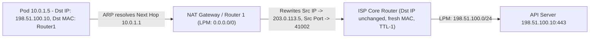
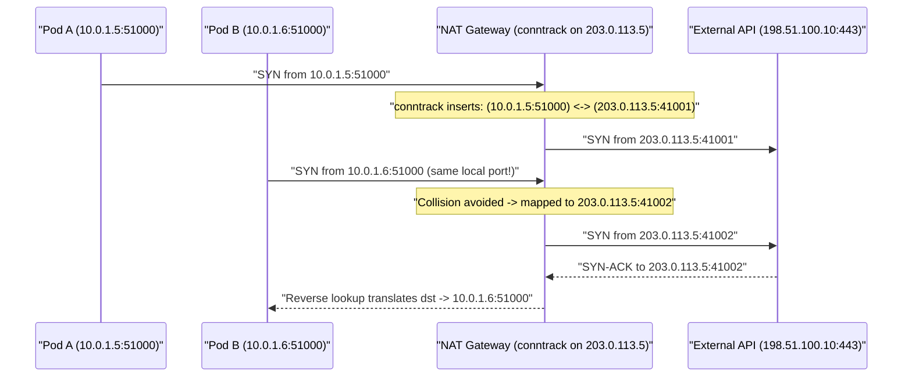
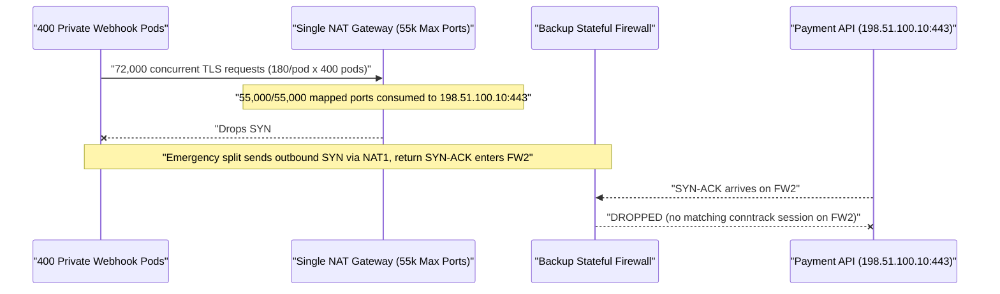

# Lesson 14: Routing and NAT — How Packets Find Their Way, and Why Your Phone Shares One Public Address

> **Prerequisites:** [Lesson 13: Subnets and CIDR](../13-subnets-and-cidr/README.md), [Lesson 03: IP Addresses](../03-ip-addresses/README.md), and [Networking From Zero Overview](../README.md) (Lesson 14 of 30).  
> **Estimated Reading Time:** 28 minutes  
> **Target Audience:** Backend and cloud platform engineers debugging NAT Gateway `SNAT` port exhaustion (`conntrack` table limits), asymmetric routing drops across stateful firewalls, local ARP hops, and IPv4-to-IPv6 transitions.  
> **Free PDF Notes:** [Download SD-N-014.pdf](https://backendroadmap.com/notes/system-design/SD-N-014.pdf)

> [!TIP]
> **The Golden Rule of Routing & NAT:** **Routing** forwards packets hop by hop using **Longest Prefix Match** (and `0.0.0.0/0` as the last-resort default gateway), leaving IP headers unchanged while swapping **MAC addresses via ARP** on every local link. **NAT (`SNAT` / `PAT` / `DNAT`)** sits at the network boundary rewriting IP and port tuples inside a stateful **`conntrack` table**, letting thousands of private `RFC 1918` devices share one public IP—at the cost of a **`55,000–64,000` port ceiling** per destination tuple and strict sensitivity to **asymmetric routing**.

---

## Words You'll Meet Today

| Word | In Plain Words | Role in a Live Backend System |
| :--- | :--- | :--- |
| **Routing table** | A phone directory telling the OS/router which neighbor gets each CIDR. | Evaluated via **Longest Prefix Match** before every packet leaves a NIC. |
| **Default gateway (`0.0.0.0/0`)** | The catch-all exit door when no local or specific CIDR matches. | Sends internet-bound traffic out to your home router or cloud VPC router. |
| **ARP** | *Address Resolution Protocol*: shouts "Who owns this local IP?" on LAN. | Maps next-hop IP (`10.0.1.1`) to a `48`-bit Ethernet **MAC** address for the frame. |
| **Next hop** | The immediate neighbor router one physical link away. | Every hop strips the old MAC header, decrements IP `TTL`, and picks a fresh MAC. |
| **SNAT & PAT** | Rewriting the sender's private IP (and port) to a public NAT IP. | Lets hundreds of private pods (`10.0.x.x`) reach external APIs over one IP (`conntrack`). |
| **DNAT** | Rewriting the destination public IP/port to an internal server IP/port. | How cloud load balancers and Kubernetes `NodePort`/`Service` forward inbound calls. |
| **`conntrack` table** | Stateful kernel hash table tracking active NAT mappings (`5`-tuple). | Remembers `(10.0.1.5, 51000) <-> (203.0.113.5, 41002)` so replies return safely. |
| **Asymmetric routing** | Outbound packets leave Path A while return replies arrive on Path B. | Breaks stateful firewalls and NAT gateways whose `conntrack` lives only on Path A. |

---

## Visual Mental Models & Architecture

### The Question: How Can `500` Pods Share One Public IP Without Mixing Up Replies?

In [lesson 13](../13-subnets-and-cidr/README.md), we saw that private subnets use `RFC 1918` addresses (`10.0.1.5`) that internet routers refuse to deliver. Yet your laptop (`192.168.1.42`) and `500` private Kubernetes pods (`10.0.1.x`) simultaneously query external APIs through **one** public address (`203.0.113.5`), and every reply lands back in the exact browser tab or pod that asked. How do routers pass packets across hops, and how does NAT keep `500` streams straight?

### An Everyday Picture First: Relay Couriers + Front-Desk Extensions

Imagine mailing a parcel from an apartment inside a private campus (`10.0.1.5`) to an external bank (`198.51.100.10`):

- **Routing & ARP (Relay Couriers):** Each courier only drives one road segment. Your apartment courier delivers to the **campus gate (`10.0.1.1`)**, the gate courier hands it to the city hub, and so on. The **outer shipping crate (`MAC` address)** changes at every handoff, while the **final destination street address (`IP` address)** written on the inner parcel never changes.
- **PAT / NAT (Front-Desk Extension Numbers):** Because the campus apartments use reusable indoor numbers (`Room 101`), the bank cannot mail replies directly to `Room 101`. So the campus **front desk (`203.0.113.5`)** erases `Room 101` on the return address, stamps **`Campus Building, Ext. 41002`**, and writes `Ext 41002 -> Room 101, Port 51000` in its **front-desk ledger (`conntrack`)**. When the bank replies to `Ext. 41002`, the desk checks the ledger and routes it straight back to `Room 101`!

### Hop-by-Hop Routing, Longest Prefix Match, and `ARP`

Suppose private pod `10.0.1.5` wants to send a TCP packet to `198.51.100.10:443`:

1. **Longest Prefix Match (`LPM`):** The kernel inspects its routing table: does `198.51.100.10` match the on-link `10.0.1.0/24` route? No. Does it match `10.0.0.0/16` (VPC internal)? No. Only **`0.0.0.0/0`** (the **default gateway**, pointing to `10.0.1.1`) matches.
2. **Local Link `ARP`:** Notice `10.0.1.5` does **not** ARP for `198.51.100.10`—that server is thousands of miles away! It ARPs on the local broadcast domain (`ff:ff:ff:ff:ff:ff`) for its **next hop (`10.0.1.1`)** and caches `10.0.1.1 -> aa:bb:cc:00:00:01`.
3. **Hop-by-Hop Forwarding:** At each router along the path, the router pops the Ethernet frame, checks the IP header, decrements the IP **TTL** (`64 -> 63 -> ...` so routing loops die instead of spinning forever), runs LPM on *its* routing table, ARPs the next hop's MAC, and builds a fresh Ethernet frame.



*Figure 1. Hop-by-hop routing vs. NAT: Ethernet MAC addresses change on every physical hop (resolved via ARP), IP TTL decrements by `1` per router, and only the NAT Gateway mutates the source IP and port.*

### `SNAT`, `DNAT`, `PAT`, and the `conntrack` Port Limit

- **`SNAT` (Source NAT) + `PAT` (Port Address Translation / Masquerade):** Rewrites `(src_ip, src_port)` on **outbound** packets. Suppose Pod A (`10.0.1.5:51000`) and Pod B (`10.0.1.6:51000`) pick the *exact same* ephemeral port `51000` simultaneously while calling `198.51.100.10:443`. The NAT Gateway allocates two distinct mapped ports—`(203.0.113.5, 41001)` for Pod A and `(203.0.113.5, 41002)` for Pod B—storing both full `5`-tuples in its **`conntrack` table**.
- **`DNAT` (Destination NAT):** Rewrites `(dst_ip, dst_port)` on **inbound** packets. A client connects to load balancer `203.0.113.5:443`; the LB performs DNAT to forward the packet to private backend `10.0.2.20:8443`, keeping internal topology hidden.
- **NAT Port Exhaustion (`~55k` / `64k` Limit):** A single public NAT IP only has `16`-bit ports (`65,535` total, roughly **`55,000`** usable on managed cloud NAT Gateways like AWS NAT GW, or `~64,000` on raw Linux `iptables MASQUERADE`). Remember from [lesson 11](../11-tcp-closing-time-wait-and-ports/README.md) that TCP connections are tracked by the `4`/`5`-tuple: here, **all** private pods behind one NAT IP share that single `203.0.113.5` pool when calling the **same** external `(dst_ip, dst_port, proto)`! Connect `300` pods × `200` sockets each to one payment API (`60,000` total) -> boom, `ErrorPortAllocation`!



*Figure 2. How PAT resolves identical private ports: Pod A and Pod B both chose ephemeral port `51000`, so `conntrack` assigns distinct public mapped ports (`41001` vs. `41002`) and reverses the rewrite on return packets.*

### Asymmetric Routing & Why IPv6 Removes NAT

In multi-homed datacenters with two active border firewalls/NATs (`FW-A` and `FW-B`), **asymmetric routing** occurs if outbound `SYN` packets leave through `FW-A` (creating a `conntrack` session there), while return `SYN-ACK` packets from the internet arrive via `FW-B` (whose `conntrack` table has **never seen that flow**). A stateful firewall sees an unsolicited `SYN-ACK` or mid-stream `ACK` and silently drops it—leaving callers hanging on mysterious timeouts!

Why does **IPv6** eliminate NAT? Because IPv6's `128`-bit address space ($3.4 \times 10^{38}$ addresses) gives every phone, laptop, and Kubernetes pod its own globally unique IP—removing `conntrack` SNAT port ceilings completely (though organizations still keep *stateless/stateful firewalls* at the perimeter to block unsolicited inbound connections without translating addresses!).

---

## Systematic Reference & Comparison Grid

### Forwarding vs. Address Translation Modes

| Mechanism | Header Mutated | Who Initiates Flow? | Stateful `conntrack` Required? | Primary Scaling Ceiling |
| :--- | :--- | :--- | :--- | :--- |
| **Pure IP Routing** | **None** (`TTL - 1`, MAC swaps per hop) | Either peer | No (stateless LPM forwarding) | Router PPS / FIB table size |
| **PAT / Masquerade (`SNAT`)** | **Src IP + Src Port** | Private client outbound | **Yes** (`~320 B` RAM / flow) | **`55,000–64,000`** flows per `(dst_ip, dst_port)` per NAT IP |
| **1:1 Static `SNAT`** | **Src IP only** (1 private <-> 1 public) | Either direction | Optional / stateless mapping | Requires 1 dedicated public IP per private host |
| **`DNAT` (Port Forward / LB)** | **Dst IP + Dst Port** | External client inbound | **Yes** (or DSR / proxy) | Backend `conntrack` table size & `ip_local_port_range` |

### Header Visibility Across Four Hops (`Pod -> NAT -> Router -> Origin LB`)

| Packet Field | Leaving Pod (`eth0`) | After NAT Gateway | After Internet Core Router | After Origin LB (`DNAT`) |
| :--- | :--- | :--- | :--- | :--- |
| **Source MAC** | Pod MAC | NAT WAN MAC | Core Router MAC | LB Internal MAC |
| **Dest MAC** | NAT LAN MAC | ISP Next-Hop MAC | Origin Edge MAC | Backend Pod MAC |
| **IP TTL** | `64` | `63` | `54` | `53` |
| **Source IP:Port** | `10.0.1.5:51000` | **`203.0.113.5:41001`** | `203.0.113.5:41001` | `203.0.113.5:41001` |
| **Dest IP:Port** | `198.51.100.10:443` | `198.51.100.10:443` | `198.51.100.10:443` | **`10.90.2.20:8443`** |

The concurrent outbound NAT ceiling to a single external `(dst_ip, dst_port, proto)` tuple is:

$$
\text{Max Concurrent Flows}_{\text{single target}} = N_{\text{NAT Public IPs}} \times P_{\text{usable ports}} \quad (\approx N \times 55{,}000\text{ on cloud NAT GW})
$$

Meanwhile, Linux `conntrack` table capacity is bounded by `net.netfilter.nf_conntrack_max` (often `65,536`–`262,144` entries on small VMs—once full, *every* new connection fails with `nf_conntrack: table full, dropping packet`!).

---

## Production War Story Post-Mortem: `55k` NAT SNAT Exhaustion & Asymmetric Multi-WAN Drop

- **Severity:** SEV-1 (`65%` checkout webhook failures across private Kubernetes worker pools)
- **Detection / Resolution Time:** 32 minutes to attach secondary Elastic IPs and restore steady-state flow
- **Impact:** All `3` Availability Zones shared a single NAT Gateway (`1` public IP `203.0.113.5`) when contacting an external payment gateway (`198.51.100.10:443`), saturating the `55,000` port limit (`ErrorPortAllocation`). Adding a second redundant edge path temporarily triggered asymmetric return drops across a stateful firewall before traffic was pinned symmetrically.

### What Happened



*Figure 3. Compounding production failure: `400` pods behind one NAT IP hit the `55,000` SNAT port cap toward one destination IP, and an uncoordinated second path caused asymmetric stateful drops.*

### Root Cause Analysis

1. **Single NAT IP Bottleneck:** Because `400` pods routed through *one* NAT Gateway IP (`203.0.113.5`) against *one* destination `(198.51.100.10, 443)`, even modest `180` sockets per pod summed to `72,000`—shattering the `55,000` per-destination port limit (`ErrorPortAllocation`).
2. **Short-Lived TLS Sockets + `TIME_WAIT` on NAT:** Lack of HTTP/2 multiplexing and aggressive connection churn kept recently closed NAT mappings pinned in `conntrack` `TIME_WAIT` (`120 s` in Linux netfilter), worsening exhaustion.
3. **Asymmetric Failover Path:** Routing return traffic back through a secondary stateful device that never observed the outbound `SYN` dropped valid `SYN-ACK` packets.

### The Fix & Architectural Hardening

- **Zonal NAT Gateways + Multiple Public IPs:** Deployed `1` NAT Gateway per AZ (`3` AZs) and attached `4` public Elastic IPs per NAT Gateway (`4 × 55,000 = 220,000` ports per AZ).
- **HTTP/2 & Pool Consolidation:** Enabled HTTP/2 multiplexing and reduced per-pod pool sizes so `400` pods multiplexed over `< 4,000` long-lived sockets total.
- **Symmetric Policy Routing:** Ensured each public NAT IP maps strictly to its originating gateway (`conntrack` stickiness / BGP route symmetry).

---

## Multi-Language Production Implementation

Below is a clean **Longest-Prefix Routing Table Lookup + Simulated PAT/`conntrack` Translation Engine** in Go, TypeScript, Python, and C#. It routes any destination IP by longest `/prefix` (`0.0.0.0/0` fallback included), translates private `(srcIP, srcPort)` outbound flows into `(natIP, mappedPort)` with `conntrack` collision checking and explicit port-exhaustion detection, and resolves inbound replies back to the original private pod.

````carousel
```go
package netengine

import (
	"errors"
	"fmt"
	"net/netip"
)

type Route struct {
	Prefix  netip.Prefix
	NextHop string
	Iface   string
}

type FlowKey struct {
	SrcIP, DstIP     netip.Addr
	SrcPort, DstPort uint16
}

type NatKey struct {
	MappedPort uint16
	DstIP      netip.Addr
	DstPort    uint16
}

type RouterAndNAT struct {
	Routes    []Route
	NatIP     netip.Addr
	MinPort   uint16
	MaxPort   uint16
	outbound  map[FlowKey]uint16
	inbound   map[NatKey]FlowKey
}

func NewRouterAndNAT(routes []Route, natIP string, minP, maxP uint16) *RouterAndNAT {
	return &RouterAndNAT{
		Routes:   routes,
		NatIP:    netip.MustParseAddr(natIP),
		MinPort:  minP,
		MaxPort:  maxP,
		outbound: make(map[FlowKey]uint16),
		inbound:  make(map[NatKey]FlowKey),
	}
}

func (r *RouterAndNAT) LookupRoute(dst netip.Addr) (Route, error) {
	bestBits := -1
	var best Route
	for _, rt := range r.Routes {
		if rt.Prefix.Contains(dst) && rt.Prefix.Bits() > bestBits {
			bestBits = rt.Prefix.Bits()
			best = rt
		}
	}
	if bestBits < 0 {
		return Route{}, fmt.Errorf("no route to host: %s", dst)
	}
	return best, nil
}

func (r *RouterAndNAT) TranslateOutbound(srcIP, dstIP string, srcPort, dstPort uint16) (string, uint16, error) {
	fk := FlowKey{netip.MustParseAddr(srcIP), netip.MustParseAddr(dstIP), srcPort, dstPort}
	if existing, ok := r.outbound[fk]; ok {
		return r.NatIP.String(), existing, nil
	}
	for port := int(r.MinPort); port <= int(r.MaxPort); port++ {
		nk := NatKey{uint16(port), fk.DstIP, fk.DstPort}
		if _, busy := r.inbound[nk]; !busy {
			r.outbound[fk] = uint16(port)
			r.inbound[nk] = fk
			return r.NatIP.String(), uint16(port), nil
		}
	}
	return "", 0, errors.New("SNAT port exhaustion: no free mapped ports for destination tuple")
}

func (r *RouterAndNAT) TranslateInbound(mappedPort uint16, srcIP string, srcPort uint16) (FlowKey, bool) {
	fk, ok := r.inbound[NatKey{mappedPort, netip.MustParseAddr(srcIP), srcPort}]
	return fk, ok
}
```
<!-- slide -->
```typescript
export interface RouteEntry {
  cidr: string;
  nextHop: string;
  iface: string;
}

function ipToUint32(ip: string): number {
  const octets = ip.split(".").map(Number);
  return (((octets[0] << 24) | (octets[1] << 16) | (octets[2] << 8) | octets[3]) >>> 0);
}

export class RouterAndNat {
  private readonly outbound = new Map<string, number>();
  private readonly inbound = new Map<string, { srcIp: string; srcPort: number }>();

  constructor(
    private readonly routes: RouteEntry[],
    private readonly natIp: string,
    private readonly minPort = 40000,
    private readonly maxPort = 40999
  ) {}

  lookupRoute(dstIp: string): RouteEntry {
    const dst = ipToUint32(dstIp);
    let best: RouteEntry | null = null;
    let bestPrefix = -1;

    for (const route of this.routes) {
      const [netStr, pStr] = route.cidr.split("/");
      const prefix = Number(pStr);
      const mask = prefix === 0 ? 0 : (0xffffffff << (32 - prefix)) >>> 0;
      if (((ipToUint32(netStr) & mask) >>> 0) === ((dst & mask) >>> 0) && prefix > bestPrefix) {
        bestPrefix = prefix;
        best = route;
      }
    }
    if (!best) throw new Error(`No route to host ${dstIp}`);
    return best;
  }

  translateOutbound(srcIp: string, srcPort: number, dstIp: string, dstPort: number): { natIp: string; mappedPort: number } {
    const flowKey = `${srcIp}:${srcPort}->${dstIp}:${dstPort}`;
    const existing = this.outbound.get(flowKey);
    if (existing !== undefined) return { natIp: this.natIp, mappedPort: existing };

    for (let port = this.minPort; port <= this.maxPort; port++) {
      const natKey = `${port}->${dstIp}:${dstPort}`;
      if (!this.inbound.has(natKey)) {
        this.outbound.set(flowKey, port);
        this.inbound.set(natKey, { srcIp, srcPort });
        return { natIp: this.natIp, mappedPort: port };
      }
    }
    throw new Error(`SNAT port exhaustion toward ${dstIp}:${dstPort}`);
  }

  translateInbound(mappedPort: number, remoteIp: string, remotePort: number): { srcIp: string; srcPort: number } | null {
    return this.inbound.get(`${mappedPort}->${remoteIp}:${remotePort}`) ?? null;
  }
}
```
<!-- slide -->
```python
from dataclasses import dataclass
import ipaddress


@dataclass(frozen=True)
class Route:
    prefix: ipaddress.IPv4Network
    next_hop: str
    iface: str


class RouterAndNAT:
    def __init__(self, routes: list[Route], nat_ip: str, min_port: int = 40000, max_port: int = 40999):
        self.routes = routes
        self.nat_ip = nat_ip
        self.min_port = min_port
        self.max_port = max_port
        self.outbound: dict[tuple[str, int, str, int], int] = {}
        self.inbound: dict[tuple[int, str, int], tuple[str, int]] = {}

    def lookup_route(self, dst_ip: str) -> Route:
        addr = ipaddress.IPv4Address(dst_ip)
        matches = [r for r in self.routes if addr in r.prefix]
        if not matches:
            raise LookupError(f"No route to host: {dst_ip}")
        return max(matches, key=lambda r: r.prefix.prefixlen)  # Longest Prefix Match

    def translate_outbound(self, src_ip: str, src_port: int, dst_ip: str, dst_port: int) -> tuple[str, int]:
        flow = (src_ip, src_port, dst_ip, dst_port)
        if flow in self.outbound:
            return self.nat_ip, self.outbound[flow]

        for port in range(self.min_port, self.max_port + 1):
            nat_key = (port, dst_ip, dst_port)
            if nat_key not in self.inbound:
                self.outbound[flow] = port
                self.inbound[nat_key] = (src_ip, src_port)
                return self.nat_ip, port

        raise RuntimeError(f"SNAT port exhaustion toward {dst_ip}:{dst_port}")

    def translate_inbound(self, mapped_port: int, remote_ip: str, remote_port: int) -> tuple[str, int] | None:
        return self.inbound.get((mapped_port, remote_ip, remote_port))
```
<!-- slide -->
```csharp
using System;
using System.Buffers.Binary;
using System.Collections.Generic;
using System.Net;

public sealed record RouteEntry(string Cidr, string NextHop, string Interface);

public sealed class RouterAndNat
{
    private readonly List<RouteEntry> _routes;
    private readonly string _natIp;
    private readonly int _minPort, _maxPort;
    private readonly Dictionary<(string, int, string, int), int> _outbound = new();
    private readonly Dictionary<(int, string, int), (string SrcIp, int SrcPort)> _inbound = new();

    public RouterAndNat(List<RouteEntry> routes, string natIp, int minPort = 40000, int maxPort = 40999)
    {
        _routes = routes;
        _natIp = natIp;
        _minPort = minPort;
        _maxPort = maxPort;
    }

    private static uint ToUInt(string ip) =>
        BinaryPrimitives.ReadUInt32BigEndian(IPAddress.Parse(ip).GetAddressBytes());

    public RouteEntry LookupRoute(string dstIp)
    {
        uint dst = ToUInt(dstIp);
        RouteEntry? best = null;
        int bestPrefix = -1;

        foreach (var route in _routes)
        {
            var parts = route.Cidr.Split('/');
            int prefix = int.Parse(parts[1]);
            uint mask = prefix == 0 ? 0u : ~0u << (32 - prefix);
            if ((ToUInt(parts[0]) & mask) == (dst & mask) && prefix > bestPrefix)
            {
                bestPrefix = prefix;
                best = route;
            }
        }
        return best ?? throw new InvalidOperationException($"No route to host {dstIp}");
    }

    public (string NatIp, int MappedPort) TranslateOutbound(string srcIp, int srcPort, string dstIp, int dstPort)
    {
        var flow = (srcIp, srcPort, dstIp, dstPort);
        if (_outbound.TryGetValue(flow, out int existing))
            return (_natIp, existing);

        for (int port = _minPort; port <= _maxPort; port++)
        {
            var natKey = (port, dstIp, dstPort);
            if (_inbound.TryAdd(natKey, (srcIp, srcPort)))
            {
                _outbound[flow] = port;
                return (_natIp, port);
            }
        }
        throw new InvalidOperationException($"SNAT port exhaustion toward {dstIp}:{dstPort}");
    }

    public (string SrcIp, int SrcPort)? TranslateInbound(int mappedPort, string remoteIp, int remotePort) =>
        _inbound.TryGetValue((mappedPort, remoteIp, remotePort), out var orig) ? orig : null;
}
```
````

---

## Practical Hands-On Verification CLI Workflows

### 1. Ask the Kernel Which Route and Source IP a Destination Will Use

```bash
ip route get 1.1.1.1
```

**Expected Output:**

```text
1.1.1.1 via 10.0.1.1 dev eth0 src 10.0.1.8 uid 1000
    cache
```

This reveals the exact Longest-Prefix winner, **next-hop gateway** (`10.0.1.1`), outgoing interface (`eth0`), and chosen local source IP (`10.0.1.8`) without sending a single packet!

### 2. Inspect the Local `ARP` Neighbor Table

```bash
ip neigh show
```

**Expected Output:**

```text
10.0.1.1 dev eth0 lladdr 06:a9:c4:12:88:01 REACHABLE
```

Every router IP (`10.0.1.1`) resolves to a `MAC` address (`lladdr`) on your local subnet only—never the remote internet server's MAC.

### 3. Check `conntrack` Table Usage Against Kernel Limits

```bash
sysctl net.netfilter.nf_conntrack_count net.netfilter.nf_conntrack_max
```

**Expected Output:**

```text
net.netfilter.nf_conntrack_count = 14820
net.netfilter.nf_conntrack_max = 262144
```

On NAT gateways or Kubernetes nodes (`kube-proxy`), watching `nf_conntrack_count / nf_conntrack_max` alerts you long before `conntrack table full` drops occur.

---

## Pause and Think

> [!exercise] `300` private pods share ONE NAT Gateway IP (`55,000` SNAT ports per destination). The fleet holds `30,000` open connections to `db-a.partner.com:443` and simultaneously opens `30,000` connections to `events-b.partner.com:443` (`60,000` total sockets!). Does the NAT Gateway run out of SNAT ports? Decide before opening the answer.

<details><summary>Answer</summary>

**No!** Because `conntrack` keys NAT translations by the **full `5`-tuple** `(nat_ip, mapped_port, dst_ip, dst_port, proto)`, the same mapped port (e.g., `203.0.113.5:41001`) can be reused cleanly for **different** destinations (`db-a` vs. `events-b`). Each unique `(dst_ip, dst_port, proto)` receives its own `55,000`-port budget—so `30,000` + `30,000` succeeds cleanly as long as `conntrack` total memory/entries allow `60,000` rows! It only breaks when **more than `55,000`** connections target the **exact same** `(dst_ip, dst_port, proto)`.

</details>

---

## Operational Validation Checkpoints

<details><summary><strong>Checkpoint 1: Tracing What Changes on Every Hop</strong></summary>

**Scenario:** A packet travels `Laptop (192.168.1.5) -> Home Router (LAN 192.168.1.1 / WAN 198.51.100.7) -> ISP Core Router -> API Server (203.0.113.9:443)`. Which device does the Laptop ARP for, and when does the source IP change?

**Solution:**
The Laptop runs LPM (`203.0.113.9` matches `0.0.0.0/0` -> `192.168.1.1`), so it **ARPs only for `192.168.1.1`**. Leaving the Laptop, Source IP is `192.168.1.5`. The Home Router applies **PAT/SNAT**, rewriting Source IP to `198.51.100.7` (plus a mapped port) and decrementing IP `TTL` by `1`. The ISP Core Router leaves Source IP (`198.51.100.7`) and Dest IP (`203.0.113.9`) untouched, decrementing `TTL` and swapping MAC headers.

</details>

<details><summary><strong>Checkpoint 2: Why `tcpdump` Sees Outbound `SYN` & Inbound `SYN-ACK` Yet Connections Time Out</strong></summary>

**Scenario:** A server with two NICs (`eth0` default route, `eth1` peering subnet) receives traffic on `eth1`, yet its replies exit through `eth0` toward a stateful corporate firewall. `tcpdump` shows `SYN` arriving and `SYN-ACK` leaving, yet clients hang. Why?

**Solution:**
**Asymmetric routing!** The inbound `SYN` passed through Firewall B on `eth1`, while the return `SYN-ACK` exited via `eth0` through Firewall A. Because Firewall A never saw the initial `SYN` in its `conntrack` table, it drops the unsolicited `SYN-ACK`. Fix it with source-based policy routing (`ip rule`) so replies to traffic arriving on `eth1` always leave via `eth1`.

</details>

<details><summary><strong>Checkpoint 3: Sizing Elastic NAT IPs for High-Fanout Webhooks</strong></summary>

**Scenario:** Your private workers peak at `140,000` concurrent outbound TCP connections toward a single SaaS endpoint (`203.0.113.50:443`). How many public NAT IPs do you need on an AWS NAT Gateway (`55,000` ports per IP)?

**Solution:**
Compute $\lceil 140{,}000 / 55{,}000 \rceil = \mathbf{3}$ NAT public IPs minimum (`3 × 55,000 = 165,000` ports)—and provision `4` IPs (`220,000`) or split across `3` AZ-local NAT Gateways with multiple IPs so an AZ imbalance never hits the ceiling.

</details>

---

## Common Mistakes & Troubleshooting

### What Goes Wrong

- **Sharing one NAT IP across `500+` pods calling one upstream API:** Surpasses the `~55,000` port ceiling per destination tuple silently.
- **Ignoring `nf_conntrack_max` on busy Linux NAT/Kubernetes nodes:** When `conntrack` fills up, the kernel drops *new* packets silently (`SYN` timeouts!).
- **Dual-homing servers without policy routing:** Triggers asymmetric routing where stateful firewalls drop valid return packets.

### Common Myths

- **"ARP travels across the internet to find Google's MAC address."** Never! ARP broadcasts stop at the local subnet router (`Layer 2`). Across the internet, packets only carry the next-hop router's MAC.
- **"Adding NAT gives you automatic security."** NAT only obscures private IPs as a side effect of stateful `conntrack` blocking unsolicited inbound packets; IPv6 stateful firewalls provide stronger policy control *without* breaking end-to-end addressing or limiting SNAT ports.

### Troubleshooting Matrix

| Symptom / Error | Network Evidence | Root Cause | Fix |
| :--- | :--- | :--- | :--- |
| Intermittent external `SYN` timeouts under peak load | `ErrorPortAllocation` in NAT metrics | `> 55k` sockets per NAT IP to one `(dst_ip, dst_port)` | Attach multiple public NAT IPs; use HTTP/2 pooling |
| Random packet drops on busy proxy/K8s host | `dmesg`: `nf_conntrack: table full` | `nf_conntrack_count == nf_conntrack_max` | Raise `nf_conntrack_max` & hashsize; reduce short-lived churn |
| `SYN-ACK` sent but client never receives it | `tcpdump` shows `eth1` in, `eth0` out | Asymmetric routing hitting stateful firewall | Add `ip rule` policy routing per interface |

---

## Recap in Three Lines

1. **Routing** uses **Longest Prefix Match** (`0.0.0.0/0` fallback) to forward packets hop by hop—keeping IP addresses intact while **ARP** resolves a fresh **MAC address** on each local link.
2. **NAT (`SNAT`/`PAT` and `DNAT`)** maps private subnets onto public IPs via a stateful **`conntrack` table**, bounding concurrency per destination tuple to **`~55,000–64,000`** ports per public IP and requiring symmetric routing.
3. **IPv6** restores globally unique addressing to every device, eliminating NAT/PAT port exhaustion while preserving stateful firewall protection.

---

## Interview Practice Questions

> [!interview] Walk through what happens to a packet's MAC address and IP address across three router hops (without NAT). (Basic)

<details><summary>What to say in 30 seconds</summary>

At every hop, the source and destination IP addresses stay completely unchanged while the IP TTL decrements by one. In contrast, the Layer-2 Ethernet MAC addresses are rewritten at every single hop: the host ARPs for its default gateway's MAC, that router strips the frame, looks up the next hop via Longest Prefix Match, ARPs for the next router's MAC, and wraps a brand-new Ethernet header.

</details>

> [!interview] What is the difference between SNAT, PAT, and DNAT? (Basic)

<details><summary>What to say in 30 seconds</summary>

SNAT rewrites the source IP on outbound packets—typically paired with PAT (Port Address Translation), which also maps unique source ports in a stateful conntrack table so thousands of private IPs share one public IP. DNAT rewrites the destination IP and port on inbound packets so a public load balancer or firewall can forward external traffic to private backend servers.

</details>

> [!interview] Why does ARP resolve the gateway's MAC address instead of the destination server's MAC address when calling an external API? (Scenario)

<details><summary>What to say in 30 seconds</summary>

ARP is a local Layer-2 broadcast that never crosses routers. When the OS checks its routing table and sees the destination IP is outside its local subnet, it picks the next-hop gateway via Longest Prefix Match and ARPs for that gateway's MAC so the Ethernet switch can deliver the frame one hop closer to the internet.

</details>

> [!interview] Hundreds of private ECS tasks or Kubernetes pods behind one NAT Gateway start failing to connect to a single external SaaS endpoint under load, while calls to other endpoints work fine. Why? (Scenario)

<details><summary>What to say in 30 seconds</summary>

That is classic SNAT port exhaustion. A single NAT IP has roughly 55,000 usable ports per unique destination IP and port tuple. Because all pods hit the same SaaS IP on port 443, their aggregate connections exceeded 55,000, while calls to other destination IPs still had their own 55,000-port budgets. Add secondary NAT public IPs, shard per AZ, and pool HTTP/2 connections.

</details>

> [!interview] What is asymmetric routing, and why does it break stateful firewalls and NAT gateways? (Tricky)

<details><summary>What to say in 30 seconds</summary>

Asymmetric routing means outbound packets exit through one gateway or firewall while return packets come back through a different one. Because NAT gateways and stateful firewalls store active flows in a local conntrack table created when the initial SYN passes through, the second device has no record of the flow and silently drops the return packets.

</details>

> [!interview] Does IPv6 eliminate firewalls along with NAT? (Tricky)

<details><summary>What to say in 30 seconds</summary>

No. IPv6 removes the need for NAT and PAT address translation—giving every host and pod a globally unique address and ending SNAT port exhaustion—but networks still run stateful or stateless firewalls at the edge to drop unsolicited inbound traffic without rewriting headers.

</details>

---

## Free PDF notes

Download these notes as a printable PDF, with the hop-by-hop diagrams, NAT sizing formulas, and interview answers: [SD-N-014.pdf](https://backendroadmap.com/notes/system-design/SD-N-014.pdf).

---

## Sources

- [RFC 1812: Requirements for IP Version 4 Routers](https://www.rfc-editor.org/rfc/rfc1812), hop-by-hop forwarding, TTL decrement, and longest prefix match.
- [RFC 826: An Ethernet Address Resolution Protocol (ARP)](https://www.rfc-editor.org/rfc/rfc826), local IP-to-MAC resolution.
- [RFC 3022: Traditional IP Network Address Translator (Traditional NAT)](https://www.rfc-editor.org/rfc/rfc3022), SNAT, NAPT/PAT, and session translation.
- [RFC 4787: Network Address Translation (NAT) Behavioral Requirements for Unicast UDP](https://www.rfc-editor.org/rfc/rfc4787), mapping lifetimes and port pooling.
- [AWS NAT Gateway Quotas & Port Allocation](https://docs.aws.amazon.com/vpc/latest/userguide/nat-gateway-basics.html), `55,000` simultaneous connections per destination per Elastic IP.

---

## Next

Next comes [Lesson 15: DNS Part 1 — The Phone Book of the Internet, One Lookup Step by Step](../15-dns-lookup-step-by-step/README.md), tracing a domain query from `/etc/hosts` and Kubernetes `ndots:5` through Root, TLD, and Authoritative nameservers. Until then, the [track overview](../README.md) lists the whole series.
