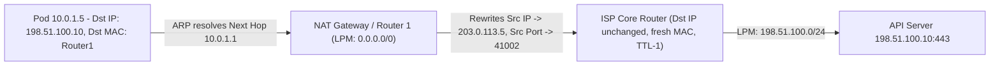
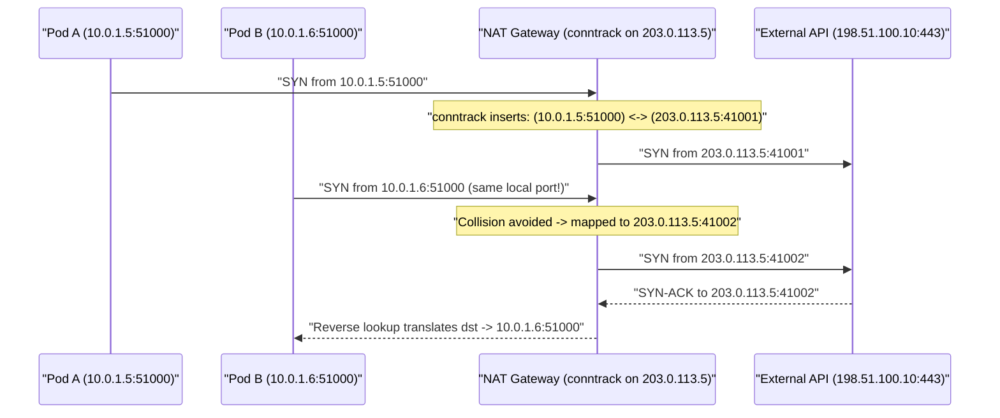
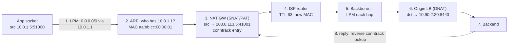
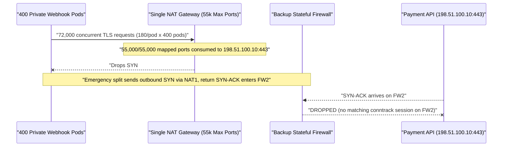

# Lesson 14: Routing and NAT — How Packets Find Their Way, and Why Your Phone Shares One Public Address

> **Prerequisites:** [Lesson 13: Subnets and CIDR](../13-subnets-and-cidr/README.md), [Lesson 03: IP Addresses](../03-ip-addresses/README.md), and [Networking From Zero Overview](../README.md) (Lesson 14 of 30).  
> **Estimated Reading Time:** 28 minutes  
> **Target Audience:** Backend and cloud platform engineers debugging NAT Gateway `SNAT` port exhaustion (`conntrack` table limits), asymmetric routing drops across stateful firewalls, local ARP hops, and IPv4-to-IPv6 transitions.  
> **Free PDF Notes:** [Download SD-N-014.pdf](https://backendroadmap.com/notes/system-design/SD-N-014.pdf)

> [!NOTE]
> **In one line:** The IP finds the machine and the port finds the process; every TCP connection is a socket named by a unique 5-tuple, so one port can hold 100,000 connections; routers forward packets hop by hop by longest prefix match without changing the IP addresses; and NAT rewrites addresses and ports in a `conntrack` table so thousands of private hosts can share one public IP, within a per-destination port budget.

> [!TIP]
> **The Golden Rule of Routing & NAT:** **Routing** forwards packets hop by hop using **Longest Prefix Match** (and `0.0.0.0/0` as the last-resort default gateway), leaving IP headers unchanged while swapping **MAC addresses via ARP** on every local link. **NAT (`SNAT` / `PAT` / `DNAT`)** sits at the network boundary rewriting IP and port tuples inside a stateful **`conntrack` table**, letting thousands of private `RFC 1918` devices share one public IP—at the cost of a **`55,000–64,000` port ceiling** per destination tuple and strict sensitivity to **asymmetric routing**.

---

## Words You'll Meet Today

| Word | In Plain Words | Role in a Live Backend System |
| :--- | :--- | :--- |
| **Routing table** | A phone directory telling the OS/router which neighbor gets each CIDR. | Evaluated via **Longest Prefix Match** before every packet leaves a NIC. |
| **Default gateway (`0.0.0.0/0`)** | The catch-all exit door when no local or specific CIDR matches. | Sends internet-bound traffic out to your home router or cloud VPC router. |
| **ARP** | *Address Resolution Protocol*: shouts "Who owns this local IP?" on LAN. | Maps next-hop IP (`10.0.1.1`) to a `48`-bit Ethernet **MAC** address for the frame. |
| **Next hop** | The immediate neighbor router one physical link away. | Every hop strips the old MAC header, decrements IP `TTL`, and picks a fresh MAC. |
| **SNAT & PAT** | Rewriting the sender's private IP (and port) to a public NAT IP. | Lets hundreds of private pods (`10.0.x.x`) reach external APIs over one IP (`conntrack`). |
| **DNAT** | Rewriting the destination public IP/port to an internal server IP/port. | How cloud load balancers and Kubernetes `NodePort`/`Service` forward inbound calls. |
| **`conntrack` table** | Stateful kernel hash table tracking active NAT mappings (`5`-tuple). | Remembers `(10.0.1.5, 51000) <-> (203.0.113.5, 41002)` so replies return safely. |
| **Asymmetric routing** | Outbound packets leave Path A while return replies arrive on Path B. | Breaks stateful firewalls and NAT gateways whose `conntrack` lives only on Path A. |

---

## Visual Mental Models & Architecture

### The Question: How Can `500` Pods Share One Public IP Without Mixing Up Replies?

In [lesson 13](../13-subnets-and-cidr/README.md), we saw that private subnets use `RFC 1918` addresses (`10.0.1.5`) that internet routers refuse to deliver. Yet your laptop (`192.168.1.42`) and `500` private Kubernetes pods (`10.0.1.x`) simultaneously query external APIs through **one** public address (`203.0.113.5`), and every reply lands back in the exact browser tab or pod that asked. How do routers pass packets across hops, and how does NAT keep `500` streams straight?

### An Everyday Picture First: Relay Couriers + Front-Desk Extensions

Imagine mailing a parcel from an apartment inside a private campus (`10.0.1.5`) to an external bank (`198.51.100.10`):

- **Routing & ARP (Relay Couriers):** Each courier only drives one road segment. Your apartment courier delivers to the **campus gate (`10.0.1.1`)**, the gate courier hands it to the city hub, and so on. The **outer shipping crate (`MAC` address)** changes at every handoff, while the **final destination street address (`IP` address)** written on the inner parcel never changes.
- **PAT / NAT (Front-Desk Extension Numbers):** Because the campus apartments use reusable indoor numbers (`Room 101`), the bank cannot mail replies directly to `Room 101`. So the campus **front desk (`203.0.113.5`)** erases `Room 101` on the return address, stamps **`Campus Building, Ext. 41002`**, and writes `Ext 41002 -> Room 101, Port 51000` in its **front-desk ledger (`conntrack`)**. When the bank replies to `Ext. 41002`, the desk checks the ledger and routes it straight back to `Room 101`!

### Hop-by-Hop Routing, Longest Prefix Match, and `ARP`

Suppose private pod `10.0.1.5` wants to send a TCP packet to `198.51.100.10:443`:

1. **Longest Prefix Match (`LPM`):** The kernel inspects its routing table: does `198.51.100.10` match the on-link `10.0.1.0/24` route? No. Does it match `10.0.0.0/16` (VPC internal)? No. Only **`0.0.0.0/0`** (the **default gateway**, pointing to `10.0.1.1`) matches.
2. **Local Link `ARP`:** Notice `10.0.1.5` does **not** ARP for `198.51.100.10`—that server is thousands of miles away! It ARPs on the local broadcast domain (`ff:ff:ff:ff:ff:ff`) for its **next hop (`10.0.1.1`)** and caches `10.0.1.1 -> aa:bb:cc:00:00:01`.
3. **Hop-by-Hop Forwarding:** At each router along the path, the router pops the Ethernet frame, checks the IP header, decrements the IP **TTL** (`64 -> 63 -> ...` so routing loops die instead of spinning forever), runs LPM on *its* routing table, ARPs the next hop's MAC, and builds a fresh Ethernet frame.



*Figure 1. Hop-by-hop routing vs. NAT: Ethernet MAC addresses change on every physical hop (resolved via ARP), IP TTL decrements by `1` per router, and only the NAT Gateway mutates the source IP and port.*

### `SNAT`, `DNAT`, `PAT`, and the `conntrack` Port Limit

- **`SNAT` (Source NAT) + `PAT` (Port Address Translation / Masquerade):** Rewrites `(src_ip, src_port)` on **outbound** packets. Suppose Pod A (`10.0.1.5:51000`) and Pod B (`10.0.1.6:51000`) pick the *exact same* ephemeral port `51000` simultaneously while calling `198.51.100.10:443`. The NAT Gateway allocates two distinct mapped ports—`(203.0.113.5, 41001)` for Pod A and `(203.0.113.5, 41002)` for Pod B—storing both full `5`-tuples in its **`conntrack` table**.
- **`DNAT` (Destination NAT):** Rewrites `(dst_ip, dst_port)` on **inbound** packets. A client connects to load balancer `203.0.113.5:443`; the LB performs DNAT to forward the packet to private backend `10.0.2.20:8443`, keeping internal topology hidden.
- **NAT Port Exhaustion (`~55k` / `64k` Limit):** A single public NAT IP only has `16`-bit ports (`65,535` total, roughly **`55,000`** usable on managed cloud NAT Gateways like AWS NAT GW, or `~64,000` on raw Linux `iptables MASQUERADE`). Remember from [lesson 11](../11-tcp-closing-time-wait-and-ports/README.md) that TCP connections are tracked by the `4`/`5`-tuple: here, **all** private pods behind one NAT IP share that single `203.0.113.5` pool when calling the **same** external `(dst_ip, dst_port, proto)`! Connect `300` pods × `200` sockets each to one payment API (`60,000` total) -> boom, `ErrorPortAllocation`!



*Figure 2. How PAT resolves identical private ports: Pod A and Pod B both chose ephemeral port `51000`, so `conntrack` assigns distinct public mapped ports (`41001` vs. `41002`) and reverses the rewrite on return packets.*

### Asymmetric Routing & Why IPv6 Removes NAT

In multi-homed datacenters with two active border firewalls/NATs (`FW-A` and `FW-B`), **asymmetric routing** occurs if outbound `SYN` packets leave through `FW-A` (creating a `conntrack` session there), while return `SYN-ACK` packets from the internet arrive via `FW-B` (whose `conntrack` table has **never seen that flow**). A stateful firewall sees an unsolicited `SYN-ACK` or mid-stream `ACK` and silently drops it—leaving callers hanging on mysterious timeouts!

Why does **IPv6** eliminate NAT? Because IPv6's `128`-bit address space ($3.4 \times 10^{38}$ addresses) gives every phone, laptop, and Kubernetes pod its own globally unique IP—removing `conntrack` SNAT port ceilings completely (though organizations still keep *stateless/stateful firewalls* at the perimeter to block unsolicited inbound connections without translating addresses!).

---

## Core Definition & Taxonomic Comparison

**What it is:** Three cooperating mechanisms deliver one packet end to end. **Addressing + sockets** decide *who* (IP → machine, port → process, 5-tuple → exactly one connection). **Routing** decides *which way* (hop-by-hop longest-prefix match on the destination IP, with ARP resolving the next-hop MAC on each local link). **NAT** decides *how private hosts appear on the public internet* (rewriting source or destination IP/port and remembering the mapping in a stateful table). **What it isn't:** routing does not rewrite IPs; NAT is not a firewall (statefulness happens to block unsolicited inbound); and a "full path" is never known by any single router.

| Term | Precise Meaning | Production Example |
| :--- | :--- | :--- |
| **Port** | 16-bit number (`0–65,535`) selecting the process on a host. Well-known: `443`, `22`, `5432`, `6379`, `53`. | `10.0.1.5:5432` is Postgres; `10.0.1.5:6379` is Redis. |
| **Ephemeral port** | The temporary client-side port chosen by the OS (`32768–60999` on Linux). | Browser tab → `203.0.113.7:51514` for each connection. |
| **Socket** | One endpoint: `(protocol, IP, port)`, exposed as a file descriptor. | `accept()` returns a new socket per client; all share local port `443`. |
| **5-tuple** | `(protocol, src IP, src port, dst IP, dst port)`: uniquely names a connection. Change any value ⇒ different connection. | A TCP and a UDP socket may both use `443` on one host. |
| **Route / FIB entry** | `destination prefix → next hop, interface`. The most specific match wins; `0.0.0.0/0` is the last resort. | `10.1.0.0/16 → peering link`, `0.0.0.0/0 → NAT gateway`. |
| **ARP / ND** | Local-link resolution of next-hop IP to MAC (ARP for IPv4, Neighbor Discovery for IPv6). | Host ARPs for `10.0.1.1`, never for `198.51.100.10`. |
| **SNAT / PAT (masquerade)** | Rewrites **source** IP (and port) on outbound packets so many private hosts share one public IP. | NAT gateway for private subnets; home router. |
| **DNAT** | Rewrites **destination** IP/port on inbound packets to a private backend. | Load balancer `203.0.113.5:443 → 10.0.2.20:8443`; Kubernetes `NodePort`. |
| **Asymmetric routing** | Forward and return packets of one flow take different paths/devices. | Dual-homed server replying on `eth0` for traffic that arrived on `eth1`. |

**Business implication:** routing/NAT faults look like *application* timeouts. "Some connections fail only under load, only to one SaaS endpoint" is almost always a NAT port budget; "SYN arrives, SYN-ACK leaves, client hangs" is almost always asymmetric routing or a stateful device that never saw the SYN.

---

## Component Breakdown & Anatomy: One Packet's Journey

A single outbound request from a private pod decomposes into **eight stages**; each is a distinct place where latency or failure can hide:

| # | Stage | Layer / Component | What Changes | Typical Failure |
| :--- | :--- | :--- | :--- | :--- |
| 1 | Socket + ephemeral port | Kernel (L4) | Chooses `src port` | `EADDRNOTAVAIL` (ports exhausted, lesson 11) |
| 2 | Route lookup (LPM) | Kernel FIB | Picks next hop + source IP | `Network is unreachable`, wrong default route |
| 3 | ARP for next hop | L2 neighbor table | Learns gateway MAC | Stale/failed neighbor entry; table overflow |
| 4 | Hop forwarding | Each router | MAC rewritten, `TTL − 1`, IP unchanged | TTL expiry (`Time Exceeded`), blackhole |
| 5 | SNAT/PAT at the boundary | NAT gateway / `iptables` | `src IP:port → NAT IP:mapped port`; entry in conntrack | Port exhaustion, `conntrack: table full` |
| 6 | Internet transit | Core routers (BGP-learned FIB) | MAC + TTL only | Congestion, path change |
| 7 | DNAT / load balancing at destination | Edge LB | `dst IP:port → backend` | Backend health, conntrack at LB |
| 8 | Return path | Reverse translation | `dst` restored from conntrack | **Asymmetry**, expired mapping |



### Header Mutation Cheat Table

| Field | Routing hop | SNAT / PAT | DNAT |
| :--- | :--- | :--- | :--- |
| Source / Destination MAC | **Rewritten** every hop | Rewritten (it is a hop) | Rewritten |
| TTL | **`−1`** | `−1` | `−1` |
| Source IP | Unchanged | **Rewritten** | Unchanged |
| Source port | Unchanged | **Rewritten** (PAT) | Unchanged |
| Destination IP / port | Unchanged | Unchanged | **Rewritten** |
| IP / TCP checksums | IP header recomputed (TTL change) | Both recomputed | Both recomputed |

### The Observability Gap: Who Sees the Real Address?

| Measurement Point | What It Captures | What It Hides |
| :--- | :--- | :--- |
| **Pod / host logs** | The private `10.x` source, the dest it *thinks* it hit | The NAT IP and mapped port the world saw |
| **VPC Flow Logs on the pod ENI** | Pre-NAT private 5-tuple | The post-NAT tuple; failures after the gateway |
| **NAT gateway metrics** | Active connections, port-allocation errors, bytes, idle timeouts | *Which* pod or flow is responsible |
| **Remote service logs** | Only the NAT public IP | Which internal client sent it; shared IP looks like one noisy client (and may be rate-limited as one) |
| **`conntrack -L` on the NAT host** | The full mapping `(private, port) ⇄ (public, mapped port)` | Historical state; entries age out |
| **`tcpdump` on both sides of the NAT** | Ground truth of rewrites and drops | Only what you captured at that instant |

---

## Mathematical Model: Sockets, Port Budgets, conntrack, and Asymmetry

### 1. How Many Connections Can One Listening Port Hold?

The server side keys connections by the **5-tuple**, and only the client's `(IP, port)` varies:

$$C_{\max}^{\text{theory}} = N_{\text{client IPs}} \times 64{,}512 \;\;(\text{unprivileged ports } 1024\text{–}65535) \;\xrightarrow{\;N=2^{32}\;}\; \approx 2.8 \times 10^{14}$$

So **ports do not run out on the server**; the real ceilings are **file descriptors** and **memory**:

$$\text{FDs}_{\text{needed}} = C + F_{\text{overhead}}, \qquad \text{RAM} = C \times (B_{\text{kernel}} + B_{\text{app}})$$

| Concurrent connections | Per-connection memory | RAM needed | `ulimit -n` / `LimitNOFILE` (≈ 2×) |
| :--- | :--- | :--- | :--- |
| `10,000` | `20 KB` | `200 MB` | `20,000` |
| `100,000` | `20 KB` | **`2 GB`** | `200,000` |
| `100,000` | `100 KB` | **`10 GB`** | `200,000` |
| `1,000,000` | `20 KB` | `20 GB` | `2,000,000` (and raise `fs.nr_open`, `net.core.somaxconn`) |

The default `1,024` open-file limit fails first with *too many open files*.

### 2. NAT Port Budget Toward One Destination

NAT mappings are keyed by the full tuple `(nat_ip, mapped_port, dst_ip, dst_port, proto)`, so the *same* mapped port can serve different destinations. For a single `(dst_ip, dst_port, proto)`:

$$F_{\max} = N_{\text{NAT IPs}} \times P_{\text{ports}}, \quad P_{\text{ports}} \approx 55{,}000\ \text{(AWS NAT GW)},\ \approx 64{,}000\ \text{(Linux MASQUERADE)}$$

$$N_{\text{IPs required}} = \left\lceil \frac{F_{\text{peak}}}{P_{\text{ports}} \times u} \right\rceil, \quad u \approx 0.7 \text{ (headroom)}$$

| Peak concurrent flows to ONE destination | Raw `⌈F / 55,000⌉` | With `70%` headroom |
| :--- | :--- | :--- |
| `30,000` | `1` | `1` |
| `55,000` | `1` | `2` |
| `72,000` (the war story) | `2` | `2` |
| `140,000` | `3` | `4` |
| `500,000` | `10` | `13` |

**Churn limit:** if closed flows linger in conntrack `TIME_WAIT` for `120 s` (Linux netfilter default), the sustainable **new** short-connection rate per destination per NAT IP is only:

$$\lambda_{\max} \approx \frac{55{,}000}{120\ \text{s}} \approx 458\ \text{new connections/s}$$

This is lesson 11's ephemeral-port arithmetic, *relocated* to the NAT gateway: pooling and HTTP/2 multiplexing shrink both $F$ and $\lambda$ by 10–100×.

### 3. conntrack Memory and Capacity

$$\text{RAM}_{\text{conntrack}} \approx N_{\text{entries}} \times \sim 320\ \text{B}$$

| `nf_conntrack_max` | Approx. RAM | Typical use |
| :--- | :--- | :--- |
| `65,536` | `~21 MB` | Tiny VM default (fills quickly!) |
| `262,144` | `~84 MB` | Mid-size node |
| `1,048,576` | `~335 MB` | Busy NAT / kube-proxy node |
| `4,194,304` | `~1.3 GB` | Large gateway (also raise `hashsize`) |

When `nf_conntrack_count` reaches `nf_conntrack_max`, **new** flows are dropped (`nf_conntrack: table full, dropping packet`) while existing flows keep working: a partial, confusing outage.

### 4. Asymmetric Routing: How Much Traffic Breaks?

If a flow's forward and return packets are spread uniformly across `n` stateful devices that do **not** share state, the probability both directions traverse the *same* device is `1/n`:

$$P_{\text{broken}} = 1 - \frac{1}{n}$$

| Active stateful devices `n` | Flows broken |
| :--- | :--- |
| `2` | `50%` |
| `3` | `66.7%` |
| `4` | `75%` |

Hence the fixes: **symmetric hashing** (same 5-tuple hash both ways), **state synchronization**, **sticky/pinned paths**, or **active/standby** only. Strict reverse-path filtering (`rp_filter=1`) also drops asymmetric packets on Linux hosts.

### 5. Longest Prefix Match, TTL, and Latency Floors

* LPM is $\arg\max_{r \in R,\ \text{dst} \in r}\ \text{prefixlen}(r)$; table order is irrelevant; the global IPv4 BGP table has on the order of `10^6` prefixes, which is why routers use tries/TCAM rather than linear scans.
* A packet crosses at most `TTL` routers (start `64` on Linux, `128` on Windows). A two-router loop with TTL `64` bounces the packet for up to `64` wasted link traversals before it dies, per packet in the loop.
* Propagation floor: light in fiber ≈ `200,000 km/s` ⇒ **`5 µs/km`**. Mumbai ↔ Frankfurt (`~6,600 km` of cable path) ⇒ `≥ 33 ms` one-way, `≥ 66 ms` RTT, no matter how good your routing is.

### 6. The PDF's Route-Table Example, Computed

| Destination | Matches | Winner (longest prefix) | Result |
| :--- | :--- | :--- | :--- |
| `10.1.4.20` | `10.1.0.0/16` (16), `0.0.0.0/0` (0) | `/16` | Peering link to VPC 2 |
| `10.0.2.15` | `10.0.0.0/16` (16), `0.0.0.0/0` (0) | `/16` | Delivered locally in the VPC |
| `8.8.8.8` | `0.0.0.0/0` only | `/0` | NAT gateway (default route) |

---

---

## Systematic Reference & Comparison Grid

### Forwarding vs. Address Translation Modes

| Mechanism | Header Mutated | Who Initiates Flow? | Stateful `conntrack` Required? | Primary Scaling Ceiling |
| :--- | :--- | :--- | :--- | :--- |
| **Pure IP Routing** | **None** (`TTL - 1`, MAC swaps per hop) | Either peer | No (stateless LPM forwarding) | Router PPS / FIB table size |
| **PAT / Masquerade (`SNAT`)** | **Src IP + Src Port** | Private client outbound | **Yes** (`~320 B` RAM / flow) | **`55,000–64,000`** flows per `(dst_ip, dst_port)` per NAT IP |
| **1:1 Static `SNAT`** | **Src IP only** (1 private <-> 1 public) | Either direction | Optional / stateless mapping | Requires 1 dedicated public IP per private host |
| **`DNAT` (Port Forward / LB)** | **Dst IP + Dst Port** | External client inbound | **Yes** (or DSR / proxy) | Backend `conntrack` table size & `ip_local_port_range` |

### Header Visibility Across Four Hops (`Pod -> NAT -> Router -> Origin LB`)

| Packet Field | Leaving Pod (`eth0`) | After NAT Gateway | After Internet Core Router | After Origin LB (`DNAT`) |
| :--- | :--- | :--- | :--- | :--- |
| **Source MAC** | Pod MAC | NAT WAN MAC | Core Router MAC | LB Internal MAC |
| **Dest MAC** | NAT LAN MAC | ISP Next-Hop MAC | Origin Edge MAC | Backend Pod MAC |
| **IP TTL** | `64` | `63` | `54` | `53` |
| **Source IP:Port** | `10.0.1.5:51000` | **`203.0.113.5:41001`** | `203.0.113.5:41001` | `203.0.113.5:41001` |
| **Dest IP:Port** | `198.51.100.10:443` | `198.51.100.10:443` | `198.51.100.10:443` | **`10.90.2.20:8443`** |

The concurrent outbound NAT ceiling to a single external `(dst_ip, dst_port, proto)` tuple is:

$$
\text{Max Concurrent Flows}_{\text{single target}} = N_{\text{NAT Public IPs}} \times P_{\text{usable ports}} \quad (\approx N \times 55{,}000\text{ on cloud NAT GW})
$$

Meanwhile, Linux `conntrack` table capacity is bounded by `net.netfilter.nf_conntrack_max` (often `65,536`–`262,144` entries on small VMs—once full, *every* new connection fails with `nf_conntrack: table full, dropping packet`!).

---

## Observability: NAT, conntrack, and Routing Health

Routing and NAT faults are *invisible to application metrics* until they are catastrophic, so instrument the middleboxes directly.

| Signal | Source | Healthy | Alert When | Meaning |
| :--- | :--- | :--- | :--- | :--- |
| `ErrorPortAllocation` | AWS CloudWatch `AWS/NATGateway` | `0` | Any `> 0` | SNAT port exhaustion to a destination; connections silently failing |
| `ActiveConnectionCount` (per NAT GW) | CloudWatch | Well below `55,000 × IPs` per top destination | `> 70%` of budget | Approaching the per-destination cap |
| `ConnectionAttemptCount` vs `ConnectionEstablishedCount` | CloudWatch | Nearly equal | Gap widens | Remote not answering, or exhaustion |
| `PacketsDropCount` | CloudWatch | `0` | Rising | NAT GW dropping (exhaustion, bandwidth, malformed) |
| `IdleTimeoutCount` | CloudWatch | Low | Spike | Long-idle flows being reaped: NAT idle timeout vs. your keep-alive |
| `nf_conntrack_count / nf_conntrack_max` | `node_nf_conntrack_entries / node_nf_conntrack_entries_limit` | `< 60%` | `> 80%` | Table-full drops imminent |
| `conntrack -S` `insert_failed`, `drop`, `early_drop` | Per-CPU stats | `0` | Increasing | Hash collisions / full table |
| `IpOutNoRoutes`, `IcmpOutDestUnreachs` | `nstat` | `0` | Rising | Missing or withdrawn route |
| ICMP Time Exceeded / traceroute hop count | `mtr`, `traceroute` | Stable path | Path flap, TTL expiry loops | Routing loop or reroute |
| Neighbor table overflow | `dmesg`: `neighbour: arp_cache: neighbor table overflow!` | None | Any | Raise `net.ipv4.neigh.default.gc_thresh{1,2,3}` (common on large Kubernetes nodes) |
| `rp_filter` / martian drops | `nstat TcpExtIPReversePathFilter`, `log_martians` | `0` | Rising | Asymmetric routing hitting reverse-path filtering |
| Top-N talkers per NAT GW | VPC Flow Logs / CloudWatch Contributor Insights | Even | One pod/destination dominates | Runaway client or missing pooling |

**Dashboards**
1. *NAT headroom:* `ActiveConnectionCount` ÷ `(55,000 × public IPs)` per top destination; red at `70%`.
2. *Flow attribution:* join Flow Logs (private pod IP, pre-NAT) with NAT mapping time windows to find *which workload* burned the ports.
3. *conntrack gauge* per node with a growth-rate overlay; alert on slope, not just level.
4. *Path health:* synthetic `mtr`/HTTP probes from each AZ to each critical external dependency (hop count + latency + loss).

**Runbook decision tree**
1. *Intermittent timeouts to ONE external endpoint under load* → `ErrorPortAllocation`? Add NAT IPs/AZ-local gateways, enable HTTP/2, cap per-pod pools.
2. *Random drops on a busy node* → `dmesg | grep conntrack`; raise `nf_conntrack_max` + `hashsize`, shorten timeouts for UDP/TIME_WAIT, reduce churn.
3. *SYN seen in, SYN-ACK out, client hangs* → run `ip route get <client>` on the server; check which interface the reply uses and add `ip rule` policy routing or fix firewall symmetry.
4. *Can't reach internet from a private subnet* → app subnet route (`0.0.0.0/0 → NAT`), NAT GW's subnet route (`0.0.0.0/0 → IGW`), NAT has an Elastic IP, then NACLs and security groups.

---

## Production War Story Post-Mortem: `55k` NAT SNAT Exhaustion & Asymmetric Multi-WAN Drop

- **Severity:** SEV-1 (`65%` checkout webhook failures across private Kubernetes worker pools)
- **Detection / Resolution Time:** 32 minutes to attach secondary Elastic IPs and restore steady-state flow
- **Impact:** All `3` Availability Zones shared a single NAT Gateway (`1` public IP `203.0.113.5`) when contacting an external payment gateway (`198.51.100.10:443`), saturating the `55,000` port limit (`ErrorPortAllocation`). Adding a second redundant edge path temporarily triggered asymmetric return drops across a stateful firewall before traffic was pinned symmetrically.

### What Happened



*Figure 3. Compounding production failure: `400` pods behind one NAT IP hit the `55,000` SNAT port cap toward one destination IP, and an uncoordinated second path caused asymmetric stateful drops.*

### Root Cause Analysis

1. **Single NAT IP Bottleneck:** Because `400` pods routed through *one* NAT Gateway IP (`203.0.113.5`) against *one* destination `(198.51.100.10, 443)`, even modest `180` sockets per pod summed to `72,000`—shattering the `55,000` per-destination port limit (`ErrorPortAllocation`).
2. **Short-Lived TLS Sockets + `TIME_WAIT` on NAT:** Lack of HTTP/2 multiplexing and aggressive connection churn kept recently closed NAT mappings pinned in `conntrack` `TIME_WAIT` (`120 s` in Linux netfilter), worsening exhaustion.
3. **Asymmetric Failover Path:** Routing return traffic back through a secondary stateful device that never observed the outbound `SYN` dropped valid `SYN-ACK` packets.

### The Fix & Architectural Hardening

- **Zonal NAT Gateways + Multiple Public IPs:** Deployed `1` NAT Gateway per AZ (`3` AZs) and attached `4` public Elastic IPs per NAT Gateway (`4 × 55,000 = 220,000` ports per AZ).
- **HTTP/2 & Pool Consolidation:** Enabled HTTP/2 multiplexing and reduced per-pod pool sizes so `400` pods multiplexed over `< 4,000` long-lived sockets total.
- **Symmetric Policy Routing:** Ensured each public NAT IP maps strictly to its originating gateway (`conntrack` stickiness / BGP route symmetry).

---

## Multi-Language Production Implementation

Below is a clean **Longest-Prefix Routing Table Lookup + Simulated PAT/`conntrack` Translation Engine** in Go, TypeScript, Python, and C#. It routes any destination IP by longest `/prefix` (`0.0.0.0/0` fallback included), translates private `(srcIP, srcPort)` outbound flows into `(natIP, mappedPort)` with `conntrack` collision checking and explicit port-exhaustion detection, and resolves inbound replies back to the original private pod.

````carousel
```go
package netengine

import (
	"errors"
	"fmt"
	"net/netip"
)

type Route struct {
	Prefix  netip.Prefix
	NextHop string
	Iface   string
}

type FlowKey struct {
	SrcIP, DstIP     netip.Addr
	SrcPort, DstPort uint16
}

type NatKey struct {
	MappedPort uint16
	DstIP      netip.Addr
	DstPort    uint16
}

type RouterAndNAT struct {
	Routes    []Route
	NatIP     netip.Addr
	MinPort   uint16
	MaxPort   uint16
	outbound  map[FlowKey]uint16
	inbound   map[NatKey]FlowKey
}

func NewRouterAndNAT(routes []Route, natIP string, minP, maxP uint16) *RouterAndNAT {
	return &RouterAndNAT{
		Routes:   routes,
		NatIP:    netip.MustParseAddr(natIP),
		MinPort:  minP,
		MaxPort:  maxP,
		outbound: make(map[FlowKey]uint16),
		inbound:  make(map[NatKey]FlowKey),
	}
}

func (r *RouterAndNAT) LookupRoute(dst netip.Addr) (Route, error) {
	bestBits := -1
	var best Route
	for _, rt := range r.Routes {
		if rt.Prefix.Contains(dst) && rt.Prefix.Bits() > bestBits {
			bestBits = rt.Prefix.Bits()
			best = rt
		}
	}
	if bestBits < 0 {
		return Route{}, fmt.Errorf("no route to host: %s", dst)
	}
	return best, nil
}

func (r *RouterAndNAT) TranslateOutbound(srcIP, dstIP string, srcPort, dstPort uint16) (string, uint16, error) {
	fk := FlowKey{netip.MustParseAddr(srcIP), netip.MustParseAddr(dstIP), srcPort, dstPort}
	if existing, ok := r.outbound[fk]; ok {
		return r.NatIP.String(), existing, nil
	}
	for port := int(r.MinPort); port <= int(r.MaxPort); port++ {
		nk := NatKey{uint16(port), fk.DstIP, fk.DstPort}
		if _, busy := r.inbound[nk]; !busy {
			r.outbound[fk] = uint16(port)
			r.inbound[nk] = fk
			return r.NatIP.String(), uint16(port), nil
		}
	}
	return "", 0, errors.New("SNAT port exhaustion: no free mapped ports for destination tuple")
}

func (r *RouterAndNAT) TranslateInbound(mappedPort uint16, srcIP string, srcPort uint16) (FlowKey, bool) {
	fk, ok := r.inbound[NatKey{mappedPort, netip.MustParseAddr(srcIP), srcPort}]
	return fk, ok
}
```
<!-- slide -->
```typescript
export interface RouteEntry {
  cidr: string;
  nextHop: string;
  iface: string;
}

function ipToUint32(ip: string): number {
  const octets = ip.split(".").map(Number);
  return (((octets[0] << 24) | (octets[1] << 16) | (octets[2] << 8) | octets[3]) >>> 0);
}

export class RouterAndNat {
  private readonly outbound = new Map<string, number>();
  private readonly inbound = new Map<string, { srcIp: string; srcPort: number }>();

  constructor(
    private readonly routes: RouteEntry[],
    private readonly natIp: string,
    private readonly minPort = 40000,
    private readonly maxPort = 40999
  ) {}

  lookupRoute(dstIp: string): RouteEntry {
    const dst = ipToUint32(dstIp);
    let best: RouteEntry | null = null;
    let bestPrefix = -1;

    for (const route of this.routes) {
      const [netStr, pStr] = route.cidr.split("/");
      const prefix = Number(pStr);
      const mask = prefix === 0 ? 0 : (0xffffffff << (32 - prefix)) >>> 0;
      if (((ipToUint32(netStr) & mask) >>> 0) === ((dst & mask) >>> 0) && prefix > bestPrefix) {
        bestPrefix = prefix;
        best = route;
      }
    }
    if (!best) throw new Error(`No route to host ${dstIp}`);
    return best;
  }

  translateOutbound(srcIp: string, srcPort: number, dstIp: string, dstPort: number): { natIp: string; mappedPort: number } {
    const flowKey = `${srcIp}:${srcPort}->${dstIp}:${dstPort}`;
    const existing = this.outbound.get(flowKey);
    if (existing !== undefined) return { natIp: this.natIp, mappedPort: existing };

    for (let port = this.minPort; port <= this.maxPort; port++) {
      const natKey = `${port}->${dstIp}:${dstPort}`;
      if (!this.inbound.has(natKey)) {
        this.outbound.set(flowKey, port);
        this.inbound.set(natKey, { srcIp, srcPort });
        return { natIp: this.natIp, mappedPort: port };
      }
    }
    throw new Error(`SNAT port exhaustion toward ${dstIp}:${dstPort}`);
  }

  translateInbound(mappedPort: number, remoteIp: string, remotePort: number): { srcIp: string; srcPort: number } | null {
    return this.inbound.get(`${mappedPort}->${remoteIp}:${remotePort}`) ?? null;
  }
}
```
<!-- slide -->
```python
from dataclasses import dataclass
import ipaddress


@dataclass(frozen=True)
class Route:
    prefix: ipaddress.IPv4Network
    next_hop: str
    iface: str


class RouterAndNAT:
    def __init__(self, routes: list[Route], nat_ip: str, min_port: int = 40000, max_port: int = 40999):
        self.routes = routes
        self.nat_ip = nat_ip
        self.min_port = min_port
        self.max_port = max_port
        self.outbound: dict[tuple[str, int, str, int], int] = {}
        self.inbound: dict[tuple[int, str, int], tuple[str, int]] = {}

    def lookup_route(self, dst_ip: str) -> Route:
        addr = ipaddress.IPv4Address(dst_ip)
        matches = [r for r in self.routes if addr in r.prefix]
        if not matches:
            raise LookupError(f"No route to host: {dst_ip}")
        return max(matches, key=lambda r: r.prefix.prefixlen)  # Longest Prefix Match

    def translate_outbound(self, src_ip: str, src_port: int, dst_ip: str, dst_port: int) -> tuple[str, int]:
        flow = (src_ip, src_port, dst_ip, dst_port)
        if flow in self.outbound:
            return self.nat_ip, self.outbound[flow]

        for port in range(self.min_port, self.max_port + 1):
            nat_key = (port, dst_ip, dst_port)
            if nat_key not in self.inbound:
                self.outbound[flow] = port
                self.inbound[nat_key] = (src_ip, src_port)
                return self.nat_ip, port

        raise RuntimeError(f"SNAT port exhaustion toward {dst_ip}:{dst_port}")

    def translate_inbound(self, mapped_port: int, remote_ip: str, remote_port: int) -> tuple[str, int] | None:
        return self.inbound.get((mapped_port, remote_ip, remote_port))
```
<!-- slide -->
```csharp
using System;
using System.Buffers.Binary;
using System.Collections.Generic;
using System.Net;

public sealed record RouteEntry(string Cidr, string NextHop, string Interface);

public sealed class RouterAndNat
{
    private readonly List<RouteEntry> _routes;
    private readonly string _natIp;
    private readonly int _minPort, _maxPort;
    private readonly Dictionary<(string, int, string, int), int> _outbound = new();
    private readonly Dictionary<(int, string, int), (string SrcIp, int SrcPort)> _inbound = new();

    public RouterAndNat(List<RouteEntry> routes, string natIp, int minPort = 40000, int maxPort = 40999)
    {
        _routes = routes;
        _natIp = natIp;
        _minPort = minPort;
        _maxPort = maxPort;
    }

    private static uint ToUInt(string ip) =>
        BinaryPrimitives.ReadUInt32BigEndian(IPAddress.Parse(ip).GetAddressBytes());

    public RouteEntry LookupRoute(string dstIp)
    {
        uint dst = ToUInt(dstIp);
        RouteEntry? best = null;
        int bestPrefix = -1;

        foreach (var route in _routes)
        {
            var parts = route.Cidr.Split('/');
            int prefix = int.Parse(parts[1]);
            uint mask = prefix == 0 ? 0u : ~0u << (32 - prefix);
            if ((ToUInt(parts[0]) & mask) == (dst & mask) && prefix > bestPrefix)
            {
                bestPrefix = prefix;
                best = route;
            }
        }
        return best ?? throw new InvalidOperationException($"No route to host {dstIp}");
    }

    public (string NatIp, int MappedPort) TranslateOutbound(string srcIp, int srcPort, string dstIp, int dstPort)
    {
        var flow = (srcIp, srcPort, dstIp, dstPort);
        if (_outbound.TryGetValue(flow, out int existing))
            return (_natIp, existing);

        for (int port = _minPort; port <= _maxPort; port++)
        {
            var natKey = (port, dstIp, dstPort);
            if (_inbound.TryAdd(natKey, (srcIp, srcPort)))
            {
                _outbound[flow] = port;
                return (_natIp, port);
            }
        }
        throw new InvalidOperationException($"SNAT port exhaustion toward {dstIp}:{dstPort}");
    }

    public (string SrcIp, int SrcPort)? TranslateInbound(int mappedPort, string remoteIp, int remotePort) =>
        _inbound.TryGetValue((mappedPort, remoteIp, remotePort), out var orig) ? orig : null;
}
```
````

---

## Practical Hands-On Verification CLI Workflows

### 1. Ask the Kernel Which Route and Source IP a Destination Will Use

```bash
ip route get 1.1.1.1
```

**Expected Output:**

```text
1.1.1.1 via 10.0.1.1 dev eth0 src 10.0.1.8 uid 1000
    cache
```

This reveals the exact Longest-Prefix winner, **next-hop gateway** (`10.0.1.1`), outgoing interface (`eth0`), and chosen local source IP (`10.0.1.8`) without sending a single packet!

### 2. Inspect the Local `ARP` Neighbor Table

```bash
ip neigh show
```

**Expected Output:**

```text
10.0.1.1 dev eth0 lladdr 06:a9:c4:12:88:01 REACHABLE
```

Every router IP (`10.0.1.1`) resolves to a `MAC` address (`lladdr`) on your local subnet only—never the remote internet server's MAC.

### 3. Check `conntrack` Table Usage Against Kernel Limits

```bash
sysctl net.netfilter.nf_conntrack_count net.netfilter.nf_conntrack_max
```

**Expected Output:**

```text
net.netfilter.nf_conntrack_count = 14820
net.netfilter.nf_conntrack_max = 262144
```

On NAT gateways or Kubernetes nodes (`kube-proxy`), watching `nf_conntrack_count / nf_conntrack_max` alerts you long before `conntrack table full` drops occur.

---

## Pause and Think

> [!exercise] `300` private pods share ONE NAT Gateway IP (`55,000` SNAT ports per destination). The fleet holds `30,000` open connections to `db-a.partner.com:443` and simultaneously opens `30,000` connections to `events-b.partner.com:443` (`60,000` total sockets!). Does the NAT Gateway run out of SNAT ports? Decide before opening the answer.

<details><summary>Answer</summary>

**No!** Because `conntrack` keys NAT translations by the **full `5`-tuple** `(nat_ip, mapped_port, dst_ip, dst_port, proto)`, the same mapped port (e.g., `203.0.113.5:41001`) can be reused cleanly for **different** destinations (`db-a` vs. `events-b`). Each unique `(dst_ip, dst_port, proto)` receives its own `55,000`-port budget—so `30,000` + `30,000` succeeds cleanly as long as `conntrack` total memory/entries allow `60,000` rows! It only breaks when **more than `55,000`** connections target the **exact same** `(dst_ip, dst_port, proto)`.

</details>

---

## Operational Validation Checkpoints

<details><summary><strong>Checkpoint 1: Tracing What Changes on Every Hop</strong></summary>

**Scenario:** A packet travels `Laptop (192.168.1.5) -> Home Router (LAN 192.168.1.1 / WAN 198.51.100.7) -> ISP Core Router -> API Server (203.0.113.9:443)`. Which device does the Laptop ARP for, and when does the source IP change?

**Solution:**
The Laptop runs LPM (`203.0.113.9` matches `0.0.0.0/0` -> `192.168.1.1`), so it **ARPs only for `192.168.1.1`**. Leaving the Laptop, Source IP is `192.168.1.5`. The Home Router applies **PAT/SNAT**, rewriting Source IP to `198.51.100.7` (plus a mapped port) and decrementing IP `TTL` by `1`. The ISP Core Router leaves Source IP (`198.51.100.7`) and Dest IP (`203.0.113.9`) untouched, decrementing `TTL` and swapping MAC headers.

</details>

<details><summary><strong>Checkpoint 2: Why `tcpdump` Sees Outbound `SYN` & Inbound `SYN-ACK` Yet Connections Time Out</strong></summary>

**Scenario:** A server with two NICs (`eth0` default route, `eth1` peering subnet) receives traffic on `eth1`, yet its replies exit through `eth0` toward a stateful corporate firewall. `tcpdump` shows `SYN` arriving and `SYN-ACK` leaving, yet clients hang. Why?

**Solution:**
**Asymmetric routing!** The inbound `SYN` passed through Firewall B on `eth1`, while the return `SYN-ACK` exited via `eth0` through Firewall A. Because Firewall A never saw the initial `SYN` in its `conntrack` table, it drops the unsolicited `SYN-ACK`. Fix it with source-based policy routing (`ip rule`) so replies to traffic arriving on `eth1` always leave via `eth1`.

</details>

<details><summary><strong>Checkpoint 3: Sizing Elastic NAT IPs for High-Fanout Webhooks</strong></summary>

**Scenario:** Your private workers peak at `140,000` concurrent outbound TCP connections toward a single SaaS endpoint (`203.0.113.50:443`). How many public NAT IPs do you need on an AWS NAT Gateway (`55,000` ports per IP)?

**Solution:**
Compute $\lceil 140{,}000 / 55{,}000 \rceil = \mathbf{3}$ NAT public IPs minimum (`3 × 55,000 = 165,000` ports)—and provision `4` IPs (`220,000`) or split across `3` AZ-local NAT Gateways with multiple IPs so an AZ imbalance never hits the ceiling.

</details>

---

## Common Mistakes & Troubleshooting

### What Goes Wrong

- **Sharing one NAT IP across `500+` pods calling one upstream API:** Surpasses the `~55,000` port ceiling per destination tuple silently.
- **Ignoring `nf_conntrack_max` on busy Linux NAT/Kubernetes nodes:** When `conntrack` fills up, the kernel drops *new* packets silently (`SYN` timeouts!).
- **Dual-homing servers without policy routing:** Triggers asymmetric routing where stateful firewalls drop valid return packets.

### Common Myths

- **"ARP travels across the internet to find Google's MAC address."** Never! ARP broadcasts stop at the local subnet router (`Layer 2`). Across the internet, packets only carry the next-hop router's MAC.
- **"Adding NAT gives you automatic security."** NAT only obscures private IPs as a side effect of stateful `conntrack` blocking unsolicited inbound packets; IPv6 stateful firewalls provide stronger policy control *without* breaking end-to-end addressing or limiting SNAT ports.

### Troubleshooting Matrix

| Symptom / Error | Network Evidence | Root Cause | Fix |
| :--- | :--- | :--- | :--- |
| Intermittent external `SYN` timeouts under peak load | `ErrorPortAllocation` in NAT metrics | `> 55k` sockets per NAT IP to one `(dst_ip, dst_port)` | Attach multiple public NAT IPs; use HTTP/2 pooling |
| Random packet drops on busy proxy/K8s host | `dmesg`: `nf_conntrack: table full` | `nf_conntrack_count == nf_conntrack_max` | Raise `nf_conntrack_max` & hashsize; reduce short-lived churn |
| `SYN-ACK` sent but client never receives it | `tcpdump` shows `eth1` in, `eth0` out | Asymmetric routing hitting stateful firewall | Add `ip rule` policy routing per interface |

---

## Recap in Three Lines

1. **Routing** uses **Longest Prefix Match** (`0.0.0.0/0` fallback) to forward packets hop by hop—keeping IP addresses intact while **ARP** resolves a fresh **MAC address** on each local link.
2. **NAT (`SNAT`/`PAT` and `DNAT`)** maps private subnets onto public IPs via a stateful **`conntrack` table**, bounding concurrency per destination tuple to **`~55,000–64,000`** ports per public IP and requiring symmetric routing.
3. **IPv6** restores globally unique addressing to every device, eliminating NAT/PAT port exhaustion while preserving stateful firewall protection.

---

## Interview Practice Questions

Each question is tagged by kind: **Basic** (definitions), **Scenario** (apply it to a system), and **Tricky** (deep follow-ups). Answer out loud before opening the solution.

### Basic Conceptual Questions (Q1–Q4)

<details>
<summary><strong>Q1: What is the difference between an IP address and a port, and what is a socket? [BASIC]</strong></summary>

<strong>What a strong answer covers:</strong>
The **IP address** finds the machine; the **port** (`0–65,535`, 16 bits) finds the process on it: `10.0.1.5:5432` is Postgres, `10.0.1.5:6379` is Redis. A **socket** is one endpoint of communication, `(protocol, IP, port)`, which the OS hands to a program as a file descriptor to read and write. A TCP connection is named by the **5-tuple** `(protocol, src IP, src port, dst IP, dst port)`; change any element and it's a different connection, which is why a TCP and a UDP socket can both use port `443` and why two browser tabs get different ephemeral ports.

</details>

<details>
<summary><strong>Q2: How can one server port (`443`) accept 100,000 connections? [BASIC]</strong></summary>

<strong>What a strong answer covers:</strong>
The server has **one listening socket**; each `accept()` creates a brand-new connected socket. All share local port `443`, but each has a different client IP and port, so every 5-tuple is unique. The server never "uses up" ports; the limits are **file descriptors** (default `1,024` per process) and **memory** (kernel buffers + app state per connection). Plan descriptors `≈ 2× connections` and RAM `≈ connections × per-connection bytes`.

</details>

<details>
<summary><strong>Q3: What changes in a packet at each router hop, and where does a packet for `10.1.4.20` go given routes `10.0.0.0/16 local`, `10.1.0.0/16 peering`, `0.0.0.0/0 NAT`? [BASIC]</strong></summary>

<strong>What a strong answer covers:</strong>
At every hop the **source and destination IP stay unchanged**; the **TTL decrements by one**; the **MAC addresses are rewritten**: the host ARPs for its next hop (default gateway), each router strips the frame, does a **longest prefix match** on its own table, ARPs the next hop and builds a new Ethernet frame. For `10.1.4.20`: it matches `10.1.0.0/16` (`16` bits) and `0.0.0.0/0` (`0` bits); the longest prefix wins, so it goes over the **peering link**, never the NAT gateway.

</details>

<details>
<summary><strong>Q4: What is the difference between SNAT, PAT, and DNAT? [BASIC]</strong></summary>

<strong>What a strong answer covers:</strong>
**SNAT** rewrites the *source* IP of outbound packets; **PAT** (masquerade/NAPT) additionally rewrites the *source port*, using a stateful `conntrack` table so thousands of private IPs share one public IP. **DNAT** rewrites the *destination* IP/port of inbound packets so a public load balancer/firewall can forward to private backends (port forwarding, Kubernetes `NodePort`, `Service` VIPs). Replies are translated back using the stored mapping.

</details>

### Scenario-Based Architecture Questions (Q5–Q8)

<details>
<summary><strong>Q5: You need one box to hold 100,000 WebSocket connections. What do you change? [SCENARIO]</strong></summary>

<strong>What a strong answer covers:</strong>
Ports are *not* the constraint. (1) Raise the open-file limit well above `100k` (`ulimit -n`, systemd `LimitNOFILE ≈ 200,000`, and `fs.file-max`/`nr_open`). (2) Budget memory per connection: kernel buffers + app state `≈ 20 KB` ⇒ `100,000 × 20 KB ≈ 2 GB`; at `100 KB` it's `10 GB`, which decides the instance size. (3) Tune `net.core.somaxconn`, backlog, and `tcp_rmem/wmem` defaults downward for idle sockets. (4) Spread across processes/cores (`SO_REUSEPORT`), send heartbeats shorter than LB idle timeouts, and **load-test**: idle connections are cheap, busy ones also cost CPU.

</details>

<details>
<summary><strong>Q6: An app in a private subnet can't reach an external API. What do you check in routing? [SCENARIO]</strong></summary>

<strong>What a strong answer covers:</strong>
Follow the packet: (1) the app subnet's route table has `0.0.0.0/0 → NAT gateway`; (2) the NAT gateway lives in a **public** subnet whose `0.0.0.0/0 → internet gateway`; (3) the NAT has an **Elastic IP** and is `available`; (4) security groups (egress), **network ACLs** (stateless: ephemeral return ports), and endpoint policies; (5) DNS resolves; (6) the target isn't blocked by a longer, more specific route (e.g., a peered CIDR) overriding the default. Use `ip route get`, Reachability Analyzer, and Flow Logs `REJECT`/missing return traffic to localize.

</details>

<details>
<summary><strong>Q7: Hundreds of private ECS tasks or pods behind one NAT Gateway fail to connect to a single SaaS endpoint under load, while other endpoints work. Why, and what do you do? [SCENARIO]</strong></summary>

<strong>What a strong answer covers:</strong>
**SNAT port exhaustion**: one NAT IP supports about `55,000` simultaneous connections *per unique destination `(IP, port, proto)`*. All pods hit the same SaaS IP:443, their aggregate exceeded the budget (`400 pods × 180 = 72,000`), while other destinations still have their own `55,000`. Confirm via `ErrorPortAllocation` and `ActiveConnectionCount`. Fix: attach more public IPs (`⌈F/55,000⌉`, with headroom), one NAT GW per AZ, **HTTP/2 / pooled keep-alive** to cut socket count 10–100×, per-pod pool caps, or route SaaS traffic via PrivateLink/VPC endpoint where offered.

</details>

<details>
<summary><strong>Q8: Why does ARP resolve the gateway's MAC address instead of the destination server's when calling an external API? [SCENARIO]</strong></summary>

<strong>What a strong answer covers:</strong>
ARP is a **local broadcast** that never crosses routers. The OS consults its routing table, finds that the destination is off-link, picks the **next hop** (default gateway) by longest prefix match, and ARPs for *that* IP's MAC. The frame carries the gateway's MAC as destination MAC but the **server's IP** as destination IP; the gateway repeats the process for its own next hop. A server's MAC is meaningless a continent away: only the next hop's MAC matters on each link.

</details>

### Advanced & Tricky Interview Questions (Q9–Q12)

<details>
<summary><strong>Q9: What is asymmetric routing, and why does it break stateful firewalls and NAT gateways? [TRICKY]</strong></summary>

<strong>What a strong answer covers:</strong>
Outbound packets exit via one gateway/firewall while return packets enter via another. Stateful devices create a `conntrack` entry on the first `SYN` they see; a device that sees only the `SYN-ACK` or mid-stream `ACK` finds no state, treats it as invalid/unsolicited, and **silently drops** it. Symptoms: `tcpdump` shows SYN in and SYN-ACK out on the server, yet clients hang. With `n` independent devices, `1 − 1/n` of flows break. Fixes: symmetric ECMP hashing, state synchronization, active/standby, source-based policy routing (`ip rule`), or pinning each public NAT IP to its originating gateway. Linux `rp_filter=1` can also drop asymmetric packets.

</details>

<details>
<summary><strong>Q10: Where can ports actually run out? [TRICKY]</strong></summary>

<strong>What a strong answer covers:</strong>
On the **client side** (and any NAT or proxy acting as a client), never on a plain server. One source IP talking to one `dst_ip:port` can have only as many connections as ephemeral ports: about `28,000` with Linux defaults (`~470` new conn/s with a `60 s` `TIME_WAIT`). Load balancers, reverse proxies, and **NAT gateways** (`~55,000` per destination per IP) hit it. Fixes: connection reuse/pooling, more source IPs, more backend IPs or ports, a wider `ip_local_port_range`, `tcp_tw_reuse`.

</details>

<details>
<summary><strong>Q11: Do routers know the full path to a destination? What does `TTL` do, and how does `traceroute` use it? [TRICKY]</strong></summary>

<strong>What a strong answer covers:</strong>
No. Each router looks only at the destination IP, picks the best next hop from **its own** table, and forwards; the end-to-end path emerges from many local decisions learned via IGPs/BGP and may change between packets (ECMP can even split a flow's packets unless hashed per 5-tuple). **TTL** is decremented per hop and the packet is discarded at `0`, so routing loops can't circulate forever; the router sends back ICMP *Time Exceeded*. `traceroute` sends probes with TTL `1, 2, 3 …` and records who replies at each step, so it reveals the forward path (which may differ from the return path).

</details>

<details>
<summary><strong>Q12: Does IPv6 eliminate firewalls along with NAT? And is NAT a security feature? [TRICKY]</strong></summary>

<strong>What a strong answer covers:</strong>
No on both counts. IPv6's `128`-bit space gives every host a globally unique address, ending the need for NAT/PAT and SNAT port ceilings, but networks still deploy **stateful or stateless firewalls** to block unsolicited inbound traffic without rewriting headers. NAT's apparent protection is a *side effect* of conntrack dropping unsolicited inbound flows; it hides addresses, not vulnerabilities, and a stateful firewall delivers the same blocking with better visibility. IPv6 also keeps ICMPv6 essential (Neighbor Discovery, Path MTU Discovery), so "block all ICMP" breaks it.

</details>

---

## One-Page Master Cheat Sheet

```text
====================================================================================================
          ROUTING & NAT: HOW PACKETS FIND THEIR WAY (AND WHY YOUR PHONE SHARES ONE PUBLIC IP)
====================================================================================================
WHO / WHAT
  IP -> machine | port -> process (0-65,535) | socket = (proto, IP, port) = file descriptor
  5-tuple = (proto, src IP, src port, dst IP, dst port) uniquely names a connection
  Server: ONE listening socket; accept() makes one socket per client. Ports never run out SERVER-side.
  100k WebSockets: fds ~200k (ulimit -n) | RAM = 100k x 20 KB = 2 GB (100 KB -> 10 GB)

ROUTING
  Longest Prefix Match: most specific wins (/24 > /16 > /0), table order irrelevant. 0.0.0.0/0 = default.
  Per hop: IP src/dst UNCHANGED | TTL - 1 | MAC rewritten (ARP for NEXT HOP only, never the far server)
  No router knows the full path. traceroute = probes with TTL 1,2,3...
  Light in fiber = 5 us/km (Mumbai<->Frankfurt >= ~66 ms RTT).

NAT
  SNAT/PAT : rewrite src IP(+port), outbound, stateful conntrack      DNAT : rewrite dst IP/port, inbound
  Budget   : flows to ONE (dst_ip,dst_port,proto) <= N_natIPs x ~55,000 (AWS) / ~64,000 (Linux)
  IPs need = ceil( peak_flows / (55,000 x 0.7) )     72k flows -> 2 IPs | 140k -> 4 IPs
  Churn    : 55,000 / 120 s conntrack TIME_WAIT ~ 458 new conn/s per dst per NAT IP
  conntrack: ~320 B per entry; nf_conntrack_max 262,144 ~ 84 MB; full table => NEW flows dropped

ASYMMETRIC ROUTING
  forward via A, return via B (stateful, no shared state) -> return dropped. Broken flows = 1 - 1/n.
  Fix: symmetric hashing, state sync, active/standby, ip rule policy routing, rp_filter awareness.

TRIAGE
  timeouts to ONE external endpoint under load ... ErrorPortAllocation -> more NAT IPs, HTTP/2, pooling
  random drops on a busy node ................... dmesg conntrack: table full -> raise max + hashsize
  SYN in, SYN-ACK out, client hangs .............. asymmetric path -> ip route get; ip rule
  private subnet can't reach internet ........... app route 0/0 -> NAT; NAT subnet 0/0 -> IGW; EIP; NACL/SG

COMMANDS
  ip route get 1.1.1.1 | ip neigh show | sysctl net.netfilter.nf_conntrack_{count,max} | conntrack -S
  mtr -rwz <host> | tcpdump -ni any host <ip> | ss -s

ANTI-PATTERNS
  x one NAT IP for 500+ pods hitting one SaaS   x default 1,024 fd limit on a connection-heavy server
  x dual-homing without policy routing           x treating NAT as a firewall      x per-request new connections
====================================================================================================
```

---

## Free PDF notes

Download these notes as a printable PDF, with the hop-by-hop diagrams, NAT sizing formulas, and interview answers: [SD-N-014.pdf](https://backendroadmap.com/notes/system-design/SD-N-014.pdf).

---

## Sources

- [RFC 1812: Requirements for IP Version 4 Routers](https://www.rfc-editor.org/rfc/rfc1812), hop-by-hop forwarding, TTL decrement, and longest prefix match.
- [RFC 826: An Ethernet Address Resolution Protocol (ARP)](https://www.rfc-editor.org/rfc/rfc826), local IP-to-MAC resolution.
- [RFC 3022: Traditional IP Network Address Translator (Traditional NAT)](https://www.rfc-editor.org/rfc/rfc3022), SNAT, NAPT/PAT, and session translation.
- [RFC 4787: Network Address Translation (NAT) Behavioral Requirements for Unicast UDP](https://www.rfc-editor.org/rfc/rfc4787), mapping lifetimes and port pooling.
- [AWS NAT Gateway Quotas & Port Allocation](https://docs.aws.amazon.com/vpc/latest/userguide/nat-gateway-basics.html), `55,000` simultaneous connections per destination per Elastic IP.

---

## Next

Next comes [Lesson 15: DNS Part 1 — The Phone Book of the Internet, One Lookup Step by Step](../15-dns-lookup-step-by-step/README.md), tracing a domain query from `/etc/hosts` and Kubernetes `ndots:5` through Root, TLD, and Authoritative nameservers. Until then, the [track overview](../README.md) lists the whole series.
