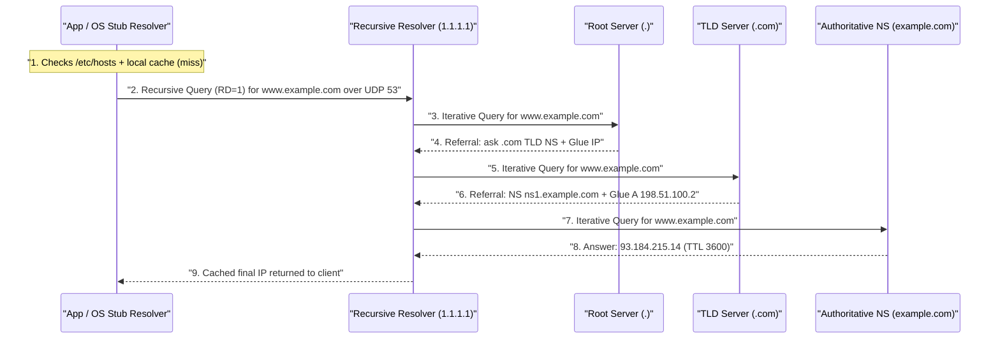
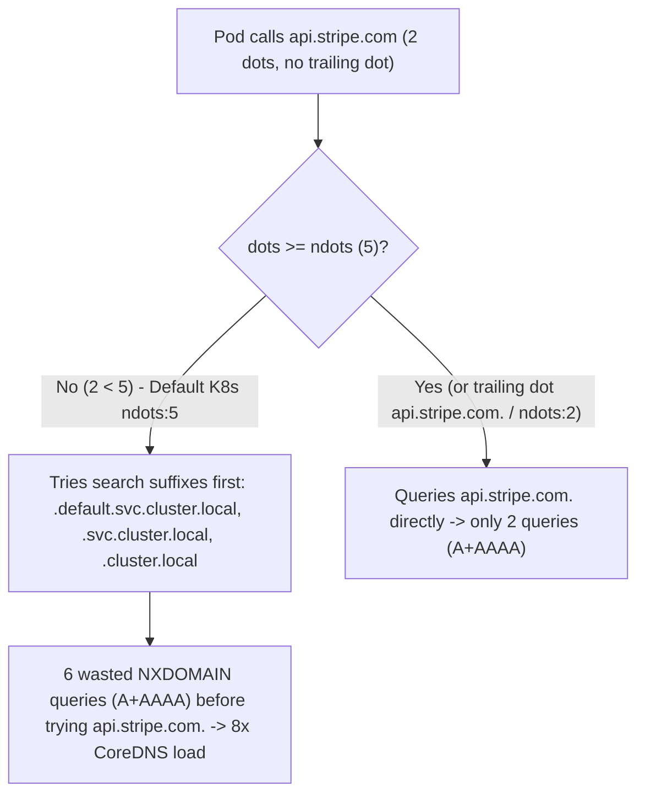
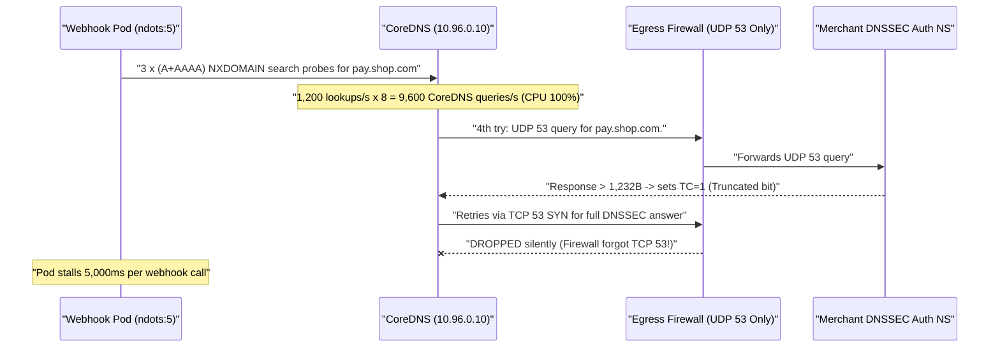

# Lesson 15: DNS Part 1 — The Phone Book of the Internet, One Lookup Step by Step

> **Prerequisites:** [Lesson 12: UDP vs TCP](../12-udp-vs-tcp/README.md), [Lesson 14: Routing and NAT](../14-routing-and-nat/README.md), and [Networking From Zero Overview](../README.md) (Lesson 15 of 30).  
> **Estimated Reading Time:** 28 minutes  
> **Target Audience:** Backend and Kubernetes platform engineers tracing cold DNS resolution, eliminating CoreDNS `ndots:5` query amplification storms, fixing UDP-to-TCP fallback (`TC=1`) firewall drops, and evaluating `EDNS0`, `DoT`, and `DoH`.  
> **Free PDF Notes:** [Download SD-N-015.pdf](https://backendroadmap.com/notes/system-design/SD-N-015.pdf)

> [!NOTE]
> **In one line:** Your machine asks a recursive resolver once; on a cache miss the resolver walks root → TLD → authoritative (using glue records to avoid circular lookups), caches every answer for its TTL, and falls back from UDP to TCP port 53 when a reply is truncated, so lower the TTL a full old-TTL before a migration, and in Kubernetes beware that `ndots:5` can multiply external lookups by up to eight.

> [!TIP]
> **The Golden Rule of DNS Resolution:** Every cold hostname lookup is a two-stage relay: your local **stub resolver** checks `/etc/hosts` and sends one **recursive query** (`RD=1`) to a **Recursive Resolver** (`1.1.1.1`, `8.8.8.8`, or `CoreDNS`), which walks **iterative referrals** down **Root (`.`) -> TLD (`.com`) -> Authoritative NS** using **glue records** to avoid chicken-and-egg loops. DNS uses **UDP port `53`** for single-packet speed (`512` B classic, `1,232` B with **`EDNS0`**), switches to **TCP port `53`** whenever the **`TC=1`** truncation bit fires—and inside Kubernetes, default **`ndots:5`** amplifies every external lookup by **`4–8x`** unless you configure trailing dots or lower `ndots`!

---

## Words You'll Meet Today

| Word | In Plain Words | Role in a Live Backend System |
| :--- | :--- | :--- |
| **Stub resolver** | The tiny DNS client built inside your OS `libc` or language runtime. | Checks `/etc/hosts`, applies `ndots`/search domains, and forwards one recursive query. |
| **Recursive resolver** | The workhorse server (`1.1.1.1`, `8.8.8.8`, `CoreDNS`) that hunts down answers. | Walks Root, TLD, and Authoritative servers iteratively and caches replies (`TTL`). |
| **Root / TLD server** | The top directory (`.`) and extension directory (`.com`, `.io`, `.org`). | Never stores final app IPs—returns referrals (delegations) to the next tier down. |
| **Iterative query** | "I won't chase it for you—here is the next server to ask." | Used between recursive resolvers and Root/TLD/Authoritative tiers. |
| **Glue record** | An extra `A`/`AAAA` IP attached alongside an `NS` delegation reply. | Breaks the circular deadlock when `example.com` hosts its own `ns1.example.com`. |
| **`TC=1` (Truncated)** | A 1-bit DNS header flag warning: "Too big for UDP, retry over TCP!" | Triggers immediate retry on **TCP port `53`** for large `DNSSEC`/`TXT` answers. |
| **`EDNS0`** | Extension letting DNS clients negotiate UDP buffers above `512` bytes. | Sets safe `1,232`-byte UDP limits (`DNS Flag Day`) without triggering IP fragments. |
| **`ndots:5`** | Kubernetes `/etc/resolv.conf` threshold treating names with `< 5` dots as local. | Turns one `api.stripe.com` call (`2` dots) into `6–8` wasteful `NXDOMAIN` probes! |

---

## Visual Mental Models & Architecture

### The Question: Where Does `api.stripe.com` Actually Come From When Caches Are Empty?

In [lesson 12](../12-udp-vs-tcp/README.md) we saw DNS picks UDP for single-packet speed, and in [lesson 14](../14-routing-and-nat/README.md) we learned packets route solely by IP addresses, never by text names. Yet you type `api.stripe.com` and milliseconds later your app connects to an IP. Where does that IP live, who knows it, and why can one tiny Kubernetes `/etc/resolv.conf` line quietly multiply your DNS traffic by eight?

### An Everyday Picture First: Personal Assistant vs. Calling Three Desks Yourself

Suppose you ask your office assistant (**Recursive Resolver**) for Alice's phone number at Stripe:

- **Recursive query (You -> Assistant):** You ask once and wait: *"Please track down `api.stripe.com` and bring me the final number."* You do not want directions—you want the answer.
- **Iterative queries (Assistant -> Directory Tree):** Your assistant calls the **National Switchboard (Root `.`)**, who replies: *"Ask the `.com` Registry Desk at `192.5.6.30`."* Your assistant calls **`.com` TLD**, who replies: *"Ask Stripe's own switchboard `ns1.stripe.com` at IP `205.251.192.x`."* Finally, Stripe's **Authoritative Nameserver** answers with the real IP—and your assistant writes it on a sticky note (`TTL` cache) so the next `1,000` coworkers get an instant answer!

### Step by Step: `/etc/hosts`, Stub Resolver, Root, TLD, Glue, and Authoritative NS

When an application calls `getaddrinfo("api.stripe.com")`, resolution walks a deterministic ladder:

1. **Local Cache & `/etc/hosts`:** Before touching the network, `glibc` (`/etc/nsswitch.conf`: `hosts: files dns`) checks `/etc/hosts` for static overrides (`127.0.0.1 localhost`) and any OS daemon cache (`systemd-resolved`, `nscd`).
2. **Stub Resolver -> Recursive Resolver (`UDP :53`, `RD=1`):** Finding nothing locally, the stub sends one packet with the **Recursion Desired (`RD=1`)** bit set to the resolver listed in `/etc/resolv.conf` (e.g., `1.1.1.1`, ISP DNS, or Kubernetes `10.96.0.10` CoreDNS).
3. **Root (`.`):** If the recursive resolver's cache is cold, it queries one of the `13` logical root server clusters (`a.root-servers.net` – `m.root-servers.net`, replicated globally to `1,500+` Anycast nodes). Root points it to the `.com` TLD servers.
4. **TLD (`.com`) + Glue Records:** `.com` returns the authoritative `NS` records for `stripe.com` (`ns1.example-dns.net` or `ns1.stripe.com`). **Crucial detail—Glue Records:** What if `example.com`'s nameserver is *inside its own zone* (`ns1.example.com`)? Without extra help, the resolver faces an infinite loop (*to find `example.com`, first find `ns1.example.com`, which requires finding `example.com`!*). So the `.com` TLD includes a **glue `A`/`AAAA` record** in the `ADDITIONAL` section (`ns1.example.com -> 198.51.100.2`) to break the loop!
5. **Authoritative Nameserver:** Finally, the recursive resolver asks the authoritative server directly, gets the `A`/`AAAA` IP + `TTL`, caches it, and replies to your stub resolver.



*Figure 1. Cold DNS lookup end-to-end: the client sends one recursive query (`RD=1`), while the recursive resolver walks three iterative hops from Root `.` to `.com` (using glue IPs) to the authoritative server.*

### `UDP 53` vs. `TCP 53` Fallback (`TC=1`), `EDNS0`, and `DoT`/`DoH`

Why does DNS default to **UDP port `53`**? Because a `60`-byte request and `120`-byte answer finish in **one round trip** with zero `SYN`/`SYN-ACK` handshake and zero `TIME_WAIT` port locking on resolvers handling millions of lookups per second.

- **Classic `512`-Byte Ceiling & `EDNS0`:** Original DNS (`RFC 1035`) capped UDP messages at **`512` bytes**. Modern **`EDNS0` (`RFC 6891`)** lets clients advertise a larger UDP buffer in an `OPT` pseudo-record—standardized at **`1,232` bytes** by DNS Flag Day 2020 so replies fit cleanly inside IPv6/VPN Path MTU without IP fragmentation (as we proved in [lesson 12](../12-udp-vs-tcp/README.md)!).
- **`TC=1` & Mandatory `TCP 53` Fallback:** Whenever an answer exceeds the advertised UDP limit (common with `DNSSEC` cryptographic signatures, big `TXT` SPF chains, or multi-record responses), the DNS server trims the UDP packet and flips the **`TC=1` (Truncated)** header bit. Compliant resolvers immediately retry the exact query over **TCP port `53`**. Zone transfers (`AXFR`) between primary/secondary nameservers also use TCP `53`. **Firewall trap:** Operators who allow `UDP 53` and forget `TCP 53` silently hang `DNSSEC` and large responses!
- **Encrypted DNS (`DoT` vs. `DoH`):** Classic UDP/TCP `53` is unencrypted plaintext—anyone on Wi-Fi or an ISP link sees every hostname you look up. **DNS over TLS (`DoT`, `RFC 7858`, TCP `853`)** wraps standard DNS messages inside TLS on a dedicated port (easy for corporate networks to monitor/block). **DNS over HTTPS (`DoH`, `RFC 8484`, TCP/UDP `443`)** encodes DNS inside HTTPS `GET`/`POST` streams (`application/dns-message`), blending seamlessly into web traffic over HTTP/2 and HTTP/3.

### The Kubernetes `ndots:5` CoreDNS Amplification Trap

Inside almost every Kubernetes pod, `/etc/resolv.conf` defaults to:

```text
nameserver 10.96.0.10
search default.svc.cluster.local svc.cluster.local cluster.local
options ndots:5
```

Look closely at **`ndots:5`**. It instructs the stub resolver: *"If a hostname has **fewer than `5` dots** and does not end with a trailing dot `.`, assume it might be an internal Kubernetes Service first—append every suffix in `search` before ever trying the bare domain as absolute!"*

How many dots are in `api.stripe.com`? **Two (`2 < 5`)!** Worse, dual-stack clients resolve both `A` (IPv4) and `AAAA` (IPv6) concurrently:

1. `api.stripe.com.default.svc.cluster.local` -> `A` + `AAAA` (`2` `NXDOMAIN`s)
2. `api.stripe.com.svc.cluster.local` -> `A` + `AAAA` (`2` `NXDOMAIN`s)
3. `api.stripe.com.cluster.local` -> `A` + `AAAA` (`2` `NXDOMAIN`s)
4. `api.stripe.com.` (finally!) -> `A` + `AAAA` (`2` queries)

That is **`8` CoreDNS lookups** (`10` if your node inherits a cloud VPC search domain!) for **every single uncached external call**!



*Figure 2. Kubernetes `ndots:5` amplification: external domains with `1–4` dots trigger `6+` guaranteed `NXDOMAIN` queries per lookup unless you set `ndots:2` or append a trailing dot (`api.stripe.com.`).*

---

## Core Definition & Taxonomic Comparison

**What it is:** DNS is a **globally distributed, hierarchical, heavily cached database** that maps names to records (addresses, aliases, mail routes, text). Resolution is *delegation*: each tier knows only who is responsible for the next label to the left, so no server stores everything. **What it isn't:** DNS is not a load balancer or a health-checker by itself (it only hands out cached answers), a `CNAME` is not an HTTP redirect (it is resolved inside DNS before any connection), and DNS `TTL` is a *cache lifetime*, unrelated to the IP packet `TTL` hop counter.

Four roles are routinely confused; each answers a different question:

| Term | Precise Meaning | Production Example |
| :--- | :--- | :--- |
| **Stub resolver** | Minimal client in `libc`/runtime: consults `/etc/hosts`, applies `search` and `ndots`, sends **one** recursive query (`RD=1`) and waits. | `getaddrinfo()` in a Go/Java/Node/Python process; `systemd-resolved`. |
| **Recursive resolver** | Does the *entire* walk on the client's behalf, validates (DNSSEC), and **caches** for many users. | `1.1.1.1`, `8.8.8.8`, VPC resolver (`.2`), CoreDNS in Kubernetes. |
| **Authoritative server** | Holds the real records of a zone; source of truth and issuer of TTLs. Does **not** recurse. | Route 53 / Cloudflare / BIND serving `example.com`. |
| **Root / TLD server** | Pure referral engines: root knows who runs `.com`; `.com` knows who runs `example.com`. Never hold your app's IP. | `a.root-servers.net`; Verisign `.com` gTLD servers. |
| **Iterative query** | "Answer if you can, else tell me who to ask next." Used between resolver and the tree. | Resolver → root → TLD → authoritative. |
| **Recursive query** | "Get me the final answer or an error." Used by stub → resolver. | Your app → `1.1.1.1`. |
| **Negative cache** | Cached *non-existence* (`NXDOMAIN`/`NODATA`) for a time given by the zone's SOA minimum. | A name queried before creation keeps failing for minutes. |

**Record types you must know**

| Type | What it does | Example | Gotcha |
| :--- | :--- | :--- | :--- |
| **`A`** | Name → IPv4 | `api.example.com A 203.0.113.10` | Multiple `A` records = DNS round-robin (not health-aware) |
| **`AAAA`** | Name → IPv6 ("quad A") | `api.example.com AAAA 2001:db8::10` | Dual-stack clients issue **both** `A` and `AAAA` queries |
| **`CNAME`** | Alias: name → another name, resolved recursively | `www CNAME my-lb.elb.amazonaws.com.` | **Illegal at the zone apex**; cannot coexist with other records |
| **`NS`** | Names the authoritative servers for a zone | `example.com NS ns1.example.com` | Parent holds the delegation; child holds the zone copy |
| **`MX`** | Mail routing with priority | `example.com MX 10 mail.example.com` | Must point to a name, not a `CNAME` |
| **`TXT`** | Free text: SPF, DKIM, domain verification | `"v=spf1 include:_spf.example.com ~all"` | Large TXT chains push responses past `1,232 B` → `TC=1` |
| **`SOA`** | Zone metadata incl. **negative-cache TTL** | `ns1 hostmaster 2026112301 7200 900 1209600 300` | Last field is the negative TTL |

**Business implication:** DNS is a hidden dependency of *every* request. A slow or failing lookup looks like an application timeout, a stale cache looks like "half our users are on the old server," and one resolver misconfiguration can take down an entire cluster even though every service is healthy.

---

## Component Breakdown & Anatomy: Where a Lookup's Time Goes

A name lookup is a **layered cache hierarchy** in front of a **three-hop tree walk**. Worst case is the full walk; typical case never leaves the first two layers.

```text
  App ─► [1 Language/runtime cache?] ─► [2 OS: /etc/hosts, nscd, systemd-resolved] ─► [3 Stub: search/ndots]
                                                                                              │ UDP 53 (RD=1)
                                                                                              ▼
                 [4 Recursive resolver cache (shared by many users)]  hit: ~1-5 ms
                       │ miss
                       ├──► Root  (.)            referral: .com NS (+glue)        ~5-25 ms   (cached 48 h)
                       ├──► TLD   (.com)         referral: example.com NS (+glue) ~10-40 ms  (cached 48 h)
                       └──► Authoritative        ANSWER: A 203.0.113.10 TTL 3600  ~10-60 ms
```

| Layer | Who controls it | Caches? | Typical latency | What goes wrong |
| :--- | :--- | :--- | :--- | :--- |
| **1. Runtime / browser** | App / browser | Seconds to minutes (JVM `networkaddress.cache.ttl`, Chrome ~1 min) | `< 0.1 ms` | Ignores TTL (JVM forever), keeps stale IPs |
| **2. OS stub + `/etc/hosts`** | Host admin | Optional (`systemd-resolved`, `nscd`) | `< 0.1 ms` | Static `hosts` override forgotten for years |
| **3. Search-list expansion** | `resolv.conf` (`search`, `ndots`) | No | Adds *N* extra queries | Kubernetes `ndots:5` amplification |
| **4. Recursive resolver** | ISP / cloud / CoreDNS | Yes, `TTL`-bound, shared | `1–5 ms` hit / `20–120 ms` miss | Overload, forwarders down, SERVFAIL |
| **5. Root → TLD → Authoritative** | Registry / DNS host | Source of truth | `5–60 ms` each | Lame delegation, firewalled `TCP 53`, DNSSEC failures |

### The Observability Gap: Who Sees Which Failure?

| Measurement Point | What It Captures | What It Hides |
| :--- | :--- | :--- |
| **App latency (`time_namelookup`, `httptrace.DNSDone`)** | Total lookup time as the app felt it | Whether the time was search-list probing, a cache miss, or a timeout retry |
| **CoreDNS / resolver metrics** | QPS, rcode mix, duration histograms, cache hit/miss | Which pod/app generated the queries (source IP is node-level without logging) |
| **`dig +trace`** | The ideal full walk from the root | What *your* resolver actually did or has cached |
| **`dig @authoritative`** | The source-of-truth answer and TTL | What users' resolvers currently serve |
| **Packet capture on port 53** | Exact queries, retries, `TC` flags, TCP fallbacks | Intent, DNSSEC validation internals |
| **Synthetic probes from many regions** | Propagation and geo behavior | Per-client caches (browsers, JVMs) |

DNS failure is **systemically silent**: many clients retry or fall back, so the symptom is *latency* (`5 s` multiples) rather than errors, until everything saturates at once.

---

## Mathematical Model: Cache Hit Ratio, Load, Migration Staleness, Amplification

### 1. Expected Lookup Latency

$$E[L] = h \cdot t_{\text{hit}} + (1-h)\cdot\big(t_{\text{hit}} + t_{\text{walk}}\big)$$

Cold-walk cost is the sum of the RTTs of each referral hop: $t_{\text{walk}} \approx \text{RTT}_{\text{root}} + \text{RTT}_{\text{TLD}} + \text{RTT}_{\text{auth}}$.

| Cache state at resolver | Network round trips to the tree | Typical latency |
| :--- | :--- | :--- |
| Answer cached | `0` | `1–5 ms` |
| `NS` for the domain cached (the common miss) | `1` (authoritative only) | `15–60 ms` |
| `.com` NS cached, domain NS not | `2` | `40–100 ms` |
| Fully cold | `3` (+ possible DNSSEC key fetches) | `60–200 ms` |

With `h = 0.95`, `t_hit = 2 ms`, `t_walk = 60 ms`: `E[L] = 2 + 0.05 × 60 = 5 ms`. Raising `h` to `0.99` drops it to `2.6 ms`; the *tail* (`p99`) is governed by the miss path, not the mean.

### 2. TTL vs. Authoritative Load

For one resolver caching one name, queries arrive at rate $\lambda$ and each miss refills the cache for $T$ seconds. A cycle is one TTL window plus the wait for the next query, so the upstream rate and miss probability are:

$$r_{\text{auth}} = \frac{1}{T + 1/\lambda}, \qquad P(\text{miss}) \approx \frac{1}{1 + \lambda T}$$

| TTL `T` | Max auth queries per resolver per name per day (`≈ 86,400 / T`) | Meaning |
| :--- | :--- | :--- |
| `10 s` | `8,640` | Provider-outage and cost exposure; many more misses |
| `60 s` | `1,440` | Failover-grade records |
| `300 s` | `288` | Common default for dynamic services |
| `3,600 s` | `24` | Typical stable record |
| `86,400 s` | `1` | Very stable (NS, MX) but near-impossible to change quickly |

If `R = 100,000` distinct resolvers query your name, authoritative load is $R \cdot r_{\text{auth}}$: at `T = 60 s` that is up to `~1,667 QPS` of pure cache refills, versus `~28 QPS` at `T = 3,600 s`: a `60×` difference for the same user traffic.

### 3. Migration Staleness: Why You Lower the TTL *Early*

A resolver that cached the old answer at a uniformly random moment still holds it for the *remaining* TTL. After you change the record at $t = 0$ (with the old TTL $T_{\text{old}}$ still in caches), the fraction of resolvers still serving the old IP is:

$$S(t) = \max\left(0,\ 1 - \frac{t}{T_{\text{old}}}\right)$$

| Time after switch | `T_old = 3600 s` (lowered *at* switch) | `T = 60 s` (lowered ≥ 1 h earlier) |
| :--- | :--- | :--- |
| `30 s` | `99.2%` stale | `50%` |
| `10 min` | `83.3%` | `0%` |
| `30 min` | `50%` | `0%` |
| `60 min` | `0%` | `0%` |

**Plan:** `t_lower ≥ T_old` before the cutover (lower from `3600 → 60` at least `1 h`, usually `24–48 h`, ahead), cut over, keep the **old backend serving** for hours to days (clients and libraries that ignore TTL, long-lived connections), then raise the TTL again.

**The PDF's worked case:** TTL `3600`; you switch at `10:00`; a resolver cached at `09:59` serves the old IP until `10:59`. Lowering the TTL to `60` at `10:00` is too late for that resolver; it won't ask again until `10:59`.

### 4. `ndots` Query Amplification

For a name with `d` dots and `S` search suffixes, dual-stack (`A + AAAA`), a name is tried **as absolute first iff `d ≥ ndots`**, otherwise every suffix first:

$$Q = \begin{cases} 2 & d \ge \text{ndots} \ \text{(absolute first, succeeds)} \\ 2\,(S + 1) & d < \text{ndots},\ \text{external name (all suffixes fail first)} \end{cases}$$

| Name | Dots | `ndots:5` queries | `ndots:2` queries | Trailing dot (`name.`) |
| :--- | :--- | :--- | :--- | :--- |
| `payments` (Service in same namespace) | `0` | `2` (first suffix hits) | `2` | n/a |
| `payments.prod` (cross-namespace) | `1` | `4` | `4` | n/a |
| `api.stripe.com` | `2` | **`8`** (`6` wasted `NXDOMAIN`) | **`2`** | `2` |
| `a.b.c.d.example.com` | `5` | `2` | `2` | `2` |

At `1,000` uncached external lookups/s with `S = 3`: **`8,000` QPS** (`ndots:5`) vs **`2,000` QPS** (`ndots:2`): a `75%` cut. Stub **retry math** when the resolver is slow/dead (`timeout:5`, `attempts:2` default in glibc): worst-case a single lookup blocks for $\text{attempts} \times N_{\text{servers}} \times \text{timeout} = 2 \times 1 \times 5 = 10\ \text{s}$ (or `20 s` with two nameservers).

### 5. Message Size and the UDP Limit

A DNS response is `12 B` header + question + answers; an `A` record with a compressed name pointer costs `16 B`.

| Limit | Payload budget | Approx. `A` records that fit | Typical overflow cause |
| :--- | :--- | :--- | :--- |
| Classic UDP (RFC 1035) | `512 B` | `~30` | Big RRsets |
| EDNS0 safe size (DNS Flag Day 2020) | `1,232 B` | `~74` | `DNSKEY`/`RRSIG` (a `2048-bit` RSA signature alone is `256 B`), large `TXT` |
| EDNS0 aggressive (`4,096 B`) | `4,096 B` | many | IP fragmentation across tunnels → silent drops |

Anything that exceeds the negotiated size sets **`TC=1`** and forces a TCP retry, an extra `1 RTT` handshake + response.

---

---

## Systematic Reference & Comparison Grid

### DNS Resolution Tiers Compared

| Tier / Component | Who Operates It? | Knowledge Scope | Caches Answers? | Typical Uncached Latency |
| :--- | :--- | :--- | :--- | :--- |
| **OS Stub (`libc`)** | Your Linux/app container | `/etc/hosts` + `resolv.conf` rules | Optional (`systemd-resolved`) | `< 0.1 ms` (local) |
| **Recursive Resolver** | Cloudflare `1.1.1.1`, ISP, `CoreDNS` | Full tree traversal + local zone cache | **Yes** (`TTL`-bound) | `1–5 ms` hit / `20–120 ms` miss |
| **Root Servers (`.`)** | `12` orgs (`13` Anycast clusters) | TLD delegations (`.com`, `.org`, `.io`) | Authoritative static root zone | `5–25 ms` (Anycast nearby) |
| **TLD Servers** | Verisign (`.com`), PIR (`.org`), etc. | Domain `NS` delegations + **Glue IPs** | Authoritative TLD zone | `10–40 ms` |
| **Authoritative NS** | Route 53, Cloudflare, BIND | Actual `A`, `AAAA`, `CNAME`, `MX`, `TXT` | Source of truth (`TTL` issuer) | `10–60 ms` |

### DNS Transport Variants

| Transport | Port & Protocol | Max Payload | Encryption | Primary Use Case / Trigger |
| :--- | :--- | :--- | :--- | :--- |
| **Classic UDP DNS** | `UDP 53` | `512 B` | None | Legacy queries without `EDNS0` |
| **`EDNS0` UDP DNS** | `UDP 53` | **`1,232 B`** (recommended) | None | Standard modern DNS queries (`DNS Flag Day`) |
| **TCP DNS Fallback** | `TCP 53` | `64 KB` stream | None | Triggered by **`TC=1`**, `DNSSEC`, and `AXFR` transfers |
| **DoT (DNS over TLS)** | `TCP 853` | Stream | **TLS** | Private Android/Linux/router encrypted upstream DNS |
| **DoH (DNS over HTTPS)** | `TCP/UDP 443` | HTTP/2–3 | **TLS (HTTPS)** | Browser & firewall-resilient encrypted DNS |

### Kubernetes `ndots` Query Multiplication Math

If a pod has $S$ search domains (typically $3$ in Kubernetes, or $4$ with a VPC domain), one dual-stack (`A` + `AAAA`) uncached external lookup triggers:

$$
\text{Queries}_{\text{amplified}} = 2 \times (S + 1), \qquad \text{Queries}_{\text{absolute / } ndots \le 2} = 2
$$

With $S = 3$ search suffixes, `1,000` external API lookups/sec generate **`8,000` CoreDNS QPS** under `ndots:5`, compared to **`2,000` QPS** under `ndots:2`—an instant **`75%` drop** in CoreDNS CPU and `conntrack` UDP socket churn!

---

## Observability: DNS Latency, Error Mix, and Cache Health

Instrument DNS like any tier-0 dependency: latency histograms, error-code mix, cache effectiveness, and transport mix.

| Signal | Source | Healthy | Alert When | Meaning |
| :--- | :--- | :--- | :--- | :--- |
| `coredns_dns_request_duration_seconds` (p50/p99) | CoreDNS Prometheus | `p99 < 20 ms` | `p99 > 100 ms` or step change | Upstream slowness, CPU saturation, conntrack drops |
| `coredns_dns_responses_total{rcode}` | CoreDNS | `NXDOMAIN` small | `NXDOMAIN` ratio `> 30–40%` sustained | **`ndots` amplification** or typos in service names |
| `SERVFAIL` rate | `rcode="SERVFAIL"` | `~0` | Any sustained rise | Broken upstream, DNSSEC validation failure, lame delegation |
| `coredns_dns_requests_total{proto="tcp"}` share | CoreDNS | `< 1–2%` of queries | Rising | Many `TC=1` fallbacks (large answers) or UDP drops |
| `coredns_cache_hits_total` vs `_misses_total` | CoreDNS `cache` plugin | Hit ratio `> 80–90%` | Falling | Churning low TTLs, unique names (random subdomains), cache too small |
| `coredns_forward_*` (healthcheck failures, request duration) | CoreDNS `forward` | `0` failures | Failures | Upstream resolver down |
| Queries/sec per client pod | CoreDNS `log` plugin sampled / NodeLocal metrics | Even | One pod dominates | Retry storm or `ndots` offender |
| `conntrack -S` `insert_failed`, `nf_conntrack_count` | Node | `0` | Rising | UDP conntrack race/exhaustion → `5 s` stalls |
| Lookup time inside the app | `curl -w '%{time_namelookup}'`, Go `httptrace.DNSDone`, OpenTelemetry `dns.lookup` spans | `< 10 ms` warm | Bimodal with `~5000 ms` mode | Timeout + retry (`resolv.conf timeout:5`) |
| Node.js `getaddrinfo` queueing | libuv threadpool (default `4`) | Idle | Threadpool saturated | Slow DNS blocks `fs`/`crypto` too |
| Response size / truncation | `coredns_dns_response_size_bytes`, `dig +bufsize` probes | Mostly `< 1,232 B` | Large/Truncated | Firewall must allow `TCP 53`; set `bufsize 1232` |
| Synthetic propagation check | Probes from N regions querying authoritative + public resolvers | All agree after `T` | Disagree after `T` | Stale caches, split-horizon errors |

**Dashboards**
1. *Golden signals for DNS:* QPS, error ratio (`SERVFAIL` + timeouts), `p50/p95/p99` duration, and saturation (CPU, conntrack, socket buffers) per CoreDNS pod.
2. *rcode stack:* `NOERROR` vs `NXDOMAIN` vs `SERVFAIL` vs `REFUSED` over time, with deploy markers; an `NXDOMAIN` plateau right after a rollout is the `ndots` signature.
3. *Migration board:* during a cutover, every `60 s` query the authoritative servers and 3–5 public resolvers and plot **% answering old vs new IP** against the expected `S(t)` curve; also traffic split at the old and new load balancers.
4. *Transport mix:* UDP vs TCP vs DoT/DoH query counts.

**Runbook decision tree**
1. *Lookups take exactly ~5 s (or 10 s)* → a packet was dropped and glibc retried after `timeout:5`: check conntrack race / `insert_failed`, UDP drops, CoreDNS saturation; consider NodeLocal DNSCache, `options single-request-reopen`, or `use-vc`.
2. *Only DNSSEC/large-TXT domains slow* → `dig +bufsize=512 +dnssec`: does it say "Truncated, retrying in TCP mode" then hang? Open `TCP 53` egress.
3. *CoreDNS CPU high, `NXDOMAIN` flood* → inspect pod `resolv.conf`; set `ndots:2` (or FQDNs with trailing dot) and add NodeLocal DNSCache.
4. *Users still on the old IP after a change* → compare `dig @authoritative` (truth) vs `dig @resolver` (what users see); read the remaining TTL; confirm the old backend is still serving and draining.

---

## Production War Story Post-Mortem: `ndots:5` CoreDNS Storm & `TCP 53` Firewall Hang

- **Severity:** SEV-1 (Outbound Webhook Delivery Latency `> 5,000 ms`, `35%` Timeout Rate)
- **Detection / Resolution Time:** 38 minutes to restore via `ndots:2`, NodeLocal DNSCache, and `TCP 53` egress rule
- **Impact:** Scaling a webhook worker fleet to `1,200 req/s` across external merchant hostnames overwhelmed CoreDNS (`100%` CPU) and triggered `nf_conntrack` UDP drops. Simultaneously, merchants using `DNSSEC` returned `TC=1` truncated responses whose `TCP 53` retries hung for `5 s` until timeout!

### What Happened



*Figure 3. Compounding DNS failure: `ndots:5` multiplied CoreDNS QPS by `8x`, while a security group permitting only `UDP 53` silently killed every `TC=1` TCP fallback.*

### Root Cause Analysis

1. **Default `ndots:5` Amplification:** Merchant hostnames (`pay.merchant.com`) contained only `2` dots, causing every pod lookup to fire `6` guaranteed `NXDOMAIN` search probes (`2` each for `.default.svc.cluster.local`, `.svc.cluster.local`, `.cluster.local`) before querying the real external name.
2. **Missing `TCP 53` Egress Rule:** A security-hardened egress ACL explicitly allowed `UDP 53` outbound and assumed DNS never used TCP—blackholing every `TC=1` response from `DNSSEC`-signed domains.

### The Fix & Architectural Hardening

- **Set `ndots: "2"` + NodeLocal DNSCache:** Updated pod `dnsConfig` (`options: [{ name: ndots, value: "2" }]`) and deployed `NodeLocal DNSCache` DaemonSets using TCP upstream connections to CoreDNS, eliminating cross-node UDP `conntrack` pressure.
- **Permit `UDP 53` AND `TCP 53` Everywhere:** Added `TCP 53` alongside `UDP 53` in every VPC Security Group and NetworkPolicy, and pinned CoreDNS `bufsize 1232` (`EDNS0`).

---

## Multi-Language Production Implementation

Below is a production-structured **DNS Lookup Client with Strict Timeout, Cold vs. Warm Cache Measurement & `ndots` Search-Path Amplification Auditor** across Go, TypeScript, Python, and C#. Notice how it explicitly enforces bounded resolver contexts (avoiding infinite `getaddrinfo` thread-pool stalls!) and exposes exact candidate search-order evaluation for any `ndots` value.

````carousel
```go
package dnsclient

import (
	"context"
	"net"
	"strings"
	"time"
)

type LookupReport struct {
	Host       string
	IPs        []string
	ColdTime   time.Duration
	WarmTime   time.Duration
	SearchPlan []string
}

// SimulateSearchOrder replicates glibc resolv.conf ndots expansion before hitting the wire.
func SimulateSearchOrder(name string, searchDomains []string, ndots int) []string {
	if strings.HasSuffix(name, ".") {
		return []string{name}
	}
	dotCount := strings.Count(name, ".")
	var candidates []string
	if dotCount >= ndots {
		candidates = append(candidates, name+".")
	}
	for _, s := range searchDomains {
		candidates = append(candidates, name+"."+strings.TrimSuffix(s, ".")+".")
	}
	if dotCount < ndots {
		candidates = append(candidates, name+".")
	}
	return candidates
}

func ResolveWithTimeout(host string, timeout time.Duration, searchDomains []string, ndots int) (LookupReport, error) {
	resolver := &net.Resolver{PreferGo: true}
	ctx1, cancel1 := context.WithTimeout(context.Background(), timeout)
	defer cancel1()

	t0 := time.Now()
	ips, err := resolver.LookupHost(ctx1, host)
	cold := time.Since(t0)
	if err != nil {
		return LookupReport{}, err
	}

	ctx2, cancel2 := context.WithTimeout(context.Background(), timeout)
	defer cancel2()
	t1 := time.Now()
	_, _ = resolver.LookupHost(ctx2, host)
	warm := time.Since(t1)

	return LookupReport{
		Host:       host,
		IPs:        ips,
		ColdTime:   cold,
		WarmTime:   warm,
		SearchPlan: SimulateSearchOrder(host, searchDomains, ndots),
	}, nil
}
```
<!-- slide -->
```typescript
import dns from "node:dns/promises";

export interface LookupReport {
  host: string;
  ips: string[];
  coldMs: number;
  warmMs: number;
  searchPlan: string[];
}

export function simulateSearchOrder(name: string, searchDomains: string[], ndots = 5): string[] {
  if (name.endsWith(".")) return [name];
  const dots = (name.match(/\./g) ?? []).length;
  const plan: string[] = [];
  if (dots >= ndots) plan.push(`${name}.`);
  for (const suffix of searchDomains) {
    plan.push(`${name}.${suffix.replace(/\.$/, "")}.`);
  }
  if (dots < ndots) plan.push(`${name}.`);
  return plan;
}

export async function resolveWithTimeout(
  host: string,
  timeoutMs = 1000,
  searchDomains = ["default.svc.cluster.local", "svc.cluster.local", "cluster.local"],
  ndots = 5
): Promise<LookupReport> {
  const resolver = new dns.Resolver({ timeout: timeoutMs, tries: 1 });
  const t0 = performance.now();
  const ips = await resolver.resolve4(host);
  const coldMs = performance.now() - t0;

  const t1 = performance.now();
  await resolver.resolve4(host);
  const warmMs = performance.now() - t1;

  return {
    host,
    ips,
    coldMs,
    warmMs,
    searchPlan: simulateSearchOrder(host, searchDomains, ndots),
  };
}
```
<!-- slide -->
```python
from dataclasses import dataclass
import socket
import time


@dataclass(frozen=True)
class LookupReport:
    host: str
    ips: list[str]
    cold_ms: float
    warm_ms: float
    search_plan: list[str]


def simulate_search_order(name: str, search_domains: list[str], ndots: int = 5) -> list[str]:
    if name.endswith("."):
        return [name]
    dots = name.count(".")
    plan: list[str] = []
    if dots >= ndots:
        plan.append(f"{name}.")
    for suffix in search_domains:
        plan.append(f"{name}.{suffix.rstrip('.')}.")
    if dots < ndots:
        plan.append(f"{name}.")
    return plan


def resolve_with_timeout(
    host: str,
    timeout_s: float = 1.0,
    search_domains: list[str] | None = None,
    ndots: int = 5,
) -> LookupReport:
    search_domains = search_domains or ["default.svc.cluster.local", "svc.cluster.local", "cluster.local"]
    prev_timeout = socket.getdefaulttimeout()
    socket.setdefaulttimeout(timeout_s)
    try:
        t0 = time.perf_counter()
        infos = socket.getaddrinfo(host, 443, type=socket.SOCK_STREAM)
        cold_ms = (time.perf_counter() - t0) * 1000.0
        ips = sorted({info[4][0] for info in infos})

        t1 = time.perf_counter()
        socket.getaddrinfo(host, 443, type=socket.SOCK_STREAM)
        warm_ms = (time.perf_counter() - t1) * 1000.0
    finally:
        socket.setdefaulttimeout(prev_timeout)

    return LookupReport(
        host=host,
        ips=ips,
        cold_ms=cold_ms,
        warm_ms=warm_ms,
        search_plan=simulate_search_order(host, search_domains, ndots),
    )
```
<!-- slide -->
```csharp
using System;
using System.Collections.Generic;
using System.Diagnostics;
using System.Linq;
using System.Net;
using System.Threading;
using System.Threading.Tasks;

public sealed record LookupReport(
    string Host, string[] Ips, double ColdMs, double WarmMs, IReadOnlyList<string> SearchPlan);

public static class DnsAuditClient
{
    public static IReadOnlyList<string> SimulateSearchOrder(
        string name, IReadOnlyList<string> searchDomains, int ndots = 5)
    {
        if (name.EndsWith('.')) return new[] { name };
        int dots = name.Count(c => c == '.');
        var plan = new List<string>();
        if (dots >= ndots) plan.Add($"{name}.");
        foreach (string suffix in searchDomains)
            plan.Add($"{name}.{suffix.TrimEnd('.')}.");
        if (dots < ndots) plan.Add($"{name}.");
        return plan;
    }

    public static async Task<LookupReport> ResolveWithTimeoutAsync(
        string host, int timeoutMs = 1000, int ndots = 5)
    {
        string[] defaults = { "default.svc.cluster.local", "svc.cluster.local", "cluster.local" };
        using var cts1 = new CancellationTokenSource(timeoutMs);
        long t0 = Stopwatch.GetTimestamp();
        IPAddress[] addrs = await Dns.GetHostAddressesAsync(host, cts1.Token);
        double coldMs = Stopwatch.GetElapsedTime(t0).TotalMilliseconds;

        using var cts2 = new CancellationTokenSource(timeoutMs);
        long t1 = Stopwatch.GetTimestamp();
        _ = await Dns.GetHostAddressesAsync(host, cts2.Token);
        double warmMs = Stopwatch.GetElapsedTime(t1).TotalMilliseconds;

        return new LookupReport(
            host,
            addrs.Select(a => a.ToString()).Distinct().ToArray(),
            coldMs,
            warmMs,
            SimulateSearchOrder(host, defaults, ndots));
    }
}
```
````

---

## Practical Hands-On Verification CLI Workflows

### 1. Walk the Iterative Tree Live From Root `.` to Authoritative NS

```bash
dig +trace example.com A
```

**Expected Output:**

```text
.                       518400  IN  NS  a.root-servers.net.
com.                    172800  IN  NS  a.gtld-servers.net.
example.com.            172800  IN  NS  a.iana-servers.net.
example.com.            3600    IN  A   93.184.215.14
```

`dig +trace` turns your local machine into a recursive resolver—letting you observe Root `.`, `.com` TLD (with glue), and the authoritative reply sequentially!

### 2. Inspect `EDNS0` Buffer Size, `TC=1` Truncation, and Automatic TCP Retry

```bash
dig @1.1.1.1 cloudflare.com DNSKEY +dnssec +bufsize=512
```

**Expected Output:**

```text
;; Truncated, retrying in TCP mode.
;; ->>HEADER<<- opcode: QUERY, status: NOERROR, id: 51920
;; flags: qr rd ra ad; QUERY: 1, ANSWER: 4, AUTHORITY: 0, ADDITIONAL: 1
;; OPT PSEUDOSECTION:
; EDNS: version: 0, flags: do; udp: 1232
```

Notice the exact message `;; Truncated, retrying in TCP mode.`—proving `TC=1` triggered an instant retry over TCP port `53` when the `DNSSEC` keyset overflowed `512` bytes!

### 3. Inspect Local `/etc/hosts` & `/etc/resolv.conf` Search Paths

```bash
cat /etc/resolv.conf
```

**Expected Output:**

```text
nameserver 10.96.0.10
search default.svc.cluster.local svc.cluster.local cluster.local
options ndots:5
```

---

## Pause and Think

> [!exercise] Suppose the `.org` TLD operator delegates `example.org` to `ns1.example.org` and `ns2.example.org` (nameservers inside `example.org` itself), **without** storing any glue `A`/`AAAA` records at `.org`. Can a cold recursive resolver resolve `www.example.org`? Decide before opening the answer.

<details><summary>Answer</summary>

**No—total deadlock!** To find `www.example.org`, `.org` tells the resolver: *"Ask `ns1.example.org`."* To find the IP of `ns1.example.org`, the resolver must ask the authoritative server for `example.org`—which is `ns1.example.org` itself! Without a **glue `A`/`AAAA` record** returned inside the `.org` TLD `ADDITIONAL` section, no cold resolver can ever break the circular dependency.

</details>

---

## Operational Validation Checkpoints

<details><summary><strong>Checkpoint 1: Identifying Recursive vs. Iterative Behavior in `dig` Flags</strong></summary>

**Scenario:** You run `dig +norecurse @192.5.6.30 example.com A` against a `.com` TLD nameserver and get `status: NOERROR` with `0` rows in `ANSWER SECTION`, `2` `NS` rows in `AUTHORITY SECTION`, and `2` `A` rows in `ADDITIONAL SECTION`. Did the query fail?

**Solution:**
No—it succeeded as an **iterative referral**! TLD servers disable recursion (`RA=0`), so they return `AUTHORITY` (`NS ns1.example.com`) plus **glue records** in `ADDITIONAL` (`ns1.example.com A ...`) pointing the recursive resolver to the authoritative server.

</details>

<details><summary><strong>Checkpoint 2: Fixing Slow `5 s` Timeouts Only on `DNSSEC`-Heavy Domains</strong></summary>

**Scenario:** `95%` of domains resolve in `< 15 ms` from your Kubernetes cluster, yet lookups for large government/fintech domains with `DNSSEC` hang for `5,000 ms` and fail. Why?

**Solution:**
`DNSSEC` signatures inflate responses past `1,232` bytes (`EDNS0` UDP limit), setting **`TC=1`** so CoreDNS retries over **`TCP 53`**. Your outbound VPC Security Group or NetworkPolicy allows `UDP 53` but blocks `TCP 53`, causing TCP `SYN` packets to time out! Allow both `UDP 53` and `TCP 53`.

</details>

<details><summary><strong>Checkpoint 3: Calculating QPS Savings From Fixing Kubernetes `ndots:5`</strong></summary>

**Scenario:** A worker pod with `3` search domains (`default.svc.cluster.local`, `svc.cluster.local`, `cluster.local`) makes `2,000` uncached dual-stack (`A` + `AAAA`) lookups/sec to `hooks.partner.com`. How many CoreDNS queries/sec does it send under default `ndots:5`, and how many if you switch to `ndots:2`?

**Solution:**
`hooks.partner.com` has `2` dots. Under `ndots:5` (`2 < 5`), `glibc` tries `3` search suffixes (`6` wasted `NXDOMAIN` `A`/`AAAA` queries) before trying `hooks.partner.com.` (`2` queries) = `8 × 2,000 =` **`16,000 QPS`**. Changing `ndots:2` (`2 >= 2`) queries `hooks.partner.com.` immediately first = `2 × 2,000 =` **`4,000 QPS`**—saving `12,000` wasted queries per second!

</details>

---

## Common Mistakes & Troubleshooting

### What Goes Wrong

- **Blocking `TCP 53` in firewalls:** Breaks `TC=1` fallback, `DNSSEC` responses, and zone transfers silently.
- **Ignoring `ndots:5` in high-throughput Kubernetes pods:** Generates `4–8x` `NXDOMAIN` floods against CoreDNS and saturates Linux `conntrack` UDP entries.
- **Unbounded `getaddrinfo` calls without timeouts:** Legacy synchronous OS lookups can block worker threads for `5–30 s` when an upstream resolver drops packets.

### Common Myths

- **"DNS is strictly a UDP protocol."** False! `RFC 7766` requires **both UDP and TCP on port `53`** for every compliant DNS server because `TC=1` truncation fallback and `AXFR` rely on TCP.
- **"Every lookup hits the Root servers."** Rarely! Root and TLD referrals carry long `TTL`s (`48` hours = `172,800 s`), so recursive resolvers cache `.com` NS locations locally and skip Root for almost every query.

### Troubleshooting Matrix

| Symptom / Error | Network Evidence | Root Cause | Fix |
| :--- | :--- | :--- | :--- |
| CoreDNS `100%` CPU & `NXDOMAIN` flood | `dig` logs show `*.svc.cluster.local` external lookups | Default Kubernetes `ndots:5` on `1–4`-dot domains | Set `ndots: "2"`, use trailing dots (`.`), deploy `NodeLocal DNSCache` |
| Intermittent `5 s` timeouts on `TXT`/`DNSSEC` | `dig` shows `TC=1` + `TCP 53 SYN` drops | Firewall permits `UDP 53` only | Permit both `UDP 53` and `TCP 53` |
| Oversized DNS UDP packets vanish behind VPN | Large `EDNS0` (`4096 B`) triggers IP fragmentation | Fragmentation dropped across `1,400 B` tunnel | Set `EDNS0` buffer size to `1,232 B` |

---

## Recap in Three Lines

1. A cold DNS lookup runs from **`/etc/hosts`** and your **OS stub resolver** (`RD=1`) to a **Recursive Resolver**, which walks **Root (`.`) -> TLD (`.com`) + Glue -> Authoritative NS** iteratively and caches the reply.
2. DNS defaults to **UDP `53`** (`EDNS0` capped at `1,232` bytes) for speed, but switches immediately to **TCP `53`** whenever the **`TC=1`** truncation bit fires—so firewalls must permit both.
3. In Kubernetes, **`ndots:5`** turns short external hostnames (`api.stripe.com`) into **`6–8x`** query amplification storms against CoreDNS unless mitigated with `ndots:2`, trailing dots, or `NodeLocal DNSCache`.

---

## Interview Practice Questions

Each question is tagged by kind: **Basic** (definitions), **Scenario** (apply it to a system), and **Tricky** (deep follow-ups). Answer out loud before opening the solution.

### Basic Conceptual Questions (Q1–Q4)

<details>
<summary><strong>Q1: Trace every step of a cold DNS lookup for `api.example.com` from a Linux host. [BASIC]</strong></summary>

<strong>What a strong answer covers:</strong>
(1) The app calls `getaddrinfo()`; `nsswitch` checks `/etc/hosts` and any local cache. (2) The **stub resolver** applies `search`/`ndots` and sends one **recursive** query (`RD=1`, UDP `53`) to the resolver in `/etc/resolv.conf`. (3) On a cache miss the **recursive resolver** iteratively asks a **root** server, which refers it to the `.com` TLD; (4) the **TLD** server refers it to `example.com`'s authoritative `NS` (with **glue** `A` records if the nameservers are in-zone); (5) the **authoritative** server returns the `A`/`AAAA` and a TTL; (6) the resolver caches it for the TTL and returns it. A warm cache skips most or all of this: typically one round trip or zero.

</details>

<details>
<summary><strong>Q2: What is the difference between a recursive and an iterative query? [BASIC]</strong></summary>

<strong>What a strong answer covers:</strong>
In a **recursive** query (`RD=1`), the client asks the resolver to do all the work and return only the final answer or an error. In an **iterative** query the server returns either the answer (if authoritative) or the **best referral** (the next nameservers down the tree, with glue) and the asker keeps chasing it. Stub → resolver is recursive; resolver → root/TLD/authoritative is iterative. TLD and root servers refuse recursion (`RA=0`) because it would be an unbounded load.

</details>

<details>
<summary><strong>Q3: What's the difference between an `A` record, an `AAAA` record, and a `CNAME`? Why can't a `CNAME` live at the zone apex? [BASIC]</strong></summary>

<strong>What a strong answer covers:</strong>
`A` maps a name directly to an IPv4 address; `AAAA` to IPv6; a `CNAME` maps a name to **another name** that must then be resolved: the standard way to point `www` at a cloud load balancer whose IPs change. A `CNAME` cannot coexist with any other record at the same name, but the **apex** (`example.com`) must hold `SOA` and `NS` (and usually `MX`/`TXT`), so a `CNAME` there is illegal. Providers offer `ALIAS`/`ANAME`/Route 53 *alias* records that resolve the target server-side and answer with plain `A`/`AAAA`. A `CNAME` is *not* an HTTP redirect; it's resolved inside DNS before any connection.

</details>

<details>
<summary><strong>Q4: What does a TTL of `3600` mean, and what is negative caching? [BASIC]</strong></summary>

<strong>What a strong answer covers:</strong>
Any cache (browser, OS, resolver) may serve that answer for up to `3,600 s` (one hour) without asking again, so a change can take up to an hour to reach users behind that cache, longer for clients that ignore TTLs. It's unrelated to the IP packet's hop-count `TTL`. **Negative caching** (RFC 2308) caches *"does not exist"* (`NXDOMAIN`/`NODATA`) for a time given by the zone's **SOA** minimum, so a name that was queried before you created it can keep failing for minutes after you create it.

</details>

### Scenario-Based Architecture Questions (Q5–Q8)

<details>
<summary><strong>Q5: You must move `api.example.com` to a new load balancer with almost no stale traffic. Lay out the plan and explain why not just keep TTLs at `10 s` forever. [SCENARIO]</strong></summary>

<strong>What a strong answer covers:</strong>
(1) **A day or two ahead**, lower the TTL `3600 → 60`. (2) **Wait at least one old TTL** so every cache drops its 1-hour copy; lowering at the moment of the change is useless because the old long TTL is already cached. (3) **Switch** the record; most clients follow within ~`60 s`. (4) **Keep the old load balancer running** for hours or days: some clients/libraries ignore TTLs (JVM caching) and long-lived connections stay put. (5) **Raise the TTL** again. Keep short TTLs only on records you may need to move fast: they multiply authoritative load (`86,400/T` refills per resolver per day), cost, cache-miss latency, and your exposure if the DNS provider has an outage.

</details>

<details>
<summary><strong>Q6: You updated DNS an hour ago and some users still hit the old server; separately, a brand-new subdomain fails to resolve for some users for minutes. Why? [SCENARIO]</strong></summary>

<strong>What a strong answer covers:</strong>
**Stale positive caches:** their resolver/OS/browser still holds the old answer (long TTL, or a client that ignores TTL); open connections also stay where they are. Verify with `dig @authoritative` (truth) vs `dig @their-resolver` and read the remaining TTL; keep the old server draining until its traffic stops. **Negative caching:** someone queried the name before it existed and resolvers cached `NXDOMAIN` for the SOA minimum; it clears when that expires. Prevention: avoid pre-creation probes, keep the SOA negative TTL small (`300 s`), and test via the authoritative server rather than your laptop's cache.

</details>

<details>
<summary><strong>Q7: Some domains resolve in `< 15 ms`, but DNSSEC-signed domains hang for `5 s` and then fail from your cluster. What's wrong? [SCENARIO]</strong></summary>

<strong>What a strong answer covers:</strong>
DNSSEC signatures and keys inflate answers past the EDNS0 UDP size (`1,232 B`), so the server sets **`TC=1` (truncated)** and the resolver must retry over **TCP port `53`**. The egress firewall, security group, or `NetworkPolicy` allows `UDP 53` but not `TCP 53`, so the retry's `SYN` is dropped and the lookup waits for the timeout. Confirm with `dig +dnssec +bufsize=512` ("Truncated, retrying in TCP mode") and a packet capture. Fix: allow **both** `UDP/53` and `TCP/53` (RFC 7766 *requires* servers to support TCP), set the resolver's EDNS buffer to `1,232`, and monitor the TCP share.

</details>

<details>
<summary><strong>Q8: Why does moving an external-API-heavy microservice into Kubernetes often spike CoreDNS CPU and `conntrack` drops `6–8×`? [SCENARIO]</strong></summary>

<strong>What a strong answer covers:</strong>
Pods default to `ndots:5` with three cluster search suffixes. A name with fewer than `5` dots (`api.stripe.com`, `2` dots) is tried as relative first: `A` + `AAAA` for each of `.default.svc.cluster.local`, `.svc.cluster.local`, `.cluster.local` return `NXDOMAIN` (`6` wasted queries) before the real absolute query: `2(S+1) = 8` queries per lookup instead of `2`. At `1,000` lookups/s that's `8,000` vs `2,000` QPS plus UDP conntrack churn. Fixes: `ndots:2` via `dnsConfig`, FQDNs with a trailing dot, **NodeLocal DNSCache**, client-side caching/pooling, and CoreDNS `autopath` (with its caveats).

</details>

### Advanced & Tricky Interview Questions (Q9–Q12)

<details>
<summary><strong>Q9: What is a glue record, and when is it mandatory? [TRICKY]</strong></summary>

<strong>What a strong answer covers:</strong>
A glue record is an `A`/`AAAA` address supplied by the **parent zone** (e.g., `.com`) in the `ADDITIONAL` section alongside an `NS` delegation. It is **mandatory** when a domain's nameservers are *inside the domain they serve* (`ns1.example.com` serves `example.com`): without it the resolver would have to resolve `ns1.example.com` by asking `example.com`'s nameserver, which is `ns1.example.com`: a circular dependency. Glue is registered at the **registrar** (host records), not in your own zone file; stale glue is a classic cause of intermittent resolution failures after nameserver IP changes. Out-of-bailiwick nameservers (`ns1.dnsprovider.net`) don't need glue.

</details>

<details>
<summary><strong>Q10: Why does DNS use UDP, and what are all the cases that force TCP? How do `DoT` and `DoH` differ? [TRICKY]</strong></summary>

<strong>What a strong answer covers:</strong>
UDP gives a **one-round-trip** exchange with no handshake and no server state, vital for resolvers handling millions of QPS. TCP `53` is required for: truncated replies (`TC=1`), zone transfers (`AXFR/IXFR`), responses too large for the negotiated EDNS size, and any client that chooses TCP. Encrypted variants: **DoT** (RFC 7858) wraps DNS in TLS on a dedicated port **`853`**, easy for admins to see/block; **DoH** (RFC 8484) carries DNS inside HTTPS (`application/dns-message`) on **`443`**, blending with web traffic, reusing HTTP/2/3 and often bypassing network-level DNS policy. Trade-offs: privacy vs. enterprise observability/filtering; both add handshake cost amortized by connection reuse.

</details>

<details>
<summary><strong>Q11: Why can't you simply set every TTL to `10 s` for instant failover, and what actually limits how fast DNS failover can be? [TRICKY]</strong></summary>

<strong>What a strong answer covers:</strong>
Load and cost scale as `~1/T`: a `10 s` TTL means `8,640` refills per resolver per name per day and a much lower hit ratio (`P(miss) ≈ 1/(1+λT)`), more latency on first requests, and a hard dependency on the DNS provider's uptime. Worse, TTL is only a *request*: some resolvers enforce minimums, many clients (JVM defaults, old libraries, connection pools) pin an IP regardless, and established connections (HTTP keep-alive, WebSockets, gRPC) don't re-resolve. Real failover therefore also needs health checks at the DNS provider, connection draining/max-age, client-side re-resolution, and where possible a layer that doesn't depend on DNS (anycast, a load balancer VIP).

</details>

<details>
<summary><strong>Q12: In Kubernetes, lookups sometimes take exactly `5 s`. What is happening and how do you fix it? [TRICKY]</strong></summary>

<strong>What a strong answer covers:</strong>
`5 s` is glibc's default resolver `timeout` (`attempts:2`). A packet was dropped and the retry succeeded. The notorious cause: `A` and `AAAA` queries are sent in parallel over UDP from the **same socket/source port**; a netfilter/conntrack **insert race** (before kernel fixes in the 5.x series) can drop one of them, so the stub waits `5 s`. Other causes: conntrack table full, CoreDNS CPU saturation, a node-level UDP drop. Fixes: **NodeLocal DNSCache** (local cache, TCP upstream to CoreDNS, bypasses conntrack for pod→node cache), upgrade kernels, `options single-request-reopen` / `single-request`, `use-vc` (TCP), reduce `ndots` to cut query volume, and add CoreDNS replicas/autoscaling.

</details>

---

## One-Page Master Cheat Sheet

```text
====================================================================================================
              DNS PART 1: THE PHONE BOOK OF THE INTERNET, ONE LOOKUP STEP BY STEP — CHEAT SHEET
====================================================================================================
LOOKUP LADDER (cold)
  app -> /etc/hosts + cache -> stub (RD=1, UDP 53) -> RECURSIVE resolver -> Root(.) -> TLD(.com) -> AUTH NS
  Root/TLD = referrals only (+GLUE). Authoritative = source of truth (A/AAAA + TTL). Resolver caches by TTL.
  Warm: answer cached 0 RTT | NS cached 1 RTT | cold 3 RTT (60-200 ms).   Root/TLD NS cached ~48 h.

ROLES
  stub = tiny client | recursive = does the walk + caches | iterative = "ask them next" | authoritative = truth
  recursive query (RD=1): stub -> resolver | iterative: resolver -> root/TLD/auth.

RECORDS
  A v4 | AAAA v6 | CNAME alias (NOT at apex; not an HTTP redirect) | NS delegation | MX mail (prio)
  TXT SPF/DKIM/verification | SOA zone meta + NEGATIVE-cache TTL.   Apex alias: ALIAS/ANAME/Route53 alias.
  GLUE = A/AAAA from parent for in-zone nameservers (ns1.example.com for example.com). Mandatory then.

TRANSPORT
  UDP 53: 512 B classic | EDNS0 1,232 B (Flag Day 2020; avoids fragmentation)
  TC=1 -> retry TCP 53 (also AXFR, DNSSEC, big TXT). ALLOW BOTH UDP/53 AND TCP/53.
  DoT = TLS on TCP 853 (easy to block/inspect) | DoH = HTTPS on 443 (blends with web traffic)

TTL MATH
  TTL = cache lifetime (seconds), NOT IP hop TTL.   Auth refills / resolver / name / day ~ 86,400 / T
  Stale fraction after switch: S(t) = max(0, 1 - t/T_old)    TTL 3600 switched at t0: up to 1 h stale
  MIGRATION: lower TTL >= 1 old TTL EARLY (24-48 h) -> switch -> keep old backend hours/days -> raise TTL
  Negative cache: SOA minimum (use ~300 s).  Test with: dig @ns1.example.com api.example.com

KUBERNETES ndots
  Queries = 2 x (S+1) if dots < ndots (external) else 2.   api.stripe.com, S=3, ndots:5 -> 8 (6 wasted)
  Fix: ndots:2 | trailing dot | NodeLocal DNSCache | pooling.   resolv.conf default: timeout 5s, attempts 2
  Exactly-5-seconds stalls: dropped UDP + retry (conntrack race) -> NodeLocal DNSCache, newer kernel, use-vc

DIAGNOSE
  dig +trace example.com | dig @1.1.1.1 name +bufsize=512 +dnssec | dig +norecurse @tld name
  coredns metrics: rcode mix (NXDOMAIN%), request_duration p99, cache hits, tcp share, forward health

ANTI-PATTERNS
  x lowering TTL at the moment of the change      x killing the old server immediately after the switch
  x blocking TCP 53 egress                         x ndots:5 left on high-QPS external callers
  x testing from your laptop's cache               x CNAME at the apex / treating CNAME as a redirect
====================================================================================================
```

---

## Free PDF notes

Download these notes as a printable PDF, with the full iterative walkthrough, `ndots` math, and interview answers: [SD-N-015.pdf](https://backendroadmap.com/notes/system-design/SD-N-015.pdf).

---

## Sources

- [RFC 1034 / RFC 1035: Domain Names — Concepts & Implementation](https://www.rfc-editor.org/rfc/rfc1035), stub vs. recursive queries, glue records, and `TC=1`.
- [RFC 6891: Extension Mechanisms for DNS (EDNS0)](https://www.rfc-editor.org/rfc/rfc6891), negotiating UDP buffer sizes (`1,232` bytes).
- [RFC 7766: DNS Transport over TCP](https://www.rfc-editor.org/rfc/rfc7766), mandatory TCP `53` fallback requirements.
- [RFC 7858: Specification for DNS over Transport Layer Security (DoT)](https://www.rfc-editor.org/rfc/rfc7858), encrypted DNS on port `853`.
- [RFC 8484: DNS Queries over HTTPS (DoH)](https://www.rfc-editor.org/rfc/rfc8484), encrypted DNS over HTTPS (`443`).
- [Kubernetes DNS for Services and Pods Documentation](https://kubernetes.io/docs/concepts/services-networking/dns-pod-service/), default `ndots:5` search path behavior.

---

## Next

Next comes [Lesson 16: DNS Part 2 — Records, TTL and Safe Migrations](../16-dns-records-ttl-and-migrations/README.md), where we examine `A`, `AAAA`, `CNAME`, `MX`, `TXT`, and `TTL` strategies for zero-downtime cutovers. Until then, the [track overview](../README.md) lists the whole series.
