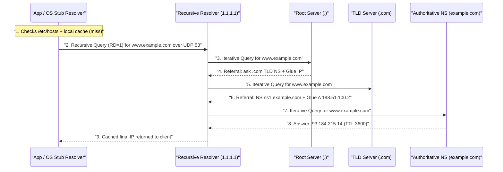
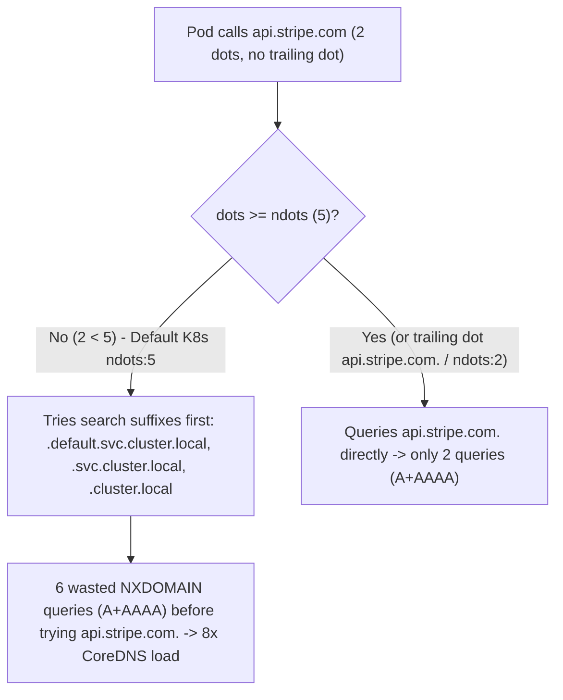
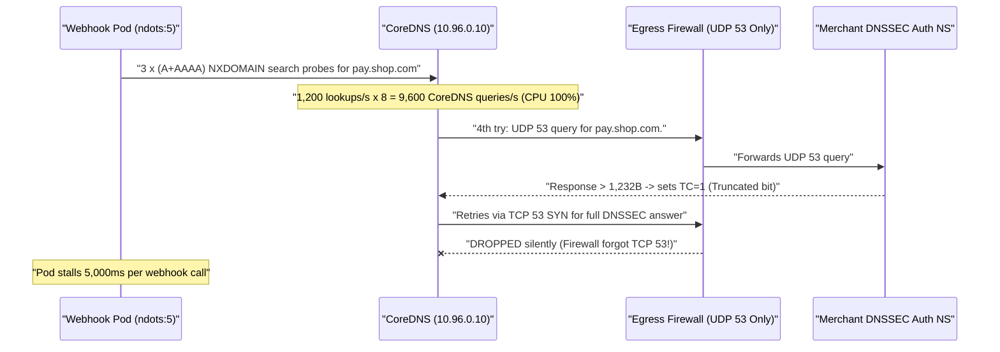

# Lesson 15: DNS Part 1 — The Phone Book of the Internet, One Lookup Step by Step

> **Prerequisites:** [Lesson 12: UDP vs TCP](../12-udp-vs-tcp/README.md), [Lesson 14: Routing and NAT](../14-routing-and-nat/README.md), and [Networking From Zero Overview](../README.md) (Lesson 15 of 30).  
> **Estimated Reading Time:** 28 minutes  
> **Target Audience:** Backend and Kubernetes platform engineers tracing cold DNS resolution, eliminating CoreDNS `ndots:5` query amplification storms, fixing UDP-to-TCP fallback (`TC=1`) firewall drops, and evaluating `EDNS0`, `DoT`, and `DoH`.  
> **Free PDF Notes:** [Download SD-N-015.pdf](https://backendroadmap.com/notes/system-design/SD-N-015.pdf)

> [!TIP]
> **The Golden Rule of DNS Resolution:** Every cold hostname lookup is a two-stage relay: your local **stub resolver** checks `/etc/hosts` and sends one **recursive query** (`RD=1`) to a **Recursive Resolver** (`1.1.1.1`, `8.8.8.8`, or `CoreDNS`), which walks **iterative referrals** down **Root (`.`) -> TLD (`.com`) -> Authoritative NS** using **glue records** to avoid chicken-and-egg loops. DNS uses **UDP port `53`** for single-packet speed (`512` B classic, `1,232` B with **`EDNS0`**), switches to **TCP port `53`** whenever the **`TC=1`** truncation bit fires—and inside Kubernetes, default **`ndots:5`** amplifies every external lookup by **`4–8x`** unless you configure trailing dots or lower `ndots`!

---

## Words You'll Meet Today

| Word | In Plain Words | Role in a Live Backend System |
| :--- | :--- | :--- |
| **Stub resolver** | The tiny DNS client built inside your OS `libc` or language runtime. | Checks `/etc/hosts`, applies `ndots`/search domains, and forwards one recursive query. |
| **Recursive resolver** | The workhorse server (`1.1.1.1`, `8.8.8.8`, `CoreDNS`) that hunts down answers. | Walks Root, TLD, and Authoritative servers iteratively and caches replies (`TTL`). |
| **Root / TLD server** | The top directory (`.`) and extension directory (`.com`, `.io`, `.org`). | Never stores final app IPs—returns referrals (delegations) to the next tier down. |
| **Iterative query** | "I won't chase it for you—here is the next server to ask." | Used between recursive resolvers and Root/TLD/Authoritative tiers. |
| **Glue record** | An extra `A`/`AAAA` IP attached alongside an `NS` delegation reply. | Breaks the circular deadlock when `example.com` hosts its own `ns1.example.com`. |
| **`TC=1` (Truncated)** | A 1-bit DNS header flag warning: "Too big for UDP, retry over TCP!" | Triggers immediate retry on **TCP port `53`** for large `DNSSEC`/`TXT` answers. |
| **`EDNS0`** | Extension letting DNS clients negotiate UDP buffers above `512` bytes. | Sets safe `1,232`-byte UDP limits (`DNS Flag Day`) without triggering IP fragments. |
| **`ndots:5`** | Kubernetes `/etc/resolv.conf` threshold treating names with `< 5` dots as local. | Turns one `api.stripe.com` call (`2` dots) into `6–8` wasteful `NXDOMAIN` probes! |

---

## Visual Mental Models & Architecture

### The Question: Where Does `api.stripe.com` Actually Come From When Caches Are Empty?

In [lesson 12](../12-udp-vs-tcp/README.md) we saw DNS picks UDP for single-packet speed, and in [lesson 14](../14-routing-and-nat/README.md) we learned packets route solely by IP addresses, never by text names. Yet you type `api.stripe.com` and milliseconds later your app connects to an IP. Where does that IP live, who knows it, and why can one tiny Kubernetes `/etc/resolv.conf` line quietly multiply your DNS traffic by eight?

### An Everyday Picture First: Personal Assistant vs. Calling Three Desks Yourself

Suppose you ask your office assistant (**Recursive Resolver**) for Alice's phone number at Stripe:

- **Recursive query (You -> Assistant):** You ask once and wait: *"Please track down `api.stripe.com` and bring me the final number."* You do not want directions—you want the answer.
- **Iterative queries (Assistant -> Directory Tree):** Your assistant calls the **National Switchboard (Root `.`)**, who replies: *"Ask the `.com` Registry Desk at `192.5.6.30`."* Your assistant calls **`.com` TLD**, who replies: *"Ask Stripe's own switchboard `ns1.stripe.com` at IP `205.251.192.x`."* Finally, Stripe's **Authoritative Nameserver** answers with the real IP—and your assistant writes it on a sticky note (`TTL` cache) so the next `1,000` coworkers get an instant answer!

### Step by Step: `/etc/hosts`, Stub Resolver, Root, TLD, Glue, and Authoritative NS

When an application calls `getaddrinfo("api.stripe.com")`, resolution walks a deterministic ladder:

1. **Local Cache & `/etc/hosts`:** Before touching the network, `glibc` (`/etc/nsswitch.conf`: `hosts: files dns`) checks `/etc/hosts` for static overrides (`127.0.0.1 localhost`) and any OS daemon cache (`systemd-resolved`, `nscd`).
2. **Stub Resolver -> Recursive Resolver (`UDP :53`, `RD=1`):** Finding nothing locally, the stub sends one packet with the **Recursion Desired (`RD=1`)** bit set to the resolver listed in `/etc/resolv.conf` (e.g., `1.1.1.1`, ISP DNS, or Kubernetes `10.96.0.10` CoreDNS).
3. **Root (`.`):** If the recursive resolver's cache is cold, it queries one of the `13` logical root server clusters (`a.root-servers.net` – `m.root-servers.net`, replicated globally to `1,500+` Anycast nodes). Root points it to the `.com` TLD servers.
4. **TLD (`.com`) + Glue Records:** `.com` returns the authoritative `NS` records for `stripe.com` (`ns1.example-dns.net` or `ns1.stripe.com`). **Crucial detail—Glue Records:** What if `example.com`'s nameserver is *inside its own zone* (`ns1.example.com`)? Without extra help, the resolver faces an infinite loop (*to find `example.com`, first find `ns1.example.com`, which requires finding `example.com`!*). So the `.com` TLD includes a **glue `A`/`AAAA` record** in the `ADDITIONAL` section (`ns1.example.com -> 198.51.100.2`) to break the loop!
5. **Authoritative Nameserver:** Finally, the recursive resolver asks the authoritative server directly, gets the `A`/`AAAA` IP + `TTL`, caches it, and replies to your stub resolver.



*Figure 1. Cold DNS lookup end-to-end: the client sends one recursive query (`RD=1`), while the recursive resolver walks three iterative hops from Root `.` to `.com` (using glue IPs) to the authoritative server.*

### `UDP 53` vs. `TCP 53` Fallback (`TC=1`), `EDNS0`, and `DoT`/`DoH`

Why does DNS default to **UDP port `53`**? Because a `60`-byte request and `120`-byte answer finish in **one round trip** with zero `SYN`/`SYN-ACK` handshake and zero `TIME_WAIT` port locking on resolvers handling millions of lookups per second.

- **Classic `512`-Byte Ceiling & `EDNS0`:** Original DNS (`RFC 1035`) capped UDP messages at **`512` bytes**. Modern **`EDNS0` (`RFC 6891`)** lets clients advertise a larger UDP buffer in an `OPT` pseudo-record—standardized at **`1,232` bytes** by DNS Flag Day 2020 so replies fit cleanly inside IPv6/VPN Path MTU without IP fragmentation (as we proved in [lesson 12](../12-udp-vs-tcp/README.md)!).
- **`TC=1` & Mandatory `TCP 53` Fallback:** Whenever an answer exceeds the advertised UDP limit (common with `DNSSEC` cryptographic signatures, big `TXT` SPF chains, or multi-record responses), the DNS server trims the UDP packet and flips the **`TC=1` (Truncated)** header bit. Compliant resolvers immediately retry the exact query over **TCP port `53`**. Zone transfers (`AXFR`) between primary/secondary nameservers also use TCP `53`. **Firewall trap:** Operators who allow `UDP 53` and forget `TCP 53` silently hang `DNSSEC` and large responses!
- **Encrypted DNS (`DoT` vs. `DoH`):** Classic UDP/TCP `53` is unencrypted plaintext—anyone on Wi-Fi or an ISP link sees every hostname you look up. **DNS over TLS (`DoT`, `RFC 7858`, TCP `853`)** wraps standard DNS messages inside TLS on a dedicated port (easy for corporate networks to monitor/block). **DNS over HTTPS (`DoH`, `RFC 8484`, TCP/UDP `443`)** encodes DNS inside HTTPS `GET`/`POST` streams (`application/dns-message`), blending seamlessly into web traffic over HTTP/2 and HTTP/3.

### The Kubernetes `ndots:5` CoreDNS Amplification Trap

Inside almost every Kubernetes pod, `/etc/resolv.conf` defaults to:

```text
nameserver 10.96.0.10
search default.svc.cluster.local svc.cluster.local cluster.local
options ndots:5
```

Look closely at **`ndots:5`**. It instructs the stub resolver: *"If a hostname has **fewer than `5` dots** and does not end with a trailing dot `.`, assume it might be an internal Kubernetes Service first—append every suffix in `search` before ever trying the bare domain as absolute!"*

How many dots are in `api.stripe.com`? **Two (`2 < 5`)!** Worse, dual-stack clients resolve both `A` (IPv4) and `AAAA` (IPv6) concurrently:

1. `api.stripe.com.default.svc.cluster.local` -> `A` + `AAAA` (`2` `NXDOMAIN`s)
2. `api.stripe.com.svc.cluster.local` -> `A` + `AAAA` (`2` `NXDOMAIN`s)
3. `api.stripe.com.cluster.local` -> `A` + `AAAA` (`2` `NXDOMAIN`s)
4. `api.stripe.com.` (finally!) -> `A` + `AAAA` (`2` queries)

That is **`8` CoreDNS lookups** (`10` if your node inherits a cloud VPC search domain!) for **every single uncached external call**!



*Figure 2. Kubernetes `ndots:5` amplification: external domains with `1–4` dots trigger `6+` guaranteed `NXDOMAIN` queries per lookup unless you set `ndots:2` or append a trailing dot (`api.stripe.com.`).*

---

## Systematic Reference & Comparison Grid

### DNS Resolution Tiers Compared

| Tier / Component | Who Operates It? | Knowledge Scope | Caches Answers? | Typical Uncached Latency |
| :--- | :--- | :--- | :--- | :--- |
| **OS Stub (`libc`)** | Your Linux/app container | `/etc/hosts` + `resolv.conf` rules | Optional (`systemd-resolved`) | `< 0.1 ms` (local) |
| **Recursive Resolver** | Cloudflare `1.1.1.1`, ISP, `CoreDNS` | Full tree traversal + local zone cache | **Yes** (`TTL`-bound) | `1–5 ms` hit / `20–120 ms` miss |
| **Root Servers (`.`)** | `12` orgs (`13` Anycast clusters) | TLD delegations (`.com`, `.org`, `.io`) | Authoritative static root zone | `5–25 ms` (Anycast nearby) |
| **TLD Servers** | Verisign (`.com`), PIR (`.org`), etc. | Domain `NS` delegations + **Glue IPs** | Authoritative TLD zone | `10–40 ms` |
| **Authoritative NS** | Route 53, Cloudflare, BIND | Actual `A`, `AAAA`, `CNAME`, `MX`, `TXT` | Source of truth (`TTL` issuer) | `10–60 ms` |

### DNS Transport Variants

| Transport | Port & Protocol | Max Payload | Encryption | Primary Use Case / Trigger |
| :--- | :--- | :--- | :--- | :--- |
| **Classic UDP DNS** | `UDP 53` | `512 B` | None | Legacy queries without `EDNS0` |
| **`EDNS0` UDP DNS** | `UDP 53` | **`1,232 B`** (recommended) | None | Standard modern DNS queries (`DNS Flag Day`) |
| **TCP DNS Fallback** | `TCP 53` | `64 KB` stream | None | Triggered by **`TC=1`**, `DNSSEC`, and `AXFR` transfers |
| **DoT (DNS over TLS)** | `TCP 853` | Stream | **TLS** | Private Android/Linux/router encrypted upstream DNS |
| **DoH (DNS over HTTPS)** | `TCP/UDP 443` | HTTP/2–3 | **TLS (HTTPS)** | Browser & firewall-resilient encrypted DNS |

### Kubernetes `ndots` Query Multiplication Math

If a pod has $S$ search domains (typically $3$ in Kubernetes, or $4$ with a VPC domain), one dual-stack (`A` + `AAAA`) uncached external lookup triggers:

$$
\text{Queries}_{\text{amplified}} = 2 \times (S + 1), \qquad \text{Queries}_{\text{absolute / } ndots \le 2} = 2
$$

With $S = 3$ search suffixes, `1,000` external API lookups/sec generate **`8,000` CoreDNS QPS** under `ndots:5`, compared to **`2,000` QPS** under `ndots:2`—an instant **`75%` drop** in CoreDNS CPU and `conntrack` UDP socket churn!

---

## Production War Story Post-Mortem: `ndots:5` CoreDNS Storm & `TCP 53` Firewall Hang

- **Severity:** SEV-1 (Outbound Webhook Delivery Latency `> 5,000 ms`, `35%` Timeout Rate)
- **Detection / Resolution Time:** 38 minutes to restore via `ndots:2`, NodeLocal DNSCache, and `TCP 53` egress rule
- **Impact:** Scaling a webhook worker fleet to `1,200 req/s` across external merchant hostnames overwhelmed CoreDNS (`100%` CPU) and triggered `nf_conntrack` UDP drops. Simultaneously, merchants using `DNSSEC` returned `TC=1` truncated responses whose `TCP 53` retries hung for `5 s` until timeout!

### What Happened



*Figure 3. Compounding DNS failure: `ndots:5` multiplied CoreDNS QPS by `8x`, while a security group permitting only `UDP 53` silently killed every `TC=1` TCP fallback.*

### Root Cause Analysis

1. **Default `ndots:5` Amplification:** Merchant hostnames (`pay.merchant.com`) contained only `2` dots, causing every pod lookup to fire `6` guaranteed `NXDOMAIN` search probes (`2` each for `.default.svc.cluster.local`, `.svc.cluster.local`, `.cluster.local`) before querying the real external name.
2. **Missing `TCP 53` Egress Rule:** A security-hardened egress ACL explicitly allowed `UDP 53` outbound and assumed DNS never used TCP—blackholing every `TC=1` response from `DNSSEC`-signed domains.

### The Fix & Architectural Hardening

- **Set `ndots: "2"` + NodeLocal DNSCache:** Updated pod `dnsConfig` (`options: [{ name: ndots, value: "2" }]`) and deployed `NodeLocal DNSCache` DaemonSets using TCP upstream connections to CoreDNS, eliminating cross-node UDP `conntrack` pressure.
- **Permit `UDP 53` AND `TCP 53` Everywhere:** Added `TCP 53` alongside `UDP 53` in every VPC Security Group and NetworkPolicy, and pinned CoreDNS `bufsize 1232` (`EDNS0`).

---

## Multi-Language Production Implementation

Below is a production-structured **DNS Lookup Client with Strict Timeout, Cold vs. Warm Cache Measurement & `ndots` Search-Path Amplification Auditor** across Go, TypeScript, Python, and C#. Notice how it explicitly enforces bounded resolver contexts (avoiding infinite `getaddrinfo` thread-pool stalls!) and exposes exact candidate search-order evaluation for any `ndots` value.

````carousel
```go
package dnsclient

import (
	"context"
	"net"
	"strings"
	"time"
)

type LookupReport struct {
	Host       string
	IPs        []string
	ColdTime   time.Duration
	WarmTime   time.Duration
	SearchPlan []string
}

// SimulateSearchOrder replicates glibc resolv.conf ndots expansion before hitting the wire.
func SimulateSearchOrder(name string, searchDomains []string, ndots int) []string {
	if strings.HasSuffix(name, ".") {
		return []string{name}
	}
	dotCount := strings.Count(name, ".")
	var candidates []string
	if dotCount >= ndots {
		candidates = append(candidates, name+".")
	}
	for _, s := range searchDomains {
		candidates = append(candidates, name+"."+strings.TrimSuffix(s, ".")+".")
	}
	if dotCount < ndots {
		candidates = append(candidates, name+".")
	}
	return candidates
}

func ResolveWithTimeout(host string, timeout time.Duration, searchDomains []string, ndots int) (LookupReport, error) {
	resolver := &net.Resolver{PreferGo: true}
	ctx1, cancel1 := context.WithTimeout(context.Background(), timeout)
	defer cancel1()

	t0 := time.Now()
	ips, err := resolver.LookupHost(ctx1, host)
	cold := time.Since(t0)
	if err != nil {
		return LookupReport{}, err
	}

	ctx2, cancel2 := context.WithTimeout(context.Background(), timeout)
	defer cancel2()
	t1 := time.Now()
	_, _ = resolver.LookupHost(ctx2, host)
	warm := time.Since(t1)

	return LookupReport{
		Host:       host,
		IPs:        ips,
		ColdTime:   cold,
		WarmTime:   warm,
		SearchPlan: SimulateSearchOrder(host, searchDomains, ndots),
	}, nil
}
```
<!-- slide -->
```typescript
import dns from "node:dns/promises";

export interface LookupReport {
  host: string;
  ips: string[];
  coldMs: number;
  warmMs: number;
  searchPlan: string[];
}

export function simulateSearchOrder(name: string, searchDomains: string[], ndots = 5): string[] {
  if (name.endsWith(".")) return [name];
  const dots = (name.match(/\./g) ?? []).length;
  const plan: string[] = [];
  if (dots >= ndots) plan.push(`${name}.`);
  for (const suffix of searchDomains) {
    plan.push(`${name}.${suffix.replace(/\.$/, "")}.`);
  }
  if (dots < ndots) plan.push(`${name}.`);
  return plan;
}

export async function resolveWithTimeout(
  host: string,
  timeoutMs = 1000,
  searchDomains = ["default.svc.cluster.local", "svc.cluster.local", "cluster.local"],
  ndots = 5
): Promise<LookupReport> {
  const resolver = new dns.Resolver({ timeout: timeoutMs, tries: 1 });
  const t0 = performance.now();
  const ips = await resolver.resolve4(host);
  const coldMs = performance.now() - t0;

  const t1 = performance.now();
  await resolver.resolve4(host);
  const warmMs = performance.now() - t1;

  return {
    host,
    ips,
    coldMs,
    warmMs,
    searchPlan: simulateSearchOrder(host, searchDomains, ndots),
  };
}
```
<!-- slide -->
```python
from dataclasses import dataclass
import socket
import time


@dataclass(frozen=True)
class LookupReport:
    host: str
    ips: list[str]
    cold_ms: float
    warm_ms: float
    search_plan: list[str]


def simulate_search_order(name: str, search_domains: list[str], ndots: int = 5) -> list[str]:
    if name.endswith("."):
        return [name]
    dots = name.count(".")
    plan: list[str] = []
    if dots >= ndots:
        plan.append(f"{name}.")
    for suffix in search_domains:
        plan.append(f"{name}.{suffix.rstrip('.')}.")
    if dots < ndots:
        plan.append(f"{name}.")
    return plan


def resolve_with_timeout(
    host: str,
    timeout_s: float = 1.0,
    search_domains: list[str] | None = None,
    ndots: int = 5,
) -> LookupReport:
    search_domains = search_domains or ["default.svc.cluster.local", "svc.cluster.local", "cluster.local"]
    prev_timeout = socket.getdefaulttimeout()
    socket.setdefaulttimeout(timeout_s)
    try:
        t0 = time.perf_counter()
        infos = socket.getaddrinfo(host, 443, type=socket.SOCK_STREAM)
        cold_ms = (time.perf_counter() - t0) * 1000.0
        ips = sorted({info[4][0] for info in infos})

        t1 = time.perf_counter()
        socket.getaddrinfo(host, 443, type=socket.SOCK_STREAM)
        warm_ms = (time.perf_counter() - t1) * 1000.0
    finally:
        socket.setdefaulttimeout(prev_timeout)

    return LookupReport(
        host=host,
        ips=ips,
        cold_ms=cold_ms,
        warm_ms=warm_ms,
        search_plan=simulate_search_order(host, search_domains, ndots),
    )
```
<!-- slide -->
```csharp
using System;
using System.Collections.Generic;
using System.Diagnostics;
using System.Linq;
using System.Net;
using System.Threading;
using System.Threading.Tasks;

public sealed record LookupReport(
    string Host, string[] Ips, double ColdMs, double WarmMs, IReadOnlyList<string> SearchPlan);

public static class DnsAuditClient
{
    public static IReadOnlyList<string> SimulateSearchOrder(
        string name, IReadOnlyList<string> searchDomains, int ndots = 5)
    {
        if (name.EndsWith('.')) return new[] { name };
        int dots = name.Count(c => c == '.');
        var plan = new List<string>();
        if (dots >= ndots) plan.Add($"{name}.");
        foreach (string suffix in searchDomains)
            plan.Add($"{name}.{suffix.TrimEnd('.')}.");
        if (dots < ndots) plan.Add($"{name}.");
        return plan;
    }

    public static async Task<LookupReport> ResolveWithTimeoutAsync(
        string host, int timeoutMs = 1000, int ndots = 5)
    {
        string[] defaults = { "default.svc.cluster.local", "svc.cluster.local", "cluster.local" };
        using var cts1 = new CancellationTokenSource(timeoutMs);
        long t0 = Stopwatch.GetTimestamp();
        IPAddress[] addrs = await Dns.GetHostAddressesAsync(host, cts1.Token);
        double coldMs = Stopwatch.GetElapsedTime(t0).TotalMilliseconds;

        using var cts2 = new CancellationTokenSource(timeoutMs);
        long t1 = Stopwatch.GetTimestamp();
        _ = await Dns.GetHostAddressesAsync(host, cts2.Token);
        double warmMs = Stopwatch.GetElapsedTime(t1).TotalMilliseconds;

        return new LookupReport(
            host,
            addrs.Select(a => a.ToString()).Distinct().ToArray(),
            coldMs,
            warmMs,
            SimulateSearchOrder(host, defaults, ndots));
    }
}
```
````

---

## Practical Hands-On Verification CLI Workflows

### 1. Walk the Iterative Tree Live From Root `.` to Authoritative NS

```bash
dig +trace example.com A
```

**Expected Output:**

```text
.                       518400  IN  NS  a.root-servers.net.
com.                    172800  IN  NS  a.gtld-servers.net.
example.com.            172800  IN  NS  a.iana-servers.net.
example.com.            3600    IN  A   93.184.215.14
```

`dig +trace` turns your local machine into a recursive resolver—letting you observe Root `.`, `.com` TLD (with glue), and the authoritative reply sequentially!

### 2. Inspect `EDNS0` Buffer Size, `TC=1` Truncation, and Automatic TCP Retry

```bash
dig @1.1.1.1 cloudflare.com DNSKEY +dnssec +bufsize=512
```

**Expected Output:**

```text
;; Truncated, retrying in TCP mode.
;; ->>HEADER<<- opcode: QUERY, status: NOERROR, id: 51920
;; flags: qr rd ra ad; QUERY: 1, ANSWER: 4, AUTHORITY: 0, ADDITIONAL: 1
;; OPT PSEUDOSECTION:
; EDNS: version: 0, flags: do; udp: 1232
```

Notice the exact message `;; Truncated, retrying in TCP mode.`—proving `TC=1` triggered an instant retry over TCP port `53` when the `DNSSEC` keyset overflowed `512` bytes!

### 3. Inspect Local `/etc/hosts` & `/etc/resolv.conf` Search Paths

```bash
cat /etc/resolv.conf
```

**Expected Output:**

```text
nameserver 10.96.0.10
search default.svc.cluster.local svc.cluster.local cluster.local
options ndots:5
```

---

## Pause and Think

> [!exercise] Suppose the `.org` TLD operator delegates `example.org` to `ns1.example.org` and `ns2.example.org` (nameservers inside `example.org` itself), **without** storing any glue `A`/`AAAA` records at `.org`. Can a cold recursive resolver resolve `www.example.org`? Decide before opening the answer.

<details><summary>Answer</summary>

**No—total deadlock!** To find `www.example.org`, `.org` tells the resolver: *"Ask `ns1.example.org`."* To find the IP of `ns1.example.org`, the resolver must ask the authoritative server for `example.org`—which is `ns1.example.org` itself! Without a **glue `A`/`AAAA` record** returned inside the `.org` TLD `ADDITIONAL` section, no cold resolver can ever break the circular dependency.

</details>

---

## Operational Validation Checkpoints

<details><summary><strong>Checkpoint 1: Identifying Recursive vs. Iterative Behavior in `dig` Flags</strong></summary>

**Scenario:** You run `dig +norecurse @192.5.6.30 example.com A` against a `.com` TLD nameserver and get `status: NOERROR` with `0` rows in `ANSWER SECTION`, `2` `NS` rows in `AUTHORITY SECTION`, and `2` `A` rows in `ADDITIONAL SECTION`. Did the query fail?

**Solution:**
No—it succeeded as an **iterative referral**! TLD servers disable recursion (`RA=0`), so they return `AUTHORITY` (`NS ns1.example.com`) plus **glue records** in `ADDITIONAL` (`ns1.example.com A ...`) pointing the recursive resolver to the authoritative server.

</details>

<details><summary><strong>Checkpoint 2: Fixing Slow `5 s` Timeouts Only on `DNSSEC`-Heavy Domains</strong></summary>

**Scenario:** `95%` of domains resolve in `< 15 ms` from your Kubernetes cluster, yet lookups for large government/fintech domains with `DNSSEC` hang for `5,000 ms` and fail. Why?

**Solution:**
`DNSSEC` signatures inflate responses past `1,232` bytes (`EDNS0` UDP limit), setting **`TC=1`** so CoreDNS retries over **`TCP 53`**. Your outbound VPC Security Group or NetworkPolicy allows `UDP 53` but blocks `TCP 53`, causing TCP `SYN` packets to time out! Allow both `UDP 53` and `TCP 53`.

</details>

<details><summary><strong>Checkpoint 3: Calculating QPS Savings From Fixing Kubernetes `ndots:5`</strong></summary>

**Scenario:** A worker pod with `3` search domains (`default.svc.cluster.local`, `svc.cluster.local`, `cluster.local`) makes `2,000` uncached dual-stack (`A` + `AAAA`) lookups/sec to `hooks.partner.com`. How many CoreDNS queries/sec does it send under default `ndots:5`, and how many if you switch to `ndots:2`?

**Solution:**
`hooks.partner.com` has `2` dots. Under `ndots:5` (`2 < 5`), `glibc` tries `3` search suffixes (`6` wasted `NXDOMAIN` `A`/`AAAA` queries) before trying `hooks.partner.com.` (`2` queries) = `8 × 2,000 =` **`16,000 QPS`**. Changing `ndots:2` (`2 >= 2`) queries `hooks.partner.com.` immediately first = `2 × 2,000 =` **`4,000 QPS`**—saving `12,000` wasted queries per second!

</details>

---

## Common Mistakes & Troubleshooting

### What Goes Wrong

- **Blocking `TCP 53` in firewalls:** Breaks `TC=1` fallback, `DNSSEC` responses, and zone transfers silently.
- **Ignoring `ndots:5` in high-throughput Kubernetes pods:** Generates `4–8x` `NXDOMAIN` floods against CoreDNS and saturates Linux `conntrack` UDP entries.
- **Unbounded `getaddrinfo` calls without timeouts:** Legacy synchronous OS lookups can block worker threads for `5–30 s` when an upstream resolver drops packets.

### Common Myths

- **"DNS is strictly a UDP protocol."** False! `RFC 7766` requires **both UDP and TCP on port `53`** for every compliant DNS server because `TC=1` truncation fallback and `AXFR` rely on TCP.
- **"Every lookup hits the Root servers."** Rarely! Root and TLD referrals carry long `TTL`s (`48` hours = `172,800 s`), so recursive resolvers cache `.com` NS locations locally and skip Root for almost every query.

### Troubleshooting Matrix

| Symptom / Error | Network Evidence | Root Cause | Fix |
| :--- | :--- | :--- | :--- |
| CoreDNS `100%` CPU & `NXDOMAIN` flood | `dig` logs show `*.svc.cluster.local` external lookups | Default Kubernetes `ndots:5` on `1–4`-dot domains | Set `ndots: "2"`, use trailing dots (`.`), deploy `NodeLocal DNSCache` |
| Intermittent `5 s` timeouts on `TXT`/`DNSSEC` | `dig` shows `TC=1` + `TCP 53 SYN` drops | Firewall permits `UDP 53` only | Permit both `UDP 53` and `TCP 53` |
| Oversized DNS UDP packets vanish behind VPN | Large `EDNS0` (`4096 B`) triggers IP fragmentation | Fragmentation dropped across `1,400 B` tunnel | Set `EDNS0` buffer size to `1,232 B` |

---

## Recap in Three Lines

1. A cold DNS lookup runs from **`/etc/hosts`** and your **OS stub resolver** (`RD=1`) to a **Recursive Resolver**, which walks **Root (`.`) -> TLD (`.com`) + Glue -> Authoritative NS** iteratively and caches the reply.
2. DNS defaults to **UDP `53`** (`EDNS0` capped at `1,232` bytes) for speed, but switches immediately to **TCP `53`** whenever the **`TC=1`** truncation bit fires—so firewalls must permit both.
3. In Kubernetes, **`ndots:5`** turns short external hostnames (`api.stripe.com`) into **`6–8x`** query amplification storms against CoreDNS unless mitigated with `ndots:2`, trailing dots, or `NodeLocal DNSCache`.

---

## Interview Practice Questions

> [!interview] Trace every step of a cold DNS lookup for `api.example.com` from a Linux host. (Basic)

<details><summary>What to say in 30 seconds</summary>

First the OS stub resolver checks local caches and /etc/hosts. On a miss, it sends a recursive UDP port 53 query to its configured recursive resolver (like 1.1.1.1 or CoreDNS). The recursive resolver iteratively queries a Root (.) server, gets referred to the .com TLD server, receives the authoritative NS record (plus any glue A record), queries that authoritative server for api.example.com, caches the answer for its TTL, and returns the IP.

</details>

> [!interview] What is the difference between a recursive query and an iterative query? (Basic)

<details><summary>What to say in 30 seconds</summary>

In a recursive query (Recursion Desired bit = 1), the client asks a resolver to do all the work and return only the final answer or an error. In an iterative query, the queried server returns either the answer if it owns it, or the best referral (the next nameserver down the tree) so the recursive resolver keeps chasing it.

</details>

> [!interview] What is a DNS glue record and when is it mandatory? (Tricky)

<details><summary>What to say in 30 seconds</summary>

A glue record is an A or AAAA IP address bundled in the ADDITIONAL section alongside an NS delegation at the parent zone (like .com). It is mandatory whenever a domain's nameservers live under that very same domain—like ns1.example.com serving example.com—otherwise resolvers hit a chicken-and-egg loop unable to resolve the nameserver's own IP.

</details>

> [!interview] When does DNS switch from UDP port 53 to TCP port 53, and what happens if a firewall blocks TCP 53? (Scenario)

<details><summary>What to say in 30 seconds</summary>

DNS uses TCP port 53 for zone transfers (AXFR) and whenever a UDP reply exceeds the 512-byte or EDNS0 UDP limit (1,232 bytes), causing the server to set the TC=1 (Truncated) flag—common with DNSSEC or large TXT/SRV responses. If a firewall blocks TCP 53, those TC=1 retries silently stall and time out after several seconds.

</details>

> [!interview] Why does migrating an external-API-heavy microservice into Kubernetes often spike CoreDNS CPU and `conntrack` drops by 6x–8x? (Scenario)

<details><summary>What to say in 30 seconds</summary>

Kubernetes pods default to `ndots:5` with three cluster search suffixes in /etc/resolv.conf. Any external hostname with fewer than 5 dots—like api.stripe.com (2 dots)—is treated as relative first, firing A and AAAA lookups across every cluster search domain (6 wasted NXDOMAIN queries) before ever querying the external domain. Lowering ndots to 2, appending a trailing dot, or running NodeLocal DNSCache eliminates the amplification.

</details>

> [!interview] Compare DoT (DNS over TLS) and DoH (DNS over HTTPS). (Basic)

<details><summary>What to say in 30 seconds</summary>

Both encrypt DNS queries in transit so local networks and ISPs cannot eavesdrop or tamper with lookups. DoT wraps standard wire DNS inside TLS on dedicated port 853, making it straightforward for network admins to inspect or block at the firewall. DoH sends DNS inside HTTPS requests on port 443, blending in with normal encrypted web traffic and reusing HTTP/2 or HTTP/3 streams.

</details>

---

## Free PDF notes

Download these notes as a printable PDF, with the full iterative walkthrough, `ndots` math, and interview answers: [SD-N-015.pdf](https://backendroadmap.com/notes/system-design/SD-N-015.pdf).

---

## Sources

- [RFC 1034 / RFC 1035: Domain Names — Concepts & Implementation](https://www.rfc-editor.org/rfc/rfc1035), stub vs. recursive queries, glue records, and `TC=1`.
- [RFC 6891: Extension Mechanisms for DNS (EDNS0)](https://www.rfc-editor.org/rfc/rfc6891), negotiating UDP buffer sizes (`1,232` bytes).
- [RFC 7766: DNS Transport over TCP](https://www.rfc-editor.org/rfc/rfc7766), mandatory TCP `53` fallback requirements.
- [RFC 7858: Specification for DNS over Transport Layer Security (DoT)](https://www.rfc-editor.org/rfc/rfc7858), encrypted DNS on port `853`.
- [RFC 8484: DNS Queries over HTTPS (DoH)](https://www.rfc-editor.org/rfc/rfc8484), encrypted DNS over HTTPS (`443`).
- [Kubernetes DNS for Services and Pods Documentation](https://kubernetes.io/docs/concepts/services-networking/dns-pod-service/), default `ndots:5` search path behavior.

---

## Next

Next comes [Lesson 16: DNS Part 2 — Records, TTL and Safe Migrations](../16-dns-records-ttl-and-migrations/README.md), where we examine `A`, `AAAA`, `CNAME`, `MX`, `TXT`, and `TTL` strategies for zero-downtime cutovers. Until then, the [track overview](../README.md) lists the whole series.
