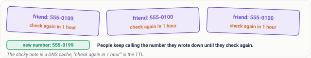
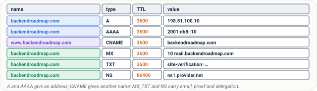
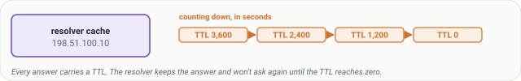
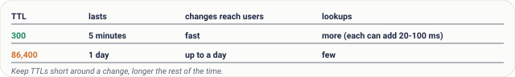
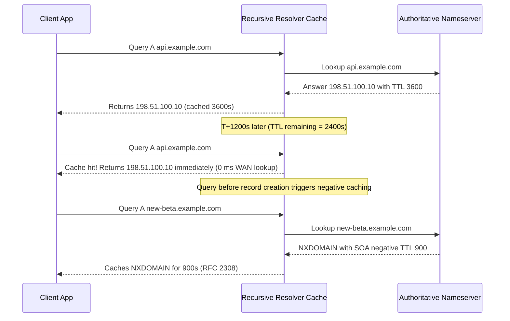
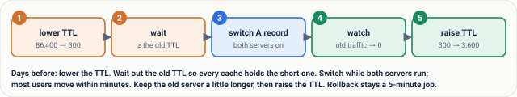
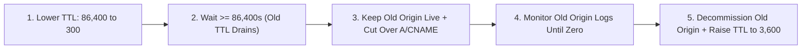
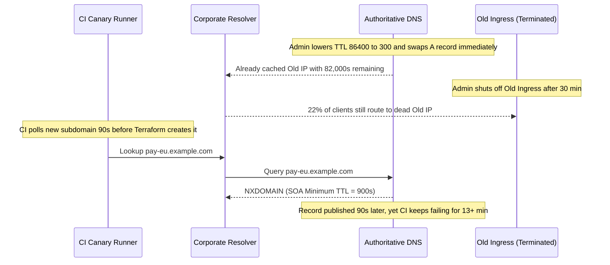
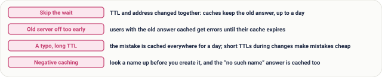

# Lesson 16: DNS Part 2, Records, TTL and Safe Migrations

> **Prerequisites:** [Lesson 15: DNS Part 1, Tracing One Lookup Step by Step](../15-dns-lookup-step-by-step/README.md) and [Networking From Zero Overview](../README.md) (Lesson 16 of 30).  
> **Estimated Reading Time:** 35 minutes  
> **Target Audience:** Backend and platform engineers planning zero-downtime IP/CDN cutovers, managing `A`/`AAAA`/`CNAME`/`MX`/`TXT`/`NS` records, and avoiding resolver cache and negative-caching traps.  
> **Free PDF Notes:** [Download SD-N-016.pdf](https://backendroadmap.com/notes/system-design/SD-N-016.pdf)

> [!NOTE]
> **In one line:** DNS stores records (`A`, `AAAA`, `CNAME`, `MX`, `TXT`, `NS`); every answer is cached for its `TTL`; to change safely, lower the `TTL` early, wait out the old `TTL`, switch while both servers run, then raise the `TTL`.

> [!TIP]
> **The Golden Rule of DNS Migrations:** DNS stores typed records (`A`, `AAAA`, `CNAME`, `MX`, `TXT`, `NS`) on authoritative servers, and every resolver caches answers—including `NXDOMAIN` ("no such name")—for their `TTL`. To migrate cleanly without outages, **lower the `TTL` early, wait out at least one full old `TTL`, switch records while both old and new origins stay live, and raise the `TTL` only after old traffic drains**.

---

## Words You'll Meet Today

| Word | In Plain Words | Role in a Live Backend System |
| :--- | :--- | :--- |
| **`A` / `AAAA` record** | A name pointing to an IPv4 / IPv6 address. | Direct routing entry mapping a hostname to a load balancer or static IP. |
| **`CNAME`** | An alias: this name is really that other name. | Delegates subdomains (`www`, `api`) to dynamically shifting CDN/cloud endpoints. |
| **`MX` record** | Where email for the domain goes, with a priority. | Routes transactional and corporate mail (`10 mail.example.com`), lowest number first. |
| **`TXT` record** | Free text, used to prove ownership and for email security. | Carries SPF, DKIM, DMARC records and domain verification tokens. |
| **`NS` record** | Which servers are authoritative for the domain. | Delegates zone authority from the parent registry (`.com`) to your DNS provider. |
| **`TTL`** | Time to live: how long an answer may be cached, in seconds. | Controls cache hit ratio (`20–100 ms` savings) vs cutover/rollback speed. |
| **Authoritative server** | The server that holds the real records for a domain. | Source of truth (Route 53, Cloudflare, BIND) serving signed/published zone data. |
| **Negative caching** | Caching a "no such name" answer too. | Resolvers cache `NXDOMAIN` for the `SOA` minimum `TTL`, delaying newly created records. |

---

## Visual Mental Models & Architecture

### The Question: Why Do Some Users Still See the Old Site?

You move your website to a new server and update DNS. Half your users see the new site; the other half still reach the old one, for hours. Nothing is broken. In [lesson 15](../15-dns-lookup-step-by-step/README.md) we followed one DNS lookup. Today: what DNS actually stores, the records, and the one number that decides how long the world remembers them, the TTL. Then, how to change DNS without anyone noticing.

### An Everyday Picture First: A Number on Sticky Notes

Your friend's phone number is written on sticky notes all over town, and each note also says: check again in one hour. Your friend changes their number. People who check their note within the hour still call the old number; then they check again and get the new one. If the note had said one week, some people would call the old number for a week. Nothing is broken: they're using what they wrote down. The sticky note is a DNS cache, and “check again in one hour” is the TTL.



*Figure 1. The analogy: a phone number copied onto sticky notes that say “check again in 1 hour”. The note is a DNS cache and the reminder is the TTL.*

### DNS Records

The records for `backendroadmap.com` live on its **authoritative servers**. Each record has four parts: a name, a type, a TTL and a value.

- **`A`**: `backendroadmap.com`, type `A`, TTL `3,600`, value `198.51.100.10`, the IPv4 address. **`AAAA`** does the same for an IPv6 address.
- **`CNAME`**: an alias. `www.backendroadmap.com CNAME backendroadmap.com` means: look up that other name instead. It's how you point a name at a CDN or a cloud load balancer whose addresses change.
- **`MX`**: where email for the domain goes, with a priority number; lower goes first.
- **`TXT`**: free text, used to prove you own a domain and for email security.
- **`NS`**: which servers are authoritative for the domain.



*Figure 2. The six records you'll see most: A and AAAA give an address, CNAME gives another name, and MX, TXT and NS carry email, proof of ownership and delegation. Each record has a name, a type, a TTL and a value.*

One rule: a `CNAME` can't sit at the top of a domain (the **zone apex**) next to other records like `SOA`, `NS`, or `MX`. Many DNS providers offer a special alias record (`ALIAS`, `ANAME`, or CNAME flattening) for that case, resolving the target internally and returning synthetic `A`/`AAAA` answers.


*Figure 3. A CNAME is an alias: the resolver follows it to another name and looks that up. It can't sit at the top of a domain next to other records.*

### The `TTL`

Every answer carries a **`TTL`**, in seconds; `3,600` means one hour. The resolver caches the answer and counts down, and until it reaches zero it won't ask again.



*Figure 4. The TTL: every DNS answer carries a time to live in seconds; a resolver caches the answer and only asks again when the countdown reaches zero.*

**Real numbers.** A TTL of `300` is five minutes; `86,400` is one day. A short TTL means changes spread fast, but more lookups, and each lookup can add `20` to `100 ms`. A long TTL means fewer lookups, but a change can take a whole day to reach everyone.

So the famous line, “DNS changes take 48 hours to propagate”, isn't quite right. The new record is live on the authoritative server at once. What you're waiting for is old copies, in caches, running out their TTL.



*Figure 5. Short versus long TTLs: short ones spread changes fast but cost more lookups; long ones save lookups but make a change take up to a day.*



### A Safe Migration, Step by Step

1. **Days before the move, lower the TTL**, from one day (`86,400`) to five minutes (`300`).
2. **Wait at least the old TTL**, a full day, so every cache now holds the short one.
3. **Keep the old server running and change the `A` record** to the new address. Within about five minutes, most users move.
4. **Watch traffic on the old server fall to almost zero**, and keep it alive a little longer for slow caches.
5. **When everything is stable, raise the TTL again**, say to one hour (`3,600`).

And the bonus: for the whole move, rolling back takes only five minutes.



*Figure 6. A safe DNS migration: lower the TTL, wait at least the old TTL, switch the record while both servers run, watch traffic move, then raise the TTL again.*



---

## Systematic Reference & Comparison Grid

### Essential DNS Record Types

| Type | Target / Value Format | Zone Apex Allowed? | Typical `TTL` | Primary Production Role |
| :--- | :--- | :--- | :--- | :--- |
| **`A`** | IPv4 address (`198.51.100.10`) | Yes | `60–3,600 s` | Maps domain or subdomain directly to IPv4 endpoint |
| **`AAAA`** | IPv6 address (`2001:db8::10`) | Yes | `60–3,600 s` | Dual-stack IPv6 connectivity alongside `A` |
| **`CNAME`** | Canonical hostname (`edge.cdn.net.`) | **No** (RFC 1034 conflict) | `300–3,600 s` | Aliases subdomains to dynamic CDN/LB DNS names |
| **`ALIAS` / `ANAME`** | Synthetic apex flattening (provider extension) | **Yes** | `60–300 s` | Provider resolves target and serves flattened `A`/`AAAA` at apex |
| **`MX`** | Priority + mail host (`10 mail.example.com.`) | Yes | `3,600–86,400 s` | Email delivery routing; lowest priority number tried first |
| **`TXT`** | Quoted ASCII string (`"v=spf1 ..."`) | Yes | `300–3,600 s` | Domain ownership proofs, SPF, DKIM, DMARC policies |
| **`NS`** | Authoritative nameserver hostnames | Yes (required) | `86,400–172,800 s` | Zone delegation from TLD registry to DNS provider |
| **`SOA`** | Primary NS, admin email, serial, negative `TTL` | Yes (required) | `3,600–86,400 s` | Zone metadata and RFC 2308 negative-cache duration |

### TTL Strategy Trade-Off Profiles

| Profile | `TTL` (Seconds) | Cutover / Rollback Lag | Cache Hit Efficiency | Best Operational Fit |
| :--- | :--- | :--- | :--- | :--- |
| **Ultra-Short** | `30–60 s` | `< 1 minute` | Lower (more `20–100 ms` misses) | Active DNS failover, health-checked load balancing |
| **Agile / Migration** | `300 s` (`5 min`) | `~5 minutes` | Moderate | Pre-cutover staging window and dynamic APIs |
| **Standard Web** | `3,600 s` (`1 hr`) | `1 hour` | High | Steady-state web apps, `MX`, `TXT` SPF policies |
| **Static Glue** | `86,400 s` (`24 hr`) | `24 hours` | Maximum | Rarely changed `NS` delegation and root infrastructure |

---

## Core Definition & Taxonomic Comparison

**DNS records are typed, cached facts.** Every record is a four-part tuple (`name`, `type`, `TTL`, `value`) stored on **authoritative** servers and copied, for at most `TTL` seconds, by every **recursive resolver**, OS stub, browser, and runtime between your user and your zone. **What it is not:** DNS is not a push system. The authoritative server never tells caches "this changed"; caches only discover the change when their own countdown reaches zero.

Four pairs of ideas are routinely conflated in design reviews and incident channels:

| Term | Precise Meaning | Production Example |
| :--- | :--- | :--- |
| **DNS `TTL`** vs. **HTTP `max-age`** | `TTL` is how long a *name -> address* answer may be cached by resolvers; `max-age` is how long an *HTTP response body* may be reused by browsers/CDNs. They stack: a stale IP can hide behind a fresh page. | `api.example.com A 198.51.100.10 TTL 300` while `/v1/config` carries `Cache-Control: max-age=3600`. |
| **`CNAME`** vs. **`ALIAS` / `ANAME`** vs. **HTTP `301`** | `CNAME`: the resolver follows to another *name* (visible to every client, illegal at the apex). `ALIAS`/`ANAME`: the *provider* flattens the target and serves `A`/`AAAA` at the apex. `301`: the *web server* tells the browser to fetch a different URL. | `www -> d123.cloudfront.net` (`CNAME`); `example.com -> d123.cloudfront.net` (`ALIAS`); `http://example.com -> https://example.com` (`301`). |
| **`NXDOMAIN`** vs. **`NODATA`** vs. **`SERVFAIL`** | `NXDOMAIN`: the *name* does not exist at all. `NODATA` (`NOERROR`, empty answer): the name exists but not for that *type* (an `AAAA` query on an IPv4-only host). `SERVFAIL`: the resolver could not get a trustworthy answer (broken delegation, `DNSSEC` failure). | `pay-eu.example.com` before Terraform runs -> `NXDOMAIN`, cached for the `SOA` minimum (`900 s`). |
| **"Propagation"** vs. **cache expiry** | There is no propagation: the authoritative server answers with the new value immediately. What "propagates" is the *expiry of old copies* spread uniformly across `[0, T_old]`. | A `TTL = 86,400` record changed at `10:00` is still served from some caches until `10:00` the next day. |

**Human and business impact.** DNS is the first dependency of every request, so a bad record is a total outage with a long tail: a typo behind a `24 h` TTL is a `24 h` incident that no deploy, rollback, or restart can shorten. Conversely, an unnecessarily tiny TTL silently multiplies resolver traffic, lookup latency (`20-100 ms` per miss), and your DNS provider bill.

---

## Component Anatomy & The Observability Gap

### Anatomy of One Answer: From Zone File to Browser

```text
 AUTHORITATIVE ZONE (source of truth)                     CACHE LAYERS (each keeps its own countdown)
 +-----------------------------------------+   miss   +--------------------+   +---------------+   +-------------+
 | api.example.com. 300 IN A 198.51.100.10 | -------> | Recursive Resolver | ->| OS Stub Cache | ->| App / JVM / |
 |  ^     ^          ^   ^  ^               |  TTL=300 | (ISP, 8.8.8.8, VPC)|   | (systemd-     |   | Browser     |
 |  |     |          |   |  +-- RDATA       |          | counts 300 -> 0    |   | resolved...)  |   | Pool Cache  |
 |  |     |          |   +---- TYPE         |          +--------------------+   +---------------+   +-------------+
 |  |     |          +-------- CLASS (IN)   |
 |  |     +------------------- TTL (seconds)|     Wire format (RFC 1035): NAME | TYPE(2B) | CLASS(2B) | TTL(4B) | RDLENGTH(2B) | RDATA
 |  +------------------------- NAME         |     TTL is an unsigned 32-bit integer: max 2^32-1 s, practical cap 604,800 s (7 days)
 +-----------------------------------------+
```

A resolver that fetched the record `T_age` seconds ago reports **`TTL_remaining = TTL_published - T_age`** to its clients, which is why repeating `dig` against a recursive resolver shows a *decaying* number while the same query against the authoritative server always shows the full value.

### The Observability Gap: Who Can Actually See a DNS Migration?

| Vantage Point | What It Captures | What It Hides |
| :--- | :--- | :--- |
| **Authoritative query log** (Route 53 query logging, BIND `querylog`) | Only cache **misses**: one entry per resolver per TTL window. | Every cache **hit**. A busy resolver serving `10,000` users shows up as *one* line per `TTL`. |
| **Recursive resolver metrics** (cache hit ratio, `NXDOMAIN` rate) | Cache hit/miss, upstream latency, `SERVFAIL` spikes. | Which *clients* hold the old answer; stale entries cannot be enumerated. |
| **Client stub** (`dig`, `resolvectl query`, app logs) | Real remaining TTL as *that one client* sees it. | Everyone else's view; JVM/pool caches that never call the stub again. |
| **Old origin access logs / LB metrics** | The **only ground truth** for "who still uses the old IP" (requests per second, unique source ASNs). | Why they are stale (resolver clamp vs. open pool vs. hard-coded IP). |
| **Synthetic multi-vantage probes** (RIPE Atlas, Pingdom, `dig @8.8.8.8 / @1.1.1.1 / @9.9.9.9`) | Spot checks across public resolvers and regions. | Private enterprise resolvers and mobile carrier forwarders. |

**Operational rule:** never declare a migration complete from the authoritative side. The exit criterion is **old-origin traffic ≈ 0 for at least one full old TTL**, measured at the origin, not in DNS.

---

## Mathematical Model of TTL, Cache Hit Ratio & Cutover Time

### 1. Staleness Window After a Change

Let the record change at $t_0$ with old TTL $T_{\text{old}}$. A cache that last refreshed at time $t_r \in [t_0 - T_{\text{old}},\, t_0]$ keeps serving the old value until $t_r + T_{\text{old}}$. If refreshes are uniformly spread:

$$W_{\max} = T_{\text{old}}, \qquad \mathbb{E}[W] = \frac{T_{\text{old}}}{2}$$

After lowering the TTL to $T_{\text{new}}$ and **waiting at least $T_{\text{old}}$**, every cache holds a short entry, so the staleness window of the *real* cutover collapses to:

$$W_{\text{cutover}} = T_{\text{new}}, \qquad \text{Fraction migrated at } t \text{ after switch} = \min\!\left(1,\ \frac{t}{T_{\text{new}}}\right)$$

| Strategy | Max Stale Window | 50% Migrated | 95% Migrated | Rollback Time |
| :--- | :--- | :--- | :--- | :--- |
| Change IP, keep `TTL = 86,400` | `24 h` | `12 h` | `22.8 h` | `24 h` |
| Lower to `300` and change in the same minute (**the bug**) | `24 h` | `12 h` | `22.8 h` | `24 h` |
| Lower to `300`, **wait `86,400 s`**, then change | `5 min` | `2.5 min` | `4.75 min` | `5 min` |
| Lower to `60`, wait old TTL, then change | `1 min` | `30 s` | `57 s` | `1 min` |

### 2. Cache Hit Ratio and Authoritative Load

For one resolver receiving $\lambda$ queries/second for a name, it contacts the authoritative server at most once per TTL, so:

$$h = 1 - \frac{1}{\lambda\,T}, \qquad \text{Auth QPS} \approx \frac{R}{T}\quad(R = \text{number of active resolvers asking})$$

With $\lambda = 10\ \text{q/s}$ at one resolver: $T = 30 \Rightarrow h = 99.67\%$, $T = 300 \Rightarrow h = 99.97\%$. Across $R = 200{,}000$ active resolvers:

| `TTL` | Authoritative QPS ($R/T$) | Queries/Day to Authoritative | Cutover Window |
| :--- | :--- | :--- | :--- |
| `30 s` | `6,667` | `576 M` | `30 s` |
| `60 s` | `3,333` | `288 M` | `1 min` |
| `300 s` | `667` | `57.6 M` | `5 min` |
| `3,600 s` | `56` | `4.8 M` | `1 h` |
| `86,400 s` | `2.3` | `0.2 M` | `24 h` |

**Reading the table:** going from `3,600 s` to `300 s` costs about `12x` more authoritative queries but buys a `12x` faster cutover. That trade is only worth paying *around changes* and for failover records; steady-state records belong at `1 h`+.

### 3. Latency Cost of a Short TTL

Each cache miss adds a resolver round trip ($L_{\text{dns}} \approx 20\text{-}100\ \text{ms}$). Expected extra latency per request on a connection that re-resolves every request is:

$$\mathbb{E}[\Delta L] = (1 - h)\cdot L_{\text{dns}}$$

At $h = 99.67\%$ and $L_{\text{dns}} = 80\ \text{ms}$: $\mathbb{E}[\Delta L] = 0.0033 \times 80 = 0.26\ \text{ms}$, so a `30 s` TTL is nearly free for hot names but expensive for rarely visited ones (a name queried once per hour has $h = 0$ at any TTL below `3,600 s`).

### 4. Negative Caching (RFC 2308)

$$T_{\text{NXDOMAIN cached}} = \min\!\left(\text{SOA TTL},\ \text{SOA MINIMUM}\right)$$

With `SOA MINIMUM = 900`, one premature lookup of a not-yet-created name poisons that resolver for up to **15 minutes**, regardless of how fast you publish the record afterwards.

### 5. Worked Example: Planning the Window

An API has `TTL = 43,200` (`12 h`) and must cut over Friday `14:00 UTC` with a `5 min` maximum window:

1. Latest moment to lower TTL to `300`: $14{:}00 - 12\text{ h} = 02{:}00$ UTC Friday (**add a 1-2 h safety margin**, so `00:00` UTC).
2. Cutover at `14:00`: 95% of users move by `14:04:45`; keep the old origin alive until its logs show zero for `>= 12 h`.
3. Only then raise TTL back to `3,600` and decommission.

---

## Production War Story Post-Mortem: Unwaited `86,400 s` TTL & `NXDOMAIN` Poisoning

- **Severity:** SEV-1 (Partial Region Cutover & Automated Canary Failure)
- **Detection / Resolution Time:** 18 minutes to recover routing via temporary reverse proxy; 24 hours for full old-TTL drain
- **Impact:** `22%` of webhook customers continued hitting a terminated `us-west` ingress IP for hours, while CI smoke checks for a brand-new regional endpoint `pay-eu.example.com` failed for `15` minutes with `no such host`.

### What Happened



### Root Cause Analysis

1. **Skipping Step 2 (`T >= old_TTL`):** Changing `TTL` from `86,400 s` to `300 s` only applies to *future* queries made after existing caches expire. Any resolver that cached the record minutes before the change kept the old IP for nearly `24` hours.
2. **Premature Decommissioning:** Shutting off the old ingress server while recursive resolvers still served the old IP dropped live webhook deliveries (`ECONNREFUSED`).
3. **Negative Caching (`RFC 2308`):** Polling `pay-eu.example.com` before DNS propagation completed caused the shared resolver to cache `NXDOMAIN` for the zone's `SOA` minimum (`900 s`), blocking verification even after the record existed on authoritative servers.

### The Fix & Architectural Hardening

- **Emergency Reverse Proxy:** Re-spun the old IP briefly as a lightweight TCP/HTTPS proxy forwarding requests to the new origin until access logs on the old IP dropped to zero.
- **Automation Gate:** Built a migration pre-flight gate requiring `TTL <= 300 s` to be active for at least `old_TTL` seconds before any origin IP swap is permitted.
- **Lower `SOA` Minimum:** Reduced the zone's `SOA` negative-caching field from `900 s` to `60 s`, and shifted CI readiness checks to query the authoritative nameserver directly before polling recursive resolvers.

---

## Multi-Language Production Implementation

Below is a production-structured **DNS Zone Validator & Safe Migration Guard** enforcing RFC 1034 apex `CNAME` rules, calculating safe cutover eligibility (`elapsedSinceTtlDrop >= previousTtl`), and simulating RFC 2308 positive + negative (`NXDOMAIN`) resolver caching across Go, TypeScript, Python, and C#.

````carousel
```go
package dnsguard

import (
	"errors"
	"strings"
	"time"
)

type Record struct {
	Name  string
	Type  string // A, AAAA, CNAME, MX, TXT, NS, SOA
	TTL   time.Duration
	Value string
}

type CacheEntry struct {
	Value     string
	Negative  bool // RFC 2308 NXDOMAIN cache
	ExpiresAt time.Time
}

func ValidateZoneApex(zoneApex string, records []Record) error {
	var hasCNAME, hasOther bool
	for _, r := range records {
		if strings.EqualFold(r.Name, zoneApex) {
			if strings.EqualFold(r.Type, "CNAME") {
				hasCNAME = true
			} else {
				hasOther = true
			}
		}
	}
	if hasCNAME && hasOther {
		return errors.New("RFC 1034 violation: CNAME cannot coexist with NS/SOA/MX at zone apex")
	}
	return nil
}

// CanCutoverSafely verifies that the old TTL window has fully drained since lowering TTL.
func CanCutoverSafely(oldTTL, currentTTL time.Duration, loweredAt, now time.Time) (bool, time.Duration) {
	if currentTTL > 5*time.Minute {
		return false, 0
	}
	readyAt := loweredAt.Add(oldTTL)
	if now.Before(readyAt) {
		return false, readyAt.Sub(now)
	}
	return true, 0
}
```
<!-- slide -->
```typescript
export interface DnsRecord {
  name: string;
  type: "A" | "AAAA" | "CNAME" | "MX" | "TXT" | "NS" | "SOA";
  ttlSeconds: number;
  value: string;
}

export function validateZoneApex(zoneApex: string, records: DnsRecord[]): void {
  const apexRecords = records.filter((r) => r.name.toLowerCase() === zoneApex.toLowerCase());
  const hasCname = apexRecords.some((r) => r.type === "CNAME");
  const hasOther = apexRecords.some((r) => r.type !== "CNAME");

  if (hasCname && hasOther) {
    throw new Error(
      `RFC 1034 violation: CNAME at apex "${zoneApex}" conflicts with NS/SOA/MX; use ALIAS or CNAME flattening.`
    );
  }
}

export function checkCutoverReadiness(
  oldTtlSec: number,
  currentTtlSec: number,
  ttlLoweredAtMs: number,
  nowMs: number = Date.now()
): { ready: boolean; waitRemainingSec: number } {
  if (currentTtlSec > 300) {
    throw new Error("Lower TTL to <= 300s before starting the drain countdown.");
  }
  const readyAtMs = ttlLoweredAtMs + oldTtlSec * 1000;
  const remaining = Math.max(0, Math.ceil((readyAtMs - nowMs) / 1000));
  return { ready: remaining === 0, waitRemainingSec: remaining };
}
```
<!-- slide -->
```python
from dataclasses import dataclass
from datetime import datetime, timedelta, timezone


@dataclass(frozen=True)
class DnsRecord:
    name: str
    rtype: str  # A, AAAA, CNAME, MX, TXT, NS, SOA
    ttl_seconds: int
    value: str


def validate_zone_apex(zone_apex: str, records: list[DnsRecord]) -> None:
    apex_types = {
        r.rtype.upper() for r in records if r.name.lower() == zone_apex.lower()
    }
    if "CNAME" in apex_types and len(apex_types) > 1:
        raise ValueError(
            f"RFC 1034 violation: CNAME cannot sit at apex '{zone_apex}' beside {apex_types - {'CNAME'}}"
        )


def check_cutover_readiness(
    old_ttl_sec: int,
    current_ttl_sec: int,
    lowered_at: datetime,
    now: datetime | None = None,
) -> tuple[bool, int]:
    if current_ttl_sec > 300:
        raise ValueError("Lower record TTL to <= 300s before waiting out old TTL.")
    now = now or datetime.now(timezone.utc)
    ready_at = lowered_at + timedelta(seconds=old_ttl_sec)
    remaining = max(0, int((ready_at - now).total_seconds()))
    return remaining == 0, remaining
```
<!-- slide -->
```csharp
using System;
using System.Collections.Generic;
using System.Linq;

public sealed record DnsRecord(string Name, string Type, int TtlSeconds, string Value);

public static class DnsMigrationGuard
{
    public static void ValidateZoneApex(string zoneApex, IReadOnlyList<DnsRecord> records)
    {
        var apexTypes = records
            .Where(r => string.Equals(r.Name, zoneApex, StringComparison.OrdinalIgnoreCase))
            .Select(r => r.Type.ToUpperInvariant())
            .ToHashSet();

        if (apexTypes.Contains("CNAME") && apexTypes.Count > 1)
        {
            throw new InvalidOperationException(
                $"RFC 1034 violation: CNAME at zone apex '{zoneApex}' conflicts with NS/SOA/MX.");
        }
    }

    public static (bool Ready, int RemainingSeconds) CheckCutoverReadiness(
        int oldTtlSec,
        int currentTtlSec,
        DateTimeOffset loweredAt,
        DateTimeOffset? now = null)
    {
        if (currentTtlSec > 300)
            throw new ArgumentException("Lower TTL to <= 300s before starting migration drain.");

        var current = now ?? DateTimeOffset.UtcNow;
        var readyAt = loweredAt.AddSeconds(oldTtlSec);
        int remaining = (int)Math.Max(0, Math.Ceiling((readyAt - current).TotalSeconds));
        return (remaining == 0, remaining);
    }
}
```
````

---

## Practical Hands-On Verification CLI Workflows

### 1. Observe Real-Time `TTL` Countdown on a Recursive Resolver vs. Authoritative Server

```bash
dig +nocmd +noall +answer example.com A
```

**Expected Output:**

```text
example.com.		284	IN	A	93.184.215.14
```

Run the same command 10 seconds later (`274` seconds left); query the authoritative nameserver directly (`dig @a.iana-servers.net example.com A`) to see the true published `TTL` (`3600` or `300`) instead of a decaying cache countdown.

### 2. Inspect `CNAME` Chaining, `MX`, `TXT`, and `NS` Records

```bash
dig +nocmd +noall +answer www.github.com CNAME github.com MX github.com TXT github.com NS
```

**Expected Output:**

```text
www.github.com.		3600	IN	CNAME	github.com.
github.com.		3600	IN	MX	1 aspmx.l.google.com.
github.com.		3600	IN	TXT	"v=spf1 ip4:192.30.252.0/22 include:_netblocks.google.com ~all"
github.com.		172800	IN	NS	dns1.p08.nsone.net.
```

### 3. Verify RFC 2308 Negative Caching (`NXDOMAIN` + `SOA` Minimum TTL)

```bash
dig nonexistent-sub-9941.example.com A
```

**Expected Output:**

```text
;; ->>HEADER<<- opcode: QUERY, status: NXDOMAIN, id: 41892
;; AUTHORITY SECTION:
example.com.		900	IN	SOA	ns.icann.org. noc.dns.icann.org. 2024081442 7200 3600 1209600 3600
```

Running it again shows the `AUTHORITY` `SOA` TTL decrementing (`895`, `890`, ...), proving the `NXDOMAIN` itself is cached!

---

## Pause and Think

> [!exercise] Your A record has a TTL of one day. You lower it to five minutes and change the address in the same minute. How long until every user reaches the new server? Decide before you open the answer.

<details><summary>Answer</summary>

Up to a day. A resolver that cached the old record just before your change keeps it for its full 86,400 seconds; it never saw the new five-minute TTL. Lowering the TTL only helps once the old TTL has run out.


*Figure 8. The pause-and-think answer: changing the address in the same minute as lowering the TTL still leaves caches holding the old answer for up to a day.*

</details>

---

## Operational Validation Checkpoints

<details><summary><strong>Checkpoint 1: Planning a Safe Zero-Downtime Cutover Window</strong></summary>

**Scenario:** Your API `api.shop.example` currently has an `A` record with `TTL = 43,200` (12 hours). You want to switch IPs at `14:00 UTC` on Friday with a maximum 5-minute transition window. What exact action must happen by `02:00 UTC` Friday?

**Solution:**
By `02:00 UTC` Friday (at least `43,200` seconds = 12 hours before `14:00 UTC`), lower the `TTL` on `api.shop.example` from `43,200` to `300` (keeping the **old** IP intact!). By `14:00 UTC`, every compliant resolver worldwide has refreshed and now holds `TTL = 300`, allowing a 5-minute cutover and 5-minute rollback.

</details>

<details><summary><strong>Checkpoint 2: Zone Apex `CNAME` Outage</strong></summary>

**Scenario:** A developer tries to point `example.com` (the bare apex domain) to `d123.cloudfront.net` using a standard `CNAME`, and immediately email (`MX`) delivery breaks or the DNS console rejects the change. Why?

**Solution:**
Per RFC 1034, a `CNAME` claims a name is an alias for *all* record types and cannot coexist with `NS`, `SOA`, `MX`, or `TXT` records at the same node. Since the zone apex requires `NS` and `SOA` (and usually `MX`), use a provider-specific `ALIAS` / `ANAME` / CNAME-flattening record that resolves the CDN target server-side and returns synthetic `A`/`AAAA` records.

</details>

<details><summary><strong>Checkpoint 3: Newly Created Subdomain Stuck Returning `NXDOMAIN`</strong></summary>

**Scenario:** Terraform creates `billing-v2.example.com` and checks its availability immediately through a corporate recursive resolver, which keeps returning `NXDOMAIN` for 15 minutes even though `dig @ns1.provider.net` returns the IP. Why?

**Solution:**
A health check or monitoring script queried `billing-v2.example.com` *before* the record existed. Under RFC 2308, the resolver cached the `NXDOMAIN` answer for the `SOA` minimum `TTL` (`900 s`). Query authoritative nameservers directly for pre-launch verification, and keep `SOA` negative TTLs low (`60–300 s`).

</details>

---

## Common Mistakes & Troubleshooting

### What Goes Wrong

- **Skipping step 2:** You lower the TTL and change the address at the same time; caches still hold the old answer with its old TTL, up to a full day.
- **Switching the old server off too early:** Users with the old answer cached get errors until their cache expires.
- **A typo in a record with a long TTL:** The mistake is cached everywhere for a day. Short TTLs during changes make mistakes cheap.
- **Negative caching:** Even “not found” is cached: look up a name before you create it, and the “no such name” answer is remembered too.



*Figure 7. What goes wrong with DNS changes: skipping the wait, switching the old server off too early, a typo cached under a long TTL, and negative caching of a name that didn't exist yet.*

### Common Myths

- **"DNS changes take 48 hours."** No. Caches expire by TTL; with planning, the move takes minutes.
- **"A shorter TTL is always better."** No. It means more lookups, more load and a little more latency. Keep it short around changes, longer the rest of the time.
- **"A CNAME is a redirect."** No. The address bar doesn't change; DNS just follows one name to another. An HTTP redirect is different ([lesson 19](../19-http-status-codes-and-caching/README.md)).

---

## Recap in Three Lines

1. DNS stores records: `A`, `AAAA`, `CNAME`, `MX`, `TXT` and `NS`.
2. Every answer is cached for its `TTL`.
3. To change safely: lower the `TTL` early, wait out the old `TTL`, switch, keep the old server, then raise the `TTL`.

---

## Interview Practice Questions

Each question is tagged by kind: **Basic** (definitions), **Scenario** (apply it to a system), and **Tricky** (deep follow-ups). Answer out loud before opening the solution.

<details>
<summary><strong>1. Name the common DNS record types and what they do. [BASIC]</strong></summary>

<strong>What a strong answer covers:</strong>
- **`A` / `AAAA`:** map a name to an IPv4 / IPv6 address.
- **`CNAME`:** makes a name an alias of another name; the resolver follows it and looks the target up.
- **`MX`:** lists mail servers with priorities; the lowest number is tried first.
- **`TXT`:** free text, used for ownership proofs and email security (`SPF`, `DKIM`, `DMARC`).
- **`NS`:** names the authoritative servers for the zone (delegation). **`SOA`** carries zone metadata including the negative-caching timer.
Every record also carries a `TTL`.

</details>

<details>
<summary><strong>2. What is a TTL in DNS, and what is the trade-off in choosing it? [BASIC]</strong></summary>

<strong>What a strong answer covers:</strong>
The time, in seconds, a resolver may cache an answer before asking again. A short TTL (`300`) makes changes reach users fast, but multiplies lookups and adds `20-100 ms` per cache miss. A long TTL (`86,400`) saves lookups and provider cost, but a change (or a mistake) can take up to that long to disappear. Rule of thumb: short around changes and for failover records, `1 h`+ in steady state. Quantify it: authoritative load is roughly $R/T$ for $R$ active resolvers.

</details>

<details>
<summary><strong>3. What is the difference between an authoritative server and a recursive resolver, and who caches what? [BASIC]</strong></summary>

<strong>What a strong answer covers:</strong>
The **authoritative** server holds the zone and gives the source-of-truth answer with the published `TTL`. The **recursive resolver** (ISP, `8.8.8.8`, VPC resolver) walks the hierarchy on behalf of clients and **caches** answers for the remaining TTL. Caching also happens in the OS stub (`systemd-resolved`, `mDNSResponder`), browsers, and language runtimes (the JVM `InetAddress` cache). Only the authoritative server can be asked for the "real" value, which is why `dig @ns1.provider.net` is the right pre-launch check.

</details>

<details>
<summary><strong>4. What is negative caching, and how long does it last? [BASIC]</strong></summary>

<strong>What a strong answer covers:</strong>
Resolvers cache "this name does not exist" (`NXDOMAIN`) just like positive answers (RFC 2308). The lifetime is the smaller of the `SOA` record's own TTL and its `MINIMUM` field (often `300-900 s`). Consequence: if anything looks up a hostname *before* you create it, that resolver keeps answering `NXDOMAIN` for minutes after the record exists. Mitigate by lowering the `SOA` minimum (`60-300 s`) and verifying new names against the authoritative server first.

</details>

<details>
<summary><strong>5. How do you move a website to a new IP address with no downtime? [SCENARIO]</strong></summary>

<strong>What a strong answer covers:</strong>
1. Days before: lower the record's TTL (say `86,400` to `300`).
2. **Wait at least the old TTL** so every cache holds the short one.
3. Keep both origins live and switch the `A` record; most users move within about `T_new`.
4. Watch the old origin's traffic fall to zero and keep it up a little longer for TTL-ignoring clients.
5. Raise the TTL back (for example `3,600`) and only then decommission the old server.
Rollback is a `5 min` operation for the entire window. Bonus points: add a temporary reverse proxy on the old IP.

</details>

<details>
<summary><strong>6. Users still reach the old server hours after a DNS change. Why, and what can you do? [SCENARIO]</strong></summary>

<strong>What a strong answer covers:</strong>
Resolvers cached the old answer under the *old* TTL and keep it until it expires; some resolvers clamp low TTLs to a floor (`300 s`+), and clients with pools, keep-alive sockets, or runtime caches (JVM) never re-resolve. You cannot flush other people's caches. Keep the old origin running (or proxying to the new one) until its logs drain, and plan the TTL drop ahead of time on the next migration.

</details>

<details>
<summary><strong>7. After moving the website behind a CDN, company email stops arriving. What probably happened? [SCENARIO]</strong></summary>

<strong>What a strong answer covers:</strong>
Someone replaced the apex `A` record with a `CNAME` (or the provider deleted the other apex records to accept it). A `CNAME` means "this name has no other data", so `MX`, `TXT` (`SPF`), `NS`, and `SOA` at that node are invalidated or rejected; mail senders can no longer find `MX`. Fix: restore the `MX`/`TXT` records and use the provider's `ALIAS`/`ANAME`/CNAME-flattening record at the apex, or CNAME only `www`. Remember the repaired records still take up to the `MX` TTL to be seen everywhere.

</details>

<details>
<summary><strong>8. Terraform creates `pay-eu.example.com`, but CI still gets `NXDOMAIN` for 15 minutes. Diagnose it. [SCENARIO]</strong></summary>

<strong>What a strong answer covers:</strong>
A readiness probe queried the name before the record was published, so the shared recursive resolver cached `NXDOMAIN` for the `SOA` negative TTL (`900 s`). `dig @ns1.provider.net pay-eu.example.com` will return the real answer immediately, proving the zone is correct. Fixes: have CI poll the **authoritative** server first, gate on `SOA`-aware backoff, lower the `SOA MINIMUM` to `60 s`, and create the record before anything is told to look it up.

</details>

<details>
<summary><strong>9. What is the difference between a CNAME and an HTTP redirect? [TRICKY]</strong></summary>

<strong>What a strong answer covers:</strong>
A `CNAME` is resolved **inside DNS**: the resolver follows the alias, returns the final address, and the browser URL never changes (the `Host` header still carries the original name). An HTTP `301`/`302` is the web server telling the browser to request a different URL, so the address bar changes and the request is repeated. A `CNAME` cannot change paths or scheme; a redirect can. They also cache differently: DNS `TTL` vs. `Cache-Control`.

</details>

<details>
<summary><strong>10. Why can't you put a CNAME at the root (apex) of a domain? [TRICKY]</strong></summary>

<strong>What a strong answer covers:</strong>
A `CNAME` says the name has no other data of its own, but the apex *must* carry `NS` and `SOA` and usually `MX` and `TXT`. Under RFC 1034 a `CNAME` cannot coexist with other record types at the same name. Providers offer `ALIAS`/`ANAME` records or CNAME flattening: they resolve the target server-side and answer with synthetic `A`/`AAAA` records. Trade-off: flattened answers use the provider's own TTL and can ignore EDNS Client Subnet, which affects CDN geo-steering.

</details>

<details>
<summary><strong>11. You lowered the TTL to 60 s and changed the IP in the same minute, yet users saw the old IP for a day. Why? [TRICKY]</strong></summary>

<strong>What a strong answer covers:</strong>
A resolver that cached the record moments before the change holds it for the **old** `86,400 s`; it never saw the new `60 s` TTL. Lowering a TTL only affects caches that refresh *afterward*, so the lowering step needs a head start of at least the old TTL. Max stale window is $T_{\text{old}}$ (expected $T_{\text{old}}/2$). This is the single most common DNS-migration mistake.

</details>

<details>
<summary><strong>12. Why not just set every TTL to 0 or 1 second so changes are instant? [TRICKY]</strong></summary>

<strong>What a strong answer covers:</strong>
Authoritative load grows as $R/T$; at `1 s` that is `200,000` QPS for `200,000` resolvers, the lookup latency (`20-100 ms`) lands on user requests, and the provider bill grows. Many ISP and enterprise resolvers **clamp** TTLs to a minimum (`30-300 s`+) and some ignore them, so the benefit is unreliable. Long-lived connections and runtime caches (`JVM`, pools) bypass DNS entirely. Use short TTLs only around changes or for health-checked failover, and get fast failover from an anycast front door instead (Lesson 17).

</details>

---

## One-Page Master Cheat Sheet

```text
====================================================================================================
                      DNS RECORDS, TTL & SAFE MIGRATIONS  —  CHEAT SHEET
====================================================================================================
RECORD = (NAME, TYPE, TTL, VALUE)           Wire: NAME | TYPE 2B | CLASS 2B | TTL 4B | RDLENGTH 2B | RDATA
  A / AAAA : name -> IPv4 / IPv6             CNAME : alias, NEVER at zone apex or beside other records
  MX       : "10 mail.example.com." low=first   TXT : SPF / DKIM / DMARC / ownership tokens
  NS / SOA : delegation / zone metadata + negative-cache MINIMUM      ALIAS/ANAME : provider apex flattening

TTL MATH
  Stale window after change     : max = T_old,  mean = T_old / 2   (there is NO "propagation", only cache expiry)
  Safe cutover window           : T_new   (after waiting >= T_old)   Fraction moved at t = min(1, t / T_new)
  Cache hit ratio (1 resolver)  : h = 1 - 1/(lambda * T)             Authoritative QPS ~ R / T
  Negative cache (RFC 2308)     : NXDOMAIN lives min(SOA TTL, SOA MINIMUM)   (typ. 300-900 s)
  Typical TTLs                  : failover 30-60 s | migration 300 s | steady web 3,600 s | NS 86,400+ s

SAFE MIGRATION (5 STEPS)
  1 Lower TTL (86,400 -> 300)  2 WAIT >= old TTL  3 Switch record, BOTH origins live
  4 Watch OLD origin logs -> 0  5 Raise TTL (-> 3,600), then decommission.   Rollback = T_new.

OBSERVABILITY
  Authoritative logs = misses only  | Truth = old-origin traffic | Check: dig @ns1.provider.net vs @8.8.8.8
  Exit criterion: old-origin RPS ~ 0 for >= one full old TTL.

ANTI-PATTERNS
  X lower TTL + change IP same minute   X kill old server early        X typo under long TTL
  X probe a name before creating it     X CNAME at apex                X assume 48 h "propagation"
  X TTL = 1 s everywhere                X trust authoritative-only view of a migration
====================================================================================================
```

---

## Free PDF notes

Download these notes as a printable PDF, with every picture, the migration checklist and the interview answers: [SD-N-016.pdf](https://backendroadmap.com/notes/system-design/SD-N-016.pdf).

---

## Sources

- [RFC 1034: Domain Names, Concepts and Facilities](https://www.rfc-editor.org/rfc/rfc1034), records, zones, caching and TTL.
- [RFC 1035: Domain Names, Implementation and Specification](https://www.rfc-editor.org/rfc/rfc1035), record types and formats.
- [RFC 2308: Negative Caching of DNS Queries](https://www.rfc-editor.org/rfc/rfc2308), caching “no such name” answers.
- [RFC 3596: DNS Extensions to Support IPv6](https://www.rfc-editor.org/rfc/rfc3596), the AAAA record.
- [RFC 7208: Sender Policy Framework](https://www.rfc-editor.org/rfc/rfc7208), email security in TXT records.

---

## Next

Next comes [lesson 17, DNS traffic management](../17-dns-traffic-management/README.md): how one name can send each user to the nearest, healthiest server. See [the track overview](../README.md) for the whole series.
