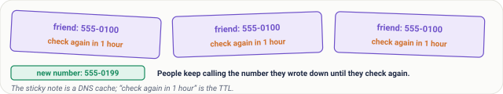
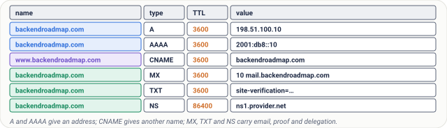
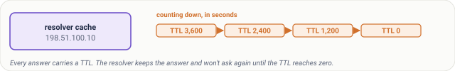
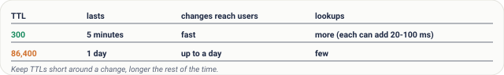
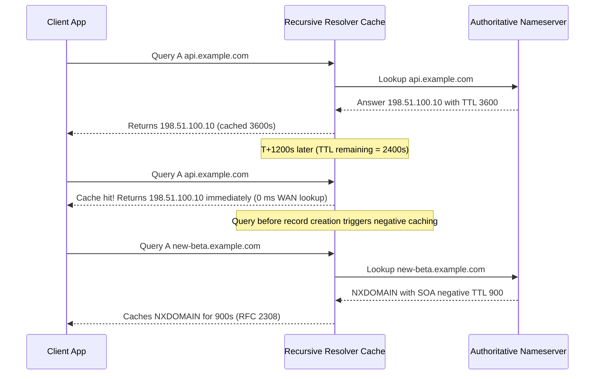
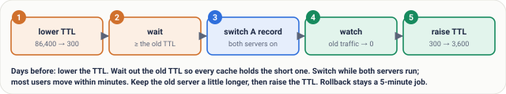
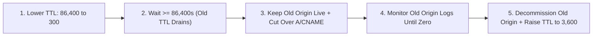
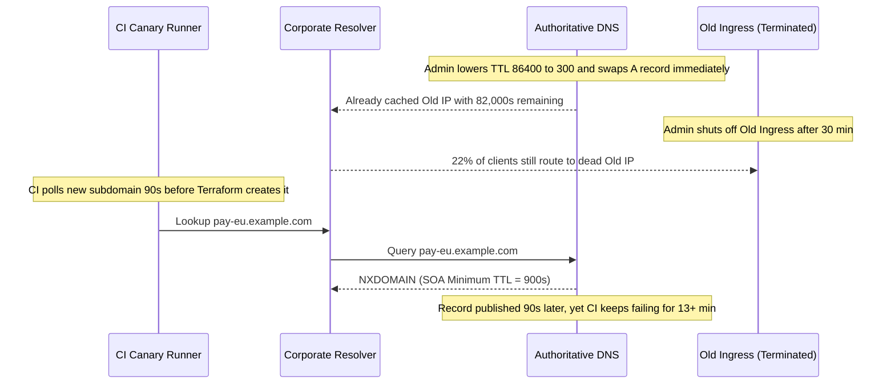
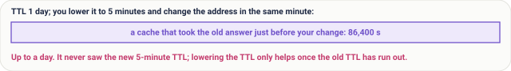
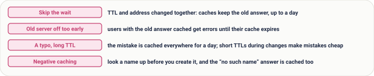

# Lesson 16: DNS Part 2, Records, TTL and Safe Migrations

> **Prerequisites:** Lesson 15 (tracing one DNS lookup step by step) and [Networking From Zero Overview](../README.md) (Lesson 16 of 30).  
> **Estimated Reading Time:** 25 minutes  
> **Target Audience:** Backend and platform engineers planning zero-downtime IP/CDN cutovers, managing `A`/`AAAA`/`CNAME`/`MX`/`TXT`/`NS` records, and avoiding resolver cache and negative-caching traps.  
> **Free PDF Notes:** [Download SD-N-016.pdf](https://backendroadmap.com/notes/system-design/SD-N-016.pdf)

> [!TIP]
> **The Golden Rule of DNS Migrations:** DNS stores typed records (`A`, `AAAA`, `CNAME`, `MX`, `TXT`, `NS`) on authoritative servers, and every resolver caches answers—including `NXDOMAIN` ("no such name")—for their `TTL`. To migrate cleanly without outages, **lower the `TTL` early, wait out at least one full old `TTL`, switch records while both old and new origins stay live, and raise the `TTL` only after old traffic drains**.

---

## Words You'll Meet Today

| Word | In Plain Words | Role in a Live Backend System |
| :--- | :--- | :--- |
| **`A` / `AAAA` record** | A name pointing to an IPv4 / IPv6 address. | Direct routing entry mapping a hostname to a load balancer or static IP. |
| **`CNAME`** | An alias: this name is really that other name. | Delegates subdomains (`www`, `api`) to dynamically shifting CDN/cloud endpoints. |
| **`MX` record** | Where email for the domain goes, with a priority. | Routes transactional and corporate mail (`10 mail.example.com`), lowest number first. |
| **`TXT` record** | Free text, used to prove ownership and for email security. | Carries SPF, DKIM, DMARC records and domain verification tokens. |
| **`NS` record** | Which servers are authoritative for the domain. | Delegates zone authority from the parent registry (`.com`) to your DNS provider. |
| **`TTL`** | Time to live: how long an answer may be cached, in seconds. | Controls cache hit ratio (`20–100 ms` savings) vs cutover/rollback speed. |
| **Authoritative server** | The server that holds the real records for a domain. | Source of truth (Route 53, Cloudflare, BIND) serving signed/published zone data. |
| **Negative caching** | Caching a "no such name" answer too. | Resolvers cache `NXDOMAIN` for the `SOA` minimum `TTL`, delaying newly created records. |

---

## Visual Mental Models & Architecture

### The Question: Why Do Some Users Still See the Old Site?

You move your website to a new server and update DNS. Half your users see the new site; the other half still reach the old one, for hours. Nothing is broken. In lesson 15 we followed one DNS lookup. Today: what DNS actually stores, the records, and the one number that decides how long the world remembers them, the TTL. Then, how to change DNS without anyone noticing.

### An Everyday Picture First: A Number on Sticky Notes

Your friend's phone number is written on sticky notes all over town, and each note also says: check again in one hour. Your friend changes their number. People who check their note within the hour still call the old number; then they check again and get the new one. If the note had said one week, some people would call the old number for a week. Nothing is broken: they're using what they wrote down. The sticky note is a DNS cache, and “check again in one hour” is the TTL.



*Figure 1. The analogy: a phone number copied onto sticky notes that say “check again in 1 hour”. The note is a DNS cache and the reminder is the TTL.*

### DNS Records

The records for `backendroadmap.com` live on its **authoritative servers**. Each record has four parts: a name, a type, a TTL and a value.

- **`A`**: `backendroadmap.com`, type `A`, TTL `3,600`, value `198.51.100.10`, the IPv4 address. **`AAAA`** does the same for an IPv6 address.
- **`CNAME`**: an alias. `www.backendroadmap.com CNAME backendroadmap.com` means: look up that other name instead. It's how you point a name at a CDN or a cloud load balancer whose addresses change.
- **`MX`**: where email for the domain goes, with a priority number; lower goes first.
- **`TXT`**: free text, used to prove you own a domain and for email security.
- **`NS`**: which servers are authoritative for the domain.



*Figure 2. The six records you'll see most: A and AAAA give an address, CNAME gives another name, and MX, TXT and NS carry email, proof of ownership and delegation. Each record has a name, a type, a TTL and a value.*

One rule: a `CNAME` can't sit at the top of a domain (the **zone apex**) next to other records like `SOA`, `NS`, or `MX`. Many DNS providers offer a special alias record (`ALIAS`, `ANAME`, or CNAME flattening) for that case, resolving the target internally and returning synthetic `A`/`AAAA` answers.


*Figure 3. A CNAME is an alias: the resolver follows it to another name and looks that up. It can't sit at the top of a domain next to other records.*

### The `TTL`

Every answer carries a **`TTL`**, in seconds; `3,600` means one hour. The resolver caches the answer and counts down, and until it reaches zero it won't ask again.



*Figure 4. The TTL: every DNS answer carries a time to live in seconds; a resolver caches the answer and only asks again when the countdown reaches zero.*

**Real numbers.** A TTL of `300` is five minutes; `86,400` is one day. A short TTL means changes spread fast, but more lookups, and each lookup can add `20` to `100 ms`. A long TTL means fewer lookups, but a change can take a whole day to reach everyone.

So the famous line, “DNS changes take 48 hours to propagate”, isn't quite right. The new record is live on the authoritative server at once. What you're waiting for is old copies, in caches, running out their TTL.



*Figure 5. Short versus long TTLs: short ones spread changes fast but cost more lookups; long ones save lookups but make a change take up to a day.*



### A Safe Migration, Step by Step

1. **Days before the move, lower the TTL**, from one day (`86,400`) to five minutes (`300`).
2. **Wait at least the old TTL**, a full day, so every cache now holds the short one.
3. **Keep the old server running and change the `A` record** to the new address. Within about five minutes, most users move.
4. **Watch traffic on the old server fall to almost zero**, and keep it alive a little longer for slow caches.
5. **When everything is stable, raise the TTL again**, say to one hour (`3,600`).

And the bonus: for the whole move, rolling back takes only five minutes.



*Figure 6. A safe DNS migration: lower the TTL, wait at least the old TTL, switch the record while both servers run, watch traffic move, then raise the TTL again.*



---

## Systematic Reference & Comparison Grid

### Essential DNS Record Types

| Type | Target / Value Format | Zone Apex Allowed? | Typical `TTL` | Primary Production Role |
| :--- | :--- | :--- | :--- | :--- |
| **`A`** | IPv4 address (`198.51.100.10`) | Yes | `60–3,600 s` | Maps domain or subdomain directly to IPv4 endpoint |
| **`AAAA`** | IPv6 address (`2001:db8::10`) | Yes | `60–3,600 s` | Dual-stack IPv6 connectivity alongside `A` |
| **`CNAME`** | Canonical hostname (`edge.cdn.net.`) | **No** (RFC 1034 conflict) | `300–3,600 s` | Aliases subdomains to dynamic CDN/LB DNS names |
| **`ALIAS` / `ANAME`** | Synthetic apex flattening (provider extension) | **Yes** | `60–300 s` | Provider resolves target and serves flattened `A`/`AAAA` at apex |
| **`MX`** | Priority + mail host (`10 mail.example.com.`) | Yes | `3,600–86,400 s` | Email delivery routing; lowest priority number tried first |
| **`TXT`** | Quoted ASCII string (`"v=spf1 ..."`) | Yes | `300–3,600 s` | Domain ownership proofs, SPF, DKIM, DMARC policies |
| **`NS`** | Authoritative nameserver hostnames | Yes (required) | `86,400–172,800 s` | Zone delegation from TLD registry to DNS provider |
| **`SOA`** | Primary NS, admin email, serial, negative `TTL` | Yes (required) | `3,600–86,400 s` | Zone metadata and RFC 2308 negative-cache duration |

### TTL Strategy Trade-Off Profiles

| Profile | `TTL` (Seconds) | Cutover / Rollback Lag | Cache Hit Efficiency | Best Operational Fit |
| :--- | :--- | :--- | :--- | :--- |
| **Ultra-Short** | `30–60 s` | `< 1 minute` | Lower (more `20–100 ms` misses) | Active DNS failover, health-checked load balancing |
| **Agile / Migration** | `300 s` (`5 min`) | `~5 minutes` | Moderate | Pre-cutover staging window and dynamic APIs |
| **Standard Web** | `3,600 s` (`1 hr`) | `1 hour` | High | Steady-state web apps, `MX`, `TXT` SPF policies |
| **Static Glue** | `86,400 s` (`24 hr`) | `24 hours` | Maximum | Rarely changed `NS` delegation and root infrastructure |

---

## Production War Story Post-Mortem: Unwaited `86,400 s` TTL & `NXDOMAIN` Poisoning

- **Severity:** SEV-1 (Partial Region Cutover & Automated Canary Failure)
- **Detection / Resolution Time:** 18 minutes to recover routing via temporary reverse proxy; 24 hours for full old-TTL drain
- **Impact:** `22%` of webhook customers continued hitting a terminated `us-west` ingress IP for hours, while CI smoke checks for a brand-new regional endpoint `pay-eu.example.com` failed for `15` minutes with `no such host`.

### What Happened



### Root Cause Analysis

1. **Skipping Step 2 (`T >= old_TTL`):** Changing `TTL` from `86,400 s` to `300 s` only applies to *future* queries made after existing caches expire. Any resolver that cached the record minutes before the change kept the old IP for nearly `24` hours.
2. **Premature Decommissioning:** Shutting off the old ingress server while recursive resolvers still served the old IP dropped live webhook deliveries (`ECONNREFUSED`).
3. **Negative Caching (`RFC 2308`):** Polling `pay-eu.example.com` before DNS propagation completed caused the shared resolver to cache `NXDOMAIN` for the zone's `SOA` minimum (`900 s`), blocking verification even after the record existed on authoritative servers.

### The Fix & Architectural Hardening

- **Emergency Reverse Proxy:** Re-spun the old IP briefly as a lightweight TCP/HTTPS proxy forwarding requests to the new origin until access logs on the old IP dropped to zero.
- **Automation Gate:** Built a migration pre-flight gate requiring `TTL <= 300 s` to be active for at least `old_TTL` seconds before any origin IP swap is permitted.
- **Lower `SOA` Minimum:** Reduced the zone's `SOA` negative-caching field from `900 s` to `60 s`, and shifted CI readiness checks to query the authoritative nameserver directly before polling recursive resolvers.

---

## Multi-Language Production Implementation

Below is a production-structured **DNS Zone Validator & Safe Migration Guard** enforcing RFC 1034 apex `CNAME` rules, calculating safe cutover eligibility (`elapsedSinceTtlDrop >= previousTtl`), and simulating RFC 2308 positive + negative (`NXDOMAIN`) resolver caching across Go, TypeScript, Python, and C#.

````carousel
```go
package dnsguard

import (
	"errors"
	"strings"
	"time"
)

type Record struct {
	Name  string
	Type  string // A, AAAA, CNAME, MX, TXT, NS, SOA
	TTL   time.Duration
	Value string
}

type CacheEntry struct {
	Value     string
	Negative  bool // RFC 2308 NXDOMAIN cache
	ExpiresAt time.Time
}

func ValidateZoneApex(zoneApex string, records []Record) error {
	var hasCNAME, hasOther bool
	for _, r := range records {
		if strings.EqualFold(r.Name, zoneApex) {
			if strings.EqualFold(r.Type, "CNAME") {
				hasCNAME = true
			} else {
				hasOther = true
			}
		}
	}
	if hasCNAME && hasOther {
		return errors.New("RFC 1034 violation: CNAME cannot coexist with NS/SOA/MX at zone apex")
	}
	return nil
}

// CanCutoverSafely verifies that the old TTL window has fully drained since lowering TTL.
func CanCutoverSafely(oldTTL, currentTTL time.Duration, loweredAt, now time.Time) (bool, time.Duration) {
	if currentTTL > 5*time.Minute {
		return false, 0
	}
	readyAt := loweredAt.Add(oldTTL)
	if now.Before(readyAt) {
		return false, readyAt.Sub(now)
	}
	return true, 0
}
```
<!-- slide -->
```typescript
export interface DnsRecord {
  name: string;
  type: "A" | "AAAA" | "CNAME" | "MX" | "TXT" | "NS" | "SOA";
  ttlSeconds: number;
  value: string;
}

export function validateZoneApex(zoneApex: string, records: DnsRecord[]): void {
  const apexRecords = records.filter((r) => r.name.toLowerCase() === zoneApex.toLowerCase());
  const hasCname = apexRecords.some((r) => r.type === "CNAME");
  const hasOther = apexRecords.some((r) => r.type !== "CNAME");

  if (hasCname && hasOther) {
    throw new Error(
      `RFC 1034 violation: CNAME at apex "${zoneApex}" conflicts with NS/SOA/MX; use ALIAS or CNAME flattening.`
    );
  }
}

export function checkCutoverReadiness(
  oldTtlSec: number,
  currentTtlSec: number,
  ttlLoweredAtMs: number,
  nowMs: number = Date.now()
): { ready: boolean; waitRemainingSec: number } {
  if (currentTtlSec > 300) {
    throw new Error("Lower TTL to <= 300s before starting the drain countdown.");
  }
  const readyAtMs = ttlLoweredAtMs + oldTtlSec * 1000;
  const remaining = Math.max(0, Math.ceil((readyAtMs - nowMs) / 1000));
  return { ready: remaining === 0, waitRemainingSec: remaining };
}
```
<!-- slide -->
```python
from dataclasses import dataclass
from datetime import datetime, timedelta, timezone


@dataclass(frozen=True)
class DnsRecord:
    name: str
    rtype: str  # A, AAAA, CNAME, MX, TXT, NS, SOA
    ttl_seconds: int
    value: str


def validate_zone_apex(zone_apex: str, records: list[DnsRecord]) -> None:
    apex_types = {
        r.rtype.upper() for r in records if r.name.lower() == zone_apex.lower()
    }
    if "CNAME" in apex_types and len(apex_types) > 1:
        raise ValueError(
            f"RFC 1034 violation: CNAME cannot sit at apex '{zone_apex}' beside {apex_types - {'CNAME'}}"
        )


def check_cutover_readiness(
    old_ttl_sec: int,
    current_ttl_sec: int,
    lowered_at: datetime,
    now: datetime | None = None,
) -> tuple[bool, int]:
    if current_ttl_sec > 300:
        raise ValueError("Lower record TTL to <= 300s before waiting out old TTL.")
    now = now or datetime.now(timezone.utc)
    ready_at = lowered_at + timedelta(seconds=old_ttl_sec)
    remaining = max(0, int((ready_at - now).total_seconds()))
    return remaining == 0, remaining
```
<!-- slide -->
```csharp
using System;
using System.Collections.Generic;
using System.Linq;

public sealed record DnsRecord(string Name, string Type, int TtlSeconds, string Value);

public static class DnsMigrationGuard
{
    public static void ValidateZoneApex(string zoneApex, IReadOnlyList<DnsRecord> records)
    {
        var apexTypes = records
            .Where(r => string.Equals(r.Name, zoneApex, StringComparison.OrdinalIgnoreCase))
            .Select(r => r.Type.ToUpperInvariant())
            .ToHashSet();

        if (apexTypes.Contains("CNAME") && apexTypes.Count > 1)
        {
            throw new InvalidOperationException(
                $"RFC 1034 violation: CNAME at zone apex '{zoneApex}' conflicts with NS/SOA/MX.");
        }
    }

    public static (bool Ready, int RemainingSeconds) CheckCutoverReadiness(
        int oldTtlSec,
        int currentTtlSec,
        DateTimeOffset loweredAt,
        DateTimeOffset? now = null)
    {
        if (currentTtlSec > 300)
            throw new ArgumentException("Lower TTL to <= 300s before starting migration drain.");

        var current = now ?? DateTimeOffset.UtcNow;
        var readyAt = loweredAt.AddSeconds(oldTtlSec);
        int remaining = (int)Math.Max(0, Math.Ceiling((readyAt - current).TotalSeconds));
        return (remaining == 0, remaining);
    }
}
```
````

---

## Practical Hands-On Verification CLI Workflows

### 1. Observe Real-Time `TTL` Countdown on a Recursive Resolver vs. Authoritative Server

```bash
dig +nocmd +noall +answer example.com A
```

**Expected Output:**

```text
example.com.		284	IN	A	93.184.215.14
```

Run the same command 10 seconds later (`274` seconds left); query the authoritative nameserver directly (`dig @a.iana-servers.net example.com A`) to see the true published `TTL` (`3600` or `300`) instead of a decaying cache countdown.

### 2. Inspect `CNAME` Chaining, `MX`, `TXT`, and `NS` Records

```bash
dig +nocmd +noall +answer www.github.com CNAME github.com MX github.com TXT github.com NS
```

**Expected Output:**

```text
www.github.com.		3600	IN	CNAME	github.com.
github.com.		3600	IN	MX	1 aspmx.l.google.com.
github.com.		3600	IN	TXT	"v=spf1 ip4:192.30.252.0/22 include:_netblocks.google.com ~all"
github.com.		172800	IN	NS	dns1.p08.nsone.net.
```

### 3. Verify RFC 2308 Negative Caching (`NXDOMAIN` + `SOA` Minimum TTL)

```bash
dig nonexistent-sub-9941.example.com A
```

**Expected Output:**

```text
;; ->>HEADER<<- opcode: QUERY, status: NXDOMAIN, id: 41892
;; AUTHORITY SECTION:
example.com.		900	IN	SOA	ns.icann.org. noc.dns.icann.org. 2024081442 7200 3600 1209600 3600
```

Running it again shows the `AUTHORITY` `SOA` TTL decrementing (`895`, `890`, ...), proving the `NXDOMAIN` itself is cached!

---

## Pause and Think

> [!exercise] Your A record has a TTL of one day. You lower it to five minutes and change the address in the same minute. How long until every user reaches the new server? Decide before you open the answer.

<details><summary>Answer</summary>

Up to a day. A resolver that cached the old record just before your change keeps it for its full 86,400 seconds; it never saw the new five-minute TTL. Lowering the TTL only helps once the old TTL has run out.



*Figure 8. The pause-and-think answer: changing the address in the same minute as lowering the TTL still leaves caches holding the old answer for up to a day.*

</details>

---

## Operational Validation Checkpoints

<details><summary><strong>Checkpoint 1: Planning a Safe Zero-Downtime Cutover Window</strong></summary>

**Scenario:** Your API `api.shop.example` currently has an `A` record with `TTL = 43,200` (12 hours). You want to switch IPs at `14:00 UTC` on Friday with a maximum 5-minute transition window. What exact action must happen by `02:00 UTC` Friday?

**Solution:**
By `02:00 UTC` Friday (at least `43,200` seconds = 12 hours before `14:00 UTC`), lower the `TTL` on `api.shop.example` from `43,200` to `300` (keeping the **old** IP intact!). By `14:00 UTC`, every compliant resolver worldwide has refreshed and now holds `TTL = 300`, allowing a 5-minute cutover and 5-minute rollback.

</details>

<details><summary><strong>Checkpoint 2: Zone Apex `CNAME` Outage</strong></summary>

**Scenario:** A developer tries to point `example.com` (the bare apex domain) to `d123.cloudfront.net` using a standard `CNAME`, and immediately email (`MX`) delivery breaks or the DNS console rejects the change. Why?

**Solution:**
Per RFC 1034, a `CNAME` claims a name is an alias for *all* record types and cannot coexist with `NS`, `SOA`, `MX`, or `TXT` records at the same node. Since the zone apex requires `NS` and `SOA` (and usually `MX`), use a provider-specific `ALIAS` / `ANAME` / CNAME-flattening record that resolves the CDN target server-side and returns synthetic `A`/`AAAA` records.

</details>

<details><summary><strong>Checkpoint 3: Newly Created Subdomain Stuck Returning `NXDOMAIN`</strong></summary>

**Scenario:** Terraform creates `billing-v2.example.com` and checks its availability immediately through a corporate recursive resolver, which keeps returning `NXDOMAIN` for 15 minutes even though `dig @ns1.provider.net` returns the IP. Why?

**Solution:**
A health check or monitoring script queried `billing-v2.example.com` *before* the record existed. Under RFC 2308, the resolver cached the `NXDOMAIN` answer for the `SOA` minimum `TTL` (`900 s`). Query authoritative nameservers directly for pre-launch verification, and keep `SOA` negative TTLs low (`60–300 s`).

</details>

---

## Common Mistakes & Troubleshooting

### What Goes Wrong

- **Skipping step 2:** You lower the TTL and change the address at the same time; caches still hold the old answer with its old TTL, up to a full day.
- **Switching the old server off too early:** Users with the old answer cached get errors until their cache expires.
- **A typo in a record with a long TTL:** The mistake is cached everywhere for a day. Short TTLs during changes make mistakes cheap.
- **Negative caching:** Even “not found” is cached: look up a name before you create it, and the “no such name” answer is remembered too.



*Figure 7. What goes wrong with DNS changes: skipping the wait, switching the old server off too early, a typo cached under a long TTL, and negative caching of a name that didn't exist yet.*

### Common Myths

- **"DNS changes take 48 hours."** No. Caches expire by TTL; with planning, the move takes minutes.
- **"A shorter TTL is always better."** No. It means more lookups, more load and a little more latency. Keep it short around changes, longer the rest of the time.
- **"A CNAME is a redirect."** No. The address bar doesn't change; DNS just follows one name to another. An HTTP redirect is different ([lesson 19](../19-http-status-codes-and-caching/README.md)).

---

## Recap in Three Lines

1. DNS stores records: `A`, `AAAA`, `CNAME`, `MX`, `TXT` and `NS`.
2. Every answer is cached for its `TTL`.
3. To change safely: lower the `TTL` early, wait out the old `TTL`, switch, keep the old server, then raise the `TTL`.

---

## Interview Practice Questions

> [!interview] Name the common DNS record types and what they do. (Basic)

<details><summary>What to say in 30 seconds</summary>

A maps a name to an IPv4 address and AAAA to an IPv6 address; CNAME makes a name an alias of another name; MX lists mail servers with priorities; TXT holds text such as ownership proofs and SPF/DKIM for email; NS names the authoritative servers for a domain. Each record also carries a TTL.

</details>

> [!interview] What is a TTL in DNS, and what's the trade-off in choosing it? (Basic)

<details><summary>What to say in 30 seconds</summary>

The time, in seconds, a resolver may cache an answer before asking again. A short TTL (like 300) makes changes reach users fast but causes more lookups and a little more latency; a long TTL (like 86,400) saves lookups but makes changes take up to that long.

</details>

> [!interview] How do you move a website to a new IP address with no downtime? (Scenario)

<details><summary>What to say in 30 seconds</summary>

Days before, lower the record's TTL, say from a day to five minutes, and wait at least the old TTL so every cache holds the short one. Switch the A record while both old and new servers run, watch traffic move to the new one, keep the old server a little longer for slow caches, then raise the TTL again. Rollback is quick throughout.

</details>

> [!interview] Users still reach the old server hours after a DNS change. Why, and what can you do? (Scenario)

<details><summary>What to say in 30 seconds</summary>

Resolvers cached the old answer with its old TTL and will keep it until that expires; some resolvers and clients also hold answers longer. You can't flush other people's caches, so keep the old server running (or proxying to the new one) until traffic drains, and lower TTLs ahead of time next time.

</details>

> [!interview] What's the difference between a CNAME and an HTTP redirect? (Tricky)

<details><summary>What to say in 30 seconds</summary>

A CNAME is resolved inside DNS: the resolver follows the alias to another name and returns its address, and the browser's URL doesn't change. An HTTP redirect (301 or 302) is the web server telling the browser to request a different URL, so the address bar changes.

</details>

> [!interview] Why can't you put a CNAME at the root of a domain? (Tricky)

<details><summary>What to say in 30 seconds</summary>

A CNAME means the name has no other data of its own, but the root (apex) must have NS and SOA records, and usually MX and TXT. So DNS forbids a CNAME there. Providers offer ALIAS or ANAME records, or CNAME flattening, which resolve the target themselves and return its addresses as A and AAAA records.

</details>

---

## Free PDF notes

Download these notes as a printable PDF, with every picture, the migration checklist and the interview answers: [SD-N-016.pdf](https://backendroadmap.com/notes/system-design/SD-N-016.pdf).

---

## Sources

- [RFC 1034: Domain Names, Concepts and Facilities](https://www.rfc-editor.org/rfc/rfc1034), records, zones, caching and TTL.
- [RFC 1035: Domain Names, Implementation and Specification](https://www.rfc-editor.org/rfc/rfc1035), record types and formats.
- [RFC 2308: Negative Caching of DNS Queries](https://www.rfc-editor.org/rfc/rfc2308), caching “no such name” answers.
- [RFC 3596: DNS Extensions to Support IPv6](https://www.rfc-editor.org/rfc/rfc3596), the AAAA record.
- [RFC 7208: Sender Policy Framework](https://www.rfc-editor.org/rfc/rfc7208), email security in TXT records.

---

## Next

Next comes lesson 17, DNS traffic management: how one name can send each user to the nearest, healthiest server (coming soon). Until then, the [track overview](../README.md) lists the whole series.
