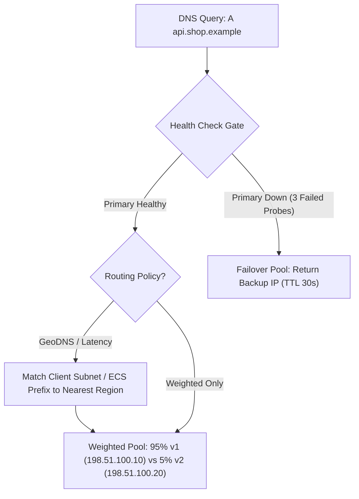
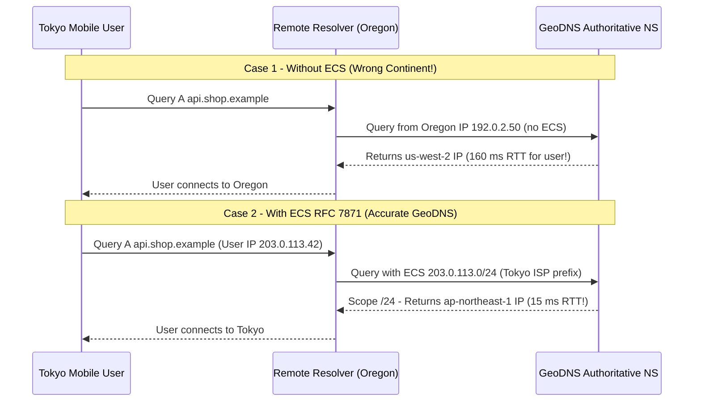
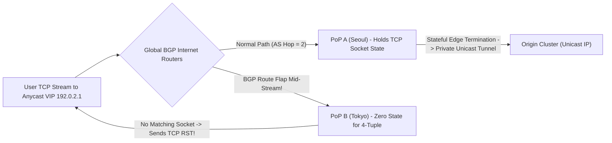
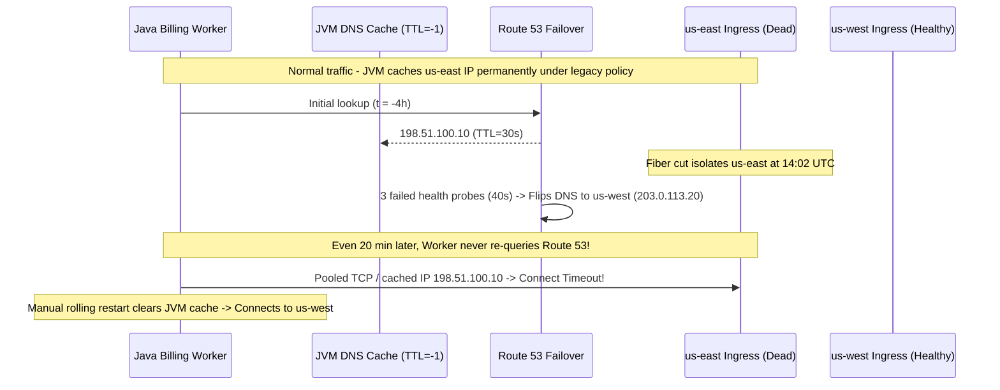

# Lesson 17: DNS Traffic Management — GeoDNS, Weighted, Failover and Anycast

> **Prerequisites:** [Lesson 16: DNS Part 2 — Records, TTL and Safe Migrations](../16-dns-records-ttl-and-migrations/README.md) and [Networking From Zero Overview](../README.md) (Lesson 17 of 30).  
> **Estimated Reading Time:** 25 minutes  
> **Target Audience:** Backend, SRE, and platform engineers operating multi-region services, canary rollouts, global load balancing, and disaster recovery over DNS and BGP Anycast.  
> **Free PDF Notes:** [Download SD-N-017.pdf](https://backendroadmap.com/notes/system-design/SD-N-017.pdf)

> [!TIP]
> **The Golden Rule of DNS Traffic Management:** Authoritative DNS steers clients *before* a TCP socket ever opens using **Weighted**, **GeoDNS**, **Latency**, or **Failover** policies, whereas **BGP Anycast** advertises one global IP from many locations so internet routers pick the shortest path. Because recursive resolvers, browsers, and JVM caches hold stale IPs—and public resolvers obscure user geography without **EDNS Client Subnet (`ECS`)**—pair short TTLs and active health checks with edge proxies or application-level connection draining for fast, predictable failover.

---

## Words You'll Meet Today

| Word | In Plain Words | Role in a Live Backend System |
| :--- | :--- | :--- |
| **Weighted DNS** | Returning different IPs at set percentage splits (`90/10`). | Shifts canary or blue/green traffic gradually across regions or clusters. |
| **GeoDNS** | Returning the IP of the datacenter closest to the user's region. | Enforces data residency (EU users in Frankfurt) and lowers cross-ocean latency. |
| **Latency-based routing** | Picking the region with the lowest measured RTT to the user's network. | Routes global API callers to the fastest datacenter, even across ISP peering quirks. |
| **`ECS` (EDNS Client Subnet)** | Forwarding the user's truncated IP prefix (`/24`) inside DNS queries. | Lets authoritative GeoDNS see the user's region instead of `8.8.8.8`'s datacenter. |
| **DNS failover** | Health-checking primary IPs and swapping DNS answers to a backup. | Active-passive disaster recovery when an entire region or load balancer goes dark. |
| **Anycast** | Announcing the exact same IP address from dozens of global PoPs. | Converges traffic to the topologically nearest edge via BGP (`1.1.1.1`, CDNs). |
| **Unicast** | Assigning a unique IP address to a single server or region. | Required for stateful origin connections where packets must always hit one cluster. |
| **BGP route flap** | Internet routing table changing mid-connection to a new PoP. | Breaks long-lived stateful TCP flows across Anycast edges with `RST` frames. |

---

## Visual Mental Models & Architecture

### The Question: Why Did a Tokyo User Hit Your Virginia Server?

You deploy an identical API cluster in Tokyo (`ap-northeast-1`) and Virginia (`us-east-1`), enable GeoDNS, and expect Tokyo users to connect locally in `15 ms`. Yet latency graphs show half your Japanese mobile users crossing the Pacific to Virginia (`160 ms`). Worse, when Virginia crashes and your DNS provider swaps the `A` record to Tokyo, Java worker pods keep hitting the dead Virginia IP for hours.

In [Lesson 16](../16-dns-records-ttl-and-migrations/README.md) we learned what records DNS stores and how `TTL` controls caching. Today: how one hostname steers global traffic dynamically, why `ECS` and stale client caches surprise teams, and when to replace DNS routing with BGP Anycast.

### An Everyday Picture First: A City Directory vs. a National 1-800 Number

Imagine a pizza chain with kitchens in Tokyo, London, and New York.
- **GeoDNS / Weighted / Failover (Unicast):** You look up the pizza shop's phone number in a central directory. Calling from Tokyo gives Tokyo's unique number; if Tokyo's oven breaks, it switches to Singapore. **Catch:** If a friend in Virginia looks it up *for you* without sharing your zip code, you get Virginia's kitchen (`missing ECS`), and writing it on a sticky note (`TTL` / JVM cache) leaves you dialing a dead shop.
- **BGP Anycast:** Every kitchen shares the **exact same toll-free number**. You dial once, and the phone network automatically routes your call to the nearest open branch on the wire.

### Weighted DNS, GeoDNS, Latency Routing, and Failover

Unlike an HTTP reverse proxy that inspects every request, an **authoritative DNS server** (Route 53, NS1, Cloudflare GSLB) only sees one event: a recursive resolver asking `A api.shop.example`. Inside that `1–5 ms` decision, modern traffic-management DNS evaluates a routing pipeline before returning `A`/`AAAA` records:
1. **Health Gate (Failover):** Active probes (`HTTP 200`, `TCP SYN`, or TLS checks from multiple global monitors) mark unhealthy endpoints `DOWN`. Active-passive failover keeps `100%` on `Primary` until `N` consecutive probes fail, then swaps to `Backup`.
2. **Geography / Latency Filter:** **GeoDNS** maps client prefixes to regions (`DE -> eu-central-1`) for GDPR residency or proximity, while **Latency-based routing (`LBR`)** uses continuous RTT telemetry across ISP fiber paths.
3. **Weighted Split:** Splits traffic across healthy pools (`95%` `v1`, `5%` canary `v2`) proportionally per DNS lookup.



*Figure 1. Inside an authoritative Global Server Load Balancer (GSLB): health checks filter out dead origins before GeoDNS, latency tables, or weighted canary probabilities pick the returned IP.*

**Why Weighted DNS is never an exact `5.0%` split.** DNS weights govern *lookups*, not *HTTP requests*. One corporate NAT gateway or ISP recursive resolver serving `10,000` users caches a single weighted answer for its `TTL` (`60 s`). If it rolls the `5%` canary dice and gets `v2`, all `10,000` users behind that resolver hit `v2` for a full minute (`100%` locally), while HTTP/2 connection reuse keeps clients pinned even longer. Keep DNS canary weights coarse (`5% -> 25% -> 50% -> 100%`) and use an L7 load balancer for exact per-request splits.

### The `EDNS Client Subnet (ECS)` Caveat

Authoritative nameservers do **not** receive packets from the end user's phone—they receive queries from **recursive resolvers** like `8.8.8.8` (Google), `1.1.1.1` (Cloudflare), or a corporate VPN resolver in Virginia.

Without **`ECS` (RFC 7871)**, if a Tokyo user sends queries to a centralized resolver located in Oregon, the authoritative GeoDNS server only sees the Oregon resolver's source IP and routes the Tokyo user to `us-west-2`!

`ECS` solves this by attaching an optional EDNS0 field containing the client's truncated IP prefix—typically `/24` for IPv4 or `/56` for IPv6—so the authoritative server knows the user's neighborhood without exposing their exact IP.

**The privacy twist (`1.1.1.1` vs `8.8.8.8`):**
- Google Public DNS (`8.8.8.8`) sends `ECS` (`/24`) to participating authoritative providers.
- Cloudflare (`1.1.1.1`) refuses to forward `ECS` for user privacy. Instead, Cloudflare deploys `1.1.1.1` via **BGP Anycast** across `300+` cities, so the recursive resolver node answering a Tokyo user *is physically in Tokyo*—making the resolver's own IP geographically accurate anyway!
- **Corporate VPN trap:** If an enterprise routes employee DNS over a central VPN tunnel to Virginia, both the resolver IP and the `ECS` prefix belong to Virginia, defeating GeoDNS completely.



*Figure 2. How centralized recursive resolvers fool GeoDNS without `ECS`, and how RFC 7871 attaches the user's truncated `/24` prefix so the authoritative server returns the true local region.*

### Why DNS Failover Is Rarely Instant (`TTL = 30 s` ≠ `30 s` Recovery)

Suppose you set `TTL = 30 s` and enable active-passive failover. Even when your authoritative server flips the `A` record in `45 s`, traffic drains slowly because **every layer caches independently**:

1. **Non-compliant resolvers:** Some ISP and enterprise DNS forwarders override low TTLs with a floor (`min-ttl = 300 s` or `3,600 s`).
2. **OS & Browser stub caches:** Windows DNS Client, macOS `mDNSResponder`, `systemd-resolved`, and Chrome (`chrome://net-internals/#dns`) maintain local host caches, and Chrome holds open HTTP/2 sockets (`pool`) that never re-query DNS until closed or timed out.
3. **JVM & Runtime traps:** Older Java setups with a `SecurityManager` default `networkaddress.cache.ttl` to **`-1` (cache forever until pod restart!)**; even modern JVMs default to `30 s` unless overridden (`-Dsun.net.inetaddr.ttl=5`). Meanwhile, Python `requests`, Go `http.Client`, and Node `undici` keep TCP keep-alive connections pinned to the old IP long after DNS flips, only switching once idle connections fail or expire (`MaxConnLifetime`).

### BGP Anycast vs. Unicast GeoDNS (and the BGP Flap Hazard)

With **Unicast**, Tokyo gets `198.51.100.10` and Virginia gets `203.0.113.10`. With **Anycast**, every edge datacenter worldwide announces the **exact same `/24` IPv4 prefix** (or `/48` IPv6 prefix—the smallest prefixes accepted by global BGP routers) into the internet's Border Gateway Protocol (**BGP**). Internet routers naturally forward packets along the shortest Autonomous System (**AS**) path to the nearest PoP.

**Why Anycast is unmatched for DNS & Edge DDoS:**
- **Zero DNS TTL lag:** Failover happens in BGP convergence time (`10–30 s`) when a PoP withdraws its `/24` announcement—zero client caches to wait on!
- **DDoS absorption:** A `1 Tbps` flood gets smeared across 100 global PoPs automatically instead of melting one region.

**The catch — BGP Flaps on Stateful TCP:**
UDP protocols like DNS (`53`) and QUIC/HTTP3 (which use a Connection ID rather than just the 4-tuple) tolerate path shifts smoothly. **TCP does not.** If a BGP route flaps mid-download and packets for an active TCP stream suddenly land at Tokyo instead of Seoul, Tokyo has no socket state for that 4-tuple and immediately responds with a **`RST`**—killing long-lived WebSockets, gRPC streams, or database tunnels! Production CDNs solve this by keeping Anycast strictly at a stateless **edge termination tier** (or ECMP consistent-hashing L4 load balancers like Maglev) that forwards over private **unicast** tunnels to stateful origin backends.



*Figure 3. Anycast BGP path stability vs. a mid-stream BGP flap: if packets shift to a new PoP mid-flow, the new PoP has no TCP state for that connection and drops it with `RST`.*

---

## Systematic Reference & Comparison Grid

### DNS Traffic Management vs. BGP Anycast

| Strategy | Routing Layer | Failover Speed | Cache Pinning Risk? | Long-Lived TCP Risk | Best Production Fit |
| :--- | :--- | :--- | :--- | :--- | :--- |
| **Weighted DNS** | L7 DNS Answer | `T_detect + TTL` | High (`NAT` skew, pools) | None (Unicast per IP) | Gradual canary releases (`5% -> 25% -> 100%`) |
| **GeoDNS** | L7 DNS Answer | `T_detect + TTL` | Medium (`ECS` / VPN skew) | None (Unicast per IP) | GDPR data locality, regional compliance |
| **Latency-Based (`LBR`)** | L7 DNS Answer | `T_detect + TTL` | Medium (`ECS` required) | None (Unicast per IP) | Multi-region stateless APIs maximizing speed |
| **Active-Passive Failover** | L7 DNS Answer | `30 s – 15 min+` | **High** (JVM / ISP `min-ttl`) | Sockets hang until timeout | Multi-region DR when active-active is impossible |
| **BGP Anycast** | **L3 IP / BGP** | **`5–30 s`** (BGP withdraw) | **Zero** (single VIP) | **High on BGP flap (`RST`)** | Authoritative DNS, CDN/WAF edges, QUIC/HTTP3 |

### End-to-End Failover Latency & Cache Stack

Where a `TTL = 30 s` record actually gets stuck during a primary region outage:

$$T_{\text{failover}} = T_{\text{probe\_detect}} + \max\!\left(T_{\text{resolver\_ttl}},\; T_{\text{os\_stub}},\; T_{\text{jvm\_or\_pool}}\right) + T_{\text{tcp\_timeout}}$$

For example, if probes trigger after `3 × 10 s = 30 s`, an enterprise resolver clamps `min-ttl = 300 s`, and a Go/Java client holds idle sockets up to `60 s` with a `10 s` dial timeout, real recovery takes **$30 + 300 + 10 = 340\text{ s}$ (~5.7 minutes)**—not `30 s`!

| Cache Layer | Default TTL / Behavior | Why It Delays DNS Failover | Hardening Control |
| :--- | :--- | :--- | :--- |
| **Authoritative Health Probe** | `10–30 s` interval × `2–3` fails | Waits to avoid flapping on transient packet loss | Use multi-vantage regional probes + fast `10 s` intervals |
| **ISP / Enterprise Resolver** | Respects `TTL`, may clamp floor | Non-compliant forwarders enforce `300 s+` minimum | Pair DNS failover with BGP Anycast or multi-IP `A` records |
| **OS Stub (`systemd-resolved`)** | Honors `TTL` (or caps max) | Local stub keeps old IP until local expiry | Keep `TTL` at `30–60 s`; verify `resolvectl` config on workers |
| **JVM `InetAddress` Cache** | `30 s` (or `-1` forever with `SecurityManager`) | Never re-resolves DNS after first lookup | Explicitly set `-Dsun.net.inetaddr.ttl=10` and `negative=5` |
| **HTTP / DB Connection Pool** | Keeps sockets open indefinitely | Established TCP connections never re-query DNS | Configure `MaxConnLifetime` (`2–5 min`) + short `DialTimeout` |

---

## Production War Story Post-Mortem: The "30-Second" Failover That Took 45 Minutes (Plus Anycast `RST` Collateral)

- **Severity:** SEV-1 (45-Minute Checkout Blackout in `us-east` + `14%` Streaming Disconnects)
- **Detection / Resolution Time:** DNS swapped in `40 s`; full client recovery took `45 minutes` after emergency pod bounce and BGP peer drain
- **Impact:** After a fiber cut isolated `us-east` ingress, Route 53 failover moved `payments.internal.example` to `us-west` in `40 s`, yet `65%` of Java billing workers kept timing out on the dead IP. Simultaneously, engineers rerouted external webhooks onto a newly provisioned Anycast tier whose flapping BGP transit link reset `14%` of active TLS webhook streams.

### What Happened



### Root Cause Analysis

1. **JVM Infinite DNS Pinning & Unbounded Socket Lifetimes:** A legacy Java runtime flag set `networkaddress.cache.ttl=-1` ("cache forever"), so billing workers never observed the `TTL = 30 s` failover record until forced restarts cleared JVM memory. Meanwhile, Go webhook callers that *did* re-resolve DNS kept trying dead pooled HTTP/2 sockets until `IdleConnTimeout` expired.
2. **Untested Anycast Transit Flap:** Under panic load, traffic was shifted onto an Anycast IP backed by two regional edge PoPs without BGP graceful-shutdown or consistent-hashing edge proxies. An asymmetric BGP flap rerouted established TCP sockets mid-flight, triggering `RST` storms.

### The Fix & Architectural Hardening

- **Explicit Runtime TTLs & Connection Recycling:** Enforced `networkaddress.cache.ttl=10` in all JVM base images and capped `MaxConnLifetime = 120 s` across Go, Python, and C# HTTP clients so sockets periodically recycle onto fresh DNS answers.
- **Multi-IP `A` Records + Client Circuit Breakers:** Switched critical internal endpoints to return *multiple* regional IPs alongside health checks so clients fail over locally in `< 2 s` upon connect timeout without waiting for DNS caches.
- **Stateless Anycast Edge -> Unicast Origin:** Terminated TLS/TCP at stateless Anycast edge proxies (`Envoy` with BGP graceful shutdown) before forwarding over private unicast tunnels to origins.

---

## Multi-Language Production Implementation

Below is a production-structured **Health-Checked Weighted & Geo-Aware Endpoint Selector with Periodic DNS/TTL Refresh & Circuit-Breaker Fallback** across Go, TypeScript, Python, and C#—demonstrating how client applications complement DNS traffic management without getting pinned to dead regions.

````carousel
```go
package trafficmgr

import (
	"context"
	"math/rand/v2"
	"net"
	"sync"
	"time"
)

type Endpoint struct {
	Host, Region string
	Weight       int
	Healthy      bool
	IP           net.IP
	ExpiresAt    time.Time
}

type Router struct {
	mu          sync.RWMutex
	localRegion string
	endpoints   []*Endpoint
}

func (r *Router) RefreshDNS(ctx context.Context, res *net.Resolver, ttl time.Duration) {
	if ttl > 30*time.Second { ttl = 30 * time.Second }
	r.mu.Lock()
	defer r.mu.Unlock()
	now := time.Now()
	for _, ep := range r.endpoints {
		if now.Before(ep.ExpiresAt) && ep.IP != nil { continue }
		if ips, err := res.LookupIP(ctx, "ip4", ep.Host); err != nil || len(ips) == 0 {
			ep.Healthy = false // Circuit-breaker trips on failed DNS
		} else {
			ep.IP, ep.ExpiresAt = ips[0], now.Add(ttl)
		}
	}
}

func (r *Router) Select() *Endpoint {
	r.mu.RLock()
	defer r.mu.RUnlock()
	var local, fallback []*Endpoint
	for _, ep := range r.endpoints {
		if !ep.Healthy || ep.Weight <= 0 { continue }
		if ep.Region == r.localRegion { local = append(local, ep) } else { fallback = append(fallback, ep) }
	}
	pool := local
	if len(pool) == 0 { pool = fallback }
	total := 0
	for _, ep := range pool { total += ep.Weight }
	if total == 0 { return nil }
	roll := rand.IntN(total)
	for _, ep := range pool {
		if roll -= ep.Weight; roll < 0 { return ep }
	}
	return pool[0]
}
```
<!-- slide -->
```typescript
import { resolve4 } from "node:dns/promises";

export interface Endpoint {
  host: string; region: string; weight: number; healthy: boolean; ip?: string; expiresAtMs: number;
}

export class GeoWeightedSelector {
  constructor(private readonly localRegion: string, private readonly endpoints: Endpoint[], private readonly maxTtlMs = 30_000) {}

  async refreshDns(): Promise<void> {
    const now = Date.now();
    await Promise.all(this.endpoints.map(async (ep) => {
      if (ep.ip && now < ep.expiresAtMs) return;
      try {
        const ips = await resolve4(ep.host);
        if (!ips.length) throw new Error("empty");
        ep.ip = ips[0];
        ep.expiresAtMs = now + this.maxTtlMs;
      } catch { ep.healthy = false; }
    }));
  }

  select(): Endpoint | null {
    const healthy = this.endpoints.filter((e) => e.healthy && e.weight > 0);
    const local = healthy.filter((e) => e.region === this.localRegion);
    const pool = local.length > 0 ? local : healthy;
    const total = pool.reduce((s, e) => s + e.weight, 0);
    if (total <= 0) return null;
    let roll = Math.random() * total;
    for (const ep of pool) { if ((roll -= ep.weight) < 0) return ep; }
    return pool[0] ?? null;
  }
}
```
<!-- slide -->
```python
from dataclasses import dataclass
import random, socket, time

@dataclass
class Endpoint:
    host: str; region: str; weight: int
    healthy: bool = True; ip: str | None = None; expires_at: float = 0.0

class GeoWeightedRouter:
    def __init__(self, local_region: str, endpoints: list[Endpoint], max_ttl_sec: int = 30):
        self.local_region, self.endpoints, self.max_ttl = local_region, endpoints, min(max_ttl_sec, 30)

    def refresh_dns(self) -> None:
        now = time.monotonic()
        for ep in self.endpoints:
            if ep.ip and now < ep.expires_at: continue
            try:
                ep.ip, ep.expires_at = socket.gethostbyname(ep.host), now + self.max_ttl
            except OSError:
                ep.healthy = False

    def select(self) -> Endpoint | None:
        healthy = [e for e in self.endpoints if e.healthy and e.weight > 0]
        pool = [e for e in healthy if e.region == self.local_region] or healthy
        return random.choices(pool, weights=[e.weight for e in pool], k=1)[0] if pool else None
```
<!-- slide -->
```csharp
using System;
using System.Collections.Generic;
using System.Linq;
using System.Net;
using System.Threading.Tasks;

public sealed class ManagedEndpoint(string host, string region, int weight)
{
    public string Host { get; } = host; public string Region { get; } = region; public int Weight { get; } = weight;
    public bool Healthy { get; set; } = true; public IPAddress? Ip { get; set; }
    public DateTimeOffset ExpiresAt { get; set; } = DateTimeOffset.MinValue;
}

public sealed class GeoWeightedSelector(string localRegion, IReadOnlyList<ManagedEndpoint> endpoints)
{
    public async Task RefreshDnsAsync()
    {
        var now = DateTimeOffset.UtcNow;
        foreach (var ep in endpoints.Where(e => e.Ip is null || now >= e.ExpiresAt))
        {
            try { ep.Ip = (await Dns.GetHostAddressesAsync(ep.Host)).First(); ep.ExpiresAt = now.AddSeconds(30); }
            catch { ep.Healthy = false; }
        }
    }

    public ManagedEndpoint? Select()
    {
        var healthy = endpoints.Where(e => e.Healthy && e.Weight > 0).ToList();
        var pool = healthy.Where(e => e.Region == localRegion).ToList();
        if (pool.Count == 0) pool = healthy;
        int total = pool.Sum(e => e.Weight);
        if (total <= 0) return null;
        int roll = Random.Shared.Next(total);
        foreach (var ep in pool) { if ((roll -= ep.Weight) < 0) return ep; }
        return pool[0];
    }
}
```
````

---

## Practical Hands-On Verification CLI Workflows

### 1. Simulate `ECS` GeoDNS Responses with `dig`

```bash
dig @8.8.8.8 +subnet=3.80.0.0/24 www.netflix.com +noall +answer +comments
```

**Expected Output:**

```text
;; OPT PSEUDOSECTION:
; EDNS: version: 0, flags:; udp: 512
; CLIENT-SUBNET: 3.80.0.0/24/24
;; ANSWER SECTION:
www.netflix.com.	14	IN	CNAME	www.geo.netflix.com.
www.geo.netflix.com.	14	IN	A	54.236.110.178
```

Repeat with a European prefix (`+subnet=185.199.108.0/24`) to watch ECS-enabled GeoDNS return a different regional IP.

### 2. Verify Which Anycast PoP Serves You (`1.1.1.1`) & Pin Local Overrides

```bash
curl -sS https://1.1.1.1/cdn-cgi/trace | grep -E "ip=|colo=|loc="
```

**Expected Output:**

```text
ip=203.0.113.45
loc=IN
colo=BOM
```

`colo=BOM` identifies the exact **Anycast PoP** (Mumbai) selected by BGP. To inspect your local OS stub cache (`systemd-resolved`) or test a failover IP locally before changing DNS, run:

```bash
resolvectl statistics && curl -sI --resolve api.example.com:443:203.0.113.20 https://api.example.com/health
```

---

## Pause and Think

> [!exercise] Your active-passive DNS failover uses `TTL = 30 s`. When `us-east` goes down, Route 53 switches `api.internal` to `us-west` in `45` seconds. Yet `30%` of your Java and Go microservices keep failing with connection timeouts to `us-east` for `25` minutes until you restart them. Why? Decide before you open the answer.

<details><summary>Answer</summary>

Two layers ignored the `30 s` DNS flip:

1. **JVM DNS cache:** Older or `SecurityManager`-enabled Java runtimes pin `InetAddress` resolutions indefinitely (`networkaddress.cache.ttl = -1`) until restarted.
2. **Persistent connection pools:** Even if Go's resolver sees the new IP, active HTTP/gRPC pools reuse already-open TCP sockets bound to the old `us-east` IP until idle timeouts or read/write deadlines tear them down.

Fix both with short explicit runtime DNS TTLs (`10 s`), bounded `MaxConnLifetime` on pools, and multi-IP client-side failover.

</details>

---

## Operational Validation Checkpoints

<details><summary><strong>Checkpoint 1: Debugging Canary Traffic Skew Under Weighted DNS</strong></summary>

**Scenario:** You configure Weighted DNS at `95%` `v1` and `5%` `v2` (`TTL = 60 s`). Two minutes after enabling it, `v2` suddenly receives `42%` of total RPS. Nothing changed in your DNS config. How could `5%` turn into `42%`?

**Solution:**
Traffic skew comes from uneven **resolver population density** and **connection reuse**. One massive corporate NAT or regional ISP recursive resolver representing `40%` of your user base rolled the `5%` chance on a single cache miss and cached `v2`'s IP for `60 s`. All users behind that resolver hit `v2`, and persistent HTTP/2 sockets kept them on `v2` even after TTL expiry. Keep DNS canary steps coarse and enforce exact percentage splits at an L7 reverse proxy (`Envoy`/`Nginx`/ALB).

</details>

<details><summary><strong>Checkpoint 2: Why `1.1.1.1` Users Get Accurate GeoDNS Without `ECS` While Corporate VPN Users Don't</strong></summary>

**Scenario:** Cloudflare DNS (`1.1.1.1`) disables `ECS` by default, yet users on `1.1.1.1` still land on nearby GeoDNS servers—while users on a corporate VPN routed through Frankfurt get wrong-continent routing on `us-east` sites. Why?

**Solution:**
Cloudflare deploys `1.1.1.1` via **Anycast across 300+ cities**, so a Tokyo user's query hits a Tokyo `1.1.1.1` node; the authoritative GeoDNS sees a Tokyo resolver IP and answers accurately without `ECS`. By contrast, a corporate VPN funnels user DNS to a single Frankfurt resolver egress without `ECS` (or with Frankfurt's `ECS`), so GeoDNS genuinely believes the user is in Frankfurt.

</details>

<details><summary><strong>Checkpoint 3: Anycast Prefix Size & Mid-Stream TCP `RST`</strong></summary>

**Scenario:** A team tries to announce a `/28` IPv4 subnet (`16` IPs) via BGP Anycast from 5 PoPs for their stateful WebSocket game server. Half their announcements never propagate, and connected players randomly get `connection reset by peer` every few minutes. Identify the two mistakes.

**Solution:**
1. **Prefix too small:** Global BGP routing tables filter out IPv4 prefixes smaller than **`/24`** (`256` IPs) to prevent routing table bloat—a `/28` is dropped by transit peers.
2. **Stateful TCP on raw Anycast:** WebSockets run over long-lived TCP sockets. Whenever BGP path selection shifts even briefly between two PoPs (a BGP flap), packets arrive at a PoP lacking that connection's TCP state and receive immediate `RST`s. Terminate Anycast at stateless L4/L7 edge proxies (or use QUIC connection IDs) and tunnel stably to unicast game servers.

</details>

---

## Common Mistakes & Troubleshooting

### What Goes Wrong

- **Expecting DNS failover to act like a load balancer:** DNS cannot drain active TCP connections or enforce exact `1%` traffic splits across unequal ISP resolver sizes.
- **Forgetting `ECS` or VPN centralization:** Testing GeoDNS only from your office VPN makes you think routing works locally while remote users cross oceans.
- **Running stateful origins directly behind raw BGP Anycast:** Any internet BGP churn sends established TCP segments to another continent, tearing down long downloads and streams.

### Common Myths

- **"Setting `TTL = 5 s` guarantees 5-second failover."** No. ISP `min-ttl` overrides, JVM caching, and long-lived HTTP/2 socket pools easily extend failover to minutes or hours.
- **"Anycast and GeoDNS do the same thing."** No. GeoDNS returns *different unicast IPs* at L7 DNS; Anycast announces *one shared IP* at L3 BGP and lets internet routers pick the shortest AS path.

| Symptom | Root Cause | Fix |
| :--- | :--- | :--- |
| Users routed to wrong continent via `8.8.8.8` / VPN | Authoritative server ignores `ECS` or VPN centralizes DNS | Enable `ECS` parsing on GSLB or deploy Anycast edge POPs |
| Microservices stay pinned to dead IP after DNS failover | JVM infinite cache (`-1`) or long-lived keep-alive pool | Set `networkaddress.cache.ttl=10` and `MaxConnLifetime` |
| Random TCP `RST` spikes on Anycast service | BGP route flap shifts active TCP flow to stateless peer PoP | Terminate TCP at stateless edge proxies + unicast origin tunnels |

---

## Recap in Three Lines

1. **Weighted, GeoDNS, Latency, and Failover** DNS steer clients at lookup time by returning different unicast IPs—subject to `ECS` visibility and downstream caches.
2. **BGP Anycast** announces one IP from many PoPs for `10–30 s` L3 failover and DDoS absorption, though BGP flaps reset unprotected stateful TCP streams.
3. Combine short DNS TTLs with bounded runtime DNS caching, connection-lifetime caps, and client circuit breakers for true high availability.

---

## Interview Practice Questions

> [!interview] What is the difference between GeoDNS and Anycast? (Basic)

<details><summary>What to say in 30 seconds</summary>

GeoDNS works at the DNS layer: the authoritative server inspects the requester's IP (or ECS prefix) and returns a different unicast IP for each region, subject to DNS TTL caching. Anycast works at the BGP IP routing layer: every PoP worldwide advertises the exact same IP prefix, and internet routers automatically deliver packets along the shortest topological path with zero DNS cache lag.

</details>

> [!interview] What is EDNS Client Subnet (`ECS`), and when can GeoDNS still get a user's location wrong? (Scenario)

<details><summary>What to say in 30 seconds</summary>

ECS (RFC 7871) attaches the user's truncated IP prefix (like a /24) to recursive DNS queries so authoritative GeoDNS servers don't accidentally route based on a remote public resolver's IP. GeoDNS still misroutes when privacy resolvers like 1.1.1.1 omit ECS (solved via Anycast resolvers), when corporate VPNs centralize egress, or when an authoritative server caches poorly across subnets.

</details>

> [!interview] Why does setting a 30-second DNS TTL not guarantee 30-second failover? (Scenario)

<details><summary>What to say in 30 seconds</summary>

First, health checks need multiple failed probes to detect an outage safely. Second, some ISP resolvers enforce minimum TTL floors above 30 seconds. Third, OS caches, browsers, and especially JVM runtimes or HTTP connection pools keep reusing cached IPs and already-established TCP sockets long after DNS changes. You need bounded connection lifetimes and client-side failover alongside short TTLs.

</details>

> [!interview] Why is Weighted DNS inaccurate for a 1% canary rollout? (Tricky)

<details><summary>What to say in 30 seconds</summary>

DNS weights apply per recursive resolver query, not per HTTP request. One huge ISP or corporate NAT resolver serving tens of thousands of users caches a single returned IP for the full TTL—giving 100% of its users either the stable or canary IP—and HTTP/2 keep-alive pins them there. Use an L7 proxy or ingress controller for fine-grained canary splits.

</details>

> [!interview] Why does Anycast excel for DNS and HTTP/3, yet risk breaking long-lived TCP connections? (Tricky)

<details><summary>What to say in 30 seconds</summary>

DNS is stateless UDP and HTTP/3 (QUIC) carries connection IDs that survive path changes. A long-lived TCP connection depends on a specific PoP holding its socket state; if a BGP route flap shifts packets to a different Anycast PoP mid-stream, that PoP lacks the socket state and immediately sends a TCP RST. Production CDNs avoid this by keeping Anycast at a stateless edge tier that tunnels to unicast origins.

</details>

> [!interview] What is the minimum IPv4 prefix size you can advertise over BGP Anycast, and why? (Basic)

<details><summary>What to say in 30 seconds</summary>

A /24 (256 IPv4 addresses), or /48 for IPv6. Global Tier-1 transit routers filter out more specific prefixes like /25 or /28 to stop the global BGP routing table from exploding in size, so anything smaller simply won't propagate across the internet.

</details>

---

## Free PDF notes

Download these notes as a printable PDF, with the routing comparison grids, cache math, and interview answers: [SD-N-017.pdf](https://backendroadmap.com/notes/system-design/SD-N-017.pdf).

---

## Sources

- [RFC 7871: Client Subnet in DNS Queries (`ECS`)](https://www.rfc-editor.org/rfc/rfc7871), forwarding client `/24` prefixes safely for GeoDNS.
- [RFC 4786: Operation of Anycast Services](https://www.rfc-editor.org/rfc/rfc4786), BGP Anycast architecture, convergence, and stateful TCP caveats.
- [RFC 1794: DNS Support for Load Balancing](https://www.rfc-editor.org/rfc/rfc1794), foundational weighted/rotational DNS semantics.
- [Cloudflare Learning Center: What is Anycast?](https://www.cloudflare.com/learning/cdn/glossary/anycast-network/), Anycast vs unicast DDoS absorption and edge PoP routing.
- [AWS Route 53 Developer Guide: Choosing a Routing Policy](https://docs.aws.amazon.com/Route53/latest/DeveloperGuide/routing-policy.html), weighted, geolocation, latency-based, and failover DNS routing.

---

## Next

Next comes [Lesson 18: HTTP Part 1 — Requests, Responses and Methods](../18-http-requests-responses-and-methods/README.md): once DNS connects us to the right server, what exact plain-text bytes cross the TCP wire, how `CL.TE` request smuggling breaks proxies, and why `POST` retries require `Idempotency-Key`. See [the track overview](../README.md) for the whole series.
