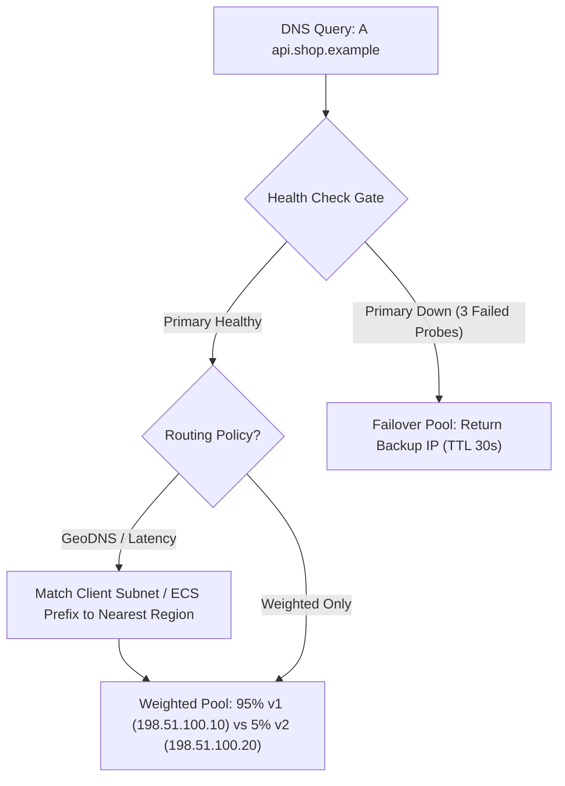
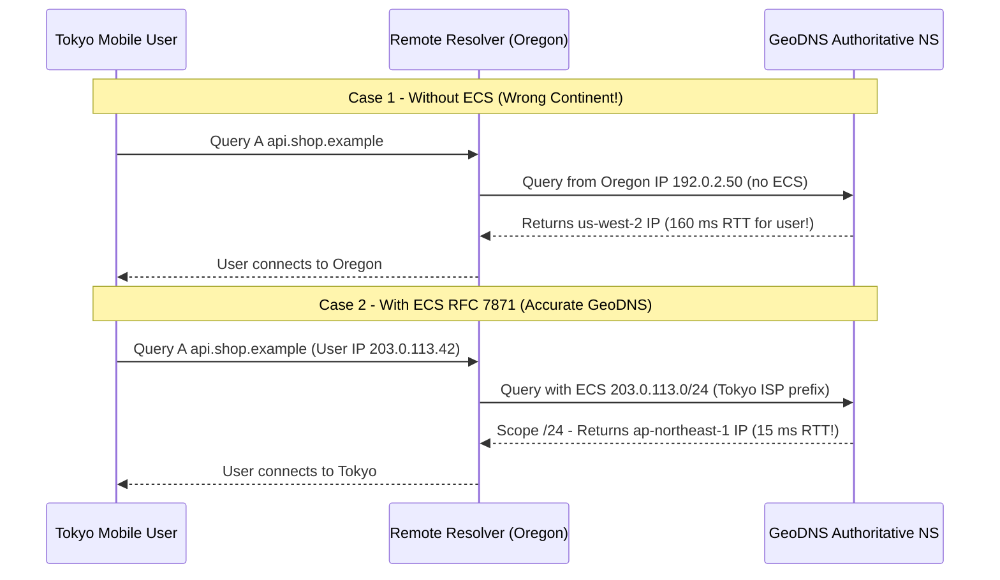
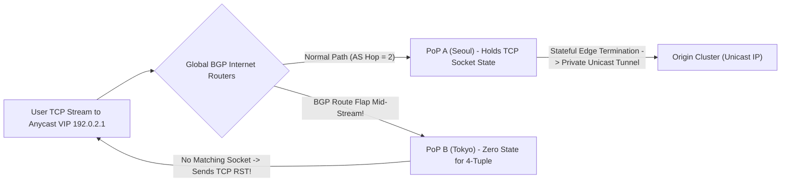
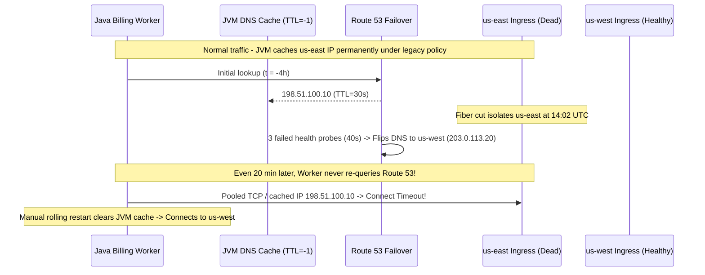

# Lesson 17: DNS Traffic Management — GeoDNS, Weighted, Failover and Anycast

> **Prerequisites:** [Lesson 16: DNS Part 2 — Records, TTL and Safe Migrations](../16-dns-records-ttl-and-migrations/README.md) and [Networking From Zero Overview](../README.md) (Lesson 17 of 30).  
> **Estimated Reading Time:** 35 minutes  
> **Target Audience:** Backend, SRE, and platform engineers operating multi-region services, canary rollouts, global load balancing, and disaster recovery over DNS and BGP Anycast.  
> **Free PDF Notes:** [Download SD-N-017.pdf](https://backendroadmap.com/notes/system-design/SD-N-017.pdf)

> [!NOTE]
> **In one line:** An authoritative DNS server can give different answers to different users (by location, measured latency, weights, or health) to route traffic between regions, but DNS failover is slow because of health-check time and caching, so use an anycast global load balancer when you need seconds.

> [!TIP]
> **The Golden Rule of DNS Traffic Management:** Authoritative DNS steers clients *before* a TCP socket ever opens using **Weighted**, **GeoDNS**, **Latency**, or **Failover** policies, whereas **BGP Anycast** advertises one global IP from many locations so internet routers pick the shortest path. Because recursive resolvers, browsers, and JVM caches hold stale IPs—and public resolvers obscure user geography without **EDNS Client Subnet (`ECS`)**—pair short TTLs and active health checks with edge proxies or application-level connection draining for fast, predictable failover.

---

## Words You'll Meet Today

| Word | In Plain Words | Role in a Live Backend System |
| :--- | :--- | :--- |
| **Weighted DNS** | Returning different IPs at set percentage splits (`90/10`). | Shifts canary or blue/green traffic gradually across regions or clusters. |
| **GeoDNS** | Returning the IP of the datacenter closest to the user's region. | Enforces data residency (EU users in Frankfurt) and lowers cross-ocean latency. |
| **Latency-based routing** | Picking the region with the lowest measured RTT to the user's network. | Routes global API callers to the fastest datacenter, even across ISP peering quirks. |
| **`ECS` (EDNS Client Subnet)** | Forwarding the user's truncated IP prefix (`/24`) inside DNS queries. | Lets authoritative GeoDNS see the user's region instead of `8.8.8.8`'s datacenter. |
| **DNS failover** | Health-checking primary IPs and swapping DNS answers to a backup. | Active-passive disaster recovery when an entire region or load balancer goes dark. |
| **Anycast** | Announcing the exact same IP address from dozens of global PoPs. | Converges traffic to the topologically nearest edge via BGP (`1.1.1.1`, CDNs). |
| **Unicast** | Assigning a unique IP address to a single server or region. | Required for stateful origin connections where packets must always hit one cluster. |
| **BGP route flap** | Internet routing table changing mid-connection to a new PoP. | Breaks long-lived stateful TCP flows across Anycast edges with `RST` frames. |

---

## Visual Mental Models & Architecture

### The Question: Why Did a Tokyo User Hit Your Virginia Server?

You deploy an identical API cluster in Tokyo (`ap-northeast-1`) and Virginia (`us-east-1`), enable GeoDNS, and expect Tokyo users to connect locally in `15 ms`. Yet latency graphs show half your Japanese mobile users crossing the Pacific to Virginia (`160 ms`). Worse, when Virginia crashes and your DNS provider swaps the `A` record to Tokyo, Java worker pods keep hitting the dead Virginia IP for hours.

In [Lesson 16](../16-dns-records-ttl-and-migrations/README.md) we learned what records DNS stores and how `TTL` controls caching. Today: how one hostname steers global traffic dynamically, why `ECS` and stale client caches surprise teams, and when to replace DNS routing with BGP Anycast.

### An Everyday Picture First: A City Directory vs. a National 1-800 Number

Imagine a pizza chain with kitchens in Tokyo, London, and New York.
- **GeoDNS / Weighted / Failover (Unicast):** You look up the pizza shop's phone number in a central directory. Calling from Tokyo gives Tokyo's unique number; if Tokyo's oven breaks, it switches to Singapore. **Catch:** If a friend in Virginia looks it up *for you* without sharing your zip code, you get Virginia's kitchen (`missing ECS`), and writing it on a sticky note (`TTL` / JVM cache) leaves you dialing a dead shop.
- **BGP Anycast:** Every kitchen shares the **exact same toll-free number**. You dial once, and the phone network automatically routes your call to the nearest open branch on the wire.

### Weighted DNS, GeoDNS, Latency Routing, and Failover

Unlike an HTTP reverse proxy that inspects every request, an **authoritative DNS server** (Route 53, NS1, Cloudflare GSLB) only sees one event: a recursive resolver asking `A api.shop.example`. Inside that `1–5 ms` decision, modern traffic-management DNS evaluates a routing pipeline before returning `A`/`AAAA` records:
1. **Health Gate (Failover):** Active probes (`HTTP 200`, `TCP SYN`, or TLS checks from multiple global monitors) mark unhealthy endpoints `DOWN`. Active-passive failover keeps `100%` on `Primary` until `N` consecutive probes fail, then swaps to `Backup`.
2. **Geography / Latency Filter:** **GeoDNS** maps client prefixes to regions (`DE -> eu-central-1`) for GDPR residency or proximity, while **Latency-based routing (`LBR`)** uses continuous RTT telemetry across ISP fiber paths.
3. **Weighted Split:** Splits traffic across healthy pools (`95%` `v1`, `5%` canary `v2`) proportionally per DNS lookup.



*Figure 1. Inside an authoritative Global Server Load Balancer (GSLB): health checks filter out dead origins before GeoDNS, latency tables, or weighted canary probabilities pick the returned IP.*

**Why Weighted DNS is never an exact `5.0%` split.** DNS weights govern *lookups*, not *HTTP requests*. One corporate NAT gateway or ISP recursive resolver serving `10,000` users caches a single weighted answer for its `TTL` (`60 s`). If it rolls the `5%` canary dice and gets `v2`, all `10,000` users behind that resolver hit `v2` for a full minute (`100%` locally), while HTTP/2 connection reuse keeps clients pinned even longer. Keep DNS canary weights coarse (`5% -> 25% -> 50% -> 100%`) and use an L7 load balancer for exact per-request splits.

### The `EDNS Client Subnet (ECS)` Caveat

Authoritative nameservers do **not** receive packets from the end user's phone—they receive queries from **recursive resolvers** like `8.8.8.8` (Google), `1.1.1.1` (Cloudflare), or a corporate VPN resolver in Virginia.

Without **`ECS` (RFC 7871)**, if a Tokyo user sends queries to a centralized resolver located in Oregon, the authoritative GeoDNS server only sees the Oregon resolver's source IP and routes the Tokyo user to `us-west-2`!

`ECS` solves this by attaching an optional EDNS0 field containing the client's truncated IP prefix—typically `/24` for IPv4 or `/56` for IPv6—so the authoritative server knows the user's neighborhood without exposing their exact IP.

**The privacy twist (`1.1.1.1` vs `8.8.8.8`):**
- Google Public DNS (`8.8.8.8`) sends `ECS` (`/24`) to participating authoritative providers.
- Cloudflare (`1.1.1.1`) refuses to forward `ECS` for user privacy. Instead, Cloudflare deploys `1.1.1.1` via **BGP Anycast** across `300+` cities, so the recursive resolver node answering a Tokyo user *is physically in Tokyo*—making the resolver's own IP geographically accurate anyway!
- **Corporate VPN trap:** If an enterprise routes employee DNS over a central VPN tunnel to Virginia, both the resolver IP and the `ECS` prefix belong to Virginia, defeating GeoDNS completely.



*Figure 2. How centralized recursive resolvers fool GeoDNS without `ECS`, and how RFC 7871 attaches the user's truncated `/24` prefix so the authoritative server returns the true local region.*

### Why DNS Failover Is Rarely Instant (`TTL = 30 s` ≠ `30 s` Recovery)

Suppose you set `TTL = 30 s` and enable active-passive failover. Even when your authoritative server flips the `A` record in `45 s`, traffic drains slowly because **every layer caches independently**:

1. **Non-compliant resolvers:** Some ISP and enterprise DNS forwarders override low TTLs with a floor (`min-ttl = 300 s` or `3,600 s`).
2. **OS & Browser stub caches:** Windows DNS Client, macOS `mDNSResponder`, `systemd-resolved`, and Chrome (`chrome://net-internals/#dns`) maintain local host caches, and Chrome holds open HTTP/2 sockets (`pool`) that never re-query DNS until closed or timed out.
3. **JVM & Runtime traps:** Older Java setups with a `SecurityManager` default `networkaddress.cache.ttl` to **`-1` (cache forever until pod restart!)**; even modern JVMs default to `30 s` unless overridden (`-Dsun.net.inetaddr.ttl=5`). Meanwhile, Python `requests`, Go `http.Client`, and Node `undici` keep TCP keep-alive connections pinned to the old IP long after DNS flips, only switching once idle connections fail or expire (`MaxConnLifetime`).

### BGP Anycast vs. Unicast GeoDNS (and the BGP Flap Hazard)

With **Unicast**, Tokyo gets `198.51.100.10` and Virginia gets `203.0.113.10`. With **Anycast**, every edge datacenter worldwide announces the **exact same `/24` IPv4 prefix** (or `/48` IPv6 prefix—the smallest prefixes accepted by global BGP routers) into the internet's Border Gateway Protocol (**BGP**). Internet routers naturally forward packets along the shortest Autonomous System (**AS**) path to the nearest PoP.

**Why Anycast is unmatched for DNS & Edge DDoS:**
- **Zero DNS TTL lag:** Failover happens in BGP convergence time (`10–30 s`) when a PoP withdraws its `/24` announcement—zero client caches to wait on!
- **DDoS absorption:** A `1 Tbps` flood gets smeared across 100 global PoPs automatically instead of melting one region.

**The catch — BGP Flaps on Stateful TCP:**
UDP protocols like DNS (`53`) and QUIC/HTTP3 (which use a Connection ID rather than just the 4-tuple) tolerate path shifts smoothly. **TCP does not.** If a BGP route flaps mid-download and packets for an active TCP stream suddenly land at Tokyo instead of Seoul, Tokyo has no socket state for that 4-tuple and immediately responds with a **`RST`**—killing long-lived WebSockets, gRPC streams, or database tunnels! Production CDNs solve this by keeping Anycast strictly at a stateless **edge termination tier** (or ECMP consistent-hashing L4 load balancers like Maglev) that forwards over private **unicast** tunnels to stateful origin backends.



*Figure 3. Anycast BGP path stability vs. a mid-stream BGP flap: if packets shift to a new PoP mid-flow, the new PoP has no TCP state for that connection and drops it with `RST`.*

---

## Systematic Reference & Comparison Grid

### DNS Traffic Management vs. BGP Anycast

| Strategy | Routing Layer | Failover Speed | Cache Pinning Risk? | Long-Lived TCP Risk | Best Production Fit |
| :--- | :--- | :--- | :--- | :--- | :--- |
| **Weighted DNS** | L7 DNS Answer | `T_detect + TTL` | High (`NAT` skew, pools) | None (Unicast per IP) | Gradual canary releases (`5% -> 25% -> 100%`) |
| **GeoDNS** | L7 DNS Answer | `T_detect + TTL` | Medium (`ECS` / VPN skew) | None (Unicast per IP) | GDPR data locality, regional compliance |
| **Latency-Based (`LBR`)** | L7 DNS Answer | `T_detect + TTL` | Medium (`ECS` required) | None (Unicast per IP) | Multi-region stateless APIs maximizing speed |
| **Active-Passive Failover** | L7 DNS Answer | `30 s – 15 min+` | **High** (JVM / ISP `min-ttl`) | Sockets hang until timeout | Multi-region DR when active-active is impossible |
| **BGP Anycast** | **L3 IP / BGP** | **`5–30 s`** (BGP withdraw) | **Zero** (single VIP) | **High on BGP flap (`RST`)** | Authoritative DNS, CDN/WAF edges, QUIC/HTTP3 |

### End-to-End Failover Latency & Cache Stack

Where a `TTL = 30 s` record actually gets stuck during a primary region outage:

$$T_{\text{failover}} = T_{\text{probe\_detect}} + \max\!\left(T_{\text{resolver\_ttl}},\; T_{\text{os\_stub}},\; T_{\text{jvm\_or\_pool}}\right) + T_{\text{tcp\_timeout}}$$

For example, if probes trigger after `3 × 10 s = 30 s`, an enterprise resolver clamps `min-ttl = 300 s`, and a Go/Java client holds idle sockets up to `60 s` with a `10 s` dial timeout, real recovery takes **$30 + 300 + 10 = 340\text{ s}$ (~5.7 minutes)**—not `30 s`!

| Cache Layer | Default TTL / Behavior | Why It Delays DNS Failover | Hardening Control |
| :--- | :--- | :--- | :--- |
| **Authoritative Health Probe** | `10–30 s` interval × `2–3` fails | Waits to avoid flapping on transient packet loss | Use multi-vantage regional probes + fast `10 s` intervals |
| **ISP / Enterprise Resolver** | Respects `TTL`, may clamp floor | Non-compliant forwarders enforce `300 s+` minimum | Pair DNS failover with BGP Anycast or multi-IP `A` records |
| **OS Stub (`systemd-resolved`)** | Honors `TTL` (or caps max) | Local stub keeps old IP until local expiry | Keep `TTL` at `30–60 s`; verify `resolvectl` config on workers |
| **JVM `InetAddress` Cache** | `30 s` (or `-1` forever with `SecurityManager`) | Never re-resolves DNS after first lookup | Explicitly set `-Dsun.net.inetaddr.ttl=10` and `negative=5` |
| **HTTP / DB Connection Pool** | Keeps sockets open indefinitely | Established TCP connections never re-query DNS | Configure `MaxConnLifetime` (`2–5 min`) + short `DialTimeout` |

---

## Core Definition & Taxonomic Comparison

**DNS traffic management** means making the authoritative server return a *different, deliberately chosen answer* for the same name, depending on who is asking, how healthy each target is, and what share of traffic each target should get. It happens **once per lookup, before any TCP socket exists**. What it is not: a load balancer. It cannot see requests, drain connections, or react faster than caches expire.

Six mechanisms are regularly mixed up in architecture discussions:

| Term | Precise Meaning | Production Example |
| :--- | :--- | :--- |
| **Weighted routing** | Return answer $i$ with probability $w_i / \sum w$ **per DNS lookup** (not per HTTP request). | `95` -> `v1` stack, `5` -> canary stack in Route 53 / NS1. |
| **GeoDNS (geolocation)** | Map the *resolver's* (or `ECS` prefix's) country/state to a fixed region; deterministic. | `DE`, `FR`, `IT` -> `eu-central-1` for GDPR data residency. |
| **Latency-based routing (`LBR`)** | Return the region with the lowest *measured* RTT from the asking network; dynamic, not geographic. | Mumbai users reach `ap-south-1` or `ap-southeast-1`, whichever measures faster that hour. |
| **DNS failover** | Remove an unhealthy target from answers after health checks fail; promote a secondary. | Active-passive `us-east` -> `us-west` DR with `TTL = 30 s`. |
| **Anycast** | The **same IP prefix** announced by many PoPs over `BGP`; the *network* picks the nearest. DNS answer never changes. | `1.1.1.1`, `8.8.8.8`, root servers, CDN edges (`/24` announcements). |
| **Global load balancer (GLB / GSLB)** | An anycast front door that health-checks regional backends and shifts traffic **behind one stable IP**. | AWS Global Accelerator, Cloudflare Load Balancing, GCP global external ALB. |

**Which layer decides?** DNS policies decide at **L7-ish name resolution time** (answer-level, cached); anycast decides at **L3 routing time** (packet-level, no cache); a GLB decides at **L4/L7 connection time** (per connection/request, health-aware). Moving a decision down the stack gives you faster reaction but more infrastructure.

**Business impact.** Region selection sets p50 latency (and therefore conversion), data residency (legal exposure), blast radius of a bad canary, and the length of a regional outage. A routing policy chosen by habit instead of arithmetic is how a "30-second failover" becomes a `45 min` incident.

---

## Component Anatomy & The Observability Gap

### Anatomy of One Routed Answer

```text
  Tokyo phone ──> carrier / ISP resolver ──> [ECS?] ──> AUTHORITATIVE GSLB (Route 53 / NS1 / Cloudflare)
                                                         │
                       1. Health gate     : drop targets whose last N probes failed        (state: UP/DOWN)
                       2. Geo / latency   : match resolver IP or ECS /24 -> region table   (state: RTT map)
                       3. Weighted split  : roll dice over healthy targets by weight       (state: weights)
                       4. Build answer    : A / AAAA set + TTL (30-60 s for failover records)
                                                         │
  answer cached at ISP resolver ─> OS stub ─> browser/JVM/pool ─> TCP connect to ONE unicast IP
                                          (each layer keeps its OWN countdown and its own stickiness)
```

### The Observability Gap: Where Each Metric Lies

| Vantage Point | What It Captures | What It Hides |
| :--- | :--- | :--- |
| **Authoritative DNS query log** | Resolver IP (and `ECS` prefix if sent), chosen answer, health state at that instant. | The real *user* location (you see the resolver); cached repeats; whether the client actually connected. |
| **Health-check dashboard** (`HealthCheckStatus`, probe success %) | Whether probes from N vantage points reach `/health`. | Whether a **real user** can complete checkout (shallow `/health` passes while the DB is down). |
| **Client / SDK logs** (resolved IP, connect time, `X-Region` header) | The IP *this client* actually used and its latency. | Fleet-wide distribution unless aggregated; stale pooled sockets look healthy until they time out. |
| **RUM / synthetic probes** (per-region p50/p95, RIPE Atlas) | End-to-end latency by user geography; mis-steering shows as a bimodal histogram. | Root cause: ECS missing vs. VPN vs. wrong policy all look like "high latency in Tokyo". |
| **BGP looking glass / `RIPE RIS`, CDN trace (`colo=`)** | Which PoP is serving a prefix right now; withdrawals and flaps. | Per-connection impact of a flap (TCP `RST` shows only in app/edge logs). |

**Rule:** measure from the *user's* side (RUM) and from *each cache layer*, never from the policy engine alone. The policy engine always reports success because it did exactly what you configured.

---

## Mathematical Model of Failover, Canary Skew & Distance

### 1. The Failover Budget

For health checks every $\Delta$ seconds that declare failure after $n$ consecutive misses, a record TTL of $T$ (or the resolver clamp $T_{\text{clamp}}$ if larger), and client connection lifetime $T_{\text{conn}}$:

$$T_{\text{detect}} = n\,\Delta,\qquad T_{\text{failover}}^{\max} = n\,\Delta + \max(T,\ T_{\text{clamp}}) + T_{\text{conn}},\qquad \mathbb{E}\!\left[T_{\text{failover}}\right] \approx n\,\Delta + \frac{\max(T,T_{\text{clamp}})}{2}$$

| Configuration | Detect ($n\Delta$) | Cache ($T$) | Worst Case (most users) | Mean User |
| :--- | :--- | :--- | :--- | :--- |
| Aggressive: `10 s x 3`, `TTL 30` | `30 s` | `30 s` | **`60 s`** | `45 s` |
| Typical: `10 s x 3`, `TTL 60` | `30 s` | `60 s` | **`90 s`** | `60 s` |
| Conservative: `30 s x 3`, `TTL 300` | `90 s` | `300 s` | **`390 s` (6.5 min)** | `240 s` |
| ISP clamp: `10 s x 3`, `TTL 30` but resolver floor `300 s` | `30 s` | `300 s` | **`330 s`** | `180 s` |
| Add a client holding sockets `60 s` + `10 s` dial timeout | -- | -- | **`+70 s` on top** | -- |
| Anycast GLB: `2 s x 3` probes + `~3 s` shift | `6 s` | `0` | **`~9 s`** | `~9 s` |

### 2. Availability Impact

With $k$ regional incidents per year, each costing $T_{\text{failover}}$ of user-visible downtime:

$$A = 1 - \frac{k \cdot T_{\text{failover}}}{31{,}536{,}000\ \text{s}}$$

At $k = 4$: DNS conservative (`390 s`) $\Rightarrow$ `1,560 s` $\Rightarrow$ **99.9950%**; DNS typical (`90 s`) $\Rightarrow$ `360 s` $\Rightarrow$ **99.9989%**; anycast GLB (`10 s`) $\Rightarrow$ `40 s` $\Rightarrow$ **99.99987%**. Two independent `99.9%` regions give $1-(0.001)^2 = 99.9999\%$ **only if failover is instantaneous**; the failover time is what actually sets your ceiling.

### 3. Why a `5%` Canary Is Not `5%`

Resolvers cache one weighted answer per TTL, so a resolver carrying fraction $f_i$ of your traffic contributes either $0$ or $f_i$ to the canary. With canary probability $p$ and a Bernoulli draw $B_i$ per resolver per TTL:

$$\text{Canary share} = \sum_i f_i B_i,\quad \mathbb{E} = p,\quad \sigma = \sqrt{p(1-p)\sum_i f_i^2}$$

| Resolver Population ($p = 5\%$) | $\sum f_i^2$ | $\sigma$ of Canary Share | Typical Observed Range (±2σ) |
| :--- | :--- | :--- | :--- |
| `10,000` equal-size resolvers | `0.0001` | `0.22%` | `4.6% - 5.4%` |
| `100` equal-size resolvers | `0.01` | `2.18%` | `0.6% - 9.4%` |
| One `40%` corporate NAT + `6,000` small | `0.160` | `8.72%` | `0% - 22%` |

A `40%` resolver draws the canary with probability `5%` per TTL; when it does, canary traffic jumps to **at least `40%`** for a full TTL, exactly the "5% became 42%" incident. Use DNS weights only for *coarse* steps (`5 -> 25 -> 50 -> 100`) and enforce exact splits at an L7 proxy.

### 4. Distance Sets the Floor

Light in fiber travels about `200,000 km/s`, so the physical minimum round trip is:

$$\text{RTT}_{\min}\ (\text{ms}) \approx \frac{d\ (\text{km})}{100}$$

| Client -> Region | Distance | $\text{RTT}_{\min}$ | Typical Real RTT |
| :--- | :--- | :--- | :--- |
| Paris -> Ireland (`eu-west-1`) | `~780 km` | `~8 ms` | `15-25 ms` |
| Paris -> Virginia (`us-east-1`) | `~6,200 km` | `~62 ms` | `80-100 ms` |
| Tokyo -> Tokyo (`ap-northeast-1`) | `<50 km` | `<1 ms` | `5-15 ms` |
| Tokyo -> Virginia | `~10,900 km` | `~109 ms` | `150-170 ms` |

A mis-steered Tokyo user pays roughly **`140 ms` extra per round trip**, and TLS plus HTTP multiplies that by `3-4` round trips on a cold connection (`~420-560 ms`).

---

## Production War Story Post-Mortem: The "30-Second" Failover That Took 45 Minutes (Plus Anycast `RST` Collateral)

- **Severity:** SEV-1 (45-Minute Checkout Blackout in `us-east` + `14%` Streaming Disconnects)
- **Detection / Resolution Time:** DNS swapped in `40 s`; full client recovery took `45 minutes` after emergency pod bounce and BGP peer drain
- **Impact:** After a fiber cut isolated `us-east` ingress, Route 53 failover moved `payments.internal.example` to `us-west` in `40 s`, yet `65%` of Java billing workers kept timing out on the dead IP. Simultaneously, engineers rerouted external webhooks onto a newly provisioned Anycast tier whose flapping BGP transit link reset `14%` of active TLS webhook streams.

### What Happened



### Root Cause Analysis

1. **JVM Infinite DNS Pinning & Unbounded Socket Lifetimes:** A legacy Java runtime flag set `networkaddress.cache.ttl=-1` ("cache forever"), so billing workers never observed the `TTL = 30 s` failover record until forced restarts cleared JVM memory. Meanwhile, Go webhook callers that *did* re-resolve DNS kept trying dead pooled HTTP/2 sockets until `IdleConnTimeout` expired.
2. **Untested Anycast Transit Flap:** Under panic load, traffic was shifted onto an Anycast IP backed by two regional edge PoPs without BGP graceful-shutdown or consistent-hashing edge proxies. An asymmetric BGP flap rerouted established TCP sockets mid-flight, triggering `RST` storms.

### The Fix & Architectural Hardening

- **Explicit Runtime TTLs & Connection Recycling:** Enforced `networkaddress.cache.ttl=10` in all JVM base images and capped `MaxConnLifetime = 120 s` across Go, Python, and C# HTTP clients so sockets periodically recycle onto fresh DNS answers.
- **Multi-IP `A` Records + Client Circuit Breakers:** Switched critical internal endpoints to return *multiple* regional IPs alongside health checks so clients fail over locally in `< 2 s` upon connect timeout without waiting for DNS caches.
- **Stateless Anycast Edge -> Unicast Origin:** Terminated TLS/TCP at stateless Anycast edge proxies (`Envoy` with BGP graceful shutdown) before forwarding over private unicast tunnels to origins.

---

## Multi-Language Production Implementation

Below is a production-structured **Health-Checked Weighted & Geo-Aware Endpoint Selector with Periodic DNS/TTL Refresh & Circuit-Breaker Fallback** across Go, TypeScript, Python, and C#—demonstrating how client applications complement DNS traffic management without getting pinned to dead regions.

````carousel
```go
package trafficmgr

import (
	"context"
	"math/rand/v2"
	"net"
	"sync"
	"time"
)

type Endpoint struct {
	Host, Region string
	Weight       int
	Healthy      bool
	IP           net.IP
	ExpiresAt    time.Time
}

type Router struct {
	mu          sync.RWMutex
	localRegion string
	endpoints   []*Endpoint
}

func (r *Router) RefreshDNS(ctx context.Context, res *net.Resolver, ttl time.Duration) {
	if ttl > 30*time.Second { ttl = 30 * time.Second }
	r.mu.Lock()
	defer r.mu.Unlock()
	now := time.Now()
	for _, ep := range r.endpoints {
		if now.Before(ep.ExpiresAt) && ep.IP != nil { continue }
		if ips, err := res.LookupIP(ctx, "ip4", ep.Host); err != nil || len(ips) == 0 {
			ep.Healthy = false // Circuit-breaker trips on failed DNS
		} else {
			ep.IP, ep.ExpiresAt = ips[0], now.Add(ttl)
		}
	}
}

func (r *Router) Select() *Endpoint {
	r.mu.RLock()
	defer r.mu.RUnlock()
	var local, fallback []*Endpoint
	for _, ep := range r.endpoints {
		if !ep.Healthy || ep.Weight <= 0 { continue }
		if ep.Region == r.localRegion { local = append(local, ep) } else { fallback = append(fallback, ep) }
	}
	pool := local
	if len(pool) == 0 { pool = fallback }
	total := 0
	for _, ep := range pool { total += ep.Weight }
	if total == 0 { return nil }
	roll := rand.IntN(total)
	for _, ep := range pool {
		if roll -= ep.Weight; roll < 0 { return ep }
	}
	return pool[0]
}
```
<!-- slide -->
```typescript
import { resolve4 } from "node:dns/promises";

export interface Endpoint {
  host: string; region: string; weight: number; healthy: boolean; ip?: string; expiresAtMs: number;
}

export class GeoWeightedSelector {
  constructor(private readonly localRegion: string, private readonly endpoints: Endpoint[], private readonly maxTtlMs = 30_000) {}

  async refreshDns(): Promise<void> {
    const now = Date.now();
    await Promise.all(this.endpoints.map(async (ep) => {
      if (ep.ip && now < ep.expiresAtMs) return;
      try {
        const ips = await resolve4(ep.host);
        if (!ips.length) throw new Error("empty");
        ep.ip = ips[0];
        ep.expiresAtMs = now + this.maxTtlMs;
      } catch { ep.healthy = false; }
    }));
  }

  select(): Endpoint | null {
    const healthy = this.endpoints.filter((e) => e.healthy && e.weight > 0);
    const local = healthy.filter((e) => e.region === this.localRegion);
    const pool = local.length > 0 ? local : healthy;
    const total = pool.reduce((s, e) => s + e.weight, 0);
    if (total <= 0) return null;
    let roll = Math.random() * total;
    for (const ep of pool) { if ((roll -= ep.weight) < 0) return ep; }
    return pool[0] ?? null;
  }
}
```
<!-- slide -->
```python
from dataclasses import dataclass
import random, socket, time

@dataclass
class Endpoint:
    host: str; region: str; weight: int
    healthy: bool = True; ip: str | None = None; expires_at: float = 0.0

class GeoWeightedRouter:
    def __init__(self, local_region: str, endpoints: list[Endpoint], max_ttl_sec: int = 30):
        self.local_region, self.endpoints, self.max_ttl = local_region, endpoints, min(max_ttl_sec, 30)

    def refresh_dns(self) -> None:
        now = time.monotonic()
        for ep in self.endpoints:
            if ep.ip and now < ep.expires_at: continue
            try:
                ep.ip, ep.expires_at = socket.gethostbyname(ep.host), now + self.max_ttl
            except OSError:
                ep.healthy = False

    def select(self) -> Endpoint | None:
        healthy = [e for e in self.endpoints if e.healthy and e.weight > 0]
        pool = [e for e in healthy if e.region == self.local_region] or healthy
        return random.choices(pool, weights=[e.weight for e in pool], k=1)[0] if pool else None
```
<!-- slide -->
```csharp
using System;
using System.Collections.Generic;
using System.Linq;
using System.Net;
using System.Threading.Tasks;

public sealed class ManagedEndpoint(string host, string region, int weight)
{
    public string Host { get; } = host; public string Region { get; } = region; public int Weight { get; } = weight;
    public bool Healthy { get; set; } = true; public IPAddress? Ip { get; set; }
    public DateTimeOffset ExpiresAt { get; set; } = DateTimeOffset.MinValue;
}

public sealed class GeoWeightedSelector(string localRegion, IReadOnlyList<ManagedEndpoint> endpoints)
{
    public async Task RefreshDnsAsync()
    {
        var now = DateTimeOffset.UtcNow;
        foreach (var ep in endpoints.Where(e => e.Ip is null || now >= e.ExpiresAt))
        {
            try { ep.Ip = (await Dns.GetHostAddressesAsync(ep.Host)).First(); ep.ExpiresAt = now.AddSeconds(30); }
            catch { ep.Healthy = false; }
        }
    }

    public ManagedEndpoint? Select()
    {
        var healthy = endpoints.Where(e => e.Healthy && e.Weight > 0).ToList();
        var pool = healthy.Where(e => e.Region == localRegion).ToList();
        if (pool.Count == 0) pool = healthy;
        int total = pool.Sum(e => e.Weight);
        if (total <= 0) return null;
        int roll = Random.Shared.Next(total);
        foreach (var ep in pool) { if ((roll -= ep.Weight) < 0) return ep; }
        return pool[0];
    }
}
```
````

---

## Practical Hands-On Verification CLI Workflows

### 1. Simulate `ECS` GeoDNS Responses with `dig`

```bash
dig @8.8.8.8 +subnet=3.80.0.0/24 www.netflix.com +noall +answer +comments
```

**Expected Output:**

```text
;; OPT PSEUDOSECTION:
; EDNS: version: 0, flags:; udp: 512
; CLIENT-SUBNET: 3.80.0.0/24/24
;; ANSWER SECTION:
www.netflix.com.	14	IN	CNAME	www.geo.netflix.com.
www.geo.netflix.com.	14	IN	A	54.236.110.178
```

Repeat with a European prefix (`+subnet=185.199.108.0/24`) to watch ECS-enabled GeoDNS return a different regional IP.

### 2. Verify Which Anycast PoP Serves You (`1.1.1.1`) & Pin Local Overrides

```bash
curl -sS https://1.1.1.1/cdn-cgi/trace | grep -E "ip=|colo=|loc="
```

**Expected Output:**

```text
ip=203.0.113.45
loc=IN
colo=BOM
```

`colo=BOM` identifies the exact **Anycast PoP** (Mumbai) selected by BGP. To inspect your local OS stub cache (`systemd-resolved`) or test a failover IP locally before changing DNS, run:

```bash
resolvectl statistics && curl -sI --resolve api.example.com:443:203.0.113.20 https://api.example.com/health
```

---

## Pause and Think

> [!exercise] Your active-passive DNS failover uses `TTL = 30 s`. When `us-east` goes down, Route 53 switches `api.internal` to `us-west` in `45` seconds. Yet `30%` of your Java and Go microservices keep failing with connection timeouts to `us-east` for `25` minutes until you restart them. Why? Decide before you open the answer.

<details><summary>Answer</summary>

Two layers ignored the `30 s` DNS flip:

1. **JVM DNS cache:** Older or `SecurityManager`-enabled Java runtimes pin `InetAddress` resolutions indefinitely (`networkaddress.cache.ttl = -1`) until restarted.
2. **Persistent connection pools:** Even if Go's resolver sees the new IP, active HTTP/gRPC pools reuse already-open TCP sockets bound to the old `us-east` IP until idle timeouts or read/write deadlines tear them down.

Fix both with short explicit runtime DNS TTLs (`10 s`), bounded `MaxConnLifetime` on pools, and multi-IP client-side failover.

</details>

---

## Operational Validation Checkpoints

<details><summary><strong>Checkpoint 1: Debugging Canary Traffic Skew Under Weighted DNS</strong></summary>

**Scenario:** You configure Weighted DNS at `95%` `v1` and `5%` `v2` (`TTL = 60 s`). Two minutes after enabling it, `v2` suddenly receives `42%` of total RPS. Nothing changed in your DNS config. How could `5%` turn into `42%`?

**Solution:**
Traffic skew comes from uneven **resolver population density** and **connection reuse**. One massive corporate NAT or regional ISP recursive resolver representing `40%` of your user base rolled the `5%` chance on a single cache miss and cached `v2`'s IP for `60 s`. All users behind that resolver hit `v2`, and persistent HTTP/2 sockets kept them on `v2` even after TTL expiry. Keep DNS canary steps coarse and enforce exact percentage splits at an L7 reverse proxy (`Envoy`/`Nginx`/ALB).

</details>

<details><summary><strong>Checkpoint 2: Why `1.1.1.1` Users Get Accurate GeoDNS Without `ECS` While Corporate VPN Users Don't</strong></summary>

**Scenario:** Cloudflare DNS (`1.1.1.1`) disables `ECS` by default, yet users on `1.1.1.1` still land on nearby GeoDNS servers—while users on a corporate VPN routed through Frankfurt get wrong-continent routing on `us-east` sites. Why?

**Solution:**
Cloudflare deploys `1.1.1.1` via **Anycast across 300+ cities**, so a Tokyo user's query hits a Tokyo `1.1.1.1` node; the authoritative GeoDNS sees a Tokyo resolver IP and answers accurately without `ECS`. By contrast, a corporate VPN funnels user DNS to a single Frankfurt resolver egress without `ECS` (or with Frankfurt's `ECS`), so GeoDNS genuinely believes the user is in Frankfurt.

</details>

<details><summary><strong>Checkpoint 3: Anycast Prefix Size & Mid-Stream TCP `RST`</strong></summary>

**Scenario:** A team tries to announce a `/28` IPv4 subnet (`16` IPs) via BGP Anycast from 5 PoPs for their stateful WebSocket game server. Half their announcements never propagate, and connected players randomly get `connection reset by peer` every few minutes. Identify the two mistakes.

**Solution:**
1. **Prefix too small:** Global BGP routing tables filter out IPv4 prefixes smaller than **`/24`** (`256` IPs) to prevent routing table bloat—a `/28` is dropped by transit peers.
2. **Stateful TCP on raw Anycast:** WebSockets run over long-lived TCP sockets. Whenever BGP path selection shifts even briefly between two PoPs (a BGP flap), packets arrive at a PoP lacking that connection's TCP state and receive immediate `RST`s. Terminate Anycast at stateless L4/L7 edge proxies (or use QUIC connection IDs) and tunnel stably to unicast game servers.

</details>

---

## Common Mistakes & Troubleshooting

### What Goes Wrong

- **Expecting DNS failover to act like a load balancer:** DNS cannot drain active TCP connections or enforce exact `1%` traffic splits across unequal ISP resolver sizes.
- **Forgetting `ECS` or VPN centralization:** Testing GeoDNS only from your office VPN makes you think routing works locally while remote users cross oceans.
- **Running stateful origins directly behind raw BGP Anycast:** Any internet BGP churn sends established TCP segments to another continent, tearing down long downloads and streams.

### Common Myths

- **"Setting `TTL = 5 s` guarantees 5-second failover."** No. ISP `min-ttl` overrides, JVM caching, and long-lived HTTP/2 socket pools easily extend failover to minutes or hours.
- **"Anycast and GeoDNS do the same thing."** No. GeoDNS returns *different unicast IPs* at L7 DNS; Anycast announces *one shared IP* at L3 BGP and lets internet routers pick the shortest AS path.

| Symptom | Root Cause | Fix |
| :--- | :--- | :--- |
| Users routed to wrong continent via `8.8.8.8` / VPN | Authoritative server ignores `ECS` or VPN centralizes DNS | Enable `ECS` parsing on GSLB or deploy Anycast edge POPs |
| Microservices stay pinned to dead IP after DNS failover | JVM infinite cache (`-1`) or long-lived keep-alive pool | Set `networkaddress.cache.ttl=10` and `MaxConnLifetime` |
| Random TCP `RST` spikes on Anycast service | BGP route flap shifts active TCP flow to stateless peer PoP | Terminate TCP at stateless edge proxies + unicast origin tunnels |

---

## Recap in Three Lines

1. **Weighted, GeoDNS, Latency, and Failover** DNS steer clients at lookup time by returning different unicast IPs—subject to `ECS` visibility and downstream caches.
2. **BGP Anycast** announces one IP from many PoPs for `10–30 s` L3 failover and DDoS absorption, though BGP flaps reset unprotected stateful TCP streams.
3. Combine short DNS TTLs with bounded runtime DNS caching, connection-lifetime caps, and client circuit breakers for true high availability.

---

## Interview Practice Questions

Each question is tagged by kind: **Basic** (definitions), **Scenario** (apply it to a system), and **Tricky** (deep follow-ups). Answer out loud before opening the solution.

<details>
<summary><strong>1. What is the difference between GeoDNS and Anycast? [BASIC]</strong></summary>

<strong>What a strong answer covers:</strong>
GeoDNS works at the DNS layer: the authoritative server inspects the resolver's IP (or the `ECS` prefix) and returns a **different unicast IP** per region, subject to DNS `TTL` caching. Anycast works at the BGP routing layer: every PoP announces the **same prefix**, and internet routers deliver each packet along the shortest AS path, so there is no DNS cache lag. GeoDNS is policy (you choose), anycast is topology (the network chooses).

</details>

<details>
<summary><strong>2. What is EDNS Client Subnet (ECS), and why does GeoDNS need it? [BASIC]</strong></summary>

<strong>What a strong answer covers:</strong>
Authoritative servers see the **recursive resolver's** IP, not the user's. `ECS` (RFC 7871) lets the resolver attach a truncated client prefix (typically `/24` IPv4, `/56` IPv6) so GeoDNS can choose the user's region. Without it, a Tokyo user on a centralized resolver in Oregon is routed to Oregon. Privacy trade-off: `8.8.8.8` sends `ECS`; `1.1.1.1` does not, but compensates by running anycast resolver nodes in hundreds of cities.

</details>

<details>
<summary><strong>3. Why is DNS failover slow? [BASIC]</strong></summary>

<strong>What a strong answer covers:</strong>
Four stacked delays: (1) **detection**, $n\Delta$ (`3 x 10 s = 30 s`) to avoid flapping on transient loss; (2) **caching**, resolvers keep the old answer until its `TTL` (and some clamp to `300 s`+); (3) **client caches**, OS stub, browser, and the JVM `InetAddress` cache; (4) **open connections**, pools and WebSockets never re-resolve until they break. Worst case $= n\Delta + \max(T, T_{\text{clamp}}) + T_{\text{conn}}$.

</details>

<details>
<summary><strong>4. What is the smallest IPv4 prefix you can announce over BGP, and why does it matter for anycast? [BASIC]</strong></summary>

<strong>What a strong answer covers:</strong>
A `/24` (`256` addresses) for IPv4, a `/48` for IPv6. Transit providers filter longer prefixes (`/25`-`/32`) to keep the global routing table from exploding. So you cannot anycast a single IP or a `/28`: you must own and announce at least a `/24`, which is why small teams usually rent anycast from a CDN or accelerator service instead of running their own.

</details>

<details>
<summary><strong>5. Roll out a new version to 5% of users at the DNS level. How? [SCENARIO]</strong></summary>

<strong>What a strong answer covers:</strong>
Weighted records `95` (current) and `5` (new) with a short `TTL` (`60 s`) so you can roll back fast. Watch error rate and latency of the canary, then step `5 -> 25 -> 50 -> 100`. State the caveat: weights apply to *DNS answers*, not requests, so the real split is noisy (`σ` depends on resolver concentration) and long-lived connections stay pinned. For exact per-request percentages use an L7 proxy or service-mesh traffic split.

</details>

<details>
<summary><strong>6. Users in Paris sometimes land in us-east. Why? [SCENARIO]</strong></summary>

<strong>What a strong answer covers:</strong>
GeoDNS sees the resolver's location. If those users use a resolver located in the US (corporate VPN egress, a centralized public resolver, a mobile carrier gateway) that does not forward `ECS`, the authoritative server answers for the US. Diagnose with `dig +subnet=` tests and RUM latency histograms; mitigate with `ECS`-aware policy, latency-based routing, or an anycast front door whose routing follows the packets rather than the resolver.

</details>

<details>
<summary><strong>7. The requirement is region failover in under 10 seconds. Design it. [SCENARIO]</strong></summary>

<strong>What a strong answer covers:</strong>
Do not rely on DNS: $90\text{-}390\ \text{s}$ is the realistic envelope. Put a **global load balancer on an anycast IP** (Global Accelerator, Cloudflare, GCP global ALB) in front of both regions; it health-checks regional backends every `1-2 s` and shifts traffic behind the same IP, so no cache has to expire. Add bounded connection lifetimes and client retries with a circuit breaker; keep DNS failover only as a slow secondary layer. Mention that health checks must test *dependencies*, not just "web server is up".

</details>

<details>
<summary><strong>8. You run EU and US regions with EU data-residency rules. Which DNS policies do you combine? [SCENARIO]</strong></summary>

<strong>What a strong answer covers:</strong>
**Geolocation** records pin EU countries to `eu-central-1` (a legal requirement, not just a speed optimization) with a default record for the rest of the world; **latency-based** routing only among regions that are allowed for that user; **health checks** remove an unhealthy region, but *for EU users failover must stay inside the EU* (a second EU region), never silently to `us-east`. Confirm `ECS` behavior, test from VPN and mobile networks, and keep a runbook for the compliance-vs-availability decision.

</details>

<details>
<summary><strong>9. You set TTL to 60 s, but after failover some traffic hits the dead region for 30 minutes. Why? [TRICKY]</strong></summary>

<strong>What a strong answer covers:</strong>
Some resolvers and runtimes cache longer than the TTL (`min-ttl` floors, JVM `networkaddress.cache.ttl = -1` under a `SecurityManager`), and long-lived connections (HTTP/2 pools, WebSockets, DB pools) never re-resolve until they break. Fixes: set explicit runtime DNS TTLs (`10 s`), cap `MaxConnLifetime` (`2-5 min`), return multiple healthy IPs, and use client-side circuit breakers that retry against a fresh lookup.

</details>

<details>
<summary><strong>10. Weighted 90/10, but the canary gets 30% of traffic. How? [TRICKY]</strong></summary>

<strong>What a strong answer covers:</strong>
Weights apply per **lookup**, not per **request**. A few large resolvers (a big ISP, a corporate NAT) that drew the canary answer serve it to *all* their users for the whole TTL, and keep-alive connections prolong it. The expected share is still `10%` but the variance is $\sigma = \sqrt{p(1-p)\sum f_i^2}$, huge when one resolver carries `30-40%` of traffic. It evens out over many TTLs, not per minute.

</details>

<details>
<summary><strong>11. Why does anycast excel for DNS and HTTP/3 but risk breaking long-lived TCP connections? [TRICKY]</strong></summary>

<strong>What a strong answer covers:</strong>
DNS over UDP is stateless, and QUIC/HTTP/3 identifies connections by a Connection ID that survives path changes. A TCP flow depends on one PoP holding its socket state; if a BGP flap shifts packets to another PoP mid-stream, that PoP has no state for the 4-tuple and replies with `RST`. Production designs keep anycast at a **stateless edge tier** (ECMP + consistent hashing, e.g. Maglev-style) and tunnel over private unicast to stateful origins, and use BGP graceful shutdown for planned drains.

</details>

<details>
<summary><strong>12. Cloudflare's 1.1.1.1 does not send ECS, yet GeoDNS usually works for its users. Why? [TRICKY]</strong></summary>

<strong>What a strong answer covers:</strong>
`1.1.1.1` is itself **anycast**: the resolver node that answers a Tokyo user is physically in Tokyo, so the authoritative server sees a Tokyo source IP and answers correctly with no `ECS`. The failure case is a *non-anycast* centralized resolver (enterprise VPN egress in Frankfurt) where both the resolver IP and any `ECS` prefix point at the wrong place. Lesson: anycast the *resolver* and the *service*, or give GeoDNS better signals (`ECS`, latency maps).

</details>

---

## One-Page Master Cheat Sheet

```text
====================================================================================================
                     DNS TRAFFIC MANAGEMENT: GEO, WEIGHTED, FAILOVER & ANYCAST  —  CHEAT SHEET
====================================================================================================
WHO DECIDES WHEN
  DNS policy (weighted / geo / latency / failover) : at LOOKUP time, answer-level, CACHED (T + clamp)
  BGP anycast                                      : at ROUTING time, packet-level, NO cache (5-30 s BGP)
  Global load balancer on anycast IP               : at CONNECTION time, health-aware (seconds)

POLICY PIPELINE (authoritative GSLB)   1 health gate -> 2 geo/latency filter -> 3 weighted split -> answer
  GeoDNS sees the RESOLVER (or ECS /24, /56), NOT the user.   1.1.1.1 = no ECS but anycast resolvers.

FAILOVER MATH
  T_detect = n * interval            T_failover(max)  = n*interval + max(TTL, resolver clamp) + T_conn
  Mean user ~ n*interval + TTL/2     10s x3 + TTL 60 = 90 s | 30s x3 + TTL 300 = 390 s | anycast GLB ~ 10 s
  Availability = 1 - k * T_failover / 31,536,000 s   (k incidents per year)

CANARY MATH
  share = sum(f_i * B_i)   E = p   sigma = sqrt( p(1-p) * sum(f_i^2) )     one 40% resolver -> jumps of 40%
  Use DNS weights only for coarse steps (5/25/50/100); exact splits belong at an L7 proxy.

PHYSICS
  RTT_min (ms) ~ distance_km / 100    Tokyo->Virginia ~109 ms floor (150-170 real)   Paris->Dublin ~8 ms

ANYCAST RULES
  Announce >= /24 (v4) or /48 (v6)   |   Great for DNS, QUIC/HTTP3, CDN edge   |   TCP + BGP flap => RST
  Terminate at STATELESS edge, tunnel over unicast to origins   |   Withdraw prefix = fast failover, no TTL wait

CLIENT HARDENING
  JVM -Dsun.net.inetaddr.ttl=10   MaxConnLifetime 2-5 min   multi-IP answers   circuit breaker + retry fresh lookup

ANTI-PATTERNS
  X promise instant failover with DNS alone     X long TTL on a failover record    X trust GeoDNS location
  X shallow /health checks                      X weights as exact percentages     X stateful TCP origin on raw anycast
====================================================================================================
```

---

## Free PDF notes

Download these notes as a printable PDF, with the routing comparison grids, cache math, and interview answers: [SD-N-017.pdf](https://backendroadmap.com/notes/system-design/SD-N-017.pdf).

---

## Sources

- [RFC 7871: Client Subnet in DNS Queries (`ECS`)](https://www.rfc-editor.org/rfc/rfc7871), forwarding client `/24` prefixes safely for GeoDNS.
- [RFC 4786: Operation of Anycast Services](https://www.rfc-editor.org/rfc/rfc4786), BGP Anycast architecture, convergence, and stateful TCP caveats.
- [RFC 1794: DNS Support for Load Balancing](https://www.rfc-editor.org/rfc/rfc1794), foundational weighted/rotational DNS semantics.
- [Cloudflare Learning Center: What is Anycast?](https://www.cloudflare.com/learning/cdn/glossary/anycast-network/), Anycast vs unicast DDoS absorption and edge PoP routing.
- [AWS Route 53 Developer Guide: Choosing a Routing Policy](https://docs.aws.amazon.com/Route53/latest/DeveloperGuide/routing-policy.html), weighted, geolocation, latency-based, and failover DNS routing.

---

## Next

Next comes [Lesson 18: HTTP Part 1 — Requests, Responses and Methods](../18-http-requests-responses-and-methods/README.md): once DNS connects us to the right server, what exact plain-text bytes cross the TCP wire, how `CL.TE` request smuggling breaks proxies, and why `POST` retries require `Idempotency-Key`. See [the track overview](../README.md) for the whole series.
