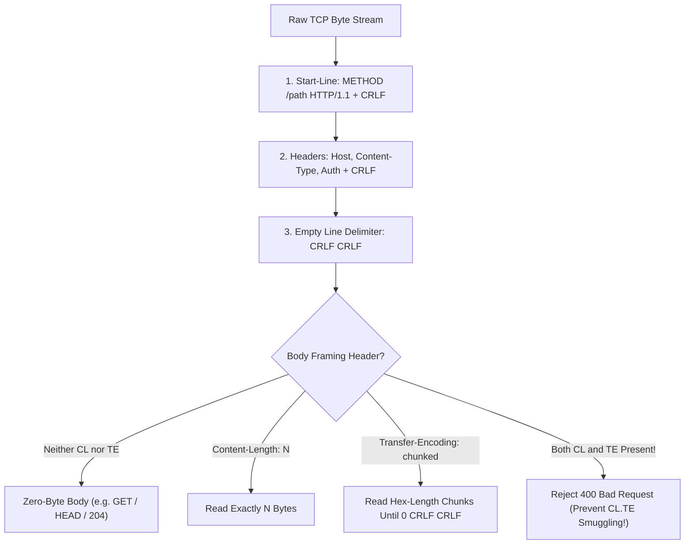
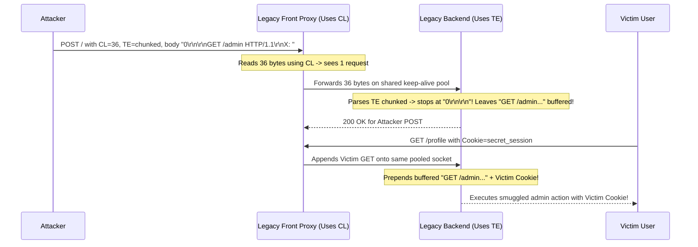
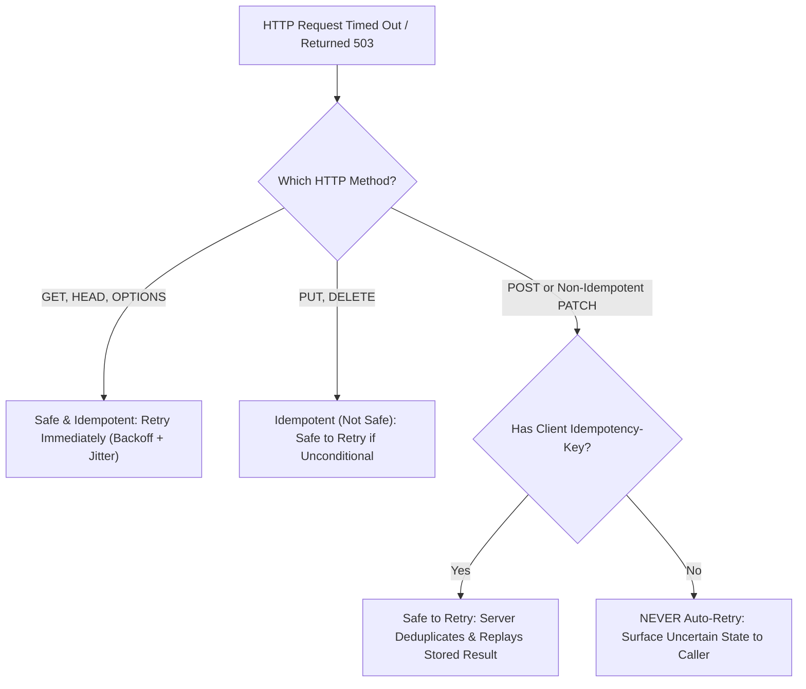
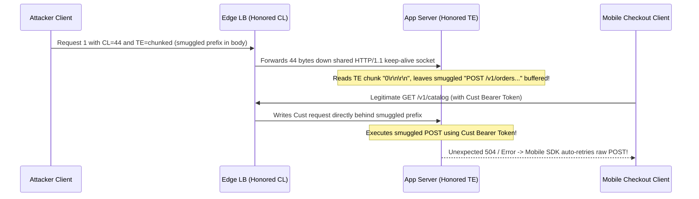

# Lesson 18: HTTP Part 1 — Requests, Responses and Methods

> **Prerequisites:** [Lesson 07: What Happens When You Type a URL](../07-what-happens-when-you-type-a-url/README.md), [Lesson 17: DNS Traffic Management](../17-dns-traffic-management/README.md), and [Networking From Zero Overview](../README.md) (Lesson 18 of 30).  
> **Estimated Reading Time:** 25 minutes  
> **Target Audience:** Backend and API engineers designing REST endpoints, hardening reverse proxies against `CL.TE` HTTP request smuggling, and implementing retry-safe `Idempotency-Key` middleware.  
> **Free PDF Notes:** [Download SD-N-018.pdf](https://backendroadmap.com/notes/system-design/SD-N-018.pdf)

> [!TIP]
> **The Golden Rule of HTTP Wire Framing & Methods:** HTTP/1.1 runs as plain text over a continuous TCP byte stream delimited by `\r\n\r\n`, `Content-Length`, or `Transfer-Encoding: chunked`—so front proxies and origin servers must **never disagree on message boundaries** (`400 Bad Request` on conflicting `CL` + `TE`). On top of that wire contract, design retries strictly around method semantics: **`Safe` (`GET`, `HEAD`, `OPTIONS`)** and **`Idempotent` (`PUT`, `DELETE`)** calls retry cleanly, whereas **`POST`** mutations require an explicit **`Idempotency-Key`** to prevent duplicate charges.

---

## Words You'll Meet Today

| Word | In Plain Words | Role in a Live Backend System |
| :--- | :--- | :--- |
| **Request-line / Status-line** | The very first line of an HTTP message. | Declares `METHOD /path HTTP/1.1` on requests or `HTTP/1.1 200 OK` on responses. |
| **`CRLF` (`\r\n`)** | Carriage Return + Line Feed line ending. | Separates every header line; a double `\r\n\r\n` marks where headers end and body begins. |
| **`Host` header** | Mandatory HTTP/1.1 header naming the target domain. | Enables virtual hosting so one reverse proxy IP serves thousands of domains. |
| **`Content-Length`** | Exact byte size of the message body in decimal. | Tells a keep-alive TCP socket exactly how many bytes belong to this request/response. |
| **`Transfer-Encoding: chunked`** | Sending a body in size-prefixed streaming pieces. | Allows dynamic responses/uploads without knowing total size upfront, ending in `0\r\n\r\n`. |
| **Request smuggling (`CL.TE`)** | Exploiting front/back-end disagreement on body length. | Smuggles a hidden second request inside a keep-alive socket, hijacking another user's traffic. |
| **Safe method** | A read-only HTTP method (`GET`, `HEAD`, `OPTIONS`). | Guarantees clients, crawlers, and caches can call it freely with zero state mutation. |
| **Idempotent method** | Calling once or ten times yields the same server state. | Lets network clients safely retry `GET`, `PUT`, `DELETE`—or `POST` paired with `Idempotency-Key`. |

---

## Visual Mental Models & Architecture

### The Question: What Bytes Actually Flow Over the TCP Socket?

In [Lesson 17](../17-dns-traffic-management/README.md), DNS resolved a hostname to an IP, and TCP opened a clean stream of bytes between your client and the server. Yet TCP knows nothing about URLs, JSON payloads, or API endpoints—it only delivers raw bytes in order. How does a server sharing one TCP socket across fifty consecutive requests know where request #1 ends and request #2 begins, or whether retrying a timed-out payment call is safe?

### An Everyday Picture First: A Sealed Crate with a Shipping Waybill

Think of sending an HTTP/1.1 message like dropping boxes onto a continuously moving conveyor belt (a persistent TCP connection):

- The **top line** is the job order: *"GET item `/v1/orders` using protocol HTTP/1.1"* (`request-line`).
- The **sticker lines** below list metadata: which tenant building inside the warehouse owns the box (**`Host`**), what format is inside (`Content-Type`), and either **"exactly 42 kilograms"** (`Content-Length: 42`) or **"sub-crates labeled with weight, ending with a 0-kg empty box"** (`Transfer-Encoding: chunked`).
- An **empty gap line** (`\r\n\r\n`) separates the shipping label from the actual crate contents (`body`).
- **The smuggling trap:** If the front loading dock weighs the box by the `42 kg` sticker (`CL`) while the back warehouse reads the sub-crate end marker (`TE`), an attacker can pack a sneaky second box *inside* the first crate—and the warehouse executes it on the next customer's turn!

### Exact HTTP/1.1 Wire Anatomy

On the wire, an HTTP/1.1 request and response are plain ASCII headers ending at `\r\n\r\n`, followed by optional body bytes:

```text
POST /v1/charges HTTP/1.1\r\n
Host: api.payments.example\r\n
Content-Type: application/json\r\n
Idempotency-Key: 9b1deb4d-3b7d-4bad-9bdd-2b0d7b3dcb6d\r\n
Content-Length: 27\r\n
\r\n
{"amount":4900,"ccy":"USD"}
--- Response on same TCP socket ---
HTTP/1.1 201 Created\r\n
Location: /v1/charges/ch_8812\r\n
Content-Length: 31\r\n
\r\n
{"id":"ch_8812","status":"ok"}
```

Notice the four structural parts:
1. **Start-line:** Request-line (`METHOD SP request-target SP HTTP-version CRLF`) or Status-line (`HTTP-version SP status-code SP reason-phrase CRLF`).
2. **Headers (`key: value\r\n`):** Case-insensitive field names. In HTTP/1.1, **`Host` is mandatory** (`RFC 9112`): one cloud load balancer IP (`198.51.100.10`) serves `api.foo.com` and `admin.bar.com` via **virtual hosting**, so missing or duplicate `Host` headers MUST return **`400 Bad Request`**.
3. **Blank-line delimiter (`\r\n\r\n`):** Marks where headers end and the optional body begins.
4. **Optional Message Body:** Present when `Content-Length` or `Transfer-Encoding` is sent.



*Figure 1. Exact HTTP/1.1 wire parsing pipeline over a persistent TCP stream: the blank `\r\n\r\n` boundary separates headers from the body, whose length must be framed unambiguously.*

### `Content-Length` vs. `Transfer-Encoding: chunked` & `CL.TE` Smuggling

When `Connection: keep-alive` (default in HTTP/1.1) reuses one TCP socket for multiple back-to-back requests, both client and server must agree **to the exact byte** where Request 1 ends and Request 2 begins:

- **`Content-Length: 27`**: Sender knows the full payload size upfront (`27` bytes); receiver reads `27` bytes and immediately expects Request 2 next.
- **`Transfer-Encoding: chunked`**: Streams chunks dynamically using **hexadecimal** byte lengths (`5\r\nhello\r\n6\r\n world\r\n0\r\n\r\n`), ending with a `0`-byte sentinel chunk.

**How `CL.TE` HTTP Request Smuggling Happens:**
Suppose an attacker sends a malformed request containing **both** `Content-Length: 13` and `Transfer-Encoding: chunked`, with body `0\r\n\r\nSMUGGLED`:
- The **front-end proxy** looks only at `Content-Length: 13` (`CL`), reads all `13` bytes, and forwards the whole packet down a shared keep-alive backend TCP pool.
- The **back-end server** follows `Transfer-Encoding: chunked` (`TE`): it sees `0\r\n\r\n` and stops parsing Request 1 after `5` bytes! The remaining `8` bytes (`SMUGGLED`—actually a crafted prefix like `GET /admin/delete HTTP/1.1\r\n...`) stay stuck in the backend socket buffer and **prepend themselves to the next victim user's legitimate request**!

**The `RFC 9112` Hardening Rule:** If a request contains both `Transfer-Encoding` and `Content-Length`, or multiple differing `Content-Length` headers, proxies and servers MUST reject it immediately with **`400 Bad Request`** and close the TCP connection. Even better: terminate HTTP/2 or HTTP/3 between proxies and backends (`h2c` / `HTTP/2`) because HTTP/2 uses binary length-prefixed frames rather than text delimiters, eliminating `CL.TE` ambiguity altogether.



*Figure 2. `CL.TE` request smuggling over a shared keep-alive backend connection: conflicting body-length rules let an attacker poison the next legitimate caller's request.*

### Safe vs. Idempotent Methods & Why Retries Need `Idempotency-Key`

HTTP methods are not just labels—they are **machine-readable safety contracts** for browsers, load balancers, and retry libraries:

1. **Safe Methods (`GET`, `HEAD`, `OPTIONS`):** Must **never** mutate server state (read-only). Search crawlers, prefetchers, and load balancers can invoke or retry them freely. (`HEAD` returns identical headers as `GET` with zero body; `OPTIONS` queries CORS/method capabilities.)
2. **Idempotent Methods (`GET`, `HEAD`, `OPTIONS`, `PUT`, `DELETE`):** Calling an idempotent endpoint $1$ time or $N$ times leaves the **server resource in the exact same final state** (ignoring log entries or timestamps).
   - **Watch the `DELETE` subtlety:** First `DELETE /orders/42` returns `200 OK`; a retry after a dropped packet returns `404 Not Found`. Is `DELETE` still idempotent? **Yes!** Idempotency governs **final server state** (order `42` no longer exists), not receiving identical HTTP status codes.
   - **Full-replacement `PUT` vs. Partial `PATCH`:** `PUT /users/7` replaces the entire user object (`{"name":"Ana","plan":"pro"}`)—retrying produces the exact same user record (`idempotent`). `PATCH` is *not* idempotent by specification: `{"op":"increment","balance":50}` adds `50` on every retry unless written as conditional overwrite or keyed!
3. **Non-Idempotent `POST` + `Idempotency-Key`:** `POST /v1/charges` creates a brand-new resource each time. If your mobile SDK sends `POST /v1/charges`, the server commits the charge, and a cellular tunnel drops before `201 Created` reaches the phone, blindly retrying `POST` charges the customer **twice**.
   - **The Production Pattern (`Idempotency-Key`):** Client generates a random UUIDv4 (`Idempotency-Key: <uuid>`) once per logical checkout attempt and sends it across retries. The server atomically stores `(client_id, idempotency_key) -> {request_hash, status, body}` in a durable database/Redis lock:
     - First arrival: executes charge, persists response, returns `201 Created`.
     - Retry with identical key & matching payload hash: **skips charge execution and replays the cached `201 Created`**!
     - Retry with identical key while first request is still running: returns **`409 Conflict`** (or waits on lock).
     - Reuse of old key with a *different* request payload: rejects with **`422 Unprocessable Content`** (`400`) to catch client bugs!



*Figure 3. Retry safety decision tree: only Safe methods, unconditionally Idempotent methods, or `POST` requests protected by a server-enforced `Idempotency-Key` can be automatically retried.*

---

## Systematic Reference & Comparison Grid

### HTTP Method Semantics (`RFC 9110`)

| Method | Typical Request Body? | Safe (Read-Only)? | Idempotent? | Cacheable? | Auto-Retry Safe on Network Timeout? |
| :--- | :--- | :--- | :--- | :--- | :--- |
| **`GET`** | No (ignored/discouraged) | **Yes** | **Yes** | **Yes** | **Yes** |
| **`HEAD`** | No | **Yes** | **Yes** | **Yes** | **Yes** |
| **`OPTIONS`** | Rare | **Yes** | **Yes** | No | **Yes** |
| **`PUT`** | Yes (full replacement) | No | **Yes** | No | **Yes** (if no relative counter) |
| **`DELETE`** | Optional (avoid) | No | **Yes** | No | **Yes** (`200`/`204`/`404` all valid) |
| **`POST`** | Yes | No | **No** | Rare (explicit only) | **Only with `Idempotency-Key`** |
| **`PATCH`** | Yes (partial diff) | No | **No** (unless designed so) | No | **Only if conditional (`If-Match`) or keyed** |

### HTTP/1.1 Framing Validation & Retry Math

Consider a checkout API at $1{,}000\text{ RPS}$ experiencing a $1.5\%$ TCP/LB response-drop rate (`504` after origin commit). Without `Idempotency-Key`, auto-retrying `POST` causes:

$$\text{Duplicate Charges/sec} = 1{,}000\text{ RPS} \times 0.015 = 15\text{ double-charges per second}\; (54{,}000/\text{hour})$$

Meanwhile, for chunked streaming (`Transfer-Encoding: chunked`), every chunk of length $L_i$ bytes adds $\lceil \log_{16}(L_i + 1) \rceil + 4$ framing bytes (`hex_len` + `\r\n` + `\r\n`) plus a `5`-byte closing terminator `0\r\n\r\n`—tiny overhead for `4 KB` chunks ($8 / 4096 \approx 0.2\%$), but huge ($>100\%$) if you flush `1`-byte chunks!

| Wire Framing Combination | RFC 9112 Status | Security / Parsing Risk | Compliant Proxy / Server Action |
| :--- | :--- | :--- | :--- |
| **Missing `Host` header (HTTP/1.1)** | Invalid | Ambiguous virtual-host routing | Reject **`400 Bad Request`** |
| **Duplicate `Host` headers** | Invalid | Host-routing confusion / cache poisoning | Reject **`400 Bad Request`** |
| **Single `Content-Length: N`** | Valid | Must match exact body byte count | Read exactly `N` bytes |
| **`Transfer-Encoding: chunked` only** | Valid | Incomplete terminator hangs socket | Stream chunks until `0\r\n\r\n` |
| **Both `Content-Length` AND `Transfer-Encoding`** | **Forbidden** | **`CL.TE` / `TE.CL` Request Smuggling** | Reject **`400 Bad Request`**, close socket |
| **Two `Content-Length` headers with different values** | **Forbidden** | **Header desync smuggling** | Reject **`400 Bad Request`**, close socket |

---

## Production War Story Post-Mortem: `CL.TE` Smuggling & `POST` Double-Charge Cascade

- **Severity:** SEV-1 (Cross-Tenant Session Hijacking + `1,400` Duplicate Checkout Charges)
- **Detection / Resolution Time:** 14 minutes to patch proxy header validation; 3 hours to refund duplicate ledger rows
- **Impact:** A misconfigured legacy L7 edge proxy forwarded requests containing *both* `Content-Length` and `Transfer-Encoding: chunked` to a Python HTTP/1.1 upstream pool. Attackers smuggled `GET /admin/export` prefixes onto pooled sockets, while simultaneous mobile SDK retries on `504` timeouts triggered `1,400` duplicate `POST /v1/orders` charges lacking `Idempotency-Key`.

### What Happened



### Root Cause Analysis

1. **Permissive Edge Framing (`CL + TE` Forwarded):** The outer proxy accepted requests with both `Content-Length` and `Transfer-Encoding: chunked`, parsed using `Content-Length`, and passed the raw headers untouched to an app server configured to prefer `Transfer-Encoding`—enabling `CL.TE` request smuggling on shared keep-alive backend pools.
2. **Blind Retry on Unkeyed `POST`:** When smuggled collisions and backend overload returned `504 Gateway Timeout`, the mobile SDK retried `POST /v1/orders` 3 times without an `Idempotency-Key`, duplicating orders that had already committed before the timeout.

### The Fix & Architectural Hardening

- **Strict RFC 9112 Framing Gate + HTTP/2 Upstreams:** Upgraded edge proxy validation to reject any request carrying `CL + TE`, duplicate `Content-Length`, or whitespace before header colons with `400 Bad Request` + socket close, and enabled **HTTP/2** (`h2`) on proxy-to-origin links (binary framing prevents smuggling by construction).
- **`Idempotency-Key` Enforcement:** Required `Idempotency-Key` (UUIDv4) on all `POST /v1/orders` and `/v1/charges` routes, backed by an atomic PostgreSQL/Redis `(tenant_id, key)` unique record that replays identical responses and rejects payload mismatches with `422`.
- **Method-Aware Client Retries:** Restricted automatic SDK retries exclusively to `GET`/`HEAD`/`OPTIONS`, `PUT`/`DELETE`, or `POST` requests carrying an explicit `Idempotency-Key`.

---

## Multi-Language Production Implementation

Below is a production-structured **HTTP/1.1 Wire Framing Validator (`CL.TE` Guard) + Method-Aware `Idempotency-Key` Middleware** across Go, TypeScript, Python, and C#.

````carousel
```go
package httpmw

import (
	"crypto/sha256"
	"encoding/hex"
	"io"
	"net/http"
	"sync"
)

type reply struct {
	hash string; status int; body []byte
}

type Guard struct {
	mu    sync.Mutex
	store map[string]reply
}

func CanAutoRetry(method string, h http.Header) bool {
	switch method {
	case http.MethodGet, http.MethodHead, http.MethodOptions, http.MethodPut, http.MethodDelete:
		return true
	case http.MethodPost:
		return h.Get("Idempotency-Key") != ""
	default:
		return false
	}
}

func (g *Guard) Middleware(next http.Handler) http.Handler {
	return http.HandlerFunc(func(w http.ResponseWriter, r *http.Request) {
		if r.Host == "" || (len(r.TransferEncoding) > 0 && r.Header.Get("Content-Length") != "") {
			w.Header().Set("Connection", "close")
			http.Error(w, "invalid Host or CL+TE framing", http.StatusBadRequest)
			return
		}
		if r.Method != http.MethodPost { next.ServeHTTP(w, r); return }

		key := r.Header.Get("Idempotency-Key")
		if key == "" { http.Error(w, "Idempotency-Key required", http.StatusBadRequest); return }
		raw, _ := io.ReadAll(io.LimitReader(r.Body, 1<<20))
		sum := sha256.Sum256(raw)
		hash := hex.EncodeToString(sum[:])

		g.mu.Lock()
		prev, ok := g.store[key]
		g.mu.Unlock()
		if ok {
			if prev.hash != hash { http.Error(w, "key payload mismatch", http.StatusUnprocessableEntity); return }
			w.Header().Set("X-Idempotent-Replay", "true")
			w.WriteHeader(prev.status); _, _ = w.Write(prev.body); return
		}
		body := []byte(`{"status":"created"}`)
		g.mu.Lock(); g.store[key] = reply{hash, http.StatusCreated, body}; g.mu.Unlock()
		w.WriteHeader(http.StatusCreated); _, _ = w.Write(body)
	})
}
```
<!-- slide -->
```typescript
import { createHash } from "node:crypto";
import type { IncomingMessage, ServerResponse } from "node:http";

const IDEMPOTENT = new Set(["GET", "HEAD", "OPTIONS", "PUT", "DELETE"]);
const store = new Map<string, { hash: string; status: number; body: string }>();

export const canAutoRetry = (method: string, headers: Record<string, string>) =>
  IDEMPOTENT.has(method.toUpperCase()) || (method.toUpperCase() === "POST" && Boolean(headers["idempotency-key"]?.trim()));

export function validateAndHandle(req: IncomingMessage, res: ServerResponse, rawBody: Buffer, run: () => { status: number; body: string }): void {
  const hasCl = req.headers["content-length"] !== undefined;
  const hasTe = req.headers["transfer-encoding"] !== undefined;
  if (!req.headers.host || Array.isArray(req.headers.host) || (hasCl && hasTe)) {
    res.writeHead(400, { Connection: "close" }); res.end("Invalid Host or CL+TE framing"); return;
  }
  const key = String(req.headers["idempotency-key"] ?? "").trim();
  if (!key) { res.writeHead(400); res.end("Missing Idempotency-Key"); return; }
  const hash = createHash("sha256").update(rawBody).digest("hex");
  const prev = store.get(key);
  if (prev) {
    if (prev.hash !== hash) { res.writeHead(422); res.end("Payload mismatch"); return; }
    res.writeHead(prev.status, { "X-Idempotent-Replay": "true" }); res.end(prev.body); return;
  }
  const out = run();
  store.set(key, { hash, ...out });
  res.writeHead(out.status, { "Content-Type": "application/json" }); res.end(out.body);
}
```
<!-- slide -->
```python
import hashlib

IDEMPOTENT_METHODS = frozenset({"GET", "HEAD", "OPTIONS", "PUT", "DELETE"})

def can_auto_retry(method: str, headers: dict[str, str]) -> bool:
    up = method.upper()
    return up in IDEMPOTENT_METHODS or (up == "POST" and bool(headers.get("idempotency-key", "").strip()))

def validate_framing(headers: list[tuple[str, str]]) -> None:
    names = [k.lower() for k, _ in headers]
    if names.count("host") != 1 or ("content-length" in names and "transfer-encoding" in names):
        raise ValueError("400 Bad Request: missing Host or ambiguous CL+TE framing")

class IdempotencyGuard:
    def __init__(self) -> None:
        self._store: dict[str, tuple[str, int, bytes]] = {}

    def handle_post(self, key: str, body: bytes, run) -> tuple[int, bytes, bool]:
        if not key.strip(): return 400, b"Idempotency-Key required", False
        digest = hashlib.sha256(body).hexdigest()
        if key in self._store:
            old_hash, status, resp = self._store[key]
            return (status, resp, True) if old_hash == digest else (422, b"Payload mismatch", False)
        status, resp = run(body)
        self._store[key] = (digest, status, resp)
        return status, resp, False
```
<!-- slide -->
```csharp
using System;
using System.Collections.Concurrent;
using System.Security.Cryptography;
using System.Text;
using Microsoft.AspNetCore.Http;

public sealed class HttpContractGuard
{
    private readonly ConcurrentDictionary<string, (string Hash, int Status, string Body)> _store = new();

    public static bool CanAutoRetry(string method, IHeaderDictionary headers) =>
        method.ToUpperInvariant() is "GET" or "HEAD" or "OPTIONS" or "PUT" or "DELETE"
        || (method.Equals("POST", StringComparison.OrdinalIgnoreCase) && !string.IsNullOrWhiteSpace(headers["Idempotency-Key"]));

    public IResult HandlePost(HttpRequest req, string rawBody, Func<(int Status, string Body)> run)
    {
        if (string.IsNullOrWhiteSpace(req.Headers.Host) || (req.Headers.ContainsKey("Content-Length") && req.Headers.ContainsKey("Transfer-Encoding")))
            return Results.BadRequest("Missing Host or conflicting CL+TE framing");

        string key = req.Headers["Idempotency-Key"].ToString().Trim();
        if (string.IsNullOrEmpty(key)) return Results.BadRequest("Idempotency-Key required");

        string hash = Convert.ToHexString(SHA256.HashData(Encoding.UTF8.GetBytes(rawBody)));
        if (_store.TryGetValue(key, out var prev))
        {
            if (prev.Hash != hash) return Results.UnprocessableEntity("Idempotency-Key payload mismatch");
            req.HttpContext.Response.Headers["X-Idempotent-Replay"] = "true";
            return Results.Text(prev.Body, "application/json", statusCode: prev.Status);
        }
        var (status, body) = run();
        _store.TryAdd(key, (hash, status, body));
        return Results.Text(body, "application/json", statusCode: status);
    }
}
```
````

---

## Practical Hands-On Verification CLI Workflows

### 1. Send a Raw HTTP/1.1 Wire Request (`Host`, `\r\n\r\n`, and Status-Line)

```bash
printf "HEAD / HTTP/1.1\r\nHost: example.com\r\nConnection: close\r\n\r\n" | nc -w 3 example.com 80
```

**Expected Output:**

```text
HTTP/1.1 200 OK
Accept-Ranges: bytes
Content-Type: text/html
Content-Length: 1256
Connection: close
```

Omitting `Host` returns `HTTP/1.1 400 Bad Request` on any RFC 9112-compliant server.

### 2. Inspect Raw `Transfer-Encoding: chunked` Framing & `OPTIONS`

```bash
curl -sS --http1.1 --raw -D - https://httpbin.org/stream/2 | head -n 14
```

**Expected Output:**

```text
HTTP/1.1 200 OK
Transfer-Encoding: chunked
Content-Type: application/json

10e
{"url": "https://httpbin.org/stream/2", "id": 0, ...}

0
```

Notice the hex byte length (`10e` = `270` bytes) and `0` (`0\r\n\r\n`) terminator. You can also inspect allowed methods with `curl -sS -i -X OPTIONS https://httpbin.org/anything`.

---

## Pause and Think

> [!exercise] A mobile banking client calls `POST /v1/transfers` (`USD 250`). The server commits the transfer in PostgreSQL, then the client's Wi-Fi drops just before `201 Created` reaches the phone. Two seconds later on 5G, the SDK automatically retries `POST /v1/transfers`. What happens without `Idempotency-Key` vs. with `Idempotency-Key`—and why wouldn't `PUT /v1/profiles/42` suffer the same duplicate creation bug? Decide before you open the answer.

<details><summary>Answer</summary>

Without `Idempotency-Key`, the server treats the retried `POST` as a brand-new transfer request and debits `USD 250` **twice** (`USD 500` total!). With an `Idempotency-Key` generated once on checkout click, the server sees the duplicate key, skips executing the transfer, and replays the stored `201 Created` JSON safely.

`PUT /v1/profiles/42` doesn't create a second profile because `PUT` targets a **known, fixed resource ID** and overwrites it cleanly—sending the same full payload once or twice leaves profile `42` in the exact same state (`idempotent`).

</details>

---

## Operational Validation Checkpoints

<details><summary><strong>Checkpoint 1: Detecting `CL.TE` Smuggling Risk in Proxy Configs</strong></summary>

**Scenario:** Your API gateway receives incoming HTTP/1.1 requests carrying both `Content-Length: 45` and `Transfer-Encoding: chunked`, and forwards *both* headers intact over a reused HTTP/1.1 upstream socket pool to a legacy app server. Why is this a critical SEV-1 vulnerability, and what two architectural fixes eliminate it?

**Solution:**
If the gateway reads `45` bytes using `Content-Length` while the backend reads chunks using `Transfer-Encoding: chunked`, an attacker can end the chunk early (`0\r\n\r\n`) and leave smuggled HTTP bytes queued on the shared backend TCP socket—hijacking the next user's request.
1. Reject any request carrying both `Content-Length` and `Transfer-Encoding` (or duplicate differing `CL` headers) with `400 Bad Request` and close the connection.
2. Upgrade gateway-to-backend transport to **HTTP/2** (`h2` / `h2c`), which uses binary length-prefixed frames with zero text-delimiter smuggling ambiguity.

</details>

<details><summary><strong>Checkpoint 2: Why `DELETE` Is Idempotent Even When Retries Return `404`</strong></summary>

**Scenario:** A junior engineer writes in a code review: *"Our `DELETE /items/99` endpoint returns `200 OK` on the first call and `404 Not Found` on the second call—so `DELETE` isn't idempotent, right?"* Also, they implemented `PATCH /wallets/99` as `{"addBalance": 100}`. Address both points.

**Solution:**
1. **`DELETE` IS idempotent:** RFC 9110 defines idempotency strictly in terms of **intended effect on server state**, not identical response codes. Calling `DELETE /items/99` once or five times results in the same state: item `99` is deleted. Retry clients should accept `200`, `204`, and `404` cleanly for `DELETE`.
2. **`PATCH {"addBalance": 100}` is NOT idempotent:** Every retry adds another `100`! To make `PATCH` safe against retries, either send absolute desired state (`{"balance": 500}`), use optimistic concurrency (`If-Match: "etag-v3"` returning `412 Precondition Failed` on retry), or require an `Idempotency-Key`.

</details>

<details><summary><strong>Checkpoint 3: Virtual Hosting `Host` Header vs. TLS `SNI` Mismatch (`421`)</strong></summary>

**Scenario:** An HTTP/2 client opens one TLS connection with `SNI = a.example.com` and then sends a request over that same connection with `Host: b.example.com` (`:authority: b.example.com`). Both domains live behind your CDN IP, though `a` and `b` have different backend routing/mTLS policies. What HTTP status code should the server return?

**Solution:**
Return **`421 Misdirected Request`** (`RFC 9110`). While HTTP/2 permits connection coalescing across SAN-matching domains, whenever a server cannot or refuses to serve the requested `Host` / `:authority` on the current TLS connection (due to differing tenant isolation or client-cert requirements), `421` tells the client to open a dedicated socket for `b.example.com`.

</details>

---

## Common Mistakes & Troubleshooting

### What Goes Wrong

- **Auto-retrying every timeout indiscriminately:** Retrying `POST` without `Idempotency-Key` on `504` / socket reset turns transient blips into duplicate orders and ledger corruption.
- **Ignoring conflicting framing headers:** Allowing proxies to silently pick `CL` while upstreams pick `TE` opens `CL.TE` request smuggling over shared keep-alive pools.
- **Using `GET` for state-changing links:** Putting `GET /unsubscribe?user=42` or `GET /approve?tx=9` in emails lets link-preview bots and browser prefetchers mutate user data accidentally.

### Common Myths

- **"Idempotent means returning the exact same HTTP status and JSON every time."** No. It means repeating the request produces the **same final resource state** on the server (`DELETE` -> `200`, then `404` is still idempotent).
- **"PUT creates or updates, POST only creates—so PUT isn't idempotent."** Wrong. Because `PUT` replaces the target URI's full representation (`PUT /items/42`), calling it 10 times produces the identical representation `42`.
- **"HTTP/1.1 doesn't strictly need `Host` if only one site runs on the server."** False. `RFC 9112` mandates exactly one `Host` header on all HTTP/1.1 requests; compliant servers reject requests missing `Host` with `400 Bad Request`.

| Symptom | Root Cause | Fix |
| :--- | :--- | :--- |
| Duplicate charges/orders during upstream `504` blips | Client retries `POST` without server deduplication | Require `Idempotency-Key` UUIDv4 + atomic response cache + `422` hash check |
| Random user receives another tenant's response body | `CL.TE` or `TE.CL` smuggling across keep-alive proxy pool | Reject `CL + TE` with `400 Bad Request`; switch proxy-to-origin to `HTTP/2` |
| Link-preview scanners trigger account actions | State mutation exposed on a `GET` route | Move all state mutations to `POST` / `PUT` / `DELETE` (`Safe` = read-only) |

---

## Recap in Three Lines

1. HTTP/1.1 sends plain-text start-lines, headers (`Host` mandatory), `\r\n\r\n`, and bodies framed by `Content-Length` or `Transfer-Encoding: chunked`.
2. Conflicting `CL` and `TE` headers cause `CL.TE` request smuggling on shared keep-alive pools—reject them immediately with `400 Bad Request`.
3. `Safe` (`GET`/`HEAD`/`OPTIONS`) and `Idempotent` (`PUT`/`DELETE`) methods retry cleanly, while `POST` mutations demand `Idempotency-Key` to prevent duplicates.

---

## Interview Practice Questions

> [!interview] Walk through the exact parts of an HTTP/1.1 request and response on the wire. (Basic)

<details><summary>What to say in 30 seconds</summary>

An HTTP/1.1 message starts with a request-line (`GET /orders HTTP/1.1`) or status-line (`HTTP/1.1 200 OK`) terminated by `\r\n`, followed by `Name: Value\r\n` headers including the mandatory `Host` header for virtual hosting. A blank line `\r\n\r\n` ends the headers, and any message body is bounded either by an exact byte count in `Content-Length` or hex-sized chunks under `Transfer-Encoding: chunked` ending with `0\r\n\r\n`.

</details>

> [!interview] What is the difference between a safe HTTP method and an idempotent HTTP method? (Basic)

<details><summary>What to say in 30 seconds</summary>

A safe method (`GET`, `HEAD`, `OPTIONS`) promises not to modify server state at all—it is purely read-only. An idempotent method (`GET`, `HEAD`, `OPTIONS`, `PUT`, `DELETE`) can change state on the first call, but calling it multiple times produces the exact same final server state as calling it once. Every safe method is idempotent, though `PUT` and `DELETE` are idempotent without being safe.

</details>

> [!interview] Why is `POST` not idempotent, and how do payment APIs make `POST` retries safe? (Scenario)

<details><summary>What to say in 30 seconds</summary>

`POST` creates a new sub-resource or triggers a fresh action each time it runs, so retrying after a dropped socket risks double-billing. Payment APIs like Stripe solve this with a client-generated UUID in an `Idempotency-Key` header: the server stores the key atomically alongside a hash of the request payload and the resulting response, replaying the cached response on retries and rejecting conflicting payloads with 422.

</details>

> [!interview] Explain `CL.TE` HTTP request smuggling and how you prevent it in production. (Tricky)

<details><summary>What to say in 30 seconds</summary>

`CL.TE` happens when a front-end proxy and back-end origin reuse keep-alive TCP connections and parse a dual-framed request differently—the proxy uses `Content-Length` while the origin honors `Transfer-Encoding: chunked`. The leftover bytes after `0\r\n\r\n` stay in the backend socket buffer and prepend to the next victim's request. Prevent it by rejecting requests carrying both `CL` and `TE` (or duplicate `CL`) with 400 Bad Request and using HTTP/2 between proxy and origin.

</details>

> [!interview] Is `DELETE /items/42` still idempotent if the first call returns `200` and the retry returns `404`? (Tricky)

<details><summary>What to say in 30 seconds</summary>

Yes. HTTP idempotency is defined by the resulting state on the server, not getting identical status codes back. Whether `DELETE /items/42` runs once (`200 OK`) or three times (`404 Not Found`), the final server state is identical: item 42 is gone.

</details>

> [!interview] Why did HTTP/1.1 make the `Host` header mandatory, and what happens if it's missing? (Basic)

<details><summary>What to say in 30 seconds</summary>

Because one public IP address and reverse proxy routinely host dozens or thousands of domains via virtual hosting, and the HTTP request-line originally only sent the relative path (`/login`), not the domain name. The `Host` header tells the server which tenant site the client wants. Per RFC 9112, an HTTP/1.1 request missing `Host` or carrying two `Host` headers must be rejected with `400 Bad Request`.

</details>

---

## Free PDF notes

Download these notes as a printable PDF, with the HTTP/1.1 wire anatomy diagrams, method matrix, and interview answers: [SD-N-018.pdf](https://backendroadmap.com/notes/system-design/SD-N-018.pdf).

---

## Sources

- [RFC 9110: HTTP Semantics](https://www.rfc-editor.org/rfc/rfc9110), safe and idempotent method definitions (`GET`, `HEAD`, `OPTIONS`, `PUT`, `DELETE`, `POST`, `PATCH`).
- [RFC 9112: HTTP/1.1](https://www.rfc-editor.org/rfc/rfc9112), message syntax, `Host` header rules, `Content-Length`, `Transfer-Encoding: chunked`, and smuggling prohibitions.
- [PortSwigger Web Security Academy: HTTP Request Smuggling](https://portswigger.net/web-security/request-smuggling), detailed walkthrough of `CL.TE` and `TE.CL` framing desynchronization.
- [IETF Draft: The Idempotency-Key HTTP Header Field](https://datatracker.ietf.org/doc/draft-ietf-httpapi-idempotency-key-header/), standardizing `Idempotency-Key` replay and payload-mismatch semantics.
- [MDN: HTTP Request Methods](https://developer.mozilla.org/en-US/docs/Web/HTTP/Methods), practical reference for method safety and idempotency.

---

## Next

Next comes [Lesson 19: HTTP Part 2 — Status Codes, 401 vs 403, Caching and ETags](../19-http-status-codes-and-caching/README.md): what the three-digit response numbers mean, why `401` and `403` drive completely different client behavior, and how `Cache-Control` + `ETag` slash payload transfers. See [the track overview](../README.md) for the whole series.
