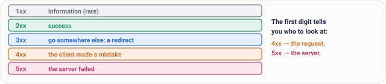
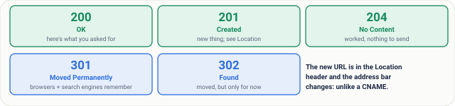
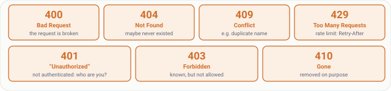
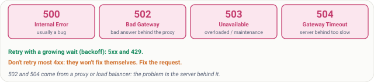
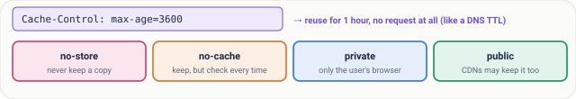
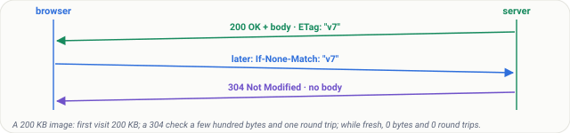

# Lesson 19: HTTP Part 2, Status Codes, 401 vs 403, Caching and ETags

## Roadmap

You are in **System Design Interview Prep**, Track 02, **Networking from Zero**: lesson 19 of 30. It follows lesson 18, HTTP requests and responses. Here we look at what every status code means and how HTTP caching works. The next lesson, why encryption: public and private keys, is coming soon. See [the track overview](../README.md) for the whole plan.

These are the written notes for the lesson's video. Prefer paper? The same notes are a free, printable PDF: [download SD-N-019.pdf](https://backendroadmap.com/notes/system-design/SD-N-019.pdf).

## Concept

> [!key] The first digit names the family: 2xx success, 3xx redirect, 4xx the client's fault, 5xx the server's; 401 is “who are you?”, 403 is “not allowed”; Cache-Control says how long to reuse a response, and ETags with 304 make checking cheap.

## Words you'll meet today

| Word | In plain words |
|---|---|
| **Status code** | the three-digit result of an HTTP request |
| **2xx / 3xx** | success / go somewhere else (a redirect) |
| **4xx** | a client error: the request was wrong |
| **5xx** | a server error: the server failed |
| **Location header** | where a redirect, or a newly created thing, is |
| **Cache-Control** | how long, and by whom, a response may be reused |
| **ETag** | a fingerprint of one version of the content |
| **304 Not Modified** | your cached copy is still good; no body sent |

## The question: what is the server telling you?

Your app shows “something went wrong”, but the server sent a number: 403. Another time, 503. Each number tells you exactly where to look, and one header can make a page load with almost no data at all. In lesson 18 we met HTTP requests and responses; today, the status codes and HTTP caching.

## An everyday picture first: the post office counter

You hand a parcel over at a post office counter. The clerk can say: accepted. Or: they've moved, send it to this new address. Or: your form is filled in wrong. Or: sorry, our system is down. And if you ask “has my parcel changed since this morning?”, the clerk can just say “no, same as before”, without handing it over again. That's caching.

*Figure 1. The analogy: a post office clerk's four kinds of answer match the status code families, and “no, same as before” is caching.*

## Five families, by the first digit

1xx is information, and rare. 2xx is success. 3xx means go somewhere else. 4xx means the client made a mistake. 5xx means the server failed. The first digit tells you who to look at.

*Figure 2. Status codes come in five families by their first digit: information, success, redirect, client error and server error.*

- **200 OK**: here's what you asked for. **201 Created**: your POST made something new, and its address is in the Location header. **204 No Content**: it worked, nothing to send back, like after a delete.
- **301 Moved Permanently**: browsers and search engines remember the new address. **302**: moved, but only for now. The new URL is in the Location header and the address bar changes: that's the difference from a CNAME (lesson 16).

*Figure 3. Success and redirects: 200, 201 and 204; 301 and 302 send the browser to the URL in the Location header.*

- **400 Bad Request**: the request itself is broken. **404 Not Found**. **409 Conflict**: it clashes with the current state, like a duplicate username. **429 Too Many Requests**: you hit a rate limit, so wait, often for the time in the Retry-After header.
- **401 versus 403.** 401, called Unauthorized, really means not authenticated: who are you? Send valid credentials. 403 Forbidden means: I know who you are, and you're not allowed. Logging in again won't help.
- **404 versus 410.** 404: not found, and maybe it never existed. 410 Gone: it existed, and was removed on purpose.

*Figure 4. Client errors, and the pairs interviewers love: 401 means not authenticated, 403 means authenticated but not allowed; 404 may never have existed, 410 was removed on purpose.*

**Server errors.** 500 Internal Server Error: usually a bug in the code. 502 Bad Gateway: a proxy or load balancer got a bad answer from the server behind it. 503 Service Unavailable: overloaded or down for maintenance, try later. 504 Gateway Timeout: the server behind didn't answer in time.

**A rule for retries.** 5xx and 429 may succeed if you try again, with a growing wait between tries. Most 4xx won't fix themselves: don't retry them, fix the request.

*Figure 5. Server errors, and the rule for retries: 5xx and 429 may succeed with backoff; most 4xx won't, so fix the request.*

## HTTP caching

A response can say `Cache-Control: max-age=3600`: the browser may reuse it for an hour without asking at all, the same idea as the DNS TTL in lesson 16. Other values: **no-store**, never keep a copy, like a bank statement; **no-cache**, you may keep it but check before every use; **private**, only the user's own browser may keep it; **public**, shared caches like CDNs may keep it too.

*Figure 6. Cache-Control: max-age says how long a response may be reused without asking; no-store, no-cache, private and public say who may keep it and how.*

When max-age runs out, the browser can check cheaply with an **ETag**. The first response says `ETag: "v7"`. Next time the browser asks `If-None-Match: "v7"`, and if nothing changed, the server replies **304 Not Modified**, with no body at all.

**Real numbers.** A 200 KB image: the first visit costs 200 KB; a check that returns 304 costs a few hundred bytes and one round trip; while max-age is still fresh, zero bytes and zero round trips.

**A common pattern.** Put a fingerprint in the file name, like `app.3f9a.js`, and cache it for a year. When you deploy, the name changes, so users get the new file at once. The HTML page itself gets a short max-age, or no-cache.

*Figure 7. Cheap checks with an ETag: the browser sends If-None-Match with the version it has, and gets 304 Not Modified with no body if nothing changed.*

## What goes wrong

- **Errors sent as 200 OK**, with “error” written in the body: monitoring thinks everything is fine, and caches happily store the error page.
- **A personal page cached as public**: a CDN serves one user's account page to someone else. Mark it private, or no-store.
- **A long max-age on a file without a fingerprint**: after a deploy, users keep the old version until their cache runs out.

## Pause and think

> [!exercise] A logged-in user opens an admin page they aren't allowed to see: which status code? A user whose login token has expired calls the API: which status code? Decide before you open the answer.

Answer

The first is 403: the server knows who they are, and the answer is no. The second is 401: the credentials are no longer valid, so log in again and try again.

*Figure 8. The pause-and-think answer: a logged-in user on a page they may not see gets 403; a request with an expired token gets 401.*

## Common mistakes

- **"401 means no permission."** No. 401 means we don't know who you are. No permission is 403.
- **"no-cache means don't cache."** No. It means always check before using. The one that means never keep a copy is no-store.
- **"A 304 is an error."** No. It's a success: your copy is still good, so nothing needs to be sent.

## Recap in three lines

1. The first digit names the family: 2xx success, 3xx redirect, 4xx your fault, 5xx the server's.
2. 401 is “who are you?”, 403 is “not allowed”.
3. Cache-Control says how long to reuse a response, and ETags with 304 make checking cheap.

## Interview questions

> [!interview] What do the HTTP status code families mean? (Basic)

What to say in 30 seconds

1xx is informational; 2xx success, such as 200, 201 and 204; 3xx redirects, with the new URL in the Location header; 4xx client errors, such as 400, 404 and 429, where the request needs fixing; 5xx server errors, such as 500, 502, 503 and 504, where the server or something behind it failed.

> [!interview] What's the difference between 401 and 403? (Basic)

What to say in 30 seconds

401 (named Unauthorized) means not authenticated: the server doesn't know who you are, or your credentials are missing, invalid or expired, so authenticate and retry. 403 Forbidden means the server knows who you are and you're not allowed; logging in again won't help.

> [!interview] Which errors should a client retry? (Scenario)

What to say in 30 seconds

5xx errors such as 502, 503 and 504, and 429 Too Many Requests, may succeed later: retry with exponential backoff and jitter, honour Retry-After, and only retry requests that are safe to repeat (idempotent, or protected by an idempotency key). Most 4xx errors won't fix themselves, so don't retry them.

> [!interview] How would you cache static files and HTML for a web app? (Scenario)

What to say in 30 seconds

Put a content hash in static file names (app.3f9a.js) and serve them with a long max-age, even a year, marked immutable; a deploy changes the name, so users get the new file at once. Serve HTML with a short max-age or no-cache plus an ETag, so browsers revalidate cheaply. Mark personal pages private or no-store.

> [!interview] What's the difference between no-cache and no-store? (Tricky)

What to say in 30 seconds

no-cache allows storing a copy but requires revalidation with the server before every use, typically with an ETag and If-None-Match. no-store forbids keeping a copy at all, for sensitive responses like bank statements.

> [!interview] How do ETags and 304 work, and what do they save? (Tricky)

What to say in 30 seconds

The server labels a response with an ETag, a version fingerprint. When the cached copy is stale, the browser sends If-None-Match with that ETag; if the content hasn't changed the server replies 304 Not Modified with no body. That saves the bytes of the response, though it still costs a round trip; only a fresh max-age saves the round trip too.

## Free PDF notes

Download these notes as a printable PDF, with every picture, the status code cards and the interview answers: [SD-N-019.pdf](https://backendroadmap.com/notes/system-design/SD-N-019.pdf).

## Sources

- [RFC 9110: HTTP Semantics](https://www.rfc-editor.org/rfc/rfc9110), status codes, the Location header, ETags and conditional requests.
- [RFC 9111: HTTP Caching](https://www.rfc-editor.org/rfc/rfc9111), Cache-Control, freshness and revalidation.
- [RFC 6585: Additional HTTP Status Codes](https://www.rfc-editor.org/rfc/rfc6585), 429 Too Many Requests.
- [MDN: HTTP response status codes](https://developer.mozilla.org/en-US/docs/Web/HTTP/Status), a readable reference for every code.
- [MDN: HTTP caching](https://developer.mozilla.org/en-US/docs/Web/HTTP/Caching), Cache-Control in practice.

## Next

Next comes lesson 20, why encryption: what anyone on your Wi-Fi can see without it, and how public and private keys fix that (coming soon). Until then, the [track overview](../README.md) lists the whole series.
