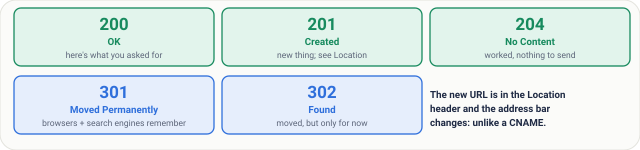
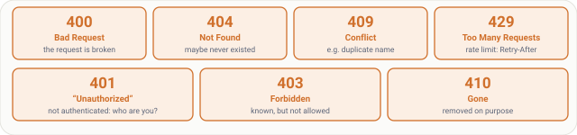
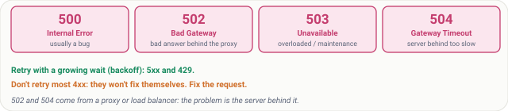
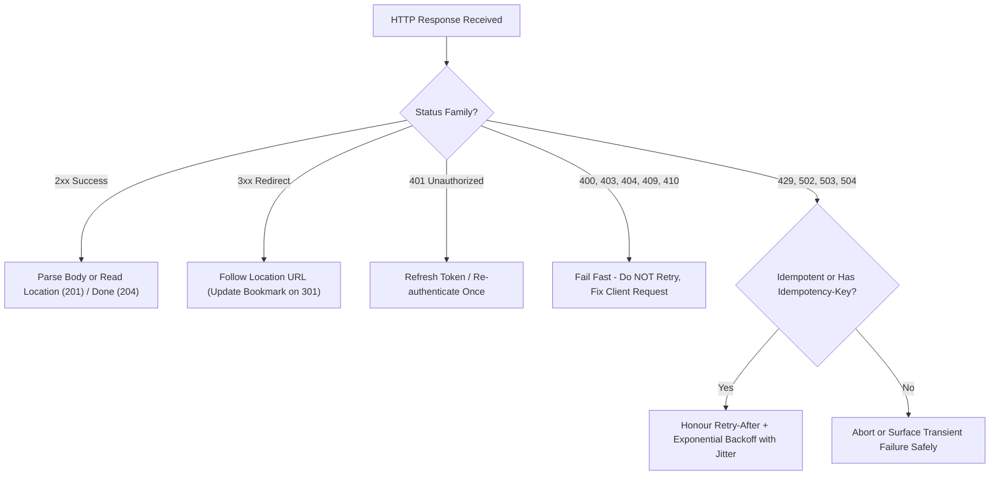
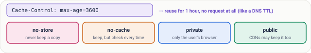
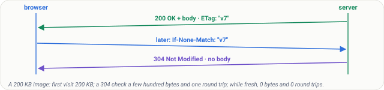
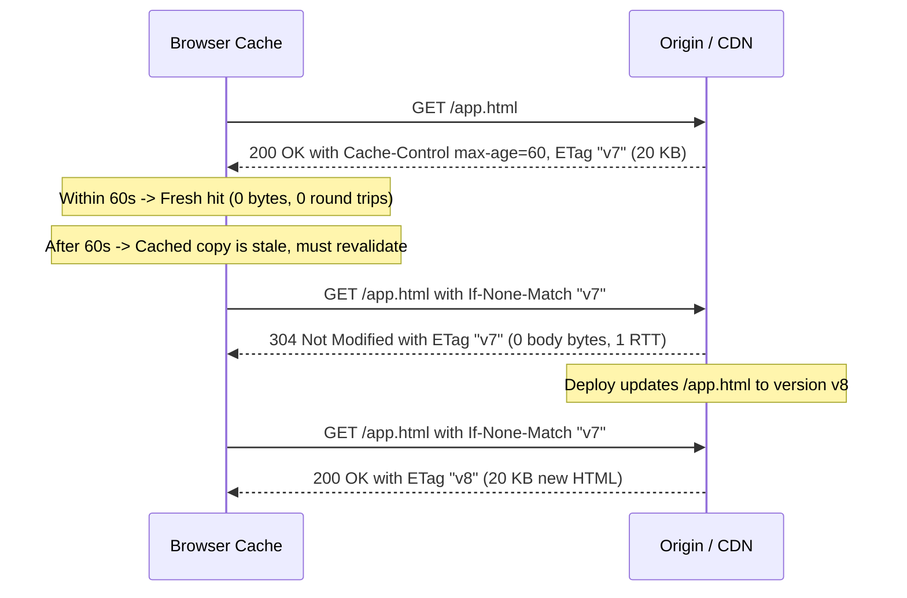
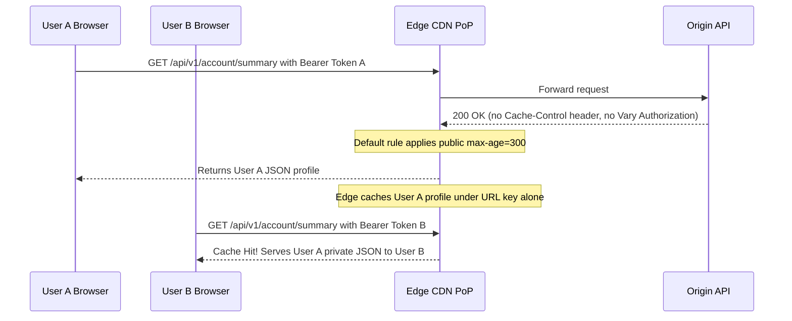

# Lesson 19: HTTP Part 2, Status Codes, 401 vs 403, Caching and ETags

> **Prerequisites:** [Lesson 18: HTTP Part 1, Requests, Responses and Methods](../18-http-requests-responses-and-methods/README.md), [Lesson 16: DNS Records, TTL and Safe Migrations](../16-dns-records-ttl-and-migrations/README.md), and [Networking From Zero Overview](../README.md) (Lesson 19 of 30).  
> **Estimated Reading Time:** 35 minutes  
> **Target Audience:** Backend and full-stack engineers designing resilient HTTP APIs, retry logic, authentication responses (`401` vs `403`), CDN `Cache-Control` policies, and conditional `ETag`/`304` validation.  
> **Free PDF Notes:** [Download SD-N-019.pdf](https://backendroadmap.com/notes/system-design/SD-N-019.pdf)

> [!NOTE]
> **In one line:** The first digit names the family (`2xx` success, `3xx` redirect, `4xx` the client's fault, `5xx` the server's); `401` is "who are you?", `403` is "not allowed"; `Cache-Control` says how long to reuse a response, and `ETag`s with `304` make checking cheap.

> [!TIP]
> **The Golden Rule of HTTP Semantics & Caching:** The first status-code digit names who owns the outcome (`2xx` success, `3xx` redirect, `4xx` client fault, `5xx` server fault): `401` asks "who are you?" while `403` declares "not allowed." Only retry `429` and `5xx` safely, mark personal data `private` or `no-store`, and pair `Cache-Control` with `ETag` and `304 Not Modified` so revalidation ships headers with zero body bytes.

---

## Words You'll Meet Today

| Word | In Plain Words | Role in a Live Backend System |
| :--- | :--- | :--- |
| **Status code** | The three-digit result of an HTTP request. | Machine-readable contract driving client retries, circuit breakers, and CDN caching. |
| **`2xx` / `3xx`** | Success / go somewhere else (a redirect). | `200`/`201`/`204` confirm execution; `301`/`302` steer clients to the `Location` URI. |
| **`4xx`** | A client error: the request was wrong. | Signals malformed payloads (`400`), missing auth (`401`), forbidden access (`403`), or rate limits (`429`). |
| **`5xx`** | A server error: the server failed. | Indicates origin exceptions (`500`), upstream proxy faults (`502`/`504`), or overload (`503`). |
| **`Location` header** | Where a redirect, or a newly created thing, is. | Redirect target URL on `3xx` or newly provisioned resource URI on `201 Created`. |
| **`Cache-Control`** | How long, and by whom, a response may be reused. | Enforces browser/CDN lifetimes (`max-age`), revalidation (`no-cache`), or privacy (`private`, `no-store`). |
| **`ETag`** | A fingerprint of one version of the content. | Strong or weak hash enabling conditional `If-None-Match` validation without re-downloading bodies. |
| **`304 Not Modified`** | Your cached copy is still good; no body sent. | Cuts origin bandwidth by returning headers-only confirmation in 1 RTT. |

---

## Visual Mental Models & Architecture

### The Question: What Is the Server Telling You?

Your app shows “something went wrong”, but the server sent a number: `403`. Another time, `503`. Each number tells you exactly where to look, and one header can make a page load with almost no data at all. In [lesson 18](../18-http-requests-responses-and-methods/README.md) we met HTTP requests and responses; today, the status codes and HTTP caching.

### An Everyday Picture First: The Post Office Counter

You hand a parcel over at a post office counter. The clerk can say: accepted. Or: they've moved, send it to this new address. Or: your form is filled in wrong. Or: sorry, our system is down. And if you ask “has my parcel changed since this morning?”, the clerk can just say “no, same as before”, without handing it over again. That's caching.


*Figure 1. The analogy: a post office clerk's four kinds of answer match the status code families, and “no, same as before” is caching.*

### Five Families, by the First Digit

`1xx` is information, and rare. `2xx` is success. `3xx` means go somewhere else. `4xx` means the client made a mistake. `5xx` means the server failed. The first digit tells you who to look at.


*Figure 2. Status codes come in five families by their first digit: information, success, redirect, client error and server error.*

- **`200 OK`**: here's what you asked for. **`201 Created`**: your `POST` made something new, and its address is in the `Location` header. **`204 No Content`**: it worked, nothing to send back, like after a delete.
- **`301 Moved Permanently`**: browsers and search engines remember the new address. **`302`**: moved, but only for now. The new URL is in the `Location` header and the address bar changes: that's the difference from a `CNAME` ([lesson 16](../16-dns-records-ttl-and-migrations/README.md)).



*Figure 3. Success and redirects: 200, 201 and 204; 301 and 302 send the browser to the URL in the Location header.*

- **`400 Bad Request`**: the request itself is broken. **`404 Not Found`**. **`409 Conflict`**: it clashes with the current state, like a duplicate username. **`429 Too Many Requests`**: you hit a rate limit, so wait, often for the time in the `Retry-After` header.
- **`401` versus `403`.** `401`, called Unauthorized, really means not authenticated: who are you? Send valid credentials. `403 Forbidden` means: I know who you are, and you're not allowed. Logging in again won't help.
- **`404` versus `410`.** `404`: not found, and maybe it never existed. `410 Gone`: it existed, and was removed on purpose.



*Figure 4. Client errors, and the pairs interviewers love: 401 means not authenticated, 403 means authenticated but not allowed; 404 may never have existed, 410 was removed on purpose.*

**Server errors.** `500 Internal Server Error`: usually a bug in the code. `502 Bad Gateway`: a proxy or load balancer got a bad answer from the server behind it. `503 Service Unavailable`: overloaded or down for maintenance, try later. `504 Gateway Timeout`: the server behind didn't answer in time.

**A rule for retries.** `5xx` and `429` may succeed if you try again, with a growing wait between tries. Most `4xx` won't fix themselves: don't retry them, fix the request.



*Figure 5. Server errors, and the rule for retries: 5xx and 429 may succeed with backoff; most 4xx won't, so fix the request.*



### HTTP Caching (`Cache-Control`, `ETag`, and `304`)

A response can say `Cache-Control: max-age=3600`: the browser may reuse it for an hour without asking at all, the same idea as the DNS TTL in [lesson 16](../16-dns-records-ttl-and-migrations/README.md). Other values: **`no-store`**, never keep a copy, like a bank statement; **`no-cache`**, you may keep it but check before every use; **`private`**, only the user's own browser may keep it; **`public`**, shared caches like CDNs may keep it too.



*Figure 6. Cache-Control: max-age says how long a response may be reused without asking; no-store, no-cache, private and public say who may keep it and how.*

When `max-age` runs out, the browser can check cheaply with an **`ETag`**. The first response says `ETag: "v7"`. Next time the browser asks `If-None-Match: "v7"`, and if nothing changed, the server replies **`304 Not Modified`**, with no body at all.

**Real numbers.** A `200 KB` image: the first visit costs `200 KB`; a check that returns `304` costs a few hundred bytes and one round trip; while `max-age` is still fresh, zero bytes and zero round trips.

**A common pattern.** Put a fingerprint in the file name, like `app.3f9a.js`, and cache it for a year (`max-age=31536000, immutable`). When you deploy, the name changes, so users get the new file at once. The HTML page itself gets a short `max-age`, or `no-cache`.



*Figure 7. Cheap checks with an ETag: the browser sends If-None-Match with the version it has, and gets 304 Not Modified with no body if nothing changed.*



---

## Systematic Reference & Comparison Grid

### Critical Status Codes & Client Semantics

| Code | Meaning | Key Response Header(s) | Retryable? | Cacheable by Default? |
| :--- | :--- | :--- | :--- | :--- |
| **`200 OK`** | Request succeeded, body returned | `Cache-Control`, `ETag` | Yes (if idempotent) | Yes (if `Cache-Control` permits) |
| **`201 Created`** | `POST` created a new resource | `Location` | Only with `Idempotency-Key` | No |
| **`204 No Content`** | Success with empty response body | `ETag` (optional) | Yes (e.g., `DELETE`) | Rarely |
| **`301` / `302`** | Permanent / temporary redirect | `Location` | Follow redirect | `301` yes, `302` explicit only |
| **`304 Not Modified`** | Conditional check passed; reuse body | `ETag`, `Cache-Control` | N/A | Refreshes cached entry TTL |
| **`400 Bad Request`** | Malformed syntax or validation error | `Content-Type` (`problem+json`) | **No** | No |
| **`401 Unauthorized`** | Missing, invalid, or expired credentials | `WWW-Authenticate` | Re-authenticate once | No |
| **`403 Forbidden`** | Authenticated identity lacks permission | — | **No** | No |
| **`404` / `410`** | Not found / intentionally removed (`Gone`) | `Cache-Control` (optional) | **No** | Yes if explicit `max-age` |
| **`409 Conflict`** | State collision (duplicate key / ETag mismatch) | — | Only after state reload | No |
| **`429 Too Many Requests`** | Rate limit exceeded | `Retry-After` | **Yes** (after `Retry-After`) | No |
| **`500` / `502` / `503` / `504`** | Origin bug / bad gateway / overloaded / timeout | `Retry-After` (`503`) | **Yes** (idempotent + jitter) | No |

### `Cache-Control` Directives Compared

| Directive | Stored in Browser Cache? | Stored in Shared CDN? | Revalidates Before Use? | Ideal Production Use Case |
| :--- | :--- | :--- | :--- | :--- |
| **`public, max-age=31536000, immutable`** | Yes (1 year) | Yes (1 year) | Never until URL changes | Content-hashed bundles (`app.3f9a.js`) |
| **`no-cache`** | Yes | Yes (unless `private`) | **Always** (`If-None-Match`) | Root `index.html`, semi-dynamic metadata |
| **`private, max-age=60`** | Yes | **No** | After 60s | Logged-in user profile/settings |
| **`no-store`** | **Never** (not on disk) | **Never** | Always full fetch | Banking statements, OTPs, PII tokens |

---

## Core Definition & Taxonomic Comparison

**An HTTP status code is the server's machine-readable verdict on a request; HTTP caching is the contract that lets copies of a response be reused without asking again.** The first digit assigns ownership of the problem (`4xx` = fix the request, `5xx` = fix the server), and the cache headers assign ownership of the *copy* (who may keep it, for how long, and how to check it is still true). What they are not: status codes are not a place for application error detail (that belongs in the body, as `application/problem+json`), and `Cache-Control` is not a security boundary against a malicious client, only a contract that well-behaved caches follow.

| Term | Precise Meaning | Production Example |
| :--- | :--- | :--- |
| **`301`** vs. **`302`** vs. **`307`** vs. **`308`** | `301` permanent (clients/crawlers remember; historically rewrites `POST` to `GET`). `302` temporary (same ambiguity). `307` temporary and **preserves method + body**. `308` permanent and preserves method. | `http -> https` upgrade uses `301`/`308`; a maintenance redirect for a `POST /upload` must be `307`, or the body is lost. |
| **Fresh** vs. **stale** vs. **revalidated** | *Fresh*: `age < freshness lifetime`, served with **0 RTT, 0 bytes**. *Stale*: lifetime exceeded, must check or refetch. *Revalidated*: stale entry confirmed by `304`, then fresh again. | `max-age=60` page: view at `t = 30 s` is fresh; at `t = 90 s` it sends `If-None-Match` and gets `304`. |
| **Strong `ETag`** vs. **weak `ETag`** (`W/"v7"`) vs. **`Last-Modified`** | Strong: byte-for-byte identical (needed for range requests). Weak: semantically equivalent (survives gzip/re-serialization). `Last-Modified`: timestamp validator with 1-second resolution, weaker still. | Hash of body for static JSON (strong); `W/"catalog-2026-11"` for dynamically compressed HTML. |
| **Private cache** vs. **shared cache** (+ `Vary`) | A *private* cache serves one user (the browser); a *shared* cache serves many (CDN, corporate proxy). `Vary: Accept-Encoding` makes a request header part of the cache key; `private`/`s-maxage` target one tier only. | `Cache-Control: private, max-age=60` for `/account`; `public, s-maxage=300` + `Vary: Accept-Encoding` for `/catalog`. |
| **`no-cache`** vs. **`no-store`** vs. **`must-revalidate`** | `no-cache`: *store*, but revalidate before **every** use. `no-store`: never keep a copy. `must-revalidate`: once stale, never serve without a successful check (even if the origin is down). | `no-store` for statements and tokens; `no-cache` for `index.html`; `must-revalidate` for prices. |

**Business impact.** A correct status code decides whether a mobile SDK retries, a circuit breaker opens, a CDN caches an error, and whether on-call is paged. A correct cache policy is typically the cheapest performance and cost lever a backend has (`90-99%` fewer origin hits), and the most common cause of cross-user data leaks when it is wrong.

---

## Component Anatomy & The Observability Gap

### The Anatomy of a Cache Decision

```text
  GET /app.html
      │
      ▼
 [Browser cache]──fresh?──────────yes──> serve from memory/disk                 0 bytes, 0 RTT   (DevTools: "(disk cache)")
      │ no (stale or missing)
      ▼
 [CDN / shared cache]──fresh? (s-maxage / max-age − Age)──yes──> serve at edge    ~0.5 RTT to PoP  (header: Age, X-Cache: HIT)
      │ no
      ▼
 conditional request: If-None-Match: "v7"  (and/or If-Modified-Since)
      │
      ▼
 [Origin]──ETag still "v7"?──yes──> 304 Not Modified, no body                     ~300 B, 1 RTT
      │ no
      ▼
      200 OK + new ETag + new Cache-Control + body                                full size S, 1 RTT
```

### The Observability Gap: What Each Layer Can and Cannot See

| Vantage Point | What It Captures | What It Hides |
| :--- | :--- | :--- |
| **Browser DevTools / RUM** | `from disk cache` vs. `304` vs. `200`, transfer size, timing. | Other users' experience; whether the CDN or the origin served the body. |
| **CDN analytics** (`X-Cache`, `CF-Cache-Status`, `Age`) | Edge hit ratio, bytes saved, `Age` distribution. | Requests that never left the browser cache (fresh hits are invisible to every server). |
| **Origin access log** | Only misses and revalidations (`200` vs. `304` split). | Hit traffic entirely; **a falling request rate can mean a better hit ratio or lost users**. |
| **SLO dashboard by status class** | `5xx` ratio, `4xx` ratio. | **`200 OK` error envelopes** (`{"ok":false}`) count as success; availability reads `100%` during an outage. |
| **Metrics to add** | `cache_status` per route, `304_ratio`, `Age` histogram, `Vary` key cardinality, authenticated-route `Cache-Control` audit. | Nothing: these catch both silent staleness and silent leaks. |

**Rule:** graph *status code, cache status, and bytes* together per route. A route with high `200` and `Cache-Control: public` but an `Authorization` header is a data-leak alert, not a performance win.

---

## Mathematical Model of Freshness, Savings & Retry Back-off

### 1. Freshness Lifetime and Heuristic Caching

$$\text{fresh} \iff \text{current age} < \text{freshness lifetime},\qquad \text{current age} \approx \text{Age} + \text{response delay} + \text{time since stored}$$

Freshness lifetime is `s-maxage` (shared caches) or `max-age`, else `Expires - Date`. **If none is present**, caches may *guess*: RFC 9111 §4.2.2 suggests `10%` of the time since `Last-Modified`:

$$\text{lifetime}_{\text{heuristic}} \approx 0.1 \times (\text{Date} - \text{Last-Modified})$$

A file last modified `100 days` ago is silently cacheable for **`10 days`** with no `Cache-Control` at all. Always send an explicit policy.

### 2. Bytes and Round Trips per View

For an object of size $S$ viewed $n$ times with $n_{200}$ full downloads, $n_{304}$ conditional hits (cost $c \approx 300\ \text{B}$), and $n_{\text{fresh}}$ local hits:

$$\text{Bytes} = n_{200}\,S + n_{304}\,c,\qquad \text{RTTs} = n_{200} + n_{304}\quad(n_{\text{fresh}} \text{ costs } 0)$$

| Policy for a `200 KB` logo viewed `5` times | Bytes Downloaded | Network RTTs |
| :--- | :--- | :--- |
| `no-store` | `1,000 KB` | `5` |
| `no-cache` + `ETag` | `200 KB + 4 x 0.3 KB = 201.2 KB` | `5` |
| `public, max-age=3600` (fingerprinted name) | `200 KB` | `1` |
| `public, max-age=31536000, immutable` | `200 KB` | `1` (and never revalidates) |

### 3. Worked Example: The 2 MB Catalog

`100,000` app opens per day from `5,000` devices (`20` opens each); the catalog changes `3` times a day.

- **No caching:** $100{,}000 \times 2\ \text{MB} = 200\ \text{GB/day}$.
- **`ETag` only:** at most one full download per device per change: $5{,}000 \times 3 = 15{,}000$ full fetches $= 30\ \text{GB}$, plus $85{,}000 \times 300\ \text{B} \approx 25.5\ \text{MB}$ of `304`s, a **~85% saving**.
- **Add `max-age=300`:** repeat opens within `5 min` need no request at all, cutting origin requests further, and a CDN with `s-maxage` collapses the `15,000` full fetches into roughly one per PoP per change.

### 4. CDN Hit Ratio and Origin Load

$$\text{Origin RPS} = \text{Edge RPS} \times (1 - h)$$

| Hit Ratio $h$ | Origin RPS at `20,000` Edge RPS | Origin Reduction |
| :--- | :--- | :--- |
| `0%` (all `no-store`) | `20,000` | none |
| `90%` | `2,000` | `10x` |
| `95%` | `1,000` | `20x` |
| `99%` | `200` | `100x` |

### 5. Retry Back-off Schedule for `429` / `5xx`

Full-jitter back-off sleeps $U\!\left(0,\ \min(\text{cap},\ b\cdot 2^{a})\right)$ before attempt $a$. With $b = 100\ \text{ms}$, cap `10 s`:

| Attempt $a$ | Upper Bound | Expected Sleep |
| :--- | :--- | :--- |
| `0` | `100 ms` | `50 ms` |
| `1` | `200 ms` | `100 ms` |
| `2` | `400 ms` | `200 ms` |
| `3` | `800 ms` | `400 ms` |
| `4` | `1,600 ms` | `800 ms` |

Total expected wait over five retries is **`1.55 s`**. Jitter prevents the *thundering herd* where thousands of clients retry on the same beat; if the response carries `Retry-After`, that value **overrides** the computed delay.

### 6. How Much Does a `200 OK` Error Envelope Hide?

If a fraction $f$ of requests fail but are returned as `200`, the status-based SLI reads $1 - 0 = 100\%$ while true availability is $1 - f$. At $f = 3\%$ the real error budget burn is `~10.9 days` of annual downtime-equivalent while the dashboard stays green.

---

## Production War Story Post-Mortem: Cross-User Profile Leak via Missing `Cache-Control: private` & `200 OK` Errors

- **Severity:** SEV-1 (PII Cache Leak + Outage Masking)
- **Detection / Resolution Time:** 11 minutes to purge CDN edge caches; 25 minutes for permanent origin header fix
- **Impact:** `4,200` logged-in shoppers briefly received another user's `/api/v1/account/summary` payload from CDN PoPs, while a downstream auth glitch returned `200 OK` with `{"error":"rate_limit"}` and got cached globally for `1` hour.

### What Happened



### Root Cause Analysis

1. **Missing `Cache-Control: private` / `no-store`:** A CDN configuration update applied a fallback `Cache-Control: public, max-age=300` rule to `GET` paths lacking an explicit origin `Cache-Control` header, without partitioning cache keys by `Authorization`.
2. **`200 OK` Error Envelope:** A legacy wrapper caught upstream timeouts and returned HTTP `200 OK` with `{"ok":false,"error":"busy"}`. Edge caching saw `200 OK` and served the error payload to every subsequent caller while SLO dashboards stayed green at `0%` `5xx`.

### The Fix & Architectural Hardening

- **Secure Default Headers:** Injected middleware enforcing `Cache-Control: private, no-store` on all authenticated `/api/*` routes by default, requiring explicit opt-in for cacheable public endpoints.
- **CDN Bypass Safety:** Configured CDN edge rules to bypass cache unconditionally whenever `Authorization` or session cookies exist unless `Vary` explicitly permits keyed caching.
- **Contract Enforcement:** Rejected `200 OK` error envelopes in API gateway validation and mapped real failures strictly to `4xx`/`5xx` codes so monitoring and caches act accurately.

---

## Multi-Language Production Implementation

Below is a production-structured **HTTP ETag Conditional Responder (`304 Not Modified`), `Cache-Control` Policy Enforcer, and `401`/`403`/`429` Handler** across Go, TypeScript, Python, and C#.

````carousel
```go
package httpcache

import (
	"crypto/sha256"
	"encoding/hex"
	"fmt"
	"net/http"
)

func ComputeStrongETag(payload []byte) string {
	sum := sha256.Sum256(payload)
	return fmt.Sprintf(`"%s"`, hex.EncodeToString(sum[:16]))
}

func ServeArticle(w http.ResponseWriter, r *http.Request, body []byte, isAdmin, isAuthenticated bool) {
	if !isAuthenticated {
		w.Header().Set("WWW-Authenticate", `Bearer realm="api"`)
		w.Header().Set("Cache-Control", "no-store")
		http.Error(w, "authentication required", http.StatusUnauthorized) // 401
		return
	}
	if !isAdmin {
		w.Header().Set("Cache-Control", "private, no-store")
		http.Error(w, "insufficient permissions", http.StatusForbidden) // 403
		return
	}

	etag := ComputeStrongETag(body)
	w.Header().Set("ETag", etag)
	w.Header().Set("Cache-Control", "private, no-cache")

	if r.Header.Get("If-None-Match") == etag {
		w.WriteHeader(http.StatusNotModified) // 304: zero body bytes
		return
	}

	w.Header().Set("Content-Type", "application/json")
	w.WriteHeader(http.StatusOK)
	_, _ = w.Write(body)
}
```
<!-- slide -->
```typescript
import { createHash } from "node:crypto";
import type { IncomingMessage, ServerResponse } from "node:http";

export function computeStrongEtag(payload: Buffer): string {
  const hash = createHash("sha256").update(payload).digest("hex").slice(0, 32);
  return `"${hash}"`;
}

export function handleCacheableResource(
  req: IncomingMessage,
  res: ServerResponse,
  payload: Buffer,
  auth: { authenticated: boolean; allowed: boolean }
): void {
  if (!auth.authenticated) {
    res.writeHead(401, {
      "WWW-Authenticate": 'Bearer realm="api"',
      "Cache-Control": "no-store",
    });
    res.end("Unauthorized");
    return;
  }
  if (!auth.allowed) {
    res.writeHead(403, { "Cache-Control": "private, no-store" });
    res.end("Forbidden");
    return;
  }

  const etag = computeStrongEtag(payload);
  res.setHeader("ETag", etag);
  res.setHeader("Cache-Control", "public, max-age=0, must-revalidate");

  if (req.headers["if-none-match"] === etag) {
    res.writeHead(304); // Not Modified — zero body bytes sent
    res.end();
    return;
  }

  res.writeHead(200, { "Content-Type": "application/json" });
  res.end(payload);
}
```
<!-- slide -->
```python
import hashlib
from dataclasses import dataclass


@dataclass(frozen=True)
class HttpResponse:
    status: int
    headers: dict[str, str]
    body: bytes


def compute_strong_etag(payload: bytes) -> str:
    digest = hashlib.sha256(payload).hexdigest()[:32]
    return f'"{digest}"'


def serve_conditional(
    if_none_match: str | None,
    payload: bytes,
    authenticated: bool,
    allowed: bool,
    rate_limited: bool = False,
) -> HttpResponse:
    if rate_limited:
        return HttpResponse(429, {"Retry-After": "15", "Cache-Control": "no-store"}, b"Too Many Requests")
    if not authenticated:
        return HttpResponse(401, {"WWW-Authenticate": 'Bearer realm="api"', "Cache-Control": "no-store"}, b"Unauthorized")
    if not allowed:
        return HttpResponse(403, {"Cache-Control": "private, no-store"}, b"Forbidden")

    etag = compute_strong_etag(payload)
    headers = {"ETag": etag, "Cache-Control": "private, no-cache"}
    if if_none_match == etag:
        return HttpResponse(304, headers, b"")  # Zero body bytes

    headers["Content-Type"] = "application/json"
    return HttpResponse(200, headers, payload)
```
<!-- slide -->
```csharp
using System;
using System.Security.Cryptography;
using System.Text;
using Microsoft.AspNetCore.Http;

public static class ConditionalHttpHandler
{
    public static string ComputeStrongETag(ReadOnlySpan<byte> payload)
    {
        Span<byte> hash = stackalloc byte[32];
        SHA256.HashData(payload, hash);
        return $"\"{Convert.ToHexString(hash[..16]).ToLowerInvariant()}\"";
    }

    public static IResult Serve(HttpContext ctx, string jsonBody, bool authenticated, bool allowed)
    {
        if (!authenticated)
        {
            ctx.Response.Headers.WWWAuthenticate = "Bearer realm=\"api\"";
            ctx.Response.Headers.CacheControl = "no-store";
            return Results.StatusCode(StatusCodes.Status401Unauthorized);
        }
        if (!allowed)
        {
            ctx.Response.Headers.CacheControl = "private, no-store";
            return Results.StatusCode(StatusCodes.Status403Forbidden);
        }

        byte[] bytes = Encoding.UTF8.GetBytes(jsonBody);
        string etag = ComputeStrongETag(bytes);
        ctx.Response.Headers.ETag = etag;
        ctx.Response.Headers.CacheControl = "private, no-cache";

        if (ctx.Request.Headers.IfNoneMatch.ToString() == etag)
            return Results.StatusCode(StatusCodes.Status304NotModified);

        return Results.Bytes(bytes, "application/json");
    }
}
```
````

---

## Practical Hands-On Verification CLI Workflows

### 1. Test `ETag` + `304 Not Modified` Conditional Revalidation

```bash
curl -sS -D - -o /dev/null https://example.com/
```

**Expected Output:**

```text
HTTP/2 200
cache-control: max-age=604800
etag: "3147526947"
content-length: 1256
```

Now send that `ETag` back with `If-None-Match` to verify `304` and zero body bytes:

```bash
curl -sS -D - -o /dev/null -H 'If-None-Match: "3147526947"' https://example.com/
```

**Expected Output:**

```text
HTTP/2 304
etag: "3147526947"
cache-control: max-age=604800
```

### 2. Trace `301` / `302` Redirect Chains (`Location` Header)

```bash
curl -sS -I -L https://httpbin.org/redirect-to?url=https%3A%2F%2Fexample.com%2F\&status_code=301
```

**Expected Output:**

```text
HTTP/2 301
location: https://example.com/

HTTP/2 200
content-type: text/html; charset=UTF-8
```

### 3. Inspect `429 Too Many Requests` and `Retry-After`

```bash
curl -sS -i https://httpbin.org/status/429
```

**Expected Output:**

```text
HTTP/2 429
content-length: 0
```

In production APIs enforcing quotas, also verify `retry-after: <seconds>` is present so compliant clients know how long to back off before retrying.

---

## Pause and Think

> [!exercise] A logged-in user opens an admin page they aren't allowed to see: which status code? A user whose login token has expired calls the API: which status code? Decide before you open the answer.

<details><summary>Answer</summary>

The first is 403: the server knows who they are, and the answer is no. The second is 401: the credentials are no longer valid, so log in again and try again.


*Figure 8. The pause-and-think answer: a logged-in user on a page they may not see gets 403; a request with an expired token gets 401.*

</details>

---

## Operational Validation Checkpoints

<details><summary><strong>Checkpoint 1: `no-cache` vs. `no-store` on Shared Terminals</strong></summary>

**Scenario:** Your healthcare portal serves patient lab results with `Cache-Control: no-cache` so browsers always revalidate before displaying them. A security audit flags this as a finding on shared hospital kiosks. Why?

**Solution:**
`Cache-Control: no-cache` **still allows the browser and intermediate caches to store the response on disk**—it only mandates revalidation before reuse. If someone opens browser cache forensics or uses offline cache inspection on a shared kiosk, sensitive lab data remains on disk. Sensitive responses must send `Cache-Control: no-store` (often paired with `private`).

</details>

<details><summary><strong>Checkpoint 2: Retrying the Wrong `4xx` Code Causes a Retry Storm</strong></summary>

**Scenario:** A mobile SDK update treats all non-`2xx` statuses identically with `5` automatic retries. After an expired-token rollout returns `401`, origin RPS spikes `5×`. How should client retry logic handle `401`, `403`, `429`, and `503`?

**Solution:**
- `403` / `400` / `404`: **Never retry**—fix the request or surface permission failure.
- `401`: Do **not** blindly retry the stale token; trigger a single token refresh flow, then retry once if refreshed.
- `429` / `503`: **Retry safely** with exponential backoff + full jitter, honoring `Retry-After` if provided.

</details>

<details><summary><strong>Checkpoint 3: Bandwidth vs. Latency Math (`max-age` vs. `ETag`)</strong></summary>

**Scenario:** A `200 KB` hero logo is fetched `5` times per session across pages. Compare total bytes and network round trips when served with (A) `no-store`, (B) `no-cache` + `ETag`, and (C) `public, max-age=3600` (with fingerprinted filename `logo.8c12.png`).

**Solution:**
- (A) `no-store`: `5 × 200 KB = 1,000 KB` downloaded, `5` RTTs.
- (B) `no-cache` + `ETag`: `200 KB` on view 1 + `4 × ~0.5 KB` (`304`) = `~202 KB` downloaded, still **`5` RTTs** (every view checks the server).
- (C) `max-age=3600`: `200 KB` on view 1, then **`0` bytes and `0` RTTs** on views 2–5!

</details>

---

## Common Mistakes & Troubleshooting

### What Goes Wrong

- **Errors sent as `200 OK`**, with “error” written in the body: monitoring thinks everything is fine, and caches happily store the error page.
- **A personal page cached as `public`**: a CDN serves one user's account page to someone else. Mark it `private`, or `no-store`.
- **A long `max-age` on a file without a fingerprint**: after a deploy, users keep the old version until their cache runs out.

### Common Myths

- **"`401` means no permission."** No. `401` means we don't know who you are. No permission is `403`.
- **"`no-cache` means don't cache."** No. It means always check before using. The one that means never keep a copy is `no-store`.
- **"A `304` is an error."** No. It's a success: your copy is still good, so nothing needs to be sent.

| Symptom | Root Cause | Fix |
| :--- | :--- | :--- |
| Users see stale JS/CSS after deploy | Long `max-age` on un-fingerprinted URL (`app.js`) | Embed content hash (`app.3f9a.js`) + `immutable`; keep HTML `no-cache` |
| CDN leaks User A data to User B | Authenticated route served `public` or missing `Vary` | Send `Cache-Control: private, no-store`; bypass CDN on `Authorization` |
| Client stuck in infinite retry loop | Client retries `400`/`401`/`403` blindly | Restrict backoff retries to `429` and `502`/`503`/`504` |

---

## Recap in Three Lines

1. The first digit names the family: `2xx` success, `3xx` redirect, `4xx` your fault, `5xx` the server's.
2. `401` is “who are you?”, `403` is “not allowed”.
3. `Cache-Control` says how long to reuse a response, and `ETag`s with `304` make checking cheap.

---

## Interview Practice Questions

Each question is tagged by kind: **Basic** (definitions), **Scenario** (apply it to a system), and **Tricky** (deep follow-ups). Answer out loud before opening the solution.

<details>
<summary><strong>1. What do the HTTP status code families mean? [BASIC]</strong></summary>

<strong>What a strong answer covers:</strong>
`1xx` informational (rare, e.g. `100 Continue`, `103 Early Hints`); `2xx` success (`200`, `201` with `Location`, `204`); `3xx` redirects or "use your cache" (`301`, `302`, `304`); `4xx` the client's request needs fixing (`400`, `401`, `403`, `404`, `409`, `429`); `5xx` the server or something behind it failed (`500`, `502`, `503`, `504`). The first digit tells you whom to look at.

</details>

<details>
<summary><strong>2. What is the difference between 401 and 403? [BASIC]</strong></summary>

<strong>What a strong answer covers:</strong>
`401` (named Unauthorized) means **unauthenticated**: credentials are missing, invalid, or expired; the response should include `WWW-Authenticate`, and the client may refresh the token once and retry. `403 Forbidden` means the server knows who you are and you are **not allowed**; logging in again will not help. Some APIs return `404` instead of `403` to avoid revealing that a resource exists.

</details>

<details>
<summary><strong>3. What is the difference between 301, 302, 307 and 308, and how does a redirect differ from a CNAME? [BASIC]</strong></summary>

<strong>What a strong answer covers:</strong>
All send the client to the URL in `Location`, and the address bar changes. `301`/`308` are permanent (cacheable, remembered by browsers and search engines); `302`/`307` are temporary. `307` and `308` **preserve the method and body**, whereas `301`/`302` may be rewritten to `GET`; use `307`/`308` for redirected `POST`s. A `CNAME` is resolved inside DNS and never changes the URL (Lesson 16).

</details>

<details>
<summary><strong>4. What does `Cache-Control: max-age=3600` mean, and how is it like a DNS TTL? [BASIC]</strong></summary>

<strong>What a strong answer covers:</strong>
The response may be reused for `3,600 s` without contacting the server (zero bytes, zero round trips). It is the same countdown idea as a DNS TTL, but for an HTTP response and enforced by browsers and CDNs. The two **stack**: a CDN's `Age` header shows how long it has held the copy, and a stale DNS answer can still point at the wrong origin even when the page cache is fine.

</details>

<details>
<summary><strong>5. Which errors should a client retry? [SCENARIO]</strong></summary>

<strong>What a strong answer covers:</strong>
`429` and the transient `5xx` (`502`, `503`, `504`) may succeed later: retry with exponential back-off **and jitter**, honor `Retry-After`, cap attempts, and retry only requests that are safe to repeat (idempotent, or protected by an `Idempotency-Key`). Do not retry `400`, `403`, `404`, `409`, `410`. For `401`, refresh the token **once** and retry once. Blind retry of every non-`2xx` turned an expired-token rollout into a `5x` origin spike.

</details>

<details>
<summary><strong>6. How would you cache static files and HTML for a web app? [SCENARIO]</strong></summary>

<strong>What a strong answer covers:</strong>
Put a content hash in static file names (`app.3f9a.js`) and serve them `Cache-Control: public, max-age=31536000, immutable`; a deploy changes the name so users get new files immediately. Serve HTML with `no-cache` (or a very short `max-age`) plus an `ETag`, so browsers revalidate cheaply. Mark personal responses `private` or `no-store`. Add `Vary: Accept-Encoding` where compression varies.

</details>

<details>
<summary><strong>7. An API returns `200 OK` with `{"ok": false, "error": "busy"}` for failures. Why is that harmful and how do you fix it? [SCENARIO]</strong></summary>

<strong>What a strong answer covers:</strong>
Every layer that reads only the status treats it as success: monitoring and SLOs show `100%` availability, retry logic never fires, circuit breakers stay closed, and CDNs happily cache the error for the whole `max-age`. Fix by mapping failures to real statuses (`429`, `503`, `4xx`) with an `application/problem+json` body, add contract tests that reject error envelopes with `200`, and purge any cached error objects.

</details>

<details>
<summary><strong>8. A CDN served one user's account JSON to another user. How did it happen and how do you prevent it? [SCENARIO]</strong></summary>

<strong>What a strong answer covers:</strong>
An authenticated `GET` had no explicit `Cache-Control`, and a default edge rule treated it as `public, max-age=300`, keyed only by URL (no `Vary: Authorization`/cookie). Prevent it with secure defaults (`private, no-store` on all authenticated routes, opt-in to caching), CDN rules that **bypass** the cache when `Authorization` or session cookies are present, a test that scans responses for personalized routes lacking `private`/`no-store`, and an immediate purge procedure.

</details>

<details>
<summary><strong>9. What is the difference between `no-cache` and `no-store`? [TRICKY]</strong></summary>

<strong>What a strong answer covers:</strong>
`no-cache` allows a copy to be **stored** but requires revalidation (typically `If-None-Match` -> `304`) before every reuse. `no-store` forbids keeping a copy at all, which is what sensitive responses (statements, tokens, lab results) need; a `no-cache` response can still sit on disk of a shared kiosk. `no-cache` still saves bytes via `304`, but not round trips.

</details>

<details>
<summary><strong>10. How do `ETag` and `304` work, and what exactly do they save? [TRICKY]</strong></summary>

<strong>What a strong answer covers:</strong>
The server labels a response with an `ETag` (a version fingerprint). When the cached copy is stale, the client sends `If-None-Match: "v7"`; if unchanged the server replies `304 Not Modified` with **no body**, so the client reuses its copy. That saves the body bytes (`~300 B` instead of `2 MB`), but **still costs one round trip**; only a fresh `max-age` saves the round trip too. Bytes $= n_{200}S + n_{304}c$.

</details>

<details>
<summary><strong>11. What is `Vary`, and what goes wrong without it? [TRICKY]</strong></summary>

<strong>What a strong answer covers:</strong>
`Vary` lists request headers that influence the response, adding them to the cache key. Without `Vary: Accept-Encoding`, a cache can serve gzip bytes to a client that did not ask for them; without `Vary: Accept-Language`/`Origin`, one user's language or CORS headers are served to everyone. Too much variation (`Vary: Cookie`, `User-Agent`) destroys the hit ratio by exploding key cardinality. Normalize the varying header at the edge when possible.

</details>

<details>
<summary><strong>12. How do 502, 503 and 504 differ, and which would you page on? [TRICKY]</strong></summary>

<strong>What a strong answer covers:</strong>
All three come from the layer in front of the failing service. `502`: invalid response or abruptly closed connection from upstream (crash, protocol mismatch, keep-alive race). `503`: the service is overloaded, has no healthy backends, or is in maintenance (often with `Retry-After`). `504`: upstream did not answer before the proxy's timeout. Page on **rate and duration** (SLO burn), not single occurrences; a `502` spike right after a deploy points at connection reuse or crashes, `504`s at slow dependencies, `503`s at capacity or shedding.

</details>

---

## One-Page Master Cheat Sheet

```text
====================================================================================================
                   HTTP STATUS CODES, 401 vs 403, CACHING & ETAGS  —  CHEAT SHEET
====================================================================================================
FAMILIES   1xx info | 2xx success | 3xx redirect/use cache | 4xx YOUR request | 5xx THE SERVER
  200 OK  201 Created (+Location)  204 No Content   301/308 permanent  302/307 temporary (307/308 keep method)
  304 Not Modified (no body)   400 bad request   401 who are you?   403 known, not allowed   404 / 410 gone
  409 conflict   429 rate limit (+Retry-After)   500 bug   502 bad upstream answer   503 overload   504 upstream slow

RETRY RULES   retry: 429, 502, 503, 504 (idempotent or keyed)   backoff = U(0, min(cap, b*2^a)) + honor Retry-After
              401 -> refresh token ONCE   400 / 403 / 404 / 409 / 410 -> never retry, fix the request

CACHE-CONTROL   max-age=N fresh N s | s-maxage shared caches | no-cache store + REVALIDATE every use
                no-store never keep | private browser only | public CDNs ok | immutable never revalidate | must-revalidate
VALIDATORS      ETag + If-None-Match -> 304   Last-Modified + If-Modified-Since   Vary = request headers in cache key

FRESHNESS MATH  fresh iff age < lifetime ; heuristic lifetime ~ 0.1 * (Date - Last-Modified) if no policy sent
BYTES / RTT     bytes = n200*S + n304*~300B ; 304 saves bytes NOT the round trip ; fresh hit = 0 B, 0 RTT
ORIGIN LOAD     origin_rps = edge_rps * (1 - hit_ratio)    90% -> 10x less, 99% -> 100x less
CATALOG EXAMPLE 2 MB x 100,000 opens = 200 GB ; ETag => ~30 GB (-85%) ; + max-age/CDN => far less

STATIC ASSETS   app.3f9a.js : public, max-age=31536000, immutable    HTML : no-cache + ETag
PERSONAL DATA   private, no-store on every authenticated route; CDN bypass on Authorization / session cookies

OBSERVABILITY   graph status class + cache status + bytes per route ; never trust SLOs built on 200-with-error
ANTI-PATTERNS   X errors as 200   X public on personal pages   X long max-age on un-fingerprinted URLs
                X no-cache when you mean no-store   X retry all 4xx   X heuristic caching with no Cache-Control
====================================================================================================
```

---

## Free PDF notes

Download these notes as a printable PDF, with every picture, the status code cards and the interview answers: [SD-N-019.pdf](https://backendroadmap.com/notes/system-design/SD-N-019.pdf).

---

## Sources

- [RFC 9110: HTTP Semantics](https://www.rfc-editor.org/rfc/rfc9110), status codes, the Location header, ETags and conditional requests.
- [RFC 9111: HTTP Caching](https://www.rfc-editor.org/rfc/rfc9111), Cache-Control, freshness and revalidation.
- [RFC 6585: Additional HTTP Status Codes](https://www.rfc-editor.org/rfc/rfc6585), 429 Too Many Requests.
- [MDN: HTTP response status codes](https://developer.mozilla.org/en-US/docs/Web/HTTP/Status), a readable reference for every code.
- [MDN: HTTP caching](https://developer.mozilla.org/en-US/docs/Web/HTTP/Caching), Cache-Control in practice.

---

## Next

Next comes [lesson 20, why encryption: public and private keys](../20-why-encryption-public-and-private-keys/README.md): what anyone on your Wi-Fi can see without it, and how public and private keys fix that. See [the track overview](../README.md) for the whole series.
