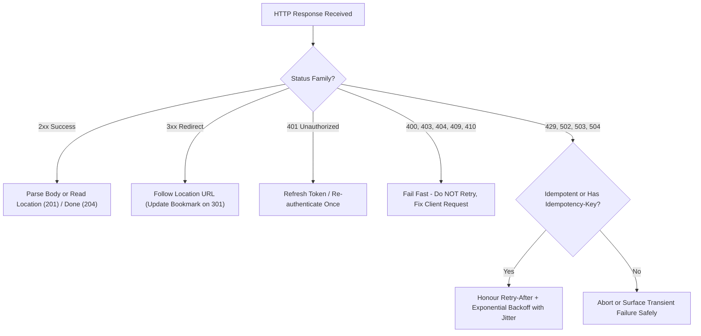
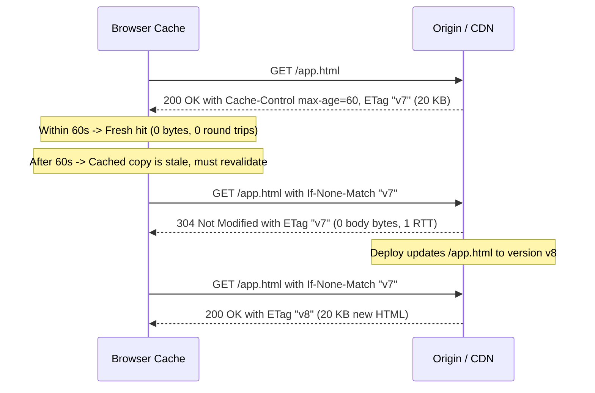
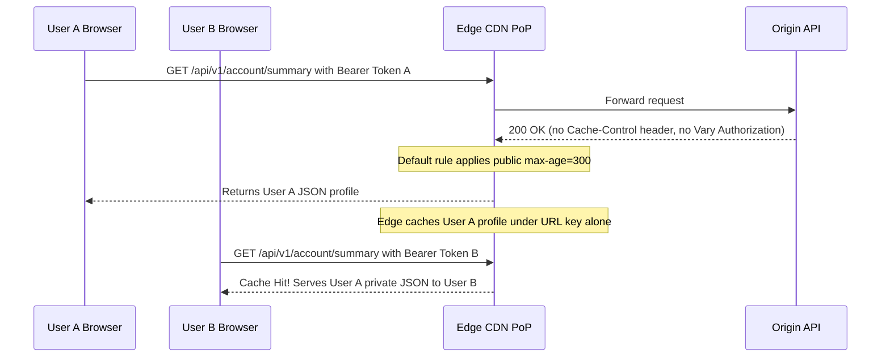

# Lesson 19: HTTP Part 2, Status Codes, 401 vs 403, Caching and ETags

> **Prerequisites:** Lesson 18 (HTTP requests and responses), [Lesson 16: DNS Records, TTL and Safe Migrations](../16-dns-records-ttl-and-migrations/README.md), and [Networking From Zero Overview](../README.md) (Lesson 19 of 30).  
> **Estimated Reading Time:** 25 minutes  
> **Target Audience:** Backend and full-stack engineers designing resilient HTTP APIs, retry logic, authentication responses (`401` vs `403`), CDN `Cache-Control` policies, and conditional `ETag`/`304` validation.  
> **Free PDF Notes:** [Download SD-N-019.pdf](https://backendroadmap.com/notes/system-design/SD-N-019.pdf)

> [!TIP]
> **The Golden Rule of HTTP Semantics & Caching:** The first status-code digit names who owns the outcome (`2xx` success, `3xx` redirect, `4xx` client fault, `5xx` server fault): `401` asks "who are you?" while `403` declares "not allowed." Only retry `429` and `5xx` safely, mark personal data `private` or `no-store`, and pair `Cache-Control` with `ETag` and `304 Not Modified` so revalidation ships headers with zero body bytes.

---

## Words You'll Meet Today

| Word | In Plain Words | Role in a Live Backend System |
| :--- | :--- | :--- |
| **Status code** | The three-digit result of an HTTP request. | Machine-readable contract driving client retries, circuit breakers, and CDN caching. |
| **`2xx` / `3xx`** | Success / go somewhere else (a redirect). | `200`/`201`/`204` confirm execution; `301`/`302` steer clients to the `Location` URI. |
| **`4xx`** | A client error: the request was wrong. | Signals malformed payloads (`400`), missing auth (`401`), forbidden access (`403`), or rate limits (`429`). |
| **`5xx`** | A server error: the server failed. | Indicates origin exceptions (`500`), upstream proxy faults (`502`/`504`), or overload (`503`). |
| **`Location` header** | Where a redirect, or a newly created thing, is. | Redirect target URL on `3xx` or newly provisioned resource URI on `201 Created`. |
| **`Cache-Control`** | How long, and by whom, a response may be reused. | Enforces browser/CDN lifetimes (`max-age`), revalidation (`no-cache`), or privacy (`private`, `no-store`). |
| **`ETag`** | A fingerprint of one version of the content. | Strong or weak hash enabling conditional `If-None-Match` validation without re-downloading bodies. |
| **`304 Not Modified`** | Your cached copy is still good; no body sent. | Cuts origin bandwidth by returning headers-only confirmation in 1 RTT. |

---

## Visual Mental Models & Architecture

### The Question: What Is the Server Telling You?

Your app shows “something went wrong”, but the server sent a number: `403`. Another time, `503`. Each number tells you exactly where to look, and one header can make a page load with almost no data at all. In lesson 18 we met HTTP requests and responses; today, the status codes and HTTP caching.

### An Everyday Picture First: The Post Office Counter

You hand a parcel over at a post office counter. The clerk can say: accepted. Or: they've moved, send it to this new address. Or: your form is filled in wrong. Or: sorry, our system is down. And if you ask “has my parcel changed since this morning?”, the clerk can just say “no, same as before”, without handing it over again. That's caching.


*Figure 1. The analogy: a post office clerk's four kinds of answer match the status code families, and “no, same as before” is caching.*

### Five Families, by the First Digit

`1xx` is information, and rare. `2xx` is success. `3xx` means go somewhere else. `4xx` means the client made a mistake. `5xx` means the server failed. The first digit tells you who to look at.


*Figure 2. Status codes come in five families by their first digit: information, success, redirect, client error and server error.*

- **`200 OK`**: here's what you asked for. **`201 Created`**: your `POST` made something new, and its address is in the `Location` header. **`204 No Content`**: it worked, nothing to send back, like after a delete.
- **`301 Moved Permanently`**: browsers and search engines remember the new address. **`302`**: moved, but only for now. The new URL is in the `Location` header and the address bar changes: that's the difference from a `CNAME` ([lesson 16](../16-dns-records-ttl-and-migrations/README.md)).


*Figure 3. Success and redirects: 200, 201 and 204; 301 and 302 send the browser to the URL in the Location header.*

- **`400 Bad Request`**: the request itself is broken. **`404 Not Found`**. **`409 Conflict`**: it clashes with the current state, like a duplicate username. **`429 Too Many Requests`**: you hit a rate limit, so wait, often for the time in the `Retry-After` header.
- **`401` versus `403`.** `401`, called Unauthorized, really means not authenticated: who are you? Send valid credentials. `403 Forbidden` means: I know who you are, and you're not allowed. Logging in again won't help.
- **`404` versus `410`.** `404`: not found, and maybe it never existed. `410 Gone`: it existed, and was removed on purpose.


*Figure 4. Client errors, and the pairs interviewers love: 401 means not authenticated, 403 means authenticated but not allowed; 404 may never have existed, 410 was removed on purpose.*

**Server errors.** `500 Internal Server Error`: usually a bug in the code. `502 Bad Gateway`: a proxy or load balancer got a bad answer from the server behind it. `503 Service Unavailable`: overloaded or down for maintenance, try later. `504 Gateway Timeout`: the server behind didn't answer in time.

**A rule for retries.** `5xx` and `429` may succeed if you try again, with a growing wait between tries. Most `4xx` won't fix themselves: don't retry them, fix the request.


*Figure 5. Server errors, and the rule for retries: 5xx and 429 may succeed with backoff; most 4xx won't, so fix the request.*



### HTTP Caching (`Cache-Control`, `ETag`, and `304`)

A response can say `Cache-Control: max-age=3600`: the browser may reuse it for an hour without asking at all, the same idea as the DNS TTL in [lesson 16](../16-dns-records-ttl-and-migrations/README.md). Other values: **`no-store`**, never keep a copy, like a bank statement; **`no-cache`**, you may keep it but check before every use; **`private`**, only the user's own browser may keep it; **`public`**, shared caches like CDNs may keep it too.


*Figure 6. Cache-Control: max-age says how long a response may be reused without asking; no-store, no-cache, private and public say who may keep it and how.*

When `max-age` runs out, the browser can check cheaply with an **`ETag`**. The first response says `ETag: "v7"`. Next time the browser asks `If-None-Match: "v7"`, and if nothing changed, the server replies **`304 Not Modified`**, with no body at all.

**Real numbers.** A `200 KB` image: the first visit costs `200 KB`; a check that returns `304` costs a few hundred bytes and one round trip; while `max-age` is still fresh, zero bytes and zero round trips.

**A common pattern.** Put a fingerprint in the file name, like `app.3f9a.js`, and cache it for a year (`max-age=31536000, immutable`). When you deploy, the name changes, so users get the new file at once. The HTML page itself gets a short `max-age`, or `no-cache`.


*Figure 7. Cheap checks with an ETag: the browser sends If-None-Match with the version it has, and gets 304 Not Modified with no body if nothing changed.*



---

## Systematic Reference & Comparison Grid

### Critical Status Codes & Client Semantics

| Code | Meaning | Key Response Header(s) | Retryable? | Cacheable by Default? |
| :--- | :--- | :--- | :--- | :--- |
| **`200 OK`** | Request succeeded, body returned | `Cache-Control`, `ETag` | Yes (if idempotent) | Yes (if `Cache-Control` permits) |
| **`201 Created`** | `POST` created a new resource | `Location` | Only with `Idempotency-Key` | No |
| **`204 No Content`** | Success with empty response body | `ETag` (optional) | Yes (e.g., `DELETE`) | Rarely |
| **`301` / `302`** | Permanent / temporary redirect | `Location` | Follow redirect | `301` yes, `302` explicit only |
| **`304 Not Modified`** | Conditional check passed; reuse body | `ETag`, `Cache-Control` | N/A | Refreshes cached entry TTL |
| **`400 Bad Request`** | Malformed syntax or validation error | `Content-Type` (`problem+json`) | **No** | No |
| **`401 Unauthorized`** | Missing, invalid, or expired credentials | `WWW-Authenticate` | Re-authenticate once | No |
| **`403 Forbidden`** | Authenticated identity lacks permission | — | **No** | No |
| **`404` / `410`** | Not found / intentionally removed (`Gone`) | `Cache-Control` (optional) | **No** | Yes if explicit `max-age` |
| **`409 Conflict`** | State collision (duplicate key / ETag mismatch) | — | Only after state reload | No |
| **`429 Too Many Requests`** | Rate limit exceeded | `Retry-After` | **Yes** (after `Retry-After`) | No |
| **`500` / `502` / `503` / `504`** | Origin bug / bad gateway / overloaded / timeout | `Retry-After` (`503`) | **Yes** (idempotent + jitter) | No |

### `Cache-Control` Directives Compared

| Directive | Stored in Browser Cache? | Stored in Shared CDN? | Revalidates Before Use? | Ideal Production Use Case |
| :--- | :--- | :--- | :--- | :--- |
| **`public, max-age=31536000, immutable`** | Yes (1 year) | Yes (1 year) | Never until URL changes | Content-hashed bundles (`app.3f9a.js`) |
| **`no-cache`** | Yes | Yes (unless `private`) | **Always** (`If-None-Match`) | Root `index.html`, semi-dynamic metadata |
| **`private, max-age=60`** | Yes | **No** | After 60s | Logged-in user profile/settings |
| **`no-store`** | **Never** (not on disk) | **Never** | Always full fetch | Banking statements, OTPs, PII tokens |

---

## Production War Story Post-Mortem: Cross-User Profile Leak via Missing `Cache-Control: private` & `200 OK` Errors

- **Severity:** SEV-1 (PII Cache Leak + Outage Masking)
- **Detection / Resolution Time:** 11 minutes to purge CDN edge caches; 25 minutes for permanent origin header fix
- **Impact:** `4,200` logged-in shoppers briefly received another user's `/api/v1/account/summary` payload from CDN PoPs, while a downstream auth glitch returned `200 OK` with `{"error":"rate_limit"}` and got cached globally for `1` hour.

### What Happened



### Root Cause Analysis

1. **Missing `Cache-Control: private` / `no-store`:** A CDN configuration update applied a fallback `Cache-Control: public, max-age=300` rule to `GET` paths lacking an explicit origin `Cache-Control` header, without partitioning cache keys by `Authorization`.
2. **`200 OK` Error Envelope:** A legacy wrapper caught upstream timeouts and returned HTTP `200 OK` with `{"ok":false,"error":"busy"}`. Edge caching saw `200 OK` and served the error payload to every subsequent caller while SLO dashboards stayed green at `0%` `5xx`.

### The Fix & Architectural Hardening

- **Secure Default Headers:** Injected middleware enforcing `Cache-Control: private, no-store` on all authenticated `/api/*` routes by default, requiring explicit opt-in for cacheable public endpoints.
- **CDN Bypass Safety:** Configured CDN edge rules to bypass cache unconditionally whenever `Authorization` or session cookies exist unless `Vary` explicitly permits keyed caching.
- **Contract Enforcement:** Rejected `200 OK` error envelopes in API gateway validation and mapped real failures strictly to `4xx`/`5xx` codes so monitoring and caches act accurately.

---

## Multi-Language Production Implementation

Below is a production-structured **HTTP ETag Conditional Responder (`304 Not Modified`), `Cache-Control` Policy Enforcer, and `401`/`403`/`429` Handler** across Go, TypeScript, Python, and C#.

````carousel
```go
package httpcache

import (
	"crypto/sha256"
	"encoding/hex"
	"fmt"
	"net/http"
)

func ComputeStrongETag(payload []byte) string {
	sum := sha256.Sum256(payload)
	return fmt.Sprintf(`"%s"`, hex.EncodeToString(sum[:16]))
}

func ServeArticle(w http.ResponseWriter, r *http.Request, body []byte, isAdmin, isAuthenticated bool) {
	if !isAuthenticated {
		w.Header().Set("WWW-Authenticate", `Bearer realm="api"`)
		w.Header().Set("Cache-Control", "no-store")
		http.Error(w, "authentication required", http.StatusUnauthorized) // 401
		return
	}
	if !isAdmin {
		w.Header().Set("Cache-Control", "private, no-store")
		http.Error(w, "insufficient permissions", http.StatusForbidden) // 403
		return
	}

	etag := ComputeStrongETag(body)
	w.Header().Set("ETag", etag)
	w.Header().Set("Cache-Control", "private, no-cache")

	if r.Header.Get("If-None-Match") == etag {
		w.WriteHeader(http.StatusNotModified) // 304: zero body bytes
		return
	}

	w.Header().Set("Content-Type", "application/json")
	w.WriteHeader(http.StatusOK)
	_, _ = w.Write(body)
}
```
<!-- slide -->
```typescript
import { createHash } from "node:crypto";
import type { IncomingMessage, ServerResponse } from "node:http";

export function computeStrongEtag(payload: Buffer): string {
  const hash = createHash("sha256").update(payload).digest("hex").slice(0, 32);
  return `"${hash}"`;
}

export function handleCacheableResource(
  req: IncomingMessage,
  res: ServerResponse,
  payload: Buffer,
  auth: { authenticated: boolean; allowed: boolean }
): void {
  if (!auth.authenticated) {
    res.writeHead(401, {
      "WWW-Authenticate": 'Bearer realm="api"',
      "Cache-Control": "no-store",
    });
    res.end("Unauthorized");
    return;
  }
  if (!auth.allowed) {
    res.writeHead(403, { "Cache-Control": "private, no-store" });
    res.end("Forbidden");
    return;
  }

  const etag = computeStrongEtag(payload);
  res.setHeader("ETag", etag);
  res.setHeader("Cache-Control", "public, max-age=0, must-revalidate");

  if (req.headers["if-none-match"] === etag) {
    res.writeHead(304); // Not Modified — zero body bytes sent
    res.end();
    return;
  }

  res.writeHead(200, { "Content-Type": "application/json" });
  res.end(payload);
}
```
<!-- slide -->
```python
import hashlib
from dataclasses import dataclass


@dataclass(frozen=True)
class HttpResponse:
    status: int
    headers: dict[str, str]
    body: bytes


def compute_strong_etag(payload: bytes) -> str:
    digest = hashlib.sha256(payload).hexdigest()[:32]
    return f'"{digest}"'


def serve_conditional(
    if_none_match: str | None,
    payload: bytes,
    authenticated: bool,
    allowed: bool,
    rate_limited: bool = False,
) -> HttpResponse:
    if rate_limited:
        return HttpResponse(429, {"Retry-After": "15", "Cache-Control": "no-store"}, b"Too Many Requests")
    if not authenticated:
        return HttpResponse(401, {"WWW-Authenticate": 'Bearer realm="api"', "Cache-Control": "no-store"}, b"Unauthorized")
    if not allowed:
        return HttpResponse(403, {"Cache-Control": "private, no-store"}, b"Forbidden")

    etag = compute_strong_etag(payload)
    headers = {"ETag": etag, "Cache-Control": "private, no-cache"}
    if if_none_match == etag:
        return HttpResponse(304, headers, b"")  # Zero body bytes

    headers["Content-Type"] = "application/json"
    return HttpResponse(200, headers, payload)
```
<!-- slide -->
```csharp
using System;
using System.Security.Cryptography;
using System.Text;
using Microsoft.AspNetCore.Http;

public static class ConditionalHttpHandler
{
    public static string ComputeStrongETag(ReadOnlySpan<byte> payload)
    {
        Span<byte> hash = stackalloc byte[32];
        SHA256.HashData(payload, hash);
        return $"\"{Convert.ToHexString(hash[..16]).ToLowerInvariant()}\"";
    }

    public static IResult Serve(HttpContext ctx, string jsonBody, bool authenticated, bool allowed)
    {
        if (!authenticated)
        {
            ctx.Response.Headers.WWWAuthenticate = "Bearer realm=\"api\"";
            ctx.Response.Headers.CacheControl = "no-store";
            return Results.StatusCode(StatusCodes.Status401Unauthorized);
        }
        if (!allowed)
        {
            ctx.Response.Headers.CacheControl = "private, no-store";
            return Results.StatusCode(StatusCodes.Status403Forbidden);
        }

        byte[] bytes = Encoding.UTF8.GetBytes(jsonBody);
        string etag = ComputeStrongETag(bytes);
        ctx.Response.Headers.ETag = etag;
        ctx.Response.Headers.CacheControl = "private, no-cache";

        if (ctx.Request.Headers.IfNoneMatch.ToString() == etag)
            return Results.StatusCode(StatusCodes.Status304NotModified);

        return Results.Bytes(bytes, "application/json");
    }
}
```
````

---

## Practical Hands-On Verification CLI Workflows

### 1. Test `ETag` + `304 Not Modified` Conditional Revalidation

```bash
curl -sS -D - -o /dev/null https://example.com/
```

**Expected Output:**

```text
HTTP/2 200
cache-control: max-age=604800
etag: "3147526947"
content-length: 1256
```

Now send that `ETag` back with `If-None-Match` to verify `304` and zero body bytes:

```bash
curl -sS -D - -o /dev/null -H 'If-None-Match: "3147526947"' https://example.com/
```

**Expected Output:**

```text
HTTP/2 304
etag: "3147526947"
cache-control: max-age=604800
```

### 2. Trace `301` / `302` Redirect Chains (`Location` Header)

```bash
curl -sS -I -L https://httpbin.org/redirect-to?url=https%3A%2F%2Fexample.com%2F\&status_code=301
```

**Expected Output:**

```text
HTTP/2 301
location: https://example.com/

HTTP/2 200
content-type: text/html; charset=UTF-8
```

### 3. Inspect `429 Too Many Requests` and `Retry-After`

```bash
curl -sS -i https://httpbin.org/status/429
```

**Expected Output:**

```text
HTTP/2 429
content-length: 0
```

In production APIs enforcing quotas, also verify `retry-after: <seconds>` is present so compliant clients know how long to back off before retrying.

---

## Pause and Think

> [!exercise] A logged-in user opens an admin page they aren't allowed to see: which status code? A user whose login token has expired calls the API: which status code? Decide before you open the answer.

<details><summary>Answer</summary>

The first is 403: the server knows who they are, and the answer is no. The second is 401: the credentials are no longer valid, so log in again and try again.


*Figure 8. The pause-and-think answer: a logged-in user on a page they may not see gets 403; a request with an expired token gets 401.*

</details>

---

## Operational Validation Checkpoints

<details><summary><strong>Checkpoint 1: `no-cache` vs. `no-store` on Shared Terminals</strong></summary>

**Scenario:** Your healthcare portal serves patient lab results with `Cache-Control: no-cache` so browsers always revalidate before displaying them. A security audit flags this as a finding on shared hospital kiosks. Why?

**Solution:**
`Cache-Control: no-cache` **still allows the browser and intermediate caches to store the response on disk**—it only mandates revalidation before reuse. If someone opens browser cache forensics or uses offline cache inspection on a shared kiosk, sensitive lab data remains on disk. Sensitive responses must send `Cache-Control: no-store` (often paired with `private`).

</details>

<details><summary><strong>Checkpoint 2: Retrying the Wrong `4xx` Code Causes a Retry Storm</strong></summary>

**Scenario:** A mobile SDK update treats all non-`2xx` statuses identically with `5` automatic retries. After an expired-token rollout returns `401`, origin RPS spikes `5×`. How should client retry logic handle `401`, `403`, `429`, and `503`?

**Solution:**
- `403` / `400` / `404`: **Never retry**—fix the request or surface permission failure.
- `401`: Do **not** blindly retry the stale token; trigger a single token refresh flow, then retry once if refreshed.
- `429` / `503`: **Retry safely** with exponential backoff + full jitter, honoring `Retry-After` if provided.

</details>

<details><summary><strong>Checkpoint 3: Bandwidth vs. Latency Math (`max-age` vs. `ETag`)</strong></summary>

**Scenario:** A `200 KB` hero logo is fetched `5` times per session across pages. Compare total bytes and network round trips when served with (A) `no-store`, (B) `no-cache` + `ETag`, and (C) `public, max-age=3600` (with fingerprinted filename `logo.8c12.png`).

**Solution:**
- (A) `no-store`: `5 × 200 KB = 1,000 KB` downloaded, `5` RTTs.
- (B) `no-cache` + `ETag`: `200 KB` on view 1 + `4 × ~0.5 KB` (`304`) = `~202 KB` downloaded, still **`5` RTTs** (every view checks the server).
- (C) `max-age=3600`: `200 KB` on view 1, then **`0` bytes and `0` RTTs** on views 2–5!

</details>

---

## Common Mistakes & Troubleshooting

### What Goes Wrong

- **Errors sent as `200 OK`**, with “error” written in the body: monitoring thinks everything is fine, and caches happily store the error page.
- **A personal page cached as `public`**: a CDN serves one user's account page to someone else. Mark it `private`, or `no-store`.
- **A long `max-age` on a file without a fingerprint**: after a deploy, users keep the old version until their cache runs out.

### Common Myths

- **"`401` means no permission."** No. `401` means we don't know who you are. No permission is `403`.
- **"`no-cache` means don't cache."** No. It means always check before using. The one that means never keep a copy is `no-store`.
- **"A `304` is an error."** No. It's a success: your copy is still good, so nothing needs to be sent.

| Symptom | Root Cause | Fix |
| :--- | :--- | :--- |
| Users see stale JS/CSS after deploy | Long `max-age` on un-fingerprinted URL (`app.js`) | Embed content hash (`app.3f9a.js`) + `immutable`; keep HTML `no-cache` |
| CDN leaks User A data to User B | Authenticated route served `public` or missing `Vary` | Send `Cache-Control: private, no-store`; bypass CDN on `Authorization` |
| Client stuck in infinite retry loop | Client retries `400`/`401`/`403` blindly | Restrict backoff retries to `429` and `502`/`503`/`504` |

---

## Recap in Three Lines

1. The first digit names the family: `2xx` success, `3xx` redirect, `4xx` your fault, `5xx` the server's.
2. `401` is “who are you?”, `403` is “not allowed”.
3. `Cache-Control` says how long to reuse a response, and `ETag`s with `304` make checking cheap.

---

## Interview Practice Questions

> [!interview] What do the HTTP status code families mean? (Basic)

<details><summary>What to say in 30 seconds</summary>

1xx is informational; 2xx success, such as 200, 201 and 204; 3xx redirects, with the new URL in the Location header; 4xx client errors, such as 400, 404 and 429, where the request needs fixing; 5xx server errors, such as 500, 502, 503 and 504, where the server or something behind it failed.

</details>

> [!interview] What's the difference between 401 and 403? (Basic)

<details><summary>What to say in 30 seconds</summary>

401 (named Unauthorized) means not authenticated: the server doesn't know who you are, or your credentials are missing, invalid or expired, so authenticate and retry. 403 Forbidden means the server knows who you are and you're not allowed; logging in again won't help.

</details>

> [!interview] Which errors should a client retry? (Scenario)

<details><summary>What to say in 30 seconds</summary>

5xx errors such as 502, 503 and 504, and 429 Too Many Requests, may succeed later: retry with exponential backoff and jitter, honour Retry-After, and only retry requests that are safe to repeat (idempotent, or protected by an idempotency key). Most 4xx errors won't fix themselves, so don't retry them.

</details>

> [!interview] How would you cache static files and HTML for a web app? (Scenario)

<details><summary>What to say in 30 seconds</summary>

Put a content hash in static file names (app.3f9a.js) and serve them with a long max-age, even a year, marked immutable; a deploy changes the name, so users get the new file at once. Serve HTML with a short max-age or no-cache plus an ETag, so browsers revalidate cheaply. Mark personal pages private or no-store.

</details>

> [!interview] What's the difference between no-cache and no-store? (Tricky)

<details><summary>What to say in 30 seconds</summary>

no-cache allows storing a copy but requires revalidation with the server before every use, typically with an ETag and If-None-Match. no-store forbids keeping a copy at all, for sensitive responses like bank statements.

</details>

> [!interview] How do ETags and 304 work, and what do they save? (Tricky)

<details><summary>What to say in 30 seconds</summary>

The server labels a response with an ETag, a version fingerprint. When the cached copy is stale, the browser sends If-None-Match with that ETag; if the content hasn't changed the server replies 304 Not Modified with no body. That saves the bytes of the response, though it still costs a round trip; only a fresh max-age saves the round trip too.

</details>

---

## Free PDF notes

Download these notes as a printable PDF, with every picture, the status code cards and the interview answers: [SD-N-019.pdf](https://backendroadmap.com/notes/system-design/SD-N-019.pdf).

---

## Sources

- [RFC 9110: HTTP Semantics](https://www.rfc-editor.org/rfc/rfc9110), status codes, the Location header, ETags and conditional requests.
- [RFC 9111: HTTP Caching](https://www.rfc-editor.org/rfc/rfc9111), Cache-Control, freshness and revalidation.
- [RFC 6585: Additional HTTP Status Codes](https://www.rfc-editor.org/rfc/rfc6585), 429 Too Many Requests.
- [MDN: HTTP response status codes](https://developer.mozilla.org/en-US/docs/Web/HTTP/Status), a readable reference for every code.
- [MDN: HTTP caching](https://developer.mozilla.org/en-US/docs/Web/HTTP/Caching), Cache-Control in practice.

---

## Next

Next comes [lesson 20, why encryption: public and private keys](../20-why-encryption-public-and-private-keys/README.md): what anyone on your Wi-Fi can see without it, and how public and private keys fix that. See [the track overview](../README.md) for the whole series.
