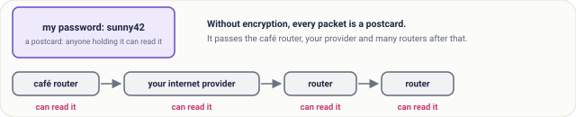
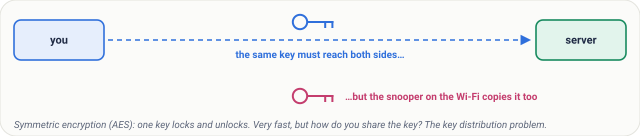
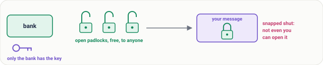
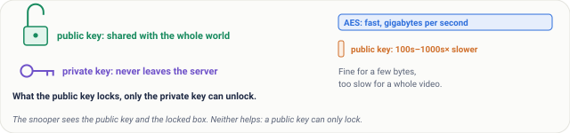
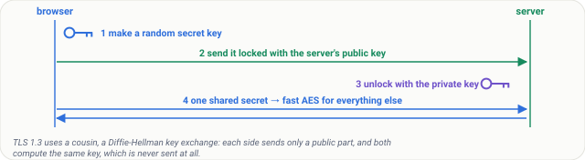
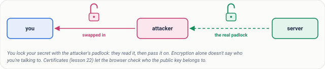

# Lesson 20: Why Encryption, Public and Private Keys, the Padlock Picture

## Roadmap

You are in **System Design Interview Prep**, Track 02, **Networking from Zero**: lesson 20 of 30. It follows [lesson 19, HTTP status codes and caching](../19-http-status-codes-and-caching/README.md). Here we look at why encryption matters and how public and private keys work. The next lesson, HTTPS and the TLS handshake, is coming soon. See [the track overview](../README.md) for the whole plan.

These are the written notes for the lesson's video. Prefer paper? The same notes are a free, printable PDF: [download SD-N-020.pdf](https://backendroadmap.com/notes/system-design/SD-N-020.pdf).

## Concept

> [!key] Without encryption every packet is a postcard; symmetric encryption (one key) is fast but the key must be shared, public and private keys solve the sharing but are slow, so HTTPS uses both: agree one secret, then encrypt fast with AES.

## Words you'll meet today

| Word | In plain words |
|---|---|
| **Encryption** | scrambling data so only the right person can read it |
| **Key** | the secret value that locks and unlocks |
| **Symmetric** | the same key locks and unlocks (AES) |
| **Public key** | half of a key pair that anyone may have |
| **Private key** | the other half, kept only by the owner |
| **Key exchange** | both sides compute the same secret without sending it |
| **Signature** | made with a private key, checked with the public key |
| **Forward secrecy** | fresh keys per connection, so an old leak can't unlock old traffic |

## The question: what can someone on the café Wi-Fi see?

You're on café Wi-Fi and log in to a site over plain HTTP. Anyone on the same network can read your password. Worse, they can change the page before it reaches you. In lesson 19 we met status codes and caching; today, why encryption matters and how public and private keys make it work.

## An everyday picture first: a postcard

Without encryption, every packet is a postcard. It passes the café router, your internet provider and many routers after that, and anyone holding it on the way can read it.

*Figure 1. Without encryption every packet is a postcard: the café router, your internet provider and every router after that can read it.*

Three things can go wrong. Someone **reads** it: privacy. Someone **changes** it: integrity. Someone **pretends** to be your bank: authenticity. Today we fix the first one; lessons 21 and 22 finish the rest.

*Figure 2. Three things can go wrong on the wire: someone reads it (privacy), changes it (integrity), or pretends to be the other side (authenticity).*

## The simplest fix: a lockbox with one key

The same key locks and unlocks. This is **symmetric** encryption, and the common one is called **AES**. It's very fast: a laptop can encrypt gigabytes every second.

But there's a catch. Both sides need the same key. If you send it over the café Wi-Fi, the snooper copies the key too. This is the **key distribution problem**.

*Figure 3. Symmetric encryption uses one key to lock and unlock, and is very fast; the catch is getting that key to the other side without anyone copying it.*

## Public and private keys: the padlock picture

A bank hands out open padlocks, free, to anyone. Only the bank has the key that opens them. You put your message in a box and snap a padlock shut. Now nobody can open it, not even you. Only the bank.

*Figure 4. The padlock picture: the bank hands out open padlocks to anyone but keeps the only key; once you snap one shut on your box, only the bank can open it.*

The real thing is a **key pair**. The **public key**, like the open padlock, is shared with the whole world. The **private key** never leaves the server. What the public key locks, only the private key can unlock. So a snooper who sees the public key and the locked box learns nothing: a public key can only lock.

Then why not use public keys for everything? Because they're slow: public-key operations are hundreds to thousands of times slower than AES. Fine for a few bytes, too slow for a whole video.

*Figure 5. A key pair: the public key is shared with everyone, the private key never leaves the server; public-key operations are much slower than AES.*

## Why HTTPS uses both

1. The browser makes a random secret key.
2. It locks that key with the server's public key, and sends it.
3. The server unlocks it with its private key.
4. Now both sides share one secret, and switch to fast AES for everything else.

That's the classic idea. Modern **TLS 1.3** uses a cousin called a **key exchange**, or Diffie-Hellman: each side keeps a secret and sends only a public part, and both compute the same shared key, which is never sent at all. The snooper sees both public parts and still can't work it out.

*Figure 6. HTTPS uses both: slow public-key crypto to agree one secret, then fast AES for the data. TLS 1.3 agrees it with a Diffie-Hellman key exchange.*

**The other way round: signatures.** The server can sign something with its private key, like a wax seal. Anyone with the public key can check the seal is real. That proves who sent it, and it's the base of certificates, in lesson 22.

**Real numbers.** An AES key is 128 or 256 bits. An RSA key is usually 2,048 bits, and an elliptic curve key just 256. Guessing a 128-bit key means up to 2128 tries: even with every computer on Earth, that takes far longer than the age of the universe.

**What HTTPS hides.** The page content, the full URL path, your cookies and your password. What stays visible: your IP address, the server's, the site's domain name, and how much data moves, and when.

*Figure 7. What HTTPS hides (content, URL path, cookies, passwords) and what stays visible (both IP addresses, the domain name, and how much data moves, and when).*

## What goes wrong

- **A leaked private key.** Anyone who has it can pretend to be your server. With old setups, they could even unlock traffic recorded months ago. That's why TLS 1.3 makes fresh keys for every connection: **forward secrecy**.
- **Home-made encryption.** Base64 is not encryption: anyone can decode it in a second. A clever scheme you invented is almost always broken. Use standard, well-tested libraries.
- **Encrypting to the wrong person.** If an attacker swaps in their own public key, you lock your secret for the attacker: a man in the middle. Encryption alone doesn't say who you're talking to. Certificates fix that, in lesson 22.

## Pause and think

> [!exercise] An attacker on the café Wi-Fi copies the server's public key and your locked box. Can they read your message? And what if, before the key reached you, they swapped it for their own? Decide before you open the answer.

Answer

The first: no. A public key only locks, so copying it doesn't help. The second: yes. You locked your secret with the attacker's padlock. That's exactly why the browser must check who the key belongs to.

*Figure 8. The pause-and-think answer: copying a public key doesn't help an attacker, but swapping in their own does. That's a man in the middle, and why certificates exist.*

## Common mistakes

- **"The public key must be kept secret."** No. It's meant to be shared. Only the private key is secret.
- **"HTTPS hides which site I visit."** No. The domain name and IP addresses are still visible. The content and the URL path are hidden.
- **"Public keys are better, so use them for everything."** No. They're slow. They're used to agree on a key, then fast symmetric encryption does the work.

## Recap in three lines

1. Symmetric: one shared key, fast, but how do you share it?
2. Public and private keys: the public key locks, only the private key unlocks.
3. HTTPS uses both: agree a secret, then encrypt fast with AES.

## Interview questions

> [!interview] What's the difference between symmetric and asymmetric encryption? (Basic)

What to say in 30 seconds

Symmetric encryption, such as AES, uses one shared key to encrypt and decrypt; it's very fast, but both sides need the key, and getting it there safely is the key distribution problem. Asymmetric encryption uses a key pair: the public key is shared with anyone, the private key never leaves its owner. What the public key encrypts, only the private key can decrypt. It solves sharing but is far slower.

> [!interview] Why does HTTPS use both kinds? (Basic)

What to say in 30 seconds

Asymmetric crypto is too slow for bulk data, and symmetric crypto alone has no safe way to share the key. So TLS uses asymmetric crypto, today an ephemeral Diffie-Hellman key exchange, to agree a fresh session key, then encrypts all the data with fast symmetric AES (or ChaCha20). Certificates and signatures prove the server's public key really belongs to the site.

> [!interview] What does an attacker on public Wi-Fi see when you use HTTPS? (Scenario)

What to say in 30 seconds

Your IP address and the server's, the domain name (from DNS, and the SNI field in the TLS handshake unless Encrypted Client Hello is used), and the timing and size of the traffic. They can't see the URL path, the page content, cookies or form data such as passwords, and they can't change them without being detected.

> [!interview] A server's private key leaks. What's the damage? (Scenario)

What to say in 30 seconds

An attacker can impersonate the server, so the certificate must be revoked and the key replaced. With old RSA key transport, they could also decrypt any recorded past traffic. TLS 1.3 only uses ephemeral key exchanges, which give forward secrecy: each connection has fresh keys, so recordings stay safe.

> [!interview] Is Base64 or hashing encryption? (Tricky)

What to say in 30 seconds

No. Base64 is an encoding: anyone can reverse it, with no key. A hash is one-way: it can't be decrypted at all, which suits checking passwords (with a slow, salted hash) but not hiding data you need back. Encryption needs a key to reverse. And never invent your own scheme: use standard, well-tested libraries.

> [!interview] If public keys are public, how can an attacker in the middle break things? (Tricky)

What to say in 30 seconds

Copying the public key doesn't help, since it can only lock. But if the attacker swaps in their own public key, you encrypt for the attacker, who reads the data and passes it on: a man in the middle. Encryption alone doesn't say who you're talking to; certificates signed by a trusted authority let the browser check the key belongs to the site.

## Free PDF notes

Download these notes as a printable PDF, with every picture, the padlock pictures and the interview answers: [SD-N-020.pdf](https://backendroadmap.com/notes/system-design/SD-N-020.pdf).

## Sources

- [RFC 8446: TLS 1.3](https://www.rfc-editor.org/rfc/rfc8446), the key exchange, forward secrecy and the handshake.
- [RFC 7748: Elliptic Curves for Security](https://www.rfc-editor.org/rfc/rfc7748), X25519, the key exchange most browsers use.
- [NIST FIPS 197: AES](https://csrc.nist.gov/pubs/fips/197/final), the symmetric cipher behind most HTTPS traffic.
- [Cloudflare: What is encryption?](https://www.cloudflare.com/learning/ssl/what-is-encryption/), a readable introduction.
- [Cloudflare: How does public key encryption work?](https://www.cloudflare.com/learning/ssl/how-does-public-key-encryption-work/), key pairs and TLS.

## Next

Next comes lesson 21, HTTPS and the TLS handshake, step by step (coming soon). Until then, the [track overview](../README.md) lists the whole series.
