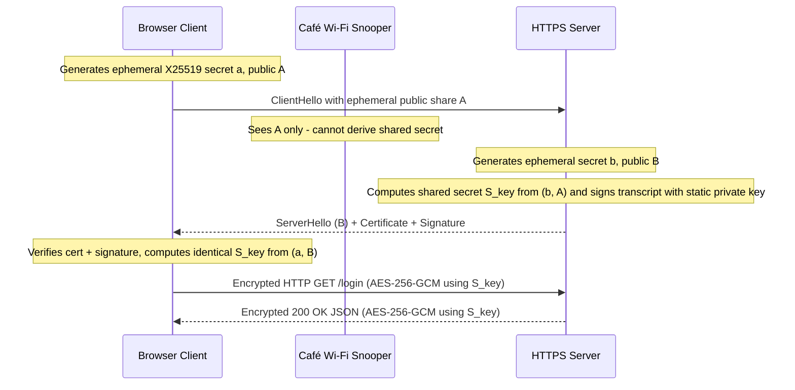
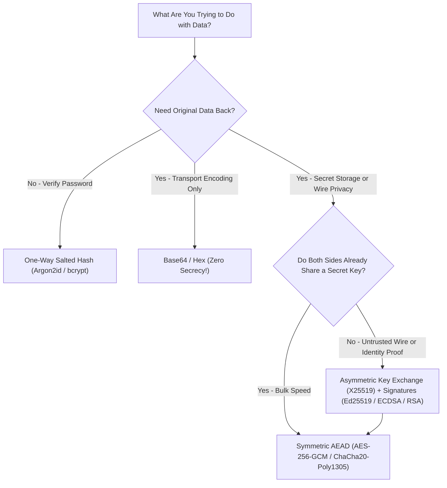
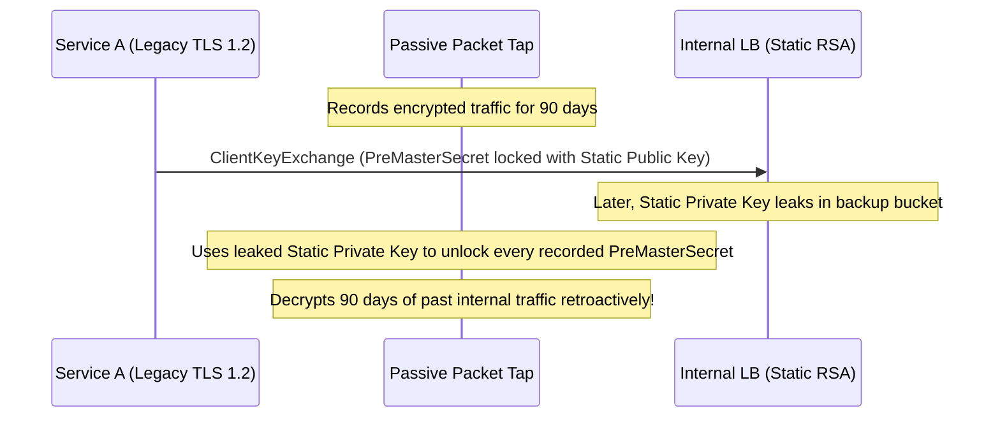

# Lesson 20: Why Encryption, Public and Private Keys, the Padlock Picture

> **Prerequisites:** [Lesson 19: HTTP Status Codes and Caching](../19-http-status-codes-and-caching/README.md) and [Networking From Zero Overview](../README.md) (Lesson 20 of 30).  
> **Estimated Reading Time:** 25 minutes  
> **Target Audience:** Backend engineers securing API traffic, managing TLS/SSH key pairs, reasoning about forward secrecy and MitM attacks, and avoiding broken home-made cryptography.  
> **Free PDF Notes:** [Download SD-N-020.pdf](https://backendroadmap.com/notes/system-design/SD-N-020.pdf)

> [!TIP]
> **The Golden Rule of Hybrid Encryption:** Without encryption every packet is a postcard. **Symmetric encryption (`AES` / `ChaCha20`)** is gigabit-fast but suffers the key distribution problem, while **asymmetric public/private keys (`X25519`, `ECDSA`, `RSA`)** solve sharing and signatures at high CPU cost—so TLS 1.3 pairs ephemeral key exchange for **forward secrecy** with fast symmetric `AES` for bulk data.

---

## Words You'll Meet Today

| Word | In Plain Words | Role in a Live Backend System |
| :--- | :--- | :--- |
| **Encryption** | Scrambling data so only the right person can read it. | Turns plaintext HTTP payloads into authenticated ciphertext (`AES-GCM` / `ChaCha20-Poly1305`). |
| **Key** | The secret value that locks and unlocks. | Random `128`/`256`-bit secret feeding symmetric ciphers or `2048`-bit/`256`-bit asymmetric math. |
| **Symmetric** | The same key locks and unlocks (`AES`). | Encrypts gigabytes per second of bulk TLS records once a session secret is established. |
| **Public key** | Half of a key pair that anyone may have. | Distributed inside X.509 server certificates (`TLS`) or `authorized_keys` (`SSH`). |
| **Private key** | The other half, kept only by the owner. | Stored in HSM/KMS or locked down on disk; signs TLS handshakes to prove server identity. |
| **Key exchange** | Both sides compute the same secret without sending it. | `X25519` / `ECDHE` lets client and server derive matching session keys across an untrusted wire. |
| **Signature** | Made with a private key, checked with the public key. | Proves authenticity and integrity in TLS certificates, JWTs (`RS256`/`EdDSA`), and code releases. |
| **Forward secrecy** | Fresh keys per connection, so an old leak can't unlock old traffic. | Ephemeral Diffie-Hellman ensures stealing a server's static private key never decrypts past captures. |

---

## Visual Mental Models & Architecture

### The Question: What Can Someone on the Café Wi-Fi See?

You're on café Wi-Fi and log in to a site over plain HTTP. Anyone on the same network can read your password. Worse, they can change the page before it reaches you. In [lesson 19](../19-http-status-codes-and-caching/README.md) we met status codes and caching; today, why encryption matters and how public and private keys make it work.

### An Everyday Picture First: A Postcard

Without encryption, every packet is a postcard. It passes the café router, your internet provider and many routers after that, and anyone holding it on the way can read it.


*Figure 1. Without encryption every packet is a postcard: the café router, your internet provider and every router after that can read it.*

Three things can go wrong. Someone **reads** it: privacy. Someone **changes** it: integrity. Someone **pretends** to be your bank: authenticity. Today we fix the first one; lessons 21 and 22 finish the rest.


*Figure 2. Three things can go wrong on the wire: someone reads it (privacy), changes it (integrity), or pretends to be the other side (authenticity).*

### The Simplest Fix: A Lockbox with One Key (Symmetric)

The same key locks and unlocks. This is **symmetric** encryption, and the common one is called **`AES`**. It's very fast: a laptop can encrypt gigabytes every second.

But there's a catch. Both sides need the same key. If you send it over the café Wi-Fi, the snooper copies the key too. This is the **key distribution problem**.


*Figure 3. Symmetric encryption uses one key to lock and unlock, and is very fast; the catch is getting that key to the other side without anyone copying it.*

### Public and Private Keys: The Padlock Picture (Asymmetric)

A bank hands out open padlocks, free, to anyone. Only the bank has the key that opens them. You put your message in a box and snap a padlock shut. Now nobody can open it, not even you. Only the bank.


*Figure 4. The padlock picture: the bank hands out open padlocks to anyone but keeps the only key; once you snap one shut on your box, only the bank can open it.*

The real thing is a **key pair**. The **public key**, like the open padlock, is shared with the whole world. The **private key** never leaves the server. What the public key locks, only the private key can unlock. So a snooper who sees the public key and the locked box learns nothing: a public key can only lock.

Then why not use public keys for everything? Because they're slow: public-key operations are hundreds to thousands of times slower than AES. Fine for a few bytes, too slow for a whole video.


*Figure 5. A key pair: the public key is shared with everyone, the private key never leaves the server; public-key operations are much slower than AES.*

### Why HTTPS Uses Both (Hybrid Encryption & Key Exchange)

1. The browser makes a random secret key.
2. It locks that key with the server's public key, and sends it.
3. The server unlocks it with its private key.
4. Now both sides share one secret, and switch to fast `AES` for everything else.

That's the classic idea. Modern **TLS 1.3** uses a cousin called a **key exchange**, or Diffie-Hellman (`X25519` / `ECDHE`): each side keeps a secret and sends only a public part, and both compute the same shared key, which is never sent at all. The snooper sees both public parts and still can't work it out.


*Figure 6. HTTPS uses both: slow public-key crypto to agree one secret, then fast AES for the data. TLS 1.3 agrees it with a Diffie-Hellman key exchange.*



**The other way round: signatures.** The server can sign something with its private key, like a wax seal. Anyone with the public key can check the seal is real. That proves who sent it, and it's the base of certificates, in [lesson 22](../22-certificates-and-pki/README.md).

**Real numbers.** An `AES` key is `128` or `256` bits. An `RSA` key is usually `2,048` bits, and an elliptic curve key (`X25519` / `P-256`) just `256`. Guessing a `128`-bit key means up to `2^128` (`~3.4 × 10^38`) tries: even with every computer on Earth, that takes far longer than the age of the universe.

**What HTTPS hides.** The page content, the full URL path, your cookies and your password. What stays visible: your IP address, the server's, the site's domain name, and how much data moves, and when.


*Figure 7. What HTTPS hides (content, URL path, cookies, passwords) and what stays visible (both IP addresses, the domain name, and how much data moves, and when).*



---

## Systematic Reference & Comparison Grid

### Encoding vs. Hashing vs. Symmetric vs. Asymmetric Cryptography

| Mechanism | Reversible? | Key(s) Required | Relative Speed | Primary Security Goal | Classic Anti-Pattern |
| :--- | :--- | :--- | :--- | :--- | :--- |
| **Encoding (`Base64`, `URL`)** | Yes (trivially) | None | Instant | Wire-safe text representation | Treating Base64 JWT headers/payloads as "encrypted" |
| **Hashing (`SHA-256`, `Argon2id`)** | **No** (one-way) | None (plus salt for passwords) | Fast (`SHA`) / Tuned slow (`Argon2`) | Integrity & password verification | Storing reversible plaintext or unsalted MD5 passwords |
| **Symmetric (`AES-GCM`, `ChaCha20`)** | Yes | Same shared secret key | **Gigabytes/sec** (hardware AES-NI) | Confidentiality + integrity (AEAD) | Sending raw symmetric keys over plain HTTP or reusing nonces |
| **Asymmetric (`X25519`, `ECDSA`, `RSA`)** | Key exchange / verify | Public + Private key pair | **100×–1,000× slower** than AES | Safe key agreement & signatures | Bulk-encrypting multi-MB files directly with RSA |

### Café Wi-Fi Visibility Matrix Over HTTPS

| Traffic Metadata / Payload | Visible to Café Wi-Fi Snooper? | Why / Mitigation |
| :--- | :--- | :--- |
| **Client & Server IP Addresses** | **Yes** | Required in unencrypted L3 IP headers for packet routing |
| **Target Domain Name** | **Yes** (unless DoH + ECH) | Leaked via plain UDP DNS and TLS `SNI` extension |
| **Packet Size & Timing** | **Yes** | Encrypted TLS record lengths reveal traffic bursts |
| **URL Path & Query (`?token=...`)** | **Hidden** | Sent inside encrypted HTTP layer after TLS handshake |
| **Cookies, Passwords, JSON Bodies** | **Hidden** | Encrypted and authenticated with `AES-GCM` / `ChaCha20` |

---

## Production War Story Post-Mortem: Leaked Private Key Without Forward Secrecy

- **Severity:** SEV-1 (90-Day Historical Traffic Exposure)
- **Detection / Resolution Time:** 16 minutes to revoke certificate and rotate keys; full TLS 1.3 cipher migration in 2 hours
- **Impact:** A misconfigured artifact backup exposed a wildcard `*.internal.example.com` TLS private key. Because legacy internal load balancers still allowed static RSA key transport (`TLS_RSA_WITH_AES_128_GCM_SHA256`), recorded east-west captures from the prior `90` days became retroactively decryptable.

### What Happened



### Root Cause Analysis

1. **Static RSA Key Transport Allowed:** Under legacy RSA key exchange, the client generates a `PreMasterSecret`, locks it with the server's *long-lived static public key*, and sends it over the wire. Whoever later steals that single static private key unlocks every recorded session forever.
2. **Missing Ephemeral Key Exchange (`ECDHE` / `X25519`):** TLS 1.3 drops static RSA key transport completely; the static private key is used **only** to sign the handshake, while session secrets come from short-lived ephemeral `X25519` keys destroyed immediately when each connection closes.

### The Fix & Architectural Hardening

- **Enforce TLS 1.3 / Ephemeral Ciphers Only:** Disabled all `TLS_RSA_*` suites across Envoy, Nginx, and ALBs, enforcing TLS 1.3 (or TLS 1.2 `ECDHE-*` AEAD suites only) for universal **forward secrecy**.
- **Key Rotation & Revocation:** Revoked the exposed certificate via CRL/OCSP, rotated keys inside hardware-backed KMS/HSM boundaries, and blocked raw `.key` files from backup policies.

---

## Multi-Language Production Implementation

Below is a production-structured **Hybrid Encryption Pipeline (Ephemeral `X25519`/`ECDH` Key Agreement + `HKDF-SHA256` + `AES-256-GCM` Authenticated Encryption)** demonstrating exactly how modern TLS 1.3 pairs asymmetric key exchange with fast symmetric AEAD ciphers across Go, TypeScript, Python, and C#.

````carousel
```go
package hybridcrypto

import (
	"crypto/aes"
	"crypto/cipher"
	"crypto/ecdh"
	"crypto/rand"
	"crypto/sha256"
	"io"
)

// HybridEncrypt derives an ephemeral X25519 shared key and encrypts plaintext with AES-256-GCM.
func HybridEncrypt(serverPub *ecdh.PublicKey, plaintext []byte) (ephemeralPub, nonce, ciphertext []byte, err error) {
	ephemeralPriv, err := ecdh.X25519().GenerateKey(rand.Reader)
	if err != nil {
		return nil, nil, nil, err
	}
	sharedSecret, err := ephemeralPriv.ECDH(serverPub)
	if err != nil {
		return nil, nil, nil, err
	}
	key := sha256.Sum256(sharedSecret) // Production code uses HKDF-SHA256 over transcript

	block, err := aes.NewCipher(key[:])
	if err != nil {
		return nil, nil, nil, err
	}
	aead, err := cipher.NewGCM(block)
	if err != nil {
		return nil, nil, nil, err
	}
	nonce = make([]byte, aead.NonceSize())
	if _, err := io.ReadFull(rand.Reader, nonce); err != nil {
		return nil, nil, nil, err
	}
	ciphertext = aead.Seal(nil, nonce, plaintext, ephemeralPriv.PublicKey().Bytes())
	return ephemeralPriv.PublicKey().Bytes(), nonce, ciphertext, nil
}
```
<!-- slide -->
```typescript
import {
  createCipheriv,
  diffieHellman,
  generateKeyPairSync,
  hkdfSync,
  randomBytes,
  type KeyObject,
} from "node:crypto";

export function hybridEncrypt(serverPublicKey: KeyObject, plaintext: Buffer) {
  // 1. Fresh ephemeral X25519 key pair per message/session (forward secrecy)
  const eph = generateKeyPairSync("x25519");
  const shared = diffieHellman({
    privateKey: eph.privateKey,
    publicKey: serverPublicKey,
  });

  // 2. Derive 256-bit symmetric key via HKDF-SHA256
  const aesKey = Buffer.from(
    hkdfSync("sha256", shared, Buffer.alloc(0), Buffer.from("tls13-hybrid-demo"), 32)
  );

  // 3. Fast authenticated symmetric encryption (AES-256-GCM)
  const nonce = randomBytes(12);
  const cipher = createCipheriv("aes-256-gcm", aesKey, nonce);
  const ciphertext = Buffer.concat([cipher.update(plaintext), cipher.final()]);
  const authTag = cipher.getAuthTag();

  return { ephemeralPublicKey: eph.publicKey, nonce, ciphertext, authTag };
}
```
<!-- slide -->
```python
import os
from cryptography.hazmat.primitives import hashes
from cryptography.hazmat.primitives.asymmetric.x25519 import (
    X25519PrivateKey,
    X25519PublicKey,
)
from cryptography.hazmat.primitives.ciphers.aead import AESGCM
from cryptography.hazmat.primitives.kdf.hkdf import HKDF


def hybrid_encrypt(
    server_public_key: X25519PublicKey, plaintext: bytes
) -> tuple[bytes, bytes, bytes]:
    # 1. Ephemeral X25519 key exchange (forward secrecy)
    eph_private = X25519PrivateKey.generate()
    shared_secret = eph_private.exchange(server_public_key)

    # 2. Key derivation -> 256-bit AES session key
    aes_key = HKDF(
        algorithm=hashes.SHA256(),
        length=32,
        salt=None,
        info=b"tls13-hybrid-demo",
    ).derive(shared_secret)

    # 3. Fast AES-256-GCM encryption + integrity tag
    nonce = os.urandom(12)
    ciphertext = AESGCM(aes_key).encrypt(nonce, plaintext, associated_data=None)
    return eph_private.public_key().public_bytes_raw(), nonce, ciphertext
```
<!-- slide -->
```csharp
using System;
using System.Security.Cryptography;

public static class HybridEnvelopeCrypto
{
    public static (byte[] EphemeralPublicKey, byte[] Nonce, byte[] Ciphertext, byte[] Tag) Encrypt(
        ECDiffieHellmanPublicKey serverPublicKey,
        ReadOnlySpan<byte> plaintext)
    {
        // 1. Ephemeral ECDH key pair for forward secrecy
        using var eph = ECDiffieHellman.Create(ECCurve.NamedCurves.nistP256);
        byte[] sharedSecret = eph.DeriveRawSecretAgreement(serverPublicKey);

        // 2. HKDF-SHA256 -> 32-byte AES-256-GCM key
        byte[] aesKey = HKDF.DeriveKey(
            HashAlgorithmName.SHA256,
            sharedSecret,
            outputLength: 32,
            info: "tls13-hybrid-demo"u8);

        // 3. Fast authenticated encryption with AES-256-GCM
        byte[] nonce = RandomNumberGenerator.GetBytes(AesGcm.NonceByteSizes.MaxSize);
        byte[] ciphertext = new byte[plaintext.Length];
        byte[] tag = new byte[AesGcm.TagByteSizes.MaxSize];

        using var aes = new AesGcm(aesKey, AesGcm.TagByteSizes.MaxSize);
        aes.Encrypt(nonce, plaintext, ciphertext, tag);

        return (eph.PublicKey.ExportSubjectPublicKeyInfo(), nonce, ciphertext, tag);
    }
}
```
````

---

## Practical Hands-On Verification CLI Workflows

### 1. Inspect a Live TLS 1.3 Key Exchange (`X25519`) and Symmetric Cipher (`AES-GCM`)

```bash
openssl s_client -connect example.com:443 -tls1_3 -brief
```

**Expected Output:**

```text
CONNECTION ESTABLISHED
Protocol version: TLSv1.3
Ciphersuite: TLS_AES_256_GCM_SHA384
Peer certificate: CN = *.example.com
Hash used: SHA256
Signature type: ECDSA
Server Temp Key: X25519, 253 bits
```

Notice both halves in action: `X25519` ephemeral key exchange (`Server Temp Key`) plus `ECDSA` signature for identity, paired with `TLS_AES_256_GCM_SHA384` symmetric encryption for data!

### 2. Generate an Asymmetric Key Pair & Separate Public Key from Private Key

```bash
openssl genpkey -algorithm Ed25519 -out private.pem && openssl pkey -in private.pem -pubout -out public.pem && cat public.pem
```

**Expected Output:**

```text
-----BEGIN PUBLIC KEY-----
MCowBQYDK2VwAyEAz6x2p9... (safe to share publicly)
-----END PUBLIC KEY-----
```

### 3. Verify That Base64 Is Reversible Encoding (Zero Encryption!)

```bash
printf "sunny42" | base64 && printf "c3Vubnk0Mg==" | base64 -d
```

**Expected Output:**

```text
c3Vubnk0Mg==
sunny42
```

---

## Pause and Think

> [!exercise] An attacker on the café Wi-Fi copies the server's public key and your locked box. Can they read your message? And what if, before the key reached you, they swapped it for their own? Decide before you open the answer.

<details><summary>Answer</summary>

The first: no. A public key only locks, so copying it doesn't help. The second: yes. You locked your secret with the attacker's padlock. That's exactly why the browser must check who the key belongs to.


*Figure 8. The pause-and-think answer: copying a public key doesn't help an attacker, but swapping in their own does. That's a man in the middle, and why certificates exist.*

</details>

---

## Operational Validation Checkpoints

<details><summary><strong>Checkpoint 1: JWT Decoding on the Café Wi-Fi</strong></summary>

**Scenario:** An API passes user emails inside a signed JWT (`HS256` / `RS256`) header/query over plain HTTP, assuming "it's cryptographic tokens, so eavesdroppers can't read the email." True or false?

**Solution:**
**False.** Standard signed JWTs (JWS) only **Base64url-encode** the JSON header and payload and append a digital signature/HMAC. Anyone sniffing plain HTTP (or decoding the token client-side) can read the Base64 payload effortlessly without any key. Signing protects **integrity/authenticity**, not **privacy**—you need TLS encryption (or JWE) for confidentiality.

</details>

<details><summary><strong>Checkpoint 2: What Happens After a Private Key Leak Under TLS 1.3?</strong></summary>

**Scenario:** An attacker steals your server's TLS private key (`cert.key`) today. They also saved a `pcap` file of yesterday's HTTPS traffic between users and your TLS 1.3 server. Can they (a) impersonate your server tomorrow, and (b) decrypt yesterday's `pcap`?

**Solution:**
- **(a) Impersonate tomorrow:** **Yes**—until you revoke the certificate and deploy a new key pair, they can sign TLS handshakes pretending to be your server.
- **(b) Decrypt yesterday's `pcap`:** **No**—TLS 1.3 mandates ephemeral Diffie-Hellman (`X25519`/`ECDHE`), giving **forward secrecy**. Yesterday's ephemeral keys were discarded in RAM as each connection closed, so the stolen static key cannot reconstruct past session secrets.

</details>

<details><summary><strong>Checkpoint 3: Auditing What HTTPS Actually Conceals</strong></summary>

**Scenario:** An employee visits `https://jobs.competitor.com/engineering/staff-backend?ref=secret` from corporate Wi-Fi. Which exact parts can the corporate router log: the domain `jobs.competitor.com`, the path `/engineering/staff-backend`, or `?ref=secret`?

**Solution:**
The router can see the **IP addresses** and the **domain name** `jobs.competitor.com` (via plain DNS and the unencrypted TLS `SNI` field unless Encrypted Client Hello is enabled), plus traffic size/timing. The URL **path** (`/engineering/staff-backend`), **query string** (`?ref=secret`), cookies, headers, and HTML body are all strictly hidden inside the TLS tunnel.

</details>

---

## Common Mistakes & Troubleshooting

### What Goes Wrong

- **A leaked private key:** Anyone who has it can pretend to be your server. With old setups, they could even unlock traffic recorded months ago. That's why TLS 1.3 makes fresh keys for every connection: **forward secrecy**.
- **Home-made encryption:** Base64 is not encryption: anyone can decode it in a second. A clever scheme you invented is almost always broken. Use standard, well-tested libraries.
- **Encrypting to the wrong person:** If an attacker swaps in their own public key, you lock your secret for the attacker: a man in the middle. Encryption alone doesn't say who you're talking to. Certificates fix that, in [lesson 22](../22-certificates-and-pki/README.md).

### Common Myths

- **"The public key must be kept secret."** No. It's meant to be shared. Only the private key is secret.
- **"HTTPS hides which site I visit."** No. The domain name and IP addresses are still visible. The content and the URL path are hidden.
- **"Public keys are better, so use them for everything."** No. They're slow. They're used to agree on a key, then fast symmetric encryption does the work.

| Risk / Failure | Root Cause | Hardened Fix |
| :--- | :--- | :--- |
| Past captures decrypted after key leak | Static `TLS_RSA_*` cipher suites used | Enforce TLS 1.3 or `ECDHE-*` AEAD ciphers only |
| Home-rolled XOR / Base64 "encryption" | Confusing encoding or weak obfuscation with crypto | Use vetted AEAD (`AES-256-GCM` / `ChaCha20-Poly1305`) libraries |
| Unverified server public key | Accepting unauthenticated keys without CA trust chain | Enforce strict X.509 certificate verification (never skip TLS verify) |

---

## Recap in Three Lines

1. Symmetric: one shared key, fast, but how do you share it?
2. Public and private keys: the public key locks, only the private key unlocks.
3. HTTPS uses both: agree a secret, then encrypt fast with `AES`.

---

## Interview Practice Questions

> [!interview] What's the difference between symmetric and asymmetric encryption? (Basic)

<details><summary>What to say in 30 seconds</summary>

Symmetric encryption, such as AES, uses one shared key to encrypt and decrypt; it's very fast, but both sides need the key, and getting it there safely is the key distribution problem. Asymmetric encryption uses a key pair: the public key is shared with anyone, the private key never leaves its owner. What the public key encrypts, only the private key can decrypt. It solves sharing but is far slower.

</details>

> [!interview] Why does HTTPS use both kinds? (Basic)

<details><summary>What to say in 30 seconds</summary>

Asymmetric crypto is too slow for bulk data, and symmetric crypto alone has no safe way to share the key. So TLS uses asymmetric crypto, today an ephemeral Diffie-Hellman key exchange, to agree a fresh session key, then encrypts all the data with fast symmetric AES (or ChaCha20). Certificates and signatures prove the server's public key really belongs to the site.

</details>

> [!interview] What does an attacker on public Wi-Fi see when you use HTTPS? (Scenario)

<details><summary>What to say in 30 seconds</summary>

Your IP address and the server's, the domain name (from DNS, and the SNI field in the TLS handshake unless Encrypted Client Hello is used), and the timing and size of the traffic. They can't see the URL path, the page content, cookies or form data such as passwords, and they can't change them without being detected.

</details>

> [!interview] A server's private key leaks. What's the damage? (Scenario)

<details><summary>What to say in 30 seconds</summary>

An attacker can impersonate the server, so the certificate must be revoked and the key replaced. With old RSA key transport, they could also decrypt any recorded past traffic. TLS 1.3 only uses ephemeral key exchanges, which give forward secrecy: each connection has fresh keys, so recordings stay safe.

</details>

> [!interview] Is Base64 or hashing encryption? (Tricky)

<details><summary>What to say in 30 seconds</summary>

No. Base64 is an encoding: anyone can reverse it, with no key. A hash is one-way: it can't be decrypted at all, which suits checking passwords (with a slow, salted hash) but not hiding data you need back. Encryption needs a key to reverse. And never invent your own scheme: use standard, well-tested libraries.

</details>

> [!interview] If public keys are public, how can an attacker in the middle break things? (Tricky)

<details><summary>What to say in 30 seconds</summary>

Copying the public key doesn't help, since it can only lock. But if the attacker swaps in their own public key, you encrypt for the attacker, who reads the data and passes it on: a man in the middle. Encryption alone doesn't say who you're talking to; certificates signed by a trusted authority let the browser check the key belongs to the site.

</details>

---

## Free PDF notes

Download these notes as a printable PDF, with every picture, the padlock pictures and the interview answers: [SD-N-020.pdf](https://backendroadmap.com/notes/system-design/SD-N-020.pdf).

---

## Sources

- [RFC 8446: TLS 1.3](https://www.rfc-editor.org/rfc/rfc8446), the key exchange, forward secrecy and the handshake.
- [RFC 7748: Elliptic Curves for Security](https://www.rfc-editor.org/rfc/rfc7748), X25519, the key exchange most browsers use.
- [NIST FIPS 197: AES](https://csrc.nist.gov/pubs/fips/197/final), the symmetric cipher behind most HTTPS traffic.
- [Cloudflare: What is encryption?](https://www.cloudflare.com/learning/ssl/what-is-encryption/), a readable introduction.
- [Cloudflare: How does public key encryption work?](https://www.cloudflare.com/learning/ssl/how-does-public-key-encryption-work/), key pairs and TLS.

---

## Next

Next comes [lesson 21, the TLS 1.3 handshake step by step](../21-tls-1-3-handshake/README.md): how HTTPS sets up forward-secret keys in one round trip. See [the track overview](../README.md) for the whole series.
