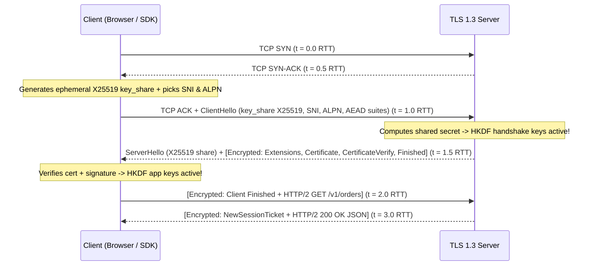
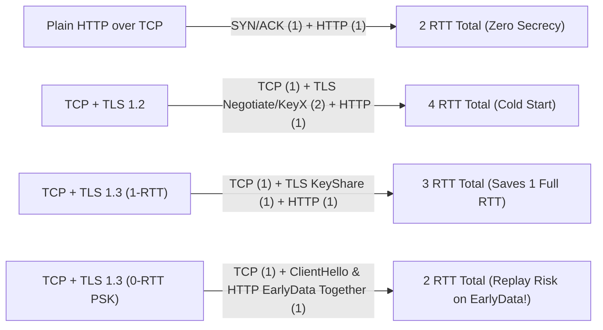
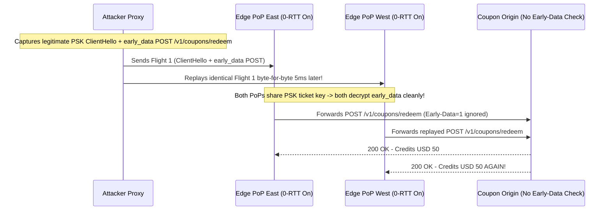

# Lesson 21: The TLS 1.3 Handshake Step by Step

> **Prerequisites:** [Lesson 20: Why Encryption, Public and Private Keys](../20-why-encryption-public-and-private-keys/README.md), [Lesson 09: TCP Three-Way Handshake](../09-tcp-three-way-handshake/README.md), and [Networking From Zero Overview](../README.md) (Lesson 21 of 30).  
> **Estimated Reading Time:** 25 minutes  
> **Target Audience:** Backend, SRE, and security engineers optimizing HTTPS tail latency, configuring TLS 1.3 servers and clients, auditing cipher suites, and guarding APIs against `0-RTT` replay attacks.  
> **Free PDF Notes:** [Download SD-N-021.pdf](https://backendroadmap.com/notes/system-design/SD-N-021.pdf)

> [!TIP]
> **The Golden Rule of TLS 1.3:** By guessing an ephemeral `X25519` `key_share` directly inside `ClientHello`, TLS 1.3 completes key agreement in **`1` RTT** instead of TLS 1.2's **`2` RTTs**, encrypts certificates and `ALPN` right after `ServerHello`, and restricts ciphers strictly to `AEAD` (`AES-GCM` / `ChaCha20-Poly1305`) with mandatory **forward secrecy**. While session resumption (`PSK`) also enables **`0-RTT` early data**, `0-RTT` lacks replay protection—so proxies and origins must reject non-idempotent `POST` requests carrying early data with **`425 Too Early`**.

---

## Words You'll Meet Today

| Word | In Plain Words | Role in a Live Backend System |
| :--- | :--- | :--- |
| **`ClientHello`** | The client's opening TLS message. | Announces TLS 1.3 support, `AEAD` suites, `SNI`, `ALPN`, and an upfront `key_share` guess. |
| **`key_share` (`X25519`)** | Client's ephemeral public half of the key exchange sent early. | Eliminates a full round trip by letting the server compute the shared secret immediately. |
| **`SNI` (Server Name Indication)** | Clear-text hostname inside `ClientHello`. | Tells a shared IP terminator (`Nginx`/`CDN`) which domain certificate to load. |
| **`ALPN` (Application-Layer Protocol)** | Negotiates HTTP/2 vs. HTTP/1.1 during the handshake. | Saves an HTTP upgrade round trip (`h2` vs `http/1.1`) before any request runs. |
| **`CertificateVerify`** | A live signature over the entire handshake transcript. | Proves the server holds the certificate's private key right now, defeating replay. |
| **`HKDF` (Key Schedule)** | Key-derivation recipe turning raw secrets into traffic keys. | Splits ephemeral `ECDHE` entropy into isolated handshake and application keys. |
| **`AEAD` cipher** | Authenticated Encryption (`AES-GCM`, `ChaCha20-Poly1305`). | Protects both secrecy and tamper integrity in one fast pass; mandatory in TLS 1.3. |
| **`0-RTT` (`PSK` Early Data)** | Sending encrypted HTTP bytes inside the very first packet. | Cuts TLS setup to zero RTTs on repeat visits, at the cost of **replay vulnerability**. |

---

## Visual Mental Models & Architecture

### The Question: Why Did Turning Off TLS 1.2 Drop Mobile API Startup Latency by 100 ms?

In [Lesson 09](../09-tcp-three-way-handshake/README.md) we opened a TCP socket in `1` round trip (`SYN`, `SYN-ACK`, `ACK`). In [Lesson 20](../20-why-encryption-public-and-private-keys/README.md) we saw why HTTPS pairs slow asymmetric cryptography with fast symmetric `AES`. Yet mobile users on `100 ms` RTT links used to wait **`400 ms`** before receiving the first byte of JSON. What was happening inside those extra round trips, and how did TLS 1.3 (`RFC 8446`) eliminate an entire round trip while actually strengthening security?

### An Everyday Picture First: Sending Your Key Guess in Envelope #1

Imagine mailing locked instructions across an ocean (`100 ms` round trip):

- **TLS 1.2 (`2` TLS RTTs):** Letter 1 asks *"Which padlock sizes do you support?"* Server mails back *"Let's use X25519, here is my public key and ID card."* Letter 2 mails back *your* public half so both can lock the channel. Only in Letter 3 does your actual HTTP request leave!
- **TLS 1.3 (`1` TLS RTT):** You gamble smartly in Letter 1: *"I speak X25519—here is my public half already! Also I want `api.shop.example` (`SNI`) over HTTP/2 (`ALPN`)."* The server immediately combines your half with its own, **already encrypts** its ID card (`Certificate`) and signature (`CertificateVerify`) in the very first reply, and your HTTP request rides immediately afterward.

### The TLS 1.3 `1-RTT` Handshake Step by Step

1. **TCP 3-Way Handshake (`0.0 -> 1.0 RTT`):** Client sends `SYN`, server replies `SYN-ACK`, client replies `ACK` and piggybacks **`ClientHello`** in the same flight!
2. **Flight 1 — `ClientHello` (`Client -> Server`):**
   - `legacy_version = TLS 1.2 (0x0303)` + **`supported_versions = [TLS 1.3]`**: disguised as 1.2 at the outer byte offset so buggy corporate firewalls don't drop it!
   - `cipher_suites`: only modern **`AEAD`** suites (e.g., `TLS_AES_128_GCM_SHA256`, `TLS_AES_256_GCM_SHA384`, `TLS_CHACHA20_POLY1305_SHA256`).
   - `SNI` (`api.shop.example`), `ALPN` (`h2`, `http/1.1`), `supported_groups` (`x25519`, `secp256r1`), and **`key_share`** (an ephemeral `X25519` public key generated fresh in RAM).
3. **Flight 2 — `ServerHello` + Encrypted Handshake (`Server -> Client`):**
   - `ServerHello` picks the cipher suite and returns the server's own ephemeral `X25519` `key_share`.
   - **Encryption starts right here!** Both sides run **`HKDF`** on `(client_ephemeral, server_ephemeral)` + handshake hash to derive `handshake_traffic_secret`. Everything else in Flight 2 travels **encrypted**:
     - `{EncryptedExtensions}`: confirms selected `ALPN` (`h2`).
     - `{Certificate}`: server's X.509 chain (hidden from Wi-Fi snoopers!).
     - `{CertificateVerify}`: server signs the handshake transcript hash with its static private key.
     - `{Finished}`: HMAC MAC sealing the entire handshake against tampering.
4. **Flight 3 — Client `{Finished}` + Encrypted HTTP Data (`Client -> Server`):**
   - Client verifies the certificate chain (Lesson 22) and `CertificateVerify` signature, derives `application_traffic_secret` via `HKDF`, sends `{Finished}`, and **appends its encrypted `HTTP GET /` inside the very same packet**.

*(Edge case: if the client guessed `X25519` and a strict FIPS server only permits `P-256`, the server sends `HelloRetryRequest`, adding `1` extra RTT so the client sends a `P-256` `key_share`.)*



*Figure 1. Full TCP + TLS 1.3 `1-RTT` handshake timeline: key agreement finishes in a single TLS round trip, encrypting the server's certificate and shipping the first HTTP response by `t = 3.0 RTT` (down from `4.0 RTT` in TLS 1.2).*

### Forward Secrecy, `HKDF`, and Why TLS 1.3 Deleted Legacy Crypto

TLS 1.3 threw away every historically broken algorithm from TLS 1.0–1.2:
- **Removed static `RSA` key transport, `RC4`, `3DES`, `CBC` padding ciphers (`POODLE`/`BEAST`), `SHA-1`, `MD5`, and TLS compression (`CRIME`).**
- **Mandatory Forward Secrecy:** Every fresh TLS 1.3 connection uses ephemeral `(EC)DHE` (`X25519` or `P-256`). Once the socket closes, ephemeral private keys vanish from RAM; stealing the server's static certificate key later *cannot* decrypt yesterday's captures.
- **Pure `AEAD` Encryption + `HKDF` Key Schedule:** `HKDF` (`HMAC-based Key Derivation Function`) separates keys cryptographically into handshake keys, client-to-server application keys, and server-to-client application keys—plus supports `KeyUpdate` rotation on long-lived streams. `AES-GCM` excels on servers with AES-NI hardware instructions, while `ChaCha20-Poly1305` runs faster on low-power ARM phones lacking AES hardware.



*Figure 2. Total cold-start round trips to first HTTP response byte across protocols: TLS 1.3 saves a full RTT on every cold TLS connection, while `0-RTT` overlaps TLS and HTTP at the price of anti-replay protection.*

### Session Resumption (`PSK`) and the `0-RTT` Replay Attack Danger

After a `1-RTT` handshake completes, the server sends an encrypted **`NewSessionTicket`** binding a **Pre-Shared Key (`PSK`)**. On the next visit, the client has two choices:
1. **`1-RTT PSK + ECDHE` (Recommended Default):** Client skips certificate verification and mixes the `PSK` with a fresh `X25519` `key_share`. **Forward secrecy and replay protection stay 100% intact.**
2. **`0-RTT Early Data`:** Client derives an early key from the `PSK` *alone* and blasts encrypted HTTP requests inside Flight 1 **alongside `ClientHello`**—before receiving *any* fresh randomness from the server!

**Why `0-RTT` Is Dangerous for Non-Idempotent Requests:**
Because no fresh `ServerHello` entropy was mixed into `early_data`, an active attacker (or a flakey mobile proxy retrying packets) can record Flight 1 (`ClientHello + early_data`) and **replay that exact encrypted blob `N` times** across any edge PoP holding the same ticket encryption key! If `early_data` contained `POST /v1/transfers`, the server executes the transfer twice or ten times cleanly as valid TLS!

Per **`RFC 8470`**, TLS proxies enabling `0-RTT` must tag forwarded early requests with `Early-Data: 1`, and origins MUST **reject non-idempotent methods (`POST`, state-mutating `PATCH`, payments) with HTTP `425 Too Early`**, forcing the client to wait `1` RTT and resend safely after `{Finished}`.

---

## Systematic Reference & Comparison Grid

### TLS 1.2 vs. TLS 1.3 Comparison

| Capability / Property | TLS 1.2 (Legacy Standard) | TLS 1.3 (`RFC 8446`) | Engineering Consequence |
| :--- | :--- | :--- | :--- |
| **Cold Handshake Latency** | `2` RTTs (`4` RTTs with TCP + HTTP) | **`1` RTT** (`3` RTTs with TCP + HTTP) | Cuts `~50–150 ms` per cold mobile/WAN connection |
| **Key Exchange Guess** | Negotiated first, exchanged in RTT 2 | `key_share` (`X25519`) sent in `ClientHello` | `HelloRetryRequest` only if server lacks guessed curve |
| **Server Certificate Privacy** | **Sent in cleartext** | **Encrypted** (after `ServerHello`) | Prevents passive network sniffing of internal service certs |
| **Forward Secrecy** | Optional (static `RSA` allowed!) | **Mandatory** (`ECDHE` / `DHE` only) | Stolen static key cannot decrypt recorded traffic |
| **Allowed Cipher Suites** | Hundreds (including weak `CBC`/`RC4`) | **5 `AEAD` suites only** (`AES-GCM` / `ChaCha20`) | Eliminates padding oracles and downgrade guesswork |
| **Session Resumption** | Session IDs / Tickets (`1` RTT) | `PSK` (`1` RTT) + optional **`0-RTT` Early Data** | Must gate `0-RTT` with `425 Too Early` for non-idempotent routes |

### Cold-Start Latency Math ($80\text{ ms}$ Mobile RTT Example)

For a client on a mobile link with $\text{RTT} = 80\text{ ms}$:

$$T_{\text{TLS 1.2}} = (1_{\text{TCP}} + 2_{\text{TLS}} + 1_{\text{HTTP}}) \times 80\text{ ms} = 320\text{ ms}$$

$$T_{\text{TLS 1.3 (1-RTT)}} = (1_{\text{TCP}} + 1_{\text{TLS}} + 1_{\text{HTTP}}) \times 80\text{ ms} = 240\text{ ms}\; (-25\%)$$

$$T_{\text{TLS 1.3 (0-RTT PSK)}} = (1_{\text{TCP}} + 0_{\text{TLS}} + 1_{\text{HTTP}}) \times 80\text{ ms} = 160\text{ ms}\; (-50\%)$$

*(Note: TLS `CipherSuites` in RFC 8446 define symmetric + hash primitives only—key exchange `X25519`/`P-256` and auth `ECDSA`/`RSA-PSS` are negotiated separately via extensions!)*

| TLS 1.3 Cipher / Extension | Wire Name / Role | When Preferred |
| :--- | :--- | :--- |
| **`TLS_AES_128_GCM_SHA256`** | `128`-bit `AEAD` + `SHA-256` `HKDF` | Default fast suite on x86/ARM hardware with AES acceleration |
| **`TLS_AES_256_GCM_SHA384`** | `256`-bit `AEAD` + `SHA-384` `HKDF` | Compliance environments mandating 256-bit symmetric keys |
| **`TLS_CHACHA20_POLY1305_SHA256`** | Stream `AEAD` (`256`-bit key) | Low-power mobile/IoT CPUs lacking hardware AES-NI |
| **`server_name` (`SNI`)** | Cleartext target hostname | Required for virtual-hosted multi-domain TLS termination |
| **`application_layer_protocol_negotiation`** | `ALPN` (`h2`, `http/1.1`) | Selects HTTP/2 multiplexing inside `ClientHello` without extra RTT |

---

## Production War Story Post-Mortem: Promo Code Drained via `0-RTT` Early-Data Replay

- **Severity:** SEV-1 (Financial Abuse + Multi-Region Replay Exploit)
- **Detection / Resolution Time:** 11 minutes to disable `0-RTT` globally at CDN edge; 2 hours to implement `425 Too Early` middleware
- **Impact:** To shave `60 ms` off mobile API latency, platform engineers toggled `ssl_early_data on` across 18 Anycast edge nodes sharing a `NewSessionTicket` key. Within days, an attacker captured a single `ClientHello + early_data (POST /v1/coupons/redeem)` packet and replayed it simultaneously across 4 regional edge PoPs—redeeming single-use `USD 50` promo credits `312` times before fraud alerts fired.

### What Happened



### Root Cause Analysis

1. **Multi-PoP Anti-Replay Gap:** Single-instance strike registers cannot synchronize `0-RTT` replay caches globally within `5 ms`, so replaying `ClientHello + early_data` across geographically separate PoPs bypassed local anti-replay memory.
2. **Forwarding `0-RTT` on State-Mutating `POST`:** The edge proxy forwarded `early_data` for *every* HTTP method without checking idempotency, and the origin ignored the `Early-Data: 1` header completely.

### The Fix & Architectural Hardening

- **Method-Strict `0-RTT` Gate (`425 Too Early`):** Configured edge proxies to permit `0-RTT` early data *exclusively* for safe read-only `GET`/`HEAD` requests, immediately returning **`425 Too Early`** (`RFC 8470`) to any `POST`, `PUT`, `PATCH`, or `DELETE` arriving inside `0-RTT` (and enforcing `Early-Data: 1` rejection in origin middleware as defense-in-depth).
- **Ticket Key Rotation:** Shortened `NewSessionTicket` encryption key lifetime to `2` hours with automatic rotation across edge nodes.

---

## Multi-Language Production Implementation

Below is a production-structured **Strict TLS 1.3 Server & Client Inspector** enforcing `TLS 1.3` minimum, explicit `ALPN` (`h2`, `http/1.1`), `SNI`, modern `X25519` + `AEAD` preferences, and inspecting the negotiated TLS version, cipher suite, and `ALPN` protocol across Go, TypeScript, Python, and C#.

````carousel
```go
package tlsstrict

import (
	"crypto/tls"
	"fmt"
	"net/http"
)

func StrictTLS13ServerConfig(cert tls.Certificate) *tls.Config {
	return &tls.Config{
		MinVersion:               tls.VersionTLS13, // Disables TLS 1.0/1.1/1.2 completely
		Certificates:             []tls.Certificate{cert},
		NextProtos:               []string{"h2", "http/1.1"}, // ALPN negotiation
		CurvePreferences:         []tls.CurveID{tls.X25519, tls.CurveP256},
		PreferServerCipherSuites: true,
	}
}

func RejectEarlyDataMiddleware(next http.Handler) http.Handler {
	return http.HandlerFunc(func(w http.ResponseWriter, r *http.Request) {
		// RFC 8470: reject non-safe methods arriving over 0-RTT early data
		if r.Header.Get("Early-Data") == "1" && r.Method != http.MethodGet && r.Method != http.MethodHead {
			http.Error(w, "0-RTT replay guard: retry after handshake", http.StatusTooEarly) // 425
			return
		}
		next.ServeHTTP(w, r)
	})
}

func InspectTLSConnection(hostPort, sni string) (string, error) {
	conn, err := tls.Dial("tcp", hostPort, &tls.Config{
		MinVersion: tls.VersionTLS13,
		ServerName: sni,
		NextProtos: []string{"h2", "http/1.1"},
	})
	if err != nil {
		return "", err
	}
	defer conn.Close()

	cs := conn.ConnectionState()
	return fmt.Sprintf("version=0x%x cipher=%s alpn=%s sni=%s resumed=%v",
		cs.Version, tls.CipherSuiteName(cs.CipherSuite), cs.NegotiatedProtocol, cs.ServerName, cs.DidResume), nil
}
```
<!-- slide -->
```typescript
import tls from "node:tls";
import type { SecureContextOptions } from "node:tls";

export function strictTls13Options(certPem: string, keyPem: string): tls.TlsOptions & SecureContextOptions {
  return {
    cert: certPem,
    key: keyPem,
    minVersion: "TLSv1.3",
    maxVersion: "TLSv1.3",
    ALPNProtocols: ["h2", "http/1.1"],
    ecdhCurve: "X25519:P-256",
  };
}

export function inspectTls13Endpoint(host: string, port = 443): Promise<Record<string, unknown>> {
  return new Promise((resolve, reject) => {
    const socket = tls.connect(
      {
        host,
        port,
        servername: host, // Explicit SNI
        minVersion: "TLSv1.3",
        ALPNProtocols: ["h2", "http/1.1"],
      },
      () => {
        const info = {
          authorized: socket.authorized,
          protocol: socket.getProtocol(), // "TLSv1.3"
          cipher: socket.getCipher(),
          alpn: socket.alpnProtocol,      // "h2" or "http/1.1"
          ephemeralKey: socket.getEphemeralKeyInfo(),
        };
        socket.end();
        resolve(info);
      }
    );
    socket.on("error", reject);
  });
}
```
<!-- slide -->
```python
import socket
import ssl


def build_strict_tls13_context() -> ssl.SSLContext:
    ctx = ssl.SSLContext(ssl.PROTOCOL_TLS_CLIENT)
    ctx.load_default_certs()
    ctx.minimum_version = ssl.TLSVersion.TLSv1_3  # Forbid TLS <= 1.2
    ctx.set_alpn_protocols(["h2", "http/1.1"])
    ctx.check_hostname = True
    ctx.verify_mode = ssl.CERT_REQUIRED
    return ctx


def inspect_tls13(host: str, port: int = 443) -> dict[str, object]:
    ctx = build_strict_tls13_context()
    with socket.create_connection((host, port), timeout=5.0) as tcp_sock:
        with ctx.wrap_socket(tcp_sock, server_hostname=host) as tls_sock:  # SNI
            return {
                "version": tls_sock.version(),                 # "TLSv1.3"
                "cipher": tls_sock.cipher(),                   # ("TLS_AES_256_GCM_SHA384", ...)
                "alpn": tls_sock.selected_alpn_protocol(),     # "h2"
                "reused_session": tls_sock.session_reused,
            }
```
<!-- slide -->
```csharp
using System;
using System.Collections.Generic;
using System.Net.Security;
using System.Net.Sockets;
using System.Security.Authentication;
using System.Threading.Tasks;

public static class StrictTls13Client
{
    public static async Task<string> InspectAsync(string host, int port = 443)
    {
        using var tcp = new TcpClient();
        await tcp.ConnectAsync(host, port);

        await using var ssl = new SslStream(tcp.GetStream(), leaveInnerStreamOpen: false);
        var options = new SslClientAuthenticationOptions
        {
            TargetHost = host, // Sets SNI & validates SAN
            EnabledSslProtocols = SslProtocols.Tls13, // Enforce TLS 1.3 only
            ApplicationProtocols = new List<SslApplicationProtocol>
            {
                SslApplicationProtocol.Http2,
                SslApplicationProtocol.Http11,
            },
        };

        await ssl.AuthenticateAsClientAsync(options);
        return $"Protocol={ssl.SslProtocol}, Suite={ssl.NegotiatedCipherSuite}, ALPN={ssl.NegotiatedApplicationProtocol}";
    }
}
```
````

---

## Practical Hands-On Verification CLI Workflows

### 1. Inspect Live TLS 1.3 `key_share`, `ALPN`, `SNI`, and `AEAD` Cipher Suite

```bash
openssl s_client -connect cloudflare.com:443 -servername cloudflare.com -tls1_3 -alpn h2 -brief
```

**Expected Output:**

```text
CONNECTION ESTABLISHED
Protocol version: TLSv1.3
Ciphersuite: TLS_AES_256_GCM_SHA384
Peer certificate: CN = cloudflare.com
Hash used: SHA256
Signature type: ECDSA
Server Temp Key: X25519, 253 bits
ALPN protocol: h2
```

Notice `Server Temp Key: X25519, 253 bits` (forward-secret ephemeral key share) and `ALPN protocol: h2` negotiated inside the single TLS 1.3 round trip!

### 2. Measure TCP vs. TLS vs. First-Byte Timing with `curl`

```bash
curl -sS -o /dev/null --tlsv1.3 -w "tcp=%{time_connect}s tls=%{time_appconnect}s ttfb=%{time_starttransfer}s\n" https://example.com/
```

**Expected Output:**

```text
tcp=0.028140s tls=0.057890s ttfb=0.086910s
```

Look closely at the timestamps: `0.028 s` for TCP `1` RTT, `+0.029 s` (`0.057 s`) for TLS 1.3 `1` RTT, and `+0.029 s` (`0.086 s`) for the HTTP response `1` RTT—exact `1 + 1 + 1 = 3` RTT math in real milliseconds!

### 3. Verify `PSK` Session Resumption Across Two Connections

```bash
openssl s_client -connect example.com:443 -tls1_3 -sess_out /tmp/tls.sess -ign_eof < /dev/null >/dev/null && \
openssl s_client -connect example.com:443 -tls1_3 -sess_in /tmp/tls.sess -brief < /dev/null
```

**Expected Output:**

```text
Reused, TLSv1.3, Cipher is TLS_AES_256_GCM_SHA384
```

`Reused, TLSv1.3` confirms `PSK` session ticket resumption skipped re-transmitting the certificate chain.

---

## Pause and Think

> [!exercise] Suppose an attacker records the very first TLS packet (`ClientHello`) when your phone resumes a TLS 1.3 `0-RTT` connection to transfer `USD 1,000` (`POST /v1/transfers`). Even though the payload is encrypted with `AES-256-GCM` and the attacker *cannot read or modify a single byte*, how can they still steal money—and what HTTP status code should the server return to prevent it? Decide before you open the answer.

<details><summary>Answer</summary>

The attacker doesn't need to read or decrypt the `AES-GCM` ciphertext—they simply **replay the exact captured TCP/TLS Flight 1 packet** (`ClientHello + early_data`) to your edge servers 5 or 10 times! Because `0-RTT` derives keys from the cached `PSK` *before* mixing in fresh server randomness, every edge PoP decrypts the replayed `POST /v1/transfers` as genuine.

The fix: servers must inspect `0-RTT` state (`Early-Data: 1`) and reject non-idempotent routes like `POST` with **`425 Too Early`** (`RFC 8470`), forcing the client to complete the `1-RTT` handshake before sending the transfer.

</details>

---

## Operational Validation Checkpoints

<details><summary><strong>Checkpoint 1: Why `ClientHello` Still Claims TLS 1.2 Inside Its Legacy Field</strong></summary>

**Scenario:** You capture a TLS 1.3 handshake in Wireshark and are confused when the `ClientHello` record header and outer `Version` field say `TLS 1.2 (0x0303)`, yet Wireshark labels the connection `TLSv1.3`. Why does RFC 8446 disguise `ClientHello` this way?

**Solution:**
During TLS 1.3 standardization, thousands of legacy corporate firewalls and load balancers (`middleboxes`) crashed or dropped packets whenever they saw `0x0304` in the legacy `ClientHello.legacy_version` field. To remain compatible with ossified networks, TLS 1.3 sets `legacy_version = 0x0303` (`TLS 1.2`) and places the true version list (`0x0304`) inside the **`supported_versions`** extension!

</details>

<details><summary><strong>Checkpoint 2: Debugging a Sudden 2-RTT TLS 1.3 Handshake (`HelloRetryRequest`)</strong></summary>

**Scenario:** Your enterprise client only accepts `X25519` in its initial `ClientHello` `key_share`, while a compliance-hardened government server permits *only* `NIST P-256` (`secp256r1`). What happens on the wire, and how does it affect latency?

**Solution:**
Because the server cannot compute a shared secret from the client's `X25519` `key_share`, it responds with a **`HelloRetryRequest`** asking the client to resend `ClientHello` with a `secp256r1` `key_share`. That adds **`1` extra RTT**, turning the handshake into `2` RTTs. Clients interacting with mixed-compliance endpoints can mitigate this by sending *both* `X25519` and `P-256` shares (or caching the preferred group per host).

</details>

<details><summary><strong>Checkpoint 3: Auditing `SNI` Visibility vs. Encrypted Certificates</strong></summary>

**Scenario:** A compliance officer audits your TLS 1.3 setup and asks: *"Since TLS 1.3 encrypts the server certificate, can our corporate firewall still inspect which HTTPS hostname an employee is visiting?"* Answer accurately.

**Solution:**
**Yes.** While TLS 1.3 encrypts the server's `Certificate` (hiding internal SAN hostnames inside multi-tenant wildcard certs), the client's **`SNI` (`server_name`)** inside the opening `ClientHello` still travels in **cleartext** so load balancers know which certificate to select before decryption keys exist. (Hiding `SNI` requires **Encrypted Client Hello / `ECH`** paired with encrypted DNS like DoH.)

</details>

---

## Common Mistakes & Troubleshooting

### What Goes Wrong

- **Enabling `0-RTT` globally on API gateways:** Turning on `0-RTT` for performance without rejecting non-idempotent routes (`425 Too Early`) exposes `POST`/`PATCH` APIs to effortless replay attacks across PoPs.
- **Omitting `ALPN` or `SNI` in custom backend clients:** Leaving `ServerName` blank breaks virtual-hosted TLS gateways (`default cert` mismatch), while omitting `ALPN` forces fallback to HTTP/1.1 instead of HTTP/2.
- **Allowing TLS 1.2 fallback to static `RSA` ciphers:** Supporting legacy TLS 1.2 alongside TLS 1.3 without stripping `TLS_RSA_*` re-introduces non-forward-secret key transport via downgrade configurations.

### Common Myths

- **"TLS 1.3 hides the domain name completely from ISPs."** Not by default: `SNI` in `ClientHello` is still unencrypted unless **Encrypted Client Hello (`ECH`)** is configured alongside DoH.
- **"TLS 1.3 `0-RTT` is just faster `1-RTT` with the same security."** False. `0-RTT` gives up **anti-replay guarantees** and forward secrecy on the first flight's early data until `Finished` completes.

| Symptom | Root Cause | Fix |
| :--- | :--- | :--- |
| TLS handshake takes 2 RTTs instead of 1 RTT | Client `key_share` curve rejected -> `HelloRetryRequest` | Include `X25519` (and `P-256` if compliance requires) in `CurvePreferences` |
| Edge gateway rejects `POST` with `425 Too Early` | Client sent non-idempotent `POST` inside `0-RTT` early data | Client retries over full `1-RTT`; disable `0-RTT` on mutation endpoints |
| Connection fails with `no application protocol` or wrong cert | Client omitted `SNI` (`ServerName`) or `ALPN` list | Explicitly set `ServerName` and `ALPNProtocols = ["h2", "http/1.1"]` |

---

## Recap in Three Lines

1. TLS 1.3 cuts cold handshakes from `2` RTTs to **`1` RTT** by sending an ephemeral `X25519` `key_share`, `SNI`, and `ALPN` upfront inside `ClientHello`.
2. Everything after `ServerHello`—including `Certificate`, `CertificateVerify`, and `Finished`—is encrypted and locked by `HKDF`-derived `AEAD` keys with mandatory **forward secrecy**.
3. `PSK` resumption enables **`0-RTT`** early data, which lacks anti-replay safety and must be rejected (`425 Too Early`) on non-idempotent `POST` routes.

---

## Interview Practice Questions

> [!interview] How does TLS 1.3 achieve a 1-RTT handshake compared to TLS 1.2's 2-RTT handshake? (Basic)

<details><summary>What to say in 30 seconds</summary>

In TLS 1.2, the client and server spend one RTT just negotiating algorithms and certificates before exchanging key-agreement messages in a second RTT. In TLS 1.3, the client optimistically guesses a key-exchange curve (typically `X25519`) and sends its ephemeral `key_share` directly inside `ClientHello`. The server immediately responds with `ServerHello` and its own share, derives handshake keys via `HKDF`, and sends an encrypted `Certificate`, `CertificateVerify`, and `Finished` in that same single RTT.

</details>

> [!interview] What security algorithms did TLS 1.3 remove, and why? (Basic)

<details><summary>What to say in 30 seconds</summary>

TLS 1.3 removed static `RSA` key transport (which lacked forward secrecy), static Diffie-Hellman, weak ciphers like `RC4` and `3DES`, `CBC`-mode encryption (vulnerable to padding oracles like `BEAST` and `POODLE`), `SHA-1`/`MD5`, and TLS compression (`CRIME`). Only ephemeral `(EC)DHE` key exchange for mandatory forward secrecy and modern `AEAD` ciphers (`AES-GCM` and `ChaCha20-Poly1305`) remain.

</details>

> [!interview] What is `0-RTT` early data in TLS 1.3, and why is it dangerous for `POST` endpoints? (Scenario)

<details><summary>What to say in 30 seconds</summary>

With `PSK` session resumption, `0-RTT` lets a client encrypt an HTTP request under the resumed ticket key and attach it directly to `ClientHello` before receiving a fresh `ServerHello`. Because no fresh server randomness is mixed into that first flight, an attacker can capture and replay that exact encrypted `ClientHello + early_data` packet multiple times across edge PoPs. Servers must reject non-idempotent requests like `POST` payments arriving in `0-RTT` with `425 Too Early`.

</details>

> [!interview] What is the difference between `SNI` and `ALPN` inside `ClientHello`? (Basic)

<details><summary>What to say in 30 seconds</summary>

`SNI` (Server Name Indication) tells a multi-tenant TLS terminator which domain name the client wants so it picks the right X.509 certificate before encryption keys are established. `ALPN` (Application-Layer Protocol Negotiation) agrees on the higher-level protocol—such as HTTP/2 (`h2`) vs `http/1.1`—inside the TLS handshake itself, avoiding an extra post-handshake upgrade round trip.

</details>

> [!interview] If TLS 1.3 encrypts the server's certificate, what metadata is still visible to a Wi-Fi snooper? (Tricky)

<details><summary>What to say in 30 seconds</summary>

IP addresses, TCP ports, packet sizes and timing, plus the cleartext **`SNI` hostname** in `ClientHello` (unless Encrypted Client Hello / `ECH` is enabled). Encrypting the `Certificate` in Flight 2 still protects internal SAN lists and user/client certificates (`mTLS`) from passive eavesdropping, while URL paths, cookies, and JSON bodies remain completely hidden inside the TLS tunnel.

</details>

> [!interview] What triggers a `HelloRetryRequest` in TLS 1.3, and what does it cost? (Tricky)

<details><summary>What to say in 30 seconds</summary>

It fires when the server supports TLS 1.3 and a compatible group, but the client's optimistic `key_share` guess in `ClientHello` doesn't match the server's allowed curves (for example, the client guessed `X25519` while a FIPS-locked server only allows `P-256`). The server asks the client to retry `ClientHello` with the matching group, costing one extra round trip (`2 RTT` total).

</details>

---

## Free PDF notes

Download these notes as a printable PDF, with the TLS 1.3 handshake timeline, RTT math, and interview answers: [SD-N-021.pdf](https://backendroadmap.com/notes/system-design/SD-N-021.pdf).

---

## Sources

- [RFC 8446: The Transport Layer Security (TLS) Protocol Version 1.3](https://www.rfc-editor.org/rfc/rfc8446), full specification of `1-RTT`, `key_share`, `HKDF`, `AEAD`, and `0-RTT`.
- [RFC 8470: Using Early Data in HTTP](https://www.rfc-editor.org/rfc/rfc8470), `Early-Data: 1` header and `425 Too Early` anti-replay protections.
- [RFC 7301: Transport Layer Security (TLS) Application-Layer Protocol Negotiation (`ALPN`)](https://www.rfc-editor.org/rfc/rfc7301), negotiating `h2` vs `http/1.1` during TLS handshakes.
- [RFC 6066: TLS Extensions (`SNI`)](https://www.rfc-editor.org/rfc/rfc6066), Server Name Indication extension.
- [Cloudflare Blog: A Detailed Look at RFC 8446 (TLS 1.3)](https://blog.cloudflare.com/rfc-8446-aka-tls-1-3/), operational lessons on middlebox compatibility and `0-RTT` tradeoffs.

---

## Next

Next comes [Lesson 22: Certificates and PKI — Why Your Browser Trusts a Site It Has Never Met](../22-certificates-and-pki/README.md): how X.509 certificates, `SAN`s, Intermediate CAs, `ACME`, `OCSP stapling`, and `mTLS` prove identity inside that encrypted TLS 1.3 handshake. See [the track overview](../README.md) for the whole series.
