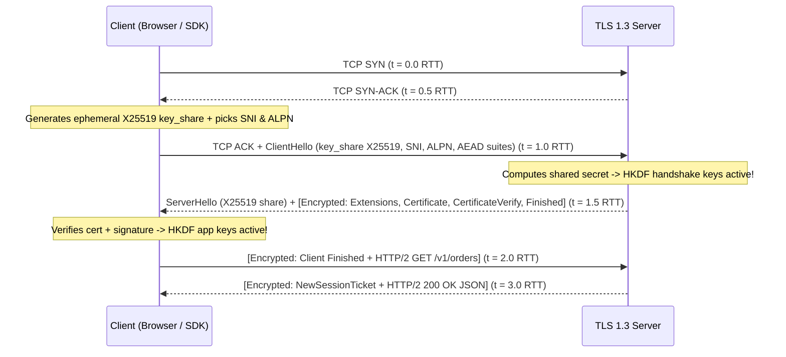
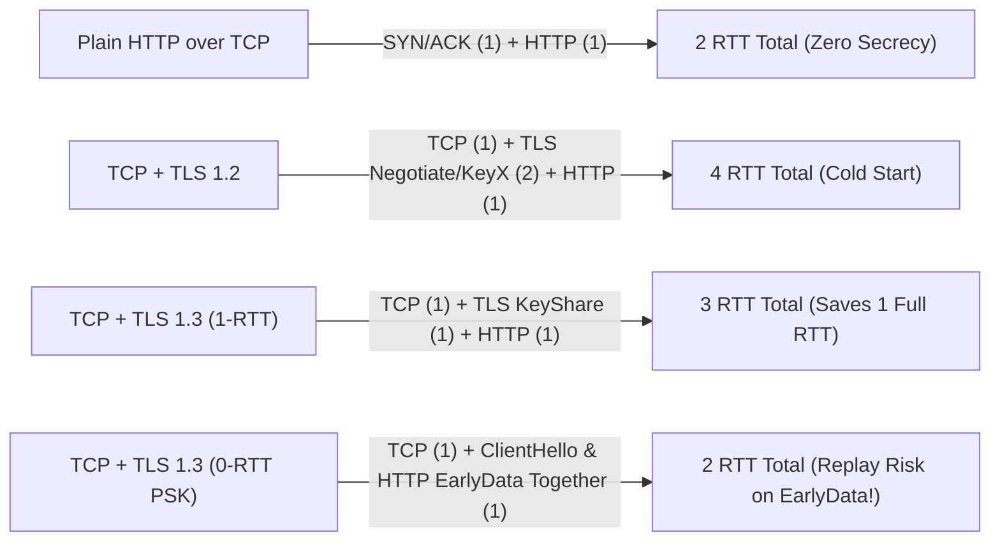
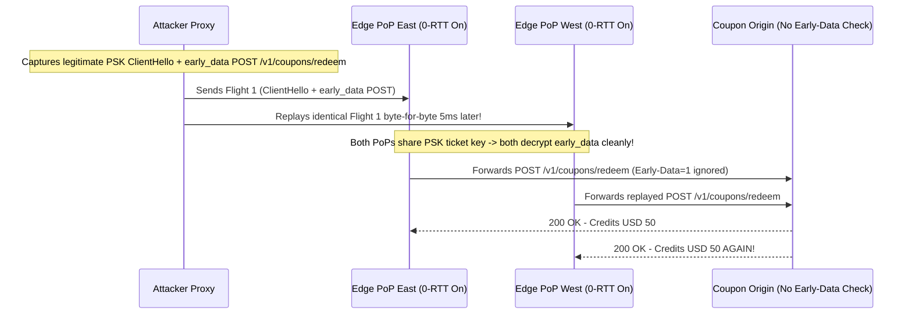

# Lesson 21: The TLS 1.3 Handshake Step by Step

> **Prerequisites:** [Lesson 20: Why Encryption, Public and Private Keys](../20-why-encryption-public-and-private-keys/README.md), [Lesson 09: TCP Three-Way Handshake](../09-tcp-three-way-handshake/README.md), and [Networking From Zero Overview](../README.md) (Lesson 21 of 30).  
> **Estimated Reading Time:** 35 minutes  
> **Target Audience:** Backend, SRE, and security engineers optimizing HTTPS tail latency, configuring TLS 1.3 servers and clients, auditing cipher suites, and guarding APIs against `0-RTT` replay attacks.  
> **Free PDF Notes:** [Download SD-N-021.pdf](https://backendroadmap.com/notes/system-design/SD-N-021.pdf)

> [!NOTE]
> **In one line:** HTTPS is HTTP inside TLS; the TLS 1.3 handshake agrees on fresh secret keys with `ECDHE` and proves the server's identity with a certificate, all in one round trip, then switches to fast symmetric encryption.

> [!TIP]
> **The Golden Rule of TLS 1.3:** By guessing an ephemeral `X25519` `key_share` directly inside `ClientHello`, TLS 1.3 completes key agreement in **`1` RTT** instead of TLS 1.2's **`2` RTTs**, encrypts certificates and `ALPN` right after `ServerHello`, and restricts ciphers strictly to `AEAD` (`AES-GCM` / `ChaCha20-Poly1305`) with mandatory **forward secrecy**. While session resumption (`PSK`) also enables **`0-RTT` early data**, `0-RTT` lacks replay protection—so proxies and origins must reject non-idempotent `POST` requests carrying early data with **`425 Too Early`**.

---

## Words You'll Meet Today

| Word | In Plain Words | Role in a Live Backend System |
| :--- | :--- | :--- |
| **`ClientHello`** | The client's opening TLS message. | Announces TLS 1.3 support, `AEAD` suites, `SNI`, `ALPN`, and an upfront `key_share` guess. |
| **`key_share` (`X25519`)** | Client's ephemeral public half of the key exchange sent early. | Eliminates a full round trip by letting the server compute the shared secret immediately. |
| **`SNI` (Server Name Indication)** | Clear-text hostname inside `ClientHello`. | Tells a shared IP terminator (`Nginx`/`CDN`) which domain certificate to load. |
| **`ALPN` (Application-Layer Protocol)** | Negotiates HTTP/2 vs. HTTP/1.1 during the handshake. | Saves an HTTP upgrade round trip (`h2` vs `http/1.1`) before any request runs. |
| **`CertificateVerify`** | A live signature over the entire handshake transcript. | Proves the server holds the certificate's private key right now, defeating replay. |
| **`HKDF` (Key Schedule)** | Key-derivation recipe turning raw secrets into traffic keys. | Splits ephemeral `ECDHE` entropy into isolated handshake and application keys. |
| **`AEAD` cipher** | Authenticated Encryption (`AES-GCM`, `ChaCha20-Poly1305`). | Protects both secrecy and tamper integrity in one fast pass; mandatory in TLS 1.3. |
| **`0-RTT` (`PSK` Early Data)** | Sending encrypted HTTP bytes inside the very first packet. | Cuts TLS setup to zero RTTs on repeat visits, at the cost of **replay vulnerability**. |

---

## Visual Mental Models & Architecture

### The Question: Why Did Turning Off TLS 1.2 Drop Mobile API Startup Latency by 100 ms?

In [Lesson 09](../09-tcp-three-way-handshake/README.md) we opened a TCP socket in `1` round trip (`SYN`, `SYN-ACK`, `ACK`). In [Lesson 20](../20-why-encryption-public-and-private-keys/README.md) we saw why HTTPS pairs slow asymmetric cryptography with fast symmetric `AES`. Yet mobile users on `100 ms` RTT links used to wait **`400 ms`** before receiving the first byte of JSON. What was happening inside those extra round trips, and how did TLS 1.3 (`RFC 8446`) eliminate an entire round trip while actually strengthening security?

### An Everyday Picture First: Sending Your Key Guess in Envelope #1

Imagine mailing locked instructions across an ocean (`100 ms` round trip):

- **TLS 1.2 (`2` TLS RTTs):** Letter 1 asks *"Which padlock sizes do you support?"* Server mails back *"Let's use X25519, here is my public key and ID card."* Letter 2 mails back *your* public half so both can lock the channel. Only in Letter 3 does your actual HTTP request leave!
- **TLS 1.3 (`1` TLS RTT):** You gamble smartly in Letter 1: *"I speak X25519—here is my public half already! Also I want `api.shop.example` (`SNI`) over HTTP/2 (`ALPN`)."* The server immediately combines your half with its own, **already encrypts** its ID card (`Certificate`) and signature (`CertificateVerify`) in the very first reply, and your HTTP request rides immediately afterward.

### The TLS 1.3 `1-RTT` Handshake Step by Step

1. **TCP 3-Way Handshake (`0.0 -> 1.0 RTT`):** Client sends `SYN`, server replies `SYN-ACK`, client replies `ACK` and piggybacks **`ClientHello`** in the same flight!
2. **Flight 1 — `ClientHello` (`Client -> Server`):**
   - `legacy_version = TLS 1.2 (0x0303)` + **`supported_versions = [TLS 1.3]`**: disguised as 1.2 at the outer byte offset so buggy corporate firewalls don't drop it!
   - `cipher_suites`: only modern **`AEAD`** suites (e.g., `TLS_AES_128_GCM_SHA256`, `TLS_AES_256_GCM_SHA384`, `TLS_CHACHA20_POLY1305_SHA256`).
   - `SNI` (`api.shop.example`), `ALPN` (`h2`, `http/1.1`), `supported_groups` (`x25519`, `secp256r1`), and **`key_share`** (an ephemeral `X25519` public key generated fresh in RAM).
3. **Flight 2 — `ServerHello` + Encrypted Handshake (`Server -> Client`):**
   - `ServerHello` picks the cipher suite and returns the server's own ephemeral `X25519` `key_share`.
   - **Encryption starts right here!** Both sides run **`HKDF`** on `(client_ephemeral, server_ephemeral)` + handshake hash to derive `handshake_traffic_secret`. Everything else in Flight 2 travels **encrypted**:
     - `{EncryptedExtensions}`: confirms selected `ALPN` (`h2`).
     - `{Certificate}`: server's X.509 chain (hidden from Wi-Fi snoopers!).
     - `{CertificateVerify}`: server signs the handshake transcript hash with its static private key.
     - `{Finished}`: HMAC MAC sealing the entire handshake against tampering.
4. **Flight 3 — Client `{Finished}` + Encrypted HTTP Data (`Client -> Server`):**
   - Client verifies the certificate chain (Lesson 22) and `CertificateVerify` signature, derives `application_traffic_secret` via `HKDF`, sends `{Finished}`, and **appends its encrypted `HTTP GET /` inside the very same packet**.

*(Edge case: if the client guessed `X25519` and a strict FIPS server only permits `P-256`, the server sends `HelloRetryRequest`, adding `1` extra RTT so the client sends a `P-256` `key_share`.)*



*Figure 1. Full TCP + TLS 1.3 `1-RTT` handshake timeline: key agreement finishes in a single TLS round trip, encrypting the server's certificate and shipping the first HTTP response by `t = 3.0 RTT` (down from `4.0 RTT` in TLS 1.2).*

### Forward Secrecy, `HKDF`, and Why TLS 1.3 Deleted Legacy Crypto

TLS 1.3 threw away every historically broken algorithm from TLS 1.0–1.2:
- **Removed static `RSA` key transport, `RC4`, `3DES`, `CBC` padding ciphers (`POODLE`/`BEAST`), `SHA-1`, `MD5`, and TLS compression (`CRIME`).**
- **Mandatory Forward Secrecy:** Every fresh TLS 1.3 connection uses ephemeral `(EC)DHE` (`X25519` or `P-256`). Once the socket closes, ephemeral private keys vanish from RAM; stealing the server's static certificate key later *cannot* decrypt yesterday's captures.
- **Pure `AEAD` Encryption + `HKDF` Key Schedule:** `HKDF` (`HMAC-based Key Derivation Function`) separates keys cryptographically into handshake keys, client-to-server application keys, and server-to-client application keys—plus supports `KeyUpdate` rotation on long-lived streams. `AES-GCM` excels on servers with AES-NI hardware instructions, while `ChaCha20-Poly1305` runs faster on low-power ARM phones lacking AES hardware.



*Figure 2. Total cold-start round trips to first HTTP response byte across protocols: TLS 1.3 saves a full RTT on every cold TLS connection, while `0-RTT` overlaps TLS and HTTP at the price of anti-replay protection.*

### Session Resumption (`PSK`) and the `0-RTT` Replay Attack Danger

After a `1-RTT` handshake completes, the server sends an encrypted **`NewSessionTicket`** binding a **Pre-Shared Key (`PSK`)**. On the next visit, the client has two choices:
1. **`1-RTT PSK + ECDHE` (Recommended Default):** Client skips certificate verification and mixes the `PSK` with a fresh `X25519` `key_share`. **Forward secrecy and replay protection stay 100% intact.**
2. **`0-RTT Early Data`:** Client derives an early key from the `PSK` *alone* and blasts encrypted HTTP requests inside Flight 1 **alongside `ClientHello`**—before receiving *any* fresh randomness from the server!

**Why `0-RTT` Is Dangerous for Non-Idempotent Requests:**
Because no fresh `ServerHello` entropy was mixed into `early_data`, an active attacker (or a flakey mobile proxy retrying packets) can record Flight 1 (`ClientHello + early_data`) and **replay that exact encrypted blob `N` times** across any edge PoP holding the same ticket encryption key! If `early_data` contained `POST /v1/transfers`, the server executes the transfer twice or ten times cleanly as valid TLS!

Per **`RFC 8470`**, TLS proxies enabling `0-RTT` must tag forwarded early requests with `Early-Data: 1`, and origins MUST **reject non-idempotent methods (`POST`, state-mutating `PATCH`, payments) with HTTP `425 Too Early`**, forcing the client to wait `1` RTT and resend safely after `{Finished}`.

---

## Systematic Reference & Comparison Grid

### TLS 1.2 vs. TLS 1.3 Comparison

| Capability / Property | TLS 1.2 (Legacy Standard) | TLS 1.3 (`RFC 8446`) | Engineering Consequence |
| :--- | :--- | :--- | :--- |
| **Cold Handshake Latency** | `2` RTTs (`4` RTTs with TCP + HTTP) | **`1` RTT** (`3` RTTs with TCP + HTTP) | Cuts `~50–150 ms` per cold mobile/WAN connection |
| **Key Exchange Guess** | Negotiated first, exchanged in RTT 2 | `key_share` (`X25519`) sent in `ClientHello` | `HelloRetryRequest` only if server lacks guessed curve |
| **Server Certificate Privacy** | **Sent in cleartext** | **Encrypted** (after `ServerHello`) | Prevents passive network sniffing of internal service certs |
| **Forward Secrecy** | Optional (static `RSA` allowed!) | **Mandatory** (`ECDHE` / `DHE` only) | Stolen static key cannot decrypt recorded traffic |
| **Allowed Cipher Suites** | Hundreds (including weak `CBC`/`RC4`) | **5 `AEAD` suites only** (`AES-GCM` / `ChaCha20`) | Eliminates padding oracles and downgrade guesswork |
| **Session Resumption** | Session IDs / Tickets (`1` RTT) | `PSK` (`1` RTT) + optional **`0-RTT` Early Data** | Must gate `0-RTT` with `425 Too Early` for non-idempotent routes |

### Cold-Start Latency Math ($80\text{ ms}$ Mobile RTT Example)

For a client on a mobile link with $\text{RTT} = 80\text{ ms}$:

$$T_{\text{TLS 1.2}} = (1_{\text{TCP}} + 2_{\text{TLS}} + 1_{\text{HTTP}}) \times 80\text{ ms} = 320\text{ ms}$$

$$T_{\text{TLS 1.3 (1-RTT)}} = (1_{\text{TCP}} + 1_{\text{TLS}} + 1_{\text{HTTP}}) \times 80\text{ ms} = 240\text{ ms}\; (-25\%)$$

$$T_{\text{TLS 1.3 (0-RTT PSK)}} = (1_{\text{TCP}} + 0_{\text{TLS}} + 1_{\text{HTTP}}) \times 80\text{ ms} = 160\text{ ms}\; (-50\%)$$

*(Note: TLS `CipherSuites` in RFC 8446 define symmetric + hash primitives only—key exchange `X25519`/`P-256` and auth `ECDSA`/`RSA-PSS` are negotiated separately via extensions!)*

| TLS 1.3 Cipher / Extension | Wire Name / Role | When Preferred |
| :--- | :--- | :--- |
| **`TLS_AES_128_GCM_SHA256`** | `128`-bit `AEAD` + `SHA-256` `HKDF` | Default fast suite on x86/ARM hardware with AES acceleration |
| **`TLS_AES_256_GCM_SHA384`** | `256`-bit `AEAD` + `SHA-384` `HKDF` | Compliance environments mandating 256-bit symmetric keys |
| **`TLS_CHACHA20_POLY1305_SHA256`** | Stream `AEAD` (`256`-bit key) | Low-power mobile/IoT CPUs lacking hardware AES-NI |
| **`server_name` (`SNI`)** | Cleartext target hostname | Required for virtual-hosted multi-domain TLS termination |
| **`application_layer_protocol_negotiation`** | `ALPN` (`h2`, `http/1.1`) | Selects HTTP/2 multiplexing inside `ClientHello` without extra RTT |

---

## Core Definition & Taxonomic Comparison

**HTTPS is plain HTTP carried inside a TLS connection (port `443`), and the TLS 1.3 handshake is the short negotiation that creates that connection.** Inside one round trip it agrees on fresh keys with ephemeral Diffie-Hellman, proves the server's identity with a certificate and a live signature, and then switches to fast symmetric encryption. TLS adds exactly three guarantees: **confidentiality** (nobody can read it), **integrity** (nobody can change a byte unnoticed), and **authentication** (the server proves who it is). What it is not: TLS does not hide the destination (`IP`, `SNI`), does not protect data once a proxy decrypts it, and does not make a vulnerable application safe.

| Term | Precise Meaning | Production Example |
| :--- | :--- | :--- |
| **SSL** vs. **TLS** vs. **HTTPS** vs. **mTLS** | `SSL` is the obsolete ancestor (SSL 3.0 is broken); `TLS` is the protocol (1.2/1.3 are in use); `HTTPS` = HTTP over TLS; `mTLS` = *both* sides present certificates. | Browser to site: TLS 1.3 HTTPS. Service to service in a mesh: mTLS with SPIFFE identities. |
| **Full handshake** vs. **`PSK` resumption** vs. **`0-RTT`** | Full: certificate + signature, `1` TLS RTT. Resumption: reuse a ticket as a pre-shared key, skip certificate work, **still `1` RTT** with fresh `ECDHE`. `0-RTT`: data in the first flight, replayable. | First app launch (full); next launch (`PSK`); a `GET /feed` (`0-RTT`, only if idempotent). |
| **Cleartext** vs. **encrypted** handshake messages | In TLS 1.3 only `ClientHello` and `ServerHello` are cleartext; `EncryptedExtensions`, `Certificate`, `CertificateVerify`, `Finished` are encrypted under handshake keys. | Wi-Fi snoopers see `SNI` and the key shares, but not the certificate or `ALPN` choice. |
| **Terminate + re-encrypt** vs. **passthrough** vs. **offload** | *Terminate + re-encrypt*: LB holds the public cert, reads HTTP, opens a second TLS connection to backends. *Passthrough*: L4 LB forwards raw encrypted bytes; backends terminate. *Offload*: LB decrypts and sends **plain** HTTP inside. | Path-based routing + PCI scope: terminate + re-encrypt. End-to-end encryption, no HTTP routing: passthrough. Offload is a zero-trust anti-pattern. |
| **Key exchange** vs. **authentication** vs. **bulk cipher** | Three independent jobs: `X25519` agrees keys; `ECDSA`/`RSA-PSS` + certificate authenticates; `AES-GCM`/`ChaCha20` encrypts data. TLS 1.3 *cipher suites* name only the last one (+ hash). | `TLS_AES_128_GCM_SHA256` says nothing about the curve; that is negotiated in `supported_groups`. |

**Business impact.** The handshake sits on the critical path of every *new* connection: each saved round trip is `20-200 ms` on every cold mobile start, API client launch, and cross-region call. It also determines your compliance posture (forward secrecy, no legacy ciphers) and your replay exposure when `0-RTT` is enabled.

---

## Component Anatomy & The Observability Gap

### Anatomy of the Three Flights

```text
 CLIENT                                                                                       SERVER
   │  TCP SYN ─────────────────────────────────────────────────────────────────────────────────>│
   │<─────────────────────────────────────────────────────────────────────────────── SYN-ACK    │   (1 RTT: TCP)
   │  ACK + FLIGHT 1  [ClientHello  ~300-600 B  CLEARTEXT]                                       │
   │     legacy_version 0x0303 | supported_versions [TLS1.3] | cipher_suites (AEAD only)         │
   │     SNI | ALPN [h2, http/1.1] | supported_groups | key_share X25519 (32 B) | PSK (resume)   │
   │ ───────────────────────────────────────────────────────────────────────────────────────────>│
   │                                  server: HKDF(client_share, server_share, transcript) ──>   │
   │<─ FLIGHT 2  [ServerHello + key_share 32 B  CLEARTEXT]                                       │   (1 RTT: TLS)
   │             {EncryptedExtensions}{Certificate ~1.5-5 KB}{CertificateVerify ~64-256 B}{Finished 32-48 B}
   │     client: verify chain + signature + Finished, derive application keys                    │
   │  FLIGHT 3  {Finished} + {HTTP GET /}   (first request rides in the SAME flight)             │
   │ ───────────────────────────────────────────────────────────────────────────────────────────>│
   │<─ {NewSessionTicket} + {HTTP 200 OK ...}                                                    │   (1 RTT: HTTP)
   Legend: {...} = encrypted with handshake/application traffic keys derived by HKDF
```

**Key schedule (RFC 8446 §7.1):** `PSK -> Early Secret -> (EC)DHE -> Handshake Secret -> Master Secret`, each stage `HKDF-Extract`ed and `HKDF-Expand`ed into separate labelled keys (`client/server handshake traffic`, `client/server application traffic`, `resumption`, `exporter`). Separate keys per direction and per phase mean compromising one never reveals another.

**Record layer:** application data travels in records of up to `2^14 = 16,384` plaintext bytes, each adding `5 B` header + `1 B` inner content type + `16 B` AEAD tag = **`22 B` (`0.13%`)**. A server flight larger than the TCP initial window (`10 x 1,460 = 14,600 B`) costs an extra RTT, so keep chains short (ECDSA leaf, one intermediate).

### The Observability Gap: Where Handshake Cost Hides

| Vantage Point | What It Captures | What It Hides |
| :--- | :--- | :--- |
| **Client timing** (`curl -w time_connect, time_appconnect`; browser `secureConnectionStart` -> `connectEnd`) | TCP, TLS, and TTFB phases separately. | Server CPU cost and why a handshake was slow (RTT vs. CPU vs. retry). |
| **LB / proxy TLS metrics** (`ssl_handshake_total`, `ssl_session_reused`, Envoy `ssl.handshake`, `ssl.fail_verify_*`) | Handshake rate, failure reasons, resumption ratio, negotiated version/cipher. | End-user latency by geography. |
| **HTTP access logs** | Only requests that **completed** the handshake. | **Failed handshakes entirely**: expired cert, no shared cipher, bad `SNI`, protocol mismatch never reach HTTP, so they are invisible to access logs and `5xx` dashboards. |
| **Packet capture** | `ClientHello` contents (`SNI`, groups, `ALPN`), `HelloRetryRequest`, alerts. | Everything after `ServerHello` (encrypted) unless `SSLKEYLOGFILE` is supplied. |
| **Metrics to add** | Handshake p50/p95, resumption ratio (target `> 80%`), `HelloRetryRequest` rate (target `~0`), TLS 1.2 share, `0-RTT` accepted/rejected (`425`) counts, certificate expiry days. | Nothing: they separate "network is slow" from "we pay full handshakes we should not". |

---

## Mathematical Model of Handshake Latency, CPU & Replay Exposure

### 1. Time to First Byte on a Cold Connection

$$T_{\text{TTFB}} = (N_{\text{TCP}} + N_{\text{TLS}} + N_{\text{HTTP}}) \times \text{RTT} + T_{\text{server}}$$

| Protocol Stack | $N_{\text{TCP}}$ | $N_{\text{TLS}}$ | $N_{\text{HTTP}}$ | Total RTTs |
| :--- | :--- | :--- | :--- | :--- |
| Plain HTTP | `1` | `0` | `1` | `2` |
| TCP + TLS 1.2 | `1` | `2` | `1` | **`4`** |
| TCP + TLS 1.3 (`1-RTT`, full or `PSK`) | `1` | `1` | `1` | **`3`** |
| TCP + TLS 1.3 (`0-RTT`, idempotent only) | `1` | `0` | `1` | **`2`** |
| QUIC / HTTP/3 (`1-RTT`) | `0` | `1` (combined) | `1` | **`2`** |
| QUIC / HTTP/3 (`0-RTT`) | `0` | `0` | `1` | **`1`** |

| RTT | TLS 1.2 (`4x`) | TLS 1.3 (`3x`) | TLS 1.3 `0-RTT` (`2x`) | HTTP/3 (`2x`) | HTTP/3 `0-RTT` (`1x`) |
| :--- | :--- | :--- | :--- | :--- | :--- |
| `20 ms` (same metro) | `80 ms` | `60 ms` | `40 ms` | `40 ms` | `20 ms` |
| `50 ms` (same continent) | `200 ms` | `150 ms` | `100 ms` | `100 ms` | `50 ms` |
| `100 ms` (mobile / cross-ocean) | **`400 ms`** | **`300 ms`** | **`200 ms`** | `200 ms` | `100 ms` |
| `200 ms` (poor mobile / far) | `800 ms` | `600 ms` | `400 ms` | `400 ms` | `200 ms` |

TLS 1.3 saves exactly **one RTT** (`-25%` at `100 ms`); `0-RTT` saves another (`-50%` total) but only for requests that are safe to replay. These figures exclude `T_server` (processing) and TCP slow-start effects.

### 2. Server CPU: Why Certificate Type Matters

Approximate single-core full-handshake capacity (benchmark your own hardware with `openssl speed`): **RSA-2048 certificate `~1,000 handshakes/s`** (the `~1 ms` signature dominates) versus **ECDSA P-256 `~6,000 handshakes/s`**.

$$\text{Cores} = \frac{\text{New connections/s}}{\text{Handshakes/s per core}}$$

| New Connections/s | RSA-2048 Cores | ECDSA P-256 Cores |
| :--- | :--- | :--- |
| `6,000` | `6` | `1` |
| `60,000` | `60` | `10` |
| `600,000` (traffic spike / DDoS) | `600` | `100` |

ECDSA certificates are a `~6x` handshake-CPU saving and also shrink the chain (`~1.5-2 KB` vs `3-5 KB`).

### 3. Bandwidth Saved by Resumption

Resumed `PSK` handshakes omit the certificate chain. At `60,000` new connections/s and a `4 KB` chain:

$$\text{No resumption: } 60{,}000 \times 4\ \text{KB} = 240\ \text{MB/s} \approx 1.9\ \text{Gbps}$$

$$\text{80\% resumption: } 0.2 \times 240 = 48\ \text{MB/s} \approx 0.38\ \text{Gbps}\;\;(-80\%)$$

Resumption also skips signature verification on the client, saving battery on mobile.

### 4. `0-RTT` Replay Exposure

$$\text{Max replays} \approx \begin{cases} P & \text{per-PoP single-use strike register, tickets shared by } P \text{ PoPs} \\ \text{attacker rate} \times W & \text{only a time-window check } (W) \text{ and no strike register} \end{cases}$$

In the war story below, `4` PoPs sharing a ticket key with no global strike register let one captured packet redeem a `USD 50` coupon `312` times: $312 \times 50 = \text{USD } 15{,}600$ from a single recorded `ClientHello`. Anti-replay for `0-RTT` therefore needs *global* single-use state, a very short acceptance window (`~10 s`), a bounded ticket lifetime (RFC 8446 max `7 days`, practical `<= 24 h`, rotating ticket keys every `2 h`), **and** method-level rejection (`425 Too Early` for anything not safe).

### 5. Post-Quantum Hybrid Key Shares (Size Effects)

Hybrid groups such as `X25519MLKEM768` add roughly `1.2 KB` to the `ClientHello` key share (`32 B` X25519 + `1,184 B` ML-KEM-768 public key), pushing it past a single `1,460 B` TCP segment and sometimes triggering middlebox bugs. Handshake **RTT count is unchanged**, but `ClientHello` fragmentation and larger flights are a new thing to watch in captures.

---

## Production War Story Post-Mortem: Promo Code Drained via `0-RTT` Early-Data Replay

- **Severity:** SEV-1 (Financial Abuse + Multi-Region Replay Exploit)
- **Detection / Resolution Time:** 11 minutes to disable `0-RTT` globally at CDN edge; 2 hours to implement `425 Too Early` middleware
- **Impact:** To shave `60 ms` off mobile API latency, platform engineers toggled `ssl_early_data on` across 18 Anycast edge nodes sharing a `NewSessionTicket` key. Within days, an attacker captured a single `ClientHello + early_data (POST /v1/coupons/redeem)` packet and replayed it simultaneously across 4 regional edge PoPs—redeeming single-use `USD 50` promo credits `312` times before fraud alerts fired.

### What Happened



### Root Cause Analysis

1. **Multi-PoP Anti-Replay Gap:** Single-instance strike registers cannot synchronize `0-RTT` replay caches globally within `5 ms`, so replaying `ClientHello + early_data` across geographically separate PoPs bypassed local anti-replay memory.
2. **Forwarding `0-RTT` on State-Mutating `POST`:** The edge proxy forwarded `early_data` for *every* HTTP method without checking idempotency, and the origin ignored the `Early-Data: 1` header completely.

### The Fix & Architectural Hardening

- **Method-Strict `0-RTT` Gate (`425 Too Early`):** Configured edge proxies to permit `0-RTT` early data *exclusively* for safe read-only `GET`/`HEAD` requests, immediately returning **`425 Too Early`** (`RFC 8470`) to any `POST`, `PUT`, `PATCH`, or `DELETE` arriving inside `0-RTT` (and enforcing `Early-Data: 1` rejection in origin middleware as defense-in-depth).
- **Ticket Key Rotation:** Shortened `NewSessionTicket` encryption key lifetime to `2` hours with automatic rotation across edge nodes.

---

## Multi-Language Production Implementation

Below is a production-structured **Strict TLS 1.3 Server & Client Inspector** enforcing `TLS 1.3` minimum, explicit `ALPN` (`h2`, `http/1.1`), `SNI`, modern `X25519` + `AEAD` preferences, and inspecting the negotiated TLS version, cipher suite, and `ALPN` protocol across Go, TypeScript, Python, and C#.

````carousel
```go
package tlsstrict

import (
	"crypto/tls"
	"fmt"
	"net/http"
)

func StrictTLS13ServerConfig(cert tls.Certificate) *tls.Config {
	return &tls.Config{
		MinVersion:               tls.VersionTLS13, // Disables TLS 1.0/1.1/1.2 completely
		Certificates:             []tls.Certificate{cert},
		NextProtos:               []string{"h2", "http/1.1"}, // ALPN negotiation
		CurvePreferences:         []tls.CurveID{tls.X25519, tls.CurveP256},
		PreferServerCipherSuites: true,
	}
}

func RejectEarlyDataMiddleware(next http.Handler) http.Handler {
	return http.HandlerFunc(func(w http.ResponseWriter, r *http.Request) {
		// RFC 8470: reject non-safe methods arriving over 0-RTT early data
		if r.Header.Get("Early-Data") == "1" && r.Method != http.MethodGet && r.Method != http.MethodHead {
			http.Error(w, "0-RTT replay guard: retry after handshake", http.StatusTooEarly) // 425
			return
		}
		next.ServeHTTP(w, r)
	})
}

func InspectTLSConnection(hostPort, sni string) (string, error) {
	conn, err := tls.Dial("tcp", hostPort, &tls.Config{
		MinVersion: tls.VersionTLS13,
		ServerName: sni,
		NextProtos: []string{"h2", "http/1.1"},
	})
	if err != nil {
		return "", err
	}
	defer conn.Close()

	cs := conn.ConnectionState()
	return fmt.Sprintf("version=0x%x cipher=%s alpn=%s sni=%s resumed=%v",
		cs.Version, tls.CipherSuiteName(cs.CipherSuite), cs.NegotiatedProtocol, cs.ServerName, cs.DidResume), nil
}
```
<!-- slide -->
```typescript
import tls from "node:tls";
import type { SecureContextOptions } from "node:tls";

export function strictTls13Options(certPem: string, keyPem: string): tls.TlsOptions & SecureContextOptions {
  return {
    cert: certPem,
    key: keyPem,
    minVersion: "TLSv1.3",
    maxVersion: "TLSv1.3",
    ALPNProtocols: ["h2", "http/1.1"],
    ecdhCurve: "X25519:P-256",
  };
}

export function inspectTls13Endpoint(host: string, port = 443): Promise<Record<string, unknown>> {
  return new Promise((resolve, reject) => {
    const socket = tls.connect(
      {
        host,
        port,
        servername: host, // Explicit SNI
        minVersion: "TLSv1.3",
        ALPNProtocols: ["h2", "http/1.1"],
      },
      () => {
        const info = {
          authorized: socket.authorized,
          protocol: socket.getProtocol(), // "TLSv1.3"
          cipher: socket.getCipher(),
          alpn: socket.alpnProtocol,      // "h2" or "http/1.1"
          ephemeralKey: socket.getEphemeralKeyInfo(),
        };
        socket.end();
        resolve(info);
      }
    );
    socket.on("error", reject);
  });
}
```
<!-- slide -->
```python
import socket
import ssl


def build_strict_tls13_context() -> ssl.SSLContext:
    ctx = ssl.SSLContext(ssl.PROTOCOL_TLS_CLIENT)
    ctx.load_default_certs()
    ctx.minimum_version = ssl.TLSVersion.TLSv1_3  # Forbid TLS <= 1.2
    ctx.set_alpn_protocols(["h2", "http/1.1"])
    ctx.check_hostname = True
    ctx.verify_mode = ssl.CERT_REQUIRED
    return ctx


def inspect_tls13(host: str, port: int = 443) -> dict[str, object]:
    ctx = build_strict_tls13_context()
    with socket.create_connection((host, port), timeout=5.0) as tcp_sock:
        with ctx.wrap_socket(tcp_sock, server_hostname=host) as tls_sock:  # SNI
            return {
                "version": tls_sock.version(),                 # "TLSv1.3"
                "cipher": tls_sock.cipher(),                   # ("TLS_AES_256_GCM_SHA384", ...)
                "alpn": tls_sock.selected_alpn_protocol(),     # "h2"
                "reused_session": tls_sock.session_reused,
            }
```
<!-- slide -->
```csharp
using System;
using System.Collections.Generic;
using System.Net.Security;
using System.Net.Sockets;
using System.Security.Authentication;
using System.Threading.Tasks;

public static class StrictTls13Client
{
    public static async Task<string> InspectAsync(string host, int port = 443)
    {
        using var tcp = new TcpClient();
        await tcp.ConnectAsync(host, port);

        await using var ssl = new SslStream(tcp.GetStream(), leaveInnerStreamOpen: false);
        var options = new SslClientAuthenticationOptions
        {
            TargetHost = host, // Sets SNI & validates SAN
            EnabledSslProtocols = SslProtocols.Tls13, // Enforce TLS 1.3 only
            ApplicationProtocols = new List<SslApplicationProtocol>
            {
                SslApplicationProtocol.Http2,
                SslApplicationProtocol.Http11,
            },
        };

        await ssl.AuthenticateAsClientAsync(options);
        return $"Protocol={ssl.SslProtocol}, Suite={ssl.NegotiatedCipherSuite}, ALPN={ssl.NegotiatedApplicationProtocol}";
    }
}
```
````

---

## Practical Hands-On Verification CLI Workflows

### 1. Inspect Live TLS 1.3 `key_share`, `ALPN`, `SNI`, and `AEAD` Cipher Suite

```bash
openssl s_client -connect cloudflare.com:443 -servername cloudflare.com -tls1_3 -alpn h2 -brief
```

**Expected Output:**

```text
CONNECTION ESTABLISHED
Protocol version: TLSv1.3
Ciphersuite: TLS_AES_256_GCM_SHA384
Peer certificate: CN = cloudflare.com
Hash used: SHA256
Signature type: ECDSA
Server Temp Key: X25519, 253 bits
ALPN protocol: h2
```

Notice `Server Temp Key: X25519, 253 bits` (forward-secret ephemeral key share) and `ALPN protocol: h2` negotiated inside the single TLS 1.3 round trip!

### 2. Measure TCP vs. TLS vs. First-Byte Timing with `curl`

```bash
curl -sS -o /dev/null --tlsv1.3 -w "tcp=%{time_connect}s tls=%{time_appconnect}s ttfb=%{time_starttransfer}s\n" https://example.com/
```

**Expected Output:**

```text
tcp=0.028140s tls=0.057890s ttfb=0.086910s
```

Look closely at the timestamps: `0.028 s` for TCP `1` RTT, `+0.029 s` (`0.057 s`) for TLS 1.3 `1` RTT, and `+0.029 s` (`0.086 s`) for the HTTP response `1` RTT—exact `1 + 1 + 1 = 3` RTT math in real milliseconds!

### 3. Verify `PSK` Session Resumption Across Two Connections

```bash
openssl s_client -connect example.com:443 -tls1_3 -sess_out /tmp/tls.sess -ign_eof < /dev/null >/dev/null && \
openssl s_client -connect example.com:443 -tls1_3 -sess_in /tmp/tls.sess -brief < /dev/null
```

**Expected Output:**

```text
Reused, TLSv1.3, Cipher is TLS_AES_256_GCM_SHA384
```

`Reused, TLSv1.3` confirms `PSK` session ticket resumption skipped re-transmitting the certificate chain.

---

## Pause and Think

> [!exercise] Suppose an attacker records the very first TLS packet (`ClientHello`) when your phone resumes a TLS 1.3 `0-RTT` connection to transfer `USD 1,000` (`POST /v1/transfers`). Even though the payload is encrypted with `AES-256-GCM` and the attacker *cannot read or modify a single byte*, how can they still steal money—and what HTTP status code should the server return to prevent it? Decide before you open the answer.

<details><summary>Answer</summary>

The attacker doesn't need to read or decrypt the `AES-GCM` ciphertext—they simply **replay the exact captured TCP/TLS Flight 1 packet** (`ClientHello + early_data`) to your edge servers 5 or 10 times! Because `0-RTT` derives keys from the cached `PSK` *before* mixing in fresh server randomness, every edge PoP decrypts the replayed `POST /v1/transfers` as genuine.

The fix: servers must inspect `0-RTT` state (`Early-Data: 1`) and reject non-idempotent routes like `POST` with **`425 Too Early`** (`RFC 8470`), forcing the client to complete the `1-RTT` handshake before sending the transfer.

</details>

---

## Operational Validation Checkpoints

<details><summary><strong>Checkpoint 1: Why `ClientHello` Still Claims TLS 1.2 Inside Its Legacy Field</strong></summary>

**Scenario:** You capture a TLS 1.3 handshake in Wireshark and are confused when the `ClientHello` record header and outer `Version` field say `TLS 1.2 (0x0303)`, yet Wireshark labels the connection `TLSv1.3`. Why does RFC 8446 disguise `ClientHello` this way?

**Solution:**
During TLS 1.3 standardization, thousands of legacy corporate firewalls and load balancers (`middleboxes`) crashed or dropped packets whenever they saw `0x0304` in the legacy `ClientHello.legacy_version` field. To remain compatible with ossified networks, TLS 1.3 sets `legacy_version = 0x0303` (`TLS 1.2`) and places the true version list (`0x0304`) inside the **`supported_versions`** extension!

</details>

<details><summary><strong>Checkpoint 2: Debugging a Sudden 2-RTT TLS 1.3 Handshake (`HelloRetryRequest`)</strong></summary>

**Scenario:** Your enterprise client only accepts `X25519` in its initial `ClientHello` `key_share`, while a compliance-hardened government server permits *only* `NIST P-256` (`secp256r1`). What happens on the wire, and how does it affect latency?

**Solution:**
Because the server cannot compute a shared secret from the client's `X25519` `key_share`, it responds with a **`HelloRetryRequest`** asking the client to resend `ClientHello` with a `secp256r1` `key_share`. That adds **`1` extra RTT**, turning the handshake into `2` RTTs. Clients interacting with mixed-compliance endpoints can mitigate this by sending *both* `X25519` and `P-256` shares (or caching the preferred group per host).

</details>

<details><summary><strong>Checkpoint 3: Auditing `SNI` Visibility vs. Encrypted Certificates</strong></summary>

**Scenario:** A compliance officer audits your TLS 1.3 setup and asks: *"Since TLS 1.3 encrypts the server certificate, can our corporate firewall still inspect which HTTPS hostname an employee is visiting?"* Answer accurately.

**Solution:**
**Yes.** While TLS 1.3 encrypts the server's `Certificate` (hiding internal SAN hostnames inside multi-tenant wildcard certs), the client's **`SNI` (`server_name`)** inside the opening `ClientHello` still travels in **cleartext** so load balancers know which certificate to select before decryption keys exist. (Hiding `SNI` requires **Encrypted Client Hello / `ECH`** paired with encrypted DNS like DoH.)

</details>

---

## Common Mistakes & Troubleshooting

### What Goes Wrong

- **Enabling `0-RTT` globally on API gateways:** Turning on `0-RTT` for performance without rejecting non-idempotent routes (`425 Too Early`) exposes `POST`/`PATCH` APIs to effortless replay attacks across PoPs.
- **Omitting `ALPN` or `SNI` in custom backend clients:** Leaving `ServerName` blank breaks virtual-hosted TLS gateways (`default cert` mismatch), while omitting `ALPN` forces fallback to HTTP/1.1 instead of HTTP/2.
- **Allowing TLS 1.2 fallback to static `RSA` ciphers:** Supporting legacy TLS 1.2 alongside TLS 1.3 without stripping `TLS_RSA_*` re-introduces non-forward-secret key transport via downgrade configurations.

### Common Myths

- **"TLS 1.3 hides the domain name completely from ISPs."** Not by default: `SNI` in `ClientHello` is still unencrypted unless **Encrypted Client Hello (`ECH`)** is configured alongside DoH.
- **"TLS 1.3 `0-RTT` is just faster `1-RTT` with the same security."** False. `0-RTT` gives up **anti-replay guarantees** and forward secrecy on the first flight's early data until `Finished` completes.

| Symptom | Root Cause | Fix |
| :--- | :--- | :--- |
| TLS handshake takes 2 RTTs instead of 1 RTT | Client `key_share` curve rejected -> `HelloRetryRequest` | Include `X25519` (and `P-256` if compliance requires) in `CurvePreferences` |
| Edge gateway rejects `POST` with `425 Too Early` | Client sent non-idempotent `POST` inside `0-RTT` early data | Client retries over full `1-RTT`; disable `0-RTT` on mutation endpoints |
| Connection fails with `no application protocol` or wrong cert | Client omitted `SNI` (`ServerName`) or `ALPN` list | Explicitly set `ServerName` and `ALPNProtocols = ["h2", "http/1.1"]` |

---

## Recap in Three Lines

1. TLS 1.3 cuts cold handshakes from `2` RTTs to **`1` RTT** by sending an ephemeral `X25519` `key_share`, `SNI`, and `ALPN` upfront inside `ClientHello`.
2. Everything after `ServerHello`—including `Certificate`, `CertificateVerify`, and `Finished`—is encrypted and locked by `HKDF`-derived `AEAD` keys with mandatory **forward secrecy**.
3. `PSK` resumption enables **`0-RTT`** early data, which lacks anti-replay safety and must be rejected (`425 Too Early`) on non-idempotent `POST` routes.

---

## Interview Practice Questions

Each question is tagged by kind: **Basic** (definitions), **Scenario** (apply it to a system), and **Tricky** (deep follow-ups). Answer out loud before opening the solution.

<details>
<summary><strong>1. Walk through a TLS 1.3 handshake. [BASIC]</strong></summary>

<strong>What a strong answer covers:</strong>
The client sends `ClientHello` with supported AEAD suites, `SNI`, `ALPN`, and an `X25519` `key_share`. The server replies with `ServerHello` and its own key share; both derive the same secret via `ECDHE` and run `HKDF` to get handshake keys. Encrypted from then on, the server sends `EncryptedExtensions`, its `Certificate`, a `CertificateVerify` signature over the transcript, and `Finished`. The client verifies, sends its `Finished` and the first HTTP request in the same flight: **one round trip**, then application keys.

</details>

<details>
<summary><strong>2. What is forward secrecy, and how does TLS 1.3 enforce it? [BASIC]</strong></summary>

<strong>What a strong answer covers:</strong>
Each session uses ephemeral `ECDHE` keys that are deleted afterwards, and the long-term certificate key only **signs** the handshake. Stealing that key later lets an attacker impersonate the server from then on but not decrypt recorded traffic. TLS 1.3 removed static `RSA` key transport and static DH, so forward secrecy is mandatory for every connection.

</details>

<details>
<summary><strong>3. Why switch to symmetric encryption after the handshake? [BASIC]</strong></summary>

<strong>What a strong answer covers:</strong>
Public-key operations cost on the order of `50 µs-1 ms` of CPU each, whereas AES-GCM with hardware support encrypts several GB/s per core (`~21,000x` cheaper per byte than RSA). The handshake pays for asymmetric math once (key agreement + signature), then both sides derive symmetric session keys with `HKDF` and every record is protected by fast `AEAD` ciphers (`AES-GCM`, `ChaCha20-Poly1305`).

</details>

<details>
<summary><strong>4. What did TLS 1.3 remove, and why? [BASIC]</strong></summary>

<strong>What a strong answer covers:</strong>
Static `RSA` key transport and static DH (no forward secrecy), `CBC`-mode ciphers (padding oracles like `BEAST`/`POODLE`), `RC4`, `3DES`, `SHA-1`/`MD5`, TLS compression (`CRIME`), renegotiation, and custom DH groups. Only five `AEAD` suites remain, key exchange is always ephemeral, and the server certificate is encrypted. Less negotiation means fewer downgrade attacks and a shorter handshake.

</details>

<details>
<summary><strong>5. Your app has `100 ms` RTT and users complain about slow first loads. What does TLS 1.3 buy you? [SCENARIO]</strong></summary>

<strong>What a strong answer covers:</strong>
One round trip per new connection: $(1+2+1)\times100 = 400\ \text{ms}$ with TLS 1.2 becomes $(1+1+1)\times100 = 300\ \text{ms}$. Add session resumption (smaller flights, less CPU) and `0-RTT` for idempotent `GET`s to reach about `200 ms`; `POST /orders` still waits for the full handshake. Reuse connections (keep-alive, pooling), consider HTTP/3 (merges the TCP handshake), and serve from a nearby PoP to lower the RTT itself.

</details>

<details>
<summary><strong>6. Security wants encryption inside the data center, but you route by URL path at the load balancer. What do you do? [SCENARIO]</strong></summary>

<strong>What a strong answer covers:</strong>
**Terminate and re-encrypt**: the LB terminates client TLS (it needs plaintext HTTP to route by path/header, add `X-Forwarded-Proto`, run a WAF), then opens a **second TLS** (or mTLS) connection to backends with internal certificates, often through a service mesh. Passthrough preserves end-to-end encryption but blinds the L4 LB to paths. Plain-HTTP "offload" inside the network fails zero-trust and compliance (PCI DSS, HIPAA) expectations.

</details>

<details>
<summary><strong>7. Should you enable `0-RTT` for your whole API? [SCENARIO]</strong></summary>

<strong>What a strong answer covers:</strong>
No. Early data has no fresh server randomness, so an attacker (or a flaky proxy) can replay a captured `ClientHello + early_data` and the server cannot tell on its own. Allow `0-RTT` only for safe, idempotent routes (`GET`/`HEAD`), forward `Early-Data: 1`, and return `425 Too Early` for `POST`/`PUT`/`PATCH`/`DELETE` and payments (RFC 8470). Add global anti-replay state, short ticket lifetimes, and rotating ticket keys.

</details>

<details>
<summary><strong>8. An attacker steals your TLS private key today. What can they do with TLS 1.3? [SCENARIO]</strong></summary>

<strong>What a strong answer covers:</strong>
They can impersonate your server to clients going forward (until the certificate is revoked and the key replaced) and sign handshakes as you, but they **cannot decrypt past recorded sessions** thanks to ephemeral `ECDHE`. Response: revoke the certificate, rotate to a new key in an HSM/KMS, redeploy, search for the leak path, and monitor for misuse; also check for any legacy `TLS_RSA_*` or TLS 1.2 non-ECDHE suites still enabled, since those do expose history.

</details>

<details>
<summary><strong>9. TLS 1.3 encrypts the certificate. Can a network observer still see which site you visit? [TRICKY]</strong></summary>

<strong>What a strong answer covers:</strong>
Usually yes: the destination IP is visible, DNS may be visible, and the `SNI` hostname in `ClientHello` is plaintext because the server needs it to pick a certificate before keys exist. TLS 1.3 hides the certificate (and `ALPN` selection), not the destination. **Encrypted Client Hello (ECH)** plus encrypted DNS (DoH/DoT) conceals the `SNI`, but the IP often still identifies shared-CDN sites weakly.

</details>

<details>
<summary><strong>10. What is a `HelloRetryRequest`, and what does it cost? [TRICKY]</strong></summary>

<strong>What a strong answer covers:</strong>
The client guessed a key-exchange group (say `X25519`) that the server will not use (a FIPS-locked server allowing only `P-256`). The server cannot compute a secret, so it sends `HelloRetryRequest` naming an acceptable group and the client sends a new `ClientHello`: **one extra RTT** (`2` TLS RTTs, back to TLS 1.2 latency). Mitigate by offering shares for multiple groups or remembering the preferred group per host, and monitor the HRR rate.

</details>

<details>
<summary><strong>11. Why does a TLS 1.3 `ClientHello` claim to be TLS 1.2 in its legacy version field? [TRICKY]</strong></summary>

<strong>What a strong answer covers:</strong>
Middleboxes (corporate firewalls, load balancers) had ossified around TLS 1.2 and dropped or crashed on `0x0304`. TLS 1.3 therefore sets `legacy_version = 0x0303` (and a dummy session ID / compatibility mode) and advertises the real version in the `supported_versions` extension. It is a pragmatic compatibility hack that also prevents version-downgrade confusion because the real choice is authenticated in the transcript.

</details>

<details>
<summary><strong>12. What is the difference between `SNI` and `ALPN`, and what does each leak or save? [TRICKY]</strong></summary>

<strong>What a strong answer covers:</strong>
`SNI` carries the requested hostname so a multi-tenant terminator can pick the right certificate; it is cleartext and thus leaks the destination unless ECH is used. `ALPN` lists application protocols (`h2`, `http/1.1`) so client and server settle on HTTP/2 inside the handshake with no extra upgrade round trip; the server's choice is encrypted in `EncryptedExtensions`. Omitting `SNI` yields a default-certificate mismatch; omitting `ALPN` silently falls back to HTTP/1.1.

</details>

---

## One-Page Master Cheat Sheet

```text
====================================================================================================
                          THE TLS 1.3 HANDSHAKE STEP BY STEP  —  CHEAT SHEET
====================================================================================================
GUARANTEES   confidentiality | integrity | authentication      HTTPS = HTTP inside TLS (port 443)

HANDSHAKE (1 TLS RTT)
  F1 ClientHello  : AEAD suites, SNI, ALPN, supported_groups, key_share X25519 (cleartext, legacy_version 0x0303)
  F2 ServerHello  : server key_share (cleartext) + {EncryptedExtensions}{Certificate}{CertificateVerify}{Finished}
  F3 Client       : {Finished} + first HTTP request in the same flight ; server then sends {NewSessionTicket}
  Keys: HKDF key schedule -> separate handshake / client-app / server-app / resumption keys ; ephemeral (EC)DHE

TLS 1.3 vs 1.2   RTTs 1 vs 2 | forward secrecy mandatory vs optional | 5 AEAD suites vs hundreds | cert encrypted
  Removed: static RSA, static DH, CBC, RC4, 3DES, SHA-1/MD5, compression, renegotiation

LATENCY MATH   TTFB = (N_tcp + N_tls + N_http) * RTT   TLS1.2 = 4x | TLS1.3 = 3x | 0-RTT = 2x | HTTP/3 = 2x (0-RTT 1x)
  @100 ms RTT : 400 -> 300 -> 200 ms          HelloRetryRequest = +1 RTT (wrong group guess)
CPU MATH       cores = new_conn/s / handshakes/s/core ; RSA-2048 ~1,000/s vs ECDSA P-256 ~6,000/s per core
BANDWIDTH      60k conn/s * 4 KB chain = 240 MB/s ; 80% PSK resumption => 48 MB/s ; keep flight < 14.6 KB (IW10)
RECORD         <=16,384 B plaintext + 22 B overhead (5 hdr + 1 type + 16 tag) = 0.13%

0-RTT RULES    replayable ! only GET/HEAD | Early-Data: 1 | 425 Too Early for POST/PUT/PATCH/DELETE
               global strike register, ~10 s window, ticket keys rotate ~2 h | 4 PoPs / 312 replays * $50 = $15,600

TLS TERMINATION   terminate + re-encrypt (default) | passthrough (E2E, no L7 routing) | offload (plain inside = AVOID)

VISIBLE TO SNOOPER   IPs, ports, SNI (unless ECH), sizes, timing      HIDDEN: certificate, ALPN choice, URL, headers, body
OBSERVE        handshake p95, resumption ratio >80%, HRR ~0, TLS1.2 share, 425 counts, cert expiry ; failed handshakes
               NEVER appear in HTTP access logs

ANTI-PATTERNS  X 0-RTT on POST   X TLS 1.2 + TLS_RSA_* fallback   X no SNI/ALPN in custom clients
               X plain HTTP behind the LB   X RSA certs at huge handshake rates   X ignoring failed-handshake metrics
====================================================================================================
```

---

## Free PDF notes

Download these notes as a printable PDF, with the TLS 1.3 handshake timeline, RTT math, and interview answers: [SD-N-021.pdf](https://backendroadmap.com/notes/system-design/SD-N-021.pdf).

---

## Sources

- [RFC 8446: The Transport Layer Security (TLS) Protocol Version 1.3](https://www.rfc-editor.org/rfc/rfc8446), full specification of `1-RTT`, `key_share`, `HKDF`, `AEAD`, and `0-RTT`.
- [RFC 8470: Using Early Data in HTTP](https://www.rfc-editor.org/rfc/rfc8470), `Early-Data: 1` header and `425 Too Early` anti-replay protections.
- [RFC 7301: Transport Layer Security (TLS) Application-Layer Protocol Negotiation (`ALPN`)](https://www.rfc-editor.org/rfc/rfc7301), negotiating `h2` vs `http/1.1` during TLS handshakes.
- [RFC 6066: TLS Extensions (`SNI`)](https://www.rfc-editor.org/rfc/rfc6066), Server Name Indication extension.
- [Cloudflare Blog: A Detailed Look at RFC 8446 (TLS 1.3)](https://blog.cloudflare.com/rfc-8446-aka-tls-1-3/), operational lessons on middlebox compatibility and `0-RTT` tradeoffs.

---

## Next

Next comes [Lesson 22: Certificates and PKI — Why Your Browser Trusts a Site It Has Never Met](../22-certificates-and-pki/README.md): how X.509 certificates, `SAN`s, Intermediate CAs, `ACME`, `OCSP stapling`, and `mTLS` prove identity inside that encrypted TLS 1.3 handshake. See [the track overview](../README.md) for the whole series.
