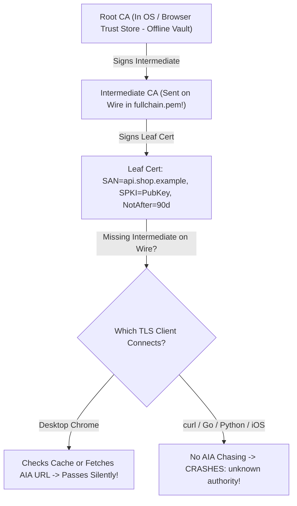
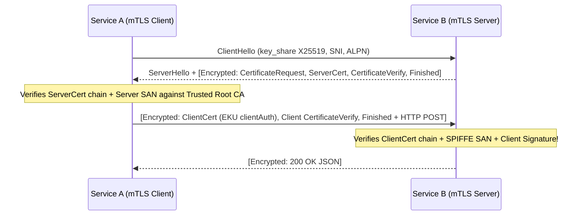
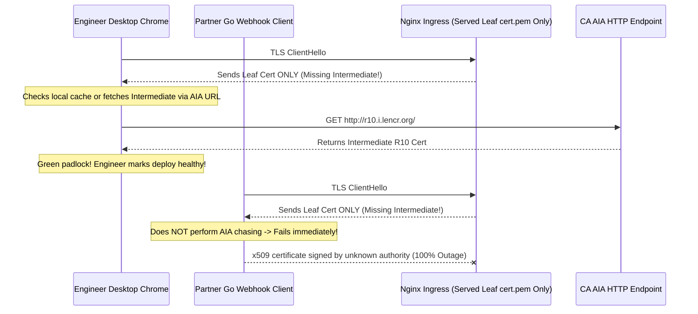

# Lesson 22: Certificates and PKI — Why Your Browser Trusts a Site It Has Never Met

> **Prerequisites:** [Lesson 21: The TLS 1.3 Handshake Step by Step](../21-tls-1-3-handshake/README.md) and [Networking From Zero Overview](../README.md) (Lesson 22 of 30).  
> **Estimated Reading Time:** 25 minutes  
> **Target Audience:** Backend, SRE, and DevOps engineers debugging TLS trust chain failures, automating `ACME` certificate issuance, enabling `OCSP` stapling, and implementing service-to-service `mTLS`.  
> **Free PDF Notes:** [Download SD-N-022.pdf](https://backendroadmap.com/notes/system-design/SD-N-022.pdf)

> [!TIP]
> **The Golden Rule of PKI & Trust Chains:** Encryption without verified identity just locks traffic for an attacker; **X.509 certificates** bind a hostname in **`SAN`** (not deprecated `CN`) to a public key through a signature chain from an offline **Root CA** in your OS store down through an **Intermediate CA** to your **Leaf certificate**. Always configure servers to serve **`fullchain.pem` (Leaf + Intermediate)**, automate renewals via **`ACME` (`HTTP-01` / `DNS-01`)**, attach **`OCSP` staples**, and enforce **`mTLS`** when internal services must verify each other.

---

## Words You'll Meet Today

| Word | In Plain Words | Role in a Live Backend System |
| :--- | :--- | :--- |
| **X.509 Certificate** | A signed digital passport for a server's public key. | Binds domain names (`SAN`), validity dates, and public key (`SPKI`) via CA signature. |
| **`SAN` (Subject Alt Name)** | Extension listing exact DNS names/IPs a cert covers. | Mandatory hostname check (`api.shop.example`, `*.shop.example`); replaced legacy `CN`. |
| **Root CA** | A master authority baked into your OS/browser store. | Kept air-gapped offline; trusts the Intermediate CAs that sign public web certificates. |
| **Intermediate CA** | An online issuing authority signed by a Root CA. | Signs Leaf certs daily while insulating the Root key; **must be sent by the server**. |
| **`AIA` (Authority Info Access)** | A URL inside a cert pointing to its Intermediate CA. | Browsers fetch missing intermediates via `AIA`; Go, Python, and `curl` do **not**. |
| **`ACME` (`HTTP-01` / `DNS-01`)** | Automated protocol (Let's Encrypt) to prove domain ownership. | Zero-touch 60-day issuance and renewal; `DNS-01` unlocks wildcards and private hosts. |
| **`OCSP` Stapling** | Server attaches a fresh non-revocation proof to TLS. | Proves the cert wasn't revoked without slow, privacy-leaking client lookups to the CA. |
| **`mTLS` (Mutual TLS)** | Both server *and* client present X.509 certificates. | Zero-trust service-to-service identity across Kubernetes, meshes, and B2B webhooks. |

---

## Visual Mental Models & Architecture

### The Question: Why Did Your API Pass Chrome Yet Crash Go, Python, `curl`, and Mobile Apps?

In [Lesson 21](../21-tls-1-3-handshake/README.md), we saw the TLS 1.3 server send `{Certificate}` and `{CertificateVerify}` inside Flight 2. After an Nginx config change, your teammate opens `https://api.example.com` in desktop Chrome—green padlock, zero errors. Ten minutes later, PagerDuty explodes: iOS, Android, Go webhook callers, and `curl` are all throwing `unable to verify the first certificate` (`x509: unknown authority`). Why did Chrome trust a server that every backend client rejected?

### An Everyday Picture First: A Passport Stamped by an Embassy You Already Trust

Imagine meeting a stranger claiming to represent Acme Bank. You've never met them, so you don't trust their business card alone. Instead, they hand you:

1. **Their personal passport (`Leaf Cert`)**, listing their exact name (`SAN`) and photo (`Public Key`), stamped by a regional Passport Office (`Intermediate CA`).
2. **The Passport Office's charter (`Intermediate Cert`)**, stamped by the National Ministry (`Root CA`), whose master seal is already printed in the **official rulebook inside your pocket (`OS Trust Store`)**.

**What happens if they forget to bring paper #2 (the Intermediate Charter)?** A clever border guard (`Desktop Chrome`) reads the return address printed on the passport (`AIA`), remembers seeing that office earlier in their cache, or phones the Ministry to download the charter. An automated airport kiosk (`Go`, `Python`, `curl`, mobile APIs) refuses to make extra network calls—it rejects the incomplete passport on the spot!

### X.509 Certificate Anatomy (`SAN` vs. Deprecated `CN`)

Every TLS certificate follows the **`X.509 v3`** (`RFC 5280`) format and contains:
- **Serial Number & Issuer:** Unique ID and which Intermediate CA signed it.
- **Validity (`Not Before` / `Not After`):** Hard start/expiry timestamps (`UTC`). Public WebPKI caps leaf validity at `398` days (and industry timelines are tightening further toward `47` days), making automation non-negotiable.
- **`SubjectPublicKeyInfo` (`SPKI`):** The server's actual public key (`ECDSA P-256` or `RSA-2048`) and algorithm.
- **Extensions:**
  - **`Subject Alternative Name (SAN)`:** Lists every valid hostname/IP (`DNS:api.example.com`, `DNS:*.example.com`, `IP:10.0.1.5`). **Legacy `CN` (Common Name) is dead**—modern Go (`1.15+`), Chrome, and OpenSSL reject certificates lacking a matching `SAN` even if `CN` matches!
  - **`Key Usage` & `Extended Key Usage (EKU)`:** Constrains purpose (`serverAuth` for HTTPS servers, `clientAuth` for `mTLS` clients).
  - **`Basic Constraints`:** `CA:FALSE` on leaf certs (preventing any website from signing fake certs for other domains!).
  - **`AIA` (`Authority Information Access`):** URL where the signing Intermediate CA cert can be downloaded.
- **Digital Signature:** Signed by the issuing Intermediate CA's private key over all fields above.

### The Chain of Trust & Missing Intermediate Failure Mode

Because a single compromised Root CA key would break the internet, **Root CAs sit offline in vaults** and only sign a handful of **Intermediate CAs** (`R10`, `E6`, etc.). Intermediates sign millions of 90-day leaf certificates.

During TLS Flight 2, your server MUST send **`fullchain.pem`** = `[Leaf Cert, Intermediate Cert(s)]`:
- **Never send only `cert.pem` (Leaf only):** Non-browser clients (`curl`, Go, Python, Java, Node.js, iOS/Android) do **not** follow `AIA` links (`AIA chasing`) for performance and SSRF/latency reasons—they fail immediately with `unknown authority`!
- **Don't append the `Root CA` either:** Clients ignore server-sent roots anyway (they only trust roots baked into their local OS/Mozilla/container store), so appending the root just bloats Flight 2 by `~1.5 KB` unnecessarily.



*Figure 1. The X.509 Chain of Trust and why omitting the Intermediate CA causes a deceptive split outage: desktop browsers work around missing intermediates via cache/`AIA`, while API clients fail hard.*

### Automated Issuance with `ACME` (`HTTP-01` vs. `DNS-01`)

Manual certificate spreadsheets guarantee midnight expiry outages. **`ACME` (`RFC 8555`, e.g., Let's Encrypt, ZeroSSL, Step-CA)** automates issuance and renewal (`60`-day auto-renew for `90`-day certs) via domain-control challenges:

1. **`HTTP-01` Challenge:** The ACME CA asks your agent (`Certbot`, `cert-manager`, `Caddy`) to host a random token at `http://api.example.com/.well-known/acme-challenge/<token>` on TCP port **`80`**.
   - *Pros:* Zero DNS API credentials needed.
   - *Limitations:* **Cannot issue wildcard certs (`*.example.com`)**, requires public port `80` reachability, and fails for internal VPC-only domains.
2. **`DNS-01` Challenge:** The ACME agent calls your DNS provider API to publish a **`TXT` record** at `_acme-challenge.api.example.com`.
   - *Pros:* **Issues wildcard certs (`*.example.com`)** and works for completely **private/air-gapped internal services** with zero public HTTP ports!
   - *Caveat:* Requires scoped DNS-write credentials (delegate `_acme-challenge` via `CNAME` to a dedicated restricted zone to limit blast radius).

### Revocation: `CRL` vs. `OCSP` vs. `OCSP Stapling`

What if a private key leaks before `Not After` expires? CAs maintain revocation status, delivered in three ways:
- **`CRL` (Certificate Revocation List):** Giant signed list of revoked serial numbers downloaded periodically—grew to tens of megabytes and went stale between downloads.
- **Online `OCSP` (Online Certificate Status Protocol):** Client queries the CA's OCSP HTTP server live during the TLS handshake. Slow (`+1–2` RTTs), leaks every site you visit to the CA, and breaks whenever the CA's responder goes down (`fail-open` soft checks defeat security!).
- **`OCSP Stapling` (`RFC 6066` / `RFC 6961`):** Your **web server** fetches the CA-signed, timestamped OCSP response (`valid ~7 days`) in the background and **staples it directly inside TLS Flight 2**. Zero extra client RTT, zero privacy leak! *(Modern WebPKI is also moving toward ultra-short `6–47` day ACME certificates + browser-pushed CRLite filters, reducing reliance on live OCSP altogether.)*

### Mutual TLS (`mTLS`) Between Services

Standard TLS proves **only the server's identity**. In zero-trust microservice meshes (`Envoy`/`Istio`, Kafka, PostgreSQL, B2B webhooks), **`mTLS`** forces **both sides** to authenticate cryptographically inside the handshake:
- In TLS 1.3 Flight 2, the server appends **`{CertificateRequest}`** (inside the encrypted handshake!).
- In Flight 3, the client replies with its own **`{Certificate}`** (`EKU: clientAuth`, e.g., SPIFFE ID `spiffe://prod/ns/billing/sa/worker`) and **`{CertificateVerify}`** signature proving it holds the client private key!



*Figure 2. Mutual TLS (`mTLS`) over TLS 1.3: the server requests a client certificate inside Flight 2, and the client authenticates with its own certificate and `CertificateVerify` signature before HTTP traffic flows.*

---

## Systematic Reference & Comparison Grid

### Chain Files & PKI Artifacts

| Artifact / Cert Role | Stored Where? | Sent on TLS Wire? | Typical Validity | Failure Mode If Misconfigured |
| :--- | :--- | :--- | :--- | :--- |
| **Root CA** | OS / Browser / Container `ca-certificates` | **No** (wastes bytes; ignored) | `10–25 years` | Missing in stripped `scratch` containers -> TLS fails |
| **Intermediate CA** | Web server / Load Balancer `fullchain.pem` | **Yes** (after leaf) | `3–5 years` | Omitted -> Chrome passes (`AIA`), APIs/mobile crash |
| **Leaf Certificate** | Web server / Ingress `fullchain.pem` | **Yes** (position `0`) | `47–90 days` (`398 d` max) | Expired or missing `SAN` -> total HTTPS outage |
| **Private Key (`.key`)** | Server RAM / KMS / HSM (`0600` perms) | **Never** | Rotated with leaf | Leaked -> attacker impersonates server (`revoke!`) |

### `ACME` Challenge Types (`RFC 8555`)

| Challenge | Verification Vector | Wildcards (`*.domain`)? | Private / Firewalled Hosts? | Key Security Consideration |
| :--- | :--- | :--- | :--- | :--- |
| **`HTTP-01`** | `GET http://<host>/.well-known/acme-challenge/<tok>` | **No** | **No** (needs port `80` public) | Must disable HTTPS redirects on `/.well-known/` or pass through |
| **`DNS-01`** | `TXT _acme-challenge.<domain>` | **Yes** | **Yes** (zero open ports) | Delegate `_acme-challenge` via `CNAME` to isolate DNS API tokens |
| **`TLS-ALPN-01`** | TLS port `443` with `acme-tls/1` ALPN | **No** | **No** (needs port `443` public) | Useful when port `80` is blocked by compliance policies |

### Revocation Check Approaches Compared

| Mechanism | Extra Client Handshake RTT? | Leaks Browsing History to CA? | Fail-Open Risk? | Current Industry Direction |
| :--- | :--- | :--- | :--- | :--- |
| **`CRL` Download** | Periodic background download | Minimal | Stale until refresh | Used inside browsers via compressed `CRLite` / `CRLSets` |
| **Online `OCSP`** | **Yes (`+1–2 RTT`)** | **Yes** | High (soft-fail defaults) | Deprecated by major CAs (`Let's Encrypt` ending OCSP in favor of CRLs/short certs) |
| **`OCSP Stapling`** | **Zero** (`0 RTT`) | **No** | Safe with `Must-Staple` | Best practice when server OCSP responders are active |
| **Short-Lived Certs (`7–47 d`)** | **Zero** (`0 RTT`) | **No** | **Eliminated** via rapid expiry | Gold standard in automated cloud & `SPIFFE` `mTLS` meshes |

---

## Production War Story Post-Mortem: Staging Passed Chrome, Production Crashed Every Webhook & Mobile App

- **Severity:** SEV-1 (28-Minute Total Mobile API & Webhook Blackout)
- **Detection / Resolution Time:** 12 minutes to diagnose `cert.pem` vs `fullchain.pem`; 28 minutes to roll corrected Ingress Secret across clusters
- **Impact:** After migrating an ingress controller, engineers opened `https://api.shop.example/health` in Chrome, saw a green padlock, and signed off on the rollout. Instantly, `100%` of iOS/Android clients, Stripe webhook deliveries, and partner Go microservices failed TLS handshakes with `unable to verify the first certificate`.

### What Happened



### Root Cause Analysis

1. **Serving `cert.pem` Instead of `fullchain.pem`:** The Terraform/Helm template mapped `tls.crt` to the leaf certificate alone, omitting the Intermediate CA certificate (`R10`).
2. **False Confidence from Desktop Browser Validation:** Because desktop Chrome caches intermediates globally and falls back to `AIA` HTTP fetching, testing solely in a browser masked a completely broken TLS chain for all programmatic TLS clients.
3. **Stripped Container Images Missing Root Stores:** Simultaneously, two internal Go sidecars built `FROM scratch` without copying `/etc/ssl/certs/ca-certificates.crt`, guaranteeing failure even with a complete chain.

### The Fix & Architectural Hardening

- **Automated CI Chain Gate:** Added an OpenSSL/Go chain verification job in CI (`openssl s_client` / `verify_chain` rejecting `AIA`) that blocks deploys unless `PeerCertificates` includes a complete Leaf + Intermediate chain validating cleanly against stock Mozilla roots.
- **`ca-certificates` Baseline & `< 14`-Day Expiry Alerts:** Baked updated root bundles into minimal `distroless`/`alpine` images and exported Prometheus alerts firing at `21` days (`warning`) and `14` days (`critical`) before `NotAfter`.

---

## Multi-Language Production Implementation

Below is a production-structured **X.509 Certificate Chain, `SAN`, & `< 14`-Day Expiry Inspector** across Go, TypeScript, Python, and C# that checks whether the server supplies an intermediate chain (without relying on browser `AIA` chasing!), validates `SAN` matching, and flags expiring certs early.

````carousel
```go
package pkicheck

import (
	"crypto/tls"
	"crypto/x509"
	"fmt"
	"net"
	"time"
)

type AuditReport struct {
	Host          string; ChainLen int; SANs []string
	DaysLeft      float64; MissingInterm, ExpiringSoon bool
}

func InspectCert(host, port string, warnDays int) (*AuditReport, error) {
	// Skip dial abort so manual x509.Verify reports exact chain/SAN/expiry faults.
	conn, err := tls.DialWithDialer(&net.Dialer{Timeout: 5 * time.Second}, "tcp", net.JoinHostPort(host, port),
		&tls.Config{ServerName: host, InsecureSkipVerify: true})
	if err != nil { return nil, err }
	defer conn.Close()

	certs := conn.ConnectionState().PeerCertificates
	leaf, interms := certs[0], x509.NewCertPool()
	for _, c := range certs[1:] { interms.AddCert(c) }
	_, vErr := leaf.Verify(x509.VerifyOptions{DNSName: host, Intermediates: interms})
	days := time.Until(leaf.NotAfter).Hours() / 24.0
	rep := &AuditReport{host, len(certs), leaf.DNSNames, days, len(certs) < 2 && vErr != nil, days < float64(warnDays)}
	if vErr != nil { return rep, fmt.Errorf("verify failed: %w", vErr) }
	return rep, nil
}
```
<!-- slide -->
```typescript
import tls, { type DetailedPeerCertificate } from "node:tls";

export function inspectCertChain(host: string, port = 443, warnDays = 14) {
  return new Promise((resolve, reject) => {
    const sock = tls.connect({ host, port, servername: host, rejectUnauthorized: false }, () => {
      let cur: DetailedPeerCertificate | undefined = sock.getPeerCertificate(true);
      const chain: DetailedPeerCertificate[] = [];
      const seen = new Set<string>();
      while (cur?.fingerprint256 && !seen.has(cur.fingerprint256)) {
        seen.add(cur.fingerprint256); chain.push(cur); cur = cur.issuerCertificate;
      }
      const leaf = chain[0];
      const daysLeft = (new Date(leaf.valid_to).getTime() - Date.now()) / 86_400_000;
      const sans = (leaf.subjectaltname ?? "").split(",").map((s) => s.trim()).filter(Boolean);
      sock.end();
      resolve({
        host, authorized: sock.authorized, error: sock.authorizationError ?? null,
        chainDepth: chain.length, missingIntermediate: chain.length < 2 && !sock.authorized,
        sans, daysRemaining: Math.round(daysLeft * 10) / 10, expiringSoon: daysLeft < warnDays,
      });
    });
    sock.on("error", reject);
  });
}
```
<!-- slide -->
```python
from datetime import datetime, timezone
import socket, ssl

def audit_tls_certificate(host: str, port: int = 443, warn_days: int = 14) -> dict[str, object]:
    ctx = ssl.create_default_context()  # Strict system roots + SAN check, zero AIA chasing
    try:
        with socket.create_connection((host, port), timeout=5.0) as tcp:
            with ctx.wrap_socket(tcp, server_hostname=host) as tls_sock:
                cert = tls_sock.getpeercert()
    except ssl.SSLCertVerificationError as exc:
        return {"host": host, "trusted": False, "error": str(exc), "expiring_soon": None}

    days = (ssl.cert_time_to_seconds(cert["notAfter"]) - datetime.now(timezone.utc).timestamp()) / 86400.0
    sans = [val for kind, val in cert.get("subjectAltName", ()) if kind == "DNS"]
    return {"host": host, "trusted": True, "sans": sans, "days_remaining": round(days, 1), "expiring_soon": days < warn_days}
```
<!-- slide -->
```csharp
using System;
using System.Net.Security;
using System.Net.Sockets;
using System.Security.Cryptography.X509Certificates;
using System.Threading.Tasks;

public sealed record CertAudit(string Host, bool Trusted, int Depth, bool MissingInterm, double DaysLeft, bool ExpiringSoon, string Errors);

public static class CertificateAuditor
{
    public static async Task<CertAudit> InspectAsync(string host, int port = 443, int warnDays = 14)
    {
        CertAudit? report = null;
        using var tcp = new TcpClient();
        await tcp.ConnectAsync(host, port);
        await using var ssl = new SslStream(tcp.GetStream(), false, (_, cert, chain, errs) =>
        {
            var leaf = new X509Certificate2(cert!);
            double days = (leaf.NotAfter.ToUniversalTime() - DateTime.UtcNow).TotalDays;
            int depth = chain?.ChainElements.Count ?? 0;
            report = new(host, errs == SslPolicyErrors.None, depth, depth < 2 && errs != 0, Math.Round(days, 1), days < warnDays, errs.ToString());
            return true; // Audit callback preserves full diagnostic report
        });
        await ssl.AuthenticateAsClientAsync(host);
        return report!;
    }
}
```
````

---

## Practical Hands-On Verification CLI Workflows

### 1. Inspect Full Certificate Chain Depth, `OCSP Stapling`, and Verify Code

```bash
openssl s_client -connect example.com:443 -servername example.com -showcerts -status < /dev/null
```

**Expected Output:**

```text
Certificate chain
 0 s:CN = *.example.com
   i:C = US, O = DigiCert Inc, CN = DigiCert Global G3 TLS ECC SHA384 2020 CA1
 1 s:C = US, O = DigiCert Inc, CN = DigiCert Global G3 TLS ECC SHA384 2020 CA1
   i:C = US, O = DigiCert Inc, OU = www.digicert.com, CN = DigiCert Global Root G3
...
OCSP response:
======================================
OCSP Response Data:
    OCSP Response Status: successful (0x0)
    Cert Status: good
...
    Verify return code: 0 (ok)
```

Look for **at least `0` (Leaf) and `1` (Intermediate)** in `Certificate chain`, `Verify return code: 0 (ok)`, and `OCSP Response Status: successful`. If you only see `0 s:...` and `Verify return code: 21 (unable to verify the first certificate)`, the server forgot its Intermediate CA!

### 2. Inspect `SAN`s, Expiry Dates, `AIA`, and `Basic Constraints`

```bash
openssl s_client -connect example.com:443 -servername example.com < /dev/null 2>/dev/null | \
  openssl x509 -noout -dates -ext subjectAltName,authorityInfoAccess,basicConstraints
```

**Expected Output:**

```text
notBefore=Jan 15 00:00:00 2026 GMT
notAfter=Jan 15 23:59:59 2027 GMT
X509v3 Subject Alternative Name:
    DNS:*.example.com, DNS:example.com
Authority Information Access:
    CA Issuers - URI:http://cacerts.digicert.com/DigiCertGlobalG3TLSECCSHA3842020CA1-1.crt
X509v3 Basic Constraints: critical
    CA:FALSE
```

### 3. Verify a Local `fullchain.pem` File Against System Roots Before Deploying

```bash
openssl verify -untrusted intermediate.pem leaf.pem
```

**Expected Output:**

```text
leaf.pem: OK
```

---

## Pause and Think

> [!exercise] You configure Nginx with `ssl_certificate cert.pem` (just your leaf certificate) instead of `fullchain.pem`. When you test on your laptop Chrome, it loads smoothly with a padlock, yet `curl`, Python `requests`, and iOS crash with `unable to get local issuer certificate`. Why—and why shouldn't you fix it by appending the `Root CA` certificate to `fullchain.pem` as well? Decide before you open the answer.

<details><summary>Answer</summary>

Chrome maintains a local intermediate cache and performs **`AIA` chasing** (downloading the missing Intermediate CA over HTTP from the URL embedded in the leaf cert's `AIA` extension). Non-browser TLS stacks (`curl`, Go, Python, mobile SDKs) intentionally skip `AIA` network fetches during handshakes, so without the Intermediate CA sent on the wire, they cannot link your leaf cert up to a trusted `Root CA`.

Don't append the `Root CA` to `fullchain.pem`: clients only trust roots stored locally in their own OS/browser trust store anyway, so sending the Root CA over the wire wastes ~1.5 KB inside every cold TLS handshake.

</details>

---

## Operational Validation Checkpoints

<details><summary><strong>Checkpoint 1: Automating Wildcard & Private VPC Certificates with `ACME`</strong></summary>

**Scenario:** Your platform team needs a wildcard TLS certificate `*.internal.shop.example` for private Kubernetes services unreachable from the public internet (`port 80` blocked). `Certbot --nginx` (`HTTP-01`) keeps failing with connection timeouts. Which challenge should you switch to, and how do you limit DNS credential blast radius?

**Solution:**
Switch to the **`DNS-01`** challenge (`RFC 8555`), which is the *only* ACME challenge supporting wildcard (`*.domain`) names and completely private hosts without inbound port `80`/`443`. To avoid granting your Kubernetes cluster full write access to your main production DNS zone, `CNAME` `_acme-challenge.internal.shop.example` to a separate low-privilege validation zone (`_acme.acme-auth.example`) and scope the ACME API token exclusively to that validation zone.

</details>

<details><summary><strong>Checkpoint 2: Legacy `CN`-Only Internal Cert Rejected by Modern Services</strong></summary>

**Scenario:** After upgrading your Go microservice runtime (`Go 1.15+`), internal HTTPS requests to a legacy self-signed Postgres proxy start failing with `x509: certificate relies on legacy Common Name field, use SANs instead`. What field is missing, and how do you regenerate the cert cleanly?

**Solution:**
Modern TLS implementations (`RFC 2818`, Go `1.15+`, Chrome, OpenSSL `3.x`) ignore the `Subject CN` field completely during hostname matching and require **`Subject Alternative Name (SAN)`**. Regenerate the leaf certificate with `subjectAltName = DNS:pg-proxy.internal, IP:10.4.2.10` inside the X.509 v3 extensions and reissue via your internal CA (`Step-CA` / `Vault PKI`).

</details>

<details><summary><strong>Checkpoint 3: Designing Zero-Trust `mTLS` Between Microservices</strong></summary>

**Scenario:** Service A (`billing-api`) calls Service B (`ledger-core`) over an internal network. You enable `mTLS`, yet forget to validate the client certificate's identity (`SAN` / `SPIFFE ID`) on Service B—checking only that the client cert is signed by your company's internal Root CA. Why is that still dangerous, and what must Service B enforce?

**Solution:**
If Service B trusts *any* certificate signed by your internal Root CA, then a compromised `marketing-blog` pod holding a valid internal certificate from the same CA can call `ledger-core` directly! Service B must:
1. Verify **`Extended Key Usage` includes `clientAuth`**.
2. Inspect the verified client certificate's **`SAN` / `URI` (`spiffe://prod/ns/billing/sa/billing-api`)** against an explicit allowlist before authorizing requests.
3. Automate short-lived `mTLS` cert rotation (e.g., `24`-hour certs via `SPIRE` or `cert-manager`).

</details>

---

## Common Mistakes & Troubleshooting

### What Goes Wrong

- **Deploying `cert.pem` without Intermediate CAs:** Works in QA's desktop browser via `AIA` cache, immediately breaks mobile apps, webhooks, and microservices in production.
- **Putting `Root CA` or empty container root stores:** Bloats handshakes if sending roots, or breaks outbound HTTPS inside `FROM scratch` Docker images lacking `/etc/ssl/certs`.
- **Disabling verification (`InsecureSkipVerify: true` / `NODE_TLS_REJECT_UNAUTHORIZED=0`) in app code:** Silences local dev cert errors, leaks into production, and turns HTTPS into unauthenticated encryption vulnerable to trivial MitM attacks.

### Common Myths

- **"Desktop Chrome loaded the URL cleanly, so our TLS chain is valid."** False. Chrome hides missing Intermediate CAs using `AIA` chasing and caches; always test with `openssl s_client` or `curl`.
- **"Certificates expire cleanly—users just click through a warning."** False. Automated API clients, payment webhooks, and mobile apps crash hard with zero user prompt; treat cert expiry identically to a P0 outage.
- **"Self-signed internal certs are fine if `CN` matches the hostname."** False. Modern runtimes require `SAN`s; `CN`-only certificates fail validation outright.

| Symptom | Root Cause | Fix |
| :--- | :--- | :--- |
| `unable to verify the first certificate` in `curl`/Go/iOS (Chrome works) | Server sends `cert.pem` (leaf only), missing Intermediate CA | Configure server with `fullchain.pem` (`Leaf + Intermediate`) |
| `x509: certificate signed by unknown authority` inside Docker container | Minimal `scratch`/`alpine` container lacks `ca-certificates` bundle | Install `ca-certificates` or mount OS `/etc/ssl/certs` |
| `ERR_CERT_COMMON_NAME_INVALID` despite matching `CN` | Certificate missing `Subject Alternative Name (SAN)` extension | Re-issue cert with `SAN` (`DNS:...` / `IP:...`) |
| `ACME` `HTTP-01` fails for `*.example.com` or private cluster | `HTTP-01` cannot authorize wildcards or closed internal ports | Switch to `ACME` `DNS-01` challenge via TXT records |

---

## Recap in Three Lines

1. X.509 certificates bind a public key to hostnames in **`SAN`** (not `CN`), signed down a trust chain from a pre-installed **`Root CA`** through an **`Intermediate CA`** to your **`Leaf cert`**.
2. Always serve **`fullchain.pem` (Leaf + Intermediate)**—omitting intermediates lets desktop Chrome hide behind `AIA` fetching while crashing backend APIs and mobile clients.
3. Automate renewals with **`ACME` (`HTTP-01` / `DNS-01`)**, attach **`OCSP` staples** (or short-lived certs), and enforce **`mTLS` + `SAN` allowlists** for zero-trust services.

---

## Interview Practice Questions

> [!interview] How does a browser trust an HTTPS website it has never visited before? (Basic)

<details><summary>What to say in 30 seconds</summary>

Your OS or browser ships with a curated list of trusted Root CAs. During the TLS handshake, the server sends its Leaf certificate—containing its domain `SAN` and public key—along with an Intermediate CA certificate. The client verifies the cryptographic signature chain from the Leaf up to a trusted Root CA in its store, checks validity dates and `SAN` match, and verifies `CertificateVerify` to confirm the server actually holds the matching private key.

</details>

> [!interview] Your site loads fine in desktop Chrome, but `curl`, Go services, and iOS fail with `unable to verify the first certificate`. What broke? (Scenario)

<details><summary>What to say in 30 seconds</summary>

The server is only sending its Leaf certificate (`cert.pem`) and forgot to include the Intermediate CA certificate (`fullchain.pem`). Desktop Chrome hides this mistake by using cached intermediates or fetching the missing intermediate over HTTP via the cert's `AIA` URL. Programmatic TLS libraries intentionally skip `AIA` chasing and reject the incomplete chain immediately.

</details>

> [!interview] Why did `SAN` replace `CN` in X.509 certificates? (Basic)

<details><summary>What to say in 30 seconds</summary>

The legacy `Common Name (CN)` was an ambiguous single string inside the subject field that didn't cleanly distinguish hostnames from human organization names or support multiple domains and IP addresses reliably. `Subject Alternative Name (SAN)` explicitly types every identity (`DNS:api.example.com`, `IP:10.0.0.5`), and modern browsers plus Go/OpenSSL ignore `CN` and reject certificates missing a valid `SAN`.

</details>

> [!interview] Compare `ACME` `HTTP-01` vs. `DNS-01` challenges. When do you need `DNS-01`? (Scenario)

<details><summary>What to say in 30 seconds</summary>

`HTTP-01` proves control by serving a token on public port 80 (`/.well-known/acme-challenge/...`), which is simple and needs no DNS keys. `DNS-01` proves control by writing a `_acme-challenge` `TXT` record via DNS API. You must use `DNS-01` whenever issuing wildcard certificates (`*.example.com`) or automating certs for private internal services unreachable from the public internet.

</details>

> [!interview] What is `OCSP Stapling` and what two problems with online `OCSP` does it fix? (Tricky)

<details><summary>What to say in 30 seconds</summary>

With online `OCSP`, every client pauses the TLS handshake to ask the CA's responder if the cert was revoked—adding 1–2 RTTs of latency, leaking user browsing history to the CA, and breaking or soft-failing if the responder goes offline. With `OCSP Stapling`, the web server periodically fetches the CA-signed OCSP proof itself and staples it right inside the TLS handshake, costing zero extra RTTs and protecting user privacy.

</details>

> [!interview] How does `mTLS` differ from standard TLS, and why isn't checking the CA signature alone enough? (Tricky)

<details><summary>What to say in 30 seconds</summary>

Standard TLS authenticates only the server, whereas `mTLS` has the server send a `CertificateRequest` so the client must also present a valid X.509 certificate (`clientAuth` EKU) and sign the handshake with its private key. Checking only that the client cert was signed by your internal CA lets any internal service impersonate any other—you must also authorize the specific `SAN` or `SPIFFE ID` inside the client certificate.

</details>

---

## Free PDF notes

Download these notes as a printable PDF, with the X.509 chain anatomy diagram, `ACME` comparison, and interview answers: [SD-N-022.pdf](https://backendroadmap.com/notes/system-design/SD-N-022.pdf).

---

## Sources

- [RFC 5280: Internet X.509 Public Key Infrastructure Certificate and CRL Profile](https://www.rfc-editor.org/rfc/rfc5280), certificate fields, `SAN`, `Basic Constraints`, `AIA`, and chain validation.
- [RFC 8555: Automatic Certificate Management Environment (`ACME`)](https://www.rfc-editor.org/rfc/rfc8555), automated domain validation (`HTTP-01`, `DNS-01`) and issuance.
- [RFC 6066 & RFC 6961: TLS Certificate Status Request (`OCSP Stapling`)](https://www.rfc-editor.org/rfc/rfc6961), stapling revocation proofs inside TLS handshakes.
- [Let's Encrypt: Chain of Trust & Challenge Types](https://letsencrypt.org/docs/challenge-types/), practical root/intermediate chains and `HTTP-01` vs `DNS-01` tradeoffs.
- [CA/Browser Forum: Baseline Requirements](https://cabforum.org/working-groups/server/baseline-requirements/requirements/), `SAN` mandates and maximum public certificate lifetimes.

---

## Next

Next comes [Lesson 23: HTTP/1.1 vs HTTP/2 vs HTTP/3 and Head-of-Line Blocking](../23-http-1-1-vs-http-2-vs-http-3/README.md): now that our TLS 1.3 tunnel is authenticated and encrypted, how modern HTTP multiplexes dozens of concurrent streams and why QUIC fixes TCP head-of-line blocking. See [the track overview](../README.md) for the whole series.
