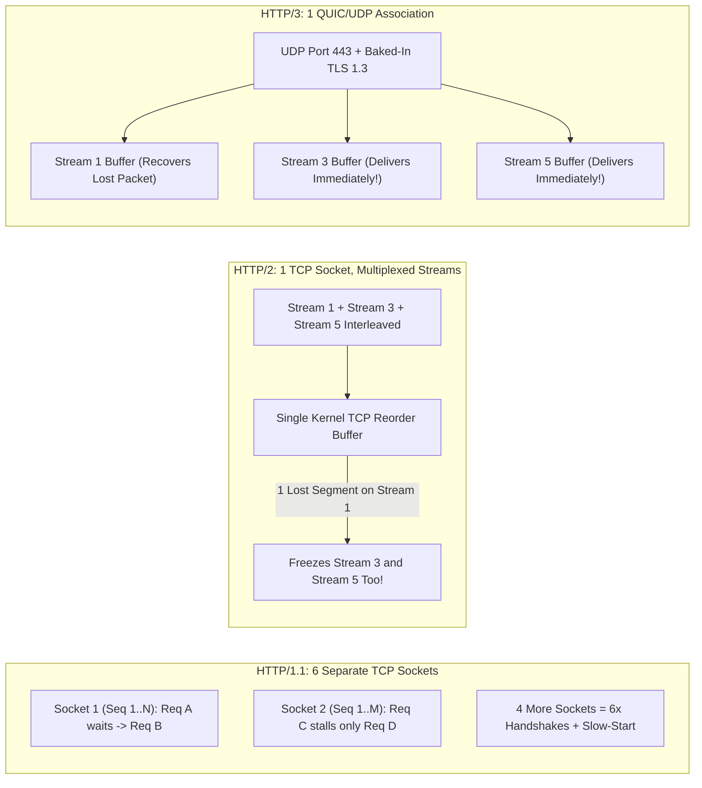
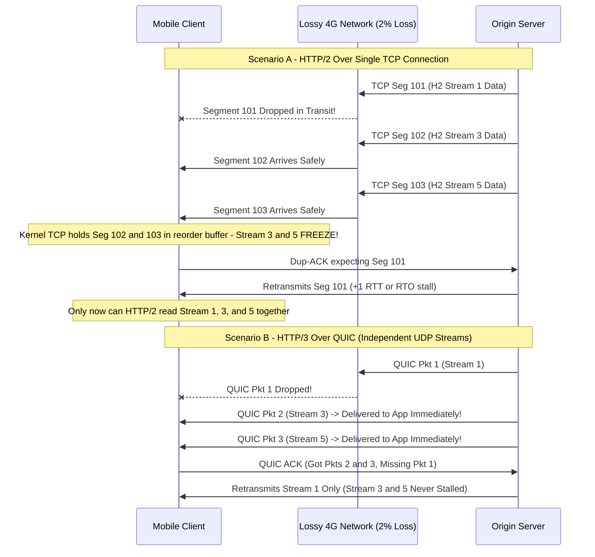
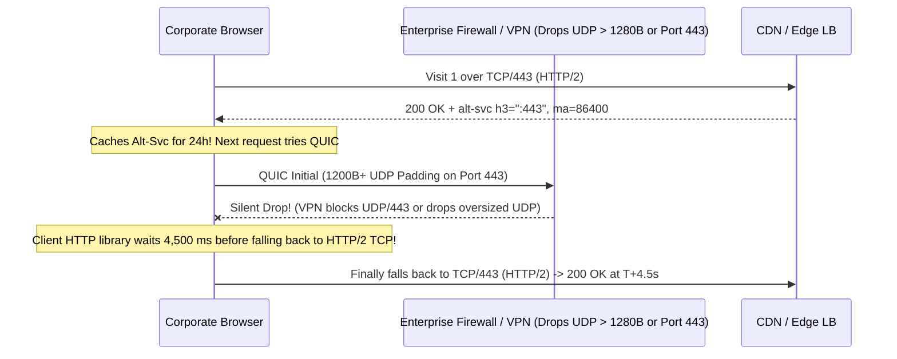

# Lesson 23: HTTP/1.1 vs HTTP/2 vs HTTP/3 and Head-of-Line Blocking

> **Prerequisites:** [Lesson 18: HTTP Part 1](../18-http-requests-responses-and-methods/README.md), [Lesson 21: The TLS 1.3 Handshake Step by Step](../21-tls-1-3-handshake/README.md), [Lesson 12: UDP vs TCP](../12-udp-vs-tcp/README.md), and [Networking From Zero Overview](../README.md) (Lesson 23 of 30).  
> **Estimated Reading Time:** 28 minutes  
> **Target Audience:** Backend, platform, and SRE engineers optimizing API latency across lossy mobile networks, debugging HTTP/2 TCP head-of-line stalls, configuring ALPN negotiation, and deploying HTTP/3 (QUIC) behind reverse proxies and CDNs.  
> **Free PDF Notes:** [Download SD-N-023.pdf](https://backendroadmap.com/notes/system-design/SD-N-023.pdf)

> [!TIP]
> **The Golden Rule of HTTP Evolution:** `HTTP/1.1` suffers **application-layer head-of-line blocking**, forcing browsers to open `6` parallel TCP connections per origin; `HTTP/2` multiplexes binary streams and `HPACK`-compressed headers over **one TCP socket**, yet any single dropped segment stalls **all streams in the kernel TCP buffer**; `HTTP/3` moves transport onto **`QUIC` (`UDP` + TLS 1.3)** so streams recover independently, survive Wi-Fi-to-5G IP switches via Connection IDs, and handshake in `1` RTT (or `0` RTT).

---

## Words You'll Meet Today

| Word | In Plain Words | Role in a Live Backend System |
| :--- | :--- | :--- |
| **Head-of-line (HoL) blocking** | A stall at the front of a line delays everything behind it. | Freezes queued HTTP responses in `HTTP/1.1` or all multiplexed `HTTP/2` streams during TCP packet loss. |
| **Multiplexing** | Interleaving pieces of many requests and responses on one socket. | Allows dozens of concurrent API calls and assets over a single `HTTP/2` or `HTTP/3` connection. |
| **Binary frame** | A length-prefixed binary packet replacing raw HTTP text lines. | Eliminates whitespace parsing ambiguity and carries `HEADERS`, `DATA`, `SETTINGS`, and `RST_STREAM`. |
| **Stream** | One independent, numbered request-response exchange inside a connection. | Client-initiated streams use odd IDs (`1, 3, 5...`) with separate flow-control windows. |
| **`HPACK` / `QPACK`** | Header compression tables built for `HTTP/2` and `HTTP/3`. | Compresses repetitive `Authorization`, `Cookie`, and `User-Agent` headers by `80–90%`. |
| **`ALPN`** | Application-Layer Protocol Negotiation inside the TLS handshake. | Lets client and server select `h2` or `http/1.1` inside `ClientHello`/`ServerHello` with `0` extra RTTs. |
| **`QUIC`** | Encrypted, multiplexed transport running in user space over `UDP`. | Bakes TLS 1.3 into transport, cuts cold setup to `1` RTT, and isolates packet loss per stream. |
| **`Alt-Svc`** | HTTP response header advertising an `HTTP/3` endpoint (`h3=":443"`). | Lets browsers upgrade silently on future requests while keeping TCP `HTTP/2` ready as fallback. |

---

## Visual Mental Models & Architecture

### The Question: Why Did HTTP/2 Actually Get Slower on Shaky Train Wi-Fi?

In [Lesson 18](../18-http-requests-responses-and-methods/README.md) we learned plain HTTP requests and responses, in [Lesson 21](../21-tls-1-3-handshake/README.md) we watched TLS 1.3 encrypt them in `1` round trip, and in [Lesson 12](../12-udp-vs-tcp/README.md) we compared ordered `TCP` against stateless `UDP`. Now picture migrating your web app from `HTTP/1.1` to `HTTP/2`: on office fiber, page loads drop by `35%`. Yet telemetry from commuter trains with `2%` packet loss shows tail latency getting *worse* than `HTTP/1.1`. Why? Because `HTTP/2` fixed blocking at the **HTTP layer** while inheriting a stricter bottleneck one layer below, inside **TCP**.

### An Everyday Picture First: Checkout Lanes, Conveyor Belts, and Courier Drones

- **`HTTP/1.1` (One Cashier Per Lane):** Each customer puts groceries on the belt, waits for the cashier to scan and hand over a receipt, and *only then* can the next customer start. One slow cart holds up the whole line (**application HoL blocking**). To cope, browsers build `6` parallel checkout lanes (`6` TCP connections per domain).
- **`HTTP/2` (One Giant Multiplexed Conveyor Belt):** Instead of `6` cashiers, all `100` shoppers toss labeled baskets (`Stream 1`, `Stream 3`, `Stream 5`) onto **one super-wide conveyor belt** (`1` TCP connection). On smooth ground it flies. But if **one tiny box falls off the belt**, a strict safety sensor freezes the *entire belt* until that box is re-fetched—stalling all `99` other shoppers (**TCP-level HoL blocking**).
- **`HTTP/3` over `QUIC` (Independent Encrypted Drones):** Every shopper gets their own courier drone flying over open air (`UDP`) using one shared security badge (`TLS 1.3`). If Drone `1` hits a gust of wind and retries, Drones `3` and `5` land on schedule without waiting.



*Figure 1. Architectural evolution across HTTP generations: HTTP/1.1 shards across 6 TCP connections, HTTP/2 multiplexes over 1 TCP connection (inheriting kernel TCP HoL blocking), and HTTP/3 isolates streams inside user-space QUIC over UDP.*

---

### Deep Dive 1: HTTP/1.1 Plaintext Framing and the 6-Connection Workaround

An `HTTP/1.1` connection carries **one active request-response at a time** per TCP socket:

1. **Application-Layer HoL Blocking:** Even with `Connection: keep-alive` reusing the socket, Request 2 cannot read its response until Request 1 finishes completely. Browser **HTTP pipelining** tried sending Requests 1, 2, and 3 back-to-back without waiting, but responses still had to arrive strictly in order—and buggy middleboxes corrupted pipelined streams—so modern browsers disabled it.
2. **The 6-Connection Browser Workaround:** Browsers open up to **`6` concurrent TCP connections per hostname** (`api.example.com`). Older sites even used **domain sharding** (`img1.example.com`, `img2.example.com`) to multiply that cap to `24+` sockets.
3. **Why `6` Sockets Hurt:** Every socket repeats a `TCP` 3-way handshake + `TLS` handshake (`6×` CPU and handshake packets), maintains separate slow-start congestion windows (`cwnd` cannot share bandwidth lessons across sockets), and repeats `600–1,200` bytes of un-compressed ASCII headers (`User-Agent`, `Cookie`, `Accept`) on every single request.

---

### Deep Dive 2: HTTP/2 Binary Frames, HPACK, and TCP-Level HoL Blocking

`HTTP/2` (RFC 9113, originally RFC 7540) changes the wire syntax from human-readable lines to **9-byte binary frames** multiplexed over **one persistent TCP connection**:

- **Multiplexed Streams:** Each request gets a 31-bit integer **Stream ID** (`1, 3, 5...` from client). A server can interleave a `DATA` frame for Stream `3` (`CSS`) right in the middle of sending `DATA` frames for Stream `1` (`JSON`), preventing a large slow query from blocking small assets at the HTTP layer.
- **`HPACK` Stateful Compression:** Both endpoints maintain an identical **static table** (`61` common headers like `:method: GET`) and a **dynamic table** of headers already seen on this connection (such as your `1.2 KB` `Cookie` or `Authorization` token). Subsequent requests send a `2`-byte index instead of `1 KB` of ASCII.
- **Stream & Connection Flow Control:** Receivers send `WINDOW_UPDATE` frames per stream and for the connection overall so one huge upload cannot starve control frames (`PING`, `RST_STREAM`).
- **`ALPN` Negotiation:** Instead of wasting an extra round trip asking *"Do you speak HTTP/2?"*, the client lists `["h2", "http/1.1"]` inside the TLS `ClientHello` **`ALPN` extension**, and the server picks `"h2"` in `ServerHello`.

**The Catch — TCP-Level Head-of-Line Blocking:** Because `HTTP/2` sits on top of a **single TCP socket**, the Linux kernel sees one flat, opaque byte stream—it knows nothing about Stream `1`, `3`, or `5`. If a single TCP segment carrying bytes for **Stream 1** drops on a lossy wireless link, segments carrying **Stream 3** and **Stream 5** that arrive safely right behind it **sit trapped inside the kernel's out-of-order TCP receive buffer**. The application's `read()` syscall blocks until the sender notices the gap (via 3 duplicate ACKs or a `200+ ms` RTO timeout) and retransmits the missing Stream 1 segment.



*Figure 2. Packet-loss trace: under HTTP/2, one dropped TCP segment freezes every in-flight stream inside the kernel; under HTTP/3, QUIC delivers Streams 3 and 5 immediately while retransmitting only Stream 1.*

---

### Deep Dive 3: HTTP/3 Over QUIC (`UDP`), Connection Migration, and `Alt-Svc`

Why didn't engineers simply fix TCP inside operating system kernels? Because millions of home routers, NAT gateways, and corporate firewalls inspect raw TCP headers and silently drop packets carrying unfamiliar TCP flags—a problem called **protocol ossification**. Instead, **`QUIC` (RFC 9000)** runs over **`UDP` port `443`** in user space, encrypting nearly every transport header so middleboxes cannot freeze its evolution.

1. **Baked-In TLS 1.3 (`1`-RTT Cold / `0`-RTT Resume):** `TCP + TLS 1.3` requires two sequential handshakes (`1` RTT for `SYN`/`SYN-ACK` + `1` RTT for `ClientHello`/`ServerHello` = `2` RTTs before encrypted HTTP bytes flow). `QUIC` embeds TLS 1.3 `CRYPTO` frames directly inside its very first UDP packet, establishing **both transport state and encryption keys in `1` RTT** (and **`0` RTT** on repeat connections using pre-shared resumption tickets, for safe idempotent `GET`s).
2. **Independent Stream Recovery:** `QUIC` owns congestion control and retransmission itself. Each HTTP/3 stream has its own byte-offset space inside encrypted QUIC packets—losing a packet for Stream `1` never blocks delivering Stream `3`.
3. **Connection ID Migration (`Wi-Fi <-> 5G`):** A TCP connection is locked to the 4-tuple `(src_ip, src_port, dst_ip, dst_port)`. Step out of your apartment and switch from Wi-Fi (`192.168.1.40`) to 5G (`172.58.91.12`) and **every active TCP/HTTP/2 download breaks**, forcing new TCP+TLS handshakes. `QUIC` identifies connections by a **`64`-bit Connection ID (`CID`)** in the packet header. When your phone's IP changes, it continues sending encrypted packets with the same `CID`, verifies the new path with a `PATH_CHALLENGE`, and **keeps streaming audio or large uploads uninterrupted**.
4. **`QPACK` Header Compression:** Because `HPACK`'s shared dynamic table requires strict in-order arrival across streams, using `HPACK` on out-of-order QUIC streams would re-introduce HoL blocking! **`QPACK` (RFC 9204)** decouples table updates onto dedicated unidirectional control streams and lets request streams either wait safely or reference only already-acknowledged table entries.
5. **`Alt-Svc` Discovery & Corporate Firewall Fallback:** Because `UDP/443` can be blocked or heavily rate-limited by enterprise firewalls, browsers don't assume HTTP/3 works blindly. On the first visit over TCP/TLS (`HTTP/2`), the server replies with:
   ```http
   alt-svc: h3=":443"; ma=86400
   ```
   On subsequent visits, the browser runs **Happy Eyeballs**—racing a QUIC/UDP connection against a TCP/HTTP/2 connection (often giving QUIC a `100–250 ms` head start). If corporate firewalls drop `UDP/443`, the browser smoothly uses `HTTP/2` over TCP with no user error.

---

## Systematic Reference & Comparison Grid

### Protocol Architecture Comparison

| Feature / Property | `HTTP/1.1` (RFC 9112) | `HTTP/2` (RFC 9113) | `HTTP/3` (RFC 9114) |
| :--- | :--- | :--- | :--- |
| **Underlying Transport** | `TCP` (+ optional `TLS`) | `TCP` + `TLS 1.2/1.3` (`ALPN: h2`) | **`QUIC`** over `UDP` (TLS 1.3 mandatory) |
| **Cold Handshake (with TLS 1.3)** | `2` RTTs (`1` TCP + `1` TLS) | `2` RTTs (`1` TCP + `1` TLS) | **`1` RTT** (transport + crypto combined) |
| **Resumed Handshake** | `1–2` RTTs | `1–2` RTTs | **`0` RTT** (for idempotent requests) |
| **Parallelism Per Origin** | `6` TCP sockets (browser cap) | `1` TCP socket, `100+` streams | `1` QUIC socket, `100+` streams |
| **Wire Format** | Plaintext ASCII lines (`\r\n`) | Binary frames (9-byte header) | Binary QUIC packets + HTTP/3 frames |
| **Header Compression** | None (repeated plain text) | `HPACK` (ordered dynamic table) | `QPACK` (out-of-order safe) |
| **Application HoL Blocking** | **Yes** (1 req/response per socket) | **Solved** | **Solved** |
| **Transport HoL Blocking** | Partial (`1/6` sockets per loss) | **Yes** (all streams freeze on 1 loss) | **Solved** (per-stream recovery) |
| **Network Migration (Wi-Fi -> 5G)** | Breaks all `6` sockets | Breaks socket | **Survives** via Connection ID (`CID`) |
| **Firewall / Proxy Reachability** | `~99.9%` (`TCP/80, 443`) | `~99%` (`TCP/443`) | `~90–95%` (`UDP/443` throttled in some enterprises) |

### Wire Anatomy & Quantitative Packet-Loss Math

- **HTTP/2 9-Byte Binary Frame Header:**
  `[Length: 24 bits] [Type: 8 bits] [Flags: 8 bits] [R: 1 bit | Stream Identifier: 31 bits]`
  Common frame types: `DATA (0x0)`, `HEADERS (0x1)`, `RST_STREAM (0x3)`, `SETTINGS (0x4)`, `PING (0x6)`, `GOAWAY (0x7)`, `WINDOW_UPDATE (0x8)`.

- **Why `2%` Packet Loss Hurts `HTTP/2` More Than `HTTP/1.1`:**
  Suppose loading a dashboard page transfers `50` packets across `30` concurrent API/asset requests at `RTT = 80 ms` and random packet loss $p = 0.02$ (`2%`). On a single `HTTP/2` TCP connection, the probability that **at least one** packet is lost and freezes the entire multiplexed connection is:

  $$P(\text{at least 1 loss}) = 1 - (1 - 0.02)^{50} \approx 1 - 0.364 = 63.6\%$$

  Once that single packet drops, **all `30` streams stall for at least `1` RTT (`80 ms`)**—or **`200+ ms` RTO** if tail packets drop. Over `HTTP/3`, only the `1` affected stream waits `80 ms` while the other `29` streams complete unhindered. Meanwhile, on cold startup at `RTT = 60 ms`:

  $$\text{TCP + TLS 1.3 + H2 startup} = 2 \times 60\text{ ms} = 120\text{ ms}, \qquad \text{QUIC / H3 startup} = 1 \times 60\text{ ms} = 60\text{ ms}$$

---

## Production War Story Post-Mortem: UDP/443 MTU Blackhole & Slow HTTP/3 Fallback

- **Severity:** SEV-2 (`4.5`-Second Checkout Latency Spike for Corporate VPN & Enterprise Office Users)
- **Detection / Resolution Time:** 18 minutes to detect via RUM (`Real User Monitoring`) percentiles; 5 minutes to roll back via `Alt-Svc: clear`
- **Impact:** After enabling HTTP/3 at the edge, `8%` of desktop enterprise users on split-tunnel VPNs experienced `4.5`-second delays on every checkout `POST`, even though edge synthetic monitors (`curl`) stayed green at `45 ms`.

### What Happened



### Root Cause Analysis

1. **Silent `UDP/443` Blackholes & Path MTU Fragmentation:** Enterprise firewalls frequently block outbound `UDP/443` silently (no ICMP `Port Unreachable`), or corporate VPN tunnels shrink MTU below `1280` bytes while dropping `QUIC Initial` packets padded to `1200` bytes (required by RFC 9000 to prevent UDP amplification attacks).
2. **Broken Client Fallback Timer & Long `Alt-Svc` Cache:** Browser Happy Eyeballs falls back to TCP in `~250 ms`, *but* a custom mobile/desktop SDK attempted QUIC sequentially with a `4.5`-second connect timeout before touching TCP—and cached `ma=86400` (`24` hours) even after failing!

### The Fix & Architectural Hardening

- **Parallel Happy Eyeballs Racing:** Configured clients to race TCP/HTTP/2 immediately if QUIC does not complete within `250 ms`, and to temporarily demote `h3` for the session on failure.
- **Short Initial `Alt-Svc` Rollout TTLs:** Started rollout with `alt-svc: h3=":443"; ma=300` (`5` minutes) and prepared instant rollback headers (`Alt-Svc: clear`) before raising `ma` to `86400`.
- **Correct Edge `UDP` Sizing & ICMP:** Ensured load balancers accepted `1200`–`1280` byte QUIC packets without fragmenting and preserved ICMP `Packet Too Big` messages across VPC boundaries.

---

## Multi-Language Production Implementation

Below is a production-structured **HTTP/2 ALPN Server & Multiplexed Concurrent Client** demonstrating explicit `ALPN` protocol negotiation (`h2`, `http/1.1`), stream concurrency caps (`MaxConcurrentStreams`), and concurrent request multiplexing over a single pooled connection across Go, TypeScript, Python, and C#.

````carousel
```go
package http2demo

import (
	"crypto/tls"
	"fmt"
	"io"
	"net/http"
	"sync"
	"time"

	"golang.org/x/net/http2"
)

// NewHTTP2Server configures ALPN ("h2", "http/1.1") and limits concurrent streams per TCP socket.
func NewHTTP2Server(addr string, cert tls.Certificate, handler http.Handler) (*http.Server, error) {
	srv := &http.Server{
		Addr:              addr,
		Handler:           handler,
		ReadHeaderTimeout: 5 * time.Second,
		TLSConfig: &tls.Config{
			MinVersion: tls.VersionTLS13,
			NextProtos: []string{"h2", "http/1.1"}, // ALPN preference order
			Certificates: []tls.Certificate{cert},
		},
	}
	// Cap concurrent multiplexed streams on one socket to protect memory & CPU
	if err := http2.ConfigureServer(srv, &http2.Server{
		MaxConcurrentStreams: 128,
		MaxReadFrameSize:     1 << 20, // 1 MiB max frame
	}); err != nil {
		return nil, err
	}
	return srv, nil
}

// FetchMultiplexed fires 10 concurrent GET requests over a single HTTP/2 TCP connection.
func FetchMultiplexed(url string, tlsCfg *tls.Config) ([]string, error) {
	client := &http.Client{
		Timeout: 10 * time.Second,
		Transport: &http.Transport{
			TLSClientConfig:   tlsCfg,
			ForceAttemptHTTP2: true, // Negotiate h2 via ALPN on TLS dial
			MaxIdleConns:      10,
		},
	}

	const n = 10
	results := make([]string, n)
	errs := make([]error, n)
	var wg sync.WaitGroup

	for i := 0; i < n; i++ {
		wg.Add(1)
		go func(idx int) {
			defer wg.Done()
			resp, err := client.Get(fmt.Sprintf("%s?stream=%d", url, idx))
			if err != nil {
				errs[idx] = err
				return
			}
			defer resp.Body.Close()
			_, _ = io.Copy(io.Discard, resp.Body) // Always drain body for connection reuse
			results[idx] = resp.Proto            // "HTTP/2.0"
		}(i)
	}
	wg.Wait()
	for _, err := range errs {
		if err != nil {
			return nil, err
		}
	}
	return results, nil
}
```
<!-- slide -->
```typescript
import http2 from "node:http2";
import { readFileSync } from "node:fs";

// 1. Server supporting ALPN ("h2" + "http/1.1" fallback) and bounded multiplexed streams
export function startHttp2Server(port: number, keyPath: string, certPath: string) {
  const server = http2.createSecureServer({
    key: readFileSync(keyPath),
    cert: readFileSync(certPath),
    ALPNProtocols: ["h2", "http/1.1"],
    allowHTTP1: true,
    settings: {
      maxConcurrentStreams: 128, // Limit streams per client socket
      initialWindowSize: 65535,  // Per-stream flow control quota
    },
  });

  server.on("request", (req, res) => {
    // Advertise HTTP/3 QUIC upgrade to browsers with 5-minute TTL
    res.setHeader("alt-svc", 'h3=":443"; ma=300');
    res.setHeader("content-type", "application/json");
    res.end(JSON.stringify({ alpn: req.httpVersion, url: req.url }));
  });

  return server.listen(port);
}

// 2. Multiplex 10 concurrent streams over ONE HTTP/2 session
export async function fetchMultiplexed(origin: string, paths: string[]): Promise<string[]> {
  const client = http2.connect(origin);

  const requests = paths.map(
    (path) =>
      new Promise<string>((resolve, reject) => {
        const stream = client.request({ ":path": path, ":method": "GET" });
        const chunks: Buffer[] = [];
        stream.on("data", (chunk: Buffer) => chunks.push(chunk));
        stream.on("end", () => resolve(Buffer.concat(chunks).toString("utf8")));
        stream.on("error", reject);
        stream.end();
      })
  );

  try {
    return await Promise.all(requests);
  } finally {
    client.close();
  }
}
```
<!-- slide -->
```python
import asyncio
import ssl
import httpx


def build_alpn_ssl_context() -> ssl.SSLContext:
    """Create a TLS 1.3 context advertising ALPN h2 + http/1.1 fallback."""
    ctx = ssl.create_default_context()
    ctx.minimum_version = ssl.TLSVersion.TLSv1_3
    ctx.set_alpn_protocols(["h2", "http/1.1"])
    return ctx


async def fetch_multiplexed(base_url: str, count: int = 10) -> list[tuple[int, str, str]]:
    """Multiplex concurrent requests over a single HTTP/2 connection using httpx[http2]."""
    limits = httpx.Limits(max_connections=1, max_keepalive_connections=1)
    async with httpx.AsyncClient(
        http2=True,
        verify=build_alpn_ssl_context(),
        limits=limits,
        timeout=httpx.Timeout(10.0),
    ) as client:
        async def get_one(idx: int) -> tuple[int, str, str]:
            resp = await client.get(f"{base_url}/item/{idx}")
            resp.raise_for_status()
            return idx, resp.http_version, resp.headers.get("alt-svc", "none")

        return await asyncio.gather(*(get_one(i) for i in range(count)))


# Run inside an async entrypoint:
# results = asyncio.run(fetch_multiplexed("https://api.example.com"))
```
<!-- slide -->
```csharp
using System;
using System.Collections.Generic;
using System.Net;
using System.Net.Http;
using System.Threading.Tasks;
using Microsoft.AspNetCore.Builder;
using Microsoft.AspNetCore.Hosting;
using Microsoft.AspNetCore.Server.Kestrel.Core;

public static class HttpProtocolDemo
{
    // 1. Kestrel server enabling HTTP/1.1 + HTTP/2 + HTTP/3 (QUIC) with ALPN + Alt-Svc
    public static WebApplication BuildServer(string[] args)
    {
        var builder = WebApplication.CreateBuilder(args);
        builder.WebHost.ConfigureKestrel(options =>
        {
            options.Limits.Http2.MaxStreamsPerConnection = 128;
            options.ListenAnyIP(443, listen =>
            {
                listen.Protocols = HttpProtocols.Http1AndHttp2AndHttp3;
                listen.UseHttps();
            });
        });

        var app = builder.Build();
        app.MapGet("/health", (Microsoft.AspNetCore.Http.HttpContext ctx) =>
            new { Protocol = ctx.Request.Protocol });
        return app;
    }

    // 2. HttpClient multiplexing concurrent streams over HTTP/2 (upgrading to HTTP/3 if advertised)
    public static async Task<string[]> FetchMultiplexedAsync(string url, int count)
    {
        using var handler = new SocketsHttpHandler { EnableMultipleHttp2Connections = false };
        using var client = new HttpClient(handler)
        {
            DefaultRequestVersion = HttpVersion.Version20,
            DefaultVersionPolicy = HttpVersionPolicy.RequestVersionOrHigher,
        };

        var tasks = new List<Task<string>>(count);
        for (int i = 0; i < count; i++)
        {
            tasks.Add(client.GetStringAsync($"{url}?stream={i}"));
        }
        return await Task.WhenAll(tasks);
    }
}
```
````

---

## Practical Hands-On Verification CLI Workflows

### 1. Verify ALPN Protocol Negotiation (`h2` vs `http/1.1`) in TLS 1.3

```bash
openssl s_client -connect example.com:443 -alpn h2,http/1.1 -brief
```

**Expected Output:**

```text
CONNECTION ESTABLISHED
Protocol version: TLSv1.3
Ciphersuite: TLS_AES_256_GCM_SHA384
ALPN protocol: h2
```

Notice `ALPN protocol: h2` returned right inside the TLS handshake—zero extra round trips required to upgrade from HTTP/1.1!

### 2. Inspect Negotiated HTTP Version, Timing Breakdown, and `Alt-Svc` Discovery

```bash
curl --http2 -sS -D - -o /dev/null -w "version=%{http_version} tcp=%{time_connect}s tls=%{time_appconnect}s ttfb=%{time_starttransfer}s\n" https://cloudflare.com/
```

**Expected Output:**

```text
HTTP/2 200
alt-svc: h3=":443"; ma=86400
content-type: text/html; charset=utf-8
...
version=2 tcp=0.018s tls=0.042s ttfb=0.068s
```

Look for `alt-svc: h3=":443"`—that tells browsers to try `HTTP/3` over `UDP/443` on subsequent visits. Also notice `tls` (`0.042s`) adds roughly `1` RTT after `tcp` (`0.018s`).

### 3. Force an HTTP/3 (QUIC) Request Directly (`curl --http3-only`)

```bash
curl --http3-only -sSI https://cloudflare.com/ | head -n 5
```

**Expected Output:**

```text
HTTP/3 200
date: Wed, 11 Nov 2026 17:00:00 GMT
content-type: text/html; charset=utf-8
```

*(Note: requires a `curl` build compiled with QUIC support such as `ngtcp2`/`quiche`, and outbound `UDP/443` permitted by your firewall.)*

---

## Pause and Think

> [!exercise] Your dashboard fires `40` small `2 KB` JSON requests in parallel when a user logs in. On fast home fiber (`0%` loss), HTTP/2 loads much faster than HTTP/1.1. On a rural train (`3%` packet loss), HTTP/1.1 (`6` connections) actually finishes slightly faster than HTTP/2, while HTTP/3 beats both. Why? Decide before opening the answer.

<details><summary>Answer</summary>

Under `0%` loss, HTTP/2 multiplexes all `40` calls on `1` TCP socket with `1` handshake and `HPACK` header compression, easily beating HTTP/1.1's `6`-connection queue. Under `3%` packet loss, dropping just `1` segment on HTTP/2 freezes **all `40` streams** inside the kernel's TCP reorder buffer until retransmission completes; with HTTP/1.1's `6` independent TCP sockets, `1` dropped segment only stalls the `~1/6` subset riding that socket while the other `5` sockets keep delivering! HTTP/3 solves both: `1` connection with `QPACK` compression *and* per-stream recovery in QUIC so losing `1` stream's packet never freezes the other `39`.

</details>

---

## Operational Validation Checkpoints

<details><summary><strong>Checkpoint 1: Silent Downgrade to HTTP/1.1 Behind a Reverse Proxy</strong></summary>

**Scenario:** You enable HTTP/2 on your Go/Kestrel backend server (`port 8443`), yet Chrome DevTools shows `Protocol: h2` to your Nginx reverse proxy while Nginx-to-origin traffic still opens `100+` short-lived HTTP/1.1 sockets. What happened?

**Solution:**
In Nginx, `proxy_pass` defaults to `HTTP/1.0` (`proxy_http_version 1.1` only enables HTTP/1.1 keepalive; Nginx famously does **not** talk HTTP/2 upstream unless explicitly supported/enabled in newer versions, or Envoy/HAProxy is configured with `h2` ALPN). Even more commonly on edge L7 load balancers (AWS ALB, Cloudflare, Envoy), **TLS termination at the edge** requires explicitly advertising `h2` in edge ALPN settings—if ALPN is omitted or an L7 proxy downgrades upstream protocol, origin still receives HTTP/1.1. Always inspect upstream `proto` logs alongside edge DevTools!

</details>

<details><summary><strong>Checkpoint 2: Why `Transfer-Encoding: chunked` Breaks HTTP/2 Clients</strong></summary>

**Scenario:** Legacy middleware in your API gateway manually injects `Transfer-Encoding: chunked` into HTTP response headers. Every HTTP/1.1 client works, while strict HTTP/2 and HTTP/3 clients immediately fail with `PROTOCOL_ERROR`. Why?

**Solution:**
RFC 9113 (HTTP/2) and RFC 9114 (HTTP/3) **explicitly forbid** connection-specific HTTP/1.1 framing headers (`Transfer-Encoding`, `Connection`, `Keep-Alive`, `Upgrade`). HTTP/2 and HTTP/3 frame body chunks natively using binary `DATA` frames and terminate streams with the `END_STREAM` flag. Strip hop-by-hop headers when upgrading or terminating protocols at your proxy!

</details>

<details><summary><strong>Checkpoint 3: `0-RTT` QUIC Replay Risk on Non-Idempotent `POST`</strong></summary>

**Scenario:** An architect proposes enabling HTTP/3 `0-RTT` Early Data for `POST /v1/payments/charge` so mobile payments feel instantaneous. Should you approve this?

**Solution:**
**No!** QUIC/TLS 1.3 `0-RTT` data lacks replay protection against a network attacker capturing and re-sending the first UDP packet before the server finishes freshness checks. Never accept `0-RTT` early data for state-changing or non-idempotent routes (`POST`, transfers, password resets) unless protected by strict single-use idempotency keys (`425 Too Early` rejects unsafe `0-RTT` requests so clients retry after `1`-RTT handshake completion).

</details>

---

## Common Mistakes & Troubleshooting

### What Goes Wrong

- **Forgetting TCP-level HoL blocking:** Assuming HTTP/2 eliminates all HoL blocking—then getting surprised by mobile tail-latency regressions under `1–3%` loss.
- **Unbounded `MAX_CONCURRENT_STREAMS`:** Allowing a client to open `10,000` streams on one HTTP/2 socket can cause memory exhaustion or `HTTP/2 Rapid Reset` (`CVE-2023-44487`) stream-creation/cancellation DoS attacks! Always cap `MaxConcurrentStreams` (`100–256`) and rate-limit `RST_STREAM` churn.
- **Forgetting `UDP/443` in firewall/security groups:** Deploying HTTP/3 on Nginx/Caddy/Cloudflare while VPC security groups only open `TCP 443`—leaving `Alt-Svc` advertising an unreachable QUIC port.

### Common Myths

- **"HTTP/2 replaces TCP."** False. HTTP/2 still runs over `TCP` (with TLS in browsers); **HTTP/3** replaces TCP with `QUIC` over `UDP`.
- **"HTTP/3 over UDP is unreliable because UDP drops packets."** False. `UDP` itself has no reliability, so **`QUIC` implements cryptographic integrity, flow control, congestion control, and reliable retransmission inside user space per stream**—making HTTP/3 just as reliable as TCP, without cross-stream HoL stalls.
- **"Browsers use HTTP/2 over plain cleartext (`h2c`)."** False. No major browser supports unencrypted `h2c`; `HTTP/2` in browsers always requires TLS (`ALPN: h2`).

| Symptom | Root Cause | Fix |
| :--- | :--- | :--- |
| Browser falls back to `http/1.1` on HTTPS | TLS `ALPN` missing `"h2"` or obsolete TLS 1.2 cipher suite | Enable TLS 1.3 + `ALPN ["h2", "http/1.1"]` on edge/LB |
| `PROTOCOL_ERROR` / `ERR_HTTP2_PROTOCOL_ERROR` | Upstream injects illegal `Transfer-Encoding` or `Connection` header | Strip hop-by-hop HTTP/1.1 headers in reverse proxy/app |
| Mobile users see `4s` delay after enabling HTTP/3 | `UDP/443` firewalled + sequential fallback timeout | Enforce Happy Eyeballs `<=250 ms` TCP fallback + short `Alt-Svc ma` |

---

## Recap in Three Lines

1. `HTTP/1.1` queues one request per TCP socket (application HoL blocking), forcing browsers into `6` separate connections with repeated text headers.
2. `HTTP/2` multiplexes binary frames and `HPACK` headers onto `1` TCP socket, eliminating application HoL blocking—yet `1` dropped segment still freezes every stream in TCP.
3. `HTTP/3` moves transport onto `QUIC` (`UDP` + TLS 1.3), cutting cold setup to `1` RTT, isolating loss per stream, and migrating smoothly across Wi-Fi and 5G via Connection IDs.

---

## Interview Practice Questions

> [!interview] What is Head-of-Line blocking, and how does it differ between HTTP/1.1 and HTTP/2? (Basic)

<details><summary>What to say in 30 seconds</summary>

In HTTP/1.1, head-of-line blocking happens at the application layer: each TCP socket can only handle one HTTP request-response at a time, so a slow response stalls everything queued behind it unless browsers open up to 6 parallel TCP sockets. HTTP/2 solves application-layer blocking by multiplexing binary streams over one TCP connection, but introduces TCP-layer head-of-line blocking: because TCP sees a single ordered byte stream, one dropped packet stalls all multiplexed streams in the kernel reorder buffer until it is retransmitted.

</details>

> [!interview] How does HTTP/3 solve TCP-level head-of-line blocking? (Basic)

<details><summary>What to say in 30 seconds</summary>

HTTP/3 runs over QUIC on top of UDP instead of TCP, and implements independent reliable delivery per stream in user space. If a UDP packet carrying Stream 1 is lost, QUIC only pauses Stream 1 for retransmission while immediately delivering packets that arrived safely for Streams 3 and 5. It also uses QPACK instead of HPACK so header compression updates don't block other streams when packets arrive out of order.

</details>

> [!interview] Why did our service actually see slower tail latency on 3G/4G commuter routes after switching from HTTP/1.1 to HTTP/2? (Scenario)

<details><summary>What to say in 30 seconds</summary>

On lossy wireless links (1–3% packet loss), HTTP/1.1 spreads requests across up to 6 independent TCP connections, so a single dropped segment only stalls roughly one-sixth of in-flight assets. With HTTP/2 using a single TCP socket, any single lost packet freezes 100% of multiplexed streams in the kernel's TCP receive buffer. Enabling HTTP/3 (QUIC) over UDP fixes this by isolating packet loss to the individual affected stream.

</details>

> [!interview] How does QUIC survive switching from home Wi-Fi to 5G without dropping active streams? (Scenario)

<details><summary>What to say in 30 seconds</summary>

A TCP connection is bound to the four-tuple of client IP, client port, server IP, and server port—so changing from a Wi-Fi IP to a cellular 5G IP breaks every active TCP/HTTP/2 socket and forces fresh handshakes. QUIC identifies connections using a cryptographic Connection ID in the packet header rather than the IP/port tuple. When the phone's IP changes, it keeps sending packets with the same Connection ID, validates the new path, and preserves active downloads and TLS state seamlessly.

</details>

> [!interview] How do browsers discover HTTP/3, and what happens if a corporate firewall blocks UDP port 443? (Tricky)

<details><summary>What to say in 30 seconds</summary>

Browsers typically start on HTTP/2 over TCP/443 and discover HTTP/3 via an `Alt-Svc: h3=":443"` response header (or HTTPS DNS records). On subsequent loads, the browser uses Happy Eyeballs to race a QUIC/UDP connection against a TCP/HTTP/2 fallback. If a corporate firewall silently drops or throttles UDP/443, the browser cleanly falls back to HTTP/2 over TCP within ~250 milliseconds without surfacing an error.

</details>

> [!interview] Why can't HTTP/3 reuse HTTP/2's HPACK directly, and why shouldn't `POST /charge` run on QUIC 0-RTT? (Tricky)

<details><summary>What to say in 30 seconds</summary>

HPACK relies on strictly ordered dynamic header-table updates across one TCP stream; if used over independent QUIC streams, out-of-order header frames would re-create head-of-line blocking, so HTTP/3 introduces QPACK. Regarding 0-RTT: early data sent on the first packet has weaker replay protection because an attacker can re-send that UDP packet before handshake completion. Only safe, idempotent requests like `GET` should run in 0-RTT—state-changing `POST`s should be rejected with `425 Too Early` or guarded by strict idempotency keys.

</details>

---

## Free PDF notes

Download these notes as a printable PDF, with the HTTP/1.1 vs HTTP/2 vs HTTP/3 diagrams, frame anatomy, and interview answers: [SD-N-023.pdf](https://backendroadmap.com/notes/system-design/SD-N-023.pdf).

---

## Sources

- [RFC 9112: HTTP/1.1](https://www.rfc-editor.org/rfc/rfc9112), persistent connections, pipelining limits, and text framing.
- [RFC 9113: HTTP/2](https://www.rfc-editor.org/rfc/rfc9113), binary framing, stream multiplexing, `WINDOW_UPDATE` flow control, and `ALPN`.
- [RFC 7541: HPACK](https://www.rfc-editor.org/rfc/rfc7541), header compression for HTTP/2.
- [RFC 9000: QUIC Transport](https://www.rfc-editor.org/rfc/rfc9000), multiplexed UDP transport, TLS 1.3 integration, and Connection ID migration.
- [RFC 9114: HTTP/3](https://www.rfc-editor.org/rfc/rfc9114) and [RFC 9204: QPACK](https://www.rfc-editor.org/rfc/rfc9204), HTTP semantics and header compression over QUIC.
- [RFC 7838: HTTP Alternative Services (`Alt-Svc`)](https://www.rfc-editor.org/rfc/rfc7838), endpoint advertisement and upgrade discovery.

---

## Next

Next comes [Lesson 24: WebSockets](../24-websockets/README.md): how a single `101 Switching Protocols` handshake turns HTTP into a bidirectional full-duplex socket, and how to scale stateful connections across multiple servers without slow-consumer OOM crashes. See [the track overview](../README.md) for the whole series.
