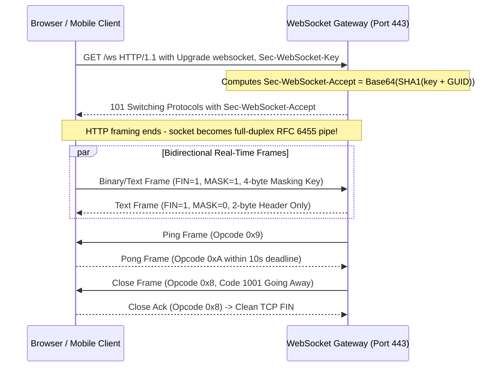
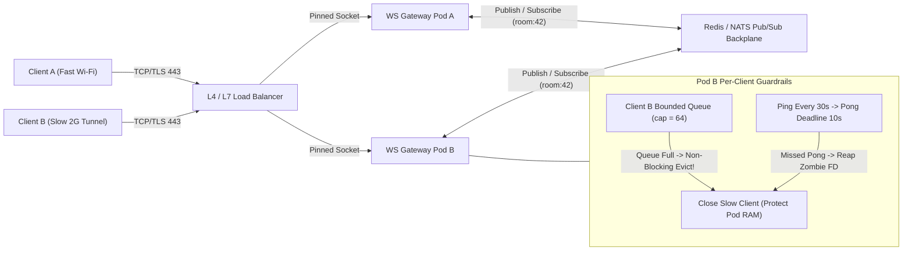
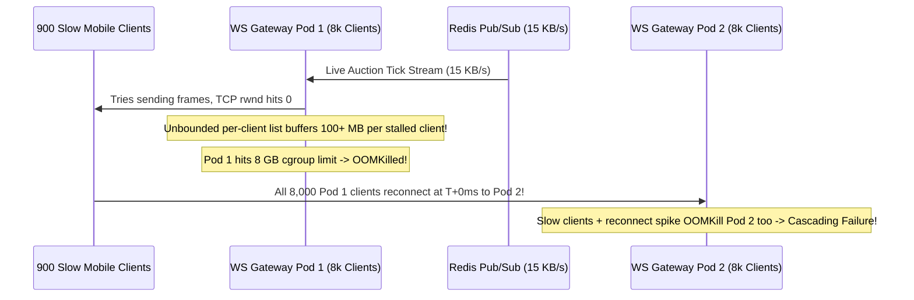

# Lesson 24: WebSockets — Full-Duplex Persistent Connections Over HTTP

> **Prerequisites:** [Lesson 23: HTTP/1.1 vs HTTP/2 vs HTTP/3](../23-http-1-1-vs-http-2-vs-http-3/README.md), [Lesson 18: HTTP Part 1](../18-http-requests-responses-and-methods/README.md), and [Networking From Zero Overview](../README.md) (Lesson 24 of 30).  
> **Estimated Reading Time:** 28 minutes  
> **Target Audience:** Backend and real-time systems engineers building low-latency chat, collaborative cursors, trading orderbooks, and stateful WebSocket gateways across auto-scaling Kubernetes pods.  
> **Free PDF Notes:** [Download SD-N-024.pdf](https://backendroadmap.com/notes/system-design/SD-N-024.pdf)

> [!TIP]
> **The Golden Rule of WebSocket Architecture:** A WebSocket begins as an HTTP request (`101 Switching Protocols` in HTTP/1.1 or `Extended CONNECT` in HTTP/2) and immediately **sheds HTTP framing** into a persistent, full-duplex binary pipe over port `443`—which makes your gateway **stateful**, so production deployments must **bound per-client send queues, enforce `Ping`/`Pong` liveness deadlines, bridge pods with Redis/NATS Pub/Sub, and drain sockets with jittered `1001` close frames**.

---

## Words You'll Meet Today

| Word | In Plain Words | Role in a Live Backend System |
| :--- | :--- | :--- |
| **Full-duplex** | Both sides can transmit and receive simultaneously on one socket. | Lets trading tickers push ticks at `100 Hz` while clients submit orders with zero wait. |
| **`101 Switching Protocols`** | HTTP status code handing the raw TCP socket to WebSocket framing. | Ends HTTP request-response rules on that connection and begins RFC 6455 binary frames. |
| **`Sec-WebSocket-Accept`** | Server handshake hash proving it genuinely speaks WebSockets. | Computed as `Base64(SHA1(Sec-WebSocket-Key + RFC6455_GUID))` to block proxy cache bugs. |
| **RFC 6455 frame** | A tiny `2–14` byte binary envelope wrapping text, binary, or control data. | Replaces `~600–800` bytes of repeated HTTP headers per real-time message. |
| **Client masking** | Mandatory `32`-bit XOR scrambling applied to every client-to-server payload. | Prevents malicious scripts from crafting raw HTTP requests inside frames to poison proxies. |
| **Extended `CONNECT`** | RFC 8441 HTTP/2 mechanism (`:protocol = websocket`) inside one stream. | Runs WebSockets inside multiplexed HTTP/2 connections instead of opening extra TCP sockets. |
| **`Ping` / `Pong`** | Control opcodes (`0x9` / `0xA`) verifying a silent peer is still alive. | Detects half-open zombie TCP sockets when mobile phones drop signal underground. |
| **Pub/Sub backplane** | Shared messaging bus (Redis Pub/Sub, NATS) linking stateful gateway pods. | Broadcasts a room event from Pod A to connected sockets pinned on Pod B. |

---

## Visual Mental Models & Architecture

### The Question: How Do Two Users Exchange Messages in Milliseconds Through Port 443?

In [Lesson 18](../18-http-requests-responses-and-methods/README.md) and [Lesson 23](../23-http-1-1-vs-http-2-vs-http-3/README.md), every HTTP interaction began with the **client** speaking first. A server cannot spontaneously push a live chat message or multiplayer cursor update down an idle HTTP request unless a request is already waiting—and repeating `800`-byte HTTP headers for every keystroke wastes bandwidth. Yet opening raw custom TCP ports (`9000`) gets blocked by corporate firewalls that only pass ports `80` and `443`. How does **WebSockets (RFC 6455)** bridge both worlds?

### An Everyday Picture First: Passing Notes at a Counter vs. Opening an Intercom

Standard HTTP is walking up to a bank counter, filling out an `800`-byte paper slip (`GET /messages` + `Cookie` + `User-Agent`), waiting for the clerk's answer (`200 OK`), and stepping back into line. WebSocket walks up to that exact same port `443` counter **once** carrying an upgrade pass (`Upgrade: websocket`). The clerk verifies the stamp, flips a sign reading **`101 Switching Protocols`**, and clicks open a **two-way live intercom** over the same wire. Neither side fills out paper forms ever again—both sides whisper tiny `2`-byte-headed frames simultaneously in either direction.



*Figure 1. Complete WebSocket lifecycle: an HTTP/1.1 Upgrade handshake transitions via `101 Switching Protocols` into simultaneous full-duplex RFC 6455 frames, `Ping`/`Pong` liveness probes, and graceful `1001` close draining.*

---

### Deep Dive 1: The HTTP/1.1 Upgrade Handshake & HTTP/2 `Extended CONNECT` (RFC 8441)

To connect over **HTTP/1.1**, the client sends a normal `GET` carrying special upgrade headers:

```http
GET /ws/orderbook HTTP/1.1
Host: stream.example.com
Upgrade: websocket
Connection: Upgrade
Sec-WebSocket-Key: dGhlIHNhbXBsZSBub25jZQ==
Sec-WebSocket-Version: 13
```

The server takes `Sec-WebSocket-Key`, concatenates the fixed RFC 6455 magic GUID **`258EAFA5-E914-47DA-95CA-C5AB0DC85B11`**, hashes with `SHA-1`, and Base64-encodes the `20`-byte digest into `Sec-WebSocket-Accept`:

$$\text{Sec-WebSocket-Accept} = \text{Base64}\!\left(\text{SHA1}(\text{Key} + \texttt{"258EAFA5-E914-47DA-95CA-C5AB0DC85B11"})\right)$$

For the classic RFC example key `dGhlIHNhbXBsZSBub25jZQ==`, this produces `s3pPLMBiTxaQ9kYGzzhZRbK+xOo=`, returned inside:

```http
HTTP/1.1 101 Switching Protocols
Upgrade: websocket
Connection: Upgrade
Sec-WebSocket-Accept: s3pPLMBiTxaQ9kYGzzhZRbK+xOo=
```

Why SHA-1? Not for secrecy or security—it is a deterministic protocol sanity check ensuring a dumb HTTP cache or reverse proxy that doesn't understand `Upgrade: websocket` can never accidentally replay a cached `200` page or mistake HTTP responses for WebSocket frames.

**What About HTTP/2 (`RFC 8441`) and HTTP/3 (`RFC 9220`)?** Over HTTP/1.1, upgrading hijacks the *entire* TCP socket. **RFC 8441 (`Extended CONNECT`)** lets a server advertise `SETTINGS_ENABLE_CONNECT_PROTOCOL = 1` over HTTP/2 so a client can open **one multiplexed stream** with `:method: CONNECT` and `:protocol: websocket`. The server replies **`200 OK`** (not `101`) and carries RFC 6455 frames inside that stream's HTTP/2 `DATA` frames—allowing dozens of independent WebSocket channels and normal REST API calls to share **one** TLS/TCP socket!

---

### Deep Dive 2: RFC 6455 Binary Frame Header Anatomy

Once upgraded, every message consists of one or more lightweight binary **frames**:

```text
 0                   1                   2                   3
 0 1 2 3 4 5 6 7 8 9 0 1 2 3 4 5 6 7 8 9 0 1 2 3 4 5 6 7 8 9 0 1
+-+-+-+-+-------+-+-------------+-------------------------------+
|F|R|R|R| opcode|M| Payload len |    Extended payload length    |
|I|S|S|S|  (4)  |A|     (7)     |             (16/64)           |
|N|V|V|V|       |S|             |   (if payload len==126/127)   |
| |1|2|3|       |K|             |                               |
+-+-+-+-+-------+-+-------------+ - - - - - - - - - - - - - - - +
|     Extended payload length continued, if payload len == 127  |
+ - - - - - - - - - - - - - - - +-------------------------------+
|                               |Masking-key, if MASK set to 1  |
+-------------------------------+-------------------------------+
| Masking-key (continued)       |          Payload Data         |
+-------------------------------- - - - - - - - - - - - - - - - +
```

Key design rules you must know:
- **`FIN` (1 bit):** `1` if this is the final fragment of a message; `0` if more `Continuation (0x0)` frames follow (letting huge payloads interleave with urgent `Ping`/`Pong` control frames).
- **`Opcode` (4 bits):** `0x1` UTF-8 text, `0x2` raw binary, `0x8` Close, `0x9` Ping, `0xA` Pong. Control frames (`0x8–0xA`) must be `<= 125` bytes and never fragmented (`FIN=1`).
- **`MASK` (1 bit) + `32`-bit Masking Key:** **Mandatory** (`MASK=1`) on all frames sent from **client to server**, and **forbidden** (`MASK=0`) from server to client. Why? Early transparent HTTP proxies ignored `Upgrade` and tried parsing raw client bytes on the wire as HTTP requests—an attacker sending crafted text inside an unmasked WebSocket frame could poison a shared proxy cache! XORing with a fresh random `32`-bit key per frame stops proxy confusion completely.

---

### Deep Dive 3: Scaling Stateful Gateways, Heartbeats, Slow Consumers & Rolling Deploys

Unlike stateless REST handlers where any pod can answer any request, **every live WebSocket pins a TCP socket to one specific backend pod**:

1. **Cross-Pod Routing via Redis / NATS Pub/Sub:** If Alice connects to **Pod A** and Bob connects to **Pod B**, Pod A cannot write to Bob's socket directly. Gateways subscribe to topic channels (`room:general`) on a **Pub/Sub backplane** (Redis Pub/Sub, NATS, or Kafka). When Alice sends a message, Pod A publishes it to `room:general`; Pod B receives the broadcast and writes to Bob's local socket.
2. **Heartbeats (`Ping` / `Pong`) Catch Silent Zombies:** A TCP connection stays `ESTABLISHED` forever in Linux memory if a mobile user rides into an elevator and stops sending packets without a `FIN`. Without application heartbeats, `50,000` dead sockets leak file descriptors and RAM. Gateways send a WebSocket `Ping (0x9)` every `30s` and close the socket if no `Pong (0xA)` returns within `10s`.
3. **Slow-Consumer Memory Blowup Protection:** When a client on `2G` cellular stalls, its TCP `rwnd` hits `0`, filling the server pod's kernel `SO_SNDBUF`. If your gateway reads broadcasts from Redis and pushes frames into an **unbounded per-client queue**, a single slow phone stalls in RAM while consuming megabytes per minute. Always enforce a **bounded per-client send channel** (e.g., `cap = 64` or `128` frames); if `trySend` fails because the buffer is full, **evict that slow client immediately** so healthy users aren't dragged into an `OOMKill`.
4. **Graceful Rolling Deploy Draining:** Sending `SIGTERM` during a Kubernetes rollout must not abruptly drop `25,000` sockets (`RST`). Instead, stop accepting new `/ws` upgrades on readiness probe failure, and send WebSocket **`Close (1001 Going Away)`** frames staggered with randomized jitter (`0–30s`)—otherwise all `25,000` clients reconnect at `t=0ms` and stampede your newly booted pods!



*Figure 2. Multi-pod WebSocket gateway architecture: pods bridge stateful connections over a Redis/NATS Pub/Sub backplane while protecting pod RAM with bounded per-client send queues and Ping/Pong liveness timers.*

---

## Systematic Reference & Comparison Grid

### RFC 6455 Frame Field & Opcode Summary

| Field / Opcode | Bit Width / Hex | Direction Rule | Purpose in Production |
| :--- | :--- | :--- | :--- |
| **`FIN`** | `1` bit | Both directions | Marks final frame of a message (`1` for single-frame messages) |
| **`Opcode 0x1` / `0x2`** | `4` bits | Both directions | UTF-8 JSON/text (`0x1`) vs compact Protobuf/MessagePack binary (`0x2`) |
| **`Opcode 0x8` (`Close`)** | `4` bits | Both directions | Carries 2-byte status (`1000` Normal, `1001` Going Away, `1008` Policy) |
| **`Opcode 0x9` / `0xA`** | `4` bits | Either (peer echoes `0xA`) | Heartbeat `Ping` (`0x9`) answered with matching payload `Pong` (`0xA`) |
| **`MASK` + `Masking-Key`** | `1` bit + `32` bits | **Client->Server ONLY** | XOR payload mask preventing proxy cache poisoning; `0` from server |
| **`Payload length`** | `7`, `7+16`, or `7+64` bits | Both directions | `0–125` inline, `126` = 16-bit len (`<=64 KB`), `127` = 64-bit len |

### HTTP/1.1 Upgrade vs. HTTP/2 Extended `CONNECT` & Capacity Math

| Dimension | `HTTP/1.1` Upgrade (RFC 6455) | `HTTP/2` Extended `CONNECT` (RFC 8441) |
| :--- | :--- | :--- |
| **Handshake Status** | `101 Switching Protocols` | `200 OK` (on a single H2 stream) |
| **Socket Sharing** | Hijacks entire TCP connection | Shares `1` TCP/TLS socket with REST API & other streams |
| **Proxy Requirements** | Needs `Connection: Upgrade` passthrough | Requires `SETTINGS_ENABLE_CONNECT_PROTOCOL = 1` support |

- **Header Overhead Savings:** Sending `1,000` short `50`-byte telemetry updates/sec over HTTP/1.1 (`~700`-byte headers) burns `(700 + 50) × 1,000 = 750 KB/s` per user; over WebSockets (`2`-byte server header), it burns `(2 + 50) × 1,000 = 52 KB/s` (**`93%` less bandwidth**).
- **Per-Pod Memory & Port Budget:** Assuming baseline kernel `SO_RCVBUF`/`SO_SNDBUF` + app state of `~32 KB` per socket plus a bounded `64`-frame send queue (`64 × 2 KB = 128 KB` worst-case burst), **`25,000` active clients** on one pod safely consume:

  $$\text{Baseline RAM} = 25{,}000 \times 32\text{ KB} \approx 800\text{ MB}, \qquad \text{Worst-Case Queue Burst} \le 25{,}000 \times 128\text{ KB} = 3.2\text{ GB}$$

  Without a bounded queue cap, just `1,000` stalled clients buffering `10 MB` each hit **`10 GB` heap -> instant `OOMKill`**.

---

## Production War Story Post-Mortem: Unbounded Send Queues Trigger Cascading Fleet OOMKill

- **Severity:** SEV-1 (Complete Real-Time Outage Across `6` Gateway Pods During Live Broadcast)
- **Detection / Resolution Time:** 8 minutes to identify `OOMKilled` cascade; 35 minutes to deploy bounded send-channel eviction
- **Impact:** `48,000` concurrent users watched a live auction feed pushing `10` updates/sec (`~1.5 KB` each). Poor venue cellular signal stalled `~900` mobile devices. Unbounded per-client write buffers bloated until Pod 1 OOM-killed—forcing its `8,000` clients to reconnect simultaneously onto Pods 2–6, knocking every remaining pod offline like dominoes.

### What Happened



### Root Cause Analysis

1. **Unbounded User-Space Send Buffering:** Whenever `socket.write()` blocked or yielded, the broadcast loop appended frames into an unbounded array (`[]byte` slice / JS `Array` / Python `list`).
2. **No Slow-Consumer Eviction or Jittered Reconnect:** When Pod 1 crashed, clients lacked exponential backoff + random jitter, hammering Pods 2–6 simultaneously with `8,000` TLS handshakes plus stale slow consumers.

### The Fix & Architectural Hardening

- **Bounded Send Channels (`cap = 64`):** Replaced unbounded arrays with fixed-capacity per-client channels; non-blocking enqueue drops and closes slow consumers with code `1008` / `1013` before pod memory grows.
- **Heartbeat Deadlines:** Enabled `25s` `Ping` + `10s` `Pong` read deadline to reap dead mobile sockets promptly.
- **Client Reconnect Jitter:** Updated mobile/web SDKs to wait `base * 2^attempt + random(0, 5000ms)` on disconnects and added `1001` staggered draining on server `SIGTERM`.

---

## Multi-Language Production Implementation

Below is a production-structured **Bounded WebSocket Gateway Hub** demonstrating `Ping`/`Pong` liveness tracking, bounded per-client send queues, and non-blocking slow-consumer eviction across Go, TypeScript, Python, and C#.

````carousel
```go
package wshub

import (
	"context"
	"net/http"
	"sync"
	"time"

	"github.com/gorilla/websocket"
)

const (
	writeWait  = 5 * time.Second
	pongWait   = 35 * time.Second
	pingPeriod = 25 * time.Second
	sendCap    = 64 // Hard per-client queue cap prevents slow-consumer OOM
)

type Client struct {
	conn *websocket.Conn
	send chan []byte
	hub  *Hub
}

type Hub struct {
	mu      sync.RWMutex
	clients map[*Client]struct{}
}

func NewHub() *Hub { return &Hub{clients: make(map[*Client]struct{})} }

func (h *Hub) Broadcast(msg []byte) {
	h.mu.RLock()
	defer h.mu.RUnlock()
	for c := range h.clients {
		select {
		case c.send <- msg: // Fast enqueue
		default:
			// Slow consumer queue full -> drop and evict asynchronously
			go h.evict(c)
		}
	}
}

func (h *Hub) evict(c *Client) {
	h.mu.Lock()
	if _, ok := h.clients[c]; ok {
		delete(h.clients, c)
		close(c.send)
		_ = c.conn.Close()
	}
	h.mu.Unlock()
}

func (c *Client) writePump(ctx context.Context) {
	ticker := time.NewTicker(pingPeriod)
	defer func() {
		ticker.Stop()
		c.hub.evict(c)
	}()
	for {
		select {
		case <-ctx.Done():
			_ = c.conn.WriteControl(websocket.CloseMessage,
				websocket.FormatCloseMessage(websocket.CloseGoingAway, "draining"),
				time.Now().Add(writeWait))
			return
		case msg, ok := <-c.send:
			_ = c.conn.SetWriteDeadline(time.Now().Add(writeWait))
			if !ok {
				return
			}
			if err := c.conn.WriteMessage(websocket.TextMessage, msg); err != nil {
				return
			}
		case <-ticker.C:
			if err := c.conn.WriteControl(websocket.PingMessage, nil, time.Now().Add(writeWait)); err != nil {
				return
			}
		}
	}
}

func (h *Hub) ServeWS(upgrader websocket.Upgrader, w http.ResponseWriter, r *http.Request) {
	conn, err := upgrader.Upgrade(w, r, nil)
	if err != nil {
		return
	}
	_ = conn.SetReadDeadline(time.Now().Add(pongWait))
	conn.SetPongHandler(func(string) error {
		return conn.SetReadDeadline(time.Now().Add(pongWait))
	})

	c := &Client{conn: conn, send: make(chan []byte, sendCap), hub: h}
	h.mu.Lock()
	h.clients[c] = struct{}{}
	h.mu.Unlock()

	go c.writePump(r.Context())
	defer h.evict(c)
	for {
		if _, _, err := conn.ReadMessage(); err != nil {
			return
		}
	}
}
```
<!-- slide -->
```typescript
import { WebSocketServer, WebSocket } from "ws";

const MAX_BUFFERED_BYTES = 128 * 1024; // 128 KB per-client backpressure cap
const PING_INTERVAL_MS = 25_000;

interface TrackedSocket extends WebSocket {
  isAlive: boolean;
}

export function createBoundedWsGateway(port: number) {
  const wss = new WebSocketServer({ port, maxPayload: 64 * 1024 });

  wss.on("connection", (raw) => {
    const ws = raw as TrackedSocket;
    ws.isAlive = true;
    ws.on("pong", () => {
      ws.isAlive = true;
    });
  });

  // Periodic Ping/Pong zombie reaper
  const timer = setInterval(() => {
    for (const raw of wss.clients) {
      const ws = raw as TrackedSocket;
      if (!ws.isAlive) {
        ws.terminate(); // Half-open zombie socket reaped immediately
        continue;
      }
      ws.isAlive = false;
      ws.ping();
    }
  }, PING_INTERVAL_MS);

  function broadcast(payload: string) {
    for (const ws of wss.clients) {
      if (ws.readyState !== WebSocket.OPEN) continue;
      // Slow-consumer protection: inspect kernel/user write buffer before queuing more
      if (ws.bufferedAmount > MAX_BUFFERED_BYTES) {
        ws.close(1008, "slow consumer evicted");
        continue;
      }
      ws.send(payload);
    }
  }

  function drainGracefully() {
    clearInterval(timer);
    for (const ws of wss.clients) {
      ws.close(1001, "server rolling deploy");
    }
    wss.close();
  }

  return { wss, broadcast, drainGracefully };
}
```
<!-- slide -->
```python
import asyncio
import contextlib
import websockets
from websockets.asyncio.server import ServerConnection, serve

QUEUE_CAP = 64
PING_INTERVAL_S = 25
PING_TIMEOUT_S = 10


class BoundedWsHub:
    def __init__(self) -> None:
        self.clients: dict[ServerConnection, asyncio.Queue[str]] = {}

    def broadcast(self, message: str) -> None:
        for ws, queue in list(self.clients.items()):
            try:
                queue.put_nowait(message)  # Non-blocking bounded enqueue
            except asyncio.QueueFull:
                # Slow consumer saturated queue -> evict to protect server RAM
                asyncio.create_task(ws.close(code=1008, reason="slow consumer"))

    async def handle(self, ws: ServerConnection) -> None:
        queue: asyncio.Queue[str] = asyncio.Queue(maxsize=QUEUE_CAP)
        self.clients[ws] = queue

        async def writer() -> None:
            while True:
                msg = await queue.get()
                await ws.send(msg)

        writer_task = asyncio.create_task(writer())
        try:
            async for _incoming in ws:
                pass  # Handle client messages or heartbeats
        finally:
            writer_task.cancel()
            with contextlib.suppress(asyncio.CancelledError):
                await writer_task
            self.clients.pop(ws, None)


async def main() -> None:
    hub = BoundedWsHub()
    async with serve(
        hub.handle,
        "0.0.0.0",
        8080,
        ping_interval=PING_INTERVAL_S,
        ping_timeout=PING_TIMEOUT_S,
    ):
        await asyncio.Future()
```
<!-- slide -->
```csharp
using System;
using System.Collections.Concurrent;
using System.Net.WebSockets;
using System.Text;
using System.Threading;
using System.Threading.Channels;
using System.Threading.Tasks;

public sealed class BoundedWebSocketHub
{
    private readonly ConcurrentDictionary<Guid, Channel<string>> _clients = new();

    public void Broadcast(string message)
    {
        foreach (var (id, channel) in _clients)
        {
            // Non-blocking write; evict slow consumers when 64-item queue saturates
            if (!channel.Writer.TryWrite(message))
            {
                channel.Writer.TryComplete(new InvalidOperationException("Slow consumer"));
                _clients.TryRemove(id, out _);
            }
        }
    }

    public async Task HandleClientAsync(WebSocket ws, CancellationToken appStopping)
    {
        var id = Guid.NewGuid();
        var channel = Channel.CreateBounded<string>(new BoundedChannelOptions(64)
        {
            FullMode = BoundedChannelFullMode.Wait,
            SingleReader = true
        });
        _clients[id] = channel;

        using var linked = CancellationTokenSource.CreateLinkedTokenSource(appStopping);
        var writerTask = Task.Run(async () =>
        {
            await foreach (var msg in channel.Reader.ReadAllAsync(linked.Token))
            {
                byte[] bytes = Encoding.UTF8.GetBytes(msg);
                await ws.SendAsync(bytes, WebSocketMessageType.Text, true, linked.Token);
            }
        }, linked.Token);

        var buf = new byte[4096];
        try
        {
            while (ws.State == WebSocketState.Open && !appStopping.IsCancellationRequested)
            {
                var res = await ws.ReceiveAsync(buf, appStopping);
                if (res.MessageType == WebSocketMessageType.Close) break;
            }
        }
        finally
        {
            _clients.TryRemove(id, out _);
            channel.Writer.TryComplete();
            if (ws.State == WebSocketState.Open)
                await ws.CloseAsync(WebSocketCloseStatus.EndpointUnavailable, "draining", CancellationToken.None);
            linked.Cancel();
            try { await writerTask; } catch (OperationCanceledException) { }
        }
    }
}
```
````

---

## Practical Hands-On Verification CLI Workflows

### 1. Compute and Verify `Sec-WebSocket-Accept` From the RFC 6455 Test Vector

```bash
printf "dGhlIHNhbXBsZSBub25jZQ==258EAFA5-E914-47DA-95CA-C5AB0DC85B11" | openssl dgst -sha1 -binary | base64
```

**Expected Output:**

```text
s3pPLMBiTxaQ9kYGzzhZRbK+xOo=
```

This matches the exact `Sec-WebSocket-Accept` hash defined in RFC 6455 Section 1.3.

### 2. Inspect a Raw HTTP/1.1 `101 Switching Protocols` Handshake With `curl`

```bash
curl --http1.1 -iN --max-time 3 \
  -H "Connection: Upgrade" \
  -H "Upgrade: websocket" \
  -H "Sec-WebSocket-Version: 13" \
  -H "Sec-WebSocket-Key: dGhlIHNhbXBsZSBub25jZQ==" \
  https://ws.postman-echo.com/raw
```

**Expected Output:**

```text
HTTP/1.1 101 Switching Protocols
Upgrade: websocket
Connection: Upgrade
Sec-WebSocket-Accept: s3pPLMBiTxaQ9kYGzzhZRbK+xOo=
```

Note `--http1.1`: standard HTTP/1.1 upgrade fails if you negotiate HTTP/2 without RFC 8441 Extended `CONNECT`!

### 3. Watch Live WebSocket Socket Queue Buildup (`Send-Q`) Under Slow Consumers

```bash
ss -tanp | grep ':8080'
```

**Expected Output:**

```text
ESTAB  0  0       10.0.1.12:8080  198.51.100.44:54312  users:(("ws-gateway",pid=412,fd=19))
ESTAB  0  262144  10.0.1.12:8080  198.51.100.89:61004  users:(("ws-gateway",pid=412,fd=24))
```

Look at column 3 (`Send-Q = 262144` bytes on fd `24`): `198.51.100.89` has stopped reading and is backing up into the kernel buffer—precisely the slow-consumer signal your bounded application queue catches before OOM!

---

## Pause and Think

> [!exercise] Your chat gateway runs `4` pods behind an L7 load balancer. User A connects via `Upgrade: websocket` to Pod 1; User B connects to Pod 3. User A sends a chat message, yet User B never sees it—even though `Broadcast()` ran cleanly on Pod 1. Next, your mobile QA tester shuts off airplane mode and sends messages, and Pod 1 hits `98%` memory despite only `2,000` sockets open. What two distinct architectural pieces are missing? Decide before opening the answer.

<details><summary>Answer</summary>

1. **Missing Pub/Sub Backplane (Redis / NATS):** Calling `Broadcast()` in Pod 1's memory only writes to sockets attached to Pod 1; Pod 3 never hears about the message unless Pod 1 publishes to a shared Pub/Sub channel subscribed by all `4` pods.
2. **Missing Bounded Send Queues & `Ping`/`Pong` Deadlines:** When the mobile tester went into airplane mode without closing TCP cleanly, Pod 1 kept broadcasting into unbounded write buffers for the stalled/zombie socket until RAM spiked. Adding a bounded per-client send queue (evicting slow consumers) plus `25s` `Ping` / `10s` `Pong` deadlines solves both leaks.

</details>

---

## Operational Validation Checkpoints

<details><summary><strong>Checkpoint 1: Reverse Proxy Strips `Upgrade` and Returns `400` / `200`</strong></summary>

**Scenario:** Your WebSocket works directly on `localhost:8080`, but fails immediately behind Nginx (`400 Bad Request` or `502`) because Nginx strips `Upgrade` and `Connection` hop-by-hop headers by default. How do you configure Nginx properly?

**Solution:**
Force HTTP/1.1 upstream and explicitly forward `Upgrade` and `Connection`:
```nginx
proxy_http_version 1.1;
proxy_set_header Upgrade $http_upgrade;
proxy_set_header Connection "upgrade";
proxy_read_timeout 60s; # Match or exceed Ping/Pong heartbeat interval
```
Without `proxy_read_timeout` tuned above your heartbeat interval (`25s`), Nginx will prematurely drop quiet WebSocket sockets every `60s`!

</details>

<details><summary><strong>Checkpoint 2: Rolling Kubernetes Deployment Triggers a `503` Reconnect Stampede</strong></summary>

**Scenario:** Every time CI deploys a new WebSocket gateway image (`kubectl rollout restart`), `40,000` users simultaneously disconnect from terminating pods and fire `40,000` TLS + auth DB handshakes in `500 ms`, overloading the login service. What three fixes prevent this?

**Solution:**
1. **Server-side staggered drain:** On `SIGTERM`, stop accepting new connections and stagger `Close (1001 Going Away)` frames over `15–30` seconds across existing sockets.
2. **Client-side exponential backoff + jitter:** Force clients to wait `random(1s, 15s)` before opening a fresh WebSocket after receiving `1001`.
3. **Token verification locally (JWT/edge):** Validate auth signatures locally in memory without hitting a central database on every reconnect.

</details>

<details><summary><strong>Checkpoint 3: Client Masking Mistake When Writing a Custom Client/Load Generator</strong></summary>

**Scenario:** You write a custom lightweight Go/Python load test sending raw RFC 6455 frames directly to your server without setting `MASK=1`. Your server closes the connection immediately with protocol error `1002`. Why?

**Solution:**
RFC 6455 Section 5.1 mandates that **every frame sent from a client to a server MUST have `MASK=1` and a fresh 4-byte masking key** XORed over the payload; any unmasked client frame MUST trigger immediate connection termination with status `1002` (Protocol Error). Conversely, frames from **server to client MUST have `MASK=0`**.

</details>

---

## Common Mistakes & Troubleshooting

### What Goes Wrong

- **Using sticky sessions (`IP_HASH`) and thinking Pub/Sub isn't needed:** Sticky sessions keep *one client's* handshake requests hitting the same pod, **not** two different chat users landing on the same pod! Cross-user delivery still needs Redis/NATS Pub/Sub.
- **Unbounded write queues:** Buffering outbound messages indefinitely for slow clients leads to fleet-wide `OOMKill` cascades.
- **Forgetting WebSockets bypass standard HTTP middleware after upgrade:** Per-frame auth, rate limiting, and payload-size limits (`maxPayload`) must run inside your WebSocket message handler—HTTP rate limiters only run once at handshake!

### Common Myths

- **"WebSockets replace TCP."** False. WebSockets sit directly *on top* of a single TCP socket (or one HTTP/2 stream via RFC 8441)—they inherit TCP's ordered byte delivery and HoL behavior.
- **"The server must mask its frames too."** False. Only client-to-server frames are masked (`MASK=1`); server-to-client frames must stay unmasked (`MASK=0`).
- **"TCP keepalive replaces WebSocket `Ping`/`Pong`."** False. Default OS TCP keepalives wait `2 hours` before probing; application-level WebSocket `Ping`/`Pong` detects silent mobile drops in `10–35 seconds` and exercises the user-space event loop too.

| Symptom | Root Cause | Fix |
| :--- | :--- | :--- |
| Sockets drop every `60s` behind ALB/Nginx | Proxy `proxy_read_timeout` expires during idle gaps | Send WebSocket `Ping` every `25s` and raise proxy idle timeout |
| Pod memory climbs linearly under mobile traffic | Unbounded per-client send queues for stalled peers | Enforce fixed `cap=64` send queue + non-blocking slow-client eviction |
| `400 Bad Request` on `/ws` behind reverse proxy | Proxy uses HTTP/1.0 or strips `Upgrade`/`Connection` | Set `proxy_http_version 1.1` + forward `Upgrade` & `Connection` headers |

---

## Recap in Three Lines

1. WebSockets start with an HTTP `101 Switching Protocols` upgrade (or RFC 8441 HTTP/2 `Extended CONNECT`) and switch into tiny `2–14` byte full-duplex RFC 6455 binary frames.
2. Client-to-server frames must carry a 4-byte XOR `MASK`, while `Ping`/`Pong` control frames detect dead mobile sockets in seconds instead of hours.
3. Scaling stateful WebSocket pods reliably requires a Redis/NATS Pub/Sub backplane, bounded per-client send queues to evict slow consumers, and jittered `1001` draining on deploys.

---

## Interview Practice Questions

> [!interview] Walk me through how a WebSocket handshake works over HTTP/1.1. (Basic)

<details><summary>What to say in 30 seconds</summary>

The client sends a standard HTTP/1.1 `GET` request with `Connection: Upgrade`, `Upgrade: websocket`, `Sec-WebSocket-Version: 13`, and a random Base64 `Sec-WebSocket-Key`. The server appends the RFC 6455 magic GUID to that key, hashes it with SHA-1, Base64-encodes the result into `Sec-WebSocket-Accept`, and replies `101 Switching Protocols`. From that point forward, HTTP framing stops and both sides exchange lightweight full-duplex RFC 6455 binary frames over the same TCP socket.

</details>

> [!interview] Why are client-to-server WebSocket frames masked with XOR, while server-to-client frames are unmasked? (Tricky)

<details><summary>What to say in 30 seconds</summary>

Masking is not for encryption—TLS handles privacy. It defends against cache poisoning on legacy transparent HTTP proxies that don't understand the `Upgrade` header. Without masking, a malicious script in a browser could put raw HTTP `GET` bytes inside a WebSocket payload and trick an intermediary proxy into caching a fake response for another domain. XORing every client frame with a fresh 32-bit random key makes predictable wire text impossible, while servers don't need masking.

</details>

> [!interview] How do you scale a WebSocket chat service across 10 stateless-looking Kubernetes pods? (Scenario)

<details><summary>What to say in 30 seconds</summary>

Because WebSocket sockets are stateful and pinned to individual pods, User A on Pod 1 cannot reach User B on Pod 7 through local memory alone. We place an L4/L7 load balancer in front, keep connection-to-room mappings in each pod, and wire all pods to a shared Pub/Sub backplane like Redis Pub/Sub or NATS. When User A sends a message to `room:123`, Pod 1 publishes to that topic, and only pods holding local subscribers for `room:123` deliver it down their local sockets.

</details>

> [!interview] What happens when 500 slow mobile clients stop reading on a high-throughput WebSocket broadcast server, and how do you protect the pod? (Scenario)

<details><summary>What to say in 30 seconds</summary>

The slow clients advertise TCP `rwnd=0`, filling the server's kernel `SO_SNDBUF` until socket writes stall. If the server buffers outgoing messages in unbounded user-space arrays or lists, pod memory spikes until the OS triggers `OOMKill`, taking down thousands of healthy users too. The fix is a bounded per-client send queue—say, 64 frames or 128 KB—with non-blocking enqueue: when a client's queue fills up, drop and close that slow consumer immediately so healthy connections stay unaffected.

</details>

> [!interview] Why do you still need WebSocket `Ping`/`Pong` frames if TCP already has keepalives? (Basic)

<details><summary>What to say in 30 seconds</summary>

Default OS TCP keepalives wait roughly two hours before sending probes, and they don't verify that the user-space event loop or reverse proxy layer is responsive. Also, many load balancers like AWS ALB or Nginx tear down connections after 60 seconds of quiet. Sending application-level WebSocket `Ping` frames every 25 seconds with a 10-second `Pong` deadline detects silent half-open drops quickly and resets proxy idle timers cleanly.

</details>

> [!interview] How does WebSocket over HTTP/2 (RFC 8441) differ from HTTP/1.1 WebSockets, and how do you handle rolling deploys safely? (Tricky)

<details><summary>What to say in 30 seconds</summary>

Over HTTP/1.1, a WebSocket upgrade hijacks the entire TCP socket. RFC 8441 Extended `CONNECT` sends `:method: CONNECT` with `:protocol: websocket` inside HTTP/2, receives `200 OK`, and runs the WebSocket inside one multiplexed HTTP/2 stream alongside normal REST requests. For rolling deploys, servers must never `RST` active sockets at once; they should reject new upgrades and stagger `Close (1001 Going Away)` frames over 15–30 seconds while clients reconnect with randomized exponential jitter to prevent a thundering herd.

</details>

---

## Free PDF notes

Download these notes as a printable PDF, including the RFC 6455 frame bit layout, scaling diagram, and interview answers: [SD-N-024.pdf](https://backendroadmap.com/notes/system-design/SD-N-024.pdf).

---

## Sources

- [RFC 6455: The WebSocket Protocol](https://www.rfc-editor.org/rfc/rfc6455), `101` upgrade handshake, frame layout, masking, and control opcodes.
- [RFC 8441: Bootstrapping WebSockets with HTTP/2](https://www.rfc-editor.org/rfc/rfc8441), Extended `CONNECT` (`:protocol = websocket`) inside multiplexed streams.
- [RFC 9220: Bootstrapping WebSockets with HTTP/3](https://www.rfc-editor.org/rfc/rfc9220), Extended `CONNECT` over QUIC.
- [MDN: The WebSocket API](https://developer.mozilla.org/en-US/docs/Web/API/WebSockets_API), browser client behavior and close codes.

---

## Next

Next comes [Lesson 25: SSE vs Long Polling vs WebSockets](../25-sse-vs-long-polling-vs-websockets/README.md): when a simple one-way `text/event-stream` over HTTP/2 beats WebSockets (including AI LLM token streaming), how `Last-Event-ID` prevents dropped updates, and how to defeat reverse-proxy buffering traps. See [the track overview](../README.md) for the whole series.
