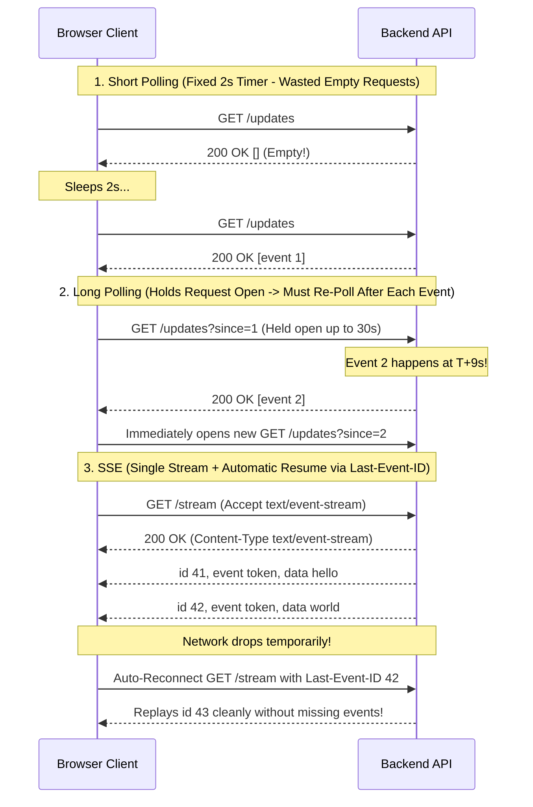
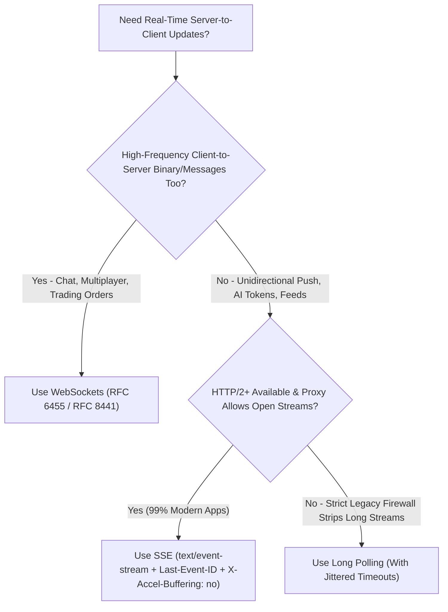
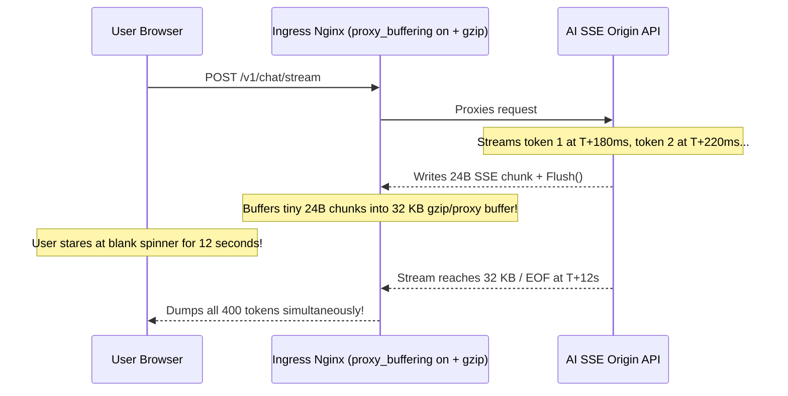

# Lesson 25: SSE vs Long Polling vs WebSockets

> **Prerequisites:** [Lesson 24: WebSockets](../24-websockets/README.md) and [Networking From Zero Overview](../README.md) (Lesson 25 of 30).  
> **Estimated Reading Time:** 26 minutes  
> **Target Audience:** Backend and full-stack engineers choosing real-time push transports for AI LLM token streams, notification feeds, dashboards, and live collaborative apps without proxy buffering bugs or reconnect storms.  
> **Free PDF Notes:** [Download SD-N-025.pdf](https://backendroadmap.com/notes/system-design/SD-N-025.pdf)

> [!TIP]
> **The Golden Rule of Real-Time Transport Selection:** Match transport complexity strictly to data direction: use **Server-Sent Events (`SSE`)** over HTTP/2 whenever updates flow **server-to-client** (AI LLM token streams, live feeds, build logs) for native `Last-Event-ID` resume and stateless HTTP middleware compatibility; reserve **WebSockets** for high-frequency bidirectional chat/games, and **Long Polling** only as a fallback behind proxies that forbid persistent streams.

---

## Words You'll Meet Today

| Word | In Plain Words | Role in a Live Backend System |
| :--- | :--- | :--- |
| **Short polling** | Client asks *"Anything new?"* on a fixed timer (`every 2s`). | Simplest stateless pattern, but wastes `>95%` of QPS and DB reads on empty responses. |
| **Long polling** | Client sends `GET` and server holds it open until an event or timeout. | Delivers instant push over plain HTTP, yet must rebuild an HTTP request after every message. |
| **Server-Sent Events (`SSE`)** | A single long-lived HTTP response streaming UTF-8 events (`text/event-stream`). | Native browser `EventSource` stream with automatic reconnect and resume over standard HTTP. |
| **`Last-Event-ID`** | HTTP request header browsers send automatically on SSE reconnects. | Enables gap-free replay from a Redis stream, ring buffer, or Kafka offset after drops. |
| **Keep-alive comment** | An SSE line starting with a colon (`: ping\n\n`) ignored by parsers. | Keeps ALB, Cloudflare, and Nginx idle timers (`60–100s`) alive without firing client events. |
| **Proxy buffering** | Reverse proxies holding small response chunks in RAM/disk before forwarding. | Batches tiny `20`-byte LLM tokens for seconds unless disabled via `X-Accel-Buffering: no`. |
| **Thundering herd** | `50,000` clients reconnecting at the exact same millisecond. | Triggered when fixed `30s` long-poll timeouts or proxy restarts synchronize client retries. |
| **6-connection limit** | HTTP/1.1 browser cap allowing only `6` TCP sockets per domain. | Causes multi-tab SSE starvation under HTTP/1.1—solved completely by HTTP/2 multiplexing. |

---

## Visual Mental Models & Architecture

### The Question: Why Do AI Chatbots Stream Over SSE Instead of WebSockets?

In [Lesson 24](../24-websockets/README.md) we built full-duplex WebSockets that deliver sub-millisecond frames in both directions. Yet inspect the Network tab of ChatGPT, Claude, or nearly every modern AI inference API and you won't see `101 Switching Protocols`. Instead, you'll see a plain HTTP request returning `Content-Type: text/event-stream` (**Server-Sent Events**). Why do production LLM APIs—and live status dashboards—deliberately skip WebSockets?

### An Everyday Picture First: Checking the Mailbox, Waiting on Hold, Tuning Radio, and Calling

- **Short Polling:** Walking out to your mailbox every `60` seconds. Most trips come back empty, wearing out your shoes (`CPU` and `QPS`).
- **Long Polling:** Calling the ticket counter and staying on hold until a ticket prints—instant answer when ready, *but* the clerk hangs up as soon as one ticket prints so you must redial immediately for the next one.
- **Server-Sent Events (`SSE`):** Tuning into a one-way live FM broadcast. You make **one** connection and listen smoothly as numbered announcements arrive (`id: 42`, `data: ...`). Drive under a tunnel and your radio automatically re-tunes and asks for `Last-Event-ID: 42`.
- **WebSockets:** A full two-way phone call where both people interrupt anytime. Powerful, yet unnecessary overhead when only the broadcaster is speaking!



*Figure 1. Wire behavior compared across Short Polling, Long Polling, and Server-Sent Events (SSE), highlighting SSE's built-in `Last-Event-ID` gap-free resume.*

---

### Deep Dive 1: Short Polling vs. Long Polling (and the 50k Reconnect Stampede)

- **Short Polling** hits your database on a fixed cadence regardless of whether data changed. With `50,000` active browser tabs polling every `2` seconds, your backend absorbs `25,000 req/s` (`1.5M req/min`) just to return `[]` `98%` of the time. Even with `304 Not Modified`, TLS/LB parsing and auth middleware burn real CPU.
- **Long Polling** keeps an HTTP request open until an event arrives or a server timeout (`~25–30s`) expires, returning empty `204`/`200 []` so the client immediately opens the next poll. It cuts wasted traffic cleanly and passes through strict corporate proxies that block upgrades.
- **The Thundering Herd Hazard:** If `50,000` clients all time out at the exact `30.000s` mark—or reconnect simultaneously when a gateway pod restarts cleanly—those `50,000` synchronized HTTP requests hit your load balancer in one spike, saturating CPU and connection pools. Long polling therefore **must** randomize server hold timeouts (`25s + random(0, 5s)`) and client reconnect delays.

---

### Deep Dive 2: SSE Wire Format, `Last-Event-ID` Resume, and the HTTP/1.1 6-Tab Hazard

**Server-Sent Events (`SSE`)** is plain UTF-8 text over a single HTTP response with `Content-Type: text/event-stream`. Each event is a sequence of `field: value` lines terminated by a blank line (`\n\n`):

```http
HTTP/1.1 200 OK
Content-Type: text/event-stream
Cache-Control: no-cache
X-Accel-Buffering: no
Content-Encoding: identity

retry: 3000
: keepalive

id: 101
event: token
data: {"delta":"Hello"}

id: 102
event: token
data: {"delta":" world"}

```

Notice the five building blocks:
1. **`event:`** Names the custom event type (`token`, `status`, `done`) handled via `eventSource.addEventListener("token", ...)` (defaults to `message`).
2. **`id:`** Monotonic event cursor stored automatically by the browser; if TCP drops, `EventSource` automatically sends **`Last-Event-ID: 102`** on reconnect so the backend replays `103+` cleanly.
3. **`data:`** UTF-8 payload (repeat `data:` lines for multi-line messages; always end the block with `\n\n`).
4. **`retry:`** Millisecond backoff hint (`3000` = `3s`) telling `EventSource` how long to wait before reconnecting.
5. **`: comment`** Any line beginning with `:` is ignored by the `EventSource` parser—making `: ping\n\n` every `15s` the clean way to prevent load-balancer idle timeouts!

**The HTTP/1.1 6-Tab Connection Exhaustion Trap vs. HTTP/2:** Because `EventSource` stays open indefinitely, over **HTTP/1.1** browsers enforce a global cap of **`6` concurrent TCP connections per domain** (`api.example.com`) shared across *all* open browser tabs! Open `6` tabs listening to `/events`, and opening a `7th` tab—or even calling `fetch("/api/save")` in tab `1`—hangs waiting for a free socket! Over **HTTP/2** (or HTTP/3), all `6` (or `100`) SSE streams share **one multiplexed TCP connection** (`MAX_CONCURRENT_STREAMS = 100+`), eliminating tab starvation effortlessly!

---

### Deep Dive 3: Why AI LLM Streaming Prefers SSE & Reverse-Proxy Buffering Traps

Why do OpenAI, Anthropic, and modern AI gateways stream `POST /v1/chat/completions` over **`SSE`** (consumed in the browser via `fetch()` `ReadableStream` or `EventSource` for `GET`) instead of WebSockets?

1. **Zero Stateful Upgrade Overhead:** Standard `HTTP` requests route naturally through stateless CDNs, WAFs, API gateways, bearer-token auth middleware, and standard HTTP error statuses (`401`, `429 Too Many Requests` with `Retry-After`) *before* the stream begins.
2. **Natural 1:1 Request-to-Stream Lifecycle:** Prompting an LLM sends one JSON payload once, then streams `100–2,000` tiny text deltas strictly server-to-client, then closes cleanly (`data: [DONE]\n\n`). There is no bidirectional chatter during generation.
3. **Reverse-Proxy Buffering Traps:** Because reverse proxies like **Nginx**, **Envoy**, and **CloudFront** try to optimize throughput by collecting small writes into `4–32 KB` buffers (or running `gzip` compression, which buffers until compression blocks fill!), tiny `20`-byte LLM token chunks can sit stuck at the proxy for `10+` seconds until the response finishes. You must disable buffering at every layer:
   - **`X-Accel-Buffering: no`** (tells Nginx/Ingress not to buffer this response, even if `proxy_buffering on` globally).
   - **`Cache-Control: no-cache, no-transform`** (prevents intermediate caches/CDNs from caching or compressing/rewriting the stream).
   - **`Content-Encoding: identity`** (or disabling `gzip` for `text/event-stream` MIME types—gzip buffers chunks before flushing!).



*Figure 2. Architecture decision flowchart: pick SSE over HTTP/2 for one-way streams and AI tokens, WebSockets for true full-duplex traffic, and jittered Long Polling only as a restrictive firewall fallback.*

---

## Systematic Reference & Comparison Grid

### Real-Time Transport Architecture Decision Matrix

| Criteria | Short Polling | Long Polling | Server-Sent Events (`SSE`) | WebSockets |
| :--- | :--- | :--- | :--- | :--- |
| **Direction** | Client -> Server (`poll`) | Server -> Client (via held `GET`) | **Server -> Client** (`1` stream) | **Full-Duplex** (Both ways) |
| **Protocol / Framing** | Plain HTTP `GET` | Plain HTTP `GET` | Plain HTTP (`text/event-stream`) | `101 Upgrade` / RFC 6455 Binary |
| **Binary Payloads** | Yes | Yes | UTF-8 text only (Base64 if binary) | **Native binary** + UTF-8 text |
| **Auto-Reconnect & Resume** | Manual | Manual (race-prone) | **Built-in** (`retry:` + `Last-Event-ID`) | Manual (must code backoff + cursor) |
| **HTTP Middleware / WAF / LB** | **Native** | **Native** | **Native** (needs buffering off) | Requires `Upgrade` / stateful pods |
| **HTTP/1.1 6-Tab Risk** | Low (short requests) | Medium (`1` socket/tab) | **High on HTTP/1.1** (**Zero on HTTP/2**) | Low (`1` socket per origin/tab) |
| **Per-Message Overhead** | `~600–800 B` headers | `~600–800 B` headers | `~10–30 B` (`id:`/`data:\n\n`) | **`2–6 B`** frame header |
| **Best Production Fit** | Low-urgency `30s+` checks | Legacy proxy fallback | **LLM token streams, feeds, logs** | **Chat, collaborative docs, games** |

### Request Rate & Bandwidth Math (`10,000` Active Users)

Suppose `10,000` users sit on an order dashboard receiving **`1` real update every `60` seconds** (`167` actual events/sec fleet-wide):

$$\text{Short Polling (every 2s)} = \frac{10{,}000}{2\text{ s}} = 5{,}000\text{ HTTP req/s} \quad (\text{96.7\% wasted!})$$

$$\text{Long Polling (30s hold + updates)} \approx \frac{10{,}000}{30\text{ s}} + 167 \approx 500\text{ HTTP req/s}$$

$$\text{SSE over HTTP/2} = 0\text{ new HTTP req/s once open} \quad (\text{only } 167\text{ tiny }\texttt{data:}\text{ frames/s + }\texttt{: ping}\text{ every 20s})$$

---

## Production War Story Post-Mortem: Buffered LLM Stream + Long-Poll Thundering Herd

- **Severity:** SEV-2 (`12`-Second Apparent Time-To-First-Token Freeze + Periodic `502` Spikes)
- **Detection / Resolution Time:** 14 minutes via `curl -N` timestamping; 10 minutes to deploy header & proxy fixes
- **Impact:** Product launched a streaming AI coding assistant over SSE. Internally it felt instant (`180 ms` to first token), yet production users stared at a blank spinner for `12` seconds before `400` tokens dumped onto the screen at once—while a separate legacy long-polling notification banner crashed auth pods every `30` seconds cleanly on the dot.

### What Happened



### Root Cause Analysis

1. **Ingress Buffering + `gzip` Compression:** Nginx had `proxy_buffering on` (default `8 KB` buffers) and `gzip on` enabled globally. Both mechanisms waited to accumulate multi-kilobyte blocks before flushing bytes to the browser, completely destroying SSE streaming latency!
2. **Synchronized Long-Poll Timeouts:** On a fallback endpoint using `30s` long polling, an ingress reload dropped `40,000` connections together; every client held an identical `30,000 ms` hold timer, locking all `40,000` users into synchronized `30s` waves forever.

### The Fix & Architectural Hardening

- **Anti-Buffering SSE Response Headers:** Emitted `X-Accel-Buffering: no`, `Cache-Control: no-cache, no-transform`, and `Content-Encoding: identity` from the origin handler, and explicitly bypassed Nginx `gzip` on `text/event-stream`.
- **Jittered Long-Poll Hold & Retry:** Changed fixed `30s` holds to `25s + random(0, 10s)` and enforced exponential backoff with full jitter on client reconnects.

---

## Multi-Language Production Implementation

Below is a production-structured **Resumable SSE Streaming Endpoint** supporting `Last-Event-ID` event replay from a bounded ring history, explicit `X-Accel-Buffering: no` / `Cache-Control: no-cache` headers, immediate response flushing, and `15s` `: keepalive` comment heartbeats across Go, TypeScript, Python, and C#.

````carousel
```go
package ssehandler

import (
	"fmt"
	"net/http"
	"strconv"
	"sync"
	"time"
)

type Event struct {
	ID   int64
	Name string
	Data string
}

type StreamServer struct {
	mu      sync.RWMutex
	history []Event // Bounded ring of recent events for Last-Event-ID replay
	subs    map[chan Event]struct{}
}

func NewStreamServer() *StreamServer {
	return &StreamServer{subs: make(map[chan Event]struct{})}
}

func (s *StreamServer) ServeSSE(w http.ResponseWriter, r *http.Request) {
	flusher, ok := w.(http.Flusher)
	if !ok {
		http.Error(w, "streaming unsupported", http.StatusInternalServerError)
		return
	}

	w.Header().Set("Content-Type", "text/event-stream; charset=utf-8")
	w.Header().Set("Cache-Control", "no-cache, no-transform")
	w.Header().Set("X-Accel-Buffering", "no")       // Disable Nginx buffering
	w.Header().Set("Content-Encoding", "identity") // Prevent gzip chunk delay

	ch := make(chan Event, 64)
	s.mu.Lock()
	s.subs[ch] = struct{}{}
	// Replay missed events strictly newer than Last-Event-ID
	lastID, _ := strconv.ParseInt(r.Header.Get("Last-Event-ID"), 10, 64)
	var missed []Event
	for _, ev := range s.history {
		if ev.ID > lastID {
			missed = append(missed, ev)
		}
	}
	s.mu.Unlock()

	defer func() {
		s.mu.Lock()
		delete(s.subs, ch)
		close(ch)
		s.mu.Unlock()
	}()

	_, _ = fmt.Fprint(w, "retry: 3000\n\n")
	for _, ev := range missed {
		_, _ = fmt.Fprintf(w, "id: %d\nevent: %s\ndata: %s\n\n", ev.ID, ev.Name, ev.Data)
	}
	flusher.Flush()

	keepAlive := time.NewTicker(15 * time.Second)
	defer keepAlive.Stop()

	for {
		select {
		case <-r.Context().Done():
			return // Client disconnected cleanly
		case <-keepAlive.C:
			_, _ = fmt.Fprint(w, ": keepalive\n\n") // Colon comment resets proxy idle timer
			flusher.Flush()
		case ev := <-ch:
			_, _ = fmt.Fprintf(w, "id: %d\nevent: %s\ndata: %s\n\n", ev.ID, ev.Name, ev.Data)
			flusher.Flush()
		}
	}
}
```
<!-- slide -->
```typescript
import type { IncomingMessage, ServerResponse } from "node:http";

export interface SseEvent {
  id: number;
  event: string;
  data: string;
}

const history: SseEvent[] = []; // Bounded event log (keep last N in prod)
const clients = new Set<ServerResponse>();

export function handleSseRequest(req: IncomingMessage, res: ServerResponse): void {
  res.writeHead(200, {
    "Content-Type": "text/event-stream; charset=utf-8",
    "Cache-Control": "no-cache, no-transform",
    "X-Accel-Buffering": "no",       // Disable Nginx reverse-proxy buffering
    "Content-Encoding": "identity",  // Bypass gzip buffering on streams
  });
  res.flushHeaders();
  res.write("retry: 3000\n\n");

  // Replay missed events if client reconnected with Last-Event-ID
  const lastIdHeader = req.headers["last-event-id"];
  const lastId = typeof lastIdHeader === "string" ? Number.parseInt(lastIdHeader, 10) || 0 : 0;
  for (const ev of history) {
    if (ev.id > lastId) {
      res.write(`id: ${ev.id}\nevent: ${ev.event}\ndata: ${ev.data}\n\n`);
    }
  }

  clients.add(res);
  const keepAlive = setInterval(() => {
    res.write(": keepalive\n\n"); // Ignored by EventSource, resets proxy idle timers
  }, 15_000);

  req.on("close", () => {
    clearInterval(keepAlive);
    clients.delete(res);
    res.end();
  });
}

export function publishSseEvent(ev: SseEvent): void {
  history.push(ev);
  if (history.length > 500) history.shift();
  const frame = `id: ${ev.id}\nevent: ${ev.event}\ndata: ${ev.data}\n\n`;
  for (const res of clients) {
    res.write(frame);
  }
}
```
<!-- slide -->
```python
import asyncio
from collections import deque
from fastapi import FastAPI, Header, Request
from fastapi.responses import StreamingResponse

app = FastAPI()
EVENT_HISTORY: deque[tuple[int, str, str]] = deque(maxlen=500)


@app.get("/events")
async def stream_events(
    request: Request,
    last_event_id: str | None = Header(default=None, alias="Last-Event-ID"),
) -> StreamingResponse:
    resume_after = int(last_event_id) if (last_event_id and last_event_id.isdigit()) else 0

    async def event_generator():
        yield "retry: 3000\n\n"
        # 1. Replay any missed events strictly newer than Last-Event-ID
        for ev_id, ev_name, payload in list(EVENT_HISTORY):
            if ev_id > resume_after:
                yield f"id: {ev_id}\nevent: {ev_name}\ndata: {payload}\n\n"

        # 2. Stream live events with 15s keep-alive comments
        cursor = resume_after
        while not await request.is_disconnected():
            sent = False
            for ev_id, ev_name, payload in list(EVENT_HISTORY):
                if ev_id > cursor:
                    cursor = ev_id
                    yield f"id: {ev_id}\nevent: {ev_name}\ndata: {payload}\n\n"
                    sent = True
            if not sent:
                yield ": keepalive\n\n"
            await asyncio.sleep(15.0)

    return StreamingResponse(
        event_generator(),
        media_type="text/event-stream",
        headers={
            "Cache-Control": "no-cache, no-transform",
            "X-Accel-Buffering": "no",       # Prevent Nginx proxy buffering
            "Content-Encoding": "identity",  # Disable gzip chunk delay
        },
    )
```
<!-- slide -->
```csharp
using System;
using System.Collections.Generic;
using System.Threading;
using System.Threading.Tasks;
using Microsoft.AspNetCore.Http;

public sealed record SseItem(long Id, string EventName, string JsonData);

public static class SseEndpoints
{
    public static async Task StreamAsync(
        HttpContext ctx,
        IReadOnlyList<SseItem> recentHistory,
        IAsyncEnumerable<SseItem> liveEvents,
        CancellationToken ct)
    {
        ctx.Response.StatusCode = StatusCodes.Status200OK;
        ctx.Response.ContentType = "text/event-stream; charset=utf-8";
        ctx.Response.Headers.CacheControl = "no-cache, no-transform";
        ctx.Response.Headers["X-Accel-Buffering"] = "no";
        ctx.Response.Headers.ContentEncoding = "identity";

        await ctx.Response.WriteAsync("retry: 3000\n\n", ct);

        long.TryParse(ctx.Request.Headers["Last-Event-ID"].ToString(), out long lastId);
        foreach (var item in recentHistory)
        {
            if (item.Id > lastId)
            {
                await ctx.Response.WriteAsync(
                    $"id: {item.Id}\nevent: {item.EventName}\ndata: {item.JsonData}\n\n", ct);
            }
        }
        await ctx.Response.Body.FlushAsync(ct);

        using var keepAliveTimer = new PeriodicTimer(TimeSpan.FromSeconds(15));
        await using var enumerator = liveEvents.GetAsyncEnumerator(ct);
        var nextEventTask = enumerator.MoveNextAsync().AsTask();
        var nextPingTask = keepAliveTimer.WaitForNextTickAsync(ct).AsTask();

        while (!ct.IsCancellationRequested)
        {
            var finished = await Task.WhenAny(nextEventTask, nextPingTask);
            if (finished == nextEventTask)
            {
                if (!await nextEventTask) break;
                var ev = enumerator.Current;
                await ctx.Response.WriteAsync(
                    $"id: {ev.Id}\nevent: {ev.EventName}\ndata: {ev.JsonData}\n\n", ct);
                await ctx.Response.Body.FlushAsync(ct);
                nextEventTask = enumerator.MoveNextAsync().AsTask();
            }
            else
            {
                await nextPingTask;
                await ctx.Response.WriteAsync(": keepalive\n\n", ct);
                await ctx.Response.Body.FlushAsync(ct);
                nextPingTask = keepAliveTimer.WaitForNextTickAsync(ct).AsTask();
            }
        }
    }
}
```
````

---

## Practical Hands-On Verification CLI Workflows

### 1. Stream Live SSE Events Unbuffered and Test `Last-Event-ID` Resume

```bash
curl -N --no-buffer -i \
  -H "Accept: text/event-stream" \
  -H "Last-Event-ID: 100" \
  http://localhost:8080/events
```

**Expected Output:**

```text
HTTP/1.1 200 OK
Content-Type: text/event-stream; charset=utf-8
Cache-Control: no-cache, no-transform
X-Accel-Buffering: no
Content-Encoding: identity

retry: 3000

id: 101
event: token
data: {"delta":"Hello"}

: keepalive
```

Notice `-N` (`--no-buffer`) prevents `curl` itself from buffering stdout so you watch each chunk arrive in real time!

### 2. Detect Reverse-Proxy Buffering by Timing Token Arrivals

```bash
curl -N -sS https://api.example.com/v1/stream | awk '{ print strftime("%H:%M:%S"), $0; fflush(); }'
```

**Expected Output (Healthy Unbuffered Stream):**

```text
17:04:01 data: {"delta":"The"}
17:04:01 data: {"delta":" quick"}
17:04:02 data: {"delta":" brown"}
17:04:02 data: {"delta":" fox"}
```

If every line carries the **exact same final timestamp** after a `10`-second pause, an intermediate Nginx, CDN, or WAF proxy is still buffering!

### 3. Verify HTTP/2 Multiplexing on Concurrent SSE Streams

```bash
curl --http2 -sSI https://api.example.com/events | grep -iE 'HTTP/|content-type|x-accel-buffering|cache-control'
```

**Expected Output:**

```text
HTTP/2 200
content-type: text/event-stream; charset=utf-8
cache-control: no-cache, no-transform
x-accel-buffering: no
```

Confirm `HTTP/2 200`—meaning browser tabs share one TCP socket instead of tripping HTTP/1.1's `6`-connection domain ceiling!

---

## Pause and Think

> [!exercise] A customer support team reports that whenever they open `6` ticket tabs of your CRM in Chrome, clicking "Save Comment" on tab `1` spins forever until they close one of the tabs. Your backend logs show zero errors, low CPU, and healthy database latency, and the site serves over `HTTP/1.1` with an SSE stream per tab. Why does tab `1`'s `POST /save` hang? Decide before opening the answer.

<details><summary>Answer</summary>

Browsers enforce a strict **`6` persistent TCP connection limit per hostname over HTTP/1.1**. Each of the `6` open CRM tabs holds `1` open SSE `EventSource` TCP connection (`6 / 6` slots occupied). When the user clicks "Save Comment," `fetch("/api/save")` cannot open a `7th` TCP socket to the same host and stalls in Chrome's local socket queue indefinitely until a tab closes! Enabling **HTTP/2** on the edge load balancer solves this immediately because all `6` SSE streams plus `POST /api/save` multiplex cleanly as streams over **one** TCP connection.

</details>

---

## Operational Validation Checkpoints

<details><summary><strong>Checkpoint 1: SSE vs. WebSockets for a Multiplayer Whiteboard</strong></summary>

**Scenario:** You are designing a real-time collaborative whiteboard where `20` users drag shapes and stream live cursor coordinates at `30` updates/sec (`600` inbound + `12,000` outbound messages/sec). Would you choose SSE or WebSockets?

**Solution:**
Choose **WebSockets**. Cursor coordinates stream rapidly in **both** directions (`client -> server` and `server -> client`), often encoded compactly in binary (`Protobuf`/raw `Float32` structs). With SSE, the client would have to fire `30` separate HTTP `POST` requests/sec per user (`600` full HTTP header envelopes/sec) rather than tiny `2–6`-byte WebSocket frames over a single persistent socket.

</details>

<details><summary><strong>Checkpoint 2: Preventing Duplicate Events During `Last-Event-ID` Replay</strong></summary>

**Scenario:** Your SSE server assigns monotonic IDs (`1, 2, 3...`) stored in a Redis Stream (`XADD`). A mobile user loses Wi-Fi right after reading `id: 42`, reconnects with `Last-Event-ID: 42`, and your handler runs `XRANGE stream 42 +`. Why does the client render event `42` twice?

**Solution:**
Redis `XRANGE start end` is **inclusive** of `start`! When resuming from `Last-Event-ID: 42`, you want events **strictly greater than** `42` (`43+`), so use Redis exclusive syntax `(42` (`XRANGE stream (42 +`) or filter `if ev.ID > lastID` in application code.

</details>

<details><summary><strong>Checkpoint 3: Why `EventSource` Doesn't Support `POST` or Custom `Authorization` Headers</strong></summary>

**Scenario:** You try calling `new EventSource("/v1/chat/completions")` to stream an LLM response, but need to send a `4 KB` JSON prompt body (`POST`) and a `Bearer` token in the `Authorization` header. Why does `EventSource` fail here, and what do modern AI apps use instead?

**Solution:**
The browser `EventSource` API only supports HTTP `GET` and does **not** allow custom request headers (`Authorization`) or request bodies. Modern AI chat frontends therefore send a standard **`fetch("/v1/chat/completions", { method: "POST", headers: { Authorization: ... }, body: ... })`** and read the `text/event-stream` chunks incrementally from `response.body.getReader()` using a lightweight SSE line parser—getting `POST`, custom headers, *and* `HTTP/2` SSE streaming together!

</details>

---

## Common Mistakes & Troubleshooting

### What Goes Wrong

- **Serving SSE over `HTTP/1.1` on the main API domain:** Exhausts the browser's `6`-connection cap as soon as users open multiple tabs, deadlocking normal `fetch()` calls.
- **Leaving Nginx `gzip` or `proxy_buffering` active:** Buffers streaming AI tokens or notifications until kilobytes fill, turning instant `100 ms` UX into multi-second hangs.
- **Omitting `: keepalive\n\n` heartbeats:** Quiet SSE connections get killed silently every `60s` by AWS ALB or Cloudflare idle timeouts, forcing constant reconnects.

### Common Myths

- **"SSE is obsolete because WebSockets exist."** False. SSE is far simpler to scale behind HTTP L7 infrastructure, handles automatic reconnection and `Last-Event-ID` resume natively, and powers the vast majority of production AI LLM streaming APIs.
- **"SSE is limited to `6` connections everywhere."** False. That `6`-connection cap is an **HTTP/1.1** browser limit; over **HTTP/2** and **HTTP/3**, browsers negotiate `100+` concurrent SSE streams inside a single socket (`SETTINGS_MAX_CONCURRENT_STREAMS`).
- **"You don't need `X-Accel-Buffering: no` if your app calls `Flusher.Flush()`."** False. Calling `Flush()` in Go/Node/Python only flushes your application socket to the OS/proxy—Nginx or a CDN sits downstream and will still buffer unless told not to!

| Symptom | Root Cause | Fix |
| :--- | :--- | :--- |
| Browser tab #7 hangs indefinitely | HTTP/1.1 `6`-socket cap exhausted by SSE tabs | Upgrade edge/origin to HTTP/2 (`ALPN: h2`) |
| LLM tokens appear all at once at the end | Nginx `proxy_buffering on` or `gzip on` buffering stream | Send `X-Accel-Buffering: no` + `Content-Encoding: identity` |
| SSE disconnects cleanly every `60` seconds | Load balancer idle timeout during silent intervals | Emit `: keepalive\n\n` comment every `15–25s` |

---

## Recap in Three Lines

1. **Short polling** wastes bandwidth on empty loops and **long polling** risks `50k`-client timeout thundering herds, whereas **SSE** streams UTF-8 `text/event-stream` events natively over HTTP with automatic `Last-Event-ID` resume.
2. **SSE + HTTP/2** eliminates HTTP/1.1's `6`-tab connection starvation and powers AI LLM streaming without stateful WebSocket upgrade complexity.
3. Always pair SSE endpoints with `X-Accel-Buffering: no`, `Cache-Control: no-cache`, `Content-Encoding: identity`, and periodic `: keepalive\n\n` comments so proxies neither delay chunks nor snip quiet streams.

---

## Interview Practice Questions

> [!interview] Compare Short Polling, Long Polling, SSE, and WebSockets in 30 seconds. (Basic)

<details><summary>What to say in 30 seconds</summary>

Short polling checks on a fixed timer, wasting most requests on empty replies. Long polling holds an HTTP request open until data arrives or times out, cutting idle traffic but requiring a fresh request after every message. Server-Sent Events (SSE) keep one HTTP response open to push UTF-8 events one way from server to client with built-in reconnection and `Last-Event-ID` resume. WebSockets upgrade HTTP into a full-duplex binary pipe when both sides need low-latency continuous messaging.

</details>

> [!interview] Why do OpenAI, Anthropic, and most AI chat APIs stream tokens over SSE instead of WebSockets? (Scenario)

<details><summary>What to say in 30 seconds</summary>

LLM token streaming is naturally request-then-one-way-stream: the client sends one prompt and only receives text deltas back. SSE works natively with standard HTTP routing, stateless load balancers, bearer auth middleware, WAF rules, and standard `401`/`429` status codes—with zero `101 Upgrade` or custom `Ping`/`Pong` framing code. Over HTTP/2 it multiplexes effortlessly, and when consumed via `fetch()` `ReadableStream` it supports `POST` bodies and `Authorization` headers cleanly.

</details>

> [!interview] What happens when you deploy SSE over HTTP/1.1, and how does HTTP/2 fix it? (Basic)

<details><summary>What to say in 30 seconds</summary>

Over HTTP/1.1, browsers allow at most 6 concurrent TCP connections per origin across all open tabs. Because each SSE stream holds a connection open indefinitely, opening 6 tabs exhausts all 6 slots and starves ordinary API calls like `fetch()` or form saves. Moving to HTTP/2 solves this because HTTP/2 multiplexes 100+ logical streams over a single TCP connection, so multiple SSE tabs and normal REST requests share one socket cleanly.

</details>

> [!interview] Users say our streaming AI response freezes for 10 seconds and then dumps everything at once. How do you debug and fix it? (Scenario)

<details><summary>What to say in 30 seconds</summary>

First verify direct origin streaming versus through the proxy using `curl -N` with timestamps. Almost always, a reverse proxy like Nginx, CloudFront, or Envoy is buffering small SSE chunks (`proxy_buffering on`) or waiting to fill a compression block (`gzip on`). The fix is emitting `Content-Type: text/event-stream`, `X-Accel-Buffering: no`, `Cache-Control: no-cache, no-transform`, and `Content-Encoding: identity`, plus calling explicit `Flush()` after every token write.

</details>

> [!interview] How does SSE guarantee no missed events on a flaky mobile network without writing custom resume logic on the client? (Tricky)

<details><summary>What to say in 30 seconds</summary>

When the server attaches a monotonic `id:` line to every SSE message, the browser's `EventSource` automatically tracks the latest received ID. If the connection drops, `EventSource` waits for the server-configured `retry:` delay, reconnects automatically, and attaches a `Last-Event-ID` HTTP request header containing that cursor. The server simply replays every event strictly newer than `Last-Event-ID` from a short-term Redis stream or ring buffer before resuming live pushes.

</details>

> [!interview] What causes a 50,000-client thundering herd with Long Polling, and how do you mitigate it? (Tricky)

<details><summary>What to say in 30 seconds</summary>

If all 50,000 clients connect during a deploy or share an identical 30-second server hold timeout, their connections expire and reconnect in lockstep—hammering load balancers, TLS handshakes, and backend pools in synchronized CPU spikes. To break synchronization, jitter both the server long-poll timeout (e.g., 25s plus 0–10s random delay) and client reconnect backoff, and ensure gateway draining spreads disconnects over 15–30 seconds.

</details>

---

## Free PDF notes

Download these notes as a printable PDF, including the transport decision matrix, SSE wire syntax, and interview answers: [SD-N-025.pdf](https://backendroadmap.com/notes/system-design/SD-N-025.pdf).

---

## Sources

- [WHATWG HTML Standard: Server-Sent Events (`text/event-stream`)](https://html.spec.whatwg.org/multipage/server-sent-events.html), `EventSource`, `id:`, `event:`, `retry:`, and `Last-Event-ID` specification.
- [RFC 6202: Known Issues and Best Practices for HTTP Long Polling and Streaming](https://www.rfc-editor.org/rfc/rfc6202), connection caps, proxy timeouts, and buffering pitfalls.
- [RFC 9113: HTTP/2](https://www.rfc-editor.org/rfc/rfc9113), stream multiplexing eliminating HTTP/1.1 connection limits.
- [MDN: Using Server-Sent Events](https://developer.mozilla.org/en-US/docs/Web/API/Server-sent_events/Using_server-sent_events), browser behavior and event stream syntax.

---

## Next

Next comes [Lesson 26: HTTP Streaming, Chunked Transfer and Backpressure](../26-http-streaming-and-backpressure/README.md): how `Transfer-Encoding: chunked` and HTTP/2 `DATA` frames stream multi-gigabyte exports without blowing up RAM, and how TCP `rwnd` propagates backpressure all the way back to your database cursor. See [the track overview](../README.md) for the whole series.
