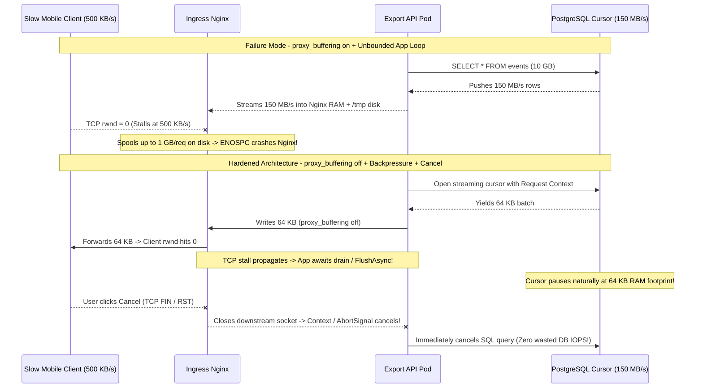

# Lesson 26: HTTP Streaming, Chunked Transfer and Backpressure

> **Prerequisites:** [Lesson 10: TCP Flow Control and Congestion Control](../10-tcp-flow-and-congestion-control/README.md), [Lesson 25: SSE vs Long Polling vs WebSockets](../25-sse-vs-long-polling-vs-websockets/README.md), and [Networking From Zero Overview](../README.md) (Lesson 26 of 30).  
> **Estimated Reading Time:** 28 minutes  
> **Target Audience:** Backend and platform engineers building multi-gigabyte CSV/Parquet exports, media/LLM streams, and proxy pipelines that maintain flat `O(1)` memory under slow clients without OOMKills or ingress disk exhaustion.  
> **Free PDF Notes:** [Download SD-N-026.pdf](https://backendroadmap.com/notes/system-design/SD-N-026.pdf)

> [!TIP]
> **The Golden Rule of Streaming & Backpressure:** HTTP streaming avoids loading gigabytes into RAM by emitting pieces incrementally (`Transfer-Encoding: chunked` in HTTP/1.1 or `DATA` + `END_STREAM` in HTTP/2+), **but streaming without end-to-end backpressure still OOMs your pod**: when a slow client drops its TCP receive window (`rwnd`), the server must pause pulling rows from the database cursor and cancel work immediately on client disconnect (`Context`/`AbortSignal`/`CancellationToken`).

---

## Words You'll Meet Today

| Word | In Plain Words | Role in a Live Backend System |
| :--- | :--- | :--- |
| **`Transfer-Encoding: chunked`** | HTTP/1.1 body format sending hex-sized pieces ending in `0\r\n\r\n`. | Streams unknown-length exports immediately before total `Content-Length` is known. |
| **`END_STREAM` flag** | Binary bit (`0x1`) on an HTTP/2 or HTTP/3 `DATA` frame marking completion. | Replaces HTTP/1.1 `chunked` framing (explicitly illegal in HTTP/2 and HTTP/3!). |
| **Backpressure** | Slow consumer pushing back upstream to throttle a faster producer. | Keeps API pod memory flat (`~64 KB` per export) regardless of `1 GB` or `100 GB` total size. |
| **Receive window (`rwnd`)** | TCP header field telling the sender how much free buffer space remains. | Shrinks to `0` (`TCP ZeroWindow`) when a mobile client or slow disk stops draining. |
| **`SO_SNDBUF`** | Kernel TCP send buffer storing unacknowledged outgoing socket bytes. | Fills completely once `rwnd=0`, causing `write()` to block or return `EAGAIN`. |
| **`drain` / high-water mark** | Stream signal pausing producer loops until kernel buffers clear. | Prevents Node/Python/Go/C# loops from piling `150 MB/s` of DB rows into heap RAM. |
| **`WINDOW_UPDATE`** | HTTP/2 control frame granting additional byte quota per stream and connection. | Isolates flow control per multiplexed stream so one slow export doesn't starve others. |
| **`proxy_max_temp_file_size`** | Nginx limit for spooling slow upstream responses to disk (`default 1g`). | Silently exhausts container ephemeral disk (`ENOSPC`) under concurrent large exports. |

---

## Visual Mental Models & Architecture

### The Question: Why Did Ten 1 GB Downloads Crash an 8 GB API Server?

In [Lesson 10](../10-tcp-flow-and-congestion-control/README.md) we learned how TCP's `rwnd` pauses a fast sender when a receiver falls behind, and in [Lesson 25](../25-sse-vs-long-polling-vs-websockets/README.md) we streamed live SSE text. Now suppose an analytics API serves a `1 GB` CSV report. If you build the string in memory first (`res.send(csv)`), `10` concurrent users allocate `10 GB` and immediately crash an `8 GB` container. So you switch to streaming row-by-row—yet `30` seconds later, when `10` commuters on slow 3G download the report, **your pod still crashes with `OOMKilled`**! Why? Because you streamed *forward* without honoring **backpressure** *backward*.

### An Everyday Picture First: A Firehose Over a Funnel vs. A Sealed Pressurized Pipe

- **Buffering Everything:** Filling a `1,000`-liter tank on your desk before handing a single drop to the customer—your floor collapses (`OOM`).
- **Streaming *Without* Backpressure:** Aiming a `500 L/min` firehose into a funnel feeding a tiny drinking straw. Even though water leaves incrementally, the funnel overflows all over the server room (`heap grows linearly until OOMKill`).
- **Streaming *With* Backpressure:** Connecting the pump to the customer's straw with a **tight, sealed pressure pipe**. When the customer slows sipping, water pressure pushes straight back up the pipe and **automatically slows the pump (`DB cursor`)** to match the straw!


*Figure 1. End-to-end backpressure chain: a slow mobile client drops `rwnd` to `0`, filling the kernel `SO_SNDBUF` and forcing the server stream to pause reading from the database cursor until bytes drain.*

---

### Deep Dive 1: `Transfer-Encoding: chunked` (HTTP/1.1) vs. `DATA` + `END_STREAM` (HTTP/2+)

When a server doesn't know total response byte size upfront—or wants Time-To-First-Byte (`TTFB`) in `10 ms` instead of waiting `60s` to compute `Content-Length`—HTTP uses **chunked framing**:

- **HTTP/1.1 (`Transfer-Encoding: chunked`, RFC 9112):** Every chunk starts with its byte length in **hexadecimal**, followed by `\r\n`, the raw bytes, and `\r\n`. A final zero-length chunk **`0\r\n\r\n`** signals complete transmission (and can carry optional **HTTP Trailers** like `X-Checksum-SHA256` after `0\r\n`!):
  ```http
  HTTP/1.1 200 OK
  Content-Type: text/csv
  Transfer-Encoding: chunked

  a\r\n
  id,amount\n\r\n
  8\r\n
  1,49.99\n\r\n
  0\r\n
  \r\n
  ```
  *(Hex `a` = `10` bytes for `"id,amount\n"`, hex `8` = `8` bytes for `"1,49.99\n"`, and `0\r\n\r\n` marks the final terminator.)*
  That explicit `0\r\n\r\n` marker matters critically: if a network drop cuts TCP off early without `0\r\n\r\n`, the client knows the CSV export was **truncated** rather than silently treating half a file as complete!

- **HTTP/2 & HTTP/3 (`DATA` Frames + `END_STREAM`, RFC 9113):** `Transfer-Encoding: chunked` is **forbidden** in HTTP/2 and HTTP/3 (`PROTOCOL_ERROR`). Instead, servers send binary `DATA` frames—each prefixed with an explicit `24`-bit byte length—and set the `END_STREAM (0x1)` bit on the final `DATA` frame (or on an empty `DATA` or trailing `HEADERS` frame).

---

### Deep Dive 2: How Backpressure Propagates—and How Naive Code Breaks It

Watch closely what happens inside your backend process when a mobile download slows to `500 KB/s` while PostgreSQL streams rows at `150 MB/s`:

1. **Client `rwnd` Hits Zero:** The client's socket receive buffer fills (`rwnd = 0`).
2. **Server Kernel `SO_SNDBUF` Fills:** The OS stops sending segments and fills `SO_SNDBUF` (`~128 KB–4 MB`).
3. **The Fatal Fork in Application Code:**
   - **Broken (Firehose Without Valve):** In Node.js, calling `res.write(chunk)` inside a tight `for await` or callback loop *ignores* its `false` return value (`highWaterMark` reached, e.g. `16–64 KB`), queuing unbounded `Buffer` objects inside V8's heap at `149.5 MB/s` until **OOMKill**! In Python/Go/C#, pushing rows into an unbounded channel/list produces the exact same crash.
   - **Correct (End-to-End Backpressure):**
     - **Go:** `w.Write(buf)` blocks naturally once `SO_SNDBUF` fills until kernel buffer space frees up; pair with `<-r.Context().Done()` to abort the DB cursor immediately if the user hits Cancel!
     - **TypeScript / Node.js:** Use `stream.pipeline(dbReadable, res)` or explicitly pause and **`await once(res, "drain")`** whenever `res.write(chunk)` returns `false`, passing `AbortSignal` into the DB query!
     - **Python (FastAPI / asyncio):** Consume an `async` generator (`StreamingResponse`) where the ASGI server (`uvicorn`/`hypercorn`) awaits socket transport `drain()` between `yield`ed chunks, handling `asyncio.CancelledError` cleanly to close DB cursors!
     - **C# (ASP.NET Core):** Write into `HttpContext.Response.BodyWriter` (`PipeWriter`), checking `FlushResult` and calling **`await writer.FlushAsync(ct)`**—which asynchronously suspends the DB reader whenever internal pipe pause thresholds (`64 KB`) trigger—passing `HttpContext.RequestAborted` (`CancellationToken`) to `DbDataReader`!

---

### Deep Dive 3: HTTP/2 `WINDOW_UPDATE` Flow Control & Nginx Temp-File Disk Traps

- **HTTP/2 Two-Level Flow Control (`WINDOW_UPDATE`):** Every HTTP/2 stream starts with a `65,535`-byte window (configurable via `SETTINGS_INITIAL_WINDOW_SIZE`), alongside a **connection-level** window. As the browser consumes bytes for Stream `3`, it sends `WINDOW_UPDATE` frames granting Stream `3` more quota. Crucially, if a user pauses Stream `3` (e.g., pausing a video tab) while keeping Stream `5` active on the same socket, Stream `3`'s window hits `0` without starving Stream `5`—*provided* the app doesn't exhaust the shared connection window first!
- **Nginx `proxy_buffering` & `proxy_max_temp_file_size`:** Why does Nginx set **`proxy_buffering on`** by default? Because if your origin is slow-worker-limited (like synchronous Gunicorn workers), Nginx tries to slurp the whole `50 MB` response in `0.2s` to free the Gunicorn worker, then slowly spoon-feed the `3G` client. **The trap:** When a response exceeds `proxy_buffers` in RAM (`~32–64 KB`), Nginx spools overflow bytes onto `/var/lib/nginx/tmp` up to `proxy_max_temp_file_size` (`1 GB` per request by default!). Launch `16` concurrent `10 GB` exports to slow clients and Nginx fills `16 GB` of container ephemeral storage -> **`ENOSPC` (`No space left on device`)** -> entire ingress cluster crashes! Setting **`proxy_buffering off`** (or sending `X-Accel-Buffering: no`) disables temp-file spooling and relays TCP backpressure straight back to your streaming origin app!



*Figure 2. Buffering vs. backpressure trace: Nginx `proxy_buffering on` causes disk exhaustion under large exports, whereas `proxy_buffering off` plus explicit app backpressure and disconnect cancellation keeps memory flat and stops orphaned DB queries.*

---

## Systematic Reference & Comparison Grid

### HTTP Streaming Framing & Proxy Buffering Comparison

| Mode / Protocol | Body Framing Marker | Truncation Detection | Proxy Temp Disk Risk | Memory Per `1 GB` Export |
| :--- | :--- | :--- | :--- | :--- |
| **`HTTP/1.1` Buffered (`Content-Length`)** | Exact decimal byte count | Fails if `bytes < Content-Length` | Low if small, OOMs origin | **`1 GB` RAM** (OOM crash!) |
| **`HTTP/1.1` `Transfer-Encoding: chunked`** | Hex byte lengths + **`0\r\n\r\n`** | Fails if `0\r\n\r\n` missing | High if `proxy_buffering on` | **`~64 KB` RAM** (with backpressure) |
| **`HTTP/2` / `HTTP/3` Stream** | Binary `DATA` frames + **`END_STREAM`** | Fails if `END_STREAM` missing | High if L7 buffers stream | **`~64 KB` RAM** (per-stream `WINDOW_UPDATE`) |

### Quantitative OOM Crash Math (`10` Slow Exports)

Suppose an API pod has **`4 GB` RAM**, PostgreSQL streams rows at $R_{db} = 150\text{ MB/s}$, and `10` slow mobile clients download at $R_{net} = 0.5\text{ MB/s}$ each:

- **Full In-Memory Buffering:**
  $$\text{RAM} = 10 \times 1{,}024\text{ MB} = 10.24\text{ GB} \implies \text{Instant OOMKill}$$
- **Un-Backpressured Streaming (Ignoring `drain`):**
  $$\text{Heap Growth Rate} = 10 \times (150 - 0.5)\text{ MB/s} = 1{,}495\text{ MB/s} \implies \text{4 GB Exhausted in } \frac{4{,}096}{1{,}495} \approx 2.7\text{ s}$$
- **True End-to-End Backpressure (`64 KB` chunk buffer):**
  $$\text{Total Streaming RAM} = 10 \times 64\text{ KB} = 640\text{ KB} \quad (\text{Flat } O(1) \text{ footprint!})$$

---

## Production War Story Post-Mortem: From Ingress `ENOSPC` Disk Crash Straight Into API OOMKill

- **Severity:** SEV-1 (Ingress Pod Evictions Followed Immediately by Backend Export OOMKills)
- **Detection / Resolution Time:** 12 minutes to spot `ENOSPC` in Nginx; 40 minutes to deploy true `drain` + `AbortSignal` backpressure
- **Impact:** Enterprise customers exporting `10 GB` audit logs caused Nginx Ingress pods to crash with `No space left on device`. An emergency patch set `proxy_buffering off` on `/exports/*`—and within `90` seconds every backend API pod OOM-killed instead!

### What Happened

1. **Phase 1 (`ENOSPC`):** `proxy_buffering on` absorbed `150 MB/s` bursts from the API, spooling up to `1 GB` per request onto small `10 GB` Kubernetes container root disks (`proxy_max_temp_file_size 1024m`). `12` concurrent slow exports filled disk cleanly.
2. **Phase 2 (`OOMKill`):** Turning `proxy_buffering off` removed the disk shield and pushed TCP backpressure directly onto the Node.js export route—which had `cursor.on("data", row => res.write(row))` **without checking `res.write()`'s boolean return value or pausing the Postgres cursor**! Heap exploded at `150 MB/s` per export.

### The Fix & Architectural Hardening

- **Enforced Stream `pipeline()` & `drain` Backpressure:** Replaced `cursor.on("data")` with `await pipeline(dbRowReadable, csvTransform, res, { signal })` so `dbRowReadable` pauses automatically whenever `res` hits `highWaterMark`.
- **Disabled Proxy Buffering Safely (`X-Accel-Buffering: no`):** Kept `proxy_buffering off` / `proxy_max_temp_file_size 0` exclusively on streaming export routes once app backpressure was verified.
- **Propagated Client Cancellation to DB:** Wired `req.on("close")` / `AbortSignal` directly to `pgQuery.cancel()` so abandoned downloads stop reading Postgres immediately.

---

## Multi-Language Production Implementation

Below is a production-structured **Bounded-Memory Streaming HTTP Responder** reading from a fast row/chunk producer with explicit **end-to-end backpressure** and immediate **client-disconnect cancellation** across Go, TypeScript, Python, and C#.

````carousel
```go
package streaming

import (
	"context"
	"fmt"
	"net/http"
)

type RowProducer interface {
	// Next returns false when exhausted or ctx is cancelled.
	Next(ctx context.Context) ([]byte, bool, error)
}

// StreamCSV streams arbitrary-size exports using O(1) memory, honoring TCP backpressure
// and aborting the upstream DB cursor immediately if the client disconnects.
func StreamCSV(w http.ResponseWriter, r *http.Request, producer RowProducer) {
	ctx := r.Context() // Cancelled automatically if TCP socket closes or client aborts
	w.Header().Set("Content-Type", "text/csv; charset=utf-8")
	w.Header().Set("Cache-Control", "no-store")
	w.Header().Set("X-Accel-Buffering", "no") // Relay TCP backpressure through Nginx
	w.WriteHeader(http.StatusOK)             // Go uses Transfer-Encoding: chunked (H1) or DATA (H2)

	flusher, canFlush := w.(http.Flusher)

	for {
		if ctx.Err() != nil {
			return // Client aborted; stop pulling rows immediately
		}
		row, ok, err := producer.Next(ctx)
		if err != nil || !ok {
			return
		}
		// Write blocks cleanly once kernel SO_SNDBUF fills under slow TCP rwnd!
		if _, err := w.Write(row); err != nil {
			return
		}
		if canFlush {
			flusher.Flush()
		}
	}
}

// FormatDemoChunk shows HTTP/1.1 wire hex chunk framing for learning.
func FormatDemoChunk(payload []byte) string {
	return fmt.Sprintf("%x\r\n%s\r\n", len(payload), payload)
}
```
<!-- slide -->
```typescript
import { once } from "node:events";
import type { IncomingMessage, ServerResponse } from "node:http";

export async function streamBoundedExport(
  req: IncomingMessage,
  res: ServerResponse,
  produceChunks: (signal: AbortSignal) => AsyncIterable<Buffer>
): Promise<void> {
  const controller = new AbortController();
  // Immediately abort upstream DB cursor if client closes socket early
  req.on("close", () => {
    if (!res.writableEnded) controller.abort();
  });

  res.writeHead(200, {
    "Content-Type": "text/csv; charset=utf-8",
    "Cache-Control": "no-store",
    "X-Accel-Buffering": "no", // Disable Nginx temp-file spooling
  });

  try {
    for await (const chunk of produceChunks(controller.signal)) {
      if (controller.signal.aborted) break;

      // CRITICAL BACKPRESSURE CHECK: returns false when highWaterMark (16 KB) fills
      const canContinue = res.write(chunk);
      if (!canContinue) {
        // Pause pulling from DB cursor until kernel SO_SNDBUF drains!
        await Promise.race([
          once(res, "drain"),
          once(controller.signal, "abort"),
        ]);
      }
    }
    if (!controller.signal.aborted) {
      res.end(); // Emits HTTP/1.1 "0\r\n\r\n" or HTTP/2 END_STREAM
    }
  } catch (err) {
    if (!controller.signal.aborted) res.destroy(err as Error);
  }
}
```
<!-- slide -->
```python
import asyncio
from collections.abc import AsyncIterator
from fastapi import FastAPI, Request
from fastapi.responses import StreamingResponse

app = FastAPI()


async def db_row_generator(request: Request) -> AsyncIterator[bytes]:
    """Yield 64 KB CSV batches with ASGI backpressure and disconnect cancellation."""
    try:
        for batch_id in range(100_000):
            # Stop upstream DB work immediately if client disconnected
            if await request.is_disconnected():
                break
            # FastAPI / Starlette awaits transport write/drain before asking for next item!
            yield f"{batch_id},ok,49.99\n".encode("utf-8")
            await asyncio.sleep(0)  # Yield to event loop so transport drain & cancel run
    except asyncio.CancelledError:
        # Cleanly close DB cursor / rollback transaction on abrupt client drop
        raise


@app.get("/export.csv")
async def export_csv(request: Request) -> StreamingResponse:
    return StreamingResponse(
        db_row_generator(request),
        media_type="text/csv; charset=utf-8",
        headers={
            "Cache-Control": "no-store",
            "X-Accel-Buffering": "no",  # Disable Nginx disk/RAM buffering
        },
    )
```
<!-- slide -->
```csharp
using System;
using System.Collections.Generic;
using System.Text;
using System.Threading;
using System.Threading.Tasks;
using Microsoft.AspNetCore.Http;

public static class BackpressureExportEndpoint
{
    public static async Task StreamExportAsync(
        HttpContext ctx,
        Func<CancellationToken, IAsyncEnumerable<string>> queryRows)
    {
        CancellationToken ct = ctx.RequestAborted; // Fires immediately on client abort
        ctx.Response.StatusCode = StatusCodes.Status200OK;
        ctx.Response.ContentType = "text/csv; charset=utf-8";
        ctx.Response.Headers.CacheControl = "no-store";
        ctx.Response.Headers["X-Accel-Buffering"] = "no";

        var writer = ctx.Response.BodyWriter; // System.IO.Pipelines PipeWriter
        int batchCount = 0;

        await foreach (string row in queryRows(ct).WithCancellation(ct))
        {
            byte[] bytes = Encoding.UTF8.GetBytes(row);
            await writer.WriteAsync(bytes, ct);
            batchCount++;

            // Flush every 64 rows: suspends producer automatically if slow client fills buffer!
            if (batchCount % 64 == 0)
            {
                var flushResult = await writer.FlushAsync(ct);
                if (flushResult.IsCompleted || flushResult.IsCanceled) break;
            }
        }
        await writer.FlushAsync(ct);
    }
}
```
````

---

## Practical Hands-On Verification CLI Workflows

### 1. Inspect Raw HTTP/1.1 Hex Chunk Lengths and `0\r\n\r\n` Terminator

```bash
curl --http1.1 --raw -sS -i http://localhost:8080/export.csv | head -n 16
```

**Expected Output:**

```text
HTTP/1.1 200 OK
Content-Type: text/csv; charset=utf-8
Transfer-Encoding: chunked

a
id,amount
8
1,49.99
0

```

Notice `--raw` stops `curl` from hiding the chunked framing, revealing exact hex lengths (`a` = 10 bytes, `8` = 8 bytes) and the terminal `0` chunk!

### 2. Throttle a Download to `10 KB/s` and Watch Kernel `Send-Q` & Flat Server RSS

```bash
curl --limit-rate 10k -o /dev/null http://localhost:8080/export-1gb.csv &
ss -tinp | grep -A1 ':8080'
```

**Expected Output:**

```text
ESTAB  0  262144  127.0.0.1:8080  127.0.0.1:53210  users:(("exporter",pid=901,fd=8))
       cubic wscale:7,7 rto:204 rtt:0.4/0.2 ato:40 mss:65483 rcv_space:65495
```

Meanwhile, check `ps -o rss= -p 901` (`~24 MB`) across the full download: because `Send-Q` saturates and backpressure pauses the producer, server RAM stays completely flat!

### 3. Verify Client-Disconnect Cancellation Stops Upstream DB Work

```bash
timeout 1s curl -sS http://localhost:8080/export-1gb.csv > /dev/null || echo "Client aborted at 1s"
```

**Expected Output:**

```text
Client aborted at 1s
```

Verify in your backend logs immediately after `1s` that `r.Context().Err()` / `AbortSignal` / `CancelledError` / `RequestAborted` fired and closed the database cursor instead of streaming `999 MB` into a closed socket!

---

## Pause and Think

> [!exercise] You write a Node.js CSV export endpoint that reads `1,000,000` rows from PostgreSQL and pipes them to `res` (`HTTP/1.1`). Everything passes integration tests on `localhost`. In production, `5` mobile users on `100 KB/s` connections start exports simultaneously and your `2 GB` pod OOMKills in `15` seconds—yet when you run `curl http://localhost:8080/export` locally, memory stays at `40 MB`. What bug hides in your code? Decide before opening the answer.

<details><summary>Answer</summary>

Your code reads from the database cursor and calls `res.write(row)` without honoring `res.write()`'s `false` return value (or using `stream.pipeline()`). On `localhost`, loopback bandwidth (`5+ GB/s`) outruns PostgreSQL, so `SO_SNDBUF` never fills and `res.write()` always returns `true`. On `100 KB/s` mobile links, TCP `rwnd` stalls, `res.write()` returns `false`, and your un-throttled loop keeps reading rows at `100+ MB/s` into Node's internal writable buffer until heap exceeds `2 GB`! Always test streaming endpoints with `--limit-rate 10k` and check `drain` / `stream.pipeline()`!

</details>

---

## Operational Validation Checkpoints

<details><summary><strong>Checkpoint 1: Nginx `proxy_buffering on` Disk Exhaustion</strong></summary>

**Scenario:** A Kubernetes Ingress controller runs Nginx with default settings (`proxy_buffering on`, `proxy_max_temp_file_size 1024m`). Your service adds a `4 GB` backup archive download endpoint. During peak backups, Nginx Ingress pods start returning `500` and crashing with `write() failed (28: No space left on device)`. Why, and what are the two fixes?

**Solution:**
When upstream sends `4 GB` fast and clients drain slowly, Nginx spills overflow past `proxy_buffers` onto `/tmp` up to `1 GB` per concurrent request—filling small ingress container disks (`ENOSPC`). Fixes:
1. Return `X-Accel-Buffering: no` from streaming endpoints (or configure `proxy_buffering off;` + `proxy_max_temp_file_size 0;` on `/backups/`), **after** verifying the origin app implements true TCP backpressure!
2. Never assume `proxy_buffering on` makes slow clients "free"—it merely moves memory/disk pressure from origin workers onto the proxy's disk.

</details>

<details><summary><strong>Checkpoint 2: Detecting Truncated Exports Without `Content-Length`</strong></summary>

**Scenario:** A mobile client downloads a `500 MB` JSONL export over HTTP/1.1 `Transfer-Encoding: chunked`. Halfway through at `220 MB`, the cellular link drops with a clean TCP `FIN` from a buggy transparent proxy. How does the client distinguish a valid `220 MB` file from a truncated failure?

**Solution:**
In HTTP/1.1 `Transfer-Encoding: chunked`, valid completion **strictly requires** receiving the final zero-length chunk terminator `0\r\n\r\n`. If TCP closes before `0\r\n\r\n` (or before `END_STREAM` in HTTP/2), compliant HTTP clients raise an `IncompleteRead` / `ERR_INCOMPLETE_CHUNKED_ENCODING` error rather than treating the truncated `220 MB` file as `200 OK` complete! (For extra integrity, also emit a trailing checksum header after `0\r\n` or verify file checksums.)

</details>

<details><summary><strong>Checkpoint 3: Preventing One Slow HTTP/2 Stream From Stalling Other Streams</strong></summary>

**Scenario:** Over a single multiplexed HTTP/2 connection, a client starts a `1 GB` paused file export on Stream `1` while simultaneously polling `/api/status` on Stream `3`. Under RFC 9113, how does flow control keep Stream `1` from starving Stream `3`?

**Solution:**
HTTP/2 maintains **separate per-stream `WINDOW_UPDATE` quotas** alongside the connection-level window. Once Stream `1` consumes its `65,535`-byte initial window without the client sending a `WINDOW_UPDATE` for Stream `1`, the server pauses sending `DATA` frames on Stream `1` **only**. Meanwhile, Stream `3` keeps receiving `WINDOW_UPDATE` credit and flows freely through the shared connection window (`HEADERS` control frames aren't even subject to `DATA` flow-control windows!).

</details>

---

## Common Mistakes & Troubleshooting

### What Goes Wrong

- **Forgetting `Transfer-Encoding: chunked` is illegal in HTTP/2+:** Manually setting `Transfer-Encoding: chunked` breaks HTTP/2 and HTTP/3 clients (`PROTOCOL_ERROR`); let the HTTP server runtime frame `chunked` (H1) or `DATA` + `END_STREAM` (H2/H3) automatically.
- **Testing streaming endpoints only on `localhost`:** `localhost` drains at gigabytes/sec, masking missing `drain` / backpressure logic that explodes on `3G`/`4G` production traffic.
- **Ignoring `Context`/`AbortSignal`/`CancellationToken`:** Leaving a multi-minute SQL `JOIN` or LLM generation running long after the user closed the browser tab burns massive CPU and DB IOPS.

### Common Myths

- **"Using `StreamingResponse` / `res.write()` automatically gives you backpressure."** False. Writing into an un-awaited buffer or ignoring `res.write() === false` simply swaps one large array for an unbounded stream write queue—you must pause the producer until `drain` / `FlushAsync` completes.
- **"Chunked encoding makes responses faster overall."** False. It lowers **Time-To-First-Byte (`TTFB`)** and bounds server RAM (`O(1)`), rather than shrinking total bytes on the wire (chunk headers actually add a few bytes per chunk).
- **"`proxy_buffering off` is always better."** False. For quick small responses (`<64 KB`) served by slow worker-pool backends (like PHP-FPM or Gunicorn sync workers), Nginx buffering *protects* precious app workers from being tied up by slow mobile clients! Disable buffering specifically for **large streaming exports** and **real-time SSE/LLM streams**.

| Symptom | Root Cause | Fix |
| :--- | :--- | :--- |
| API pod OOMKills only on slow mobile exports | Producer ignores `res.write() === false` / unbounded channel | Use `stream.pipeline()`, `await drain`, or blocking `FlushAsync` |
| Ingress Nginx crashes with `ENOSPC` on big exports | `proxy_buffering on` spools `1 GB` temp files per request | Set `X-Accel-Buffering: no` (after verifying origin backpressure!) |
| DB CPU stays high after users cancel downloads | Handler ignores `r.Context().Done()` / `RequestAborted` | Pass request cancellation token directly into DB driver / cursor |

---

## Recap in Three Lines

1. Streaming ships unknown-length bodies immediately with `O(1)` RAM using `Transfer-Encoding: chunked` (`0\r\n\r\n` terminator) in HTTP/1.1 and binary `DATA` + `END_STREAM` in HTTP/2+.
2. True end-to-end backpressure links the slow client's TCP `rwnd` through kernel `SO_SNDBUF` and stream `drain`/`FlushAsync` straight back to pause your database cursor.
3. Always disable proxy temp-file spooling (`X-Accel-Buffering: no`) on large exports once app backpressure is wired, and pass request cancellation tokens so aborted clients stop upstream DB work immediately.

---

## Interview Practice Questions

> [!interview] How does `Transfer-Encoding: chunked` work, and how does HTTP/2 replace it? (Basic)

<details><summary>What to say in 30 seconds</summary>

In HTTP/1.1, when the server doesn't know total body size upfront, it sends `Transfer-Encoding: chunked` and precedes each chunk with its byte length in hexadecimal followed by `\r\n`, ending with a `0\r\n\r\n` terminator. That lets clients detect truncated responses if TCP drops early. In HTTP/2 and HTTP/3, `Transfer-Encoding: chunked` is forbidden; instead, servers emit length-prefixed binary `DATA` frames and signal completion via the `END_STREAM` flag.

</details>

> [!interview] Explain how end-to-end backpressure prevents OOM crashes during a 10 GB database export. (Basic)

<details><summary>What to say in 30 seconds</summary>

If a mobile user downloads at 500 KB/s while PostgreSQL reads at 150 MB/s, the client's TCP receive window (`rwnd`) shrinks to zero, filling the server kernel's `SO_SNDBUF`. Without backpressure, the application buffers rows into heap memory until it hits OOMKill. With backpressure, `write()` blocks or returns `false` (`highWaterMark` reached), telling the server to await `drain` or `FlushAsync` and pause reading from the database cursor—keeping pod RAM flat at roughly 64 KB.

</details>

> [!interview] Why does a streaming endpoint pass all tests locally yet OOMKill in production? (Scenario)

<details><summary>What to say in 30 seconds</summary>

On `localhost`, loopback bandwidth is multiple gigabytes per second, so the socket never stalls and `res.write()` never fills `SO_SNDBUF` or hits `highWaterMark`. In production, slow cellular clients trigger `rwnd=0`, exposing missing backpressure handling—like ignoring `res.write() === false` in Node or queuing into an unbounded channel. Testing locally with `curl --limit-rate 10k` immediately reproduces production slow-client memory blowups.

</details>

> [!interview] What happens when Nginx sits in front of a 5 GB export with default `proxy_buffering on`, and what breaks if you turn it off blindly? (Scenario)

<details><summary>What to say in 30 seconds</summary>

With `proxy_buffering on`, Nginx slurps fast upstream chunks and writes overflow beyond its RAM buffers to local temp files up to `proxy_max_temp_file_size` (default 1 GB per request), risking `ENOSPC` disk crashes under concurrent slow exports. However, turning `proxy_buffering off` blindly passes TCP stalls directly back to the origin app—if the app lacks `drain` backpressure, you simply trade Nginx disk exhaustion for backend pod OOMKills.

</details>

> [!interview] How does HTTP/2 handle backpressure across multiple concurrent streams on one socket? (Tricky)

<details><summary>What to say in 30 seconds</summary>

HTTP/2 uses two levels of flow control via `WINDOW_UPDATE` frames: one connection-wide window and separate per-stream windows (default 64 KB). When a single export stream stalls, its individual stream quota drops to zero and the server stops emitting `DATA` frames for that stream ID, while continuing to deliver `DATA` frames for healthy concurrent streams on the same TCP connection.

</details>

> [!interview] A user downloads a 10 GB CSV export, cancels at 5%, and walks away. What happens on your backend if you didn't wire cancellation? (Tricky)

<details><summary>What to say in 30 seconds</summary>

If your streaming handler ignores request cancellation (`r.Context().Done()`, `AbortSignal`, `CancelledError`, or `RequestAborted`), the backend continues executing the expensive SQL query, formatting CSV rows, and trying to write up to the point the closed socket errors out—or worse, buffers into a background task burning database IOPS and connection pool slots for zero benefit. Always propagate the HTTP request's abort signal straight down into the database driver.

</details>

---

## Free PDF notes

Download these notes as a printable PDF, including the chunked framing layout, backpressure loop, and interview answers: [SD-N-026.pdf](https://backendroadmap.com/notes/system-design/SD-N-026.pdf).

---

## Sources

- [RFC 9112: HTTP/1.1](https://www.rfc-editor.org/rfc/rfc9112), `Transfer-Encoding: chunked` syntax, `0\r\n\r\n` terminator, and trailers.
- [RFC 9113: HTTP/2](https://www.rfc-editor.org/rfc/rfc9113), `DATA` framing, `END_STREAM`, and per-stream `WINDOW_UPDATE` flow control.
- [Node.js Guides: Backpressuring in Streams](https://nodejs.org/en/learn/modules/backpressuring-in-streams), `highWaterMark`, `write()` return boolean, and `drain`.
- [Nginx `ngx_http_proxy_module`](https://nginx.org/en/docs/http/ngx_http_proxy_module.html#proxy_buffering), `proxy_buffering`, `X-Accel-Buffering`, and `proxy_max_temp_file_size`.

---

## Next

Next comes [Lesson 27: Forward and Reverse Proxies](../27-forward-and-reverse-proxies/README.md): how reverse proxies terminate TLS, protect origin workers with smart buffering, pass client identity headers (`X-Forwarded-For` / `Forwarded`), and bridge HTTP/3 down to HTTP/1.1 origins. See [the track overview](../README.md) for the whole series.
