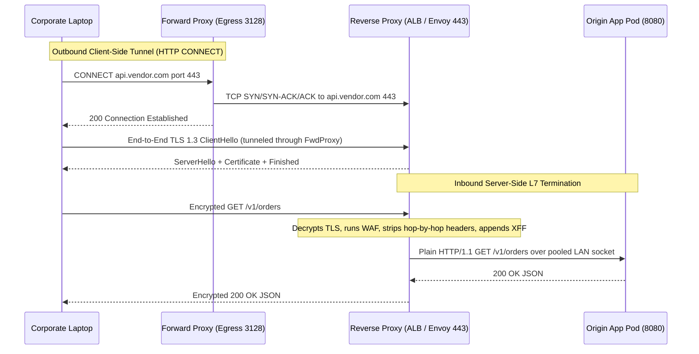
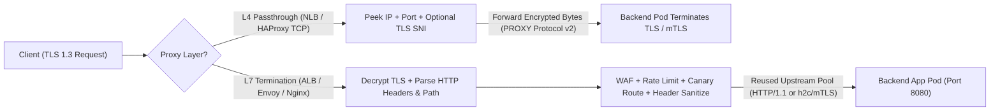
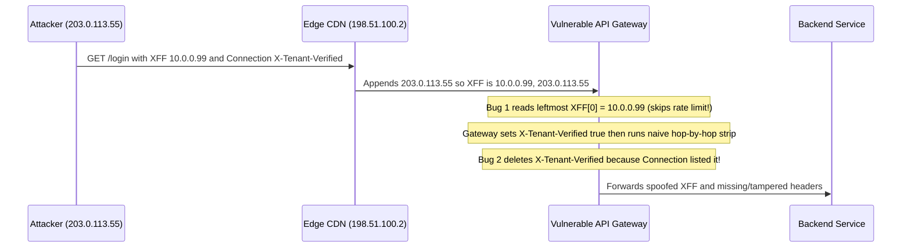

# Lesson 27: Forward and Reverse Proxies

> **Prerequisites:** [Lesson 18: HTTP Part 1](../18-http-requests-responses-and-methods/README.md), [Lesson 21: The TLS 1.3 Handshake Step by Step](../21-tls-1-3-handshake/README.md), and [Networking From Zero Overview](../README.md) (Lesson 27 of 30).  
> **Estimated Reading Time:** 25 minutes  
> **Target Audience:** Backend and platform engineers configuring Nginx, Envoy, HAProxy, or cloud ALBs for TLS termination, WAF filtering, outlier health checks, and IP-safe header forwarding.  
> **Free PDF Notes:** [Download SD-N-027.pdf](https://backendroadmap.com/notes/system-design/SD-N-027.pdf)

> [!TIP]
> **The Golden Rule of Proxies:** A **forward proxy** represents clients on outbound traffic (filtering egress, caching, and tunneling HTTPS via `CONNECT`), whereas a **reverse proxy** represents origin servers on inbound traffic (terminating TLS, enforcing WAF/rate limits, and routing to healthy backends). Choose deliberately between **L4 TCP/SNI passthrough** and **L7 HTTP termination**, strip RFC 9110 hop-by-hop headers (`Connection`, `TE`, `Keep-Alive`), and extract the client IP from `X-Forwarded-For` by counting **trusted proxy hops from the right** so callers cannot spoof their IP.

---

## Words You'll Meet Today

| Word | In Plain Words | Role in a Live Backend System |
| :--- | :--- | :--- |
| **Forward proxy** | An outbound helper that fetches external websites on a client's behalf. | Corporate egress gateway enforcing URL allowlists, shared static egress IPs, and caching. |
| **Reverse proxy** | An inbound gatekeeper standing in front of your backend servers. | Nginx, Envoy, HAProxy, or AWS ALB terminating TLS and routing traffic to origin pods. |
| **HTTP `CONNECT`** | A request asking a forward proxy to open a raw TCP pipe to a remote host. | Lets browsers perform end-to-end TLS 1.3 handshakes through a forward proxy without breaking encryption. |
| **L4 passthrough** | Forwarding raw TCP bytes by IP, port, and TLS `SNI` without decrypting HTTP. | Ultra-low-latency load balancing or strict end-to-end mTLS directly into application pods. |
| **L7 termination** | Decrypting TLS and parsing full HTTP methods, paths, headers, and cookies. | Enables WAF inspection, canary path routing, gzip/brotli compression, and per-user rate limits. |
| **`X-Forwarded-For`** | A comma-separated chain of IP addresses appended at each proxy hop. | Passes original client IP to backends, but leftmost values are client-supplied and spoofable. |
| **Hop-by-hop header** | Headers meant only for a single TCP connection, never forwarded upstream. | `Connection`, `Keep-Alive`, `TE`, `Transfer-Encoding`, `Upgrade` (plus headers named in `Connection`). |
| **Outlier detection** | Passive health checks that eject an upstream returning live errors. | Temporarily removes pods emitting consecutive `5xx` or timeouts faster than periodic probes. |

---

## Visual Mental Models & Architecture

### The Question: Who Is the Proxy Protecting?

In [lesson 18](../18-http-requests-responses-and-methods/README.md) we learned HTTP requests and responses, and in [lesson 21](../21-tls-1-3-handshake/README.md) we traced the TLS 1.3 handshake between a browser and a server. In real production networks, however, your browser almost never opens a direct TCP socket straight to your backend application process. At least one—and often three or four—proxies sit in the middle. Understanding *which side* of the internet each proxy protects explains why enterprises deploy one kind for employees and cloud architectures deploy the other in front of APIs.

### An Everyday Picture First: The Personal Shopper vs. the Company Receptionist

Think of two different middlemen:

1. **A personal shopper (forward proxy):** You sit inside your office and tell your personal shopper, "Go buy supplies from Acme Hardware and bring them back." Acme Hardware sees the shopper walk through the door, **not you**. Your company pays one shopper to check receipts, block forbidden stores, and bring shared items back once for everyone.
2. **A company receptionist (reverse proxy):** You walk up to Acme Corp's headquarters and ask for the billing department. You never walk straight to an accountant's desk. The receptionist checks your badge (WAF and rate limit), signs for encrypted envelopes (TLS termination), checks which accountant isn't overloaded (health check and load balancing), and hands the message across the desk. You don't even know how many accountants sit behind the wall.

The mechanical software can even be the same program (Nginx, Envoy, HAProxy, Squid), but **direction and ownership** flip completely: forward proxies hide and govern **clients**; reverse proxies hide, protect, and scale **servers**.

### Forward Proxy: Egress Control and the TLS `CONNECT` Tunnel

When an employee's laptop sends plain HTTP through a corporate forward proxy, the client sends the **absolute URL** (`GET http://example.com/news HTTP/1.1`) to the proxy (`proxy.corp.local:3128`). The proxy checks company policy, looks up `example.com`, fetches the page, and returns it.

With **HTTPS**, the browser cannot let a standard proxy read URL paths or cookies in plaintext—yet the proxy still needs to know *where* to open the TCP connection! So the browser uses **`HTTP CONNECT`**:

1. Browser opens TCP to `proxy.corp.local:3128`.
2. Browser sends `CONNECT api.stripe.com:443 HTTP/1.1` with `Host: api.stripe.com:443`.
3. Proxy checks egress policy, opens a TCP socket to `api.stripe.com:443`, and replies `HTTP/1.1 200 Connection Established`.
4. From that byte onward, the proxy stops parsing HTTP and blindly copies encrypted TCP bytes in both directions while the browser runs a normal **TLS 1.3 handshake** directly with `api.stripe.com`.

*(Note: Enterprise security appliances that perform "TLS inspection" act as a deliberate Man-in-the-Middle by terminating the tunnel using a corporate Root CA pre-installed on managed employee laptops.)*



*Figure 1. End-to-end flow: a forward proxy tunnels outbound TLS via `HTTP CONNECT` on behalf of the client, while a reverse proxy terminates inbound TLS on behalf of the origin.*

### Reverse Proxy: L4 TCP/SNI Passthrough vs. L7 HTTP Termination

When traffic arrives at your infrastructure, a reverse proxy operates at one of two distinct layers:

- **Layer 4 (L4) TCP / SNI Passthrough** (AWS NLB, HAProxy `mode tcp`, Envoy `tcp_proxy`):
  The proxy routes packets using only the TCP 4-tuple (`src_ip`, `src_port`, `dst_ip`, `dst_port`) and—optionally—peeks at the unencrypted **TLS `ClientHello` SNI (`server_name`)** extension (RFC 6066) on the very first packet without holding any TLS private keys. It forwards raw encrypted bytes straight to a backend server.
  - **Pros:** Microsecond latency, millions of connections per core, zero private-key exposure on the load balancer, preserves end-to-end client-to-pod mTLS.
  - **Cons:** Cannot inspect URL paths (`/api/v2`), cookies, JWTs, or HTTP methods; cannot run WAF rules, compress payloads, or split canary traffic by HTTP header.
- **Layer 7 (L7) HTTP Termination** (AWS ALB, Nginx, Envoy HTTP connection manager, Cloudflare):
  The proxy completes TCP and **terminates TLS 1.3** using your certificate and private key, parses every HTTP frame, enforces WAF signatures and token-bucket rate limits, rewrites headers, compresses bodies (`br`/`gzip`), and dispatches requests to backends over **warm, persistent connection pools** (often HTTP/1.1 or HTTP/2 over private VPC TLS or plaintext).



*Figure 2. Reverse proxy architectures: L4 passthrough preserves end-to-end encryption at minimal overhead, whereas L7 termination unlocks WAF, routing, compression, and upstream connection pooling.*

### Trusting `X-Forwarded-For`, `Forwarded`, and Stripping Hop-by-Hop Headers

Once an L7 reverse proxy terminates TCP, the backend socket's `remote_addr` becomes the **proxy's private VPC IP** (`10.0.4.12`), hiding the real user's IP. Proxies solve this by forwarding metadata headers—creating two dangerous security traps if handled carelessly:

1. **The `X-Forwarded-For` (`XFF`) Spoofing Trap:**
   Each proxy *appends* the TCP peer IP it saw to the right side of `X-Forwarded-For`. Suppose an attacker at `203.0.113.55` sends a forged header:
   ```text
   X-Forwarded-For: 127.0.0.1
   ```
   Your CDN (`198.51.100.2`) appends `203.0.113.55`. Your ALB (`10.0.1.9`) appends `198.51.100.2`. Your backend receives:
   ```text
   X-Forwarded-For: 127.0.0.1, 203.0.113.55, 198.51.100.2
   ```
   If your app naively picks the **leftmost** entry (`split(",")[0]`), it believes the attacker is `127.0.0.1`!
   **The Safe Algorithm (Right-to-Left Trusted Hop Counting):** Walk from the **right** of `XFF`, starting with the TCP socket peer IP (`remote_addr`). Skip every IP belonging to your known trusted proxy CIDRs (or skip exact `trustedProxyCount` hops). The **first untrusted IP from the right** (`203.0.113.55`) is the authentic client IP! If your proxy sits directly on the edge with zero trusted layers ahead of it, **overwrite** any incoming `X-Forwarded-For` completely with `remote_addr`.
   Modern proxies also emit standardized RFC 7239 **`Forwarded: for=203.0.113.55;proto=https;host=api.example.com`** headers—the same rightmost-trusted validation rule applies.

2. **Hop-by-Hop Header Stripping (RFC 9110):**
   Headers like `Connection`, `Keep-Alive`, `Proxy-Authenticate`, `Proxy-Authorization`, `TE`, `Trailer`, `Transfer-Encoding`, and `Upgrade` govern *only one single TCP link*. Worse, RFC 9110 says **any header name listed inside the `Connection` header becomes a hop-by-hop header**!
   If a reverse proxy forgets to strip hop-by-hop headers—or strips headers named in a malicious client's `Connection: X-Auth-Verify` *after* running an internal check, or passes client `Connection` blindly—an attacker can strip security headers from downstream services (`Hop-by-Hop Header Smuggling`). Always delete the standard RFC 9110 hop-by-hop set **and** every token listed in `Connection` before forwarding upstream, and inject trusted internal headers *after* sanitization.

### Active Health Checks vs. Passive Outlier Detection

A reverse proxy must stop routing to dead or degraded backends quickly:

- **Active health checks** poll `GET /healthz` on every upstream pod every `5–10 s` (e.g., pass after `2` successes, fail after `3` timeouts = `15–30 s` detection delay). They catch dead processes well, but miss **gray failures** where `/healthz` returns `200 OK` while real `/checkout` routes crash with `500`/`502` due to a full DB pool or broken dependency.
- **Passive outlier detection** watches **real live customer responses**: if pod `B` emits `5` consecutive `5xx` errors or TCP resets within `10 s`, Envoy/Nginx ejects `B` immediately for `30 s` (exponentially backing off on repeat ejections). Always configure a **`max_ejection_percent`** (typically `30%–50%`): if a bad deploy or downstream DB blip triggers `500`s on *all* pods at once, capping ejection prevents the proxy from blackholing `100%` of your fleet.

---

## Systematic Reference & Comparison Grid

### Forward Proxy vs. Reverse Proxy

| Dimension | Forward Proxy | Reverse Proxy |
| :--- | :--- | :--- |
| **Whose side it sits on** | Client / corporate LAN egress | Server / datacenter or cloud ingress |
| **Knows identity of** | Internal clients (often hidden from internet) | Internal backend pool (hidden from internet) |
| **HTTPS mechanism** | `HTTP CONNECT` raw TCP tunnel (or MitM CA) | Terminates TLS 1.3 with origin cert (or L4 SNI pass) |
| **Caching target** | Shared public responses fetched by many employees | Origin's own static/dynamic responses for all visitors |
| **Typical software** | Squid, Envoy Egress, Zscaler, corporate HTTP proxy | Nginx, Envoy, HAProxy, Traefik, AWS ALB |

### L4 Passthrough vs. L7 Termination

| Property | L4 TCP / SNI Passthrough | L7 HTTP Termination |
| :--- | :--- | :--- |
| **Inspection depth** | IP + Port + optional TLS `ClientHello` SNI | Full decrypted HTTP method, URI, headers, body |
| **TLS private keys on proxy?** | **No** (keys stay on backend pods) | **Yes** (or managed via ACM / KMS / SDS) |
| **WAF / Rate limit / Canary URI** | Not possible | Full support (header, cookie, JWT, path splits) |
| **Client IP preservation** | Direct Server Return (DSR) or `PROXY protocol v1/v2` | `X-Forwarded-For`, RFC 7239 `Forwarded`, `X-Real-IP` |
| **Typical added proxy latency** | `~0.05–0.2 ms` (kernel/eBPF/TCP splice) | `~0.5–2.0 ms` (TLS decrypt + HTTP parse + pool) |

### L7 End-to-End Request Latency & Hop-by-Hop Rules

For a new client TLS 1.3 connection hitting an L7 reverse proxy with a warm upstream connection pool to the origin:

$$T_{\text{total}} = \underbrace{T_{\text{TCP}} + T_{\text{TLS 1.3}}}_{\text{2 RTT client}\leftrightarrow\text{proxy}} + \underbrace{T_{\text{WAF+parse}}}_{\approx 1\text{ ms}} + \underbrace{T_{\text{HTTP\_upstream}}}_{\text{1 LAN RTT (reused pool)}}$$

Whereas with L4 passthrough on a brand-new connection, the backend pod absorbs the `2 RTT` handshake and asymmetric TLS CPU directly.

| Header Class | Examples | Reverse Proxy Action |
| :--- | :--- | :--- |
| **Standard Hop-by-Hop** | `Connection`, `Keep-Alive`, `TE`, `Trailer`, `Transfer-Encoding`, `Upgrade`, `Proxy-Authorization` | **Strip unconditionally** on ingress & egress |
| **Dynamic Hop-by-Hop** | Any header named inside `Connection: Foo, Bar` | **Strip before proxy adds trusted internal headers** |
| **Trusted Forwarding** | `X-Forwarded-For`, `X-Forwarded-Proto`, `Forwarded`, `Via` | **Append/overwrite** using verified peer `remote_addr` |

---

## Production War Story Post-Mortem: Leftmost `XFF` Bypass & `Connection` Header Smuggling

- **Severity:** SEV-1 (Rate-Limit Bypass + Unauthorized Internal Endpoint Access)
- **Detection / Resolution Time:** 14 minutes to deploy emergency ingress WAF rule; 45 minutes to roll patched proxy sanitizer
- **Impact:** Automated credential-stuffing bots bypassed IP rate limits (`100 req/min`) at `18,000 req/min` by sending fake `X-Forwarded-For` values, and probed internal moderation routes by naming an auth header inside `Connection`.

### What Happened



### Root Cause Analysis

1. **Trusting Leftmost `X-Forwarded-For`:** The gateway's rate-limiter extracted `headers["x-forwarded-for"].split(",")[0].trim()`. Attackers rotated random IPs in `X-Forwarded-For` on every request (`10.0.0.1`, `10.0.0.2`, ...), giving every bot request a fresh rate-limit bucket and matching the internal `10.0.0.0/8` admin allowlist.
2. **Hop-by-Hop Stripping Ordering Bug:** The proxy applied its internal authorization enrichment (`X-Tenant-Verified`) *before* executing RFC 9110 `Connection` header cleanup, letting a client inject `Connection: X-Tenant-Verified` to erase internal gateway assertions on downstream hops.

### The Fix & Architectural Hardening

- **Rightmost Trusted CIDR Extraction:** Replaced `XFF[0]` with right-to-left CIDR walking starting at `remote_addr` and trusting only the cloud VPC + CDN IP allowlist.
- **Sanitize First, Enrich Last:** Stripped all RFC 9110 hop-by-hop headers—including every header listed in incoming `Connection`—**before** injecting any internal proxy trust headers (`X-Forwarded-*`, `X-Tenant-*`).
- **Network ACL Isolation:** Locked down the gateway security group so only CDN IPs can reach port `443`, preventing attackers from bypassing the CDN to forge the trusted hop count.

---

## Multi-Language Production Implementation

Below is a production-structured **L7 Reverse Proxy Header Sanitizer & Trusted `X-Forwarded-For` Resolver** across Go, TypeScript, Python, and C#. Each implementation strips RFC 9110 hop-by-hop headers (including dynamic headers named in `Connection`) and resolves the true client IP right-to-left across trusted proxy CIDRs.

````carousel
```go
package proxysec

import (
	"net/http"
	"net/netip"
	"strings"
)

var staticHopByHop = map[string]struct{}{
	"connection": {}, "keep-alive": {}, "proxy-authenticate": {},
	"proxy-authorization": {}, "te": {}, "trailer": {},
	"transfer-encoding": {}, "upgrade": {},
}

// SanitizeAndResolveClientIP strips hop-by-hop headers before upstream dispatch
// and walks X-Forwarded-For right-to-left across trusted proxy prefixes.
func SanitizeAndResolveClientIP(hdr http.Header, remoteAddr string, trusted []netip.Prefix) string {
	// 1. Collect dynamic headers listed inside Connection (RFC 9110 Section 7.6.1).
	for _, connVal := range hdr.Values("Connection") {
		for _, tok := range strings.Split(connVal, ",") {
			if name := strings.TrimSpace(tok); name != "" {
				hdr.Del(name)
			}
		}
	}
	for name := range staticHopByHop {
		hdr.Del(name)
	}

	// 2. Build candidate IP chain: [client-supplied XFF..., socket peer IP].
	peerIP, _ := parseIP(remoteAddr)
	var chain []netip.Addr
	for _, xff := range hdr.Values("X-Forwarded-For") {
		for _, part := range strings.Split(xff, ",") {
			if ip, ok := parseIP(part); ok {
				chain = append(chain, ip)
			}
		}
	}
	if peerIP.IsValid() {
		chain = append(chain, peerIP)
	}

	// 3. Walk right-to-left: skip trusted proxies; first untrusted IP is the client.
	for i := len(chain) - 1; i >= 0; i-- {
		if !isTrusted(chain[i], trusted) {
			return chain[i].String()
		}
	}
	return peerIP.String()
}

func parseIP(raw string) (netip.Addr, bool) {
	s := strings.TrimSpace(raw)
	if ap, err := netip.ParseAddrPort(s); err == nil {
		return ap.Addr(), true
	}
	addr, err := netip.ParseAddr(s)
	return addr, err == nil
}

func isTrusted(ip netip.Addr, prefixes []netip.Prefix) bool {
	for _, p := range prefixes {
		if p.Contains(ip) {
			return true
		}
	}
	return false
}
```
<!-- slide -->
```typescript
import { BlockList, isIP } from "node:net";

const STATIC_HOP_BY_HOP = new Set([
  "connection", "keep-alive", "proxy-authenticate", "proxy-authorization",
  "te", "trailer", "transfer-encoding", "upgrade",
]);

export function sanitizeAndResolveClientIp(
  headers: Record<string, string | string[] | undefined>,
  remoteIp: string,
  trustedProxies: BlockList
): { cleanHeaders: Record<string, string | string[]>; clientIp: string } {
  const dynamicHop = new Set<string>();
  const connRaw = headers["connection"];
  const connList = Array.isArray(connRaw) ? connRaw : connRaw ? [connRaw] : [];
  for (const line of connList) {
    for (const token of line.split(",")) {
      const name = token.trim().toLowerCase();
      if (name) dynamicHop.add(name);
    }
  }

  const cleanHeaders: Record<string, string | string[]> = {};
  for (const [k, v] of Object.entries(headers)) {
    const lk = k.toLowerCase();
    if (v === undefined || STATIC_HOP_BY_HOP.has(lk) || dynamicHop.has(lk)) continue;
    cleanHeaders[k] = v;
  }

  const xffRaw = headers["x-forwarded-for"];
  const xffParts = (Array.isArray(xffRaw) ? xffRaw.join(",") : xffRaw ?? "")
    .split(",")
    .map((s) => s.trim())
    .filter((s) => isIP(s) !== 0);

  const chain = [...xffParts, remoteIp.trim()];
  let clientIp = remoteIp.trim();
  for (let i = chain.length - 1; i >= 0; i--) {
    const candidate = chain[i];
    const family = isIP(candidate) === 6 ? "ipv6" : "ipv4";
    if (!trustedProxies.check(candidate, family)) {
      clientIp = candidate;
      break;
    }
  }

  cleanHeaders["x-forwarded-for"] = xffParts.length ? `${xffParts.join(", ")}, ${remoteIp}` : remoteIp;
  cleanHeaders["x-real-ip"] = clientIp;
  return { cleanHeaders, clientIp };
}
```
<!-- slide -->
```python
import ipaddress
from collections.abc import Iterable

HOP_BY_HOP = frozenset({
    "connection", "keep-alive", "proxy-authenticate", "proxy-authorization",
    "te", "trailer", "transfer-encoding", "upgrade",
})


def sanitize_and_resolve_client_ip(
    headers: dict[str, str],
    remote_ip: str,
    trusted_cidrs: Iterable[str],
) -> tuple[dict[str, str], str]:
    nets = [ipaddress.ip_network(c, strict=False) for c in trusted_cidrs]

    dynamic_hop = {
        tok.strip().lower()
        for k, v in headers.items()
        if k.lower() == "connection"
        for tok in v.split(",")
        if tok.strip()
    }
    clean = {
        k: v
        for k, v in headers.items()
        if k.lower() not in HOP_BY_HOP and k.lower() not in dynamic_hop
    }

    xff_header = next((v for k, v in headers.items() if k.lower() == "x-forwarded-for"), "")
    chain = [p.strip() for p in xff_header.split(",") if p.strip()] + [remote_ip.strip()]

    client_ip = remote_ip.strip()
    for candidate in reversed(chain):
        try:
            addr = ipaddress.ip_address(candidate)
        except ValueError:
            break  # Reject malformed spoofed entries immediately
        if not any(addr in net for net in nets):
            client_ip = str(addr)
            break

    clean["X-Real-IP"] = client_ip
    return clean, client_ip
```
<!-- slide -->
```csharp
using System;
using System.Collections.Generic;
using System.Linq;
using System.Net;

public static class ReverseProxySanitizer
{
    private static readonly HashSet<string> HopByHop = new(StringComparer.OrdinalIgnoreCase)
    {
        "Connection", "Keep-Alive", "Proxy-Authenticate", "Proxy-Authorization",
        "TE", "Trailer", "Transfer-Encoding", "Upgrade"
    };

    public static (Dictionary<string, string> CleanHeaders, string ClientIp) SanitizeAndResolve(
        IDictionary<string, string> headers,
        IPAddress remoteIp,
        IReadOnlyList<(IPAddress Network, int PrefixLength)> trustedCidrs)
    {
        var dynamicHop = new HashSet<string>(StringComparer.OrdinalIgnoreCase);
        if (headers.TryGetValue("Connection", out var conn))
        {
            foreach (var tok in conn.Split(',', StringSplitOptions.RemoveEmptyEntries | StringSplitOptions.TrimEntries))
                dynamicHop.Add(tok);
        }

        var clean = headers
            .Where(kv => !HopByHop.Contains(kv.Key) && !dynamicHop.Contains(kv.Key))
            .ToDictionary(kv => kv.Key, kv => kv.Value, StringComparer.OrdinalIgnoreCase);

        var chain = new List<IPAddress>();
        if (headers.TryGetValue("X-Forwarded-For", out var xff))
        {
            foreach (var part in xff.Split(',', StringSplitOptions.RemoveEmptyEntries | StringSplitOptions.TrimEntries))
                if (IPAddress.TryParse(part, out var parsed)) chain.Add(parsed);
        }
        chain.Add(remoteIp);

        IPAddress resolved = remoteIp;
        for (int i = chain.Count - 1; i >= 0; i--)
        {
            if (!IsTrusted(chain[i], trustedCidrs))
            {
                resolved = chain[i];
                break;
            }
        }

        clean["X-Real-IP"] = resolved.ToString();
        return (clean, resolved.ToString());
    }

    private static bool IsTrusted(IPAddress ip, IReadOnlyList<(IPAddress Net, int Prefix)> cidrs)
    {
        var bytes = ip.GetAddressBytes();
        foreach (var (net, prefix) in cidrs)
        {
            var netBytes = net.GetAddressBytes();
            if (bytes.Length != netBytes.Length) continue;
            int fullBytes = prefix / 8, remBits = prefix % 8;
            bool match = bytes.Take(fullBytes).SequenceEqual(netBytes.Take(fullBytes));
            if (match && remBits > 0)
            {
                byte mask = (byte)(0xFF << (8 - remBits));
                match = (bytes[fullBytes] & mask) == (netBytes[fullBytes] & mask);
            }
            if (match) return true;
        }
        return false;
    }
}
```
````

---

## Practical Hands-On Verification CLI Workflows

### 1. Observe an `HTTP CONNECT` Tunnel Through a Forward Proxy

```bash
curl -v --proxy http://127.0.0.1:3128 https://example.com/ -o /dev/null
```

**Expected Output:**

```text
*   Trying 127.0.0.1:3128...
* Connected to 127.0.0.1 (127.0.0.1) port 3128
* Establish HTTP proxy tunnel to example.com:443
> CONNECT example.com:443 HTTP/1.1
> Host: example.com:443
< HTTP/1.1 200 Connection Established
* CONNECT tunnel established, response 200
* ALPN: curl offers h2,http/1.1
* TLSv1.3 (OUT), TLS handshake, Client hello (1):
```

Notice that `CONNECT` happens in plain HTTP/1.1 first, and the TLS 1.3 handshake runs inside the established tunnel end-to-end with `example.com`.

### 2. Test Whether an Upstream Reverse Proxy Strips Spoofed `X-Forwarded-For`

```bash
curl -sS -H "X-Forwarded-For: 127.0.0.1" -H "Connection: X-Custom-Probe" https://httpbin.org/headers
```

**Expected Output:**

```text
{
  "headers": {
    "Host": "httpbin.org",
    "X-Amzn-Trace-Id": "Root=1-6732a1b4-...",
    "X-Forwarded-For": "127.0.0.1, 203.0.113.55"
  }
}
```

Watch how the proxy **appends** your real public IP (`203.0.113.55`) to the right while the spoofed `127.0.0.1` sits on the left—proving why your application must walk right-to-left across trusted proxy hops!

### 3. Verify L4 SNI Routing & Certificate Termination on a Proxy Endpoint

```bash
openssl s_client -connect 93.184.215.14:443 -servername example.com -brief
```

**Expected Output:**

```text
CONNECTION ESTABLISHED
Protocol version: TLSv1.3
Ciphersuite: TLS_AES_256_GCM_SHA384
Peer certificate: CN = *.example.com
Verification: OK
```

Changing `-servername` checks whether an L4 SNI router or L7 multi-tenant reverse proxy selects the right upstream certificate and backend pool.

---

## Pause and Think

> [!exercise] Your API sits behind Cloudflare (`1` trusted proxy hop) and an internal Nginx ingress (`1` trusted proxy hop). A request arrives at your Go service from socket peer `10.0.2.15` with header `X-Forwarded-For: 10.0.0.1, 198.51.100.77, 172.70.12.4`. Which IP belongs to the real client, and why? Decide before opening the answer.

<details><summary>Answer</summary>

The real client IP is **`198.51.100.77`**. Walking right-to-left:
1. Socket peer `10.0.2.15` is your internal Nginx ingress (trusted hop 1 — skip).
2. `172.70.12.4` was appended by Nginx when it received the connection from Cloudflare (trusted hop 2 — skip).
3. `198.51.100.77` was appended by Cloudflare when the external user connected to Cloudflare's edge (first untrusted IP — **real client**).
4. `10.0.0.1` on the far left was injected by the caller to try to spoof an internal address and must be ignored.

</details>

---

## Operational Validation Checkpoints

<details><summary><strong>Checkpoint 1: Choosing L4 Passthrough vs. L7 Termination for Mutual TLS</strong></summary>

**Scenario:** A fintech platform requires strict end-to-end **mutual TLS (mTLS)** between partner banks and the `payments-core` Kubernetes pods so that no cloud load balancer ever holds partner-facing private keys or decrypted card payloads. Should you deploy an L4 NLB or an L7 ALB in front of the cluster?

**Solution:**
Deploy an **L4 TCP / SNI Passthrough** load balancer (like AWS NLB or HAProxy `mode tcp`) with `PROXY protocol v2` enabled if you still need the partner's source IP. Because an L4 proxy does not decrypt TLS, it never sees plaintext payloads or needs the pod's private keys, while partner client certificates terminate straight inside `payments-core` (or its Envoy sidecar).

</details>

<details><summary><strong>Checkpoint 2: Active `/healthz` Passes While Users See 502s</strong></summary>

**Scenario:** Pod `api-3` loses its database connection pool due to a stuck DNS lookup. Its `/healthz` endpoint only checks process liveness and keeps returning `200 OK`, so Nginx's `5 s` active probe keeps routing `25%` of live checkout traffic to `api-3`, returning `500`/`502` to shoppers. How do you harden health checking?

**Solution:**
Enable **passive outlier detection** alongside active probes: configure Envoy/Nginx (`max_fails=3 fail_timeout=15s` or Envoy `outlier_detection` on consecutive `5xx`/gateway errors) with **`max_ejection_percent: 50`**. Live traffic failures eject `api-3` within milliseconds rather than waiting for `/healthz`, while the `50%` ejection cap prevents cascading blackholes if every pod hits a temporary upstream hiccup simultaneously.

</details>

<details><summary><strong>Checkpoint 3: Missing `PROXY Protocol` Breaks Allowlists on L4</strong></summary>

**Scenario:** After switching a reverse proxy from L7 HTTP mode to L4 TCP passthrough, your backend logs show the load balancer's private IP (`10.2.0.8`) instead of client IPs, because L4 TCP cannot inject `X-Forwarded-For` headers into encrypted TLS frames. How do you preserve client IP without decrypting TLS?

**Solution:**
Enable **HAProxy `PROXY protocol v2`** on both the L4 load balancer and the backend listener (Nginx `listen 443 ssl proxy_protocol;` / Envoy `proxy_protocol` listener filter). The L4 proxy prepends a tiny binary header containing the original client IP and port *before* the TLS `ClientHello` bytes—strictly restrict port access to the LB security group so untrusted callers cannot forge `PROXY` headers directly.

</details>

---

## Common Mistakes & Troubleshooting

### What Goes Wrong

- **Reading `X-Forwarded-For[0]`:** Lets any caller pass `X-Forwarded-For: 127.0.0.1` to defeat rate limits, geo-fencing, and admin allowlists.
- **Unrestricted `HTTP CONNECT` open forward proxy:** Leaving a forward proxy reachable on a public IP turns your server into an open relay used by attackers to hide traffic or pivot into internal VPC endpoints (`169.254.169.254` metadata SSRF!).
- **Ejecting `100%` of backends on outlier detection:** Without `max_ejection_percent`, a momentary `500` burst across all pods makes the proxy mark *every* healthy pod down simultaneously.
- **Forgetting `X-Forwarded-Proto`:** Backend thinks an HTTPS request terminated at Nginx was plain HTTP and enters an infinite `301 https://...` redirect loop.

### Common Myths

- **"A reverse proxy always decrypts TLS."** False. L4 reverse proxies (`NLB`, HAProxy `mode tcp`, Envoy SNI proxy) route encrypted TLS streams solely by IP/port or `ClientHello` SNI without ever holding a private key.
- **"Setting `X-Real-IP` on Nginx automatically protects the backend."** Only if the backend refuses direct connections bypassing Nginx and Nginx itself overwrites (rather than trusts) incoming headers from untrusted clients.
- **"Active `/healthz` probes guarantee healthy user requests."** False. Shallow liveness checks frequently return `200 OK` during partial gray failures, requiring passive outlier detection on real traffic.

| Symptom | Root Cause | Fix |
| :--- | :--- | :--- |
| Infinite `301 https://` redirect loop behind ALB/Nginx | Backend checks `req.Scheme == "https"`, unaware TLS terminated at proxy | Forward `X-Forwarded-Proto: https` (or `Forwarded`) and trust it only from proxy CIDR |
| Rate limiter blocks *every* user under one IP | Limiter reads `remote_addr` (the proxy IP) instead of resolved client IP | Walk `X-Forwarded-For` right-to-left skipping trusted proxy CIDRs |
| `502` or protocol error after forwarding WebSocket/gRPC | Proxy stripped `Upgrade` or forwarded raw `Transfer-Encoding` wrongly | Explicitly configure proxy `Upgrade` + `Connection: upgrade` handling per route |

---

## Recap in Three Lines

1. **Forward proxies** govern outbound client traffic (filtering, caching, and tunneling HTTPS via `CONNECT`), while **reverse proxies** shield inbound servers (TLS termination, WAF, routing, and pooling).
2. Choose **L4 passthrough** when end-to-end TLS/mTLS or raw TCP speed matters, and **L7 termination** when you need HTTP routing, WAF inspection, or header/compression control.
3. Strip RFC 9110 **hop-by-hop headers** before internal enrichment, resolve `X-Forwarded-For` **right-to-left across trusted proxy CIDRs**, and pair active probes with capped **passive outlier detection**.

---

## Interview Practice Questions

> [!interview] What is the difference between a forward proxy and a reverse proxy? (Basic)

<details><summary>What to say in 30 seconds</summary>

A forward proxy sits in front of clients to manage their outbound traffic—enforcing egress policies, caching, and hiding client IPs from external sites. A reverse proxy sits in front of backend servers to accept inbound internet requests—terminating TLS, applying WAF rules and rate limits, and load-balancing across private backend instances that clients never reach directly.

</details>

> [!interview] How does an HTTPS request travel through an un-decrypting forward proxy? (Basic)

<details><summary>What to say in 30 seconds</summary>

The browser opens a TCP connection to the forward proxy and sends a plaintext `HTTP CONNECT host:443` request. After checking policy and opening a TCP socket to that host, the proxy replies `200 Connection Established` and turns into a transparent byte pipe, letting the browser run a full end-to-end TLS 1.3 handshake directly with the remote server.

</details>

> [!interview] When would you choose an L4 passthrough load balancer instead of an L7 reverse proxy? (Scenario)

<details><summary>What to say in 30 seconds</summary>

Choose L4 passthrough when backend pods must terminate TLS or mTLS directly—so load balancers never hold private keys or decrypted PII—or when forwarding non-HTTP TCP protocols and millions of connections at microsecond latency. Choose L7 termination whenever you need path- or header-based routing, canary traffic splitting, WAF inspection, rate limiting, or upstream HTTP connection pooling.

</details>

> [!interview] An attacker bypasses your IP rate limiter even though your reverse proxy appends `X-Forwarded-For`. What went wrong and how do you fix it? (Scenario)

<details><summary>What to say in 30 seconds</summary>

The backend almost certainly trusted the leftmost IP in `X-Forwarded-For`, which is controlled by the client's initial header. Because each proxy appends the peer IP to the right, you fix this by walking `X-Forwarded-For` plus the TCP `remote_addr` from right to left, skipping only your known trusted proxy CIDRs, and stopping at the first untrusted IP.

</details>

> [!interview] What are hop-by-hop headers, and what security bug occurs if a reverse proxy handles `Connection` poorly? (Tricky)

<details><summary>What to say in 30 seconds</summary>

Hop-by-hop headers like `Connection`, `Keep-Alive`, `TE`, and `Transfer-Encoding` apply only to a single TCP link and must not be forwarded upstream. Under RFC 9110, any header name listed inside the `Connection` header also becomes hop-by-hop—so if a proxy runs authentication headers first and strips `Connection`-listed headers afterward, an attacker can delete internal trust headers like `X-User-Role`. Always strip hop-by-hop headers before adding trusted headers.

</details>

> [!interview] Why isn't an active `/healthz` check enough for a reverse proxy, and what guardrails does passive outlier detection need? (Tricky)

<details><summary>What to say in 30 seconds</summary>

Active `/healthz` checks run periodically every few seconds and often miss gray failures where `/healthz` returns 200 while real business endpoints fail with 502 or timeouts. Passive outlier detection monitors live customer responses and ejects pods immediately on consecutive 5xx errors or resets—but it must cap `max_ejection_percent`, usually around 30 to 50 percent, so a transient cluster-wide blip never takes the entire fleet offline.

</details>

---

## Free PDF notes

Download these notes as a printable PDF with the proxy diagrams, header sanitization rules, and interview answers: [SD-N-027.pdf](https://backendroadmap.com/notes/system-design/SD-N-027.pdf).

---

## Sources

- [RFC 9110: HTTP Semantics](https://www.rfc-editor.org/rfc/rfc9110), `CONNECT` tunneling, hop-by-hop headers, and `Connection` semantics.
- [RFC 7239: Forwarded HTTP Extension](https://www.rfc-editor.org/rfc/rfc7239), standardized proxy forwarding headers and security considerations.
- [RFC 6066: Transport Layer Security (TLS) Extensions](https://www.rfc-editor.org/rfc/rfc6066), Server Name Indication (`SNI`) used in L4 and L7 routing.
- [Envoy Proxy Architecture: Outlier Detection & HTTP Connection Manager](https://www.envoyproxy.io/docs/envoy/latest/intro/arch_overview/upstream/outlier), production L4/L7 proxying and passive health checking.
- [NGINX Reverse Proxy Guide](https://docs.nginx.com/nginx/admin-guide/web-server/reverse-proxy/), upstream header handling and buffering.

---

## Next

Next comes [Lesson 28: CDNs — Moving Bytes Closer to the Speed of Light](../28-cdns/README.md): how global reverse proxies eliminate cross-ocean handshakes, prevent thundering herds with Origin Shielding, and lock origins down against WAF bypass. See [the track overview](../README.md) for the whole series.
