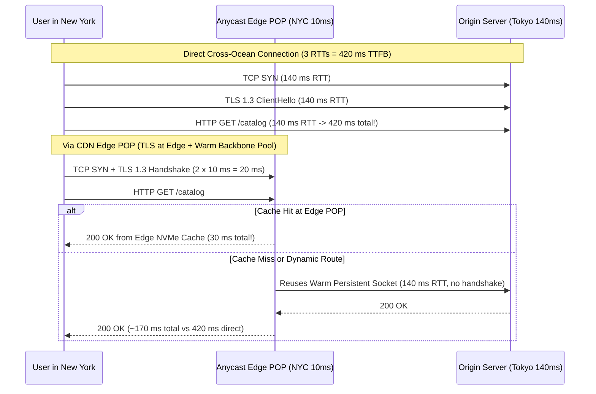
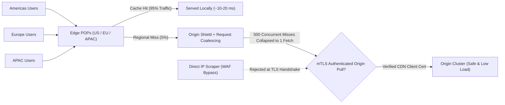
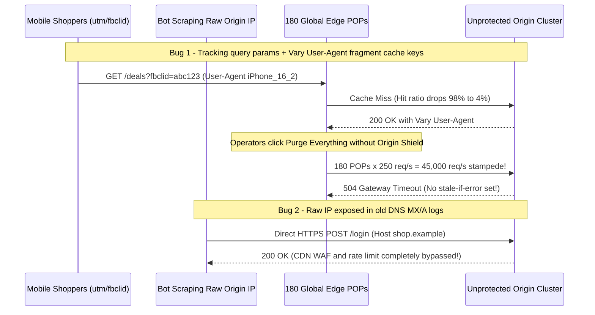

# Lesson 28: CDNs — Moving Bytes Closer to the Speed of Light

> **Prerequisites:** [Lesson 27: Forward and Reverse Proxies](../27-forward-and-reverse-proxies/README.md), [Lesson 19: HTTP Status Codes and Caching](../19-http-status-codes-and-caching/README.md), [Lesson 17: DNS Traffic Management](../17-dns-traffic-management/README.md), and [Networking From Zero Overview](../README.md) (Lesson 28 of 30).  
> **Estimated Reading Time:** 25 minutes  
> **Target Audience:** Backend and platform engineers designing low-latency global APIs, preventing cache stampedes with Origin Shielding, tuning `s-maxage`/`stale-while-revalidate` policies, and locking origins against WAF bypass.  
> **Free PDF Notes:** [Download SD-N-028.pdf](https://backendroadmap.com/notes/system-design/SD-N-028.pdf)

> [!TIP]
> **The Golden Rule of CDNs:** Light travels through fiber optic glass at roughly `200,000 km/s`—so a New York-to-Tokyo round trip costs `~140 ms` even with a zero-latency origin. Terminating TCP and TLS at a nearby **Anycast Edge POP (`~10 ms`)** immediately deletes `3–4×` cross-ocean handshakes even for uncached requests; combine **normalized cache keys**, **Origin Shielding with request coalescing**, `s-maxage` / `stale-while-revalidate` / `Cache-Tag` purges, and **mTLS origin lockdown** so traffic spikes never melt your database or bypass your WAF.

---

## Words You'll Meet Today

| Word | In Plain Words | Role in a Live Backend System |
| :--- | :--- | :--- |
| **Edge POP** | A CDN data center close to users running reverse proxies and caches. | Terminates TCP/TLS within `5–20 ms` of the caller and serves cached objects locally. |
| **Origin Shield** | A central caching tier between all global Edge POPs and your origin. | Collapses hundreds of simultaneous regional cache misses into one origin fetch. |
| **Request coalescing** | Holding concurrent misses for the same key while one request fetches upstream. | Prevents thundering-herd cache stampedes when a hot key expires or gets purged. |
| **Cache key** | The exact tuple identifying one cached entry (`scheme + host + path + query`). | Drives cache hit ratio; noisy params (`utm_source`, `fbclid`) fragment keys and drop hits. |
| **`Vary` header** | Lists request headers that produce different cached responses (`Accept-Encoding`). | `Vary: User-Agent` creates thousands of fragments per URL and ruins CDN hit ratios. |
| **`s-maxage`** | Shared-cache lifetime overriding `max-age` specifically for CDNs. | Keeps assets cached `3600 s` at the edge while browsers hold `60 s` for instant purges. |
| **`stale-while-revalidate`** | Serves a slightly expired object instantly while refreshing it asynchronously. | Eliminates `p99` revalidation spikes; pairs with `stale-if-error` for origin resilience. |
| **`Surrogate-Key` (`Cache-Tag`)** | A logical dependency label attached to cached responses for bulk purging. | Invalidates `product-42` across thousands of URLs and query permutations in `< 150 ms`. |

---

## Visual Mental Models & Architecture

### The Question: Why Can't We Just Buy a Faster Origin Server?

Imagine your origin cluster runs in Tokyo (`ap-northeast-1`) and computes every API response in `2 ms`. Yet users in New York wait `430 ms` for the very first byte of a tiny JSON file—even before a single byte of payload finishes downloading! Upgrading your Tokyo CPUs from 8 cores to 128 cores shaves off `1 ms` and still leaves `429 ms`. Why? Because the bottleneck isn't CPU; it's **light moving through glass** across multiple network handshakes ([lesson 17](../17-dns-traffic-management/README.md) and [lesson 27](../27-forward-and-reverse-proxies/README.md)).

### An Everyday Picture First: Neighborhood Espresso Bars and One Roastery

Suppose a specialty coffee roastery sits in Tokyo, and customers live in 200 cities worldwide. Sending every morning customer on a round-trip flight to Tokyo just to place an order, show ID, and pick up a cup would take hours—even if pouring the coffee took two seconds.

Instead, the roastery opens **200 neighborhood espresso bars (Edge POPs)** five minutes from every customer, supplied by **one central warehouse (Origin Shield)** near the roastery:

- **Repeat drinks (Cache Hits):** Customers walk five minutes to their local bar and get coffee immediately.
- **Custom drinks (Dynamic / Cache Misses):** Even when a drink must be brewed at headquarters, the customer checks ID and places the order locally in five minutes, and the neighborhood bar calls headquarters over an already-open private phone line!

### Fiber Physics vs. Anycast Edge Termination

In a vacuum, light travels at $c \approx 299,792\text{ km/s}$. Inside silica optical fiber (refractive index $n \approx 1.47$), light slows to:

$$v_{\text{fiber}} = \frac{c}{n} \approx \frac{299{,}792}{1.47} \approx 203{,}940\text{ km/s} \approx 200{,}000\text{ km/s}$$

Between New York and Tokyo, submarine and terrestrial fiber paths span roughly `14,000 km` one way (longer than the `10,850 km` great-circle arc). One single round trip (`28,000 km`) therefore takes:

$$\text{RTT}_{\text{NY}\leftrightarrow\text{Tokyo}} \approx \frac{28{,}000\text{ km}}{200{,}000\text{ km/s}} = 0.140\text{ s} = 140\text{ ms}$$

Without a CDN, a brand-new HTTPS request pays **at least 3 cross-ocean RTTs** before the first byte of HTTP response starts streaming: `1 RTT` TCP handshake (`SYN`/`SYN-ACK`), `1 RTT` TLS 1.3 handshake (`ClientHello`/`ServerHello`), and `1 RTT` HTTP `GET` -> response (`3 × 140 ms = 420 ms`, or `4 × 140 ms = 560 ms` on TLS 1.2!).

When you place an **Anycast Edge POP** `10 ms` away from the New York user:

1. **TCP + TLS 1.3 finish at the local Edge POP** in `2 × 10 ms = 20 ms` (saving `260 ms` before any HTTP byte even leaves New York!).
2. On a **cache hit**, HTTP finishes in another `10 ms` (`~30 ms` total—**14× faster**).
3. Even on a **dynamic API call or cache miss**, the Edge POP forwards the request to Tokyo over a **warm, pre-established, congestion-tuned backbone TCP pool**, paying only `1 × 140 ms` WAN RTT instead of `3–4×`!



*Figure 1. Anycast Edge POP termination eliminates cross-ocean TCP and TLS handshakes immediately, cutting dynamic TTFB by `250+ ms` and serving cache hits in `~30 ms`.*

### Cache Key Anatomy, `Vary` Traps, and Origin Shield + Request Coalescing

Every CDN stores responses indexed by a **Cache Key**—by default, `scheme + host + path + full query string`. Three subtleties routinely wreck hit ratios and overload origins:

1. **Query Parameter Fragmentation:** If marketing links add `?utm_source=newsletter&fbclid=IwAR3...`, two users requesting the exact same article generate different cache keys and miss the cache every single time. Configure the CDN to **strip tracking query parameters** from the cache key (while preserving functional params like `?page=2&sort=price`).
2. **The `Vary` Cardinality Explosion:** `Vary: Accept-Encoding` splits a URL into just `2–3` variants (`br`, `gzip`, identity)—totally safe. By contrast, `Vary: User-Agent` creates **thousands** of distinct browser/OS string variants per URL, and `Vary: Cookie` or `Vary: X-Request-Id` makes every request a cache miss! Never emit high-cardinality `Vary` headers on shared cacheable responses.
3. **Origin Shielding + Request Coalescing (Preventing Cache Stampedes):** A global CDN often operates `200+` Edge POPs. When a viral product JSON expires at `12:00:00`, if `1,000` users across `200` POPs hit it simultaneously, all `200` POPs miss and stampede your origin at once.
   - **Origin Shield:** Routes all Edge POP misses through **one regional shield POP** close to your origin. Now `199` regional misses become hits in the Origin Shield!
   - **Request Coalescing (Collapsed Forwarding):** When `500` concurrent requests miss the same key in the same millisecond at the shield, the CDN holds `499` requests in memory, sends **exactly `1` upstream fetch** to your origin, and streams the single response back to all `500` callers. *(Caution: disable coalescing on uncacheable/personalized `Set-Cookie` or `no-store` responses, or disable on huge byte-range video streams where serialization hurts.)*



*Figure 2. Multi-tier CDN protection: Edge POPs absorb hits globally, Origin Shield + Request Coalescing collapse concurrent misses to `1` origin fetch, and mTLS locks down direct origin access.*

### `s-maxage`, `stale-while-revalidate`, `Cache-Tag` Purges, and Origin Lockdown

From [lesson 19](../19-http-status-codes-and-caching/README.md), `Cache-Control: max-age=3600` tells **both** browsers and CDNs to cache for an hour. That creates a nasty deployment bug: even after you purge the CDN, user browsers keep holding the stale file for up to `59` minutes because you cannot purge a stranger's laptop!

- **`s-maxage` vs. `max-age` (RFC 9111):** `s-maxage=3600` governs **shared caches (CDNs)** only, while `max-age=60` governs **private browser caches**. Or send `Surrogate-Control: max-age=86400` (stripped by the CDN before replying to the browser) alongside `Cache-Control: public, max-age=30`.
- **`stale-while-revalidate` & `stale-if-error` (RFC 5861):**
  ```text
  Cache-Control: public, max-age=30, s-maxage=300, stale-while-revalidate=600, stale-if-error=86400
  ```
  After `300 s`, the next visitor still receives the slightly stale object in **`10 ms`** while the CDN refreshes it silently in the background! And if your origin crashes (`500`/`502`/`504`) during a bad deploy, `stale-if-error=86400` lets the CDN keep serving the last healthy copy for up to `24` hours instead of showing users an error page.
- **`Cache-Tag` / `Surrogate-Key` Instant Purges:** Suppose `product-42` appears in `/products/42`, `/catalog?cat=shoes`, and `/home-featured.json`. Attaching `Surrogate-Key: product-42 cat-shoes` lets your backend call a single CDN API purge on tag `product-42` whenever inventory changes, invalidating every dependent URL worldwide in `~150 ms` without tracking URL lists.
- **Origin Lockdown (Stopping WAF Bypass):** Publishing your site behind a CDN does *not* hide your origin's IP if attackers find it in historical DNS logs, SSL certificate scans, or outbound webhook headers. Once an attacker hits `https://203.0.113.88` directly with `Host: api.example.com`, they **completely bypass** your CDN WAF, rate limits, and DDoS shield! Always lock down origin port `443` via **CDN IP firewall allowlists** *and* **mTLS Authenticated Origin Pulls**, requiring the CDN to present a trusted client certificate during the origin TLS handshake.

---

## Systematic Reference & Comparison Grid

### Latency Breakdown: Direct Origin vs. Anycast CDN (NY User -> Tokyo Origin)

| Request Scenario | Handshake RTTs | Origin Fetch RTTs | Typical TTFB | Origin CPU / Sockets Hit? |
| :--- | :--- | :--- | :--- | :--- |
| **Direct to Tokyo (TLS 1.2)** | `3 × 140 ms` (`TCP + 2-RTT TLS`) | `1 × 140 ms` | `~560 ms` | Yes (new TCP + TLS + app) |
| **Direct to Tokyo (TLS 1.3)** | `2 × 140 ms` (`TCP + 1-RTT TLS`) | `1 × 140 ms` | `~420 ms` | Yes (new TCP + TLS + app) |
| **CDN Edge Miss (Warm Pool)** | `2 × 10 ms` (Edge POP) | `1 × 140 ms` (Backbone) | `~160–170 ms` | App only (TLS offloaded) |
| **CDN Edge Cache Hit** | `2 × 10 ms` (Edge POP) | `0` (Local NVMe) | `~25–35 ms` | **Zero** |
| **CDN Pooled Hit (Repeat Req)** | `0` (Existing H2/H3) | `0` (Local NVMe) | `~10 ms` | **Zero** |

### Shared Cache Headers & Purge Mechanisms

| Header / Directive | Who Reads It? | Production Behavior | Common Trap |
| :--- | :--- | :--- | :--- |
| **`s-maxage=3600`** | Shared CDNs / Reverse Proxies | Overrides `max-age` on CDN only | Setting high `max-age` instead traps stale assets in user browsers |
| **`Surrogate-Control`** | Edge CDN (stripped before client) | Edge-only caching policy invisible to browsers | Forgetting CDN strips it; browsers receive only `Cache-Control` |
| **`stale-while-revalidate=300`** | RFC 5861 Shared/Browser Caches | Serves stale immediately while async revalidating | Omitting it exposes users to origin `p99` latency spikes on expiry |
| **`stale-if-error=86400`** | RFC 5861 Shared Caches | Serves cached copy if origin returns `5xx` or times out | Caching `5xx` accidentally via misconfigured error-TTL rules |
| **`Vary: Accept-Encoding`** | All HTTP Caches | Partitions cache by `br` / `gzip` / identity | Using `Vary: User-Agent` or `Vary: Cookie` destroys hit ratio |
| **`Cache-Tag` / `Surrogate-Key`** | Edge CDN (stripped before client) | Enables `< 150 ms` tag-based global invalidation | Exceeding header/tag count limits per object (keep `< 50` tags) |

---

## Production War Story Post-Mortem: `Vary: User-Agent` Stampede & Direct-IP WAF Bypass

- **Severity:** SEV-1 (Origin Outage During Flash Sale + Credential-Stuffing Bypass)
- **Detection / Resolution Time:** 9 minutes to identify `4%` cache hit ratio; 35 minutes to fix `Vary`, enable Origin Shield, and lock origin firewall to mTLS
- **Impact:** Origin database CPU pinned at `100%`, returning `504 Gateway Timeout` for `25` minutes during a seasonal launch while scrapers bypassed the CDN rate limiter by hitting the raw origin IP.

### What Happened



### Root Cause Analysis

1. **Cache Key Fragmentation (`fbclid` + `Vary: User-Agent`):** Every social click carried a unique `?fbclid=` parameter and distinct iOS/Android `User-Agent` string, driving effective cache hits down to `4%`.
2. **No Origin Shield, Coalescing, or `stale-if-error`:** Executing a full cache purge without Origin Shield coalescing blasted all uncached origin misses straight to Postgres simultaneously—and missing `stale-if-error` turned every timeout into a visible outage page.
3. **Unauthenticated Origin Access:** The cloud load balancer accepted port `443` from `0.0.0.0/0`, allowing bots that found the origin IP via certificate transparency/DNS history to bypass CDN WAF rules completely.

### The Fix & Architectural Hardening

- **Normalized Cache Keys + `Vary` Hygiene:** Stripped `utm_*`, `fbclid`, and `gclid` from the CDN cache key, and replaced `Vary: User-Agent` with `Vary: Accept-Encoding`.
- **Origin Shield + `stale-while-revalidate` + `Surrogate-Key`:** Enabled Origin Shield with request coalescing, set `s-maxage=600, stale-while-revalidate=300, stale-if-error=86400`, and moved purges to targeted `Surrogate-Key` invalidation instead of full-site purges.
- **mTLS Authenticated Origin Pulls:** Configured the origin reverse proxy to require the CDN's mTLS client certificate (`ssl_verify_client on`) and locked the VPC security group to CDN ingress CIDRs only.

---

## Multi-Language Production Implementation

Below is a production-structured **Edge Cache-Header Policy Builder & Origin-Pull Verification Middleware** across Go, TypeScript, Python, and C#. It emits safe `s-maxage` / `stale-while-revalidate` / `stale-if-error` directives, enforces strict `Vary` hygiene against high-cardinality headers, formats `Surrogate-Key` tags, and rejects requests lacking a verified CDN origin-pull header/certificate subject.

````carousel
```go
package edgecache

import (
	"errors"
	"fmt"
	"net/http"
	"strings"
)

type Policy struct {
	BrowserMaxAgeSec   int
	EdgeSMaxAgeSec     int
	StaleWhileRevalSec int
	StaleIfErrorSec    int
	SurrogateKeys      []string
	VaryHeaders        []string
}

var forbiddenVary = map[string]bool{
	"user-agent": true, "cookie": true, "authorization": true, "x-forwarded-for": true,
}

func ApplyEdgeHeaders(w http.ResponseWriter, p Policy) error {
	for _, h := range p.VaryHeaders {
		if forbiddenVary[strings.ToLower(strings.TrimSpace(h))] {
			return fmt.Errorf("high-cardinality Vary header rejected: %s", h)
		}
	}

	cc := fmt.Sprintf(
		"public, max-age=%d, s-maxage=%d, stale-while-revalidate=%d, stale-if-error=%d",
		p.BrowserMaxAgeSec, p.EdgeSMaxAgeSec, p.StaleWhileRevalSec, p.StaleIfErrorSec,
	)
	w.Header().Set("Cache-Control", cc)

	if len(p.VaryHeaders) > 0 {
		w.Header().Set("Vary", strings.Join(p.VaryHeaders, ", "))
	}
	if len(p.SurrogateKeys) > 0 {
		// Space-delimited Surrogate-Key (Fastly) / Cache-Tag (comma-delimited on Cloudflare)
		w.Header().Set("Surrogate-Key", strings.Join(p.SurrogateKeys, " "))
		w.Header().Set("Cache-Tag", strings.Join(p.SurrogateKeys, ","))
	}
	return nil
}

// RequireOriginPullMTLS rejects requests bypassing the CDN mTLS terminator.
func RequireOriginPullMTLS(r *http.Request, expectedClientCN string) error {
	if r.TLS == nil || len(r.TLS.VerifiedChains) == 0 {
		return errors.New("403 direct origin access forbidden: missing mTLS client certificate")
	}
	cn := r.TLS.VerifiedChains[0][0].Subject.CommonName
	if cn != expectedClientCN {
		return fmt.Errorf("403 invalid CDN client cert CN=%s", cn)
	}
	return nil
}
```
<!-- slide -->
```typescript
import type { IncomingMessage, ServerResponse } from "node:http";
import type { TLSSocket } from "node:tls";

export interface EdgeCachePolicy {
  browserMaxAgeSec: number;
  edgeSMaxAgeSec: number;
  staleWhileRevalidateSec: number;
  staleIfErrorSec: number;
  surrogateKeys?: string[];
  varyHeaders?: string[];
}

const FORBIDDEN_VARY = new Set(["user-agent", "cookie", "authorization", "x-request-id"]);

export function applyEdgeCachePolicy(res: ServerResponse, policy: EdgeCachePolicy): void {
  const vary = policy.varyHeaders ?? ["Accept-Encoding"];
  for (const h of vary) {
    if (FORBIDDEN_VARY.has(h.trim().toLowerCase())) {
      throw new Error(`Unsafe Vary header "${h}" would fragment CDN cache hit ratio`);
    }
  }

  res.setHeader(
    "Cache-Control",
    `public, max-age=${policy.browserMaxAgeSec}, s-maxage=${policy.edgeSMaxAgeSec}, ` +
      `stale-while-revalidate=${policy.staleWhileRevalidateSec}, stale-if-error=${policy.staleIfErrorSec}`
  );
  res.setHeader("Vary", vary.join(", "));

  if (policy.surrogateKeys?.length) {
    res.setHeader("Surrogate-Key", policy.surrogateKeys.join(" "));
    res.setHeader("Cache-Tag", policy.surrogateKeys.join(","));
  }
}

export function verifyCdnOriginPull(req: IncomingMessage, expectedCn: string): boolean {
  const tlsSock = req.socket as Partial<TLSSocket>;
  if (!tlsSock.authorized || typeof tlsSock.getPeerCertificate !== "function") {
    return false;
  }
  const cert = tlsSock.getPeerCertificate();
  return cert?.subject?.CN === expectedCn;
}
```
<!-- slide -->
```python
from dataclasses import dataclass, field

FORBIDDEN_VARY = frozenset({"user-agent", "cookie", "authorization", "x-forwarded-for"})


@dataclass(frozen=True)
class EdgeCachePolicy:
    browser_max_age: int = 30
    edge_s_maxage: int = 3600
    stale_while_revalidate: int = 300
    stale_if_error: int = 86400
    surrogate_keys: list[str] = field(default_factory=list)
    vary_headers: list[str] = field(default_factory=lambda: ["Accept-Encoding"])


def build_edge_headers(policy: EdgeCachePolicy) -> dict[str, str]:
    for h in policy.vary_headers:
        if h.strip().lower() in FORBIDDEN_VARY:
            raise ValueError(f"Rejected high-cardinality Vary header: {h}")

    headers = {
        "Cache-Control": (
            f"public, max-age={policy.browser_max_age}, s-maxage={policy.edge_s_maxage}, "
            f"stale-while-revalidate={policy.stale_while_revalidate}, "
            f"stale-if-error={policy.stale_if_error}"
        ),
        "Vary": ", ".join(policy.vary_headers),
    }
    if policy.surrogate_keys:
        headers["Surrogate-Key"] = " ".join(policy.surrogate_keys)
        headers["Cache-Tag"] = ",".join(policy.surrogate_keys)
    return headers


def verify_origin_pull_cert(client_verify_header: str | None, client_dn: str | None, expected_cn: str) -> bool:
    """Validates Nginx/Envoy TLS-terminated origin-pull headers at the app layer."""
    return client_verify_header == "SUCCESS" and bool(client_dn) and f"CN={expected_cn}" in client_dn
```
<!-- slide -->
```csharp
using System;
using System.Collections.Generic;
using System.Linq;
using Microsoft.AspNetCore.Http;

public sealed record EdgeCachePolicy(
    int BrowserMaxAgeSec = 30,
    int EdgeSMaxAgeSec = 3600,
    int StaleWhileRevalidateSec = 300,
    int StaleIfErrorSec = 86400,
    string[]? SurrogateKeys = null,
    string[]? VaryHeaders = null);

public static class EdgeCacheHelper
{
    private static readonly HashSet<string> ForbiddenVary = new(StringComparer.OrdinalIgnoreCase)
    {
        "User-Agent", "Cookie", "Authorization", "X-Forwarded-For"
    };

    public static void ApplyPolicy(HttpResponse response, EdgeCachePolicy policy)
    {
        var vary = policy.VaryHeaders ?? ["Accept-Encoding"];
        foreach (var header in vary)
        {
            if (ForbiddenVary.Contains(header.Trim()))
                throw new InvalidOperationException($"High-cardinality Vary '{header}' destroys CDN hit rate.");
        }

        response.Headers.CacheControl =
            $"public, max-age={policy.BrowserMaxAgeSec}, s-maxage={policy.EdgeSMaxAgeSec}, " +
            $"stale-while-revalidate={policy.StaleWhileRevalidateSec}, stale-if-error={policy.StaleIfErrorSec}";
        response.Headers.Vary = string.Join(", ", vary);

        if (policy.SurrogateKeys is { Length: > 0 } keys)
        {
            response.Headers["Surrogate-Key"] = string.Join(" ", keys);
            response.Headers["Cache-Tag"] = string.Join(",", keys);
        }
    }

    public static bool IsVerifiedCdnOriginPull(HttpContext ctx, string expectedClientCn)
    {
        var cert = ctx.Connection.ClientCertificate;
        return cert is not null && cert.GetNameInfo(System.Security.Cryptography.X509Certificates.X509NameType.SimpleName, false) == expectedClientCn;
    }
}
```
````

---

## Practical Hands-On Verification CLI Workflows

### 1. Measure Edge TLS Termination Speed vs. TTFB with `curl -w`

```bash
curl -sS -o /dev/null -w "dns:%{time_namelookup}s tcp:%{time_connect}s tls:%{time_appconnect}s ttfb:%{time_starttransfer}s total:%{time_total}s\n" https://www.cloudflare.com/
```

**Expected Output:**

```text
dns:0.004s tcp:0.015s tls:0.032s ttfb:0.048s total:0.062s
```

Observe how `time_connect` (`~15 ms`) and `time_appconnect` (`~32 ms`) complete at the nearest Anycast Edge POP rather than crossing an ocean to the origin.

### 2. Inspect CDN Cache Hit/Miss Status, `Age`, and `Cache-Control`

```bash
curl -sS -I https://cdnjs.cloudflare.com/ajax/libs/lodash.js/4.17.21/lodash.min.js
```

**Expected Output:**

```text
HTTP/2 200
cache-control: public, max-age=30672000
age: 148291
cf-cache-status: HIT
vary: Accept-Encoding
```

Notice `cf-cache-status: HIT`, `age` showing seconds elapsed since the Edge POP cached the asset, and clean `vary: Accept-Encoding`.

### 3. Verify Cache-Key Hygiene Against Query Parameter Pollution

```bash
curl -sS -I "https://example.com/?utm_source=test123" | grep -iE "cache|age|x-cache|cf-cache"
```

**Expected Output:**

```text
cache-control: max-age=604800
x-cache: HIT
age: 9412
```

If appending `?utm_source=test123` drops `age` to `0` and flips `MISS`, your CDN cache key is still including marketing query strings and needs query-parameter ignoring enabled.

---

## Pause and Think

> [!exercise] A site has `200` global Edge POPs. You serve an API response with `Cache-Control: public, max-age=300` and `Vary: User-Agent`. If `1,000` users with `40` distinct `User-Agent` strings request `/trending` right after an expiry, roughly how many requests hit your origin *without* Origin Shield vs. *with* Origin Shield + Request Coalescing and `Vary: Accept-Encoding`? Decide before opening the answer.

<details><summary>Answer</summary>

- **Without Origin Shield + with `Vary: User-Agent`:** Up to **`200 POPs × 40 User-Agents = 8,000`** theoretical cache buckets—so nearly all `1,000` requests can miss across POPs and User-Agent combinations, slamming the origin with hundreds of redundant queries!
- **With Origin Shield + Request Coalescing + `Vary: Accept-Encoding`:** Each POP collapses identical regional misses to the single Origin Shield, and Request Coalescing at the Shield merges all concurrent misses per encoding (`br` / `gzip`)—dropping origin load from ~`1,000` requests down to **just `1–2` upstream fetches**!

</details>

---

## Operational Validation Checkpoints

<details><summary><strong>Checkpoint 1: Users Still See Old Content After Instant CDN Purge</strong></summary>

**Scenario:** Your team updates `/pricing.json`, triggers a CDN purge by `Surrogate-Key: pricing`, and confirms `cf-cache-status: MISS -> HIT` with fresh JSON via `curl`. Yet returning browser users still see old prices for `30` minutes. Why?

**Solution:**
The response shipped `Cache-Control: public, max-age=1800` instead of separating browser and CDN lifetimes. Browsers stored `/pricing.json` locally for `1,800` seconds and never contacted the CDN at all. Switch to `Cache-Control: public, max-age=30, s-maxage=86400, stale-while-revalidate=60` (or `Surrogate-Control: max-age=86400` + `Cache-Control: public, max-age=30`) so CDN edge caches stay hot for 24 hours while browsers check back within 30 seconds after a purge.

</details>

<details><summary><strong>Checkpoint 2: Attackers Bypass CDN Rate Limits via Historical DNS IP</strong></summary>

**Scenario:** You enabled strict CDN WAF rules and rate limits on `api.example.com`, yet origin logs still show bursts of `4,000 req/s` hitting `/v1/login` directly without `CF-Connecting-IP` or CDN headers. How did they get in and how do you stop them permanently?

**Solution:**
Attackers looked up your origin's raw IPv4 address from historical DNS archives (`SecurityTrails`, Censys) and sent HTTPS requests straight to `https://<origin-ip>/v1/login` with `Host: api.example.com`. Restrict the origin firewall to **CDN egress CIDR ranges only**, AND enable **mTLS Authenticated Origin Pulls** so the origin's TLS listener drops any connection missing the CDN's signed client certificate.

</details>

<details><summary><strong>Checkpoint 3: Preventing `Set-Cookie` Cross-User Leaks on Shared CDN Caches</strong></summary>

**Scenario:** An API endpoint accidentally caches a response containing `Set-Cookie: session_id=xyz` at the CDN edge. What happens if the CDN does not strip `Set-Cookie` or bypass cache?

**Solution:**
Another user hitting that cached edge URL could receive the first user's `Set-Cookie` header and hijack their session! Always mark personalized or cookie-setting responses `Cache-Control: private, no-store`, configure CDN rules to **never cache responses containing `Set-Cookie`**, and separate public cacheable endpoints from authenticated endpoints.

</details>

---

## Common Mistakes & Troubleshooting

### What Goes Wrong

- **Forgetting Origin Lockdown:** Leaving origin ports `80`/`443` open to `0.0.0.0/0` lets attackers skip your CDN WAF, rate limiting, and DDoS mitigation effortlessly.
- **Caching Error Pages for Hours:** Returning `500`/`404` with generic CDN "cache everything" rules serves outage pages to everyone even after the database recovers. Keep negative/error TTLs tiny (`0–10 s`) and rely on `stale-if-error` for `5xx` protection.
- **Query String & `Vary` Fragmentation:** Leaving marketing tracking tokens (`utm_*`, `fbclid`) in cache keys or emitting `Vary: User-Agent` silently tanks hit ratio below `10%`.
- **Using `max-age` Instead of `s-maxage`:** Locks stale content inside visitor browsers where CDN purges cannot reach.

### Common Myths

- **"CDNs only help static images and JavaScript."** False. Even for **uncached dynamic `POST` and `GET` API calls**, terminating TCP and TLS 1.3 at a nearby Anycast Edge POP cuts `2–3` cross-ocean RTTs (`250–400 ms`) and reuses warm backbone pools to the origin.
- **"A CDN purge empties user browsers too."** False. Purge APIs invalidate **Edge POPs and Origin Shields** only; browser caches obey `max-age` until expiry.
- **"Enabling a CDN hides my origin server completely."** False unless your origin firewall and mTLS reject direct public traffic to the origin IP.

| Symptom | Root Cause | Fix |
| :--- | :--- | :--- |
| Cache hit ratio stuck below `15%` on static/public pages | `utm_*` / `fbclid` in cache key or `Vary: User-Agent` / `Cookie` | Ignore tracking query params in CDN cache key; normalize `Vary` to `Accept-Encoding` |
| Origin still crashes during traffic spikes on purge | `200` Edge POPs all fetch concurrently on expiry | Enable **Origin Shield** + **Request Coalescing** + `stale-while-revalidate` |
| WAF rules appear ignored in origin access logs | Scrapers connect directly to origin IP bypassing CDN | Enforce CDN IP allowlist + **mTLS Authenticated Origin Pulls** |

---

## Recap in Three Lines

1. Fiber speed limits (`~200,000 km/s`) lock cross-ocean round trips around `140 ms`, so **Anycast Edge POPs** cut `2–3` handshake RTTs immediately—even on uncached API calls.
2. Protect hit ratios and origins using **clean cache keys**, safe **`Vary: Accept-Encoding`**, **Origin Shielding with request coalescing**, and `s-maxage` + `stale-while-revalidate` + `stale-if-error`.
3. Pair instant **`Surrogate-Key` / `Cache-Tag`** purges with **mTLS Origin Pull lockdown** so attackers can never bypass your edge WAF.

---

## Interview Practice Questions

> [!interview] How does a CDN speed up uncached, dynamic API requests? (Basic)

<details><summary>What to say in 30 seconds</summary>

Even when a response cannot be cached, terminating TCP and TLS 1.3 at a nearby Anycast Edge POP 10 milliseconds from the user eliminates two or three cross-ocean handshake round trips. The edge then forwards the request to the origin over a pre-warmed, persistent backbone connection pool, cutting dynamic TTFB by hundreds of milliseconds.

</details>

> [!interview] What is the difference between `max-age` and `s-maxage`? (Basic)

<details><summary>What to say in 30 seconds</summary>

`max-age` controls how long both private browser caches and shared caches may reuse a response, whereas `s-maxage` overrides `max-age` exclusively for shared caches like CDNs. Using a short `max-age` like 30 seconds with a long `s-maxage` like 3,600 seconds keeps your CDN hit ratio high while ensuring instant CDN purges reach user browsers quickly.

</details>

> [!interview] How do Origin Shielding and Request Coalescing prevent a cache stampede? (Scenario)

<details><summary>What to say in 30 seconds</summary>

Without an Origin Shield, hundreds of Edge POPs worldwide hit the origin independently when a popular cached item expires or gets purged. Origin Shield routes all POP misses through one central shield tier near the origin, and Request Coalescing collapses thousands of simultaneous requests for the same expired key into a single upstream origin fetch, broadcasting that response to all waiting clients.

</details>

> [!interview] Your CDN hit ratio dropped from 95% to 12% right after a marketing campaign and mobile app launch. What are the first two things you check? (Scenario)

<details><summary>What to say in 30 seconds</summary>

First, check whether campaign query parameters like `utm_source` or `fbclid` are polluting the CDN cache key so every click creates a brand-new miss. Second, inspect the origin's `Vary` response header—if the app emits `Vary: User-Agent` or `Vary: Cookie`, it fragments every URL into thousands of tiny unshared buckets.

</details>

> [!interview] How do `stale-while-revalidate` and `stale-if-error` improve tail latency and availability? (Tricky)

<details><summary>What to say in 30 seconds</summary>

`stale-while-revalidate` instructs the CDN to serve an expired object immediately in a few milliseconds while refreshing it asynchronously in the background, shielding callers from origin revalidation latency spikes. `stale-if-error` lets the CDN continue serving a stale cached copy if the origin returns 5xx errors or times out, turning brief backend outages into invisible blips.

</details>

> [!interview] Why isn't pointing DNS at a CDN enough to protect your backend from DDoS and WAF bypass? (Tricky)

<details><summary>What to say in 30 seconds</summary>

Anyone who uncovers your origin's raw IP address from historical DNS records or certificate logs can send HTTP requests straight to that IP with a spoofed `Host` header, bypassing the CDN WAF and rate limits completely. You must lock down origin firewalls to CDN IP ranges and enable mTLS Authenticated Origin Pulls so the origin rejects any TLS handshake lacking the CDN's client certificate.

</details>

---

## Free PDF notes

Download these notes as a printable PDF with the fiber latency math, Origin Shield architecture, and interview answers: [SD-N-028.pdf](https://backendroadmap.com/notes/system-design/SD-N-028.pdf).

---

## Sources

- [RFC 9111: HTTP Caching](https://www.rfc-editor.org/rfc/rfc9111), `s-maxage`, `Vary`, shared-cache freshness, and `Age`.
- [RFC 5861: HTTP Cache-Control Extensions for Stale Content](https://www.rfc-editor.org/rfc/rfc5861), `stale-while-revalidate` and `stale-if-error`.
- [Cloudflare Learning Center: What is a CDN? & Anycast Routing](https://www.cloudflare.com/learning/cdn/what-is-a-cdn/), Edge POP termination and Anycast physics.
- [Cloudflare Docs: Authenticated Origin Pulls (mTLS)](https://developers.cloudflare.com/ssl/origin-configuration/authenticated-origin-pulls/), cryptographic origin lockdown.
- [Fastly Docs: Origin Shielding, Request Collapsing & Surrogate-Key](https://www.fastly.com/documentation/guides/concepts/edge-state/cache/), multi-tier shield caching and instant tag purging.

---

## Next

Next comes [Lesson 29: Connection Pooling and Keep-Alive](../29-connection-pooling-and-keep-alive/README.md): how persistent socket pools eliminate handshake overhead and `TIME_WAIT` exhaustion, why mismatched idle timeouts trigger random `502`s, and how Little's Law sizes database pools safely. See [the track overview](../README.md) for the whole series.
