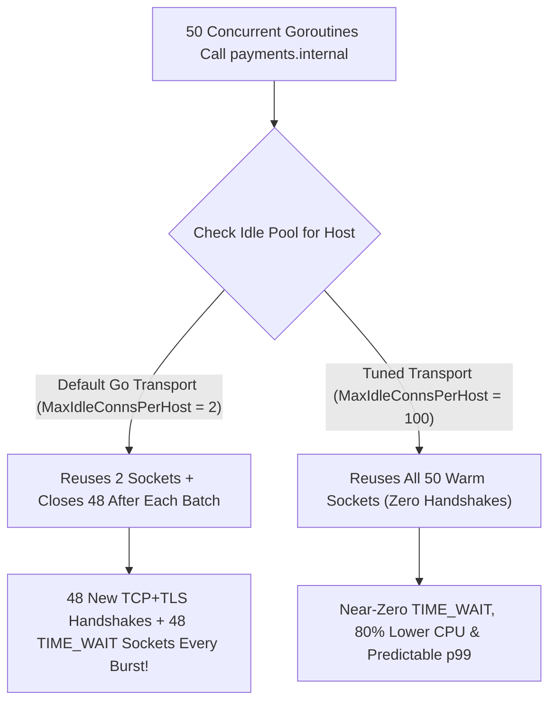
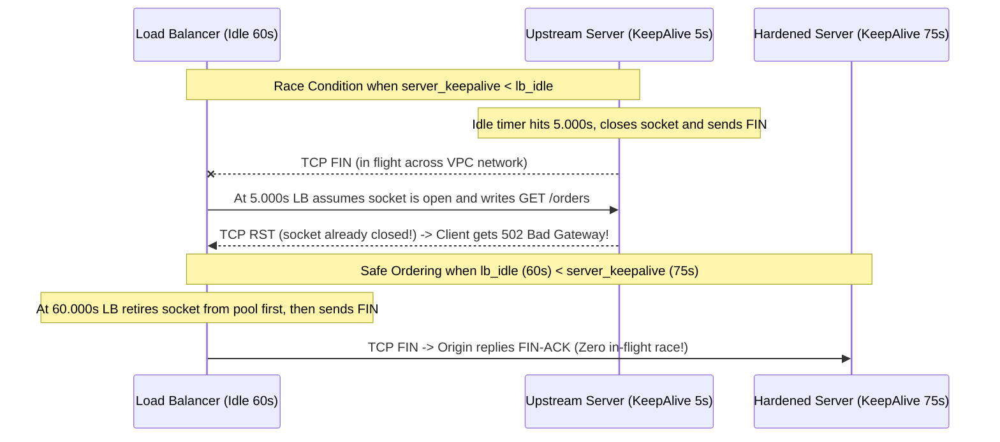
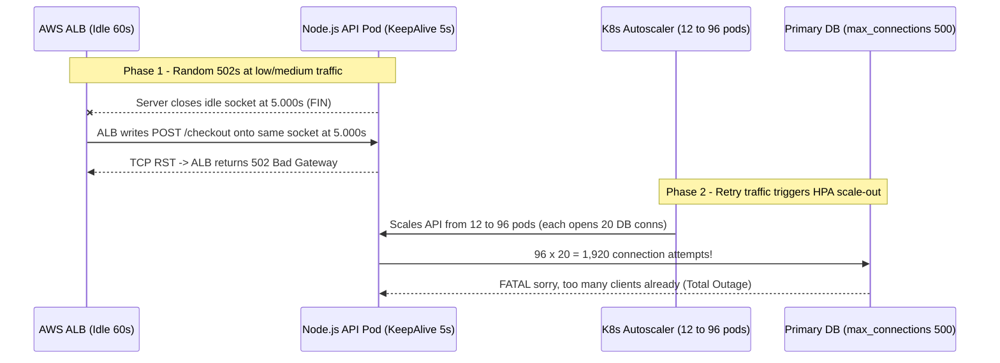

# Lesson 29: Connection Pooling and Keep-Alive

> **Prerequisites:** [Lesson 11: TCP Closing, RST, TIME_WAIT and Ports](../11-tcp-closing-time-wait-and-ports/README.md), [Lesson 27: Forward and Reverse Proxies](../27-forward-and-reverse-proxies/README.md), and [Networking From Zero Overview](../README.md) (Lesson 29 of 30).  
> **Estimated Reading Time:** 25 minutes  
> **Target Audience:** Backend engineers eliminating ephemeral port exhaustion, debugging random `502` / `EOF` errors across load balancers, tuning Go/Node/Python/.NET HTTP pools, and sizing Postgres connection pools in Kubernetes.  
> **Free PDF Notes:** [Download SD-N-029.pdf](https://backendroadmap.com/notes/system-design/SD-N-029.pdf)

> [!TIP]
> **The Golden Rule of Connection Pooling:** Reusing open sockets with **HTTP keep-alive** and **connection pools** deletes redundant TCP/TLS handshakes, drops crypto CPU, and prevents `TIME_WAIT` port exhaustion. To stop the **keep-alive race condition** (random `502`s), always ensure **`server_keepalive_timeout > client_or_lb_idle_timeout`**, raise Go's `MaxIdleConnsPerHost` from its tiny `2` default, set bounded connection lifetimes for DNS refresh, and size database pools via **Little's Law** plus **PgBouncer** transaction pooling.

---

## Words You'll Meet Today

| Word | In Plain Words | Role in a Live Backend System |
| :--- | :--- | :--- |
| **Keep-Alive** | Keeping a TCP connection open after an HTTP response so the next request reuses it. | Default in HTTP/1.1; avoids paying TCP + TLS handshakes on every sequential call. |
| **Connection pool** | A client-managed cache of pre-opened, reusable sockets to an upstream host. | Caps concurrency, eliminates `TIME_WAIT` port churn, and stabilizes tail latency. |
| **`MaxIdleConnsPerHost`** | How many idle sockets an HTTP client keeps warm for one destination host. | Go's `http.DefaultTransport` defaults to `2`—silently destroying reuse under concurrency. |
| **Keep-alive race** | Client writes onto an idle socket at the exact millisecond the server closes it (`FIN`). | Produces sporadic `EOF`, `ECONNRESET`, or `502 Bad Gateway` errors on load balancers. |
| **Idle timeout** | How long a socket may sit unused in a pool before the owner closes it cleanly. | Must be shorter on the client/LB side than on the upstream server (`client < lb < origin`). |
| **Little's Law** | $L = \lambda \times W$: average active connections equal RPS times service duration. | Proves why tiny database pools (`10–20`) outperform huge pools (`200+`) under load. |
| **Transaction pooling** | Assigning a real DB backend socket only for the duration of one SQL transaction. | Lets `PgBouncer` multiplex `5,000` microservice connections onto `80` Postgres backends. |
| **`MaxConnLifetime`** | Hard ceiling on how long any pooled socket lives before graceful rotation. | Forces periodic DNS re-resolution so clients pick up newly deployed or scaled pods. |

---

## Visual Mental Models & Architecture

### The Question: Why Did Latency Drop 80% and `TIME_WAIT` Disappear Overnight?

In [lesson 11](../11-tcp-closing-time-wait-and-ports/README.md) we discovered that closing more than `~470` short-lived connections per second exhausts Linux's `~28,000` ephemeral ports in `TIME_WAIT` (`60 s`). Meanwhile, every brand-new HTTPS socket pays a `1 RTT` TCP handshake, a `1 RTT` TLS 1.3 handshake, and expensive asymmetric `ECDHE`/`ECDSA` CPU math. Even inside a `2 ms` datacenter, tearing down and rebuilding sockets for every internal RPC burns CPU, stalls `p99` latency, and crashes with `EADDRNOTAVAIL`. **Keep-alive** and **connection pooling** keep sockets open and warm across thousands of requests.

### An Everyday Picture First: Leaving the Courier Gate Open vs. Badge Inspection Every Trip

Imagine an office building sending `500` sealed boxes a minute to a warehouse across the street:

- **No Pooling (`Connection: close`):** Every single box sends a brand-new courier who walks through metal detectors, shows a passport, fills out visitor forms (`SYN` + `TLS`), drops one box, walks out, and must wait `60` seconds before their badge slot is recycled (`TIME_WAIT`).
- **Keep-Alive + Connection Pool:** You clear `20` trusted couriers once in the morning and keep an open loading lane between buildings. Each box crosses in one smooth step—zero security queue, zero wasted badges.

### Persistent HTTP/1.1 Connections & Go's `MaxIdleConnsPerHost: 2` Trap

In HTTP/1.1, `Connection: keep-alive` is enabled by default: after reading the full response body (and draining it completely!), the client places the socket back into an **idle pool** keyed by `(scheme, host, port)` rather than sending `FIN`. *(In HTTP/2, one single TCP socket multiplexes 100+ concurrent streams—yet HTTP/1.1 remains everywhere behind cloud ALBs, Envoy/Nginx upstreams, and internal services.)*

Here is the #1 bug Go engineers hit in production: **`http.DefaultTransport` sets `MaxIdleConns: 100`, yet sets `MaxIdleConnsPerHost: 2`!**

Suppose `50` concurrent goroutines in your API service call `https://payments.internal`:

1. All `50` requests succeed and finish at roughly the same time.
2. When returning sockets to the idle pool, Go stores **only `2` sockets** for `payments.internal` and **immediately closes the remaining `48` sockets**!
3. On the very next millisecond's burst of `50` requests, `48` goroutines dial brand-new TCP + TLS connections—repeating a massive `TIME_WAIT` + TLS CPU storm every single batch!



*Figure 1. Why `MaxIdleConnsPerHost: 2` causes hidden connection churn even when pooling is technically enabled: excess sockets are closed on return and redialed on the next burst.*

### The Keep-Alive Race Condition (Why Random `502`s Appear Under Load)

Even with pooling enabled, teams frequently observe sporadic, impossible-to-reproduce **`502 Bad Gateway`** or **`EOF`** errors across Nginx, AWS ALB, Envoy, or Node.js. Almost always, the culprit is the **Keep-Alive Race Condition**:

1. Your upstream server (for example, Node.js default `keepAliveTimeout = 5 s`) decides a socket has been idle for `5.000 s` and closes it by sending TCP `FIN`.
2. At `t = 5.000 s`—while that `FIN` packet is still traveling across the wire—your load balancer or HTTP client (whose idle timeout is `60 s`) believes the pooled socket is completely healthy and writes `POST /v1/charge` onto it!
3. The server receives bytes on a socket it already closed, responds immediately with TCP **`RST`**, and the load balancer returns **`502 Bad Gateway`** to the customer!

**The Ironclad Rule:** Every downstream hop's idle connection timeout **must be strictly shorter** than the upstream server's keep-alive timeout:

$$\text{Client Idle Timeout} < \text{Load Balancer Idle Timeout} < \text{Upstream Server Keep-Alive Timeout}$$

For example: Client HTTP pool `IdleConnTimeout = 45 s` -> AWS ALB idle `60 s` -> Upstream Nginx/Node/Go `KeepAliveTimeout = 75 s` (and Node `headersTimeout = 76 s` to stay above `keepAliveTimeout`). Now the **client/LB always initiates the graceful close first**, and never pulls a dying socket out of its own pool!



*Figure 2. The keep-alive race: when the upstream closes first (`5 s`), in-flight requests from the load balancer hit a dead socket and receive `RST` (`502`). Keeping `server_keepalive > lb_idle` eliminates the race.*

### Sizing Database Pools: Little's Law & Kubernetes Pod Proliferation

HTTP pools stay relatively cheap (`10–100` sockets per target), whereas **PostgreSQL/MySQL connections are expensive** (`~5–10 MB` RAM per backend process plus shared lock and CPU context-switch overhead). Oversizing DB pools actually slows databases down!

Apply **Little's Law** ($L = \lambda \times W$):

$$L = \lambda \times W$$

Where $\lambda$ is query arrival rate (`queries/s`) and $W$ is average query execution time (`s`). If a service runs `2,000` queries/s at `5 ms` (`0.005 s`) each:

$$L = 2{,}000 \times 0.005 = 10\text{ active DB connections!}$$

Notice HikariCP's classic empirical benchmark rule:

$$\text{Connections} \approx (\text{CPU cores} \times 2) + \text{effective\_spindle\_count}$$

On an `8`-vCPU SSD database primary, `16–20` actively running connections saturate CPU and NVMe queues smoothly; `500` concurrent active queries mostly fight over CPU context switches and lock tables.

**The Kubernetes Scaling Multiplier Trap:**
Suppose you give a Go/Java pod a "safe" pool size of `25` connections against a Postgres server with `max_connections = 500`. Under normal load (`10` pods), Postgres holds `250` connections—fine. During a traffic spike, **Kubernetes HPA autoscales to `80` pods**: `80 × 25 = 2,000` connection requests immediately crash Postgres with `FATAL: sorry, too many clients already`!
**The Fix:** Keep per-pod pools small (`5–10`) and place **PgBouncer in transaction pooling mode** in front of Postgres so `2,000` mostly-idle pod sockets multiplex cleanly onto `40–80` real Postgres backend processes. *(Remember to disable server-side prepared statements or use PgBouncer protocol-level prepared statement support when using transaction pooling.)*

---

## Systematic Reference & Comparison Grid

### Connection Strategy Comparison

| Strategy | Handshake Cost (10k reqs) | `TIME_WAIT` Ports Created | Asymmetric TLS CPU | Best Fit |
| :--- | :--- | :--- | :--- | :--- |
| **New TCP + TLS per request** | `10,000` TCP + `10,000` TLS | `10,000` (exhausts ~`470/s`) | Extreme | Never in production microservices |
| **HTTP/1.1 Keep-Alive Pool** | `N` once (e.g. `50` sockets) | Near `0` (only on lifetime rotation) | Amortized to `~0%` | East-West HTTP/1.1, L7 LB upstreams |
| **HTTP/2 Multiplexed Pool** | `1–4` sockets total | Near `0` | Amortized to `~0%` | High-concurrency gRPC / TLS APIs |

### Recommended Idle & Lifetime Timeout Ordering

| Hop Role | Timeout Setting | Example Value | Why This Value? |
| :--- | :--- | :--- | :--- |
| **Client HTTP Pool** | `IdleConnTimeout` | `45 s` | Client retires idle socket before LB closes it |
| **Client HTTP Pool** | `MaxConnLifetime` | `5 min` | Forces gradual rotation so DNS updates reach new pods |
| **L7 Reverse Proxy / ALB** | Idle connection timeout | `60 s` | Strictly `>` Client idle (`45 s`) and `<` Origin keep-alive (`75 s`) |
| **Origin Web Server** | `KeepAliveTimeout` | `75 s` | Strictly `>` LB idle (`60 s`) so origin never races `FIN` |
| **TCP Socket Option** | `SO_KEEPALIVE` probe | `30 s` idle / `10 s` interval | Detects silent NAT/firewall drops on long-lived idle DB sockets |

### Default HTTP Client Pool Traps by Language

| Runtime / Library | Default Trap | Production Fix |
| :--- | :--- | :--- |
| **Go (`net/http`)** | `http.DefaultTransport` sets `MaxIdleConnsPerHost: 2` | Clone transport; set `MaxIdleConnsPerHost: 64–256`, `IdleConnTimeout: 45s` |
| **Python (`requests`)** | Bare `requests.get()` opens and closes a socket every call (`pool=0`) | Reuse one `requests.Session()` with `HTTPAdapter(pool_maxsize=64)` (or `httpx.Client`) |
| **Node.js (`http` / `undici`)** | Node `< 19` disabled keep-alive by default; old Node server `keepAliveTimeout` = `5s` | Use global `undici` / `Agent({ keepAliveTimeout: 45_000 })`; set Node server `keepAliveTimeout = 65_000` |
| **C# (`.NET HttpClient`)** | Instantiating `new HttpClient()` per request exhausts ports; singleton ignores DNS forever | Reuse singleton `SocketsHttpHandler` with `PooledConnectionLifetime = 5 min`, `PooledConnectionIdleTimeout = 45s` |

---

## Production War Story Post-Mortem: `5 s` Keep-Alive Race & Kubernetes HPA Postgres Meltdown

- **Severity:** SEV-1 (Random `502` Errors + Total Database Exhaustion)
- **Detection / Resolution Time:** 12 minutes to spot `5 s` Node keep-alive mismatch; 28 minutes to roll PgBouncer + smaller per-pod pools
- **Impact:** `4.2%` of checkout calls failed randomly with `502 Bad Gateway` behind AWS ALB, followed by total DB refusal (`too many clients`) when HPA scaled pods from `12` to `96`.

### What Happened



### Root Cause Analysis

1. **Inverted Keep-Alive Timeouts:** Node.js HTTP server defaulted to `server.keepAliveTimeout = 5000` ms while AWS ALB kept backend pool connections idle for `60 s`. Every socket hitting `5 s` between requests triggered a `FIN`/`RST` race -> `502`.
2. **Unbounded Pod-Multiplied DB Pools:** Each microservice pod configured `max: 20` Postgres connections directly without PgBouncer. Scaling to `96` pods during retries multiplied connection demand `8×` past Postgres `max_connections = 500`.

### The Fix & Architectural Hardening

- **Fixed Timeout Hierarchy:** Raised origin Node.js `server.keepAliveTimeout = 65_000` (`65 s`) and `server.headersTimeout = 66_000` (`66 s`), strictly above AWS ALB's `60 s` idle timeout.
- **PgBouncer Transaction Pooling + Small Pod Pools:** Reduced per-pod app pool size to `5` and routed pods through PgBouncer in **transaction pooling** mode (`default_pool_size = 60`), keeping Postgres backend processes flat below `100` even at `200` pods.

---

## Multi-Language Production Implementation

Below is a production-structured **Tuned HTTP Connection Pool** across Go, TypeScript, Python, and C#. Every example configures high per-host idle capacity, an idle timeout (`45 s`) strictly shorter than a typical `65 s+` upstream keep-alive, TCP keep-alive probes (`30 s`), and a periodic connection rotation window (`5 min`) so DNS changes propagate cleanly.

````carousel
```go
package poolhttp

import (
	"net"
	"net/http"
	"time"
)

// NewProductionClient creates an HTTP client tuned for high-concurrency microservices
// calling upstreams with >= 65s keep-alive and Load Balancers at 60s idle.
func NewProductionClient() *http.Client {
	dialer := &net.Dialer{
		Timeout:   2 * time.Second,  // Fast TCP connect fail-over
		KeepAlive: 30 * time.Second, // OS TCP keep-alive probes against silent NAT drops
	}

	transport := &http.Transport{
		DialContext:           dialer.DialContext,
		MaxIdleConns:          512,
		MaxIdleConnsPerHost:   128,              // Overrides Go's tiny default of 2!
		MaxConnsPerHost:       256,              // Bounds total sockets per upstream host
		IdleConnTimeout:       45 * time.Second, // Strictly < LB (60s) & Origin (75s)
		TLSHandshakeTimeout:   3 * time.Second,
		ResponseHeaderTimeout: 5 * time.Second,
		ExpectContinueTimeout: 1 * time.Second,
		ForceAttemptHTTP2:     true,
	}

	return &http.Client{
		Transport: transport,
		Timeout:   15 * time.Second,
	}
}
```
<!-- slide -->
```typescript
import { Agent, fetch as undiciFetch } from "undici";

// Production pool for Node/TypeScript using undici:
// - Idle timeout (45s) < LB/Upstream keep-alive (65-75s) prevents 502 races.
// - Max connections per origin prevents socket exhaustion.
export const upstreamPool = new Agent({
  connections: 128,            // Max concurrent TCP connections per origin
  pipelining: 1,               // Standard HTTP/1.1 (no risky pipelining)
  keepAliveTimeout: 45_000,    // Retire idle sockets before LB/server (60s/75s)
  keepAliveMaxTimeout: 300_000,// Rotate long-lived sockets every 5m for DNS refresh
  connectTimeout: 2_000,
  headersTimeout: 5_000,
  bodyTimeout: 10_000,
  connect: {
    keepAlive: true,
    keepAliveInitialDelay: 30_000, // TCP keep-alive probe interval
  },
});

export async function callUpstream(url: string, signal?: AbortSignal) {
  return undiciFetch(url, {
    dispatcher: upstreamPool,
    signal,
  });
}
```
<!-- slide -->
```python
import time
import threading
import requests
from requests.adapters import HTTPAdapter


class RefreshingPooledClient:
    """Reuses TCP/TLS sockets via requests.Session while recycling periodically for DNS updates."""

    def __init__(self, pool_maxsize: int = 64, dns_refresh_sec: int = 300) -> None:
        self._pool_maxsize = pool_maxsize
        self._dns_refresh_sec = dns_refresh_sec
        self._lock = threading.Lock()
        self._created_at = 0.0
        self._session: requests.Session | None = None

    def _build_session(self) -> requests.Session:
        session = requests.Session()
        adapter = HTTPAdapter(
            pool_connections=32,
            pool_maxsize=self._pool_maxsize,  # Mirrors MaxIdleConnsPerHost
            max_retries=0,
        )
        session.mount("https://", adapter)
        session.mount("http://", adapter)
        return session

    def get_session(self) -> requests.Session:
        with self._lock:
            now = time.monotonic()
            if self._session is None or (now - self._created_at) >= self._dns_refresh_sec:
                if self._session is not None:
                    self._session.close()
                self._session = self._build_session()
                self._created_at = now
            return self._session
```
<!-- slide -->
```csharp
using System;
using System.Net.Http;

public static class PooledHttpClientFactory
{
    // Register as a singleton (or via IHttpClientFactory).
    // PooledConnectionLifetime forces clean rotation for DNS updates without socket exhaustion!
    public static HttpClient CreateProductionClient()
    {
        var handler = new SocketsHttpHandler
        {
            MaxConnectionsPerServer = 128,
            PooledConnectionLifetime = TimeSpan.FromMinutes(5),   // Periodic DNS refresh
            PooledConnectionIdleTimeout = TimeSpan.FromSeconds(45), // < LB (60s) & Origin (75s)
            ConnectTimeout = TimeSpan.FromSeconds(2),
            KeepAlivePingDelay = TimeSpan.FromSeconds(30),
            KeepAlivePingTimeout = TimeSpan.FromSeconds(5),
            KeepAlivePingPolicy = HttpKeepAlivePingPolicy.WithActiveRequests,
        };

        return new HttpClient(handler)
        {
            Timeout = TimeSpan.FromSeconds(15),
        };
    }
}
```
````

---

## Practical Hands-On Verification CLI Workflows

### 1. Prove Connection Reuse Across Multiple HTTP Calls with `curl -v`

```bash
curl -v -o /dev/null https://example.com/ https://example.com/robots.txt 2>&1 | grep -iE "Connected to|Re-using existing"
```

**Expected Output:**

```text
* Connected to example.com (93.184.215.14) port 443
* Re-using existing connection #0 with host example.com
```

The second request pays zero TCP `SYN` and zero TLS handshake—it runs immediately over connection `#0`.

### 2. Inspect Live `ESTABLISHED` vs. `TIME_WAIT` Socket Counts on Linux

```bash
ss -tan | awk 'NR>1 {print $1}' | sort | uniq -c
```

**Expected Output:**

```text
     42 ESTAB
      3 TIME-WAIT
```

When connection pooling works properly, `ESTAB` reflects your steady warm pool (`~20–100`) and `TIME-WAIT` stays tiny. If `TIME-WAIT` climbs above `10,000`, suspect `MaxIdleConnsPerHost: 2`, missing `Session` reuse, or un-drained HTTP response bodies!

### 3. Check an Upstream's Keep-Alive Header Policy

```bash
curl -sS -I -H "Connection: keep-alive" http://httpbin.org/get | grep -iE "connection|keep-alive"
```

**Expected Output:**

```text
Connection: keep-alive
```

When using HTTP/1.1 against Nginx or Node.js origins, inspect server configs (`keepalive_timeout` in Nginx, `server.keepAliveTimeout` in Node) alongside your LB idle timeout to verify `server > lb > client`.

---

## Pause and Think

> [!exercise] Your microservice executes `1,500` PostgreSQL queries per second with an average query time of `4 ms`. You plan to scale Kubernetes pods up to `50` replicas during peak hours. Using Little's Law, how many active connections does the database *actually* need at peak, and what happens if every pod configures `max_pool_size = 30` directly against Postgres (`max_connections = 500`)? Decide before opening the answer.

<details><summary>Answer</summary>

- **Actual active connections needed (Little's Law):** $L = \lambda \times W = 1{,}500 \times 0.004\text{ s} = \mathbf{6}$ active concurrent queries on average (with headroom for bursts, a pool of `20–40` total Postgres connections is plenty).
- **Direct pod pool failure:** `50 pods × 30 connections = 1,500` connection requests immediately exceed Postgres's `max_connections = 500`, rejecting new pods and wasting gigabytes of DB RAM on mostly-idle backend processes.
- **Fix:** Set each pod's pool small (`4–5`) or route all pods through **PgBouncer in transaction pooling mode** (`default_pool_size = 40`).

</details>

---

## Operational Validation Checkpoints

<details><summary><strong>Checkpoint 1: Un-Drained Response Body Breaks Go Connection Pooling</strong></summary>

**Scenario:** You raised Go's `MaxIdleConnsPerHost` to `128`, yet `ss -tan` still shows thousands of sockets entering `TIME_WAIT` every minute! Your code checks `resp.StatusCode` and immediately calls `resp.Body.Close()` without reading the body on `4xx`/`5xx` errors. Why didn't Go reuse the socket?

**Solution:**
In HTTP/1.1, a persistent socket cannot be returned to the pool until its entire current response body is read to `EOF`—otherwise leftover bytes would corrupt the next caller's HTTP response! Calling `resp.Body.Close()` before reading the body forces Go's `net/http` transport to **destroy the TCP connection** immediately. Always drain small error bodies (`_, _ = io.Copy(io.Discard, io.LimitReader(resp.Body, 64*1024))`) before calling `resp.Body.Close()`.

</details>

<details><summary><strong>Checkpoint 2: Rolling Deploy Traffic Doesn't Reach New Pods</strong></summary>

**Scenario:** After fixing C# `HttpClient` socket exhaustion by sharing a single static `HttpClient`, you deploy `v2` pods behind a headless Kubernetes DNS service (`payments.svc.cluster.local`). Ten minutes later, `v1` pods (before termination) or initial replicas still handle `100%` of requests while newly added pods sit at `0%` CPU. Why?

**Solution:**
Sharing a long-lived `HttpClient` without a **`PooledConnectionLifetime`** keeps the original HTTP/1.1/HTTP/2 TCP sockets open forever—never re-querying DNS! Configure `SocketsHttpHandler { PooledConnectionLifetime = TimeSpan.FromMinutes(2) }` (or in Go/Python, periodically close idle pools or resolve via L7 proxy/Envoy) so sockets gracefully rotate and pick up new DNS A records.

</details>

<details><summary><strong>Checkpoint 3: Silent Load Balancer Drops After 5 Minutes of Low Traffic</strong></summary>

**Scenario:** Low-traffic background jobs fail on their first morning database or HTTP query with `read: connection reset by peer` after sitting idle for `15` minutes. Why did `IdleConnTimeout` fail to prevent it?

**Solution:**
A stateful cloud NAT gateway or firewall silently expired its connection-tracking table entry after `350 s` (`~6 min`) **without sending TCP `FIN` or `RST`** to either endpoint. When the app reused the pooled socket at `15 min`, the firewall dropped the packet or sent `RST`. Set client `IdleConnTimeout` (`45–120 s`) well below firewall idle timeouts (`350 s`) AND enable **TCP Keep-Alive probes** (`30 s`) to keep NAT mappings alive or fail dead sockets early.

</details>

---

## Common Mistakes & Troubleshooting

### What Goes Wrong

- **Using `http.DefaultTransport` in Go microservices:** `MaxIdleConnsPerHost: 2` quietly closes `98%` of pooled sockets under moderate concurrency.
- **Creating `new HttpClient()` or `requests.get()` inside a loop:** Opens and tears down a fresh TCP + TLS socket per request, causing `TIME_WAIT` exhaustion (`EADDRNOTAVAIL`) and TLS CPU spikes.
- **Inverted Idle Timeouts (`server_keepalive < lb_idle`):** Upstream closes idle sockets first, causing random `502 Bad Gateway` errors during normal traffic.
- **Over-sized DB Pools (`max_pool = 100` per pod):** Thrashing CPU context switches, memory bloat, and `max_connections` outages whenever Kubernetes scales pods.

### Common Myths

- **"Larger database connection pools always give higher throughput."** False. Beyond `(CPU cores × 2) + spindles`, extra active DB connections slow queries down via CPU scheduling contention and lock waits.
- **"Keep-alive means connections stay open forever."** False. Idle timers (`45–75 s`) and max connection lifetimes (`5 min`) safely balance reuse against stale DNS and NAT table expiry.
- **"Closing `resp.Body` in Go always returns the connection to the pool."** False unless you read the body to `EOF` first; un-drained bodies force socket closure.

| Symptom | Root Cause | Fix |
| :--- | :--- | :--- |
| Sporadic `502` / `EOF` on idle-then-active bursts | `server_keepalive_timeout <= lb_or_client_idle_timeout` | Enforce `client_idle (45s) < lb_idle (60s) < server_keepalive (75s)` |
| Massive `TIME_WAIT` despite Go `http.Client` reuse | `MaxIdleConnsPerHost: 2` default or un-drained `resp.Body` | Set `MaxIdleConnsPerHost >= 64` and drain `resp.Body` before `Close()` |
| New scaled-up pods receive zero traffic | Infinite pooled sockets pin clients to old DNS IP | Set `MaxConnLifetime` / `PooledConnectionLifetime` (`2–5 min`) or use L7 proxy |

---

## Recap in Three Lines

1. **HTTP keep-alive and connection pools** cut TCP/TLS latency and `TIME_WAIT` churn—just remember to override traps like Go's `MaxIdleConnsPerHost: 2` and drain response bodies.
2. Eliminate the **keep-alive race (`502`s)** by ensuring every downstream idle timeout is strictly shorter than the upstream server's keep-alive timeout (`client < LB < server`).
3. Size database pools with **Little's Law** ($L = \lambda \times W$) and use **PgBouncer transaction pooling** so Kubernetes pod scaling never exhausts Postgres `max_connections`.

---

## Interview Practice Questions

> [!interview] Why does Go's `http.DefaultTransport` suffer socket exhaustion under high concurrency to a single downstream API? (Basic)

<details><summary>What to say in 30 seconds</summary>

Although Go's `http.DefaultTransport` sets `MaxIdleConns` to 100 globally, `MaxIdleConnsPerHost` defaults to just `2`. When 50 goroutines hit the same upstream host concurrently, Go only saves 2 sockets back into the idle pool and closes the other 48 immediately—causing `TIME_WAIT` port churn and repeated TCP/TLS handshakes on every burst.

</details>

> [!interview] How does connection pooling prevent `TIME_WAIT` port exhaustion? (Basic)

<details><summary>What to say in 30 seconds</summary>

Each short-lived client-initiated close puts that 4-tuple into `TIME_WAIT` for 60 seconds on Linux, capping new connections at roughly 470 per second per destination. A connection pool keeps a small set of `ESTABLISHED` sockets open and reuses them across thousands of sequential HTTP requests, reducing socket creation and `TIME_WAIT` churn near zero.

</details>

> [!interview] You see sporadic `502 Bad Gateway` responses behind an AWS ALB even though origin CPU is 15%. What keep-alive race explains this and how do you fix it? (Scenario)

<details><summary>What to say in 30 seconds</summary>

The upstream server's keep-alive timeout is shorter than the ALB's idle timeout—for example, Node.js defaults to 5 seconds while ALB waits 60 seconds. When the origin closes an idle socket at 5 seconds right as the ALB sends a new request on it, the origin sends `RST` and the ALB emits `502`. Fix it by setting `origin_keepalive > lb_idle > client_idle`, such as 75s on origin and 60s on ALB.

</details>

> [!interview] Your team scales a microservice from 10 to 100 Kubernetes pods and PostgreSQL crashes with `too many clients already`. How do you solve this cleanly? (Scenario)

<details><summary>What to say in 30 seconds</summary>

Direct per-pod pools multiply linearly with pod count (`100 pods × 20 conns = 2,000`). Use Little's Law (`L = λ × W`) to calculate actual active DB concurrency—often just 10 to 30 connections—lower per-pod pool sizes, and put PgBouncer in transaction pooling mode in front of Postgres so thousands of app sockets share a small, steady pool of real database backends.

</details>

> [!interview] Why can adding `MaxConnLifetime` improve reliability in Kubernetes even though it slightly increases connection churn? (Tricky)

<details><summary>What to say in 30 seconds</summary>

Because HTTP clients resolve DNS only when dialing a brand-new TCP connection, an infinitely pooled socket stays pinned to the original pod IPs forever—ignoring newly scaled pods or headless DNS updates. A bounded `MaxConnLifetime` like 2 to 5 minutes periodically rotates connections smoothly, distributing load onto new pods without causing `TIME_WAIT` storms.

</details>

> [!interview] What happens in HTTP/1.1 pooling if you close `resp.Body` after checking headers without draining the body? (Tricky)

<details><summary>What to say in 30 seconds</summary>

HTTP/1.1 has no stream framing independent of the TCP byte stream, so unread body bytes left on the wire would corrupt the very next request reusing that socket. As a safeguard, HTTP clients refuse to pool un-drained connections and forcibly close the underlying TCP socket instead—silently defeating your connection pool on error responses unless you drain small bodies to `EOF` before closing.

</details>

---

## Free PDF notes

Download these notes as a printable PDF with the pool sizing math, timeout hierarchy diagram, and interview answers: [SD-N-029.pdf](https://backendroadmap.com/notes/system-design/SD-N-029.pdf).

---

## Sources

- [RFC 9112: HTTP/1.1](https://www.rfc-editor.org/rfc/rfc9112), persistent connections (`keep-alive`), connection closure races, and pipelining caveats.
- [RFC 9293: Transmission Control Protocol (TCP)](https://www.rfc-editor.org/rfc/rfc9293), `FIN`, `RST`, and `TIME_WAIT` socket lifecycle.
- [Go `net/http` `Transport` Documentation](https://pkg.go.dev/net/http#Transport), `MaxIdleConnsPerHost`, `IdleConnTimeout`, and body-draining requirements.
- [HikariCP: About Pool Sizing](https://github.com/brettwooldridge/HikariCP/wiki/About-Pool-Sizing), empirical CPU-core sizing formula and Little's Law intuition.
- [PgBouncer Documentation](https://www.pgbouncer.org/features.html), transaction pooling vs session pooling for PostgreSQL at scale.

---

## Next

Next comes our final lesson, [Lesson 30: Timeouts — Connect, Read, Deadlines and the Random 502](../30-timeouts-and-502s/README.md): how to prevent cascading worker hangs with connect/read/TTFB timeouts, propagate end-to-end deadlines across microservice hops, decode `502`/`503`/`504`, and stop retry amplification with retry budgets. See [the track overview](../README.md) for the whole series.
