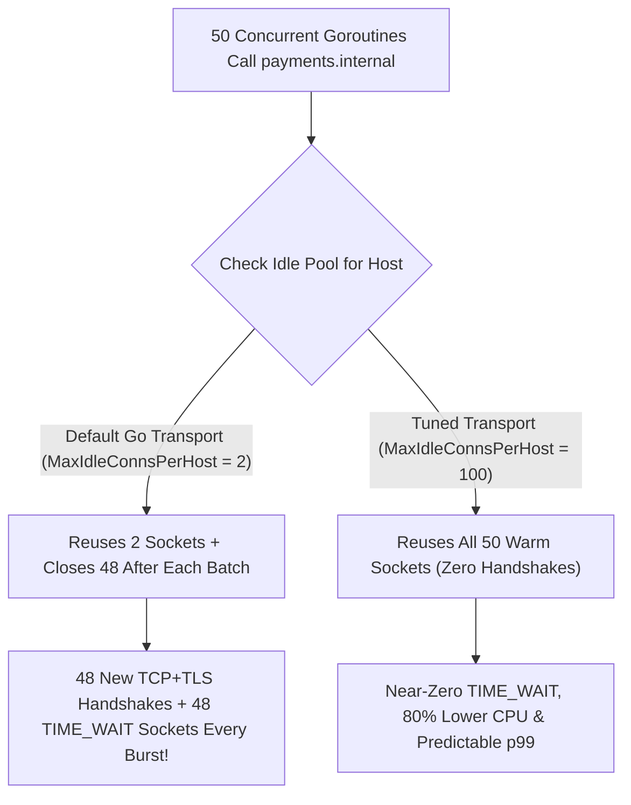
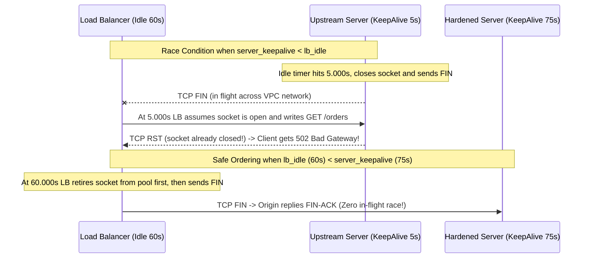
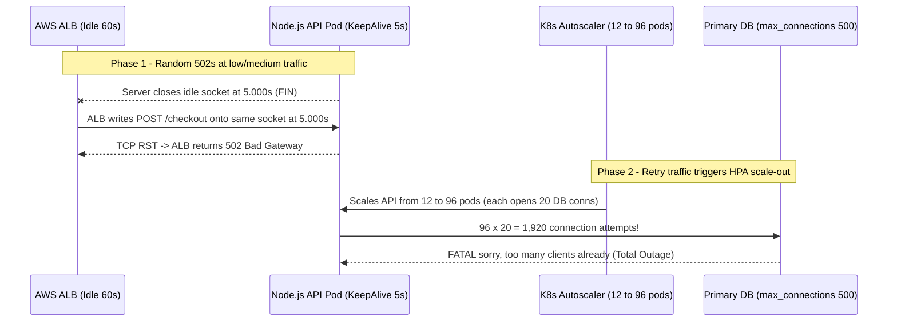

# Lesson 29: Connection Pooling and Keep-Alive

> **Prerequisites:** [Lesson 11: TCP Closing, RST, TIME_WAIT and Ports](../11-tcp-closing-time-wait-and-ports/README.md), [Lesson 27: Forward and Reverse Proxies](../27-forward-and-reverse-proxies/README.md), and [Networking From Zero Overview](../README.md) (Lesson 29 of 30).  
> **Estimated Reading Time:** 35 minutes  
> **Target Audience:** Backend engineers eliminating ephemeral port exhaustion, debugging random `502` / `EOF` errors across load balancers, tuning Go/Node/Python/.NET HTTP pools, and sizing Postgres connection pools in Kubernetes.  
> **Free PDF Notes:** [Download SD-N-029.pdf](https://backendroadmap.com/notes/system-design/SD-N-029.pdf)

> [!NOTE]
> **In one line:** opening a connection costs DNS, TCP and TLS round trips, so keep connections open and share them through a pool; size it with Little's Law, and watch idle timeouts and leaks.

> [!TIP]
> **The Golden Rule of Connection Pooling:** Reusing open sockets with **HTTP keep-alive** and **connection pools** deletes redundant TCP/TLS handshakes, drops crypto CPU, and prevents `TIME_WAIT` port exhaustion. To stop the **keep-alive race condition** (random `502`s), always ensure **`server_keepalive_timeout > client_or_lb_idle_timeout`**, raise Go's `MaxIdleConnsPerHost` from its tiny `2` default, set bounded connection lifetimes for DNS refresh, and size database pools via **Little's Law** plus **PgBouncer** transaction pooling.

---

## Words You'll Meet Today

| Word | In Plain Words | Role in a Live Backend System |
| :--- | :--- | :--- |
| **Keep-Alive** | Keeping a TCP connection open after an HTTP response so the next request reuses it. | Default in HTTP/1.1; avoids paying TCP + TLS handshakes on every sequential call. |
| **Connection pool** | A client-managed cache of pre-opened, reusable sockets to an upstream host. | Caps concurrency, eliminates `TIME_WAIT` port churn, and stabilizes tail latency. |
| **`MaxIdleConnsPerHost`** | How many idle sockets an HTTP client keeps warm for one destination host. | Go's `http.DefaultTransport` defaults to `2`—silently destroying reuse under concurrency. |
| **Keep-alive race** | Client writes onto an idle socket at the exact millisecond the server closes it (`FIN`). | Produces sporadic `EOF`, `ECONNRESET`, or `502 Bad Gateway` errors on load balancers. |
| **Idle timeout** | How long a socket may sit unused in a pool before the owner closes it cleanly. | Must be shorter on the client/LB side than on the upstream server (`client < lb < origin`). |
| **Little's Law** | $L = \lambda \times W$: average active connections equal RPS times service duration. | Proves why tiny database pools (`10–20`) outperform huge pools (`200+`) under load. |
| **Transaction pooling** | Assigning a real DB backend socket only for the duration of one SQL transaction. | Lets `PgBouncer` multiplex `5,000` microservice connections onto `80` Postgres backends. |
| **`MaxConnLifetime`** | Hard ceiling on how long any pooled socket lives before graceful rotation. | Forces periodic DNS re-resolution so clients pick up newly deployed or scaled pods. |

---

## Visual Mental Models & Architecture

### The Question: Why Did Latency Drop 80% and `TIME_WAIT` Disappear Overnight?

In [lesson 11](../11-tcp-closing-time-wait-and-ports/README.md) we discovered that closing more than `~470` short-lived connections per second exhausts Linux's `~28,000` ephemeral ports in `TIME_WAIT` (`60 s`). Meanwhile, every brand-new HTTPS socket pays a `1 RTT` TCP handshake, a `1 RTT` TLS 1.3 handshake, and expensive asymmetric `ECDHE`/`ECDSA` CPU math. Even inside a `2 ms` datacenter, tearing down and rebuilding sockets for every internal RPC burns CPU, stalls `p99` latency, and crashes with `EADDRNOTAVAIL`. **Keep-alive** and **connection pooling** keep sockets open and warm across thousands of requests.

### An Everyday Picture First: Leaving the Courier Gate Open vs. Badge Inspection Every Trip

Imagine an office building sending `500` sealed boxes a minute to a warehouse across the street:

- **No Pooling (`Connection: close`):** Every single box sends a brand-new courier who walks through metal detectors, shows a passport, fills out visitor forms (`SYN` + `TLS`), drops one box, walks out, and must wait `60` seconds before their badge slot is recycled (`TIME_WAIT`).
- **Keep-Alive + Connection Pool:** You clear `20` trusted couriers once in the morning and keep an open loading lane between buildings. Each box crosses in one smooth step—zero security queue, zero wasted badges.

### Persistent HTTP/1.1 Connections & Go's `MaxIdleConnsPerHost: 2` Trap

In HTTP/1.1, `Connection: keep-alive` is enabled by default: after reading the full response body (and draining it completely!), the client places the socket back into an **idle pool** keyed by `(scheme, host, port)` rather than sending `FIN`. *(In HTTP/2, one single TCP socket multiplexes 100+ concurrent streams—yet HTTP/1.1 remains everywhere behind cloud ALBs, Envoy/Nginx upstreams, and internal services.)*

Here is the #1 bug Go engineers hit in production: **`http.DefaultTransport` sets `MaxIdleConns: 100`, yet sets `MaxIdleConnsPerHost: 2`!**

Suppose `50` concurrent goroutines in your API service call `https://payments.internal`:

1. All `50` requests succeed and finish at roughly the same time.
2. When returning sockets to the idle pool, Go stores **only `2` sockets** for `payments.internal` and **immediately closes the remaining `48` sockets**!
3. On the very next millisecond's burst of `50` requests, `48` goroutines dial brand-new TCP + TLS connections—repeating a massive `TIME_WAIT` + TLS CPU storm every single batch!



*Figure 1. Why `MaxIdleConnsPerHost: 2` causes hidden connection churn even when pooling is technically enabled: excess sockets are closed on return and redialed on the next burst.*

### The Keep-Alive Race Condition (Why Random `502`s Appear Under Load)

Even with pooling enabled, teams frequently observe sporadic, impossible-to-reproduce **`502 Bad Gateway`** or **`EOF`** errors across Nginx, AWS ALB, Envoy, or Node.js. Almost always, the culprit is the **Keep-Alive Race Condition**:

1. Your upstream server (for example, Node.js default `keepAliveTimeout = 5 s`) decides a socket has been idle for `5.000 s` and closes it by sending TCP `FIN`.
2. At `t = 5.000 s`—while that `FIN` packet is still traveling across the wire—your load balancer or HTTP client (whose idle timeout is `60 s`) believes the pooled socket is completely healthy and writes `POST /v1/charge` onto it!
3. The server receives bytes on a socket it already closed, responds immediately with TCP **`RST`**, and the load balancer returns **`502 Bad Gateway`** to the customer!

**The Ironclad Rule:** Every downstream hop's idle connection timeout **must be strictly shorter** than the upstream server's keep-alive timeout:

$$\text{Client Idle Timeout} < \text{Load Balancer Idle Timeout} < \text{Upstream Server Keep-Alive Timeout}$$

For example: Client HTTP pool `IdleConnTimeout = 45 s` -> AWS ALB idle `60 s` -> Upstream Nginx/Node/Go `KeepAliveTimeout = 75 s` (and Node `headersTimeout = 76 s` to stay above `keepAliveTimeout`). Now the **client/LB always initiates the graceful close first**, and never pulls a dying socket out of its own pool!



*Figure 2. The keep-alive race: when the upstream closes first (`5 s`), in-flight requests from the load balancer hit a dead socket and receive `RST` (`502`). Keeping `server_keepalive > lb_idle` eliminates the race.*

### Sizing Database Pools: Little's Law & Kubernetes Pod Proliferation

HTTP pools stay relatively cheap (`10–100` sockets per target), whereas **PostgreSQL/MySQL connections are expensive** (`~5–10 MB` RAM per backend process plus shared lock and CPU context-switch overhead). Oversizing DB pools actually slows databases down!

Apply **Little's Law** ($L = \lambda \times W$):

$$L = \lambda \times W$$

Where $\lambda$ is query arrival rate (`queries/s`) and $W$ is average query execution time (`s`). If a service runs `2,000` queries/s at `5 ms` (`0.005 s`) each:

$$L = 2{,}000 \times 0.005 = 10\text{ active DB connections!}$$

Notice HikariCP's classic empirical benchmark rule:

$$\text{Connections} \approx (\text{CPU cores} \times 2) + \text{effective\_spindle\_count}$$

On an `8`-vCPU SSD database primary, `16–20` actively running connections saturate CPU and NVMe queues smoothly; `500` concurrent active queries mostly fight over CPU context switches and lock tables.

**The Kubernetes Scaling Multiplier Trap:**
Suppose you give a Go/Java pod a "safe" pool size of `25` connections against a Postgres server with `max_connections = 500`. Under normal load (`10` pods), Postgres holds `250` connections—fine. During a traffic spike, **Kubernetes HPA autoscales to `80` pods**: `80 × 25 = 2,000` connection requests immediately crash Postgres with `FATAL: sorry, too many clients already`!
**The Fix:** Keep per-pod pools small (`5–10`) and place **PgBouncer in transaction pooling mode** in front of Postgres so `2,000` mostly-idle pod sockets multiplex cleanly onto `40–80` real Postgres backend processes. *(Remember to disable server-side prepared statements or use PgBouncer protocol-level prepared statement support when using transaction pooling.)*

---

## Systematic Reference & Comparison Grid

### Connection Strategy Comparison

| Strategy | Handshake Cost (10k reqs) | `TIME_WAIT` Ports Created | Asymmetric TLS CPU | Best Fit |
| :--- | :--- | :--- | :--- | :--- |
| **New TCP + TLS per request** | `10,000` TCP + `10,000` TLS | `10,000` (exhausts ~`470/s`) | Extreme | Never in production microservices |
| **HTTP/1.1 Keep-Alive Pool** | `N` once (e.g. `50` sockets) | Near `0` (only on lifetime rotation) | Amortized to `~0%` | East-West HTTP/1.1, L7 LB upstreams |
| **HTTP/2 Multiplexed Pool** | `1–4` sockets total | Near `0` | Amortized to `~0%` | High-concurrency gRPC / TLS APIs |

### Recommended Idle & Lifetime Timeout Ordering

| Hop Role | Timeout Setting | Example Value | Why This Value? |
| :--- | :--- | :--- | :--- |
| **Client HTTP Pool** | `IdleConnTimeout` | `45 s` | Client retires idle socket before LB closes it |
| **Client HTTP Pool** | `MaxConnLifetime` | `5 min` | Forces gradual rotation so DNS updates reach new pods |
| **L7 Reverse Proxy / ALB** | Idle connection timeout | `60 s` | Strictly `>` Client idle (`45 s`) and `<` Origin keep-alive (`75 s`) |
| **Origin Web Server** | `KeepAliveTimeout` | `75 s` | Strictly `>` LB idle (`60 s`) so origin never races `FIN` |
| **TCP Socket Option** | `SO_KEEPALIVE` probe | `30 s` idle / `10 s` interval | Detects silent NAT/firewall drops on long-lived idle DB sockets |

### Default HTTP Client Pool Traps by Language

| Runtime / Library | Default Trap | Production Fix |
| :--- | :--- | :--- |
| **Go (`net/http`)** | `http.DefaultTransport` sets `MaxIdleConnsPerHost: 2` | Clone transport; set `MaxIdleConnsPerHost: 64–256`, `IdleConnTimeout: 45s` |
| **Python (`requests`)** | Bare `requests.get()` opens and closes a socket every call (`pool=0`) | Reuse one `requests.Session()` with `HTTPAdapter(pool_maxsize=64)` (or `httpx.Client`) |
| **Node.js (`http` / `undici`)** | Node `< 19` disabled keep-alive by default; old Node server `keepAliveTimeout` = `5s` | Use global `undici` / `Agent({ keepAliveTimeout: 45_000 })`; set Node server `keepAliveTimeout = 65_000` |
| **C# (`.NET HttpClient`)** | Instantiating `new HttpClient()` per request exhausts ports; singleton ignores DNS forever | Reuse singleton `SocketsHttpHandler` with `PooledConnectionLifetime = 5 min`, `PooledConnectionIdleTimeout = 45s` |

---

## Core Definition & Taxonomic Comparison

**Keep-alive leaves a TCP connection open after a response; a connection pool is the shared set of those open connections you borrow, use, and return.** Without them, every call pays DNS + TCP + TLS again. In Python that is `requests.Session` / `httpx.Client`; database drivers and SQLAlchemy have their own pools; Go's `http.Transport` *is* the pool (once you fix `MaxIdleConnsPerHost`).

| Term | Precise Meaning | Production Example |
| :--- | :--- | :--- |
| **Keep-alive** vs. **connection pool** vs. **HTTP/2 multiplex** | Keep-alive = leave one socket open for sequential reuse. Pool = manage many such sockets with caps. HTTP/2 = many concurrent streams on *few* sockets (still reused). | `httpx` shared client with `max_connections=30`; one H2 conn to an API; Postgres still needs a pool. |
| **Pool timeout** vs. **idle timeout** vs. **connect timeout** | *Pool*: max wait to **borrow**. *Idle*: close a connection unused this long. *Connect*: max wait to open a **new** socket. | Pool `0.5–1 s`, client idle `30–45 s` `<` server/LB `60–75 s`, connect `1–2 s`. |
| **Too-small pool** vs. **too-large pool** vs. **leak** | Too small: healthy downstream, but callers hit pool timeouts. Too large: exceed DB `max_connections`, waste FDs/RAM. Leak: borrowed, never returned—exhausts at *low* traffic. | `200 calls/s × 0.1 s = 20` busy; `10 pods × 50` DB conns = `500` > `max_connections=100`. |
| **Client idle `<` server idle** vs. **server idle `<` LB idle** | Client/LB must close first so they never reuse a socket the peer already `FIN`ned. Inverted ordering → random `RST` / `502`. | Client `30 s` `<` LB `60 s` `<` app keep-alive `75 s`. |

**Business impact.** At `50 ms` RTT, a fresh HTTPS call burns `~100–150 ms` and TLS CPU before your request bytes leave. Under load that shows up as `p99` cliffs, `TIME_WAIT` exhaustion, and cascading pool timeouts that look like "the payments API is down" when it is healthy.

---

## Component Anatomy & The Observability Gap

### Anatomy of Borrow → Use → Return

```text
 REQUEST HANDLERS                         SHARED POOL                         UPSTREAM
  Req1 ──borrow─────────────────────────> [conn1 IDLE] ──in use─────────────> Payments API
  Req2 ──borrow─────────────────────────> [conn2 IN USE]
  Req3 ──borrow (wait / pool timeout)──> [conn3 IDLE]                         TLS keep-alive
       <──give back (must drain body!)──  [conn4 IN USE]
                                          [conn5 IDLE] ──idle timer─────────> close before server does
 Size = rate × duration + headroom   Total across pods must fit downstream max_connections
```

### The Observability Gap: Pool Metrics That Lie

| Vantage Point | What It Captures | What It Hides |
| :--- | :--- | :--- |
| **App pool gauges** (in-use, idle, waiters, acquire latency) | Whether *this process* is starved or leaking. | Other pods' pools; total against Postgres `max_connections`. |
| **Upstream health / dependency `p99`** | Downstream is fine. | Your pool is too small—timeouts are local queueing. |
| **LB `502` rate** | Something broke on the wire. | Keep-alive race vs OOM vs buffer overflow (need proxy error strings). |
| **`ss -tan` / `TIME_WAIT` counts** | Socket churn and reuse health on one box. | Per-host idle cap bugs (Go `MaxIdleConnsPerHost=2`) unless you correlate with dial rate. |
| **Metrics to add** | Pool in-use / max, acquire wait p95, dials/s, TLS handshakes/s, leak (in-use stuck), `max_connections` headroom × pods. | Average latency alone—pool waits hide in `p99`. |

**Operational rule:** if pool timeouts rise while dependency latency is flat, **resize or fix a leak**—do not "scale the payments API."

---

## Mathematical Model of Handshake Cost, Pool Size & Idle Races

### 1. Fresh Connection Setup Cost

$$T_{\text{setup}} \approx T_{\text{DNS}} + T_{\text{TCP}} + T_{\text{TLS}} \approx (2\text{–}3) \times \text{RTT} + T_{\text{crypto}}$$

| RTT | Cold setup (≈ `3 × RTT`) | Reused keep-alive | Savings per call |
| :--- | :--- | :--- | :--- |
| `5 ms` (same AZ) | `~15 ms` | `~0` | Small but CPU still matters |
| `50 ms` (cross-AZ / nearby region) | **`~150 ms`** | `~0` | Dominates `p99` |
| `100 ms` | `~300 ms` | `~0` | Mobile / far region |

### 2. Little's Law Pool Sizing

$$L = \lambda \times W, \qquad \text{Pool size} \approx L \times (1 + \text{headroom})$$

**Worked example (PDF):** `200` payment calls/s × `100 ms` (`0.1 s`) = **`20` busy connections**. With `~50%` headroom → **`30` total**. Spread over `3` pods × `2` workers (`6` pools) → **`~5` per pool**.

| Scenario | Math | Result |
| :--- | :--- | :--- |
| Steady HTTP egress | `200/s × 0.1 s × 1.5` | `30` connections |
| Traffic doubles, pool fixed at `20` | In-flight `20 → 40` | Pool timeouts while API healthy |
| DB: `10` pods × pool `50`, `max_connections=100` | `500` demanded | Refusals / meltdown |
| Fix with PgBouncer | Small per-pod pools → shared `40–80` backends | Fits under `100` |

### 3. Utilization vs Wait (Why Tiny Headroom Cliffs)

Treat the pool as an `M/M/c`-ish resource. As borrow utilization $\rho = L / c$ rises, wait time blows up:

| Pool utilization $\rho$ | Relative borrow wait | Symptom |
| :--- | :--- | :--- |
| `50%` | `~1×` | Healthy |
| `70%` | `~3×` | `p95` acquire climbs |
| `80%` | `~5×` | Alerts flicker |
| `90%` | `~10×` | Pool timeouts start |
| `95%` | `~20×` | SEV territory |
| `99%` | `~100×` | Cascade |

Keep steady-state pool utilization in the **`60–70%`** band; the remaining headroom absorbs bursts and slow responses.

### 4. Percentiles: Averages Hide Pool Waits

`90` calls at `40 ms`, `9` at `300 ms` (borrow wait), `1` at `2,000 ms` (pool timeout path):

$$\text{mean} = 0.90\times40 + 0.09\times300 + 0.01\times2000 = 83\ \text{ms}$$

| Metric | Value | Who feels it |
| :--- | :--- | :--- |
| Mean | `83 ms` | Looks "fine" on a dashboard |
| $p_{50}$ | `~40 ms` | Happy majority |
| $p_{95}$ | `~300 ms` | Borrow queue starting |
| $p_{99}$ | `~2,000 ms` | Pool timeout / customer pain |

### 5. Compounding Across Fan-Out

If one user request fans out to $N$ downstream calls, each independently paying a cold-handshake probability $p$ when the pool is undersized:

$$P(\text{at least one cold dial}) = 1 - (1-p)^{N}$$

| $N$ | $p = 0.01$ | $p = 0.05$ | $p = 0.20$ (Go default churn) |
| :--- | :--- | :--- | :--- |
| `1` | `1%` | `5%` | `20%` |
| `5` | `5%` | `23%` | `67%` |
| `10` | `10%` | `40%` | `89%` |
| `20` | `18%` | `64%` | `99%` |

### 6. Numbers Every Backend Engineer Must Know

| Fact | Typical Value | Implication |
| :--- | :--- | :--- |
| Cold HTTPS at `50 ms` RTT | `~100–150 ms` setup | Must pool |
| Go `MaxIdleConnsPerHost` default | **`2`** | Silent churn under concurrency |
| Node.js `keepAliveTimeout` default | **`5 s`** | Classic ALB/`502` race |
| Linux `TIME_WAIT` | `60 s` | ~`470` new conns/s/dest before port pain |
| Postgres RAM per backend | `~5–10 MB` | Huge pools waste memory |
| HikariCP rule of thumb | `(cores × 2) + spindles` | Often `10–40` active DB conns |
| Safe idle ordering | client `45 s` `<` LB `60 s` `<` server `75 s` | Server never closes first |

### 7. Hierarchical Pool Budgets

| Layer | Budget / Cap | Derivation |
| :--- | :--- | :--- |
| Per-worker HTTP pool | Little's Law + `30–50%` headroom | `λ × W × 1.5` |
| Per-pod DB pool | Small (`4–10`) | Multiply by pods ≤ Postgres/`PgBouncer` |
| Cluster total → Postgres | `≤ 0.7 × max_connections` | Leave room for admin/migrations |
| Idle timeout chain | client `<` LB `<` origin | Prevent `502` races |
| `MaxConnLifetime` | `2–5 min` | DNS / pod IP refresh |

### 8. Top Engineering Mitigations

1. **One shared client per process** (FastAPI lifespan / singleton `HttpClient` / tuned Go `Transport`).
2. **Size with Little's Law** and multiply by pods/workers before hitting DB limits.
3. **Idle timeout hierarchy** (`client < LB < server`) to kill keep-alive races.
4. **Drain response bodies** and use context managers to prevent leaks.
5. **PgBouncer transaction pooling** + small per-pod DB pools under Kubernetes HPA.

---

## Production War Story Post-Mortem: `5 s` Keep-Alive Race & Kubernetes HPA Postgres Meltdown

- **Severity:** SEV-1 (Random `502` Errors + Total Database Exhaustion)
- **Detection / Resolution Time:** 12 minutes to spot `5 s` Node keep-alive mismatch; 28 minutes to roll PgBouncer + smaller per-pod pools
- **Impact:** `4.2%` of checkout calls failed randomly with `502 Bad Gateway` behind AWS ALB, followed by total DB refusal (`too many clients`) when HPA scaled pods from `12` to `96`.

### What Happened



### Root Cause Analysis

1. **Inverted Keep-Alive Timeouts:** Node.js HTTP server defaulted to `server.keepAliveTimeout = 5000` ms while AWS ALB kept backend pool connections idle for `60 s`. Every socket hitting `5 s` between requests triggered a `FIN`/`RST` race -> `502`.
2. **Unbounded Pod-Multiplied DB Pools:** Each microservice pod configured `max: 20` Postgres connections directly without PgBouncer. Scaling to `96` pods during retries multiplied connection demand `8×` past Postgres `max_connections = 500`.

### The Fix & Architectural Hardening

- **Fixed Timeout Hierarchy:** Raised origin Node.js `server.keepAliveTimeout = 65_000` (`65 s`) and `server.headersTimeout = 66_000` (`66 s`), strictly above AWS ALB's `60 s` idle timeout.
- **PgBouncer Transaction Pooling + Small Pod Pools:** Reduced per-pod app pool size to `5` and routed pods through PgBouncer in **transaction pooling** mode (`default_pool_size = 60`), keeping Postgres backend processes flat below `100` even at `200` pods.

---

## Multi-Language Production Implementation

Below is a production-structured **Tuned HTTP Connection Pool** across Go, TypeScript, Python, and C#. Every example configures high per-host idle capacity, an idle timeout (`45 s`) strictly shorter than a typical `65 s+` upstream keep-alive, TCP keep-alive probes (`30 s`), and a periodic connection rotation window (`5 min`) so DNS changes propagate cleanly.

````carousel
```go
package poolhttp

import (
	"net"
	"net/http"
	"time"
)

// NewProductionClient creates an HTTP client tuned for high-concurrency microservices
// calling upstreams with >= 65s keep-alive and Load Balancers at 60s idle.
func NewProductionClient() *http.Client {
	dialer := &net.Dialer{
		Timeout:   2 * time.Second,  // Fast TCP connect fail-over
		KeepAlive: 30 * time.Second, // OS TCP keep-alive probes against silent NAT drops
	}

	transport := &http.Transport{
		DialContext:           dialer.DialContext,
		MaxIdleConns:          512,
		MaxIdleConnsPerHost:   128,              // Overrides Go's tiny default of 2!
		MaxConnsPerHost:       256,              // Bounds total sockets per upstream host
		IdleConnTimeout:       45 * time.Second, // Strictly < LB (60s) & Origin (75s)
		TLSHandshakeTimeout:   3 * time.Second,
		ResponseHeaderTimeout: 5 * time.Second,
		ExpectContinueTimeout: 1 * time.Second,
		ForceAttemptHTTP2:     true,
	}

	return &http.Client{
		Transport: transport,
		Timeout:   15 * time.Second,
	}
}
```
<!-- slide -->
```typescript
import { Agent, fetch as undiciFetch } from "undici";

// Production pool for Node/TypeScript using undici:
// - Idle timeout (45s) < LB/Upstream keep-alive (65-75s) prevents 502 races.
// - Max connections per origin prevents socket exhaustion.
export const upstreamPool = new Agent({
  connections: 128,            // Max concurrent TCP connections per origin
  pipelining: 1,               // Standard HTTP/1.1 (no risky pipelining)
  keepAliveTimeout: 45_000,    // Retire idle sockets before LB/server (60s/75s)
  keepAliveMaxTimeout: 300_000,// Rotate long-lived sockets every 5m for DNS refresh
  connectTimeout: 2_000,
  headersTimeout: 5_000,
  bodyTimeout: 10_000,
  connect: {
    keepAlive: true,
    keepAliveInitialDelay: 30_000, // TCP keep-alive probe interval
  },
});

export async function callUpstream(url: string, signal?: AbortSignal) {
  return undiciFetch(url, {
    dispatcher: upstreamPool,
    signal,
  });
}
```
<!-- slide -->
```python
import time
import threading
import requests
from requests.adapters import HTTPAdapter


class RefreshingPooledClient:
    """Reuses TCP/TLS sockets via requests.Session while recycling periodically for DNS updates."""

    def __init__(self, pool_maxsize: int = 64, dns_refresh_sec: int = 300) -> None:
        self._pool_maxsize = pool_maxsize
        self._dns_refresh_sec = dns_refresh_sec
        self._lock = threading.Lock()
        self._created_at = 0.0
        self._session: requests.Session | None = None

    def _build_session(self) -> requests.Session:
        session = requests.Session()
        adapter = HTTPAdapter(
            pool_connections=32,
            pool_maxsize=self._pool_maxsize,  # Mirrors MaxIdleConnsPerHost
            max_retries=0,
        )
        session.mount("https://", adapter)
        session.mount("http://", adapter)
        return session

    def get_session(self) -> requests.Session:
        with self._lock:
            now = time.monotonic()
            if self._session is None or (now - self._created_at) >= self._dns_refresh_sec:
                if self._session is not None:
                    self._session.close()
                self._session = self._build_session()
                self._created_at = now
            return self._session
```
<!-- slide -->
```csharp
using System;
using System.Net.Http;

public static class PooledHttpClientFactory
{
    // Register as a singleton (or via IHttpClientFactory).
    // PooledConnectionLifetime forces clean rotation for DNS updates without socket exhaustion!
    public static HttpClient CreateProductionClient()
    {
        var handler = new SocketsHttpHandler
        {
            MaxConnectionsPerServer = 128,
            PooledConnectionLifetime = TimeSpan.FromMinutes(5),   // Periodic DNS refresh
            PooledConnectionIdleTimeout = TimeSpan.FromSeconds(45), // < LB (60s) & Origin (75s)
            ConnectTimeout = TimeSpan.FromSeconds(2),
            KeepAlivePingDelay = TimeSpan.FromSeconds(30),
            KeepAlivePingTimeout = TimeSpan.FromSeconds(5),
            KeepAlivePingPolicy = HttpKeepAlivePingPolicy.WithActiveRequests,
        };

        return new HttpClient(handler)
        {
            Timeout = TimeSpan.FromSeconds(15),
        };
    }
}
```
````

---

## Practical Hands-On Verification CLI Workflows

### 1. Prove Connection Reuse Across Multiple HTTP Calls with `curl -v`

```bash
curl -v -o /dev/null https://example.com/ https://example.com/robots.txt 2>&1 | grep -iE "Connected to|Re-using existing"
```

**Expected Output:**

```text
* Connected to example.com (93.184.215.14) port 443
* Re-using existing connection #0 with host example.com
```

The second request pays zero TCP `SYN` and zero TLS handshake—it runs immediately over connection `#0`.

### 2. Inspect Live `ESTABLISHED` vs. `TIME_WAIT` Socket Counts on Linux

```bash
ss -tan | awk 'NR>1 {print $1}' | sort | uniq -c
```

**Expected Output:**

```text
     42 ESTAB
      3 TIME-WAIT
```

When connection pooling works properly, `ESTAB` reflects your steady warm pool (`~20–100`) and `TIME-WAIT` stays tiny. If `TIME-WAIT` climbs above `10,000`, suspect `MaxIdleConnsPerHost: 2`, missing `Session` reuse, or un-drained HTTP response bodies!

### 3. Check an Upstream's Keep-Alive Header Policy

```bash
curl -sS -I -H "Connection: keep-alive" http://httpbin.org/get | grep -iE "connection|keep-alive"
```

**Expected Output:**

```text
Connection: keep-alive
```

When using HTTP/1.1 against Nginx or Node.js origins, inspect server configs (`keepalive_timeout` in Nginx, `server.keepAliveTimeout` in Node) alongside your LB idle timeout to verify `server > lb > client`.

---

## Pause and Think

> [!exercise] Your microservice executes `1,500` PostgreSQL queries per second with an average query time of `4 ms`. You plan to scale Kubernetes pods up to `50` replicas during peak hours. Using Little's Law, how many active connections does the database *actually* need at peak, and what happens if every pod configures `max_pool_size = 30` directly against Postgres (`max_connections = 500`)? Decide before opening the answer.

<details><summary>Answer</summary>

- **Actual active connections needed (Little's Law):** $L = \lambda \times W = 1{,}500 \times 0.004\text{ s} = \mathbf{6}$ active concurrent queries on average (with headroom for bursts, a pool of `20–40` total Postgres connections is plenty).
- **Direct pod pool failure:** `50 pods × 30 connections = 1,500` connection requests immediately exceed Postgres's `max_connections = 500`, rejecting new pods and wasting gigabytes of DB RAM on mostly-idle backend processes.
- **Fix:** Set each pod's pool small (`4–5`) or route all pods through **PgBouncer in transaction pooling mode** (`default_pool_size = 40`).

</details>

---

## Operational Validation Checkpoints

<details><summary><strong>Checkpoint 1: Un-Drained Response Body Breaks Go Connection Pooling</strong></summary>

**Scenario:** You raised Go's `MaxIdleConnsPerHost` to `128`, yet `ss -tan` still shows thousands of sockets entering `TIME_WAIT` every minute! Your code checks `resp.StatusCode` and immediately calls `resp.Body.Close()` without reading the body on `4xx`/`5xx` errors. Why didn't Go reuse the socket?

**Solution:**
In HTTP/1.1, a persistent socket cannot be returned to the pool until its entire current response body is read to `EOF`—otherwise leftover bytes would corrupt the next caller's HTTP response! Calling `resp.Body.Close()` before reading the body forces Go's `net/http` transport to **destroy the TCP connection** immediately. Always drain small error bodies (`_, _ = io.Copy(io.Discard, io.LimitReader(resp.Body, 64*1024))`) before calling `resp.Body.Close()`.

</details>

<details><summary><strong>Checkpoint 2: Rolling Deploy Traffic Doesn't Reach New Pods</strong></summary>

**Scenario:** After fixing C# `HttpClient` socket exhaustion by sharing a single static `HttpClient`, you deploy `v2` pods behind a headless Kubernetes DNS service (`payments.svc.cluster.local`). Ten minutes later, `v1` pods (before termination) or initial replicas still handle `100%` of requests while newly added pods sit at `0%` CPU. Why?

**Solution:**
Sharing a long-lived `HttpClient` without a **`PooledConnectionLifetime`** keeps the original HTTP/1.1/HTTP/2 TCP sockets open forever—never re-querying DNS! Configure `SocketsHttpHandler { PooledConnectionLifetime = TimeSpan.FromMinutes(2) }` (or in Go/Python, periodically close idle pools or resolve via L7 proxy/Envoy) so sockets gracefully rotate and pick up new DNS A records.

</details>

<details><summary><strong>Checkpoint 3: Silent Load Balancer Drops After 5 Minutes of Low Traffic</strong></summary>

**Scenario:** Low-traffic background jobs fail on their first morning database or HTTP query with `read: connection reset by peer` after sitting idle for `15` minutes. Why did `IdleConnTimeout` fail to prevent it?

**Solution:**
A stateful cloud NAT gateway or firewall silently expired its connection-tracking table entry after `350 s` (`~6 min`) **without sending TCP `FIN` or `RST`** to either endpoint. When the app reused the pooled socket at `15 min`, the firewall dropped the packet or sent `RST`. Set client `IdleConnTimeout` (`45–120 s`) well below firewall idle timeouts (`350 s`) AND enable **TCP Keep-Alive probes** (`30 s`) to keep NAT mappings alive or fail dead sockets early.

</details>

---

## Common Mistakes & Troubleshooting

### What Goes Wrong

- **Using `http.DefaultTransport` in Go microservices:** `MaxIdleConnsPerHost: 2` quietly closes `98%` of pooled sockets under moderate concurrency.
- **Creating `new HttpClient()` or `requests.get()` inside a loop:** Opens and tears down a fresh TCP + TLS socket per request, causing `TIME_WAIT` exhaustion (`EADDRNOTAVAIL`) and TLS CPU spikes.
- **Inverted Idle Timeouts (`server_keepalive < lb_idle`):** Upstream closes idle sockets first, causing random `502 Bad Gateway` errors during normal traffic.
- **Over-sized DB Pools (`max_pool = 100` per pod):** Thrashing CPU context switches, memory bloat, and `max_connections` outages whenever Kubernetes scales pods.

### Common Myths

- **"Larger database connection pools always give higher throughput."** False. Beyond `(CPU cores × 2) + spindles`, extra active DB connections slow queries down via CPU scheduling contention and lock waits.
- **"Keep-alive means connections stay open forever."** False. Idle timers (`45–75 s`) and max connection lifetimes (`5 min`) safely balance reuse against stale DNS and NAT table expiry.
- **"Closing `resp.Body` in Go always returns the connection to the pool."** False unless you read the body to `EOF` first; un-drained bodies force socket closure.

| Symptom | Root Cause | Fix |
| :--- | :--- | :--- |
| Sporadic `502` / `EOF` on idle-then-active bursts | `server_keepalive_timeout <= lb_or_client_idle_timeout` | Enforce `client_idle (45s) < lb_idle (60s) < server_keepalive (75s)` |
| Massive `TIME_WAIT` despite Go `http.Client` reuse | `MaxIdleConnsPerHost: 2` default or un-drained `resp.Body` | Set `MaxIdleConnsPerHost >= 64` and drain `resp.Body` before `Close()` |
| New scaled-up pods receive zero traffic | Infinite pooled sockets pin clients to old DNS IP | Set `MaxConnLifetime` / `PooledConnectionLifetime` (`2–5 min`) or use L7 proxy |

---

## Recap in Three Lines

1. **HTTP keep-alive and connection pools** cut TCP/TLS latency and `TIME_WAIT` churn—just remember to override traps like Go's `MaxIdleConnsPerHost: 2` and drain response bodies.
2. Eliminate the **keep-alive race (`502`s)** by ensuring every downstream idle timeout is strictly shorter than the upstream server's keep-alive timeout (`client < LB < server`).
3. Size database pools with **Little's Law** ($L = \lambda \times W$) and use **PgBouncer transaction pooling** so Kubernetes pod scaling never exhausts Postgres `max_connections`.

---

## Interview Practice Questions

Each question is tagged by kind: **Basic** (definitions), **Scenario** (apply it to a system), and **Tricky** (deep follow-ups). Answer out loud before opening the solution.

<details>
<summary><strong>1. Why reuse connections? [BASIC]</strong></summary>

<strong>What a strong answer covers:</strong>
To skip DNS, TCP and TLS setup on every call. At `50 ms` RTT that is about `100–150 ms` plus real CPU per call saved, which cuts latency and load on both sides. Keep-alive leaves the socket open; a pool shares those sockets across handlers.

</details>

<details>
<summary><strong>2. What goes wrong when a pool is too small or too large? [BASIC]</strong></summary>

<strong>What a strong answer covers:</strong>
Too small: requests queue for a connection and hit **pool timeouts** while the downstream is healthy. Too large: you exceed downstream limits like database `max_connections`, and waste memory and file descriptors. Size with Little's Law: $L = \lambda W$, then add headroom.

</details>

<details>
<summary><strong>3. Why does Go's `http.DefaultTransport` churn sockets under concurrency? [BASIC]</strong></summary>

<strong>What a strong answer covers:</strong>
`MaxIdleConns` is `100` globally, but **`MaxIdleConnsPerHost` defaults to `2`**. Fifty concurrent callers to one host keep only two idle sockets and close the rest—so the next burst redials TCP+TLS and floods `TIME_WAIT`. Raise `MaxIdleConnsPerHost` (e.g. `64–256`) and drain response bodies.

</details>

<details>
<summary><strong>4. How does pooling prevent `TIME_WAIT` port exhaustion? [BASIC]</strong></summary>

<strong>What a strong answer covers:</strong>
Each short-lived client close parks a 4-tuple in `TIME_WAIT` for `~60 s` on Linux (~`470` new conns/s/destination ceiling). A pool keeps a small set of `ESTABLISHED` sockets and reuses them across thousands of requests, so creation and `TIME_WAIT` churn drop near zero.

</details>

<details>
<summary><strong>5. p99 jumped after traffic doubled; logs show pool timeouts, but payments is healthy. What happened? [SCENARIO]</strong></summary>

<strong>What a strong answer covers:</strong>
In-flight doubled (say `20 → 40`) and the pool stayed at `20`, so requests wait to borrow. Raise the pool to `rate × duration + headroom`, and check for **leaks** (connections not returned). Do not scale the healthy dependency first.

</details>

<details>
<summary><strong>6. You see random connection resets, mostly after quiet periods. Cause? [SCENARIO]</strong></summary>

<strong>What a strong answer covers:</strong>
The pool reuses connections the server or load balancer already closed as idle (e.g. at `60 s`) while the client keeps them for `90 s`. Set the client's idle/keepalive expiry **below** the server's (e.g. `30 s` `<` `60 s`). Related: ALB `60 s` vs Node `5 s` keep-alive → random `502`.

</details>

<details>
<summary><strong>7. Sporadic `502` behind AWS ALB while origin CPU is 15%. Fix? [SCENARIO]</strong></summary>

<strong>What a strong answer covers:</strong>
Keep-alive race: origin keep-alive shorter than ALB idle (Node default `5 s` vs ALB `60 s`). Origin `FIN`s; ALB writes; `RST` → `502`. Enforce `client_idle < lb_idle < server_keepalive` (e.g. `45 < 60 < 75`). Raise Node `keepAliveTimeout` / `headersTimeout` above the LB.

</details>

<details>
<summary><strong>8. HPA scales 10 → 100 pods; Postgres says `too many clients`. Solve cleanly? [SCENARIO]</strong></summary>

<strong>What a strong answer covers:</strong>
Per-pod pools multiply (`100 × 20 = 2,000`). Use Little's Law for real concurrency (often tens of connections), shrink per-pod pools, and put **PgBouncer in transaction pooling** in front so many app sockets share a small backend pool.

</details>

<details>
<summary><strong>9. Does HTTP/2 remove the need for a pool? [TRICKY]</strong></summary>

<strong>What a strong answer covers:</strong>
Mostly for HTTP: one HTTP/2 connection multiplexes many concurrent requests, so you need **few** connections—but you still reuse them (and still configure idle/lifetime). **Database** connections still need a pool; H2 does not help Postgres `max_connections`.

</details>

<details>
<summary><strong>10. The pool is exhausted at low traffic. Why? [TRICKY]</strong></summary>

<strong>What a strong answer covers:</strong>
A **leak**: responses or streams not closed, so connections never return. A small rate still drains the pool until every call hits the pool timeout. Use context managers / `defer` drains, and alert on in-use stuck near max while RPS is low.

</details>

<details>
<summary><strong>11. Why does `MaxConnLifetime` help in Kubernetes? [TRICKY]</strong></summary>

<strong>What a strong answer covers:</strong>
Clients resolve DNS when dialing; infinitely long-lived pooled sockets pin old pod IPs and starve new replicas after a roll/scale. A `2–5 min` lifetime rotates connections so DNS updates take effect without a `TIME_WAIT` storm.

</details>

<details>
<summary><strong>12. What if you `Close()` an HTTP/1.1 body without draining? [TRICKY]</strong></summary>

<strong>What a strong answer covers:</strong>
Unread body bytes would corrupt the next request on that socket, so clients **destroy** the connection instead of returning it to the pool—silently defeating reuse on error paths. Drain small bodies to `EOF` (or `io.Copy` to discard with a limit) before `Close()`.

</details>

---

## One-Page Master Cheat Sheet

```text
====================================================================================================
                     CONNECTION POOLING & KEEP-ALIVE  —  CHEAT SHEET
====================================================================================================
IN ONE LINE   Open once (DNS+TCP+TLS), share via a pool; size with Little's Law; watch idle timeouts & leaks

SETUP COST    T_setup ≈ (2–3)×RTT + crypto     @50 ms RTT ≈ 100–150 ms wasted per cold call
LITTLE'S LAW  L = λ × W     pool ≈ L × 1.5 headroom
  Example: 200 calls/s × 0.1 s = 20 busy → ~30 total; 3 pods × 2 workers → ~5 per pool
UTILIZATION   Keep ρ ≈ 60–70%; at 95% borrow wait explodes (~20×) → pool timeouts

IDLE ORDER    client idle < LB idle < server keep-alive     e.g. 45s < 60s < 75s
  Inverted (Node 5s < ALB 60s) → FIN/RST race → random 502 / ECONNRESET after quiet periods

LANGUAGE TRAPS
  Go: MaxIdleConnsPerHost default = 2 (FIX: 64–256) + drain resp.Body before Close
  Python: never new AsyncClient/Session per request; one shared client in lifespan
  Node: keepAliveTimeout default 5s — raise above LB; use undici Agent
  .NET: singleton SocketsHttpHandler + PooledConnectionLifetime 2–5 min (DNS refresh)

DB POOLS      Active ≈ λ × W (often 10–40); Hikari ≈ (cores×2)+spindles
  Total = pods × pool_size ≤ ~0.7 × max_connections    else PgBouncer transaction pooling
COMPOUNDING   P(≥1 cold dial) = 1−(1−p)^N on fan-out; Go default churn makes p large

OBSERVE       in-use/max, acquire wait p95, dials/s, TLS/s, TIME_WAIT, stuck in-use at low RPS (leak)
ANTI-PATTERNS X new client per request   X size one pod, ignore × pods   X raise pool for a leak
              X server idle < LB idle   X infinite MaxConnLifetime in K8s   X undrained HTTP/1.1 bodies
====================================================================================================
```

---

## Free PDF notes

Download these notes as a printable PDF with the pool sizing math, timeout hierarchy diagram, and interview answers: [SD-N-029.pdf](https://backendroadmap.com/notes/system-design/SD-N-029.pdf).

---

## Sources

- [RFC 9112: HTTP/1.1](https://www.rfc-editor.org/rfc/rfc9112), persistent connections (`keep-alive`), connection closure races, and pipelining caveats.
- [RFC 9293: Transmission Control Protocol (TCP)](https://www.rfc-editor.org/rfc/rfc9293), `FIN`, `RST`, and `TIME_WAIT` socket lifecycle.
- [Go `net/http` `Transport` Documentation](https://pkg.go.dev/net/http#Transport), `MaxIdleConnsPerHost`, `IdleConnTimeout`, and body-draining requirements.
- [HikariCP: About Pool Sizing](https://github.com/brettwooldridge/HikariCP/wiki/About-Pool-Sizing), empirical CPU-core sizing formula and Little's Law intuition.
- [PgBouncer Documentation](https://www.pgbouncer.org/features.html), transaction pooling vs session pooling for PostgreSQL at scale.

---

## Next

Next comes our final lesson, [Lesson 30: Timeouts — Connect, Read, Deadlines and the Random 502](../30-timeouts-and-502s/README.md): how to prevent cascading worker hangs with connect/read/TTFB timeouts, propagate end-to-end deadlines across microservice hops, decode `502`/`503`/`504`, and stop retry amplification with retry budgets. See [the track overview](../README.md) for the whole series.
