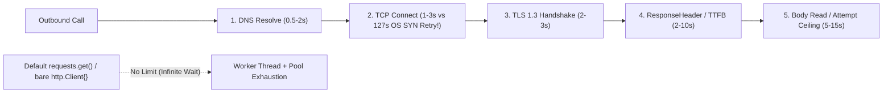
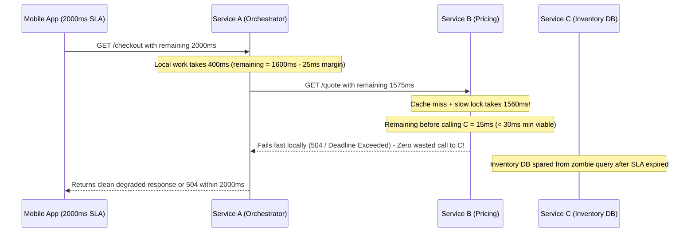
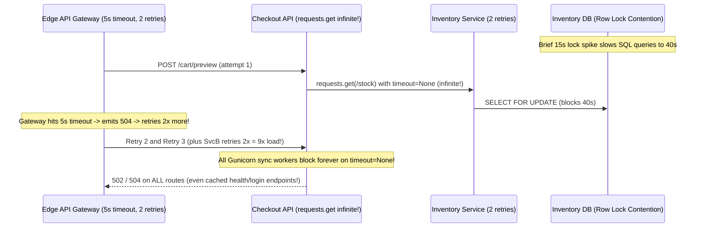

# Lesson 30: Timeouts — Connect, Read, Deadlines and the Random 502

> **Prerequisites:** [Lesson 29: Connection Pooling and Keep-Alive](../29-connection-pooling-and-keep-alive/README.md), [Lesson 19: HTTP Status Codes and Caching](../19-http-status-codes-and-caching/README.md), and [Networking From Zero Overview](../README.md) (Lesson 30 of 30).  
> **Estimated Reading Time:** 25 minutes  
> **Target Audience:** Backend and SRE engineers preventing cascading worker exhaustion, propagating end-to-end deadlines across microservices, diagnosing `502`/`503`/`504` gateway errors, and capping retry storms.  
> **Free PDF Notes:** [Download SD-N-030.pdf](https://backendroadmap.com/notes/system-design/SD-N-030.pdf)

> [!TIP]
> **The Golden Rule of Timeouts & Resilience:** Never leave HTTP client timeouts at their infinite defaults (`requests.get()`, bare `&http.Client{}`): configure fast **connect/TLS timeouts (`1–3 s`)**, bounded **per-attempt read timeouts**, and propagate a single **end-to-end deadline** (`context.WithTimeout` / `Grpc-Timeout` / `X-Request-Deadline-Ms`) across `A -> B -> C` so downstream databases abort zombie work the caller already abandoned. Pair this with **idempotency-gated retries** capped by a **retry budget (`<= 10%`)** to eliminate `502`/`504` retry amplification storms.

---

## Words You'll Meet Today

| Word | In Plain Words | Role in a Live Backend System |
| :--- | :--- | :--- |
| **Connect timeout** | Max wait to complete the TCP `SYN` / `SYN-ACK` / `ACK` handshake. | Must fail fast (`1–3 s`) instead of blocking `~127 s` on Linux `tcp_syn_retries`. |
| **TLS timeout** | Max wait for TLS negotiation and certificate verification after TCP opens. | Prevents stalled workers when a peer accepts TCP then stalls before `ServerHello`. |
| **TTFB timeout** | Max time waiting for HTTP status line and response headers (`ResponseHeaderTimeout`). | Catches hung upstreams immediately without killing legitimate large file downloads. |
| **Per-attempt timeout** | Hard ceiling on one single HTTP call including headers and body read. | Bounds worker residency per try so retries or fallbacks still fit the overall SLA. |
| **Deadline propagation** | Passing the caller's remaining time budget across service hops (`A -> B -> C`). | Stops leaf services and SQL queries from doing useless work after the user gave up. |
| **`502 Bad Gateway`** | A proxy received a broken, truncated, or `RST`-aborted answer from upstream. | Signals keep-alive races, upstream OOM kills, header buffer overflows, or stale DNS. |
| **`504 Gateway Timeout`** | A proxy waited past its upstream response timeout and got no timely answer. | Signals a slow or deadlocked upstream—retrying blindly multiplies load on it! |
| **Retry budget** | A hard cap (e.g., `<= 10%` extra RPS) limiting total retries across a client pool. | Prevents `3`-attempt retries across `3` hops from magnifying load into a `27×` storm. |

---

## Visual Mental Models & Architecture

### The Question: Why Did One Slow Downstream Service Freeze the Whole Platform?

In [lesson 29](../29-connection-pooling-and-keep-alive/README.md) we kept sockets warm with pooling, and in [lesson 19](../19-http-status-codes-and-caching/README.md) we learned what `502`, `503`, and `504` mean. Yet in production, one slow internal recommendation database (`Service C`) routinely brings down *unrelated* checkout, login, and profile endpoints across an entire microservice mesh. Why? Because when upstream services call downstream services **without strict timeouts and shared deadlines**, worker threads sit blocked forever—turning a `1%` leaf slowdown into a `100%` fleet freeze.

### An Everyday Picture First: Ordering Dinner With a Hard 7:00 PM Cutoff

Suppose you must leave for the airport at **7:00 PM**, and at **6:30 PM** (`total budget = 30 min`) you ask a courier (`Service A`) to pick up soup from a café (`Service B`), which must first get bread from a bakery (`Service C`):

- **Without deadline propagation:** You tell the courier "wait up to 30 min." The courier tells the café "no rush, take up to 30 min." The café spends 28 minutes waiting on bread from the bakery. Even though you left for the airport at 7:00 PM, the bakery keeps baking bread at 7:15 PM for an empty house!
- **With deadline propagation:** Everyone shares the **remaining clock** (`7:00 PM - now`). If `28` minutes are already spent when the request reaches the café, the café checks its watch (`2 min` left), realizes bread takes `10 min`, and **aborts immediately**—saving the bakery from burning ovens on canceled orders.

### Anatomy of Timeouts (and Why Default Libraries Hang Forever)

A single HTTP call traverses **five distinct timeout stages**. Relying on a single giant total timeout—or worse, standard-library defaults—leaves dangerous gaps:

1. **DNS Resolve Timeout (`500 ms – 2 s`):** Bounds blocked recursive DNS queries when local resolvers stall.
2. **TCP Connect Timeout (`1 – 3 s`):** On Linux, `net.ipv4.tcp_syn_retries` defaults to `6`, backing off exponentially (`1 + 2 + 4 + 8 + 16 + 32 + 64 = 127 s`!) whenever `SYN` packets are silently dropped by a firewall or dead EC2 host. Always set `connectTimeout` to `1–3 s` so dead endpoints fail fast!
3. **TLS Handshake Timeout (`2 – 3 s`):** Bounds `ClientHello` / `ServerHello` after TCP opens.
4. **ResponseHeader / TTFB Timeout (`2 – 10 s`):** Limits time spent waiting for the upstream to think and emit the first response header bytes, without punishing legitimate slow multi-megabyte body downloads.
5. **Per-Attempt / Idle Stream Read Timeout (`5 – 15 s`):** Bounds total attempt duration (or max silence between streamed body chunks).

**The Default Infinite Timeout Trap:** Both Python's `requests.get(url)` (`timeout=None`!) and Go's bare `&http.Client{}` (`Timeout: 0`!) wait **forever** by default. One half-open TCP socket or hung upstream permanently pins a Gunicorn worker thread or goroutine + memory buffer until every pod runs out of workers!



*Figure 1. The five timeout stages of an HTTP call: short connect/TLS/TTFB timers isolate dead nodes in `1–3 s`, whereas default infinite library settings lock workers indefinitely.*

### End-to-End Deadline Propagation (`A -> B -> C`)

Static per-hop timeouts fail in microservice call graphs. If `Gateway` waits `2,000 ms`, `Service A` waits `2,000 ms`, and `Service B` waits `2,000 ms`, then when `A` spends `1,800 ms`, `B` still gives `C` another `2,000 ms`—consuming resources long after `Gateway` already dropped the connection and sent `504` to the user!

Instead, carry the **remaining deadline budget** across every hop (`context.WithTimeout` internally in Go, `Grpc-Timeout: 1800m` in gRPC, or `X-Request-Deadline-Ms` / relative `X-Timeout-Remaining-Ms` in HTTP):

- **Relative remaining time (`1850 ms`) vs. absolute UTC timestamp:** Sending *remaining milliseconds* (like `Grpc-Timeout`) avoids clock-skew bugs between servers whose NTP clocks drift by `100–500 ms`.
- **Clamp + Safety Margin:** Each hop computes `childTimeout = min(localAttemptCap, remainingBudget - safetyMarginMs)` (e.g., `25 ms` for serialization/network transit). If `remaining <= 0`, abort **before** making any downstream TCP write or SQL query!



*Figure 2. End-to-end deadline propagation: shrinking budgets cancel work cleanly at `Service B` when insufficient time remains, shielding `Service C` and its database from zombie queries.*

### Decoding `502` vs. `503` vs. `504` & Stopping Retry Amplification

When an API gateway fails, distinguishing the three `5xx` gateway codes points straight to the root cause:

- **`502 Bad Gateway` (Broken / Invalid Upstream Response):** The proxy reached the upstream (or picked a pooled socket), then received invalid HTTP bytes or an abrupt socket close (`EOF` / `RST`). Four classic causes:
  1. **Keep-Alive Race Condition** ([lesson 29](../29-connection-pooling-and-keep-alive/README.md)): Upstream sent `FIN` right as proxy reused socket -> `RST`.
  2. **Upstream OOM Kill (`SIGKILL`) Mid-Request:** Kernel killed the backend container mid-response, dropping the TCP socket (`ECONNRESET`) before headers/body finished.
  3. **Response Header Buffer Overflow:** Upstream returned huge cookies or `JWT`s (`> 8 KB`), overflowing Nginx's `proxy_buffer_size` (`upstream sent too big header`).
  4. **Stale DNS IP:** Proxy dialed a recently terminated pod IP -> immediate `ECONNREFUSED` or `RST`.
- **`503 Service Unavailable` (Overload / No Healthy Endpoints):** Intentional rejection—all upstreams failed health checks, circuit breaker is open, or server is shedding load (often includes `Retry-After`).
- **`504 Gateway Timeout` (Alive Upstream Too Slow):** TCP connected cleanly, request was written, and the proxy hit its **read/response timeout** waiting for upstream bytes.

**The Retry Amplification Disaster & Retry Budgets:**
Suppose your architecture is `3` hops deep (`A -> B -> C`), and each hop configures `3` automatic retries (`4` total attempts per hop). During a `Service C` brownout, **1 single user request becomes**:

$$A_{\text{total}} = \prod_{i=1}^{3} (1 + r_i) = 4 \times 4 \times 4 = 64\times\text{ load on Service C!}$$

Adding `64×` traffic onto an already-struggling database turns a minor slowdown into a complete meltdown. To eliminate retry storms:

1. **Retry Only Safe / Idempotent Calls:** Only retry `GET`/`HEAD`/`PUT`/`DELETE` (or `POST` carrying an `Idempotency-Key` header!) on transient `502`/`503`/`504`—never blindly retry un-keyed `POST /payments` after a `504` (the payment may already have committed on the server!).
2. **Enforce a Retry Budget (`<= 10%`):** Maintain a sliding-window token bucket where every normal request credits `0.1` retry tokens and every retry spends `1.0` token. Once retries exceed `10%` of baseline traffic, stop retrying and fail fast so overloaded upstreams can recover.
3. **Retry at One Layer (Prefer Edge/Caller):** Avoid stacking retries at every internal hop.

---

## Systematic Reference & Comparison Grid

### HTTP Timeout Stages & Language Default Traps

| Timeout Stage | Recommended Value | Protects Against | Default Trap in Common Runtimes |
| :--- | :--- | :--- | :--- |
| **DNS Lookup** | `500 ms – 2 s` | Hung corporate/VPC DNS resolvers | OS resolver timeouts (`5–15 s`) block threads |
| **TCP Connect** | `1 – 3 s` | Dead pod IPs / dropped `SYN` packets | Linux `tcp_syn_retries=6` stalls **`127 s`** if unset |
| **TLS Handshake** | `2 – 3 s` | Stalled TLS peers post-SYN | Often shares infinite request wait if omitted |
| **ResponseHeader (TTFB)** | `2 – 10 s` | Hung backend goroutines/DB locks | Go `&http.Client{}` = `0` (**infinite!**) |
| **Attempt / Stream Idle** | `5 – 30 s` | Infinite read hangs & slowloris streams | Python `requests.get()` = `None` (**infinite!**) |

### Diagnostic Matrix: `502` vs. `503` vs. `504`

| Status Code | Wire Symptom at Proxy | Top Root Causes | Safe to Retry? | First Verification Check |
| :--- | :--- | :--- | :--- | :--- |
| **`502 Bad Gateway`** | `EOF`, `RST`, `ECONNREFUSED`, or malformed HTTP | Keep-alive race, OOM `SIGKILL`, `proxy_buffer_size` overflow, stale DNS | Yes (if idempotent + jitter + budget) | Check proxy error log (`upstream prematurely closed`, `too big header`) & pod `OOMKilled` |
| **`503 Service Unavailable`** | Explicit `503` or zero healthy pool backends | Load shedding, open circuit breaker, deploy rollout with `0` ready pods | Yes after **`Retry-After`** + jitter | Inspect `/healthz` readiness endpoints & queue/rate-limit metrics |
| **`504 Gateway Timeout`** | Proxy read timer fired waiting for upstream headers/body | Slow SQL lock, thread/DB pool exhaustion, missing deadline propagation | **Carefully!** Only idempotent + **retry budget** | Trace `X-Request-Id` latency across hops & slow query logs |

### Retry Amplification Formula

For a call chain of depth $d$ where hop $i$ performs up to $r_i$ retries:

$$A_{\text{total}} = \prod_{i=1}^{d} (1 + r_i), \qquad \text{Retry Budget: } R_{\text{retries}} \le 0.10 \times R_{\text{requests}}$$

---

## Production War Story Post-Mortem: Infinite `requests.get()` + `3^3` Retry Storm

- **Severity:** SEV-1 (Complete Multi-Service Cascade Outage)
- **Detection / Resolution Time:** 8 minutes to cut internal retries via feature flag; 30 minutes to deploy timeouts + deadline propagation
- **Impact:** A `30`-second lock contention spike on `InventoryDB` escalated into a `42`-minute platform-wide outage affecting `100%` of endpoints.

### What Happened



### Root Cause Analysis

1. **Missing Client Timeout (`timeout=None`):** `Service A` called `Service B` using Python `requests.get(url)` without `timeout=(2.0, 5.0)`. Every timed-out gateway request remained stuck inside `Service A`'s Gunicorn worker indefinitely—saturating `100%` of workers within `45` seconds.
2. **Stacked Multi-Hop Retries Without Budget or Deadlines:** `Gateway` retried twice (`3×`), `Service B` retried twice (`3×`), and no deadline header propagated downward—multiplying load `9×` on `InventoryDB` long after users closed their browser tabs.

### The Fix & Architectural Hardening

- **Mandatory Client Timeout Wrapper:** Enforced lint + wrapper forbidding `requests` or `http.Client` calls without explicit `(connect_timeout=2s, read_timeout)` tuples.
- **Deadline Propagation + `10%` Retry Budget:** Propagated `X-Request-Deadline-Ms` from the edge gateway down to SQL `statement_timeout`, and replaced fixed multi-hop retries with an edge-only `10%` token-bucket retry budget.

---

## Multi-Language Production Implementation

Below is a production-structured **Deadline-Propagating HTTP Client with Retry Budget** across Go, TypeScript, Python, and C#. Each helper computes remaining parent budget minus a `25 ms` transit margin, clamps the child attempt timeout, aborts immediately if expired, propagates the updated deadline header, and retries only safe/idempotent `502`/`503`/`504` responses within a `10%` retry budget.

````carousel
```go
package resilienthttp

import (
	"context"
	"errors"
	"net/http"
	"strconv"
	"sync"
	"time"
)

type RetryBudget struct {
	mu     sync.Mutex
	tokens float64
	max    float64
}

func NewRetryBudget(maxBurst float64) *RetryBudget {
	return &RetryBudget{tokens: maxBurst, max: maxBurst}
}

func (b *RetryBudget) RecordRequest() {
	b.mu.Lock()
	b.tokens = min(b.max, b.tokens+0.10) // Allow 10% retry overhead
	b.mu.Unlock()
}

func (b *RetryBudget) TryConsumeRetry() bool {
	b.mu.Lock()
	defer b.mu.Unlock()
	if b.tokens < 1.0 {
		return false
	}
	b.tokens -= 1.0
	return true
}

func DoWithDeadline(
	ctx context.Context,
	client *http.Client,
	budget *RetryBudget,
	method, url string,
	perAttemptCap time.Duration,
) (*http.Response, error) {
	const safetyMargin = 25 * time.Millisecond
	idempotent := method == http.MethodGet || method == http.MethodHead || method == http.MethodPut || method == http.MethodDelete
	budget.RecordRequest()

	for attempt := 0; attempt < 2; attempt++ {
		if attempt > 0 && (!idempotent || !budget.TryConsumeRetry()) {
			return nil, errors.New("retry skipped: non-idempotent or 10% retry budget exhausted")
		}
		parentDeadline, ok := ctx.Deadline()
		rem := perAttemptCap
		if ok {
			rem = time.Until(parentDeadline) - safetyMargin
			if rem <= 0 {
				return nil, context.DeadlineExceeded
			}
			rem = min(rem, perAttemptCap)
		}

		attemptCtx, cancel := context.WithTimeout(ctx, rem)
		req, err := http.NewRequestWithContext(attemptCtx, method, url, nil)
		if err != nil {
			cancel()
			return nil, err
		}
		req.Header.Set("X-Timeout-Remaining-Ms", strconv.FormatInt(rem.Milliseconds(), 10))

		resp, err := client.Do(req)
		cancel()
		if err == nil && resp.StatusCode != 502 && resp.StatusCode != 503 && resp.StatusCode != 504 {
			return resp, nil
		}
		if resp != nil {
			_ = resp.Body.Close()
		}
	}
	return nil, errors.New("upstream unavailable after bounded attempt")
}
```
<!-- slide -->
```typescript
export class RetryBudget {
  private tokens: number;
  constructor(private readonly maxTokens = 20) {
    this.tokens = maxTokens;
  }
  recordRequest(): void {
    this.tokens = Math.min(this.maxTokens, this.tokens + 0.1); // 10% overhead
  }
  tryConsumeRetry(): boolean {
    if (this.tokens < 1.0) return false;
    this.tokens -= 1.0;
    return true;
  }
}

export async function fetchWithDeadline(
  url: string,
  opts: { method?: string; parentRemainingMs: number; perAttemptCapMs?: number; budget: RetryBudget }
): Promise<Response> {
  const method = (opts.method ?? "GET").toUpperCase();
  const idempotent = ["GET", "HEAD", "PUT", "DELETE"].includes(method);
  const start = performance.now();
  const capMs = opts.perAttemptCapMs ?? 2000;
  const safetyMarginMs = 25;

  opts.budget.recordRequest();

  for (let attempt = 0; attempt < 2; attempt++) {
    if (attempt > 0 && (!idempotent || !opts.budget.tryConsumeRetry())) {
      throw new Error("Retry aborted: non-idempotent method or 10% retry budget depleted");
    }

    const elapsed = performance.now() - start;
    const remaining = Math.floor(opts.parentRemainingMs - elapsed - safetyMarginMs);
    if (remaining <= 0) {
      throw new Error("Parent deadline expired before downstream call");
    }

    const childTimeoutMs = Math.min(capMs, remaining);
    const res = await fetch(url, {
      method,
      headers: { "X-Timeout-Remaining-Ms": String(childTimeoutMs) },
      signal: AbortSignal.timeout(childTimeoutMs),
    });

    if (![502, 503, 504].includes(res.status)) return res;
  }
  throw new Error("Transient 502/503/504 persisted within deadline");
}
```
<!-- slide -->
```python
import time
import threading
import requests

SAFE_IDEMPOTENT = frozenset({"GET", "HEAD", "PUT", "DELETE"})
TRANSIENT_STATUSES = frozenset({502, 503, 504})


class RetryBudget:
    def __init__(self, max_tokens: float = 20.0) -> None:
        self._lock = threading.Lock()
        self._tokens = max_tokens
        self._max = max_tokens

    def record_request(self) -> None:
        with self._lock:
            self._tokens = min(self._max, self._tokens + 0.10)  # Max 10% retries

    def try_consume_retry(self) -> bool:
        with self._lock:
            if self._tokens < 1.0:
                return False
            self._tokens -= 1.0
            return True


def call_with_deadline(
    session: requests.Session,
    budget: RetryBudget,
    method: str,
    url: str,
    parent_remaining_ms: int,
    per_attempt_cap_ms: int = 2000,
) -> requests.Response:
    budget.record_request()
    start = time.monotonic()
    idempotent = method.upper() in SAFE_IDEMPOTENT

    for attempt in range(2):
        if attempt > 0 and (not idempotent or not budget.try_consume_retry()):
            raise RuntimeError("Retry skipped: unsafe method or 10% retry budget exhausted")

        elapsed_ms = int((time.monotonic() - start) * 1000)
        remaining_ms = parent_remaining_ms - elapsed_ms - 25  # 25ms safety margin
        if remaining_ms <= 0:
            raise TimeoutError("Parent deadline expired prior to downstream call")

        child_ms = min(per_attempt_cap_ms, remaining_ms)
        connect_s = min(1.5, child_ms / 1000.0)
        read_s = child_ms / 1000.0

        resp = session.request(
            method,
            url,
            headers={"X-Timeout-Remaining-Ms": str(child_ms)},
            timeout=(connect_s, read_s),
        )
        if resp.status_code not in TRANSIENT_STATUSES:
            return resp
    raise RuntimeError("Upstream returned transient 502/503/504 after bounded retry")
```
<!-- slide -->
```csharp
using System;
using System.Collections.Generic;
using System.Diagnostics;
using System.Net;
using System.Net.Http;
using System.Threading;
using System.Threading.Tasks;

public sealed class RetryBudget
{
    private readonly object _gate = new();
    private double _tokens;
    private readonly double _max;

    public RetryBudget(double maxTokens = 20.0) { _tokens = maxTokens; _max = maxTokens; }
    public void RecordRequest() { lock (_gate) _tokens = Math.Min(_max, _tokens + 0.10); }
    public bool TryConsumeRetry() { lock (_gate) { if (_tokens < 1.0) return false; _tokens -= 1.0; return true; } }
}

public static class DeadlineHttpCaller
{
    private static readonly HashSet<HttpMethod> Idempotent = new() { HttpMethod.Get, HttpMethod.Head, HttpMethod.Put, HttpMethod.Delete };

    public static async Task<HttpResponseMessage> SendAsync(
        HttpClient client, RetryBudget budget, HttpMethod method, string url,
        TimeSpan parentRemaining, TimeSpan perAttemptCap, CancellationToken ct)
    {
        budget.RecordRequest();
        var sw = Stopwatch.StartNew();
        var safetyMargin = TimeSpan.FromMilliseconds(25);

        for (int attempt = 0; attempt < 2; attempt++)
        {
            if (attempt > 0 && (!Idempotent.Contains(method) || !budget.TryConsumeRetry()))
                throw new HttpRequestException("Retry blocked: non-idempotent or 10% retry budget exhausted.");

            var left = parentRemaining - sw.Elapsed - safetyMargin;
            if (left <= TimeSpan.Zero)
                throw new TimeoutException("Parent request deadline already expired.");

            var childTimeout = left < perAttemptCap ? left : perAttemptCap;
            using var cts = CancellationTokenSource.CreateLinkedTokenSource(ct);
            cts.CancelAfter(childTimeout);

            using var req = new HttpRequestMessage(method, url);
            req.Headers.Add("X-Timeout-Remaining-Ms", ((int)childTimeout.TotalMilliseconds).ToString());

            var resp = await client.SendAsync(req, cts.Token);
            if (resp.StatusCode is not (HttpStatusCode.BadGateway or HttpStatusCode.ServiceUnavailable or HttpStatusCode.GatewayTimeout))
                return resp;
            resp.Dispose();
        }
        throw new HttpRequestException("Transient 502/503/504 exceeded bounded attempt.");
    }
}
```
````

---

## Practical Hands-On Verification CLI Workflows

### 1. Demonstrate Fast Connect Timeout (`--connect-timeout`) vs. Max Request Timeout (`--max-time`)

```bash
time curl --connect-timeout 2 --max-time 4 https://192.0.2.1/health
```

**Expected Output:**

```text
curl: (28) Connection timed out after 2001 milliseconds
real    0m2.008s
```

`192.0.2.1` (RFC 5737 TEST-NET-1) drops `SYN` packets silently. With `--connect-timeout 2`, `curl` fails cleanly in `2.0 s` instead of stalling for Linux's `127 s` default!

### 2. Inspect Linux Kernel `tcp_syn_retries` Default

```bash
sysctl net.ipv4.tcp_syn_retries
```

**Expected Output:**

```text
net.ipv4.tcp_syn_retries = 6
```

With `6` retries (`1 + 2 + 4 + 8 + 16 + 32 + 64`), any application omitting an explicit `connect_timeout` can block a worker thread for **`127` seconds** against a single blackholed IP.

### 3. Distinguish `502`, `503`, and `504` Gateway Responses via `curl -i`

```bash
curl -sS -i https://httpbin.org/status/502,503,504
```

**Expected Output:**

```text
HTTP/2 502
content-length: 0
```

When debugging a live `502` vs `504`, always correlate the edge proxy's `X-Request-Id` with upstream pod logs: **`502`** usually leaves an abrupt EOF/OOM/buffer error in the proxy log with *zero* slow timing, whereas **`504`** hits an exact round-number proxy read timeout (`5.00 s`, `30.00 s`, `60.00 s`).

---

## Pause and Think

> [!exercise] A user triggers `POST /v1/orders` through a 4-hop chain (`Gateway -> Orders -> Inventory -> Warehouse`). Each hop is configured with up to `3` automatic retries (`4` total attempts per hop) and NO retry budget. During a Warehouse slow-down, how much traffic amplification hits `Warehouse`, and what happens if `Gateway` retries `POST /v1/orders` blindly after a `504 Gateway Timeout` without an `Idempotency-Key`? Decide before opening the answer.

<details><summary>Answer</summary>

1. **Traffic amplification:** $(1 + 3)^4 = 4^4 = \mathbf{256\times}$ load hits `Warehouse` for every single user request!
2. **Duplicate charge / duplicate order bug:** A `504 Gateway Timeout` means the request *was* delivered and `Orders`/`Warehouse` may still commit the write after `Gateway`'s read timer expired. Retrying `POST /v1/orders` blindly without an **`Idempotency-Key`** can charge the customer or reserve stock twice!

</details>

---

## Operational Validation Checkpoints

<details><summary><strong>Checkpoint 1: Giant Cookie Triggers `502` on Nginx While Backend Logs `200 OK`</strong></summary>

**Scenario:** A developer adds several feature-flag claims to an OAuth session cookie, growing response headers to `9 KB`. Nginx starts returning **`502 Bad Gateway`** on `/callback`, even though the upstream Go app logs `200 OK` in `4 ms` with zero crashes. Why?

**Solution:**
Nginx's default `proxy_buffer_size` (`4 KB` or `8 KB`) is too small to hold the upstream's `9 KB` HTTP response header block, causing Nginx to log `upstream sent too big header while reading response header from upstream` and emit `502 Bad Gateway`. Trim oversized cookies/headers (store session flags server-side) and tune `proxy_buffer_size` / `proxy_buffers` appropriately.

</details>

<details><summary><strong>Checkpoint 2: Upstream Pod `OOMKilled` Mid-Response Produces Random `502`s</strong></summary>

**Scenario:** Every time users export a large CSV report, the ALB returns `502 Bad Gateway` after `~1.8 s`, and `kubectl get pods` shows `RESTARTS` incrementing with `Reason: OOMKilled`. Why is it `502` instead of `500` or `504`?

**Solution:**
The backend pod began streaming or assembling the report, hit its cgroup memory limit, and received an immediate `SIGKILL` from the Linux kernel OOM killer. Because the process died mid-request without sending an HTTP response (or after closing the socket mid-body with `RST`), the ALB saw an abruptly broken upstream socket and mapped it directly to **`502 Bad Gateway`**. Stream CSV rows chunk-by-chunk instead of buffering them in memory.

</details>

<details><summary><strong>Checkpoint 3: SQL Queries Finish 12 Seconds After User Saw `504`</strong></summary>

**Scenario:** Your API gateway enforces a strict `3 s` total SLA and returns `504` promptly at `3.0 s`. Yet PostgreSQL `pg_stat_activity` shows expensive search queries from abandoned requests continuing to run for `15+` seconds! How do you close the gap?

**Solution:**
Closing the HTTP response at the gateway does not automatically cancel downstream SQL queries unless **deadline propagation** reaches the database! Propagate `X-Timeout-Remaining-Ms` into each service's `context.Context` (`ctx, cancel := context.WithTimeout(...)`), cancel downstream requests when the client disconnects (`r.Context().Done()`), and pass the remaining milliseconds to Postgres via `SET LOCAL statement_timeout = <remaining_ms>`.

</details>

---

## Common Mistakes & Troubleshooting

### What Goes Wrong

- **Using Python `requests.get()` or Go `&http.Client{}` defaults:** Zero/infinite timeouts silently hang worker pools until the entire service stops responding.
- **One Huge Total Timeout Without Connect Timeout:** Setting `timeout=30` lets a dead host stall for `30 s` on TCP `SYN` instead of failing over in `1–2 s`.
- **Retrying `POST` Requests Without `Idempotency-Key`:** Retrying after `504` causes double payments, duplicate orders, and corrupted state.
- **No Retry Budget Across Microservices:** Fixed `3×` retries at multiple layers magnify small hiccups into $27\times$ to $256\times$ self-inflicted DDoS storms.

### Common Myths

- **"If the load balancer returns `504` at `3 s`, my backend stopped working on the request."** False unless you explicitly propagate deadlines and tie `context.Context` cancellation all the way to DB queries.
- **"`502` always means the backend crashed."** False. Keep-alive races (`FIN`/`RST`), oversized response headers overflowing proxy buffers, and stale DNS entries all produce `502` even when backend CPU is `10%`.
- **"Adding retries always improves availability."** Without idempotency checks, jitter, and a `10%` retry budget, retries during an overload event actively destroy availability.

| Symptom | Root Cause | Fix |
| :--- | :--- | :--- |
| Entire fleet hangs while CPU is `5%` during minor upstream blip | Infinite default client timeout (`requests.get`, `&http.Client{}`) | Set `connect=1–3 s`, `TTFB=2–5 s`, and bounded total `attempt` timeouts everywhere |
| `502` on Nginx while backend logs `200 OK` immediately | Response headers exceed `proxy_buffer_size` or keep-alive `FIN`/`RST` race | Increase `proxy_buffer_size` / shrink cookies, and ensure `origin_keepalive > lb_idle` |
| Leaf DB melts under `10×` QPS during brief latency spikes | Stacked multi-hop retries without deadline propagation or budget | Propagate remaining deadline down to SQL `statement_timeout`; enforce `10%` retry budget |

---

## Recap in Three Lines

1. Replace infinite client defaults with distinct **connect (`1–3 s`)**, **TLS**, **TTFB**, and **per-attempt** timeouts so dead hosts fail fast and hung sockets never exhaust workers.
2. Propagate a single **end-to-end deadline** across hops (`A -> B -> C` down to SQL `statement_timeout`), and distinguish **`502`** (broken socket/OOM/keep-alive race/buffer overflow), **`503`** (shedding), and **`504`** (slow upstream).
3. Gate retries strictly on **idempotency**, **backoff + jitter**, and a **`<= 10%` retry budget** so transient faults heal without retry amplification storms.

---

## Interview Practice Questions

> [!interview] Why isn't a single total request timeout (like `30 s`) enough on an HTTP client? (Basic)

<details><summary>What to say in 30 seconds</summary>

A single 30-second total timeout lets a dead IP address stall your worker for 30 seconds waiting on unanswered TCP `SYN` packets, instead of failing over in 1 to 2 seconds. Splitting timeouts into a fast connect timeout (1–3s), TLS timeout, TTFB/response-header timeout, and bounded body read lets you detect dead nodes immediately while still allowing legitimate multi-second responses.

</details>

> [!interview] What is the difference between `502 Bad Gateway`, `503 Service Unavailable`, and `504 Gateway Timeout`? (Basic)

<details><summary>What to say in 30 seconds</summary>

`502 Bad Gateway` means the proxy connected or reused a socket and got back an invalid, truncated, or `RST`-aborted response—often from a keep-alive race, an OOM kill, or oversized headers. `503 Service Unavailable` means intentional load shedding or zero healthy backends. `504 Gateway Timeout` means the upstream stayed alive and accepted the request, but failed to respond before the proxy's read timer expired.

</details>

> [!interview] Why are default settings in Python `requests` or Go `net/http` dangerous in production microservices? (Scenario)

<details><summary>What to say in 30 seconds</summary>

Both Python `requests.get()` (`timeout=None`) and Go's bare `&http.Client{}` (`Timeout=0`) have no timeout by default. If a downstream server stalls or drops packets after TCP open, every in-flight worker thread or goroutine blocks indefinitely—causing memory growth, thread/connection-pool exhaustion, and a total cascading outage across unrelated routes.

</details>

> [!interview] Explain end-to-end deadline propagation and why relative remaining time beats fixed per-hop timeouts. (Scenario)

<details><summary>What to say in 30 seconds</summary>

With fixed per-hop timeouts across A, B, and C, hop C can still run expensive database work long after the user gave up at hop A. End-to-end deadline propagation passes the remaining time budget (like `Grpc-Timeout` or `X-Timeout-Remaining-Ms` minus a small transit margin) down every hop and into SQL `statement_timeout`, so downstream services abort zombie work immediately once the budget expires.

</details>

> [!interview] How does a retry storm happen across microservices, and how does a retry budget stop it? (Tricky)

<details><summary>What to say in 30 seconds</summary>

If three nested services each retry three times on failure, one failing request multiplies into $4^3 = 64\times$ traffic at the bottom database, pushing an overloaded service straight into meltdown. A retry budget uses a sliding token bucket—for instance crediting `0.1` tokens per request and costing `1.0` token per retry—capping retries to at most 10% overhead so struggling dependencies can recover.

</details>

> [!interview] Your Nginx gateway returns `502 Bad Gateway` on one route, yet the upstream app logs `200 OK` in `5 ms`. Name three non-crash causes. (Tricky)

<details><summary>What to say in 30 seconds</summary>

First, a keep-alive race where the upstream closed an idle socket (`FIN`) right as Nginx reused it, triggering `RST`. Second, a response header buffer overflow (`upstream sent too big header`) when large cookies or JWTs exceed Nginx's `proxy_buffer_size`. Third, stale DNS or socket truncation on a mismatched protocol/chunked encoding boundary before Nginx could parse the `200` headers cleanly.

</details>

---

## Free PDF notes

Download these notes as a printable PDF with the timeout anatomy diagram, `502`/`503`/`504` diagnostic grid, and interview answers: [SD-N-030.pdf](https://backendroadmap.com/notes/system-design/SD-N-030.pdf).

---

## Sources

- [RFC 9110: HTTP Semantics](https://www.rfc-editor.org/rfc/rfc9110), `502`, `503`, `504` definitions and safe/idempotent method contracts.
- [RFC 9112: HTTP/1.1](https://www.rfc-editor.org/rfc/rfc9112), persistent connection closure and half-closed message framing errors.
- [Google SRE Book: Addressing Cascading Failures](https://sre.google/sre-book/addressing-cascading-failures/), deadline propagation, load shedding, and avoiding retry amplification.
- [gRPC Deadlines Documentation](https://grpc.io/docs/guides/deadlines/), relative `Grpc-Timeout` propagation across distributed service meshes.
- [Go `context` & `net/http` Documentation](https://pkg.go.dev/net/http#Client), explicit transport timers (`Dialer.Timeout`, `TLSHandshakeTimeout`, `ResponseHeaderTimeout`).

---

## Next — Series Complete!

Congratulations on completing all **30 lessons of Networking From Zero**! You have traced data all the way from a physical wire and IP packet (`Lessons 01–07`), through TCP handshakes, congestion control, and `TIME_WAIT` (`Lessons 08–12`), subnets, NAT, and DNS traffic management (`Lessons 13–17`), HTTP semantics, caching, and TLS 1.3 cryptography (`Lessons 18–22`), modern HTTP/2/3, WebSockets, SSE, and streaming (`Lessons 23–26`), right up to production infrastructure: **reverse proxies, CDNs, connection pools, and deadlines (`Lessons 27–30`)**.

Where to go from here:
- Revisit any step in [the track overview](../README.md) to reinforce weak spots.
- Continue your system design foundations in [Core Fundamentals](../../01-core-fundamentals/README.md).
- Apply these networking guarantees directly inside service internals in [Backend Architecture](../../../backend/README.md).
