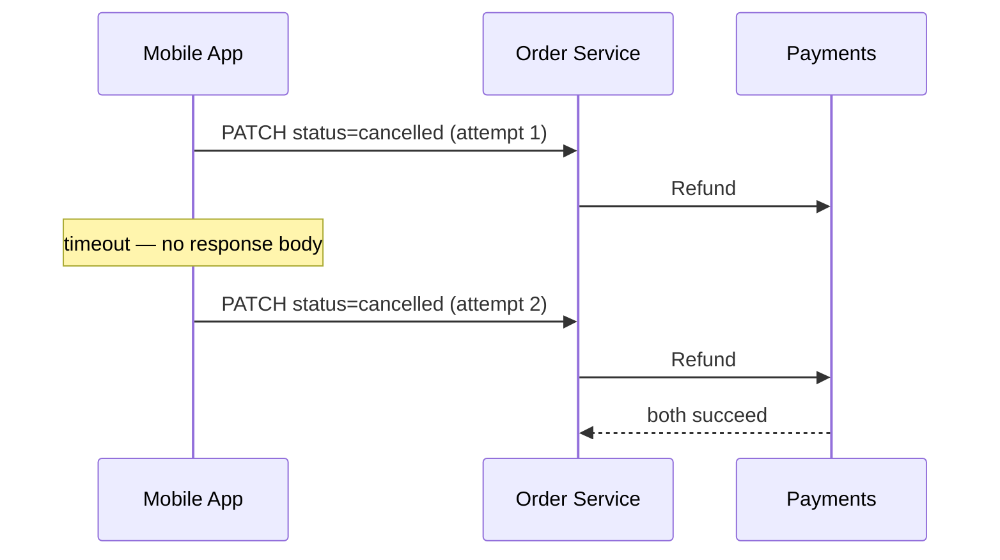

# Lesson 01: REST Principles — Resources, Verbs, HATEOAS & "Cancel Order"

> **Prerequisites:** [Networking From Zero Overview](../../02-networking-from-zero/README.md) (especially [HTTP methods & status codes](../../02-networking-from-zero/18-http-requests-responses-and-methods/README.md)) and [API Design Overview](../README.md) (Lesson 1 of 23).  
> **Estimated Reading Time:** 32 minutes  
> **Target Audience:** Backend engineers designing public or partner HTTP APIs, and anyone who must defend “is this RESTful?” in a system-design interview.  
> **Free PDF Notes:** [Download SD-C-001.pdf](https://backendroadmap.com/notes/system-design/SD-C-001.pdf)

> [!NOTE]
> **In one line:** REST means resources named by URIs, standard HTTP methods as the verbs, and Fielding’s constraints (stateless, cacheable, layered, uniform interface); “JSON over HTTP” alone is not REST.

> [!TIP]
> **The Golden Rule of REST:** Name the noun (`/orders/1001`), let the HTTP method be the verb, keep every request self-describing (stateless), and treat non-CRUD operations (`cancel`, `refund`) as explicit POSTs that are idempotent and return real status codes (`202`, `409`, `404`)—never hide them behind a silent `PATCH` of `status`.

---

## Words You'll Meet Today

| Word | In Plain Words | Role in a Live Backend System |
| :--- | :--- | :--- |
| **Resource** | A noun of the domain named by a URI. | `/orders/1001`, `/users/42` — the unit of caching, authz, and logging. |
| **URI** | The resource’s address. | Stable identity clients bookmark, cache, and link. |
| **Safe** | Method changes nothing on the server. | `GET`/`HEAD`/`OPTIONS` may be retried freely by proxies. |
| **Idempotent** | Repeating the call has the same effect as once. | Networks retry; `PUT`/`DELETE` must tolerate duplicates. |
| **Stateless** | Each request carries all context (auth + IDs). | Any of $N$ replicas behind the LB can serve any request. |
| **HATEOAS** | Responses include links to valid next actions. | Pending order shows `cancel`; shipped order does not. |
| **Uniform interface** | Same methods, status codes, representations. | Gateways, CDNs, and SDKs speak one dialect. |
| **`409 Conflict`** | Request clashes with current resource state. | Cancel after ship → conflict, not a silent no-op. |

---

## Core Definition & Taxonomic Comparison

**REST is an architectural style defined by constraints**, not by JSON or pretty URLs. Roy Fielding’s dissertation requires a client–server split, **stateless** requests, **cacheable** responses, a **layered** system, and a **uniform interface** (resource identification, manipulation via representations, self-descriptive messages, and optionally hypermedia). **What it is not:** RPC-over-HTTP with verbs in the path (`POST /getUser`), sessions stuck in server memory, or `200 OK` with `{"error":...}` in the body.

| Term | Precise Meaning | Production Example |
| :--- | :--- | :--- |
| **REST** vs **JSON over HTTP** | REST obeys the constraints above; JSON-over-HTTP is only a serialization choice. | `GET /orders/1001` with `Cache-Control` and `ETag` is REST-shaped; `POST /getOrder` with a JSON body is RPC. |
| **Safe** vs **idempotent** | Safe ⇒ no state change. Idempotent ⇒ $N$ identical requests ≡ 1. | `GET` is both; `DELETE` is idempotent but not safe; `POST` is neither unless you add an idempotency key. |
| **`PUT`** vs **`PATCH`** | `PUT` replaces the whole resource; `PATCH` applies a partial update. | `PUT /users/42` with full body; `PATCH /users/42` with `{"email":"..."}`. `PUT` is idempotent; `PATCH` is not guaranteed. |
| **HATEOAS** vs **hardcoded URLs** | Hypermedia links drive the next step; clients don’t invent paths. | Pending: `"_links":{"cancel":"/orders/1001/cancellation"}`. Shipped: no cancel link. Most SDKs still hardcode URLs. |

**Business impact.** Statelessness is what lets you scale horizontally without sticky sessions. Cacheability is what lets CDNs absorb read storms. Getting cancel wrong (status `PATCH` + double refund) is a payments SEV-1.

---

## Component Anatomy & The Observability Gap

### Anatomy of One REST Call

```text
 CLIENT                         EDGE / LAYERS                      ORIGIN
 +------------------+   HTTPS   +------------------+   proxy   +------------------+
 | App / curl / SDK | --------> | CDN + API GW     | --------> | Stateless app    |
 | builds: method + |           | auth, rate limit |           | handler          |
 | URI + headers +  |           | cache (GET)      |           | - parse resource |
 | body (repr.)     | <-------- | ETag / 304       | <-------- | - enforce rules  |
 +------------------+  status   +------------------+  2xx/4xx  | - return repr.   |
        ^                 +                      |             |   + Link headers  |
        |            Cache-Control / Vary        |             +------------------+
        +---- retries only if idempotent --------+
```

| HTTP Method | Meaning | Safe? | Idempotent? |
| :--- | :--- | :---: | :---: |
| **GET** | Read resource or collection | Yes | Yes |
| **POST** | Create in a collection (or run an action) | No | No (unless idempotency key) |
| **PUT** | Replace whole resource | No | Yes |
| **PATCH** | Partial update | No | Not guaranteed |
| **DELETE** | Remove resource | No | Yes |

### The Observability Gap

| Vantage Point | What It Captures | What It Hides |
| :--- | :--- | :--- |
| **Client RUM / SDK metrics** | End-to-end latency, retry count, status as seen by the caller. | Whether a `502` came from the gateway or the origin; body-level business errors wrapped as `200`. |
| **API gateway access log** | Method, path, status, auth subject, rate-limit decisions. | Handler-internal side effects (refund started? inventory restocked?). |
| **App handler metrics** | Per-route latency, `409`/`404` rates, idempotency-key hits. | CDN cache hits that never reach you; client abandons before response. |
| **Payments / outbox tables** | Ground truth for “was a refund issued?” | Whether the client saw `202` or timed out and retried. |

**Operational rule:** for money-moving actions, correlate `Idempotency-Key` (or cancellation resource id) across gateway logs and the ledger—status codes alone are not enough.

---

## Mathematical Model: Retries, Idempotency & Cache Hit Savings

### 1. Retry Amplification Without Idempotency

A flaky mobile network loses the response with probability $p$. A client that retries once without an idempotency key can create **two** orders (or two refunds):

$$P(\text{duplicate side effect}) = p \cdot (1 - p_{\text{server saw first}})$$

With an idempotency store, the second call is a lookup:

$$C_{\text{retry}} \approx C_{\text{lookup}} \ll C_{\text{charge}}$$

### 2. Stateless Fan-Out Capacity

With sticky sessions you need affinity; without them, $N$ identical replicas share load evenly:

$$\lambda_{\text{per replica}} = \frac{\lambda_{\text{total}}}{N}, \qquad \text{headroom} = 1 - \rho,\ \rho = \frac{\lambda_{\text{per replica}}}{\mu}$$

| Replicas $N$ | Total RPS $\lambda$ | Per-replica RPS | $\rho$ if $\mu=500$ | $p_{99}$ pressure |
| :--- | :--- | :--- | :--- | :--- |
| 5 | 1,000 | 200 | 0.40 | Comfortable |
| 5 | 2,000 | 400 | 0.80 | Elevated |
| 5 | 2,400 | 480 | 0.96 | Cliff — add replicas |
| 10 | 2,400 | 240 | 0.48 | Recovered |

### 3. Cacheable GETs vs Uncached Reads

If a collection GET is cacheable for $T$ seconds at hit ratio $h$:

$$\lambda_{\text{origin}} = \lambda_{\text{client}} \cdot (1 - h)$$

| Scenario | Client RPS | Hit ratio $h$ | Origin RPS | Notes |
| :--- | :--- | :--- | :--- | :--- |
| Uncached product list | 5,000 | 0% | 5,000 | Every read hits DB |
| `Cache-Control: max-age=60` | 5,000 | 90% | 500 | CDN absorbs storm |
| `ETag` revalidation | 5,000 | 95% `304` | 250 full + 4,750 tiny | Bandwidth win |

### 4. Worked Example: Cancel + Retry

Mobile client: `POST /orders/1001/cancellation` with `Idempotency-Key: 7f3c-91ab`. Network drops after the server accepted work ($p = 0.08$). Client retries with the **same** key.

- First call: start refund, return `202` + `{"status":"cancelling"}`.
- Second call: key hit → return the **same** `202` body. Refund count stays **1**.
- If order already shipped: first call returns `409 Conflict` (“request a return instead”).

Cost without the key at $10{,}000$ cancel attempts/day and $p=0.08$: up to $\approx 800$ duplicate refund attempts/day.

---

## Metrics, Percentiles & Distributions

| Percentile | Who it describes | REST design implication |
| :--- | :--- | :--- |
| $p_{50}$ | Typical happy-path `GET` | Should be cacheable / indexed. |
| $p_{95}$ | Most interactive clients | Budget cancels / writes here. |
| $p_{99}$ | Tail users on bad networks | Retries kick in; idempotency mandatory. |
| $p_{99.9}$ | Outliers / overloaded shards | `202` + async refund beats holding the socket. |

**Averages lie.** Ten cancels: nine finish in $40\,\text{ms}$, one waits $2{,}000\,\text{ms}$ on payments. Mean $\approx 236\,\text{ms}$ hides a payments outage that only $p_{99}$ shows.

---

## Compounding Effects at Scale

A checkout page that makes $N$ sequential REST calls each succeeding with probability $0.99$:

$$P(\text{page fully loads}) = 0.99^{N}, \qquad P(\text{at least one failure}) = 1 - 0.99^{N}$$

| $N$ calls | $P(\text{full success})$ | $P(\text{≥1 failure})$ |
| :--- | :--- | :--- |
| 1 | 99.0% | 1.0% |
| 5 | 95.1% | 4.9% |
| 10 | 90.4% | 9.6% |
| 20 | 81.8% | 18.2% |

**Implication:** fan out related reads behind one BFF or GraphQL edge (next lessons), or parallelize with a shared deadline—don’t make mobile clients walk five REST hops on cellular.

---

## Numbers Every Backend Engineer Must Know

| Operation | Layer | Typical Cost | Relative | Architectural Implication |
| :--- | :--- | :--- | :--- | :--- |
| In-memory idempotency lookup | Redis / local | $0.2$–$1\,\text{ms}$ | $1\times$ | Cheap enough on every cancel retry |
| Same-AZ REST hop | Intra-DC | $0.5$–$2\,\text{ms}$ | $\sim 5\times$ | Internal fan-out OK |
| Cellular RTT | WAN | $\sim 100\,\text{ms}$ | $\sim 200\times$ | Minimize client round trips |
| Card refund API | External | $200$–$2{,}000\,\text{ms}$ | $\sim 1000\times$ | Return `202`, work async |
| Uncached collection scan | DB | $10$–$500\,\text{ms}$ | varies | Needs `Cache-Control` / indexes |

---

## Protocol Deep Dive: Cancel as a Sub-Resource

```mermaid
sequenceDiagram
    participant C as Mobile Client
    participant GW as API Gateway
    participant O as Order API
    participant P as Payments

    C->>GW: POST /orders/1001/cancellation<br/>Idempotency-Key: 7f3c-91ab
    GW->>O: forward + auth subject
    O->>O: load order; shipped? missing?
    alt already shipped
        O-->>C: 409 Conflict
    else pending / paid
        O->>P: startRefund (async)
        O-->>C: 202 Accepted · status cancelling
        Note over C: response lost on cellular
        C->>GW: retry same POST + same key
        GW->>O: Idempotency-Key hit
        O-->>C: same 202 (no second refund)
    end
```

Three modeling options for “cancel order”:

| Option | Shape | Trade-off |
| :--- | :--- | :--- |
| Status PATCH | `PATCH /orders/1001` `{"status":"cancelled"}` | Side effects hidden; clients can set any status. |
| Action resource | `POST /orders/1001/cancellation` | Auditable who/why; natural idempotency. |
| Custom method | `POST /orders/1001:cancel` | Google AIP style; clear intent. |

---

## Hierarchical Budgets & Capacity Sizing

Target: cancel API $p_{99} \le 300\,\text{ms}$ synchronous path (accept only):

| Tier | Budget | Notes |
| :--- | :--- | :--- |
| Gateway auth + rate limit | $10\,\text{ms}$ | JWT verify / API key |
| Order load + rule check | $40\,\text{ms}$ | Indexed PK lookup |
| Idempotency store | $5\,\text{ms}$ | Redis SET NX |
| Enqueue refund | $20\,\text{ms}$ | Outbox / queue publish |
| Serialization + margin | $25\,\text{ms}$ | Headroom |
| **Sync total** | **$\le 100\,\text{ms}$** | Refund itself is async |

Downstream payments timeout: derive from remaining deadline, not a hard-coded `30s` that outlives the client.

---

## Top Engineering Mitigation Techniques

1. **Nouns in paths, verbs in methods** — ban `/getOrders`, `/deleteUser`.
2. **Real status codes** — `4xx`/`5xx`, never `200` + error body.
3. **Stateless handlers** — auth token + resource id on every request; store sessions in Redis/DB if needed.
4. **Idempotency keys on POST actions** — especially payments, cancels, refunds.
5. **Cacheable GETs** — `Cache-Control`, `ETag`, `Vary` where representations differ by auth/Accept.
6. **Explicit non-CRUD POSTs** — cancel/refund as resources or `:custom` methods with `409` rules.

---

## Production War Story: Double Refund from Status PATCH

- **Severity:** SEV-1 (duplicate customer refunds)
- **Detection / Resolution:** 47 minutes to stop the bleed; 6 hours to reconcile ledger
- **Impact:** $18{,}400$ over-refunded across $612$ orders after a cellular retry storm during a payments blip

### What Happened

Cancel was implemented as `PATCH /orders/{id}` setting `status=cancelled`. The handler always called `payments.Refund()` when it saw a transition into `cancelled`. Mobile clients timed out at $5\,\text{s}$, retried the PATCH, and the second transition check raced: both saw `paid` → both refunded.



### Root Cause

1. Non-idempotent money side effect behind a generic field write.
2. No `Idempotency-Key` / cancellation resource uniqueness constraint.
3. Status machine allowed re-entry under concurrency.

### Fix & Hardening

- Replaced with `POST /orders/{id}/cancellation` unique on `(order_id)` and optional idempotency key.
- Refund publish moved to a transactional outbox keyed by cancellation id.
- Retries return the existing cancellation (`202`/`200`); shipped orders return `409`.
- Added ledger invariant alert: `refunds_per_order > 1`.

---

## Multi-Language Production Implementation

Idempotent cancel-as-resource across Go, TypeScript, Python, and C#.

````carousel
```go
package orders

import (
	"context"
	"errors"
	"sync"
)

type Status string

const (
	StatusPending    Status = "pending"
	StatusCancelling Status = "cancelling"
	StatusShipped    Status = "shipped"
)

type Cancellation struct {
	OrderID string
	Status  Status
	Reason  string
}

type Store struct {
	mu    sync.Mutex
	orders map[string]Status
	cancels map[string]*Cancellation // key: orderID or idempotency key
}

func (s *Store) Cancel(ctx context.Context, orderID, key, reason string) (*Cancellation, int, error) {
	s.mu.Lock()
	defer s.mu.Unlock()
	if key != "" {
		if c, ok := s.cancels[key]; ok {
			return c, 202, nil // identical replay
		}
	}
	st, ok := s.orders[orderID]
	if !ok {
		return nil, 404, errors.New("order not found")
	}
	if st == StatusShipped {
		return nil, 409, errors.New("order already shipped")
	}
	if c, ok := s.cancels[orderID]; ok {
		return c, 202, nil
	}
	c := &Cancellation{OrderID: orderID, Status: StatusCancelling, Reason: reason}
	s.cancels[orderID] = c
	if key != "" {
		s.cancels[key] = c
	}
	s.orders[orderID] = StatusCancelling
	// enqueueRefund(ctx, orderID) — async
	return c, 202, nil
}
```

<!-- slide -->

```typescript
type OrderStatus = "pending" | "cancelling" | "shipped";

interface Cancellation {
  orderId: string;
  status: OrderStatus;
  reason: string;
}

const orders = new Map<string, OrderStatus>();
const cancels = new Map<string, Cancellation>(); // orderId or idempotency key

export function cancelOrder(
  orderId: string,
  idempotencyKey: string | undefined,
  reason: string
): { body: Cancellation; status: number } {
  if (idempotencyKey && cancels.has(idempotencyKey)) {
    return { body: cancels.get(idempotencyKey)!, status: 202 };
  }
  const current = orders.get(orderId);
  if (!current) {
    const err = new Error("order not found") as Error & { status: number };
    err.status = 404;
    throw err;
  }
  if (current === "shipped") {
    const err = new Error("order already shipped") as Error & { status: number };
    err.status = 409;
    throw err;
  }
  if (cancels.has(orderId)) {
    return { body: cancels.get(orderId)!, status: 202 };
  }
  const body: Cancellation = { orderId, status: "cancelling", reason };
  cancels.set(orderId, body);
  if (idempotencyKey) cancels.set(idempotencyKey, body);
  orders.set(orderId, "cancelling");
  // await enqueueRefund(orderId)
  return { body, status: 202 };
}
```

<!-- slide -->

```python
from __future__ import annotations

from dataclasses import dataclass
from threading import Lock

Status = str  # pending | cancelling | shipped


@dataclass
class Cancellation:
    order_id: str
    status: Status
    reason: str


class OrderService:
    def __init__(self) -> None:
        self._lock = Lock()
        self._orders: dict[str, Status] = {}
        self._cancels: dict[str, Cancellation] = {}

    def cancel(
        self, order_id: str, idempotency_key: str | None, reason: str
    ) -> tuple[Cancellation, int]:
        with self._lock:
            if idempotency_key and idempotency_key in self._cancels:
                return self._cancels[idempotency_key], 202
            status = self._orders.get(order_id)
            if status is None:
                raise LookupError("404:order not found")
            if status == "shipped":
                raise ConflictError("409:order already shipped")
            if order_id in self._cancels:
                return self._cancels[order_id], 202
            body = Cancellation(order_id, "cancelling", reason)
            self._cancels[order_id] = body
            if idempotency_key:
                self._cancels[idempotency_key] = body
            self._orders[order_id] = "cancelling"
            # enqueue_refund(order_id)
            return body, 202


class ConflictError(Exception):
    pass
```

<!-- slide -->

```csharp
using System.Collections.Concurrent;

public sealed record Cancellation(string OrderId, string Status, string Reason);

public sealed class OrderCancelService
{
    private readonly ConcurrentDictionary<string, string> _orders = new();
    private readonly ConcurrentDictionary<string, Cancellation> _cancels = new();

    public (Cancellation Body, int StatusCode) Cancel(
        string orderId, string? idempotencyKey, string reason)
    {
        if (!string.IsNullOrEmpty(idempotencyKey) &&
            _cancels.TryGetValue(idempotencyKey, out var replay))
            return (replay, 202);

        if (!_orders.TryGetValue(orderId, out var status))
            throw new KeyNotFoundException("404: order not found");
        if (status == "shipped")
            throw new InvalidOperationException("409: order already shipped");
        if (_cancels.TryGetValue(orderId, out var existing))
            return (existing, 202);

        var body = new Cancellation(orderId, "cancelling", reason);
        _cancels[orderId] = body;
        if (!string.IsNullOrEmpty(idempotencyKey))
            _cancels[idempotencyKey] = body;
        _orders[orderId] = "cancelling";
        // EnqueueRefund(orderId);
        return (body, 202);
    }
}
```
````

---

## Hands-On CLI Verification

```bash
# Happy path — create cancellation (expect 202)
curl -i -X POST https://api.example.com/v1/orders/1001/cancellation \
  -H "Authorization: Bearer $TOKEN" \
  -H "Idempotency-Key: 7f3c-91ab" \
  -H "Content-Type: application/json" \
  -d '{"reason":"ordered by mistake"}'

# Replay — same key must not double-refund
curl -i -X POST https://api.example.com/v1/orders/1001/cancellation \
  -H "Authorization: Bearer $TOKEN" \
  -H "Idempotency-Key: 7f3c-91ab" \
  -H "Content-Type: application/json" \
  -d '{"reason":"ordered by mistake"}'

# Conflict — shipped order
curl -i -X POST https://api.example.com/v1/orders/SHIPPED/cancellation \
  -H "Authorization: Bearer $TOKEN" \
  -H "Content-Type: application/json" \
  -d '{"reason":"too late"}'
```

Local math check for retry risk:

```bash
python -c "p=0.08; attempts=10000; print('approx duplicate attempts without key:', int(attempts*p))"
```

---

## Common Mistakes to Avoid

- Verbs in paths: `/getOrders`, `/deleteUser?id=5`.
- Returning `200 OK` with `{"error":...}` instead of real `4xx`/`5xx`.
- Session state in server memory (breaks stateless load balancing).
- Modeling cancel as `PATCH status` so retries double-refund.
- Claiming “RESTful” while ignoring cache headers and idempotency.
- Deep nesting and inventing a new URL per action (RPC in disguise).
- Skipping `409`/`404` distinctions so clients can’t branch correctly.
- No `Location` on `201 Created` for new resources.

---

## Key Terms Glossary

| Term | Interview-ready definition |
| :--- | :--- |
| **Resource** | Domain noun identified by a URI. |
| **Uniform interface** | Shared methods, status codes, and representations across resources. |
| **Stateless** | Request contains all context; server holds no client session. |
| **HATEOAS** | Hypermedia links advertise valid next transitions. |
| **Idempotent** | $N$ identical requests ≡ one effect. |
| **Custom method** | `POST /orders/1001:cancel` style action. |
| **`202 Accepted`** | Accepted for async completion. |
| **`409 Conflict`** | Semantically clashes with current state. |

---

## Interview Practice Questions

<details>
<summary><strong>Q1. What makes an API RESTful? [BASIC]</strong></summary>

<strong>What a strong answer covers:</strong>
Resources identified by URIs; standard HTTP methods as verbs; stateless requests; cacheable responses; layered system; uniform interface—with HATEOAS as the full ideal. JSON over HTTP with verb URLs is not REST.

</details>

<details>
<summary><strong>Q2. Which HTTP methods are idempotent? [BASIC]</strong></summary>

<strong>What a strong answer covers:</strong>
`GET`, `PUT`, `DELETE` (also `HEAD`, `OPTIONS`). Deleting `/orders/1001` twice leaves it deleted. `POST` is not (two POSTs → two orders) unless you add an idempotency key. `PATCH` is not guaranteed.

</details>

<details>
<summary><strong>Q3. What does “stateless” mean, and why does it help scaling? [BASIC]</strong></summary>

<strong>What a strong answer covers:</strong>
Each request carries its context (auth token, IDs), so no server needs memory of earlier requests. Any of $N$ replicas can handle any request; you add capacity without migrating sessions.

</details>

<details>
<summary><strong>Q4. Safe vs idempotent — what’s the difference? [BASIC]</strong></summary>

<strong>What a strong answer covers:</strong>
Safe methods never change server state (`GET`). Idempotent methods may change state but repeating them does not further change it (`DELETE`, `PUT`). Proxies may retry safe methods freely; money APIs must make unsafe POSTs idempotent explicitly.

</details>

<details>
<summary><strong>Q5. How would you model “cancel order” in REST? [SCENARIO]</strong></summary>

<strong>What a strong answer covers:</strong>
`POST /orders/1001/cancellation` or `POST /orders/1001:cancel`, not a hidden status PATCH. Return `200`/`202`, `409` if shipped, `404` if missing, and make it idempotent via unique cancellation or `Idempotency-Key`.

</details>

<details>
<summary><strong>Q6. Design list/create/get endpoints for a user’s orders. [SCENARIO]</strong></summary>

<strong>What a strong answer covers:</strong>
`GET/POST /users/42/orders`, `GET /orders/1001` (global id earns top-level path), filters via query (`?status=shipped`). Plural nouns, at most one nesting level, `201` + `Location` on create.

</details>

<details>
<summary><strong>Q7. Mobile cancel times out and retries — what must happen? [SCENARIO]</strong></summary>

<strong>What a strong answer covers:</strong>
Second call must not issue a second refund. Detect existing cancellation or matching idempotency key and return the same `202`/`200`. Only a conflicting different request gets `409`.

</details>

<details>
<summary><strong>Q8. Your “REST” API stores sessions in process memory. What breaks? [SCENARIO]</strong></summary>

<strong>What a strong answer covers:</strong>
Load balancing requires sticky sessions; rolling deploys drop sessions; horizontal scale is painful. Move session/token state to a shared store or make JWTs self-contained so any replica can serve any request.

</details>

<details>
<summary><strong>Q9. What is HATEOAS, and why do so few APIs use it? [TRICKY]</strong></summary>

<strong>What a strong answer covers:</strong>
Responses carry links to valid next actions. Clients in practice hardcode URLs and SDKs, so the benefit rarely pays for payload and tooling cost. Know it as part of the full definition; explain when you’d skip it.

</details>

<details>
<summary><strong>Q10. Is `PUT /orders/1001/cancel` RESTful? [TRICKY]</strong></summary>

<strong>What a strong answer covers:</strong>
No — `cancel` is a verb smuggled into the path. Prefer a noun (`/cancellation`) or a documented custom method (`:cancel`) with `POST`. `PUT` would also imply replacing a “cancel resource” representation, which confuses intent.

</details>

<details>
<summary><strong>Q11. Why is returning `200` with an error object dangerous? [TRICKY]</strong></summary>

<strong>What a strong answer covers:</strong>
Intermediaries, caches, metrics, and client HTTP stacks key off the status code. A `200` looks successful to monitors and retry logic; clients must special-case every body. Use `4xx`/`5xx` (and Problem Details) instead.

</details>

<details>
<summary><strong>Q12. Can POST be idempotent? How? [TRICKY]</strong></summary>

<strong>What a strong answer covers:</strong>
Yes, with an `Idempotency-Key` (or natural unique key like one cancellation per order). Server stores key → response; replays return the stored result without re-executing side effects. Critical for payments over unreliable networks.

</details>

---

## One-Page Master Cheat Sheet

```text
====================================================================================================
                    REST PRINCIPLES — RESOURCES, VERBS, HATEOAS, CANCEL  —  CHEAT SHEET
====================================================================================================
REST ≠ JSON-over-HTTP     Constraints: client-server | stateless | cacheable | layered | uniform (+ HATEOAS)

METHODS          Safe?   Idempotent?     USE
  GET            yes     yes             read / list
  POST           no      no*             create / actions (* yes with Idempotency-Key)
  PUT            no      yes             replace whole resource
  PATCH          no      maybe           partial update — NOT for cancel+refund
  DELETE         no      yes             remove

CANCEL OPTIONS
  POST /orders/1001/cancellation     preferred — auditable, idempotent
  POST /orders/1001:cancel           Google AIP custom method
  PATCH {status:cancelled}           ANTI-PATTERN — hides refunds; double-charge risk

STATUS CODES     201+Location create | 202 async accept | 404 missing | 409 conflict (shipped)

MATH
  P(page fail) = 1 - 0.99^N sequential REST calls
  Duplicate risk without key ≈ p_timeout * attempts
  Origin RPS = client_RPS * (1 - cache_hit_ratio)

GOLDEN RULES
  nouns in paths, verbs in methods | real 4xx/5xx | stateless replicas | cache GETs | idempotent money POSTs

ANTI-PATTERNS
  X /getUser  X 200+error body  X in-memory sessions  X cancel via status PATCH  X no idempotency on refund
====================================================================================================
```

---

## Free PDF notes

Download these notes as a printable PDF: [SD-C-001.pdf](https://backendroadmap.com/notes/system-design/SD-C-001.pdf).

---

## Sources

- [Roy Fielding — Architectural Styles and the Design of Network-based Software Architectures (2000)](https://www.ics.uci.edu/~fielding/pubs/dissertation/top.htm), REST constraints.
- [RFC 9110: HTTP Semantics](https://www.rfc-editor.org/rfc/rfc9110), methods, safety, idempotency.
- [Google AIP-136: Custom methods](https://google.aip.dev/136), `:cancel` style actions.
- [RFC 7807 / 9457: Problem Details](https://www.rfc-editor.org/rfc/rfc9457), structured API errors.

---

## Next

Next comes [Lesson 02: GraphQL for System Design](../02-graphql-for-system-design/README.md): resolvers, N+1, DataLoader, and query cost limits. See [the track overview](../README.md) for the whole series.
