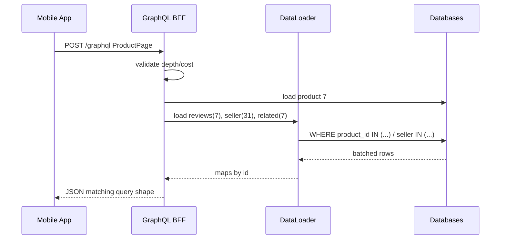
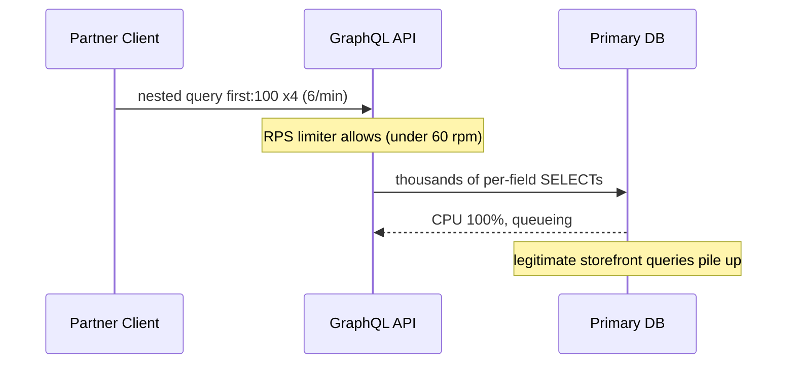

# Lesson 02: GraphQL for System Design — Resolvers, N+1, DataLoader & Limits

> **Prerequisites:** [Lesson 01: REST Principles](../01-rest-principles/README.md) and [API Design Overview](../README.md) (Lesson 2 of 23).  
> **Estimated Reading Time:** 33 minutes  
> **Target Audience:** Backend and BFF engineers aggregating multi-service data for mobile/web clients, and interview candidates who must discuss N+1 and query-cost controls.  
> **Free PDF Notes:** [Download SD-C-002.pdf](https://backendroadmap.com/notes/system-design/SD-C-002.pdf)

> [!NOTE]
> **In one line:** GraphQL lets each client ask a typed schema for exactly the data a screen needs in one request; the server pays with N+1 risk (fix: DataLoader), expensive-query risk (fix: depth and cost limits), and harder HTTP caching.

> [!TIP]
> **The Golden Rule of GraphQL:** Never ship resolvers without batching (DataLoader), never expose a public graph without depth/cost/timeout guards, and never rate-limit by request count alone—limit by estimated **nodes** (cost points).

---

## Words You'll Meet Today

| Word | In Plain Words | Role in a Live Backend System |
| :--- | :--- | :--- |
| **Schema** | Typed contract of types and fields. | Single source of truth validated at query time. |
| **Resolver** | Function that fetches one field. | Where N+1 is born or prevented. |
| **N+1 problem** | 1 list query + 1 query per item. | 50 products → 51 DB round trips. |
| **DataLoader** | Batches and caches keys per request. | Collapses 51 queries into 2. |
| **Query cost** | Estimated nodes a query may touch. | Basis for fair rate limits. |
| **Persisted query** | Pre-registered query sent by hash. | Enables CDN caching + allow lists. |
| **Over-fetching** | Fields received but unused. | Wastes mobile bandwidth. |
| **Under-fetching** | One call doesn’t return enough. | Forces extra cellular RTTs. |

---

## Core Definition & Taxonomic Comparison

**GraphQL is a query language and runtime over a typed schema**, usually served at one endpoint (`POST /graphql`). Clients declare the shape; the server resolves fields. **What it is not:** a database, a free pass to skip indexes, or a replacement for every REST/gRPC surface.

| Term | Precise Meaning | Production Example |
| :--- | :--- | :--- |
| **GraphQL** vs **REST BFF** | GraphQL: client-shaped queries on one schema. BFF: server-defined aggregates per client. | Mobile `ProductPage` query vs `GET /mobile/product-page/7`. |
| **Over-fetching** vs **under-fetching** | Too many fields vs too few resources per call. | REST product JSON has 40 unused fields; five GETs for one screen. |
| **Resolver N+1** vs **SQL JOIN N+1** | Per-field resolvers fire per parent row; same shape as ORM lazy loads. | `products` + `reviews` per product = $1+N$ queries. |
| **Persisted query** vs **arbitrary query** | Hash of known document vs free-form string. | Own apps send hash only; public playground still needs cost caps. |

**Business impact.** At $\sim 100\,\text{ms}$ cellular RTT, five sequential REST calls cost $\sim 500\,\text{ms}$ before paint; one GraphQL request costs one RTT—if the server doesn’t melt under N+1.

---

## Component Anatomy & The Observability Gap

```text
 CLIENT                         GRAPHQL EDGE                         DATA
 +------------------+  query   +------------------------+   batch   +----------+
 | Mobile / Web     | --------> | Parse → Validate       | --------> | Products |
 | chooses fields   |           | Depth/cost/auth        |           | Reviews  |
 |                  | <-------- | Execute resolvers      | <-------- | Sellers  |
 +------------------+   JSON    | DataLoader (per req)   |           +----------+
                                +------------------------+
```

| Vantage Point | What It Captures | What It Hides |
| :--- | :--- | :--- |
| **HTTP gateway** | 1 POST, status, bytes, client id. | Whether that POST touched 3 or 30,000 rows. |
| **GraphQL engine metrics** | Parse time, validation errors, field error rate. | Per-resolver DB time unless instrumented. |
| **DataLoader stats** | Batch sizes, cache hits per request. | Cross-request cache (usually none by design). |
| **DB `pg_stat_statements`** | Actual query count and `IN (...)` sizes. | Which GraphQL field caused them without trace IDs. |

**Operational rule:** export `graphql.resolver_duration` and `dataloader.batch_size` with the operation name—request RPS alone is a vanity metric.

---

## Mathematical Model: N+1, Cost & Cellular RTTs

### 1. Naive Resolver Query Count

For a list of $N$ parents each resolving $k$ child fields independently:

$$Q_{\text{naive}} = 1 + kN$$

With DataLoader (one batch per child field):

$$Q_{\text{batched}} = 1 + k$$

### 2. Worked Example (from the PDF)

List page: $50$ products, each with reviews and seller.

| Strategy | Query count | At $2\,\text{ms}$/query | DB load factor |
| :--- | :--- | :--- | :--- |
| Naive | $1 + 50 + 50 = 101$ | $\sim 202\,\text{ms}$ | $\sim 50\times$ harder |
| DataLoader | $1 + 1 + 1 = 3$ (12 distinct sellers) | $\sim 6$–$10\,\text{ms}$ | Baseline |

### 3. Query Cost (Node Budget)

$$C = \prod_{i} L_i \quad \text{(list sizes along the path)}$$

Example: `products(first:50){ reviews(first:10){ author { orders(first:20) }}}`

$$C = 50 \times 10 \times 20 = 10{,}000 \text{ nodes}$$

Reject if $C > C_{\max}$ (e.g. $5{,}000$).

### 4. Cellular Round-Trip Savings

$$T_{\text{REST seq}} \approx N \cdot RTT, \qquad T_{\text{GQL}} \approx RTT + T_{\text{server}}$$

| $N$ REST calls | $RTT=100\,\text{ms}$ | GraphQL (1 RTT + $30\,\text{ms}$ server) |
| :--- | :--- | :--- |
| 1 | $100\,\text{ms}$ | $130\,\text{ms}$ |
| 5 | $500\,\text{ms}$ | $130\,\text{ms}$ |
| 10 | $1{,}000\,\text{ms}$ | $130\,\text{ms}$ |

### 5. Utilization Cliff for Unbounded Queries

One public client at $10$ req/min with $C=10{,}000$ nodes each ≈ $1.67{,}000$ node-resolves/min—equivalent to thousands of tiny queries. Rate limit **points**, not requests:

$$\text{points/min} = \sum C_i \le B_{\text{client}}$$

| Utilization of DB | Relative latency (approx $M/M/1$) |
| :--- | :--- |
| 50% | $2.0\times$ service time |
| 70% | $3.3\times$ |
| 90% | $10\times$ |
| 95% | $20\times$ |

---

## Metrics, Percentiles & Distributions

| Percentile | GraphQL reading |
| :--- | :--- |
| $p_{50}$ operation latency | Typical persisted query |
| $p_{95}$ | Heavy screens / cold caches |
| $p_{99}$ | N+1 regressions or missing indexes |
| Error rate by operation | Contract vs abusive queries |

**Averages lie:** 99 tiny queries at $5\,\text{ms}$ and 1 at $3\,\text{s}$ average to $\sim 35\,\text{ms}$ while one screen is unusable.

---

## Compounding Effects at Scale

Depth $d$ with branching factor $b$:

$$\text{nodes} \approx b^{d}$$

| Depth $d$ | $b=10$ nodes | Action |
| :--- | :--- | :--- |
| 3 | 1,000 | Usually OK |
| 5 | 100,000 | Reject |
| 7 | $10^{7}$ | Hard depth cap (e.g. max 7) |

---

## Numbers Every Backend Engineer Must Know

| Item | Typical value | Implication |
| :--- | :--- | :--- |
| Cellular RTT | $\sim 100\,\text{ms}$ | Collapse client round trips |
| Intra-DC gRPC/DB | $1$–$3\,\text{ms}$ | BFF fan-out is cheap |
| Naive N+1 for $N=50$ | $101$ queries | Always batch |
| Default depth limit | $5$–$7$ | Stop recursive nests |
| Node budget | $2{,}000$–$10{,}000$ | Tune per product |
| Execution timeout | $3$–$5\,\text{s}$ | Kill runaways |

---

## Protocol Deep Dive: One Product Page Query

```graphql
query ProductPage {
  product(id: "7") {
    name
    price
    reviews(first: 3) { rating text }
    seller { name }
    related { name }
  }
}
```



**Caching:** default `POST /graphql` bypasses CDN. Mitigations: persisted queries over `GET`, and normalized client caches (Apollo) keyed by `__typename` + `id`.

---

## Hierarchical Budgets

| Check (in order) | Example budget |
| :--- | :--- |
| Persisted-query allow list | First-party apps only |
| Depth | $\le 7$ |
| Cost / nodes | $\le 5{,}000$ |
| Rate limit | points/min per client |
| Execution timeout | $5\,\text{s}$ |
| Per-resolver timeout | inherit deadline |

Any failure → reject **before** touching the database.

---

## Top Engineering Mitigation Techniques

1. **DataLoader (or equivalent batching)** on every relationship field.
2. **Depth limits** on the parsed document.
3. **Cost analysis** multiplying list `first`/`last` arguments.
4. **Cost-based rate limits** + execution timeouts.
5. **Persisted queries** for first-party clients (CDN-friendly GET).
6. **Choose GraphQL only when** many clients need flexible aggregates—not for simple CRUD.

---

## Production War Story: Public Graph Without Cost Caps

- **Severity:** SEV-1 (database CPU saturation)
- **Detection / Resolution:** 12 minutes to block the operation; 2 hours to add cost middleware
- **Impact:** Storefront `p_{99}$` from $80\,\text{ms}$ → $4.2\,\text{s}$; checkout timeouts $9\%$ of sessions

### What Happened

A partner integration discovered introspection and issued nested `products → reviews → author → orders → products` with `first:100` at each level. Request rate was only $6$/min—well under the RPS limit—but each query estimated $>10^{6}$ nodes. Resolvers without DataLoader amplified to millions of queries.



### Root Cause

1. Rate limit by request count, not cost.
2. No depth/cost validation.
3. Missing DataLoader on hot edges.

### Fix

- Depth $\le 7$, cost $\le 5{,}000$, $5\,\text{s}$ timeout.
- Cost-point token bucket per API key.
- DataLoader on `reviews`, `author`, `orders`.
- Disable introspection in production; persisted queries for first-party.

---

## Multi-Language Production Implementation

````carousel
```go
package gqlcost

import "fmt"

type FieldCost struct {
	Name     string
	ListSize int // 1 for scalars / singular objects
	Children []FieldCost
}

func EstimateNodes(f FieldCost) int {
	n := f.ListSize
	if len(f.Children) == 0 {
		return n
	}
	childSum := 0
	for _, c := range f.Children {
		childSum += EstimateNodes(c)
	}
	return n * max(1, childSum)
}

func RejectIfOverBudget(root FieldCost, maxNodes int) error {
	cost := EstimateNodes(root)
	if cost > maxNodes {
		return fmt.Errorf("query cost %d exceeds budget %d", cost, maxNodes)
	}
	return nil
}
```

<!-- slide -->

```typescript
type FieldCost = { name: string; listSize: number; children?: FieldCost[] };

export function estimateNodes(field: FieldCost): number {
  const childSum = (field.children ?? []).reduce((s, c) => s + estimateNodes(c), 0);
  return field.listSize * Math.max(1, childSum || 1);
}

export function assertWithinBudget(root: FieldCost, maxNodes: number): void {
  const cost = estimateNodes(root);
  if (cost > maxNodes) {
    throw Object.assign(new Error(`query cost ${cost} exceeds budget ${maxNodes}`), {
      status: 400,
    });
  }
}

// DataLoader sketch: batch keys in one tick
export function createLoader<K, V>(batchFn: (keys: K[]) => Promise<V[]>) {
  let keys: K[] = [];
  let scheduled = false;
  const waiters: Array<(vals: V[]) => void> = [];
  return (key: K) =>
    new Promise<V>((resolve) => {
      keys.push(key);
      waiters.push((vals) => resolve(vals[keys.indexOf(key)]));
      if (!scheduled) {
        scheduled = true;
        queueMicrotask(async () => {
          const batchKeys = keys;
          keys = [];
          scheduled = false;
          const vals = await batchFn(batchKeys);
          waiters.splice(0).forEach((w) => w(vals));
        });
      }
    });
}
```

<!-- slide -->

```python
from __future__ import annotations

from dataclasses import dataclass, field


@dataclass
class FieldCost:
    name: str
    list_size: int = 1
    children: list[FieldCost] = field(default_factory=list)


def estimate_nodes(node: FieldCost) -> int:
    if not node.children:
        return node.list_size
    return node.list_size * sum(estimate_nodes(c) for c in node.children)


def assert_within_budget(root: FieldCost, max_nodes: int = 5000) -> None:
    cost = estimate_nodes(root)
    if cost > max_nodes:
        raise ValueError(f"query cost {cost} exceeds budget {max_nodes}")


# Worked: 50 * 10 * 20 = 10_000 → reject
expensive = FieldCost(
    "products",
    50,
    [FieldCost("reviews", 10, [FieldCost("author", 1, [FieldCost("orders", 20)])])],
)
```

<!-- slide -->

```csharp
public sealed record FieldCost(string Name, int ListSize, IReadOnlyList<FieldCost> Children);

public static class QueryCost
{
    public static int EstimateNodes(FieldCost field)
    {
        if (field.Children.Count == 0) return field.ListSize;
        var childSum = field.Children.Sum(EstimateNodes);
        return field.ListSize * Math.Max(1, childSum);
    }

    public static void AssertWithinBudget(FieldCost root, int maxNodes = 5000)
    {
        var cost = EstimateNodes(root);
        if (cost > maxNodes)
            throw new InvalidOperationException($"query cost {cost} exceeds budget {maxNodes}");
    }
}
```
````

---

## Hands-On CLI Verification

```bash
# Cost math locally
python -c "print(50*10*20)"

# Depth-7 rejection should be a 400 before DB (example)
curl -s -X POST https://api.example.com/graphql \
  -H "Content-Type: application/json" \
  -d '{"query":"{ __typename }"}'
```

---

## Common Mistakes to Avoid

- Shipping resolvers without DataLoader.
- Public GraphQL with no depth/cost limits.
- Rate limiting by request count only.
- Expecting CDN to cache arbitrary `POST /graphql`.
- Choosing GraphQL for a simple single-client CRUD service.
- Leaving introspection enabled in production.
- Returning partial data without field-error metrics.

---

## Key Terms Glossary

| Term | Interview-ready definition |
| :--- | :--- |
| **Schema** | Typed graph of objects and fields. |
| **Query / mutation / subscription** | Read / write / push operations. |
| **Resolver** | Per-field fetch function. |
| **N+1** | One parent query plus one child query per row. |
| **DataLoader** | Per-request batching + memoization of keys. |
| **Query cost** | Estimated nodes from list multiplicands. |
| **Persisted query** | Allow-listed document referenced by hash. |

---

## Interview Practice Questions

<details>
<summary><strong>Q1. When is GraphQL better than REST? [BASIC]</strong></summary>

<strong>What a strong answer covers:</strong>
Diverse clients (especially mobile) needing flexible aggregated views in one round trip without over/under-fetching. Five REST calls at $\sim 100\,\text{ms}$ cellular become one request.

</details>

<details>
<summary><strong>Q2. What is the N+1 problem in GraphQL? [BASIC]</strong></summary>

<strong>What a strong answer covers:</strong>
A list resolver runs one query, then a child resolver runs once per item. 50 products with reviews ⇒ $1+50=51$ queries. It comes from resolving fields independently.

</details>

<details>
<summary><strong>Q3. How does DataLoader fix N+1? [BASIC]</strong></summary>

<strong>What a strong answer covers:</strong>
Resolvers request keys from a loader; it gathers keys in one event-loop tick and runs `WHERE id IN (...)`, caching within the request. 51 queries become 2.

</details>

<details>
<summary><strong>Q4. What are over-fetching and under-fetching? [BASIC]</strong></summary>

<strong>What a strong answer covers:</strong>
Over-fetching: response carries unused fields. Under-fetching: client needs more round trips to finish a screen. GraphQL targets both by letting the client name fields in one document.

</details>

<details>
<summary><strong>Q5. How do you prevent expensive GraphQL queries? [SCENARIO]</strong></summary>

<strong>What a strong answer covers:</strong>
Depth limits; cost analysis ($50\times10\times20=10{,}000$); execution timeouts; cost-based rate limiting; persisted queries for first-party apps; DataLoader so legitimate queries stay cheap.

</details>

<details>
<summary><strong>Q6. Product page is slow on mobile — add GraphQL? [SCENARIO]</strong></summary>

<strong>What a strong answer covers:</strong>
If the page needs several resources and each call is a cellular RTT, a GraphQL BFF that aggregates on the server helps. If the bottleneck is one slow DB query, GraphQL won’t fix it.

</details>

<details>
<summary><strong>Q7. Design limits for a public GraphQL API. [SCENARIO]</strong></summary>

<strong>What a strong answer covers:</strong>
Disable introspection in prod; depth ≤7; node budget; cost-point quotas per key; timeout; complexity analysis on lists; optionally require persisted queries for partners.

</details>

<details>
<summary><strong>Q8. Storefront p99 spikes but HTTP RPS is flat. Diagnose. [SCENARIO]</strong></summary>

<strong>What a strong answer covers:</strong>
Likely a few high-cost operations. Break down by operation name and cost; check DB QPS vs request QPS; look for missing DataLoader (QPS ≫ RPS).

</details>

<details>
<summary><strong>Q9. Why is caching GraphQL harder than REST? [TRICKY]</strong></summary>

<strong>What a strong answer covers:</strong>
Most traffic is `POST` to one URL, so CDN/HTTP caches can’t key on the path. Use persisted queries over GET and normalized client caches keyed by type+ID.

</details>

<details>
<summary><strong>Q10. A client sends 10 req/min but the DB melts. How? [TRICKY]</strong></summary>

<strong>What a strong answer covers:</strong>
Each request can nest into thousands of rows. Request-count limits miss that. Score by cost points and enforce depth/node caps.

</details>

<details>
<summary><strong>Q11. Should every microservice expose GraphQL? [TRICKY]</strong></summary>

<strong>What a strong answer covers:</strong>
Usually no. Service-to-service shapes are fixed; prefer gRPC. Put GraphQL at the BFF/edge where clients need flexibility.

</details>

<details>
<summary><strong>Q12. How do subscriptions change your capacity model? [TRICKY]</strong></summary>

<strong>What a strong answer covers:</strong>
Subscriptions hold long-lived connections (often WebSockets). Capacity is concurrent sockets + fan-out bandwidth, not just request RPS. Need heartbeats, backpressure, and auth on connect.

</details>

---

## One-Page Master Cheat Sheet

```text
====================================================================================================
              GRAPHQL — RESOLVERS, N+1, DATALOADER, COST LIMITS  —  CHEAT SHEET
====================================================================================================
ONE ENDPOINT     POST /graphql (schema = contract)     Ops: Query | Mutation | Subscription

N+1 MATH         Q_naive = 1 + kN     Q_batched = 1 + k      Example: 101 → 3 queries
COST MATH        C = Π list_sizes      50×10×20 = 10,000 nodes → reject if > budget
RTT MATH         T_REST ≈ N×RTT        T_GQL ≈ RTT + T_server   (cellular RTT ~100 ms)

DEFENSE PIPELINE (before DB)
  persisted hash? → depth ≤7 → cost ≤ budget → cost-based rate limit → execute w/ timeout

CACHING          POST hard for CDN → persisted queries over GET + Apollo normalized cache

WHEN TO USE      many clients / flexible aggregates / BFF
WHEN NOT         simple CRUD, public CDN-heavy APIs, service-to-service internals

ANTI-PATTERNS
  X resolvers w/o DataLoader   X no depth/cost caps   X RPS-only limits   X CDN magic on POST
====================================================================================================
```

---

## Free PDF notes

[SD-C-002.pdf](https://backendroadmap.com/notes/system-design/SD-C-002.pdf)

---

## Sources

- [GraphQL Specification](https://spec.graphql.org/)
- [GraphQL Cursor Connections / pagination best practices](https://graphql.org/learn/pagination/)
- [Facebook DataLoader](https://github.com/graphql/dataloader)

---

## Next

Next: [Lesson 03: gRPC & Protocol Buffers](../03-grpc-protocol-buffers/README.md). Track: [API Design overview](../README.md).
