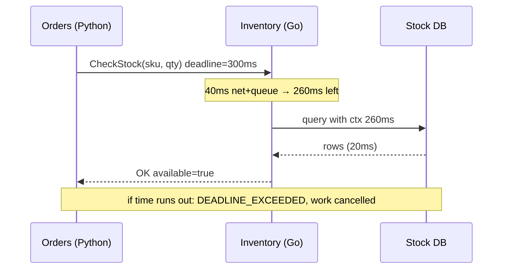
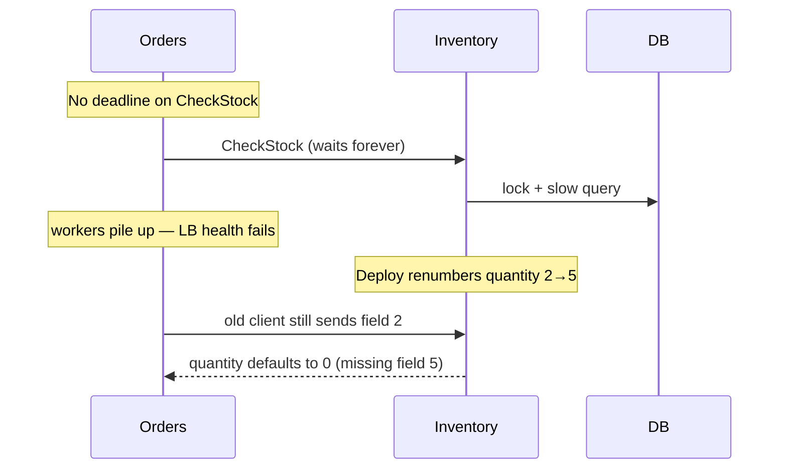

# Lesson 03: gRPC & Protocol Buffers — .proto, HTTP/2, Deadlines & Evolution

> **Prerequisites:** [Lesson 02: GraphQL for System Design](../02-graphql-for-system-design/README.md) and [HTTP/2 multiplexing](../../02-networking-from-zero/23-http-1-1-vs-http-2-vs-http-3/README.md).  
> **Estimated Reading Time:** 32 minutes  
> **Target Audience:** Backend engineers building internal microservice APIs with strict contracts, streaming, and deadline propagation.  
> **Free PDF Notes:** [Download SD-C-003.pdf](https://backendroadmap.com/notes/system-design/SD-C-003.pdf)

> [!NOTE]
> **In one line:** gRPC lets services call each other through code generated from one `.proto` contract, sending compact binary protobuf over HTTP/2 with deadlines and standard status codes; field numbers—not names—are the identity you must never break.

> [!TIP]
> **The Golden Rule of gRPC:** Every call carries a **deadline** that propagates; every schema change is additive with **new field numbers**; never reuse a number—`reserved` deleted ones. Prefer **gRPC inside, REST outside**.

---

## Words You'll Meet Today

| Word | In Plain Words | Role in a Live System |
| :--- | :--- | :--- |
| **`.proto` / IDL** | Single contract for messages + RPCs. | Build-time source of truth across languages. |
| **`protoc`** | Compiler that generates stubs. | No hand-written serializers. |
| **Field number** | Wire identity of a field. | Renaming is safe; renumbering is silent breakage. |
| **Varint** | Variable-length integer encoding. | Small ints cost 1 byte. |
| **Deadline** | Absolute time the caller will wait. | Cancels whole fan-out when exceeded. |
| **Unary / streaming** | 1:1 or stream shapes. | Watch stock, batch upload, bi-di sync. |
| **`reserved`** | Blocks reuse of deleted numbers/names. | Prevents zombie field collisions. |
| **gRPC-Web** | Browser variant via proxy. | Envoy translates to native gRPC. |

---

## Core Definition & Taxonomic Comparison

**gRPC is an RPC framework** that uses Protocol Buffers over HTTP/2 (commonly), generating typed clients/servers from `.proto` files. **What it is not:** a browser-native public API without a proxy, or a free pass to skip deadlines.

| Term | Precise Meaning | Production Example |
| :--- | :--- | :--- |
| **gRPC** vs **JSON REST** | Binary protobuf + generated stubs + HTTP/2 streams vs text resources. | Inventory `CheckStock` at 20k QPS vs partner `GET /v1/products`. |
| **Field number** vs **field name** | Wire tag is the number; name is for code only. | Rename `quantity`→`qty` keeping `=2` is safe on the wire. |
| **Deadline** vs **timeout** | Absolute instant vs relative duration; deadlines propagate remaining time. | Orders sets $300\,\text{ms}$; inventory sees $260\,\text{ms}$ left. |
| **gRPC** vs **gRPC-Web** | Native HTTP/2 + trailers vs browser-safe subset via proxy. | Mobile BFF → services native; SPA → Envoy → services. |

---

## Component Anatomy & The Observability Gap

```text
 inventory.proto ──protoc──► Go server stub + Python client stub
         │
         ▼
 Orders (Python) ──HTTP/2 multiplexed streams──► Inventory (Go) ──ctx deadline──► DB
         │                                              │
         └── status: OK | NOT_FOUND | DEADLINE_EXCEEDED | UNAVAILABLE
```

| Vantage Point | Captures | Hides |
| :--- | :--- | :--- |
| **Client stub metrics** | RPC latency, status codes, retries. | Whether deadline was already nearly exhausted on arrival. |
| **Server interceptor** | Handler time, status, message sizes. | Time spent in upstream queue before handler start. |
| **HTTP/2 / proxy** | Stream resets, GOAWAY, connection reuse. | Protobuf field-level decode errors (often appear as OK+defaults). |
| **DB** | Query time under remaining ctx. | Calls cancelled mid-flight still counted as app errors upstream. |

---

## Mathematical Model: Size, Multiplexing & Deadlines

### 1. Payload Size (PDF worked example)

JSON `{"sku":"A-1001","quantity":3}` ≈ **29 bytes** (field names repeated).  
Protobuf: tag `0x0A` + len + `A-1001` + tag `0x10` + varint `3` ≈ **10 bytes** (~$3\times$ smaller).

$$\text{Bandwidth saved} \approx \lambda \cdot (S_{\text{JSON}} - S_{\text{pb}})$$

At $\lambda = 20{,}000$ msg/s and $19$ bytes saved: $\sim 380\,\text{KB/s}$ continuous—plus CPU from skipping text parse.

### 2. HTTP/2 Multiplexing vs Connection-per-Call

Cold TCP+TLS setup $\approx 2$–$3$ RTTs. With one long-lived channel and $M$ concurrent streams:

$$\text{setup amortized} \approx \frac{C_{\text{handshake}}}{N_{\text{calls on channel}}}$$

| Pattern | Connections for 1,000 RPCs | Typical extra latency |
| :--- | :--- | :--- |
| New channel per call | 1,000 | +handshake each |
| Shared channel | 1–few | near zero setup |

### 3. Deadline Propagation

Caller budget $D$; time already spent $t$:

$$D_{\text{remaining}} = D - t$$

If $D_{\text{remaining}} \le 0$ → fail fast with `DEADLINE_EXCEEDED` (don’t start DB work).

| Hop | Budget left | Action |
| :--- | :--- | :--- |
| Orders → Inventory | $300\,\text{ms}$ | Set RPC deadline |
| After $40\,\text{ms}$ net/queue | $260\,\text{ms}$ | Pass ctx to DB |
| DB returns in $20\,\text{ms}$ | OK | Return `available` |
| If DB would need $400\,\text{ms}$ | cancel | `DEADLINE_EXCEEDED` |

### 4. Saturation Without Deadlines

Threads/workers blocked on stuck deps:

$$W_{\text{blocked}} \approx \lambda \cdot T_{\text{stuck}}$$

At $\lambda=500$/s and $T=2\,\text{s}$ stuck calls: $1{,}000$ workers tied up—cascade outage.

---

## Metrics, Percentiles & Distributions

| Metric | Healthy signal |
| :--- | :--- |
| `grpc.client.deadline_exceeded` rate | Spike ⇒ budget too tight or dep slow |
| $p_{99}$ vs deadline | Keep $p_{99} \ll D$ (e.g. $p_{99}<0.5D$) |
| Message size p99 | Catch accidental large streams |
| `UNAVAILABLE` with retry | Transient; use backoff+jitter |

---

## Compounding Effects

Fan-out of $N$ parallel gRPC calls with independent $p_{99}$ success under shared deadline:

$$P(\text{all succeed}) = \prod p_i \approx p^{N}$$

Hedging/early cancel when parent deadline fires prevents $N$ useless continuations.

---

## Numbers Every Backend Engineer Must Know

| Item | Typical | Implication |
| :--- | :--- | :--- |
| Protobuf vs JSON size | $2$–$5\times$ smaller | High-QPS internals |
| Intra-DC RPC | $0.5$–$3\,\text{ms}$ | OK to fan out |
| Default trap | no deadline | Thread exhaustion |
| Safe evolution | add fields | never renumber |
| Missing proto3 field | $0$, `""`, `false` | ≠ “explicitly set” |

---

## Protocol Deep Dive

Four call types:

| Type | Shape | Example |
| :--- | :--- | :--- |
| Unary | 1 req → 1 resp | `CheckStock` |
| Server streaming | 1 req → stream | watch stock |
| Client streaming | stream → 1 resp | batch counts |
| Bidirectional | both stream | warehouse sync |



**Schema evolution:**

```protobuf
message CheckStockRequest {
  reserved 3; reserved "warehouse"; // removed — never reuse
  string sku = 1;
  int32 quantity = 2;
  string region = 4; // new; old servers ignore
}
```

---

## Hierarchical Budgets

End-to-end checkout budget $800\,\text{ms}$:

| Tier | Budget |
| :--- | :--- |
| API gateway / BFF | $50\,\text{ms}$ |
| Orders logic | $100\,\text{ms}$ |
| Inventory CheckStock | $300\,\text{ms}$ |
| Payments auth hold | $300\,\text{ms}$ |
| Headroom | $50\,\text{ms}$ |

Each outbound gRPC deadline = remaining budget − safety margin ($10$–$20\,\text{ms}$).

---

## Top Engineering Mitigation Techniques

1. Deadlines on **every** outbound call; propagate `context`.
2. Reuse channels/pools (HTTP/2 multiplexing).
3. Additive schema changes + `reserved` for removals.
4. Use `optional`/wrappers when zero must differ from unset.
5. gRPC inside, REST/gRPC-Web at the edge.
6. Standard statuses: retry `UNAVAILABLE` with backoff; don’t retry `INVALID_ARGUMENT`.

---

## Production War Story: No Deadlines + Renumbered Field

- **Severity:** SEV-1
- **Impact:** Checkout thread pool exhausted in 6 minutes; silent inventory corruption for clients still on old binaries after a field renumber



### Fix

- Enforce deadline interceptor (default $300$–$500\,\text{ms}$ for stock).
- Buf/breaking-change CI: fail on number/type changes.
- `reserved` on removals; integration tests for default/zero semantics.

---

## Multi-Language Production Implementation

````carousel
```go
package inventory

import (
	"context"
	"time"
)

type StockRepo interface {
	Stock(ctx context.Context, sku string) (int32, error)
}

type Server struct{ DB StockRepo }

func (s *Server) CheckStock(ctx context.Context, sku string, qty int32) (bool, int32, error) {
	// Honor caller deadline; fail fast if almost gone
	if dl, ok := ctx.Deadline(); ok && time.Until(dl) < 5*time.Millisecond {
		return false, 0, context.DeadlineExceeded
	}
	n, err := s.DB.Stock(ctx, sku)
	if err != nil {
		return false, 0, err
	}
	return n >= qty, n, nil
}
```

<!-- slide -->

```typescript
export async function checkStock(
  stub: { checkStock: (req: { sku: string; quantity: number }, meta: { deadline: Date }) => Promise<{ available: boolean; inStock: number }> },
  sku: string,
  quantity: number,
  deadlineMs = 300
) {
  const deadline = new Date(Date.now() + deadlineMs);
  return stub.checkStock({ sku, quantity }, { deadline });
}
```

<!-- slide -->

```python
import grpc

def check_stock(stub, sku: str, quantity: int, timeout_s: float = 0.3):
    # generated: inventory_pb2 / inventory_pb2_grpc
    return stub.CheckStock(
        type("Req", (), {"sku": sku, "quantity": quantity})(),
        timeout=timeout_s,
    )


def evolve_safe_rules(old_numbers: set[int], new_field_number: int) -> None:
    if new_field_number in old_numbers:
        raise ValueError("never reuse or renumber existing field numbers")
```

<!-- slide -->

```csharp
public sealed class InventoryClient
{
    private readonly Inventory.InventoryClient _stub;

    public InventoryClient(Inventory.InventoryClient stub) => _stub = stub;

    public async Task<CheckStockReply> CheckStockAsync(
        string sku, int quantity, TimeSpan deadline, CancellationToken ct = default)
    {
        using var cts = CancellationTokenSource.CreateLinkedTokenSource(ct);
        cts.CancelAfter(deadline);
        var call = _stub.CheckStockAsync(
            new CheckStockRequest { Sku = sku, Quantity = quantity },
            cancellationToken: cts.Token);
        return await call.ResponseAsync.ConfigureAwait(false);
    }
}
```
````

---

## Hands-On CLI Verification

```bash
# List services (grpcurl) against a reflection-enabled server
grpcurl -plaintext localhost:50051 list

# Call with a tight deadline (expect DEADLINE_EXCEEDED if handler sleeps)
grpcurl -plaintext -d '{"sku":"A-1001","quantity":3}' \
  -H 'grpc-timeout: 10m' localhost:50051 inventory.v1.Inventory/CheckStock
```

Size comparison sketch:

```bash
python -c "print('json~29B vs protobuf~10B; ratio', round(29/10,1))"
```

---

## Common Mistakes to Avoid

- Calls without deadlines.
- Reusing/renumbering field numbers.
- Treating `0`/`""` as “client sent this.”
- New channel per call (lose multiplexing).
- Exposing raw gRPC to arbitrary browsers without gRPC-Web.
- Retrying non-idempotent RPCs on all status codes.

---

## Key Terms Glossary

| Term | Definition |
| :--- | :--- |
| **Protobuf** | Binary encoding defined by `.proto`. |
| **Field number** | Stable wire identity. |
| **Deadline** | Absolute cancel time, propagated. |
| **`reserved`** | Forever blocks deleted numbers/names. |
| **gRPC-Web** | Browser path via translating proxy. |

---

## Interview Practice Questions

<details>
<summary><strong>Q1. Why is protobuf smaller/faster than JSON? [BASIC]</strong></summary>

Tags use field number + wire type (often 1 byte) instead of names; varints encode small ints compactly. Example: 29 B JSON → ~10 B protobuf; no text scanning to parse.

</details>

<details>
<summary><strong>Q2. What are the four gRPC call types? [BASIC]</strong></summary>

Unary, server streaming, client streaming, bidirectional streaming.

</details>

<details>
<summary><strong>Q3. What does `protoc` generate? [BASIC]</strong></summary>

Language-specific client stubs and server interfaces from the `.proto`, so both sides share one build-time contract.

</details>

<details>
<summary><strong>Q4. Why prefer gRPC internally and REST externally? [BASIC]</strong></summary>

Inside you control both ends: binary, HTTP/2, deadlines, streaming. Outside, partners need curl/JSON/browser-friendly HTTP.

</details>

<details>
<summary><strong>Q5. How do you evolve a protobuf schema safely? [SCENARIO]</strong></summary>

Add fields with new numbers; never change/reuse numbers or types; `reserved` deleted ones; design for defaults on missing fields.

</details>

<details>
<summary><strong>Q6. Design CheckStock across Python orders and Go inventory. [SCENARIO]</strong></summary>

Shared `.proto`; generated stubs; unary RPC; $300\,\text{ms}$ deadline; propagate ctx to DB; map errors to `NOT_FOUND`/`UNAVAILABLE`.

</details>

<details>
<summary><strong>Q7. Browser app must call inventory. Options? [SCENARIO]</strong></summary>

Don’t speak native gRPC from the browser. Use gRPC-Web via Envoy, or a REST/JSON BFF that calls gRPC internally.

</details>

<details>
<summary><strong>Q8. 20k small messages/s between two services — REST or gRPC? [SCENARIO]</strong></summary>

gRPC: smaller payloads, multiplexing, generated types, deadlines. REST/JSON would waste CPU and bandwidth.

</details>

<details>
<summary><strong>Q9. Why must deadlines propagate? [TRICKY]</strong></summary>

If Orders gives up at $300\,\text{ms}$ but Inventory runs $2\,\text{s}$, that work is wasted load and holds resources. Propagation cancels the whole chain with `DEADLINE_EXCEEDED`.

</details>

<details>
<summary><strong>Q10. Renamed `quantity`→`qty` keeping number 2. Break? [TRICKY]</strong></summary>

Not on the wire—bytes carry number 2. Only code/JSON mappings using the name change. Changing the number to 5 silently breaks old clients.

</details>

<details>
<summary><strong>Q11. Missing `quantity` reads as 0 — danger? [TRICKY]</strong></summary>

You can’t tell “unset” from “explicit zero” in proto3 without `optional`/wrappers. A missing qty may authorize a free order. Validate presence explicitly.

</details>

<details>
<summary><strong>Q12. Which statuses are safe to retry? [TRICKY]</strong></summary>

Usually `UNAVAILABLE`, sometimes `DEADLINE_EXCEEDED` for idempotent reads. Never blindly retry `INVALID_ARGUMENT`, `NOT_FOUND`, or non-idempotent writes without idempotency keys.

</details>

---

## One-Page Master Cheat Sheet

```text
====================================================================================================
                 gRPC + PROTOBUF — CONTRACTS, HTTP/2, DEADLINES  —  CHEAT SHEET
====================================================================================================
CONTRACT         .proto → protoc → stubs (Go/Python/Java/C#/…)
WIRE             binary tags (field number + type) + varints     ~2–5× smaller than JSON
TRANSPORT        HTTP/2 multiplexed streams on reused channels

CALL TYPES       unary | server-stream | client-stream | bidi
DEADLINE         always set; propagate remaining time; cancel on DEADLINE_EXCEEDED

EVOLUTION        + add new numbers     X renumber/reuse/change type     reserved on deletes
DEFAULTS         missing → 0/""/false  use optional when unset ≠ zero

EDGE PATTERN     REST / gRPC-Web outside     gRPC inside microservices

ANTI-PATTERNS    X no deadlines  X channel-per-call  X renumber fields  X raw gRPC to browsers
====================================================================================================
```

---

## Free PDF notes

[SD-C-003.pdf](https://backendroadmap.com/notes/system-design/SD-C-003.pdf)

---

## Sources

- [gRPC Documentation](https://grpc.io/docs/)
- [Protocol Buffers Language Guide (proto3)](https://protobuf.dev/programming-guides/proto3/)
- [Protobuf Versioning / Reserved Fields](https://protobuf.dev/programming-guides/proto3/#reserved)

---

## Next

Next: [Lesson 04: REST vs GraphQL vs gRPC](../04-rest-vs-graphql-vs-grpc/README.md).
