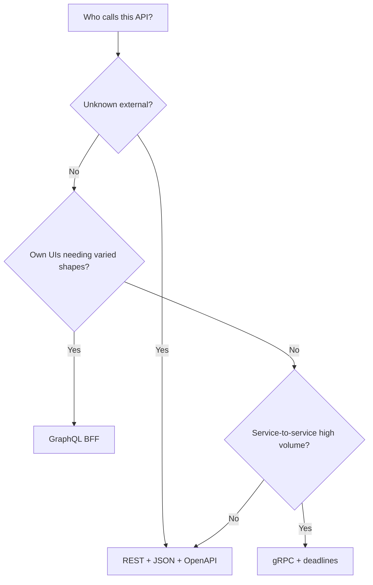
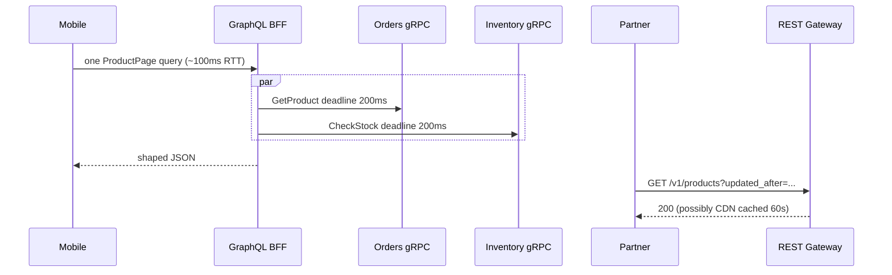
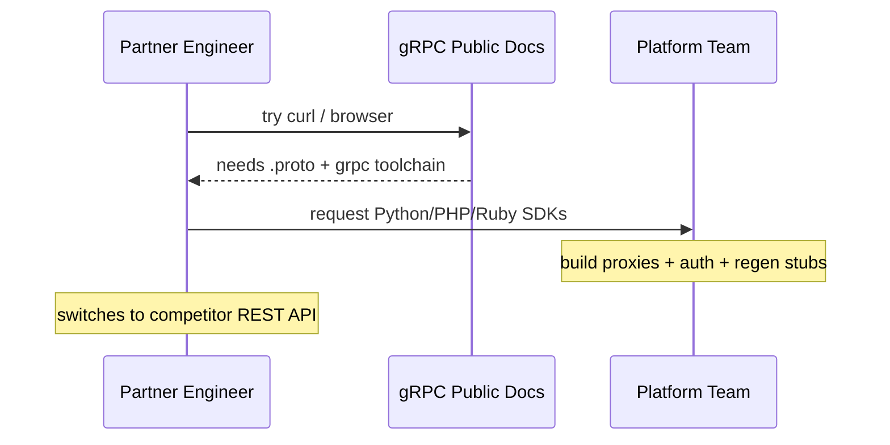

# Lesson 04: REST vs GraphQL vs gRPC — How to Choose an API Style

> **Prerequisites:** [Lesson 01: REST](../01-rest-principles/README.md), [Lesson 02: GraphQL](../02-graphql-for-system-design/README.md), [Lesson 03: gRPC](../03-grpc-protocol-buffers/README.md).  
> **Estimated Reading Time:** 30 minutes  
> **Target Audience:** Engineers and interview candidates who must pick and **defend** an API style for a concrete caller—not recite a buzzword.  
> **Free PDF Notes:** [Download SD-C-004.pdf](https://backendroadmap.com/notes/system-design/SD-C-004.pdf)

> [!NOTE]
> **In one line:** There is rarely a single winner—use REST for public/partner APIs, GraphQL as a BFF when clients need flexible aggregated views, and gRPC for fast typed calls between your own services. Most large systems run all three.

> [!TIP]
> **The Golden Rule of API Style Choice:** Start from the **caller** (unknown partners vs own UIs vs internal services), not from the technology. Match strengths to that caller; mixing styles at the right tier is a feature, not indecision.

---

## Words You'll Meet Today

| Word | In Plain Words | Role |
| :--- | :--- | :--- |
| **REST** | Resources + HTTP methods, usually JSON. | Universal public edge. |
| **GraphQL** | Client-shaped queries on a typed schema. | BFF for varied screens. |
| **gRPC** | Binary RPC from `.proto` over HTTP/2. | Internal high-QPS mesh. |
| **BFF** | Backend-for-frontend. | One API shape per client family. |
| **OpenAPI** | Standard REST contract. | Docs, codegen, gateways. |
| **API gateway** | Edge auth, limits, routing. | Where styles often meet. |

---

## Core Definition & Taxonomic Comparison

| Term | Precise Meaning | Production Example |
| :--- | :--- | :--- |
| **REST** | Resource-oriented, cacheable HTTP; loose coupling via URLs/OpenAPI. | Partner `GET /v1/products?updated_after=…`. |
| **GraphQL** | Single schema; client selects fields; server resolves. | Mobile one-query product page. |
| **gRPC** | Generated stubs, protobuf, deadlines, streaming. | Orders → Inventory `CheckStock`. |
| **“Best API”** | Myth—optimize for caller constraints. | Shop runs REST + GraphQL BFF + gRPC mesh. |

### Scorecard (rule of thumb)

| Criterion | REST | GraphQL | gRPC |
| :--- | :--- | :--- | :--- |
| Performance & payload | JSON text | Exact fields | Binary + HTTP/2 |
| HTTP caching | Built-in | Hard (POST) | Custom |
| Browser & tooling | Everywhere | Good clients | Needs gRPC-Web |
| Coupling | Loose | Shared graph | Shared `.proto` |
| Streaming | SSE/WS aside | Subscriptions | First-class |
| Team familiarity | Everyone | Some | Fewer |

---

## Component Anatomy & The Observability Gap

```text
 Partners ──REST/JSON──► API Gateway ──┐
 Mobile/Web ──GraphQL──► BFF ──────────┼── gRPC ──► Orders / Inventory / Pricing / Users
                                       └──────────►
```

| Vantage | Sees | Misses |
| :--- | :--- | :--- |
| Gateway REST metrics | Partner RPS, cache hit, 429s | Internal gRPC fan-out cost |
| GraphQL BFF | Operation cost, resolver time | Whether one field maps to 5 RPCs |
| gRPC mesh | Per-RPC p99, deadlines | Mobile user’s single RTT experience |

**Rule:** budget the **user-visible** path (cellular RTT + BFF) separately from internal RPC SLOs.

---

## Mathematical Model: One Product Page, Three Styles

### Worked example (PDF)

Mobile → GraphQL BFF over cellular ($RTT \approx 100\,\text{ms}$). BFF fans out **4 parallel gRPC** calls (product, price, stock, reviews) at $1$–$3\,\text{ms}$ each, deadline $200\,\text{ms}$. Partner nightly job: `GET /v1/products?updated_after=…` cached $60\,\text{s}$ at gateway.

$$T_{\text{mobile}} \approx RTT + \max_i(T_{\text{grpc},i}) + T_{\text{assemble}}$$

| Path | Latency sketch |
| :--- | :--- |
| 4 sequential REST from phone | $\sim 400\,\text{ms}$ network alone |
| 1 GraphQL + parallel gRPC | $\sim 100 + 3 + 5 \approx 108\,\text{ms}$ |
| Partner REST with 90% cache hit | Origin sees $0.1\times$ job QPS |

### Capacity mix

If gateway serves $10{,}000$ RPS total, $30\%$ REST partners, $50\%$ GraphQL, $20\%$ other:

| Style | RPS | Primary risk |
| :--- | :--- | :--- |
| REST | 3,000 | Cache miss storms |
| GraphQL | 5,000 | Query cost / N+1 |
| (internal gRPC) | $\gg$ client RPS | Deadline cascades |

---

## Metrics, Percentiles & Distributions

Compare styles on **user** $p_{95}$ and **dependency** $p_{99}$, not microbenchmarks alone. A “faster” gRPC that misses deadlines under fan-out loses to a slightly larger JSON REST with caching.

---

## Compounding Effects

$$P(\text{screen OK}) = P(\text{BFF OK}) \cdot \prod P(\text{RPC}_i \text{ OK within deadline})$$

Parallel gRPC helps latency but tightens the joint success probability—set deadlines and hedges accordingly.

---

## Numbers Every Backend Engineer Must Know

| Fact | Number | Use |
| :--- | :--- | :--- |
| Cellular RTT | $\sim 100\,\text{ms}$ | Collapse client hops |
| Intra-DC gRPC | $1$–$3\,\text{ms}$ | Fan-out freely |
| JSON vs protobuf | $2$–$5\times$ size | Internal QPS |
| CDN cache hit | $80$–$95\%$ | REST public reads |

---

## Protocol Deep Dive: Decision Flow





---

## Hierarchical Budgets

| Tier | Style | SLO focus |
| :--- | :--- | :--- |
| Public partners | REST | Cacheability, stable URLs, OpenAPI |
| First-party UI | GraphQL BFF | One RTT/screen, cost caps |
| Microservice mesh | gRPC | p99 ≪ deadline, stream health |

---

## Top Engineering Mitigation Techniques

1. Don’t declare one style “best.”
2. REST at the public edge by default.
3. GraphQL only where flexible aggregation pays for its complexity.
4. gRPC where you own both ends and QPS/latency matter.
5. Respect team skills—unfamiliar stacks are operational risk.
6. Observe each tier with style-appropriate metrics (cache hit vs cost points vs deadline exceeds).

---

## Production War Story: gRPC Public API for Partners

- **Severity:** SEV-2 (partner onboarding stall → revenue delay)
- **Impact:** 14 partners blocked 3 weeks waiting for language SDKs and mTLS setup



### Fix

Expose versioned REST+OpenAPI externally; keep gRPC internal; optional gRPC-Web for first-party SPAs only.

---

## Multi-Language Production Implementation

Style router sketch: pick handler by caller class.

````carousel
```go
package apistyle

type CallerKind string

const (
	Partner  CallerKind = "partner"
	FirstPartyUI CallerKind = "ui"
	Internal CallerKind = "internal"
)

func ChooseStyle(k CallerKind) string {
	switch k {
	case Partner:
		return "REST"
	case FirstPartyUI:
		return "GraphQL-BFF"
	default:
		return "gRPC"
	}
}
```

<!-- slide -->

```typescript
export type CallerKind = "partner" | "ui" | "internal";

export function chooseStyle(kind: CallerKind): "REST" | "GraphQL-BFF" | "gRPC" {
  if (kind === "partner") return "REST";
  if (kind === "ui") return "GraphQL-BFF";
  return "gRPC";
}

export function mobilePageLatencyMs(rtt: number, grpcMs: number[]): number {
  return rtt + Math.max(...grpcMs, 0) + 5; // assemble
}
```

<!-- slide -->

```python
from enum import Enum


class CallerKind(str, Enum):
    PARTNER = "partner"
    UI = "ui"
    INTERNAL = "internal"


def choose_style(kind: CallerKind) -> str:
    return {
        CallerKind.PARTNER: "REST",
        CallerKind.UI: "GraphQL-BFF",
        CallerKind.INTERNAL: "gRPC",
    }[kind]


def mobile_page_latency_ms(rtt: float, grpc_ms: list[float]) -> float:
    return rtt + max(grpc_ms or [0.0]) + 5.0
```

<!-- slide -->

```csharp
public enum CallerKind { Partner, Ui, Internal }

public static class ApiStyleChooser
{
    public static string Choose(CallerKind kind) => kind switch
    {
        CallerKind.Partner => "REST",
        CallerKind.Ui => "GraphQL-BFF",
        _ => "gRPC"
    };

    public static double MobilePageLatencyMs(double rtt, IEnumerable<double> grpcMs)
        => rtt + grpcMs.DefaultIfEmpty(0).Max() + 5;
}
```
````

---

## Hands-On CLI Verification

```bash
python -c "rtt=100; grpc=[2,3,1,2]; print('mobile~', rtt+max(grpc)+5, 'ms; sequential REST~', 4*rtt)"
```

---

## Common Mistakes to Avoid

- Declaring one style universally best.
- gRPC for unknown external partners.
- GraphQL between all microservices “for consistency.”
- Ignoring team familiarity.
- Skipping cost controls on public GraphQL.
- Forgetting CDN/`Vary` behavior when mixing versions/styles.

---

## Key Terms Glossary

| Term | Definition |
| :--- | :--- |
| **BFF** | API tailored to one client family. |
| **OpenAPI** | REST contract description. |
| **Mesh** | Internal service-to-service network (often gRPC). |

---

## Interview Practice Questions

<details>
<summary><strong>Q1. Which style for a public partner API, and why? [BASIC]</strong></summary>

REST—universal tooling, curl/Postman, cacheable, OpenAPI, easy gateway auth/rate limits.

</details>

<details>
<summary><strong>Q2. Compare REST, GraphQL, gRPC in one sentence each. [BASIC]</strong></summary>

REST: universal/cacheable but can over/under-fetch. GraphQL: exact data per screen, harder caching/cost risk. gRPC: fastest typed streaming, needs shared `.proto`, awkward in browsers.

</details>

<details>
<summary><strong>Q3. What is a BFF? [BASIC]</strong></summary>

Backend-for-frontend: an API layer shaped for a specific client (mobile/web) that aggregates downstream services.

</details>

<details>
<summary><strong>Q4. Name six comparison criteria. [BASIC]</strong></summary>

Performance/payload, caching, browser/tooling, coupling, streaming, team skills.

</details>

<details>
<summary><strong>Q5. Design APIs for partners + mobile + 30 microservices. [SCENARIO]</strong></summary>

Public REST via gateway; GraphQL BFF for mobile/web screens; gRPC with deadlines between services.

</details>

<details>
<summary><strong>Q6. Two services exchange 20k small msgs/s. Which style? [SCENARIO]</strong></summary>

gRPC—compact binary, multiplexing, typed stubs, deadlines, optional streaming.

</details>

<details>
<summary><strong>Q7. Nightly partner ETL vs interactive mobile page — same API? [SCENARIO]</strong></summary>

Usually no. ETL wants stable, cacheable REST list/export; mobile wants aggregated GraphQL/BFF. Share domain services underneath via gRPC.

</details>

<details>
<summary><strong>Q8. Startup with one web app and one DB — pick? [SCENARIO]</strong></summary>

Simple REST (or one BFF) is enough. GraphQL/gRPC complexity rarely pays until clients or services multiply.

</details>

<details>
<summary><strong>Q9. Why not GraphQL everywhere including between services? [TRICKY]</strong></summary>

Internal calls have fixed shapes; you still pay resolvers/parsing/cost limits. gRPC gives stricter contracts and lower latency.

</details>

<details>
<summary><strong>Q10. When can GraphQL be right for a public API? [TRICKY]</strong></summary>

When external devs build varied UIs over a rich graph (e.g. GitHub). Must enforce cost-based limits and node caps for untrusted queries.

</details>

<details>
<summary><strong>Q11. Is “we use gRPC so we’re modern” a good interview answer? [TRICKY]</strong></summary>

No—defend from the caller: latency, contract control, streaming needs, and edge constraints. Style without caller analysis is a red flag.

</details>

<details>
<summary><strong>Q12. How do you migrate a monolith REST API toward the three-tier model? [TRICKY]</strong></summary>

Keep external REST stable; introduce internal gRPC as you split services; add a GraphQL BFF for first-party apps without breaking partners. Strangle, don’t big-bang.

</details>

---

## One-Page Master Cheat Sheet

```text
====================================================================================================
                      REST vs GRAPHQL vs gRPC — CHOOSING  —  CHEAT SHEET
====================================================================================================
START FROM CALLER
  Unknown partners     → REST + JSON + OpenAPI + gateway
  Own UIs varied data  → GraphQL BFF (cost/depth caps)
  Internal high volume → gRPC + deadlines + .proto

COMMON ARCHITECTURE
  Partners → REST GW → ┐
  Mobile   → GQL BFF → ├── gRPC mesh (Orders, Inventory, …)
                       ┘

MOBILE MATH   T ≈ cellular_RTT + max(parallel gRPC) + assemble
              4 sequential REST ≈ 4×RTT  vs  1 GQL ≈ 1×RTT

ANTI-PATTERNS  X one style dogma  X public gRPC  X GraphQL between all services  X ignore team skill
====================================================================================================
```

---

## Free PDF notes

[SD-C-004.pdf](https://backendroadmap.com/notes/system-design/SD-C-004.pdf)

---

## Sources

- Lessons SD-C-001…003 PDF notes (Backend Roadmap)
- [GitHub GraphQL API](https://docs.github.com/en/graphql) — public GraphQL case study

---

## Next

Next: [Lesson 05: API Resource Modeling & URI Design](../05-api-resource-modeling-uri-design/README.md).
