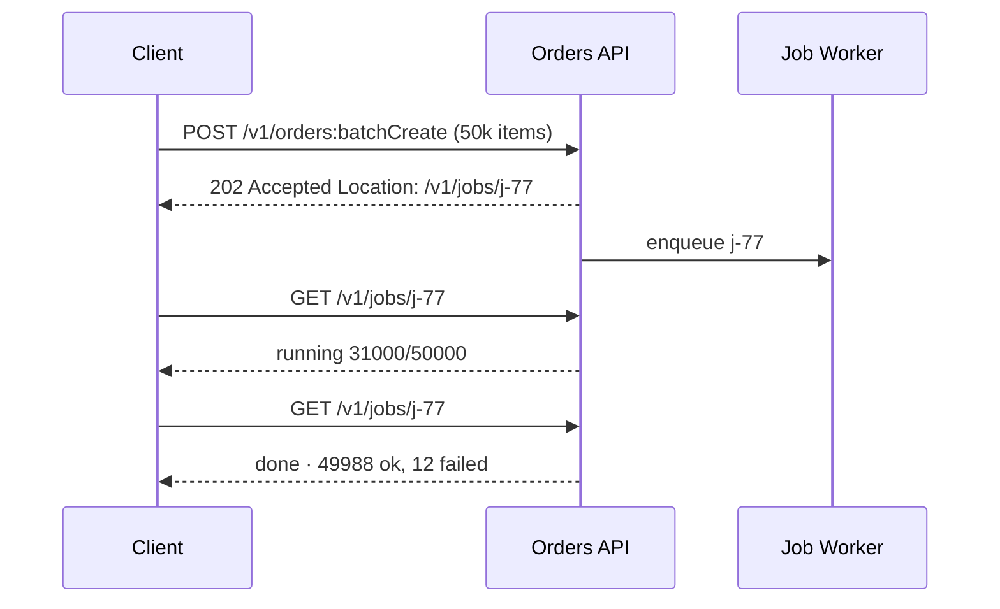
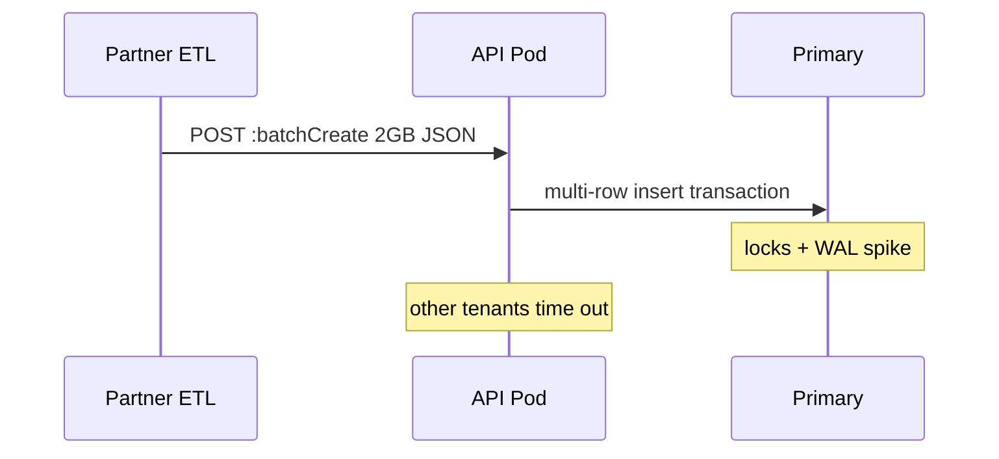

# Lesson 05: API Resource Modeling & URI Design — Nesting, Actions & Bulk

> **Prerequisites:** [Lesson 04: REST vs GraphQL vs gRPC](../04-rest-vs-graphql-vs-grpc/README.md) and [Lesson 01: REST Principles](../01-rest-principles/README.md).  
> **Estimated Reading Time:** 31 minutes  
> **Target Audience:** API designers shaping predictable public REST surfaces—collections, nesting, non-CRUD actions, and bulk imports.  
> **Free PDF Notes:** [Download SD-C-005.pdf](https://backendroadmap.com/notes/system-design/SD-C-005.pdf)

> [!NOTE]
> **In one line:** A good API is predictable: plural nouns and IDs, one level of nesting for true ownership, query parameters for filters, explicit POST actions for non-CRUD operations, and capped bulk endpoints with per-item results.

> [!TIP]
> **The Golden Rule of URI Design:** If a developer can guess the endpoint before reading the docs, you modeled it well. Nest only true ownership (one level); promote globally identified resources to top-level paths; never hide cancel/refund behind a status `PATCH`.

---

## Words You'll Meet Today

| Word | Meaning | Role |
| :--- | :--- | :--- |
| **Collection** | Plural noun path (`/orders`) | List + create |
| **Sub-resource** | Owned child (`/users/42/addresses`) | Authz scoping |
| **Global ID** | Unique alone → top-level path | `/orders/1001` |
| **Custom method** | `POST ...:cancel` | Non-CRUD intent |
| **Action resource** | `POST .../cancellations` | Auditable action |
| **Bulk endpoint** | Many items, one call | Per-item results |
| **Job resource** | Long-running work | `202` + poll |
| **`202 Accepted`** | Accepted, finishes later | Async bulk |

---

## Core Definition & Taxonomic Comparison

| Term | Precise Meaning | Example |
| :--- | :--- | :--- |
| **Sub-resource** vs **query filter** | Ownership vs attribute search | `/users/42/orders` vs `/orders?user_id=42` |
| **Custom method** vs **PATCH status** | Explicit action vs field write | `:cancel` vs `{"status":"cancelled"}` |
| **Sync bulk** vs **async job** | Inline per-item results vs `202` + `/jobs/{id}` | ≤500 items vs 50k import |
| **Deep nesting** vs **flat + filter** | Rigid chains vs guessable paths | `/users/42/orders/1001/items/7` vs `/items/7` |

---

## Component Anatomy & The Observability Gap

```text
/v1 /users /42 /shipping-addresses ?country=in&limit=20
 |    |     |           |                    |
 ver  coll  id     owned sub-coll        filter+page
```

| Vantage | Captures | Hides |
| :--- | :--- | :--- |
| Gateway route metrics | Per-path RPS, 4xx | Whether bulk item 437 failed |
| Handler logs | Action permission decisions | Partial batch success unless per-item logged |
| Job worker | Progress %, failure list | Client stopped polling |

---

## Mathematical Model: Nesting Cost & Bulk RTT

### 1. Chatty create without bulk

$$T_{\text{serial}} = N \cdot (RTT + T_{\text{server}})$$

| $N$ items | $RTT+server=50\,\text{ms}$ | Wall time |
| :--- | :--- | :--- |
| 100 | 50 ms | $5\,\text{s}$ |
| 1,000 | 50 ms | $50\,\text{s}$ |
| 10,000 | 50 ms | $\sim 8.3\,\text{min}$ |

Bulk of $500$/request → $20$ calls for $10{,}000$ items: $T \approx 20 \times 80\,\text{ms} = 1.6\,\text{s}$ (plus server work).

### 2. Authz checks in deep nests

Deep path `/users/u/orders/o/items/i/reviews/r` may re-check ownership at **4** levels:

$$C_{\text{authz}} \approx L \cdot C_{\text{check}}$$

Flattening to `/reviews/r` with a single ownership lookup cuts $L$.

### 3. Worked partial failure

Batch of 3: indices 0 and 2 succeed (`201`), index 1 → `422` unknown SKU. Client retries **only** index 1. Batch of 2,000 with cap 500 → `400` “max 500”.

---

## Metrics, Percentiles & Distributions

| Metric | Why |
| :--- | :--- |
| Bulk partial-failure rate | Bad SKUs vs platform bugs |
| Job completion time p95 | Async import SLO |
| `409` on actions | State-machine pressure |
| Path cardinality in logs | Exploding IDs → high-cardinality metrics |

---

## Compounding Effects

Unbounded bulk body size: one $1\,\text{GB}$ request can stall a worker and its DB connection pool for all tenants—blast radius ≫ one client.

---

## Numbers Every Backend Engineer Must Know

| Rule | Value |
| :--- | :--- |
| Nesting depth | ≤ 1 for ownership |
| Bulk cap | ~100–500 items |
| Page default/max | 20 / 100 |
| Large import | `202` + job poll |

---

## Protocol Deep Dive



**Cancel modeling:** prefer `POST /v1/orders/1001:cancel` or `.../cancellations` with idempotency and `409` if shipped—not `PATCH` status.

---

## Hierarchical Budgets

| Endpoint class | Latency budget | Notes |
| :--- | :--- | :--- |
| Single-resource CRUD | $p_{99} \le 100\,\text{ms}$ | Indexed PK |
| Sync bulk ≤500 | $p_{99} \le 2\,\text{s}$ | Cap + per-item |
| Async job accept | $p_{99} \le 100\,\text{ms}$ | Enqueue only |

---

## Top Engineering Mitigation Techniques

1. Plural nouns, hyphenated lowercase paths, `/v1` prefix.
2. One JSON casing everywhere.
3. Nest one level; promote global IDs.
4. Filters as query params; ownership as sub-resources.
5. Explicit POST actions for non-CRUD.
6. Bulk caps + per-item results; async jobs for huge imports.

---

## Production War Story: Unbounded Bulk Melts Primary

- **Severity:** SEV-1
- **Impact:** 14-minute write outage; pool wait $p_{99}$ → $30\,\text{s}$



### Fix

Hard body size + item cap; async path for >500; circuit-break oversized requests at gateway (`413`/`400`).

---

## Multi-Language Production Implementation

````carousel
```go
package bulk

import "fmt"

const MaxBatch = 500

type ItemResult struct {
	Index  int
	Status int
	ID     string
	Error  string
}

func BatchCreate(items []map[string]any, create func(map[string]any) (string, error)) ([]ItemResult, error) {
	if len(items) > MaxBatch {
		return nil, fmt.Errorf("400: max %d items", MaxBatch)
	}
	out := make([]ItemResult, len(items))
	for i, it := range items {
		id, err := create(it)
		if err != nil {
			out[i] = ItemResult{Index: i, Status: 422, Error: err.Error()}
			continue
		}
		out[i] = ItemResult{Index: i, Status: 201, ID: id}
	}
	return out, nil
}
```

<!-- slide -->

```typescript
export const MAX_BATCH = 500;

export type ItemResult = {
  index: number;
  status: number;
  id?: string;
  error?: string;
};

export async function batchCreate(
  items: Record<string, unknown>[],
  create: (item: Record<string, unknown>) => Promise<string>
): Promise<ItemResult[]> {
  if (items.length > MAX_BATCH) {
    throw Object.assign(new Error(`max ${MAX_BATCH} items`), { status: 400 });
  }
  const out: ItemResult[] = [];
  for (let i = 0; i < items.length; i++) {
    try {
      const id = await create(items[i]);
      out.push({ index: i, status: 201, id });
    } catch (e) {
      out.push({ index: i, status: 422, error: String(e) });
    }
  }
  return out;
}
```

<!-- slide -->

```python
MAX_BATCH = 500


def batch_create(items: list[dict], create) -> list[dict]:
    if len(items) > MAX_BATCH:
        raise ValueError(f"400: max {MAX_BATCH} items")
    results = []
    for i, item in enumerate(items):
        try:
            results.append({"index": i, "status": 201, "id": create(item)})
        except Exception as exc:  # noqa: BLE001 — map to per-item 422
            results.append({"index": i, "status": 422, "error": str(exc)})
    return results
```

<!-- slide -->

```csharp
public static class BulkCreate
{
    public const int MaxBatch = 500;
    public sealed record ItemResult(int Index, int Status, string? Id, string? Error);

    public static List<ItemResult> Run(
        IReadOnlyList<Dictionary<string, object?>> items,
        Func<Dictionary<string, object?>, string> create)
    {
        if (items.Count > MaxBatch)
            throw new ArgumentException($"400: max {MaxBatch} items");
        var list = new List<ItemResult>(items.Count);
        for (var i = 0; i < items.Count; i++)
        {
            try { list.Add(new ItemResult(i, 201, create(items[i]), null)); }
            catch (Exception ex) { list.Add(new ItemResult(i, 422, null, ex.Message)); }
        }
        return list;
    }
}
```
````

---

## Hands-On CLI Verification

```bash
curl -s -X POST https://api.example.com/v1/orders:batchCreate \
  -H "Content-Type: application/json" \
  -d '{"orders":[{},{},{}]}' | jq .
```

---

## Common Mistakes to Avoid

- Mixing `/Orders`, `/order_items`, `/shippingAddresses`.
- Nesting 3–4 levels deep.
- Cancel as `PATCH status`.
- Bulk returns one overall failure when 1/500 failed.
- Unbounded batches / body size.
- Verbs in paths for ordinary CRUD.

---

## Key Terms Glossary

| Term | Definition |
| :--- | :--- |
| **Collection / item** | `/orders` vs `/orders/1001` |
| **Action resource** | Noun for an operation (`/cancellations`) |
| **Per-item results** | Partial success reporting |

---

## Interview Practice Questions

<details>
<summary><strong>Q1. How do you design nested resource endpoints? [BASIC]</strong></summary>

Nest one level for true ownership (`/users/42/addresses`). Global IDs get top-level paths (`/orders/1001`). Filters via query params.

</details>

<details>
<summary><strong>Q2. Naming rules for predictability? [BASIC]</strong></summary>

Plural nouns + IDs, lowercase hyphenated paths, one JSON casing, `/v1` prefix.

</details>

<details>
<summary><strong>Q3. Sub-resource vs query parameter? [BASIC]</strong></summary>

If removing the parent makes the child meaningless → sub-resource. If it’s a search attribute → query param. Both can coexist with different authz.

</details>

<details>
<summary><strong>Q4. Example URI for a user’s shipping addresses? [BASIC]</strong></summary>

`GET/POST /v1/users/42/shipping-addresses` and `GET/PATCH/DELETE /v1/users/42/shipping-addresses/{id}` (or top-level if IDs are global).

</details>

<details>
<summary><strong>Q5. How do you expose cancel/refund? [SCENARIO]</strong></summary>

`POST /v1/orders/1001:cancel` or `.../cancellations`; idempotent; `409` if not cancellable.

</details>

<details>
<summary><strong>Q6. Customer imports 10,000 products. Design it. [SCENARIO]</strong></summary>

Capped `batchCreate` (500) with per-item results, or one async job `202` + `/jobs/{id}` with failure list.

</details>

<details>
<summary><strong>Q7. Admin needs cross-user order search. [SCENARIO]</strong></summary>

`GET /orders?user_id=&status=` restricted to admin scopes; keep `/users/{id}/orders` for owner-scoped access.

</details>

<details>
<summary><strong>Q8. Partner sends 2,000 items to a 500-cap bulk API. [SCENARIO]</strong></summary>

Return `400` with clear message; client splits into 4 requests (or use async job endpoint).

</details>

<details>
<summary><strong>Q9. Why not PATCH status to cancelled? [TRICKY]</strong></summary>

Cancel triggers refunds/restock/email; field updates hide side effects and let clients set illegal statuses like `shipped`.

</details>

<details>
<summary><strong>Q10. `/users/42/orders` vs `/orders?user_id=42` — both? [TRICKY]</strong></summary>

Yes. Sub-resource expresses ownership + authz; query form suits admin search. Gate the latter on permission.

</details>

<details>
<summary><strong>Q11. Why per-item results in bulk? [TRICKY]</strong></summary>

Partial failure is common; one boolean “failed” forces re-sending successes and risks duplicates. Per-item status lets clients retry only failures.

</details>

<details>
<summary><strong>Q12. When is a custom method better than an action resource? [TRICKY]</strong></summary>

Custom method (`:cancel`) is terse when you don’t need to list/audit action entities. Action resource wins when you must `GET` cancellation history (who/why).

</details>

---

## One-Page Master Cheat Sheet

```text
====================================================================================================
                 API RESOURCE MODELING & URI DESIGN  —  CHEAT SHEET
====================================================================================================
SHAPE        /v1/{collection}/{id}/{owned-collection}?filter&limit
RULES        plural nouns | hyphen-case paths | one JSON casing | nest ≤1 | global IDs top-level

ACTIONS      POST /orders/1001:cancel  OR  POST /orders/1001/cancellations
             X PATCH {status:cancelled} for money/side-effect ops

BULK         cap ~500 | per-item results | >threshold → 202 + /jobs/{id}
MATH         serial T = N*(RTT+T_s)   1000×50ms = 50s → bulk/async

ANTI-PATTERNS  X deep nests  X mixed casing  X unbounded batch  X single bulk failure bit
====================================================================================================
```

---

## Free PDF notes

[SD-C-005.pdf](https://backendroadmap.com/notes/system-design/SD-C-005.pdf)

---

## Sources

- [Google AIP-121 Resources](https://google.aip.dev/121), [AIP-136 Custom methods](https://google.aip.dev/136), [AIP-231 Batch methods](https://google.aip.dev/231)

---

## Next

Next: [Lesson 06: API Versioning Without Breaking Clients](../06-api-versioning-without-breaking-clients/README.md).
